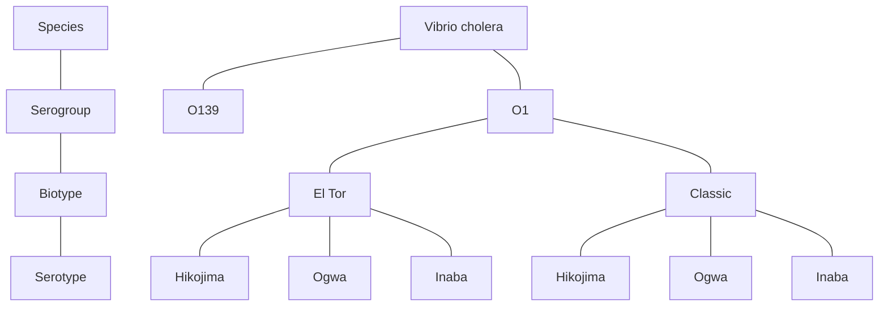
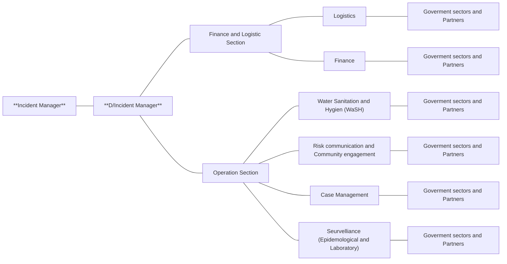
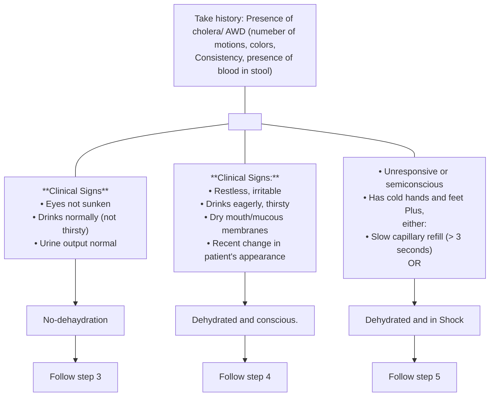
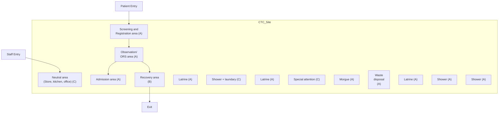
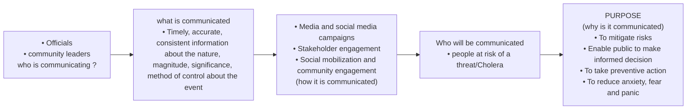
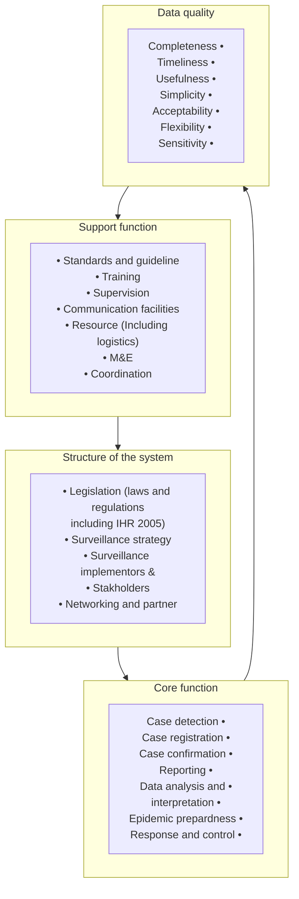

# EPHI: National Guideline for Cholera Surveillance and Outbreak Response (2022)

<!-- page 1 -->

# National Guideline for Cholera Surveillance and Outbreak Response

## 3rd Edition 2022 G.C

<!-- page 2 -->

# ACKNWOLEDGEMENTS

Ethiopian Public Health Institute (EPHI) would like to express its appreciation and gratitude to all those who are directly involved in or indirectly contributed to the preparation of this guideline.

EPHI would like to thank, all members of cholera Technical Working Group members from EPHI, MoH, ministry of Water, Regional Health Bureaus, WHO, UNCEF, CDC, and USAID for realizing the preparation of this guideline.

<!-- page 3 -->

# FOREWORD

Cholera is an acute intestinal infection caused by ingestion of food or water contaminated with the bacterium Vibrio cholera unless treated promptly it quickly leads to severe dehydration and death. In Ethiopia one confirmed case of cholera is adequate to be declared an outbreak. Therefore, health workers at all levels have to clearly understand the case definitions of this disease and manage the outbreaks in a standardized manner. If the management, including treatment of patients, infection prevention and overall outbreak containment procedures, do not follow standard procedures the effect of cholera outbreak even becomes worse.

Ethiopia is part of the global call to end cholera , The Global Task Force on Cholera Control (GTFCC) launched Ending Cholera: A Global Roadmap to 2030 an initiative that aims to reduce global cholera deaths by 90 per cent and eliminate the disease in at least 20 countries by 2030. Ethiopia is one of them.

Achieving these global objectives requires effective implementation at the country level through a multi-sectoral cholera coordination mechanism that aligns government and national actors, GTFCC partners and key stakeholders towards a shared strategy and common practices along three axes:

1. Ensuring early detection and response to contain outbreaks;

2. Adopting a multisectoral approach to prevent and control cholera in hotspots areas.

3. Establishing effective coordination mechanisms for technical support, resource mobilization and collaboration at regional, national and global levels. Multi-sectoral cholera control activities are organized around six pillars:

* Coordination;

* Surveillance

* Case management

* Oral cholera vaccine (ocv)

* Water, sanitation and hygiene (wash); and

* Community engagement.

Based on the above framework, Ethiopia has prepared and endorsed plan.

<!-- page 4 -->

## Rationale for 2nd Edition Revision

The 2nd Edition was revised in 2016, and the following points are the main reasons for revising the outbreak response guide.

* OCV was not included as one of cholera control intervention. Starting from 2019 Ethiopia is using OCV as part of cholera outbreak response, and helped in control of the disease. From 2019 to 2022 more, than 10 million OCV vaccines doses have been provided for outbreak response and conflict affected areas.

* There is a need the age limit to be included in the existing surveillance system. In line with GTFCC and WHO criteria, the age limits on case definition and criteria to set cholera alrst of suspected cases need to be revised.

* The revision expected to address the case management of acute malnutrition in a drought situations. In Ethiopia malnutrition and drought are the key challenges. In the previous outbreaks health workers raised questions on management of cholera with acute malnutrition. It also expected to address the infection prevention issues at the CTCs, safe and deigned burial of cholera corpuses.

* In the recent outbreaks we have observed response coordination remains a challenge and the guideline will introduce Incident Management function during widespread cholera outbreak responses.

* Another issue that need attention is emergencies with related to Internally Displaced Population (IDPs). In the last few years, we have been dealing with internally displaced population due to manmade and natural disaster. This document consider to address these unforeseen situation effectively and efficiently by incorporating in the existing surveillance system for the prevention and control of cholera epidemic in the conflict affected areas.

* This documement also designed to address the cross boarder coordination in case of cholera outbreaks in the nebouring nations.

* Finally, routine water quality surveillance, surveillance system evaluation guides will be annexed to improve cholera preparedness.

<!-- page 5 -->

# Contents

|Section|Page|
|-|-|
|ACKNWOLEDGEMENTS|2|
|FOREWORD|3|
|1. INTRODUCTION|1|
|2. CHOLERA DISEASE SURVEILLANCE|6|
|3. OUTBREAK INVESTIGATION|9|
|4. CHOLERA OUTBREAK RESPONSE|15|
|4.1. Leadership and Coordination|15|
|4.2. Case Management|17|
|Assessment for Level of Dehydration|19|
|Treatment of Dehydration|20|
|Malnutrition with Cholera management|23|
|Pregnant women with cholera|26|
|Cholera with other infectious disease|30|
|Identifying and Treating Complications|32|
|4.3. Cholera Treatment Centers|36|
|4.4. Water, Sanitation and Hygiene|47|
|4.5. Risk Communication and Community Engagement|57|
|4.6 Oral Cholera Vaccine|62|
|5. MONITORING AND EVALUATION|64|
|6. CHOLERA PREPAREDNESS|73|
|REFERENCE|78|
|ANNEX 1. RESPONSIBILITIES IN DETECTION AND CONTROL OF CHOLERA OUTBREAK|79|
|ANNEX 2. HEALTH FACILITY, WOREDA/REGIONAL DATA COLLECTION AND COMPILATION FORMATS|82|
|ANNEX 3. SUPPLY REQUIREMENTS LIST(CTC KIT)|87|
|ANNEX 4. HUMAN RESOURCES.|91|
|ANNEX 5: DESCRIPTION OF CHOLERA SURVEILLANCE AND RESPONSE SYSTEMS FOR MONITORING AND EVALUATION|94|
|ANNEX 6: EXPECTED ROLES AND RESPONSIBILITIES FOR CHOLERA PREPAREDNESS AND RESPONSE AT ALL LEVELS DURING NORMAL AND EMERGENCY TIMES|101|
|ANNEX 7 ESSENTIAL WATER QUALITY MEASUREMENTS|108|
|ANNEX 8: PREPARATION AND USE OF CHLORINE SOLUTIONS|109|
|ANNEX 9 REGULAR WATER QUALITY SURVEILLANCE|113|

<!-- page 6 -->

# List of Tables

|Table Title|Page|
|-|-|
|*Table1. Plan A: The amount of the oral rehydration solution that should be given to a patient for two days.*|20|
|*Table 2. Plan B: The amount of oral rehydration solution that should be given to a patient during the first 4 hours.*|21|
|*Table 3. Plan C: The amount of fluid required to rehydrate severely dehydrated patients*|22|
|*Table 5.1 Summary of criteria for selecting a cholera treatment Center*|37|
|*Table 5.6.1: Critical times for hand-washing*|41|
|*Table 1 - Conditions for effective chlorination against Vibrio cholerae*|49|
|*Table 2: Essential WASH kits for distribution*|50|
|*Table 3. Critical times when hand washing should be performed:*|53|
|*Table 9. Summary of indicators and their interpretation in a CTC and higher levels (woreda, region, etc.)*|68|
|*Table 10. Estimate of resource needs basedon expected caseload*|75|
|*Table : Sample ‘excel’ worksheet to estimate required supplies*|77|
|*Table\_\_\_ : Preparation of desired concentration of chlorine solution from commonly available chlorine sources*|111|

<!-- page 7 -->

# List of Figures

|Figure Description|Page Number|
|-|-|
|Figure 1: Genotype classification of Vibrio cholera.|1|
|Figure 2:- Coordination framework (Incident Management System \_ IMS) for sectors for Cholera outbreak during outbreak response times|16|
|Figure 5.1. Diagrammatical representation of CTC site|39|
|Figure \_\_ : - Components of Cholera surveillance and response systems targeted for M & E|71|

<!-- page 8 (printed 1) -->

## 1. INTRODUCTION

**C**holera is an acute watery diarrheal disease caused by infection of the intestine with the gram-negative bacteria Vibrio cholerae, either type O1 or O139. Both children and adults can be infected. It is one of the key indicators of social development and remains a challenge to countries where access to safe drinking water and adequate sanitation cannot be guaranteed.

### Etiology

There are over 100 vibrio species known but only the "cholerae" species are responsible for cholera epidemics. Vibrio cholerae species are divided into 2 serogroups:

* Vibrio cholerae O1, subdivided into Classical and El Tor biotypes.

* Vibrio cholerae O139 serogroup which was first identified in 1992 in India. It has since been isolated in other Asian countries between 1993 and 1998.

Both El Tor and Classic biotypes are divided into 3 serotypes: Ogawa, Inaba and Hikojima (*see Figure 1*). The three serotypes can co-exist during an epidemic because the bacteria can mutate between serotypes. Nevertheless, this does not affect the epidemic pattern, similarity of clinical features, strains and modes of response.

Figure 1: Genotype classification of Vibrio cholera.

<!-- page 9 (printed 2) -->

Vibrios grow easily in saline water and alkaline media. They survive at low temperatures but do not survive in acid media. They could be destroyed by gastric acid in the stomach, by chlorine disinfectant solutions or boiling at least for one minute.

### Mode of Transmission

Cholera is transmitted by the fecal-oral route. A dose of more than one million organisms is usually needed to cause illness. Cholera is transmitted almost exclusively by contaminated water or food. Transmission by contact, such as touching patients is rare.

Water may be contaminated at its source. Surface water and water from shallow wells are common sources of infection. Vibrio cholerae can live for years in certain aquatic environments. Water is frequently contaminated at home when inadequately washed hands come in contact with stored water. Bathing or washing cooking utensils in contaminated water can also transmit cholera.

Moist grains, such as rice, millet, or sorghum, when served at room temperature or lightly warmed, are common vehicles for cholera transmission. Moist foods lightly contaminated

after cooking and allowed to remain at room temperature for several hours, provide an excellent environment for the growth of Vibrio cholerae. Other foods which can transmit cholera include raw or undercooked seafood, particularly shellfish, raw fruits and vegetables.

Corpses of cholera patients are highly infectious through their excreta. Physical contact during funerals is also a major medium. Cholera treatment centers can become main sources of contamination if hygiene and isolation measures are insufficient. Acidifying foods with lemons, tomatoes, yogurt, or fermented milk helps to inhibit Vibrio cholerae growth.

### Reservoir

Humans are the main reservoir of Vibrio cholerae. Asymptomatic carriers and patients carry huge quantities of vibrio in feces and in vomit. Up to 100,000,000 bacteria can be found in 1ml of cholera liquid - feces/vomits. Other potential reservoirs are water, some molluscs, fish, and aquatic plants. The infective dose depends upon individual susceptibility, but in general a 1,000,000 dose is needed to cause the illness.

**Below are summary of cholera transmission by a fecal-oral route**

* Drinking-water that has been contaminated at its source (e.g. by fecally contaminated surface water entering an incompletely sealed well), during transport and/or supply, or during storage (e.g. by contact with hands soiled by feces).

* Ice made from contaminated water.

* Cooking utensils washed in contaminated water.

* Food contaminated during or after preparation. Moist foods (e.g. milk, cooked rice, lentils, potatoes, beans, eggs, and chicken), contaminated during or after cooking/preparation and allowed to remain at room temperature for several hours, provide an excellent environment for the growth of V. cholerae.

<!-- page 10 (printed 3) -->

* Seafood, particularly crustaceans and other shellfish, taken from contaminated water and eaten raw or insufficiently cooked or contaminated during preparation.

* Fruit and vegetables grown at or near ground level and fertilized with night soil (human excreta), irrigated with water containing human waste, or "freshened" with contaminated water, and then eaten raw, or contaminated during washing and preparation.

* Corpses of cholera patients are highly infectious through their excreta. Physical contact during funerals is also a major medium. If possible funeral should be held within hours of death and corps should be enclosed in plastic bag to prevent spread of *V. cholerae*.

* Cholera treatment centers can become main sources of infection and Contamination if hygiene and isolation measures are insufficient.

## Risk Factors

* Poor social and economic environment, precarious (risky) living conditions associated with:

    - Insufficient water supply (quantity and quality)

    - Inappropriate and poor sanitation and hygiene practices

    - Inadequate food and safety - this includes cultural influences on food preparation and storage at home, poor food safety during preparation and storage, inadequate/lack of food safety in markets and restaurants and by street vendors. During outbreak peel it, cook it or leave it.

* High population density: camps, slum populations, internally displaced people (IDP) are highly vulnerable.

* Conflict/War affected areas (due to distraction of WASH infrastructures, poor food safety) are very high risk for cholera outbreak/Epidemic

* Underlying diseases such as malnutrition, chronic diseases and AIDS are thought to increase susceptibility to cholera, but this has not been proven.

* Unimmunized people

<!-- page 11 (printed 4) -->

* **Environmental and seasonal factors:** Cholera epidemics often start at the end of the dry season or at the beginning of the rainy season, when water sources are limited. This pushes people to accumulate at the fewer water sources available and increasing risks of contamination and transmission. Furthermore, the salinity can increase during the dry season and favors the growth of vibrio. Heavy rains can also provoke the emergence of cholera: flooding of contaminated water from sewage systems, latrines or septic tanks may contaminate wells or other water sources and thereby increase the concentration of organic nutrients in the water.

In brief, the risk factors for Cholera are:

* Overcrowding (internally displaced people, refugee, camps, population gatherings, etc.)

* Inadequate quantity and/or quality of water

* Inadequate personal hygiene

* Poor washing facilities

* Inappropriate or poor sanitation

* Inadequate food safety

* Inappropriate funeral services for cholera victims

## Clinical Features

### Pathogenesis

The large majority of ingested bacteria are destroyed by stomach acidity. Surviving bacteria colonize intestinal cells, where they multiply and produce a very powerful enterotoxin that causes profuse watery diarrhea by a secretion mechanism. In general vibrio does not cross the intestinal barrier and does not provoke septicemia. The toxin adheres to intestinal cells and causes an excretion of isotonic fluid in the intestinal lumen: it is the enterotoxin that causes fluid loss and diarrhea.

### Incubation Period and Period of Infectivity

The incubation period is usually 1 to 3 days but can range from several hours to 5 days. Symptoms usually last 2 to 3days, although in some patients they can continue up to 5 days. Infected persons whether they are symptomatic or not, can carry and transmit vibrios during 1 to 4 weeks; a small number of individuals can remain healthy carriers for several months. Antibiotic therapy can decrease the duration of symptoms and the period of infectivity.

<!-- page 12 (printed 5) -->

## Signs and Symptoms

* In general cholera is an acute enteric disease characterized by the sudden onset of profuse painless watery diarrhea or rice-water like diarrhea, often accompanied by vomiting, which can rapidly lead to severe dehydration and cardiovascular collapse.

* Approximately 80% of people infected with cholera do not symptoms of the cholera disease; these individuals can still transmit the disease by shedding *V. cholerae* bacteria in the environment. Bacteria are present in their faeces for up to 14 days after infection.

* Among symptomatic patients, approximately 20% will develop profuse watery diarrhoea that leads to severe dehydration and death if not treated. If these patients are not promptly and adequately treated, the loss of such large amounts of fluid and salts (more than 10-20 liters/day in severe forms) can lead to severe dehydration and death within hours.

* The case-fatality rate in untreated cases may reach 30–50% if there is not prompt treatment. Treatment is straightforward (basically rehydration) and, if treatment is applied appropriately the case-fatality rate can be minimized to below 1%.

* The stool of cholera patients typically becomes a clear liquid flecked with white mucus, known as “rice-water” stool. It is usually odorless or has a mild fishy smell.

* Other symptoms include painful leg cramp. For severe cases, patients may have cramps in the stomach, arms, or legs.

* Severely ill cholera patients can lose up to 10% of their body weight in diarrhea and vomitus. In extreme cases, fluid losses can reach up to 1 liter per hour during the first 24 hours of illness. Patients who are severely dehydrated may develop hypovolemic shock. Such patients have a low blood pressure and a weak or absent radial pulse. They may appear drowsy or be unconscious. These patients must be rehydrated rapidly using intravenous fluids in order to prevent kidney failure or death.

*The typical presentation of cholera is a sudden onset of profuse painless watery stools, sometimes rice-water like, often accompanied by vomiting. There is no fever. Dehydration appears within 12 to 24 hours.*

<!-- page 13 (printed 6) -->

## 2. CHOLERA DISEASE SURVEILLANCE

In Ethiopia, cholera is one of the immediately notifiable disease. All suspected cases of cholera must be reported immediately within 30 minutes of identification or notification to the appropriate authority. Therefore, continuous surveillance of the disease should be carried out year round, at all levels.

Cholera Surveillance is the ongoing systematic identification, collection, analysis and interpretation of cholera disease occurrence, for the purposes of taking timely and robust action. And it is important to improve the detection capacity of the surveillance system by involving all stakeholders (health facilities, private clinics, traditional healers, etc.) that deliver health services within the country’s health system in the notification process.

In Ethiopia, cholera surveillance is a part of an integrated disease surveillance system that includes feedback at the local level and information-sharing at the global level. An effective surveillance system helps public health personnel to detect outbreaks of cholera early, describe its extent of the distribution and then for prevention control and elimination.

Currently, there are different types of cholera disease surveillance approaches which have a common goal of preventing and controlling cholera outbreaks. These approaches are indicator based surveillance (IBS), event based surveillance (EBS), Community Based Surveillance (CBS) and Environmental Surveillance (ES) (Refer Ethiopian PHEM guideline).1

### Cholera disease surveillance during emergencies and Cross-border

Cholera Surveillance is especially critical during times of emergencies such as epidemics, natural disasters, famines, and conflicts. Cholera surveillance in the context of disasters or other urgent situations may depend on enhancements to routine surveillance systems not specifically designed to serve emergency preparedness and response activities. The principles of cholera surveillance in a humanitarian setting are keeping it simple, standardize and enhanced with active case searching

Under the International Health Regulations, notification of all cases of cholera is no longer mandatory. However, public health events involving cholera must always be assessed against the criteria provided in the regulations to determine whether there is a need for official notification.

Strong cross-border surveillance between countries in international level and between regions, zones and woreda in national level is a critical component to achieving cholera control and elimination. If cholera occurs near cross-borders, authorities have to establish cross-border coordination and communication. During response, it is important to work closely with neighboring districts to ensure that the outbreak does not spill to another district. It is important to share information and plan for joint surveillance. Initiating the establishment of the cross-border cholera disease surveillance and response committees is imperative to provide a platform for sharing surveillance data, epidemiological and other related information during the outbreak.

1 Ethiopian public health emergency management guideline 2022

<!-- page 14 (printed 7) -->

## Detection and Diagnosis

Cholera cases are detected based on clinical suspicion in patients who present with severe acute watery diarrhea. The suspicion is then diagnosed by identifying *V. cholerae* in stool samples from affected patients. Based on the following case definition, a health worker should suspect diagnosed cholera upon encountering a single case of profuse, acute, watery diarrhea.

|Cholera cases definitions Community case definition|Cholera cases definitions Standard case definition|
|-|-|
|*Suspected cholera case*  If any person of 2 years age or more with profuse acute watery diarrhea and vomiting.|*Suspected cholera case*  Outbreak not declared: any person aged 2 years or more presenting with acute watery diarrhea and severe dehydration or dying from acute watery diarrhea.  Outbreak declared: any person aged 2 years or more presenting with or dying from acute watery diarrhea.  *Confirmed cholera case*  A suspected case in which Vibrio cholera O1 or O139 has been isolated from their stool|

Cholera can be endemic or epidemic. A cholera-endemic area is an area where confirmed cholera cases were detected during the last 3 years with evidence of local transmission (meaning the cases are not imported from elsewhere). A cholera outbreak/epidemic can occur in both endemic countries and in countries where cholera does not regularly occur. In cholera endemic countries an outbreak can be seasonal or sporadic and represents a greater than expected number of cases and cholera alert (suspected cholera outbreak) is defined by the finding of at least one of the following

Two or more people aged 2 years or older with acute watery diarrhea and severe dehydration, or dying from acute watery diarrhea, from the same area within 1 week of one another;

B) One case of acute watery diarrhea testing positive for cholera by rapid diagnostic test (RDT) in an area (including areas at risk for extension from a current outbreak) that has not yet detected a confirmed case of cholera.

Therefore, the case must be reported to the surveillance focal point or person in charge immediately (within 30 minutes) for further investigation.

<!-- page 15 (printed 8) -->

## Laboratory testing

When a cholera alert is detected in a specific area, stool samples from patients should be collected and tested for laboratory confirmation and diagnosis of the disease. The following different testing modalities will be applied in different level of outbreak and health facility.

**Rapid diagnostic tests (RDT):** used at PHC level for the purpose screening. RDTs can improve the reliability of cholera alerts by permitting the triage of specimens while waiting for culture or PCR confirmation. If the RDT is negative, cholera can be ruled out if specimens are collected in receptacles containing chlorine residues, after initiating antibiotic therapy and in case of poor sampling or handling practices of the specimen (e.g. long delay)

**Culture or PCR test:** based on availability this test used for confirming the occurrence and declare the outbreak by Isolating genotype/serotype/biotype of the cholera disease.

**Isolation of Vibrio cholerae in environmental samples:** All water and food specimens should be collected in sterile containers and transported to the laboratory for isolation. Selection of the isolation method should depend on the type of water sample to be cultured (sewage waters, marine, estuarine, lakes, rivers, streams, wells, etc.)

and Foods (milk, cooked rice, lentils, potatoes, kidney beans, eggs, chicken, and vegetables)2

When cholera outbreak is suspected at least 5-10 stool specimens ideally fresh liquid stools or rectal swabs should be collected in the first four days of illness and before antibiotic administration. After cholera outbreak declared the number of samples collected and tested depends on the laboratory capacity and the extent and magnitude of the outbreak. Ideally, a minimum of 5 samples from suspected cases and, when available, pre-selected by a positive RDT per week per health facility should be sent for laboratory confirmation and antimicrobial susceptibility testing.

When the number of suspected cases in the epidemic area significantly declines and all samples from all cholera cases test negative by RDT, culture or PCR for a minimum period of two weeks, the outbreak can be considered ended3, 4

2 [https://www.cdc.gov/cholera/pdf/laboratory-methods-for-the-diagnosis-of-vibrio-cholerae](https://www.cdc.gov/cholera/pdf/laboratory-methods-for-the-diagnosis-of-vibrio-cholerae)

3 GTFCC, Interim technical note on the use of Cholera Rapid Diagnostic Tests, November 2016 available at: [http://www.who.int/cholera/task_force/Interimguidance-cholera RDT.pdf?ua=1](http://www.who.int/cholera/task_force/Interimguidance-cholera%20RDT.pdf?ua=1)

4 Kanungo, S. et al. (2022) ‘Cholera’, The Lancet, 399(10333), pp. 1429–1440. doi: [10.1016/S0140-6736(22)00330-0](https://doi.org/10.1016/S0140-6736(22)00330-0).

<!-- page 16 (printed 9) -->

## 3. OUTBREAK INVESTIGATION

Cholera outbreak investigation is a method for identifying and evaluating people who have been exposed to the disease by establishing and verifying the existence of an outbreak, collect information and laboratory specimens for confirming the diagnosis. The investigation provides relevant information for taking immediate action and improving long-term disease prevention activities.

**Steps of Outbreak Investigation:**

**a. Prepare for Field Work**

Upon receipt of a suspected outbreak, activate the multidisciplinary outbreak investigation team (rapid response team) and initiate outbreak investigation within 3 hours. Training should be given before the deployment of the team. The RRT may consist of clinician, lab technician, epidemiologist, RCC expert and environmental health expert.

Rapid Need Assessment (RNA) should be conducted before conducting the field work. RNA uses in the identification of priority problems, needs, risks and gaps to conduct the risk assessmen. RNA should identify the local capacity to respond to an outbreak, by reviewing case management protocols, assess local human and material resources for treatment of cases and assess ability to implement / cooperate with control measures.

Begin the investigation in the most affected places and before departure to the field. The team needs to secure relevant supplies such as required formats, guidelines, etc. Supplies if not certainly available on site, laboratory equipment needed to take samples, communication equipment and data analysis

tools laptop or tablets, etc.

**b. Conduct Field Assessment**

The main objective of field assessment is to establish and verify the existence of the cholera suspected outbreak in the reported areas. During field assessment review trends in cases and deaths due to the disease over the last 1-5 years (if available) and determine a baseline number to describe the current extent of the disease in the catchment area and then based on the finding, decide whether the outbreak exists or not. Finally, the investigation results should be reported to decision makers for further action and follow-up surveillance visit should be conducted. The team should do the following activities at the health facility and community levels:

<!-- page 17 (printed 10) -->

**At the health facility level**

* Collect the names and identifying information for

* Patients meeting the case definition and treated for acute, watery diarrhea;

**ensure all ill persons are treated**

* Ask staff to describe the illness and their treatment protocols; review patient management

* Take an inventory of local supplies.

* replace specimen collection kits at the health facility

* in a remote area leave a small supply of Oral Rehydration Salt (ORS) with the community health worker

**In the community level**

* Interview patients and their families regarding identifying information, risk factor information, and ill contacts;

* Collect up to 5-10 rectal swabs (if health facility has not already done so).

**Analyze information:**

* Create a line listing, map location of cases, and graph the number of cases by date of onset of illness, identify clustering of cases;

* Determine the number of cases and deaths, attack rate, case fatality rate, potential high risk groups and sources of infection, and whether the outbreak is increasing

* Establish method to provide treatment if community is in a remote area

### c. Verify the Diagnosis

Several organisms, including some serogroups of *V. cholerae*, can produce an acute, dehydrating diarrheal illness which is clinically impossible to differentiate from cholera. These organisms can occasionally cause a number of illnesses within a community, but only cholerae O1 and O139 are capable of causing widespread outbreak disease.

Ideally, samples should be taken from patients within 5 days of onset of their illness (when *Vibrio cholerae* organisms are still being excreted in the stool). Do not delay treatment of dehydrated patients to collect samples, before antibiotic therapy has begun. To confirm the presence of *V. cholerae*, it is important that laboratory tests are done.

Confirmation of 5 to 10 stool or vomit samples is sufficient per outbreak/woreda. The confirmation of the samples will be done at regional reference laboratories as well as at the National laboratory of Ethiopian Public Health Institute.

The samples should be transported using Cary-Blair Medium, Peptonic Water and Hyper salted liquid medium. If Cary-Blair transport medium is not available, and the sample can reach a laboratory within 2 hours, liquid stool can be placed in a sterile screw-cap bottle and transported immediately to a laboratory. Alternatively, strips of blotting paper can be soaked with liquid stool. These strips should be placed in carefully sealed plastic bags to prevent drying. If possible, put the plastic bags in a refrigerated box for transport.

<!-- page 18 (printed 11) -->

**Note** *that if the laboratory does not identify an organism in the first set of samples and suspected cases are still occurring, further samples should be collected until the laboratory identifies a causative organism. Afterwards, patient samples need not be collected unless the outbreak continues for several months. In a prolonged outbreak, collection of a few samples every 3-6 months should be considered in order to identify any changes in the antibiotic resistance pattern of local V. cholerae strains.*

### d. Define and Identify Additional Cases

Once the initial cases have been confirmed and treatment has begun, actively search for additional cases and deaths and also contacts by establishing a case definition. Record information about additional cases on a case-based reporting forms for at least the first five patients. If any additional cases record on a line list when more than five to ten cases have been identified, the required number of laboratory specimens have been collected.

For potential risk factors record them in the investigation line listing; ask about

* Recent travel history

* Contact with other persons ill with diarrhea

* Recent attendance at a funeral (and the cause of death of deceased)

* Water sources for drinking, bathing, and cleaning kitchen utensils

* Food history: raw fruits or vegetables; fruit drinks, room-temperature foods from street vendors; cooked foods containing grains, such as rice, millet, or sorghum, eaten at room temperature; undercooked fish or shellfish

### e. Data analysis and interpretation of the outbreak

Collect the following information from the register: name, age, sex, address, symptoms, date of onset of illness, date treated, treatment given, outcome (alive, dead, referred), whether sample is taken and other information related to risks. Trace the first case to mark the start of the outbreak; this is especially important in open settings.

Population numbers by age group and location are also essential to specify the number of persons at risk and to calculate rates. For age it is enough to have age groups under-five years and five years and older.

Data collection, reporting, and analysis are done on daily and weekly basis. During the initial analysis, summarize the epidemic data and look for clues about where the epidemic is occurring, where it is moving, the source of the epidemic (from a single source, for example, a common water well or a common source of food), and the persons at risk of becoming ill (e.g., young children, refugees, persons living in rural areas, and so on). The team should analyze data while still in the field, so that control measures can be targeted toward any high risk groups or sources of infection identified.

<!-- page 19 (printed 12) -->

**Analyze and interpret Data by Time:** Arrange the total number of cases seen (cases plus deaths) by date of onset. Use an excel spreadsheet to enter the data. Prepare a histogram using data from the case-based reporting forms and line lists. As the histogram develops, it will illustrate an epidemic curve which use to look the pattern of the spread of the disease by: magnitude, trend over time, exposure period and/or the disease incubation period and source type as: Common source, point source and propagated.

Daily Reported Cases

The chart shows the number of daily reported cholera cases from 7/12/2019 to 8/9/2019. The x-axis represents the date of onset, and the y-axis represents the number of cases.

|Date of onset|Number of Cares|
|-|-|
|7/12/2019|0|
|7/13/2019|0|
|7/14/2019|5|
|7/15/2019|3|
|7/16/2019|1|
|7/17/2019|2|
|7/18/2019|1|
|7/19/2019|0|
|7/20/2019|0|
|7/21/2019|0|
|7/22/2019|0|
|7/23/2019|1|
|7/24/2019|0|
|7/25/2019|1|
|7/26/2019|1|
|7/27/2019|1|
|7/28/2019|1|
|7/29/2019|2|
|7/30/2019|3|
|7/31/2019|1|
|8/1/2019|2|
|8/2/2019|4|
|8/3/2019|0|
|8/4/2019|1|
|8/5/2019|0|
|8/6/2019|0|
|8/7/2019|1|
|8/8/2019|0|
|8/9/2019|0|

**Analyze and interpret Data by person:**

Compare the total number and proportion of the suspected and confirmed cases according to Age or date of birth, sex, occupation, residence, immunization status, inpatient and outpatient status, risk factors, outcome of the episode such as whether the patient survived, died or the status is not known, and Laboratory result.

**Case fatality rate (CFR):** The case fatality rate is the proportion of cases which resulted in death. A high case fatality rate (over 5%) suggests a problem with patient management – review treatment routines and / or supply the health facility with treatment materials. It may also be necessary to increase the community’s access to care. In refugee camps (closed situation) or slums, when adequate response is provided

$$ CFR = \frac{\text{Total number of cholera deaths during this week}}{\text{Total number of cholera deaths during the same week}} \times 100 $$

<!-- page 20 (printed 13) -->

**Attack Rate (AR):** The outbreak attack rate, which can be expressed in percentages, is calculated by dividing the number of cases by the population at risk, and multiplying by 100 and can be done weekly new cases as weekly incidence rate. WIR indicates the extent of the epidemic and the rapidity of its spread. AR is higher in a closed situation or in slums because of the high population density that facilitates person-to-person transmission

$$ AR = \frac{\text{Total number of cholera cases seen}}{\text{Total number of at risk population in the area}} \times 100 $$

**Analyze and interpret Data by place:** construct a spot map by using the place of residence on the case reporting forms or line lists. Then see what the map look like and this will helps to describe the geographic extent of the problem, Identify and describe any clusters or patterns of transmission calculating place/location specific attack rates in addition to examining the number of cases in each locality allows comparison on the rate of transmission in different population sizes.

### f. Develop a Hypothesis for Risk factors

Make a line listing of patients and their identifying information analyze the line list by the patients’ occupations, water sources, and other potentially important risk factors shared by a number of cases, such as address, recently attended public gatherings, etc. Review each category on the line listing to identify characteristics that many cases share.

### g. Evaluate Hypotheses for Risk factors

Characteristics that occur more frequently among patients than among people who are not ill (the local population) are likely to be associated with illness. These characteristics can identify high risk groups and sources of infection. Indicate latrine coverage (number of latrines per person) and/or sewage system and drainage facilities.

There are two approaches you can use, depending on the nature of your data: Comparison of the hypotheses with the established facts and analytic epidemiology, which allows you to test your hypotheses. Use the first method when your evidence is so strong that the hypothesis does not need to be tested. Use the second method when the cause is less clear (cohort studi es and case- control studies)5.

### h. Implement Control and Preventive Activities

Control and prevention activities are the main activity after verifying the hypothesis. An outbreak may be controlled by eliminating or reducing the source of infection, interrupting transmission and protecting persons at risk. Refer the detailed in section 5 outbreak response and IPC.

### i. Reporting and Formulating Recommendations

The team should report the findings of the investigation immediately to decision makers, including the Woreda Epidemic Committee, as well as the Regional and National levels, and community leaders. The report must be able to answer the questions: was it cholera outbreak, cases definition, describe by time, place and person, Can health services cope (human, material, logistic resources, access), what measures are being taken, Recommended

5 Ethiopian public health emergency management guideline 2022

<!-- page 21 (printed 14) -->

control measures, what is the best ways to communicate with the area and what additional assistance is needed. After returning from the field, make sure that there is a daily follow-up of the outbreak situation in order to see the progress of the outbreak.

The team should report the findings of the investigation immediately to decision makers, including the Woreda Epidemic Committee, as well as the Regional and National levels, and community leaders.

The report must be able to answer the following questions:

* Is it cholera? Was it confirmed-how, where? Which strain is it?

* Is it an outbreak?

* When was the last outbreak?

* What case definition is used or proposed?

* How many cases and how many deaths?

* What is the geographic distribution of cases?

* What is the setting? Is it a rural, urban or closed (refugee/displaced camp)?

* What population is at risk?

* What are the WIR, CFR and AR? What is the age distribution?

* How is the epidemic curve? Is the outbreak spreading?

* Is the case decreasing or increasing?

* Can health services cope (human, material, logistic resources, access)?

* Where are the areas at highest risk? Why?

* What measures are being taken?

* Are the first steps of the response adequate (human resources, protocols, supplies)?

* What is the suspected source of the outbreak, if any was identified?

* Recommended control measures, including any specific information needed to implement control measures?

* What is the best ways to communicate with the area?

* What additional assistance is needed?

Lastly, list the key recommendations based on investigation findings.

After returning from the field, make sure that there is a daily follow-up of the outbreak situation in order to see the progress of the outbreak.

<!-- page 22 (printed 15) -->

## 4. CHOLERA OUTBREAK RESPONSE

A system (from Federal level to health facility level) which is established beforehand will be able to respond to any suspected or confirmed cholera outbreaks more quickly and more effectively.

Medical and logistic teams must work in close collaboration to ensure adequate case management, staff training, supplies, and availability of safe water and sanitation measures.

Overall coordination and public information are also crucial for launching an adequate response but also to reduce panic and rumors leading to in adequate actions.

Response activities have two goals - to reduce the number of deaths and to prevent new cases. To decrease deaths, clinical management of patients must be optimized by mobilizing medical staff and treatment supplies, and by increasing access to care. To prevent new cases, spread of disease must be prevented by intensive public education campaigns and environmental sanitation programs.

### 4.1. Leadership and Coordination

Response to cholera outbreak requires the engagement of multiple sectors, line ministries, partners and other stakeholders. Unless there is a well-coordinated system to manage the flow of information and resources, the response activity will be difficult and its effectiveness compromised. To this end, active engagement of Public Health Emergency Operations Centers (PHEOCs) is necessary to coordinate the overall response.

Regional PHEOCs will work closely with the national PHEOC to ensure response and prevention activities are well coordinated at all levels. Activation of PHEOC will be based on PHOEC guideline for national and regional level but affected woreda would automatically activate IMS to ensure a unified command, control and coordination system is in place for the response.

<!-- page 23 (printed 16) -->

Figure 2:- Coordination framework (Incident Management System _ IMS) for sectors for Cholera outbreak during outbreak response times

<!-- page 24 (printed 17) -->

### Determine Staff Responsibilities

An important first step is to determine responsibilities of woreda and health facility personnel. Try to assign specific people to specific responsibilities, and be sure that they are trained and prepared to assume them in the event of an epidemic. Suggested responsibilities for the central, Regional, Woreda and health facility level are in Annex 4.

### Convene the Epidemic Committee

An Epidemic Control Committee to control cholera should be immediately convened when an outbreak due to *V. cholerae* is suspected or confirmed. If the outbreak occurs near a national border, consider forming an inter-country committee to coordinate activities.

The epidemic committee should include representatives from all the sectors and partners that are relevant in prevention and control of the outbreak.

Some of the responsibilities of the epidemic committee include:

* Plan control strategies

* Assign specific responsibilities for epidemic detection and response

* Identify and stockpile resources needed for rapid epidemic response

* Estimate resources needed to control epidemic

* Establish procedure for accessing funds

* Coordinate education of the health care community and the general public

* Coordinate and monitor the implementation of control measures

* Report on epidemic

* Evaluate impact of control measures, adjust strategy, and review performance

During an epidemic, the committee should meet every day, if possible. The committee can meet less frequently (weekly) when response efforts have begun and surveillance data suggest that additional areas are not having increased numbers of cases. At each meeting, the members (or designated subcommittees) should review each of the responsibilities listed above, and be certain that there is progress in controlling the outbreak. The committees should also meet regularly during non-epidemic periods to evaluate epidemic preparedness and monitor cholera prevention activities.

## 4.2. Case Management

When cholera cases are suspected or detected, health workers need to start treatment as early as possible to reduce potential death and contamination of the environment. Hospitalization with precautions is desirable for severely ill patients. No and some dehydration cases can be managed on an outpatient basis with oral rehydration.

Rehydration is the treatment needed as soon as possible. It is essential that all cases be rehydrated. Dehydration, acidosis, and potassium depletion are due to loss of water and salts through diarrhea and vomiting. Therefore, rehydration, which consists of replacing water and salts, is necessary.

<!-- page 25 (printed 18) -->

*General Principles of Clinical Management of Cholera*

*   The goal of treatment is to rehydrate patients and replace electrolytes lost in stool and vomitus.

*   80% - 90% of cholera patients can be rehydrated with oral rehydration therapy alone.

*   Severely dehydrated patients require rapid fluid replacement with intravenous fluids. Give ORS during and after intravenous (IV) therapy as soon as the patient can drink.

*   Ringer’s Lactate is the preferred intravenous solution because it contains an electrolyte composition appropriate for treating cholera patients.

*   For the severely dehydrated patient, antibiotics can reduce the volume and duration of diarrhea, and shorten the period of infectivity.

The case-fatality rate in untreated cases may reach 30-50%. Treatment is straightforward (basically rehydration) and, if applied appropriately, should keep case-fatality rate below 1%.

Priority interventions to reduce CFR are:

*   Setting up cholera treatment structures, multiply their numbers and decentralize them.

*   Establishing case management protocols and train health personnel for implementation. Avail this guideline and any other simplified treatment protocols to all treatment centers. Train the health workers on its use.

*   Organizing early case detection and referral of severe cases. Community workers must be trained and equipped in order to assess dehydration levels, start oral rehydration protocols, and organize quick referral of severe cases.

*   Ensuring regular supplies. Continuous availability of all the supplies required for the treatment of cholera cases is critical.

*   Planning and requesting for more supplies before they run-out of stock is one way of ensuring the availability.

Effective case management requires systematic and stepwise approaches. The steps are:

*   Assess the patient’s level of dehydration.

*   Rehydrate the patient according to the level of dehydration (no, some, or severe dehydration).

*   Monitor the patient frequently, and reassess their hydration status at intervals recommended by the guideline. Follow treatment guidelines for the newly assessed level of dehydration.

*   Collect a rectal swab sample from the first 5 suspected cholera patients seen at the health facility.

*   Give an oral antibiotic to patients with severe dehydration.

*   Allow the patient to resume feeding if vomiting has stopped.

*   Continue monitoring the patient and replacing fluid losses until the diarrhea stops.

*   Give the patient a 2-day supply of ORS for home use and instructions on homecare.

*   Advise the family on follow up and preventive actions from cholera

<!-- page 26 (printed 19) -->

## Assessment for Level of Dehydration

The severity of dehydration in patient with acute watery diarrhea is detected by using the following key signs: The degree of dehydration is graded according to symptoms and signs that reflect the amount of fluid lost. The table below shows the clinical signs and symptoms useful for detecting dehydration and assessing its degree

|Status|No Dehydration|Some Dehydration|Severe Dehydration|
|-|-|-|-|
|Check for pulse|Present Rapid|weak (Thready)|None pulse|
|General condition of the patient|Well, alert|Restless, irritable‡|Lethargic or unconscious‡|
|Eyes sunken|No|Yes (sunken)|Yes (very sunken and dry)|
|Mouth \&tongue|Moist|Dry|Very dry|
|Thirst\*|Drinks normally|Thirsty, drinks eagerly‡|Drinks poorly or Not able to drink‡|
|Skin pinch\*\*|Goes back quickly|Goes back slowly‡|Goes back very slowly (> 2 seconds)‡|
|Decide|The patient has no signs of dehydration|If the patient has 2or more signs, including at least 1major sign, there is some dehydration|If the patient has 2or more signs, including at least 1major sign, there is severe dehydration|
|Treat|Maintain Hydration PLAN A|Oral Rehydration PLAN B|IV + ORS + Antibiotic PLAN C|

\*Patient should be offered fluid to observe for this sign

\*\* Abdominal skin has to be pinched and released to observe for this sign

‡Major signs

**Note:** In adults and children older than 5 years, other signs for severe dehydration are absent radial pulse‡ and low blood pressure‡ the skin pinch may be less useful in patients with marasmus (severe wasting) or vkwashiorkor (severe malnutrition with edema), or obese patients.

<!-- page 27 (printed 20) -->

## Treatment of Dehydration

### Plan A: Oral rehydration therapy for patients with no dehydration

Patients should receive oral rehydration solution after each loose stool to maintain hydration until diarrhea stops. Because clinical status may deteriorate rapidly, these patients may initially need to be kept under monitoring, especially when they live far from the treatment center or when correct home treatment cannot be guaranteed. These patients may be sent home with a 2-day supply of ORS and instruct them to take ORS solution according to the schedule in the table.

Table1. Plan A: The amount of the oral rehydration solution that should be given to a patient for two days.

|Age|Amount of solution to take after each loose stool|ORS Sachets needed|
|-|-|-|
|Less than 2 years|50 – 100 ml|1 sachet per day for 2 days|
|2 to 9 years|100 – 200 ml|1 sachet per day for 2 days|
|10 years and Above|As much as wanted|2 sachets per day for 2 days|

Instruct the patient or caregiver to prepare the ORS solution with clean water. Also advise patients or caregivers to come back immediately if condition deteriorates, if there is repeated vomiting, if the number of stools increased or if the patient is drinking or eating poorly.

If the patient starts vomiting or develops abdominal distension, he should be given Ringer’s Lactate, 50 ml/kg over 3 hours. Afterwards, ORS may be restarted. The patient’s hydration status should be assessed every four hours.

### Plan B: Oral rehydration therapy for patients with moderate dehydration

Patients must be admitted to the treatment center, receive oral rehydration solution as indicated below and be monitored until diarrhea/vomiting stops. Cholera patients with some dehydration do not need IV fluid replacement. The amount of ORS required in 4 hours depends on the weight of the patient (75ml/kg in 4 hours).

<!-- page 28 (printed 21) -->

**Table 2. Plan B: The amount of oral rehydration solution that should be given to a patient during the first 4 hours.**

|Age\*|<4 Months|4-11 months|12-23 months|2-4 years|5-14 years|15 years or older|
|-|-|-|-|-|-|-|
|Weight|< 5 kg|5-7.9 kg|8-10.9 kg|11-15.9 kg|16-29.9kg|30 kg or More|
|ORAS solution in Wml|200-400|400-600|600-800|800-1200|1200-2200|2200- 4000|

\*Use age only when the patient’s weight is not known. If the weight is known, calculate the amount of ORS by multiplying the patient’s weight in kg by 75.

Monitor the overall response to the treatment. Some of the issues you need to look at are:

* Monitor the patient frequently to ensure that ORS solution is taken satisfactorily.

* If the patient vomits, wait 10 minutes, and continue slowly.

* Check signs of dehydration as indicated in the assessment chart, at least every hour in the first 2 hours, or more frequently if the clinical condition requires

* If there are no signs of dehydration after the first 4 hours of treatment, then follow

**Treatment Plan A.**

* If there are still signs of moderate dehydration after the first 4 hours, then repeat Treatment Plan B for 4 hours and reassess.

* If at any time signs of severe dehydration appear or if the patient becomes confused or disorientated or if frequent, severe vomiting occurs, and then shift immediately to Treatment Plan C (IV therapy).

* If patient cannot drink and IV therapy not possible at the facility, then rehydrate the patient using nasogastric tube.

## Plan C: Intravenous rehydration for patients with severe dehydration

Start the intra-venous treatment immediately, to restore normal hydration within 3 to 6 hours. Hang the infusion bag as high as possible to facilitate rapid flow. Large caliber catheters (16G, 18G) should be used. If large catheters cannot be placed, two parallel IV lines can be used, to ensure rapid administration of Ringer’s Lactate.

* Ringer’s lactate is the first choice out of all the IV fluids.

* If Ringer’s lactate is not available, normal saline or 5%glucose in normal saline can be used.

* Plain 5%glucose solution is not recommended.

<!-- page 29 (printed 22) -->

On average, a severely dehydrated adult patient needs 8-10 liters of Ringer’s Lactate and 10 liters of ORS for a full course of treatment.

If a patient is in severe dehydration and fluid cannot be given through intravenous route, give ORS through a nasogastric tube. The amount of ORS is 20ml/kg over 6 hours. Reassess every 1-2 hours: if there is repeated vomiting or increasing abdominal distention give the fluid more slowly.

Give Ringer’s Lactate a total of 100ml/kg divided into 2 periods as indicated in the table below (estimate 1ml =18 drops). If the patient can drink, you can also give ORS 5ml/kg/ hour simultaneously with the IV drip.

**Table 3. Plan C: The amount of fluid required to rehydrate severely dehydrated patients**

|Age|First give 30ml/kg IV in|Then give 70ml/kg IV in|
|-|-|-|
|Infants (<1year)|1 hour|5 hours|
|1year old and above|30 minutes|2 ½ hours|

Monitoring the progress of the treatment: Do the monitoring frequently and take measures as follows

* If after the first 30ml/kg pulse is not strong, then repeat 30 ml/kg IV one more time according the table shown above.

* After 6 hours (for infants) or 3 hours (one year or older), the patient should be completely reassessed and treated accordingly.

* The patient’s condition must be assessed every 30 minutes during the first 2 hours, then every hour for the next 6-12 hours. Monitoring is based on pulse and respiratory rates; and the frequency of urine, stool, and vomiting.

* During treatment, the patient’s respiratory rate and pulse rate should decrease. Regular urine output (every 3-4 hours) is a good sign that enough fluid is given. Increasing edema is evidence of over hydration.

Continued fast breathing and a rapid pulse rate during rehydration may be early signs of heart failure. Rehydration should be immediately stopped if a patient exhibits any of these signs. Reassess after one hour.

<!-- page 30 (printed 23) -->

## Malnutrition with Cholera management

Key Messages:

* Nutritional status of patients with cholera should be assessed as management differs, if the patient has SAM.

* All patients with cholera and SAM must be treated at a Cholera Treatment Centre (CTC) as rehydration should be addressed before nutrition care and treatment is initiated.

* The skin pinch may be less useful in patients with marasmus (severe wasting) or kwashiorkor (severe malnutrition with edema), or obese patients.

* Patients with SAM have altered physiology so they must be rehydrated slowly. IV fluids should only be used for SAM patients in shock because of the high risk of fluid overload and heart failure.

* Children with cholera and SAM must be treated for dehydration using low-osmolarity Oral Rehydration Salt (ORS). Do not use ReSoMal.

* During rehydration, closely monitor signs of fluid overload.

* Patients with cholera and SAM should be treated with the same therapeutic feeds, following the feeding protocol for patients with SAM and medical complications.

* As soon as the patient has recovered from cholera nutritional status should be re-assessed and the child referred to the SC.

* Breastfed infants should continue with breastfeeding as it the safest source of nutrition.

Principles of Management:

### Diagnosis:

For a patient with SAM and diarrhea, do a rapid diagnostic test (Crystal VC Dipstick), a screening test for cholera, if available. Collect stool samples for confirmatory diagnostic testing. Clinically the following diagnosis measures should be considered a diagnosis of cholera is considered if:

* There is evidence of high output diarrhea (one stool an hour).

* Diarrhea appears pale and straw in color.

* Diarrhea may be accompanied by vomiting and nausea.

* Patient's family members have been diagnosed with or have been suspected of having cholera.

* A diagnosis of SAM

* There is evidence of high output diarrhea (one stool an hour).

* Is there bilateral pitting edema?

* Is MUAC <11.5cm?

* Is WFH <-3 z-score?

* In infants 0-6 months check:

* Is there bilateral pitting edema?

* Is WFL <-3 z-score?

<!-- page 31 (printed 24) -->

Note: Diagnosis of SAM in patients with cholera can be difficult as dehydration can cause loss of body weight and affect the MUAC and WFH/WFL measurement. Weight and MUAC must be re-assessed after rehydration and at discharge from the CTC to confirm the nutritional status and refer for appropriate nutrition care and treatment. MUAC is less affected by dehydration and can be used to identify children with possible malnutrition. Once the child has been fully rehydrated at discharge, MUAC should be reassessed in order to confirm the nutritional status and refer for appropriate nutrition care and treatment

## STEPS of Management of cholera with SAM

STEP 1: Determine nutritional status

* Does the patient have SAM?

* If no, use the Standard Rehydration Procedures for cholera and refer to the cholera treatment clinical guidelines

* If yes, follow step 2 (assess for dehydration and shock in the SAM patient)

STEP 2: Assess dehydration and shock in patients with SAM

<!-- page 32 (printed 25) -->

## STEP 3: Treatment for non-dehydrated patients with SAM and cholera

* Continue breastfeeding for child and age-appropriate food.

* Administer ORS to replace ongoing losses:

* If < 2 years old, 30-50 ml per loose stool

* If > 2 years old, 50 -100ml per loose stool

* As soon as the patient is stable, refer to the SC for the management of SAM

## STEP 4: Treatment for dehydrated patients with SAM and cholera - CONSCIOUS and able to drink.

* 5ml/kg of ORS every 30 minutes for the first 2 hours

* 5-10 ml/kg per hour of ORS, alternating with F-75, for a maximum of 10 hours or until the fluid deficit is corrected

Adjust ORS intake during rehydration phase to compensate for on-going fluid loss in high-output stooling After rehydration give:

* If <2 years and wasted, 50-100 ml of ORS orally after each watery stool.

* If > 2 years and wasted, 100-200ml of ORS orally after each loose stool.

* If the child has bilateral pitting edema, give 30 ml of ORS orally per each loose stool.

* If the patient cannot drink adequately or is unable to drink, administer ORS via NGT

## STEP 5: Treatment for dehydrated patients with SAM and cholera - in shock

* Give IV treatment as follows:

* Give IV Ringer lactate with 5% dextrose.

* 15ml/kg/h for the first hour then reassess, if there is improvement (decrease in respiratory and pulse rates), same amount repeated for another one hour.

* After 2 hours of IV fluids, give 10ml/ kg per hour of ORS orally or via NGT until the deficit is corrected or until the patient is fully rehydrated.

* Adjust IV flow rate during the rehydration phase to compensate for ongoing fluid loss in high-output stooling.

* Check every 10 minutes for heavy or labored breathing.

* In case of presence of one or more signs of fluid overload or cardiac failure (heavy, labored breathing, engorged jugular vein pressure or increased edema) then stop the IV and consult a physician

## STEP 6: Ongoing monitoring

Continue to check the patient’s status. Re-assess the following after 1 hour:

* If the breathing status worsens, then stop IV infusion.

* If you do not see improvement, consider septic shock.

* If you do see improvement continue the same amount of IV fluid for the next one hour

<!-- page 33 (printed 26) -->

### STEP 7: Rehydration complete

Rehydration is complete when:

* Patient is no longer thirsty.

* Urine production has normalized.

* Other signs of dehydration have resolved.

* Once hydration is re-established, measure MUAC. If MUAC is still less than 11.5 cm, continue with treatment for non-dehydrated children with SAM.

* Initiate feeding and treat medical complications such as hypothermia and/or hypoglycemia.

Note: The clinical assessment of dehydration in severely malnourished children may be difficult. In particular, skin pinch and recently sunken eyes should be interpreted with caution as they may occur with malnutrition even if no dehydration is present.

## Pregnant women with cholera

**Assessment and Treatment of Pregnant women with cholera5**

**First trimester:** initial evaluation and treatment is the same as for the general population of adults with suspected cholera.

Second and third trimester: Women in 2nd and 3rd trimester have increased blood volume which may make it more difficult to see signs of dehydration. Do the following activities

* Place the woman in the supine position on her left side (left lateral position)

* Perform the skin pinch under the clavicles rather than the gravid abdomen.

* Measure systolic blood pressure, it should be between 90 and 120 mmHg.

* Measure capillary blood glucose (if glucometer is available) and body weight,

Note: Avoid positioning the patient on her back: as pregnancy progresses, the increasing weight and positional rotation of the uterus will compress the inferior vena cava reducing blood flow to the heart thereby decreasing cardiac output.

6 1. GTFCC. Interim Technical Note Treatment of cholera in pregnant women ,30 September 2020

2. Tran N-T, Taylor R, Anierens A, Staderini, N (2015) Cholera in pregnancy: a systematic review and meta-analysis of fetal, neonatal and maternal mortality PLoS One 10(7):e0132920. Doi:[10.1371/journal.poine.0132920](https://doi.org/10.1371/journal.poine.0132920).

<!-- page 34 (printed 27) -->

|Level of Dehydration|Sign and Symptom|Level of Dehydration|Rehydration protocol|Antibiotic use|
|-|-|-|-|-|
|No Dehydration|\* Awake and alert \* Normal pulse \* Normal thirst \* Eyes not sunken \* Skin pinch under clavicle normal disappears immediately \* Fetal heart rate normal (110-160 beats per minute)|No Dehydration|**Treatment Plan A** Approximately 250 ml of ORS after each stool If the patient is vomiting frequently or is having trouble drinking sufficient ORS, switch to IV route.|**First line (if local strain sensitive):** Doxycycline 300 mg p.o. single dose **Alternatives:** Azithromycin 1 g p.o. single dose or ciprofloxacin: 1 g p.o. single dose|
|Some Dehydration|No danger signs, systolic blood pressure > 90 mmHg AND at least 2 of the following: \* Irritable or restless \* Sunken eyes (recent change) \* Rapid pulse (above 100 beats per minute) \* Thirsty (drinks eagerly) \* Sink pinch under clavicle goes back slowly (< 2 seconds)|Some Dehydration|**Treatment Plan B** Oral rehydration: 75 ml/kg ORS over 4 hours and approximately 250 ml of ORS after each stool If the patient has difficulty drinking ORS or is vomiting frequently (≥ 3 per hour) pass rapidly to IV rehydration (75ml/kg of Ringer's Lactate). If the systolic blood pressure drops below < 90 mmHg or any danger signs or signs of severe dehydration appear, switch to treatment for severe dehydration.|**First line (if local strain sensitive):** Doxycycline 300mg p.o. single dose **Alternatives:** Azithromycin 1 g p.o. single dose or ciprofloxacin: 1 g p.o. single dose|

<!-- page 35 (printed 28) -->

|Severe Dehydration|One or more danger signs:|Treatment Plan C|First line (if local strain sensitive):|
|-|-|-|-|
|Severe Dehydration|\* Lethargic or unconscious \* Absent or weak pulse AND/OR \* Systolic blood pressure <90 mmHg AND/OR \* Any two signs of severe dehydration: \* Sunken eyes (recent change) \* Skin pinch under clavicle goes back very slowly (> 2 seconds) \* Not able to drink or drinks poorly \* Fetal heartrate above 160 beats per Minute|**Immediate:** Bolus of 30 ml/kg of Ringer’s Lactate over 30 minutes **Repeat the bolus if:** – the pulse remains weak, or – systolic blood pressure remains ≤ 90, or – consciousness remains altered – any additional danger sign was present and has not resolved **Once the patient has stabilized:** Continue with 70 ml/kg of Ringer’s Lactate over 3-4 hours AND If little or no vomiting: – Approximately 250 ml of ORS after each stool. **If the patient is vomiting** frequently (≥ 3 per hour) or is otherwise, unable to retain ORS, on-going fluid losses can be replaced via the IV route (add at least 250 ml of Ringer’s Lactate for each stool).|**First line (if local strain sensitive):** Doxycycline 300 mg p.o. single dose **Alternatives:** Azithromycin 1 g p.o single dose or ciprofloxacin: 1 g p.o. single dose|

<!-- page 36 (printed 29) -->

## Monitoring patients on Treatment

Monitor the overall response to the treatment. Some of the issues you need to look at are:

* Monitor the patient frequently to ensure that ORS solution is taken satisfactorily.

* If the patient vomits, wait 10 minutes, and continue slowly.

* Check signs of dehydration as indicated in the assessment chart, at least every hour in the first 2 hours, or more frequently if the clinical condition requires

* If there are no signs of dehydration after the first 4 hours of treatment, then follow Treatment Plan A.

* If there are still signs of moderate dehydration after the first 4 hours, then repeat Treatment Plan B for 4 hours and reassess.

* If at any time signs of severe dehydration appear or if the patient becomes confused or disorientated or if frequent, severe vomiting occurs, and then shift immediately to Treatment Plan C (IV therapy).

* If patient cannot drink and IV therapy not possible at the facility, then rehydrate the patient using nasogastric tube (NG tube)?

## Monitoring of Patients with Severe Dehydration

### During the initial bolus period

* Observe closely until a strong radial pulse is present and mental status improves.

* Check the volume of fluid infused.

* Ensure that the infusion rate is sufficient to administer the prescribed quantity within the correct time frame and that the IV cannula is not blocked.

* Record the amount of fluid given.

* If there is no improvement with the first bolus or if at any time the systolic blood pressure falls ≤ 90 or danger signs reappear, administer a second bolus

### During the next 3 hours

* Assess at least every 30 minutes, monitoring should include:

* Maternal respiratory rate and blood pressure

* Fetal heart rate

* Ensure that the infusion rate is sufficient to administer the prescribed quantity within the correct time frame and that the IV cannula is not blocked.

* As soon as the patient is able, start to give ORS in addition to the IV infusion.

* Note the amount of fluid given (Ringer’s Lactate and ORS).

* Note the number of stools and vomiting episodes (mark a cross for each stool or vomiting) and ensure the patient takes 250 ml of ORS for each stool or vomiting episode to correct for ongoing losses.

* Closely monitor patients with profuse diarrhea and vomiting.

* Keep monitoring for danger signs, if the systolic blood pressure falls ≤ 90 or danger signs reappear, repeat fluid bolus until the danger signs improve,

<!-- page 37 (printed 30) -->

and then continue prior fluid therapy. As above, closely monitor maternal respiratory rate and blood pressure for signs of fluid overload and fetal heart rate for signs of distress.

### Reassess at the end of the IV rehydration phase

After the prescribed amount of Ringer’s Lactate has been given, reassess the hydration status; if there are no signs of dehydration, the patient can then switch to treatment plan A. Stop the infusion but leave the IV cannula in place.

However, if a patient was more dehydrated than initially assessed or if on-going losses have not been fully replaced, some signs of dehydration may still be present at this point.

* If signs of severe dehydration are still present, repeat the 3-hour IV rehydration treatment, including another bolus.

* If some signs of dehydration are present, continue the rehydration phase with 75 ml/kg of ORS over 4 hours (standard plan B). Stop the infusion but leave the IV cannula in place. In these patients, continue the clinical evaluation hourly until the signs of dehydration have resolved and the patient can switch to treatment Plan A, giving as much ORS as wanted after each loose stool.

### Standard monitoring for patients with some or no signs of dehydration

* Check maternal systolic blood pressure, heart rate and respiratory rate and fetal heart rate every 30 minutes.

* Check signs of dehydration every hour to see if the patient is improving.

* Note the amount of ORS given and ensure it is as much as is prescribed and is also making up for ongoing losses.

* Note the number of stools and vomiting episodes (mark a cross for each stool or vomiting).

* Check patients with frequent diarrhea and vomiting more frequently.

* If the systolic blood pressure is ≤ 90 or signs of severe dehydration appear, start IV therapy for severe dehydration.

* If the woman is thirsty and wants to drink more than prescribed, give more Oral Rehydration Solution (ORS).

### Cholera with other infectious disease

The occurrence of new, emerging and re-emerging infectious diseases is challenge to human health. Deadly infectious diseases are one of the continues public health problems. Patients may have sign and symptoms unrelated to cholera for which the cause must be determined and appropriate treatment provided. During cholera epidemic, the deadly infectious diseases comorbidity may be occurred. When these diseases will be occurred, refer the corresponding national guideline and SOP, apply the screening procedure and management accordingly.

### Antibiotic Treatment

Antibiotics can reduce the volume and duration of diarrhea and the period of *V. cholerae* shedding. Antibiotics are indicated for:

* cholera patients hospitalized with severe dehydration

* Patients with high purging (at least one stool per hour during the first

<!-- page 38 (printed 31) -->

4 hours of treatment) or treatment failure (the patient is still dehydrated after completing the initial 4 hours of rehydration therapy), regardless of the degree of dehydration; and

* Patients with coexisting conditions (including pregnancy) or comorbidities (such as SAM, HIV), regardless of the degree of dehydration.

*Antibiotics are given as soon as the patient is able to take oral medication (once vomiting has stopped).*

* Doxycycline — single dose (300 mg for adults; 2–4 mg/kg for children under 12 years of age) is the antibiotic of choice for all patients, including pregnant women.

* If resistance to doxycycline is documented, give azithromycin 1 g or ciprofloxacin 1 g orally as a single dose for adults.

* For children under 12 years of age, give azithromycin 20 mg/kg (max 1 g) or ciprofloxacin 20 mg/kg (max 1 g) orally as a single dose

|Age group|First- line|Alternative|
|-|-|-|
|Adults (including pregnant women)|Doxycycline 300 mg p.o. single dose|Azithromycin 1g p.o. single dose|
|Children < 12 years old|Doxycycline 2-4 mg/kg p.o. single dose|Azithromycin 20 mg/kg (max 1g) p.o. single dose, or ciprofloxacin 20 mg/kg (max 1g) p.o. single dose|

* The laboratory should monitor patterns of resistance of the strain at the beginning of and during the outbreak and keep the clinical staff updated to adapt the treatment accordingly.

* Mass chemoprophylaxis is not recommended. Selective chemoprophylaxis can be considered in high-risk settings such as prisons.

* In patients with cholera Do not use drugs: Anti-emetics such as chlorpromazine and promethazine, Anti-motility drugs, Anti-diarrheal drugs, Nalidixic Acid

### Zinc supplementation for children

Zinc supplementation in the management of children aged 6 months to 5 years with watery diarrhea (regardless of the cause or degree of dehydration) reduces diarrhea volume and duration. When available, supplementation should be started immediately.

* Zinc may reduce the absorption of some classes of some antibiotics, including ciprofloxacin. For the best effect with these classes of drugs, antibiotics should be administered 2 hours before zinc or 4–6 hours after zinc.

<!-- page 39 (printed 32) -->

* Children receiving therapeutic food for the treatment of SAM do not require zinc supplementation, as these foods contain sufficient zinc.

Children 0-6 months: 10mg (½ Zinc Sulphate tablet) daily for 10 days

Children 6-59 months: 20mg Zinc Sulphate daily for 10 days

## Identifying and Treating Complications

### Hypoglycemia

After dehydration, hypoglycemia is the most common lethal complication of cholera in children. Hypoglycemia is the result of diminished food intake during acute illness. Early intake of ORS and re-starting of feeding can prevent hypoglycemia. For patients under IV rehydration who can drink without difficulty, give ORS orally as soon as possible. If hypoglycemia is suspected (lethargy, convulsions, eyes rolled-back, etc.) give 1ml/kg of glucose 50% by slow IV injection.

### Acute pulmonary edema

Acute pulmonary edema is related to over hydration, due to excessive IV rehydration. It is a common risk among elderly, young children and severely anemic patients. Use of sodium chloride 0.9% instead of Ringer Lactate can also contribute. Oral rehydration does not cause pulmonary edema. Signs of IV fluid overload include: dry cough, dyspnea, puffy eyelids in children, bulging fontanel in infants, edema of the lower limbs and crepitation on auscultation.

**Management:**

* Put patient in a half-sitting position, legs hanging out of the bed.

* Slow down infusion rate as much as possible.

* Administer furosemide by slow IV injection:

    - Children: 1 mg/kg/injection

    - Adults: 40 mg/injection.

* If needed, repeat the same dose after 15 minutes, according to patient's condition (maximum dose in adults: 250 mg).

### Renal failure (anuria)

This rare complication occurs when shock is not rapidly corrected. Urine output normally resumes within 6 to 8 hours after starting rehydration. If not, check that patient is correctly rehydrated and try furosemide 1 mg/kg IV under close medical supervision.

### Hypokalemia

Hypokalemia should be suspected if repeated episodes of painful cramps occur. This may happen after the first 24 hours of IV rehydration if patients do not eat or do not drink ORS (ORS provides enough potassium). If cramps occur, try to correct with ORS. In patients with cramps who cannot drink ORS, add 1 or 2 grams of Potassium hydrochloride (KCl) in one liter of Ringer lactate if clearly needed, closely monitor the rate of infusion and reassess.

<!-- page 40 (printed 33) -->

Do not administer KCl by intramuscular (IM) injection (due to risk of necrosis) or by rapid IV injection (due to risk of cardiac arrest). Do not administer KCl on the first day (the infusion rate is too high and hypokalemia is unlikely).

**Resumption of normal feeding:** Feeding with a normal diet should be resumed as soon as vomiting has stopped. There is no reason to stop cholera patient eating. Breast-feeding for infants and young children should continue. Mothers should wash their hands and breasts before feeding.

### Discharging the Patient

If hospitalized, first transfer to recovery area and keep under observation and ORS for 6 hours. From recovery area, discharge when there are no more signs of dehydration and less than 3 liquid stools during the past 6 hours.

### ORS preparation

* ORS must be prepared with safe water treated with appropriate methods (see appendix 13 – methods for household water treatment).

* ORS should be prepared daily and should not be stored for more than 12 hours at room temperature, or up to 24 hours if refrigerated.

* Ready-made sachets containing salts and minerals are available for preparing ORS. The volume of clean water to be used to dissolve one sachet of ORS is marked on the sachet.

* Discharge with enough ORS bags for 2 days at home which is equal to the number you use while treating patients using Plan A.

### Advise the family on follow up and preventive actions

■ Tell the patient when to return to health facilities: When a patient is ready to be discharged, be sure the patient and the family know when to return to the health facility. They have to return to health facility when they observe one the following symptoms.

* increased number of watery stools

* eating or drinking poorly

* marked thirst

* repeated vomiting

* fever

* blood in stool

■ Instruct the patients and the families to:

* Resume normal diet as soon as vomiting stops

* Continue breast-feeding if the patient is infant or young child

* Keep personal hygiene (Wash your hands!)

* Make sure food safety (Cook your food!)

* Use only safe drinking water (Boil or chlorinate your drinking water!)

* Ensure proper sanitation

<!-- page 41 (printed 34) -->

## Reducing the Spread of the Outbreak

Cholera epidemics mainly happened in areas where access to clean water, personal and domestic hygiene, and the environmental sanitation are poor. Since there are a number of activities to be implemented at the same time, prioritization of interventions is needed: epidemiological findings, assessment of risk factors, expected impact of each intervention and available resources must be taken into consideration.

For these reasons, access to safe water and hygiene promotion will be selected as priority interventions in most places while sanitation, although important in breaking some of the fecal-oral transmission routes, has limited feasibility in epidemics (timeliness, resources, immediate impact).

General hygiene in the case of treatment centers

* When patients arrive, disinfect with 0.05% chlorine solution;

* During their stay vomits and feces should be collected in bed pans;

* Their vomits and feces must be left for 10 minutes in strong 2% chlorine solution (pour this solution in the bed pan before emptying them)

* Before they leave their clothes should be sterilized in boiled water, or dipped in 0.05% chlorine solution for 10 minutes;

* Food utensils used by the patients should be washed with 0.05% chlorine solution;

* All people entering and exiting from a CTC should walk through foot path with 0.2% chlorine solution to disinfect the bottom of their shoe;

* Patients, families and relatives should minimize contact with the patients waste;

* In case of death the relatives must be advised to take care during funeral ceremonies;

* All persons handling the dead body should wash their hands effectively;

* Hand washing facilities should be located at all latrines and entrance points (0.05% chlorine solution) should be used every time having contact with patients and working materials;

* Promotion of hygiene for staff, patients and caretakers;

* Cleaning contaminated surfaces with 0.2% chlorine solution;

* Washing the latrine slab with 0.2% chlorine solution;

* Proper solid waste management and collect sharps, needles, lancets and ampoules and put it in a safety box

* Dispose other wastes in a dug pit and back fill the pit upon closure of the CTC.

<!-- page 42 (printed 35) -->

## Sanitation and Hygiene Precautions during Closure of CTCs

* A CTC structure can remain source of infection if not properly closed at the end of outbreak. Closure of a CTC is as important as opening one.

* Spray or wash all doors, floors, walls, beds, and equipment with 0.2% chlorine, and wash away after 10 minutes with clean water;

* Non-consumable items should be stored in a safe place (store in a health facility or woreda health office) to be ready for future outbreak;

* Wash carefully all buckets that have been used for excreta with 2% chlorine and dry them in the sun;

* Fill up waste pits;

* Fill up latrine pits and soak-away pits if they were made for outbreak;

* Linens and medical gowns are soaked in 0.2% chlorine for 10 minutes and washed as normal laundry

<!-- page 43 (printed 36) -->

## 4.3. Cholera Treatment Centers

During outbreaks of cholera, identification of cholera treatment centers (CTC) is a major problem especially in resource-limited areas. The purpose of CTC is to have strict infection control, to ensure close follow-up of the cases and to minimize cross contamination. The CTC can be established in health facilities, open secured space and any other separately constructed structures.

Oral rehydration points (ORPs) are treatment sites (simple structures) at the very lowest level of health care delivery such as health centers and health posts. They must be decentralized and widespread for immediate management of cases with ORS on arrival and decide for referral according to the level of dehydration.

Mortality due to cholera is reduced by providing early rehydration through oral or intravenous therapy.

### Locations of CTC

* The organization of CTC, their location, and staffing are based on principles that help to reduce mortality rate.

* Treatments of cholera can be decentralized to the community level where ORS is provided to the patient by community health worker or health extension workers through establishing ORPs. The main objectives of decentralization of CTC to ORPs are:

To treat patients promptly;

* To screen severely dehydrated patients for referral to CTC;

* They reduce pressure on overburdened CTCs.

* At least one CTC with several ORPs is required

* A CTC can be located and established inside the existing hospital or health centers as separate structures using tents or other materials.

* A CTC must be clearly separated and isolated from the other departments, to avoid contamination of non-cholera patients.

* If the hospital or health center compound is not suitable, another site must be selected such as a football ground, school, etc. Use of taxis or buses for transportation of the patients should be discouraged given the high contamination risk during the journey. However, if the use of these means of transportation is inevitable, the vehicles have to be disinfected with 0.05 chlorine solution immediately after arrival of the patients

* In rural settings when affected areas are too far from the CTC, access can become a problem. Ambulances can be provided for referral, or consider the establishment of other CTC close to the affected area.

<!-- page 44 (printed 37) -->

**Table 5.1 Summary of criteria for selecting a cholera treatment Center**

|Facility Character|Facility List of criteria|
|-|-|
|Position|\* Avoid low ground or depressions. \* High ground with good drainage is the best option. \* Consult local leaders about the most appropriate spot|
|Distances|\* To market = 100 m \* To water source = 40m on sandy soil, 15m if clay \* To other buildings and especially dwellings = 100m|
|Floor and Walls|\* Concrete floor, or, if temporary structure, a plastic sheeting cover to facilitate cleaning|
|Ventilation|\* Well ventilated|
|Access|\* Trucks are needed for water, food, etc., therefore a good road is important|
|Space and surface|\* The space should be adequate for future expansion if required \* Ward capacity = 2.5 m² per patient + 1 attendant \* a 29m² tent can accommodate 10 patients + attendants \* a 82m² tent can accommodate 30 patients + attendants|
|Light|\* Hospitalization wards need good light (placing an IV line with a flashlight is not easy!) \* All available light sources are needed: kerosene lamps, solar lamps, generator, etc. \* Ensure regular supplies of kerosene, fuel, etc. \* For a CTC a generator is advised as a backup, even if there is local electricity. \* For a CTU, electricity/generators can be replaced by kerosene lamps for general lighting and individual torches for the medical staff on night duty.|

<!-- page 45 (printed 38) -->

### Design of the CTC

There are principles and general requirements for a standard CTC that we need to implement in all CTCs. These include:

* Good design of CTC hygiene, sanitation and isolation

* Adequate staff and appropriate job description

* safe and adequate water supply

* Health education

* Waste and environmental management Therefore, CTCs should be designed and constructed in such a way that it helps for:

* Easy screening, isolating, and treating patients -- isolated spaces for screening, observation, admission and recovery

* Easy isolation of stores, offices and kitchen as a neutral areas

* Safe excreta disposal (latrine)

* Solid and liquid waste management Safe washing places including laundry, hand-washing and footbath

* Comfortable bathing (shower) place

### Foot bath

Feet, shoes, and boots need to be systematically disinfected in the compulsory foot bath. At the first two entrances (staff entry and patient entry) as well as at the exit:

* Put a wide tray or other material at the gates and place a piece of blanket or sponge (same size as the tray) soaked with 0.2% chlorine solution

* Every person entering or exiting the CTC should soak his feet in the foot bath.

* In addition the lower parts of legs should be sprayed.

* If there is no foot bath tray use any local materials or dig a hole 10 cm deep and cover with a plastic sheet before putting soaked blanket or sponge.

### Fence

A fence must surround a CTC with a guard at the entrance / exit

* Serves as a physical barrier

* Restricts everyone from entering the CTC

* Helps to implement the hygiene rules in the CTC

### Latrine

* The latrine should be located 15-30m away from any groundwater source and 5 to 10m from tents.

* Latrines should also be away from any channels where water flows during heavy rains.

* Provide separate latrines for women and men and for staff and patients.

* Floor areas of the latrines should be cleanable.

* The latrine pit should be as deep as possible.

* Cover the side walls of superstructure of the latrine with thick plastic sheets or with locally available materials.

<!-- page 46 (printed 39) -->

* Cover the door of the latrine with loose loopy material (thick plastic sheet).

* Use a 0.2% chlorine solution to clean the toilet regularly.

A= Mandatory, B. Second priority, C=Third priority

Figure 5.1. Diagrammatical representation of CTC site

### Bathing or Shower unit

* Two bath (shower) rooms are required per CTC (one for females and the other for males).

* The room should be big enough for two persons (patient and caregiver).

* The room can be located relatively near to the latrine but ensure that waste water flows away from the latrine pit, so as not to damage the pit.

* The shower should be constructed / screened with plastic sheet to allow people privacy during washing / bathing.

* The door should be away from the CTC and should be formed using a flap of plastic.

* The floor should be washable and on a slight slope falling in a direction towards a pit filled with stones to take the wastewater (remember that the wastewater will be contaminated and hence is dangerous).

<!-- page 47 (printed 40) -->

The slope can be formed by either digging slightly into the ground or using wood to elevate the base of the unit.

* If wooden planks are used to form the floor of the bathing unit, they should be covered with thick plastic sheeting nailed down to the wooden planks.

* The floor of the bathing unit should be washed regularly with 0.2% chlorine solution.

### Washing area or Laundry

An isolated and safe area with good drainage is required in the compound of CTC for washing equipment and laundry. Materials should be immersed and disinfected first in 0.2% chlorine solution for 10 minutes, then washed as usual and hung to dry.

### Waste management

Solid waste must be properly disposed to prevent the transmission of cholera and other diseases related to medical waste (e.g. hepatitis B tetanus, HIV). Waste can be divided for segregation and disposal purposes into 3 categories:

* Soft items: cottons, gauze, plastics, paper (waste – contaminated or uncontaminated that can be burned in drum burner).

* Organic: food residues, human tissue (waste that cannot be burned) should be disposed of in an organic pit with a lid to prevent flies.

* Sharps: needles, lancets, ampoules, glass (waste that can cause injury and transmit disease if not disposed of appropriately).

### Morgue

The morgue should be located in the CTC compound. A closed tent (plastic, material) should be used for corpses to prevent access to the body. The mortuary structure should enable effective cleaning inside, with drainage canals that flow into a soak-away pit (body fluids are likely to be highly contaminated). It should have an entrance from inside the CTC and a separate exit to allow collection of the body. If a CTC does not have the possibility to build a morgue, rapid burial should be promoted. In both situations, the body will be prepared following the same criteria (see Corpse (Dead Body) Management, below). The body should be moved as soon as possible to the mortuary as fluids will start to evacuate the body.

### Safe and adequate water supply

* The adequate amount of water, at least for three days, should be stored in CTC;

* Water for consumption (for drinking and for ORS) should be chlorinated by using chlorine products;

* Make sure 60 liter/person /day water stock is prepared.

### Infection prevention and control in CTC

Infection Prevention and Control (IPC) - refers to scientifically sound practices aimed at preventing harm caused by infection to patients, health workers and the community. It is a systematic effort or process of placing barriers between a susceptible host (person lacking effective natural or acquired protection) and infectious agents.

It is very important that basic hygiene, sanitation and isolation procedures are

<!-- page 48 (printed 41) -->

followed at all times in health facilities where patients with cholera are being treated. Failure to follow these procedures could lead to cross-contamination of other patients or infect people without cholera who come to the health center or its surroundings. **- Hand Hygiene:** avoids the transmission of Vibrio cholerae and other pathogenic micro-organisms in the CTC. There are critical times to wash hands for health workres and patients while providing treatment for cholera patients

Essential principles that all health facilities and CTCs must follow:

*   **- Isolation:** Isolate cholera cases from other cases and in CTC severe cases from non-severe cases.

Table 5.6.1: Critical times for hand-washing

|Staff ■ On entering the CTC ■ And before:|Staff ■ On leaving the CTC ■ And after:|
|-|-|
|■ An aseptic procedure (e.g. inserting a catheter, intra-osseous needle).|■ Contact with stool, vomit, blood or other body fluids.|
|■ Preparing ORS solution or food.|■ visiting/using the toilet.|
|■ Feeding a patient.|■ Preparing a corpse.|
|■ Giving a patient ORS to drink.|■ Handling soiled laundry, waste or emptying excreta buckets, etc.|
|■ Eating||
|Patients/Attendants||
|■ On entering the CTC|■ On leaving the CTC|
|■ And before:|■ And after:|
|■ Feeding a patient.|■ Contact with stools, vomit.|
|■ Giving ORS to drink.|■ Visiting/using the toilet.|
|■ Eating|■ Handling soiled laundry.|
|■ Preparing food for a patient.||
|■ Breast feeding a child||

<!-- page 49 (printed 42) -->

*Note: only patients without danger signs, conscious and capable of walking without assistance, are asked to wash their hands on entering the CTC.*

### - Personal protective equipment

Use glove, apron, medical mask, boots and gown while providing care for all cholera patients. Utility or Heavy-Duty Household Gloves should be worn when processing instruments, equipment and other items, for handling and disposing contaminated waste, and when cleaning contaminated surfaces. Donning PPE upon room entry and discarding before exiting the patient room.

Caretakers who are providing care (e.g., feeding, holding) should use PPE correctly, wear gloves whenever touching the patient’s intact skin or surfaces and articles in close proximity to the patient (e.g., medical equipment, bed rails). Use gown upon entry into the room or cubicle. Remove gown and gloves and observe hand hygiene before leaving the patient-care environment.

### - Safe injection practices

The following recommendations apply to the use of needles, cannulas that replace needles and where applicable intravenous delivery systems

* Use aseptic technique to avoid contamination of sterile injection equipment

* Do not administer medications from a syringe to multiple patients, even if the needle or cannula on the syringe is changed.

* Do not use bags or bottles of intravenous solution as a common source of supply

for multiple patients and properly dispose syringe in safety box.

### Other principles

* Contain all excreta (feces and vomit).

* Only one caretaker per patient is allowed.

* Wash hands with chlorinated water.

* Disinfect feet when leaving the center.

* Disinfect clothes of infected people before leaving the center.

* Provide hygienic and with private toilets and bathing areas for patients and caretakers.

* If patients arrive by public transport, the vehicle should be disinfected.

* If not avoidable, physical contact must be avoided with the dead bodies and provide chlorine to be used for hygiene during the ceremony.

### Infection Prevention and Control critical points in CTC

#### At the Entry/Exit Point

* At the entry/exit point a footbath or preferably a guard with sprayer will be employed for spraying and disinfecting feet. The spraying or footbath also has the objective to make staff and visitors aware of the contamination they are potentially bringing into the different areas.

* If footbaths are installed, they should be trays with cloth or sponge soaked in 0.2 % chlorine solution and changed twice per day or when the cloth appears dirty.

<!-- page 50 (printed 43) -->

* It is important to note that after chlorine solution preparation, the calcium deposits at the bottom of the container should not be used in the sprayers, as this will cause blockages. Plastic sprayers adapted to resist strong concentrations of chlorine should be used. Do not use the metal sprayers used for Indoor residual spraying campaigns.

### At Admission

* Patients and caregivers should enter through the patient entrance area where their feet and shoes will be disinfected with a 0.2 % chlorine solution by a sprayer preferably, or footbath.

* All people entering or leaving will need to wash their hands with a 0.05% chlorine solution.

* Disinfect the patient's transportation: 0.05% solution for stretchers and beds or 0.2% for vehicles.

* Wash patient and caretaker clothes in a 0.05% solution for 30 minutes, then rinse with clean water and dry on the sun. Tell caretakers not to wash their infected clothes close to water sources like rivers streams and or wells.

* Restrict and control movements into and within the wards as much as possible.

* Restrict admission and care to one caretaker per patient.

### During Hospitalization

* Wash hands with soap or 0.05% chlorine solution before and after examining each patient.

* Gloves should also be made available for those touching blood, chlorine and chlorinated solutions.

* Disinfect the shelters, beds, and floor at least twice daily with the 0.2% solution.

* Disinfect the showers, latrines, and washing areas with the 0.2% solution.

* Dispose of stools of patients collected in buckets with 1cm of 2% chlorine solution in latrines

* Wash and disinfect with 0.05% solution the clothes and bed linens of cholera patients frequently and separately from other clothing

* If caretakers are providing food to patients ensure all cooking utilities are washed with a 0.2% chlorine solution

### At Discharge

* Ensure the person has basic knowledge on cholera and is aware of hygiene measures to protect his/her family. (discharged patients might still be able to transmit cholera for a small number of days if basic hygiene is not respected)

* Provide the person with soap and chlorine (discharge kit).

### Preparation of Disinfectant at CTC

In addition to the isolation and treating patients with cholera, cross contamination at the treatment center is prevented by using a proper concentration of chlorine disinfectant during cleaning. The concentrations of disinfectant vary according to the object to be disinfected. The presentation of commonly available chlorine concentration and preparation of different chlorine solutions for different purpose is summarized Annex-YY.

<!-- page 51 (printed 44) -->

## Disinfecting Transport and the Houses of the Infected People

When people are transported to a health facility they may leave traces of cholera in the vehicle which may infect others. This needs to be disinfected to prevent cross-contamination. Disinfecting people’s houses can also lead to opportunities for undertaking hygiene promotion or surveillance activities where new cases are identified.

* Disinfect immediately the vehicle in which the patient was transported in such as Ambulance, Taxi, materials like bed, stretcher etc. on arrival and before it leaves again. Use a 0.25 % chlorine solution for the vehicle.

* Go immediately to the house of each patient instead of waiting until the patient is discharged and going home.

* Explain to the household that spraying of chlorine is done to disinfect and that is not poison.

* Use a 0.2% chlorine solution to do house spraying.

* Ask in which places the patient was vomiting and where there have been stools.

* Spray the latrine (if there is one), clothes, and the kitchen area (after removing food items).

* The visit of the affected household is a good opportunity to give extra hygiene promotion to the family members and the neighbors.

* At the same time, household visits are a way of active case detection, as you can detect new cases in the neighborhood.

## Safe and Dignified Burial

In the community, the burial process is very sensitive for the family and the community and can be the source of trouble or even open conflict. Before starting any procedure the family must be fully informed about the dignified burial process and their religious and personal rights to show respect for Ensure that the formal agreement of the family has been given before starting the burial. No burial should begin until family agreement has been obtained.

* Funerals for persons who have died of cholera can contribute to the spread of an epidemic

* Funerals can contribute to the geographical spread of cholera, as people who attend the ceremony may be infected and take the disease back to their communities.

* Contamination may occur during funerals when food and drinks are prepared by individuals who prepared or touched the body.

* A team (sprayer, dead body manger, supervisor and a person who discuss with family) should be sent to the deceased house and discuss the burial process. The funeral discussion should involve Edir, religious leaders and the family representatives that can help to maintain safe deified burial. The team should greet the family and offer condolences before starting any work. burial should take place as quickly as possible (preferably within 24 hours after death)

* Trained staff who wash and prepare the body must wear gloves, aprons and masks

<!-- page 52 (printed 45) -->

* The body should be wrapped in a plastic sheet/bag before transporting the body. If not available, a cloth soaked in 2% chlorine can be used.

* All body openings (mouth, nostrils, ears, and anus) must be plugged with cotton dipped in a 2% chlorine solution and sprayed with a 2% chlorine solution

* If requested, family members may be present during the preparation of the body for burial. they must be informed of how to protect themselves from infection and be provided with necessary personal protective equipment and hand washing facility

* Allow the family to conduct prayer (fitat /duwa) for the deceased one based on the social cultural and religious beliefs.

If the death is in CTC Keep the body separate from the patients.

* The body must be taken to the morgue immediately after death.

* All body openings (mouth, nostrils, ears, and anus) must be plugged with cotton dipped in a 2% chlorine solution and sprayed with a 2% chlorine solution.

* The body should be wrapped in a plastic sheet/bag before transporting the body. If not available, a cloth soaked in 2% chlorine can be used.

* The above procedures must be done without delay as contagious fluids will start to evacuate from the body. However, family consent must be well respected.

* Burial of the body should also be done as soon as possible. Families should be informed that dead bodies can still spread the disease. Educate community leaders and involve them to persuade family members to avoid funerals to prevent risk of cholera spread, if not Limit the number of people attending the funeral

### Hygiene

* Wash hands with 0.05% chlorine solution when entering and exiting CTCs. Nurses must wash their hands before, between and after attending to patients. Hand-washing is one of the most effective ways to prevent the transmission of cholera amongst patients, caretakers and staff (see table 5.6.1 above).

* Staff must wear protective clothes (medical gowns, aprons, and boots) inside the CTC, and they should be removed before leaving the CTC.

* Properly disinfect feet when entering and leaving the CTC (foot bath).

* If food comes from outside, plates and cups should be washed in a 0.05% solution before leaving the CTC.

* After feeding the patients, the caretakers need to wash hands with 0.05% chlorine solution before eating.

* Provide hygiene education to patients and caretakers (the Behavior Change Communication materials need to be prepared in their local languages).

<!-- page 53 (printed 46) -->

## Sanitation

* Buckets should be placed under the hole in the CTC beds and at the bedside for vomit. The bucket can be raised on a block to prevent splashing of the surrounding area. A 2% chlorine solution should be put into the bucket before placement. Do not allow people to spit and vomit on the ground/floor. Do not use these buckets for any other purposes even after properly disinfected.

* Patients’ clothes are sterilized in boiling water or dipped in a 0.2% solution for 10 minutes and then washed as normal laundry. (Be careful the chlorine might bleach the clothes).

* Solid waste should be collected and buried in the waste pit daily.

* Vehicles bringing patients should be cleaned and disinfected before leaving the CTC with a 0.2% chlorine solution.

* Local stretchers ‘karezas’ used to carry and bring to the CTCs or health facilities should be disinfected with 0.02% chlorine solution or burnt.

* Needles and syringes should be disposed in appropriate sharp boxes.

## Staffing CTC

At CTC level at least six health workers and four support staff should be assigned. For the details of the overall staff required and job description see Annex XY.

* Senior nurse or medical doctor to serve as head of the CTC. Four nurses run the CTC (2 per 12 hours).

* IPC personnel( preferable Environmental Health professional or IPC trained professional)

* Two guards and two clears

* One way of preventing cross-contamination between cholera and non-cholera patients is to separate medical and support staff (cleaners, guards, etc.) who work in the CTC from those who work in normal clinics. Therefore, each CTC needs a minimum number of essential staff of the following categories to function independently.

* A minimum of one nurse per shift, however the number of staff depends on the number of patients.

* There should be 1 medical helper per shift that assists the nurse and prepares ORS (if possible).

* 1 cleaner / sprayer per shift– who deals with all of the cleaning and disinfecting of people’s clothes, disposal of waste etc.

* 1 guard per shift – to make sure that people follow the hand and foot washing procedures and that the isolation rules are followed. Guards need to be very strict about these rules!

<!-- page 54 (printed 47) -->

## 4.4. Water, Sanitation and Hygiene

The long-term solution for cholera control lies in economic development and universal access to safe drinking water adequate sanitation and proper hygiene behavior. Actions targeting environmental conditions include the implementation of adapted long-term sustainable WASH solutions to ensure use of safe water, basic sanitation and good hygiene practices in cholera hotspots. In addition to cholera, such interventions prevent a wide range of other water-borne illnesses, as well as contributing to achieving goals related to poverty, malnutrition, and education. The WASH solutions for cholera are aligned with those of the Sustainable Development Goals (SDG 6: water and sanitation for all).

Cholera usually affects areas that are lacking access to a safe source of drinking water, poor sanitation, and hygiene. In this situation, it is critical to communicate to the affected community that making water safer and proper sanitation and hygiene practices at household, community, and institutions level is critical.

### Important WASH interventions

#### Assure access and quality of drinking water

The most likely source of cholera transmission during an outbreak is water (used for drinking or food preparation) contaminated with faecal matter. Water may be contaminated at the point of access (river, well, municipal system, water vendors, etc.), during transport or at home, in storage containers. Outbreaks often start after a failure in the water distribution system has forced people to use non-protected water sources (rivers, ditches, polluted wells). Poor access to water in sufficient quantity negatively affects hygiene practices, leading to the spread of cholera.

It is therefore essential to provide people with safe water in adequate quantity by repairing existing distribution systems or setting up temporary supply solutions.

To provide or improve access to potable water, there are several possible options, depending on the situation:

* Implementing temporary potable water transport, storage and distribution in densely populated areas where there is no water supply system, as long as required.

* Repairing or improving a failing system when this can be done easily and quickly.

* Protecting (and disinfecting) the most regularly used unprotected water sources, on condition that they are not constantly exposed to (re) contamination.

* Up-grading preferred protected water sources to improve distribution capacity and reduce waiting lines (if possible, less than 15 minutes, less than 30 minute’s maximum).

* If the authorities decide to close a contaminated water source, ensure that another source of potable water is accessible.

* In densely populated settings, bulk water chlorination is the best means to quickly provide large amounts of potable water. Household water chlorination is not recommended as first choice in these settings, unless this method has started to be implemented before the beginning of the outbreak.

* In scattered or difficult-to-reach rural populations, bucket chlorination or

<!-- page 55 (printed 48) -->

household water treatment are often the only options. Information on water disinfectants, practical demonstrations of use, constant supply and monitoring of appropriate and consistent use are essential.

Advocate for protection of holy water from flooding and contamination. In case of any suspicions of contamination in the holy water site water quality measures should be implemented in collaboration with the religious organization/leaders.

### Quantity and Quality of water

#### Quantity

At least 15 to 20 litres of potable water should be provided per person and per day for drinking, cooking and hygiene (personal and domestic).

During a cholera outbreak however, water needs increase (more frequent hand washing, laundry and cleaning of surfaces; ORS preparation, etc.). It is recommended to provide as much water as people need, also taking into account other factors such as hot climate, cultural practices (e.g. water for ablutions), etc.

#### Quality

Common indicators, such as pH, turbidity, free residual chlorine (FRC) concentration and presence of Escherichia coli, provide an indication of the quality of water and if treatment is needed.

During cholera outbreaks the goal is that all household water has sufficient residual chlorine; it is recommended that a minimum free chlorine residual of 0.5-1mg/l be maintained at the household level and at water collection points.

#### Water chlorination for public distribution

Water chlorination is the best means to quickly provide large amounts of potable water.

Chlorine-generating products are widely available and the water remains protected during transport or storage by the presence of FRC. A high level of FRC at the point of delivery is essential to guarantee the water is potable and protected against recontamination during storage for 4 to 24 hours. However, users may dislike drinking water with a strong smell or taste of chlorine. An information campaign may be necessary to increase acceptability

<!-- page 56 (printed 49) -->

**Table 1 - Conditions for effective chlorination against *Vibrio cholerae***

|Parameter|Condition|
|-|-|
|Turbidity|< 5 NTU\* (Sphere Project standard), nevertheless, during the initial stages of an emergency, turbidity < 20 NTU is acceptable.|
|Contact time|30 minutes if pH ≤ 8 60 minutes if pH > 8|
|FRC level|At all distribution points (taps, standpipes, tanker trucks, etc.) and in recipients if bucket chlorination: • 0.5 mg/litre if pH ≤ 8 • 1 mg/litre if pH > 8|

\* NTU = nephelometric turbidity unit

Note: If turbidity is over 20 NTU (emergency situation) or 5 NTU (other context), the water needs to be treated to reduce turbidity before chlorination.

### Household water treatment and safe storage

#### Water disinfection

There are different products, each designed to treat a specific volume of water.

**Chlorine generating products:** These can only be used with clear water (i.e. turbidity < 5 NTU; < 20 NTU in extreme emergencies).

*   Tablets of sodium dichloroisocyanurate (NaDCC )

*   Solutions of sodium hypochlorite (bleach)

As for all chlorination measures, the efficacy of the product (level of FRC) must be checked before each distribution and regularly throughout the operation.

**Products combining flocculent(s) and disinfectant:** These are designed for use in water with over 5 NTU. It is recommended to test them as they are not always effective in removing all particles or generating a high enough level of FRC. These products require more than one container and several steps (mixing, waiting and filtering) to produce clear and disinfected water.

#### Other methods

**- Boiling water:**

Heating water to a rolling boil, and keeping it boiling for 1 minute, kills bacteria. However, it is not the preferred method (difficult to implement especially in emergency, requires a lot of energy) unless it has been promoted for a long time in the area by local authorities or if no other solution exists.

<!-- page 57 (printed 50) -->

**- Water filtration:**

There are many household filtration systems. Their ability to remove Vibrio cholerae depends on the system itself, but mainly on the use and maintenance once in the home.

Boiled or filtered water is more easily re-contaminated than chlorinated water.

### Safe Storage

Receptacles without lids or with a wide opening increase the risk of contamination. Potable water must be stored in containers with a narrow neck or with a tap. These containers must be regularly cleaned.

Boiled or filtered water or water from a non-contaminated source that has not been chlorinated must be chlorinated at household level if intended to be stored. Contamination of water during household storage is common and the presence of FRC in water prevents (re) contamination.

### Household training

It is essential to carry out training sessions for households either before or during the first distribution of chemical water disinfectants or household water filters. The training sessions must also include information on water storage.

### Routine Water Quality Surveillance

Afterwards it is very important to regularly check the effectiveness multiple barriers in place to protect water contamination from source to point of use.

For achieving sustainable water quality improvement appropriate water quality surveillance/monitoring program should be designed and implemented.

### Distribution Water of Treatment Chemicals and Quantification

Distribution of WASH NFI needs to be appropriately combined with hygiene promotion as well as technical orientation for the beneficiaries on how to use items, such as household water treatment chemicals,

To maximize the impact of emergency response of WASH, provision of NFIs might be decided based on real needs in the sites through consultation with the target groups, women and girls in particular. In this regard, WASH Cluster advocates for the distribution of each NFIs item as per requirement to meet the minimum and essential package.

Table 2: Essential WASH kits for distribution

|Items|Quantity and duration|
|-|-|
|Household water treatment chemical|3 months|
|Jerry can|2/household for 6 months|
|Bucket|1/household for 6 months|
|Body soap|1/person/month for 3 moths|
|Laundry soap|1/person/month for 3 moths|
|Washing basin|1/household for 6 months|
|Flashlight|1/household for 6 months|
|Dignity kit|1/female|

<!-- page 58 (printed 51) -->

**Quantification of water treatment chemical should be done based on the following assumptions:**

* Daily water requirement for an individual is estimated to be 20 liters for one day.

* An average of 5 individuals lives in a household; this can be adjusted if exact number is available.

* For example: If a kebele has 1,000 households, the amount of water required is 100,000 liters (100 liters x 1,000 households) for one day. So the amount of the chemical you need for the kebele should treat 100,000 liters of water.

* Then calculate the amount of chemical needed. Using water guard: 20 liters of water can be treated with 3ml, so 100,000 liters is treated with 100,000x3/20 = 15,000ml of water guard or 100 bottles of 150ml. If you decide to treat for a set number of days (D) you multiply 100 bottles with number of days (D., i.e. 100 x D.

* This applies in areas where the water has relatively low turbidity. In areas where the water is visibly turbid double this amount of water guard is needed.

**When to stop distribution of water treatment chemicals?**

* In all areas the distribution of treatment chemicals should continue in order to assure an adequate supply of treated water for at least one month after the last case is reported. However, in areas where the risk is high, the distribution should ensure treated water supply for a minimum of two months. High risk areas include:

* Highly crowded areas

* Non flowing water sources, such as, ponds

### Improve Access and Utilization of Sanitation

#### Safe excreta disposal

Symptomatic and asymptomatic carriers shed large numbers of *Vibrio cholerae* in their stools for several days. Thus, open defecation, defecation near water sources, or poorly constructed, situated or maintained latrines, can become sources of infection, particularly during the rainy season.

When there is a large concentration of people and no or few latrines, emergency measures should be implemented, taking into account the context and habits of the population.

- **Defecation fields:** These provide a very short term (first few days) solution that can be set up in hot dry climates if there is enough space available and the population accepts them.

- **Trench latrines:** Trench latrines require less space and contain the faecal matter better (the stools are covered by soil located alongside the trench).

- **Defecation in plastic bags:** This option can only be considered if the following is organised: distribution of bags specifically designed for this purpose (biodegradable, single use, adapted size); information campaign on how to use them correctly; effective and safe collection, transport and disposal of bags by burial in an appropriate place.

<!-- page 59 (printed 52) -->

These provisional measures should rapidly be replaced by less rudimentary solutions: improved trench latrines, simple pit latrines, improved pit latrines (public, shared or private), etc.

Note: toilets and latrines must have hand washing points that are constantly maintained and supplied.

The following issues should be considered during the construction of household latrines:

* The depth of the pit should not be less than 2 meters depending on the underground water table.

* The direction of wind should be from the house to the latrine site.

* The location of the latrine from the water source should not be less than 30 meters.

* The location of the latrine from the living room, kitchen, the neighboring house and other facilities should be at least 6 meters.

* Encourage all households in a village to construct and use latrines.

* Discourage open field defecation, even if you are outside in your home compound; in case of open field defecation, dig the soil to at least 30cm and cover it after defecation.

* Wash hands with water and soap after visiting the toilet or defecation

* Encourage children to use latrines; clean immediately and bury children’s feces if open defecation occurs.

* The floor of latrine pits should be sealed to prevent light from entering into the pit and prevent breeding of flies.

## Waste water disposal

### Prevention of cross contamination

* Domestic waste water contaminated with human faeces may get in direct contact with potable water and lead to point source outbreaks.

* These outbreaks are often caused by waste water leaking from septic tanks (or improper emptying of septic tanks) or from sewers, then contaminating the potable water system. Such water systems often work intermittently, allowing waste water flowing into the system via broken pipes at times of low pressure in the system.

* It is imperative to determine the source of the contamination in order to remedy it (e.g. repair pipes) and disinfect the potable water networks polluted by the leaks.

### Water drainage

* Stagnant, undrained waste water is a permanent source of environmental contamination. Water pooling often happens in low lands or along coastal areas where waste water naturally collects and is difficult to evacuate. In urban areas, water pooling is often aggravated by discharge of domestic waste water by households, absent or obstructed drainages and, during rainy season, a raise in standing water levels.

* There is usually no short-term solution for these situations due to the scale of the problem, the technical complexity of an intervention, the time and resources required, and the often illegal nature of the settlements (slums).

<!-- page 60 (printed 53) -->

## Improve Hygiene Behavior

### Hand-washing facilities

Faecal-oral transmission of *Vibrio cholerae* may be prevented by hand washing with soap and clean water, at "critical times".

Table 3. Critical times when hand washing should be performed:

|BEFORE|AFTER|
|-|-|
|\* preparing meals|\* using the latrines or toilet|
|\* eating|\* caring for someone with diarrhoea|
|\* feeding a child or any other person|\* cleaning a child's bottom|
||\* cleaning surfaces, objects or clothes soiled with a sick person's faeces or vomit|
||\* handling a corpse|

Hand-washing facilities with water and soap (or only 0.05% chlorine solution) must be available at key locations:

* Latrines (public and familial);

* Areas used for food preparation/ consumption (kitchens, markets, restaurants, etc.).

Public hand-washing facilities must be maintained for the duration of the outbreak.

An important barrier to hand hygiene in low-income populations is the high cost of soap relative to household income. Mass or targeted distributions of soap should be organized when necessary and as long as required (minimum 500 g of soap/person/month for personal hygiene and laundry). Regular distributions of soap are systematic in refugee or internally displaced populations.

Information about the time and place of the distribution must be communicated to the population and associated with the promotion of hand-washing at critical times.

### Food hygiene

The risk of transmission is associated with food that is contaminated during handling or with eating raw (or insufficiently cooked) fish products contaminated in the environment.

The risk of transmission through food can be reduced by ensuring that: food is well cooked, eaten hot, stored covered; fruit and vegetables are washed in potable water or peeled (by oneself just before eating); the area where food is prepared and the utensils used are cleaned and dried.

<!-- page 61 (printed 54) -->

Food sold by street vendors and in restaurants is a risk if it is contaminated. The health authorities can decide to stop street food sales during an outbreak. Otherwise, an awareness raising campaign to educate vendors on food safety should be set up.

The following points should be promoted for community

* Wash hands with clean water and soap after visiting the toilet, before preparing, eating, serving food to other family members, feeding a child.

* Avoid eating raw foods including vegetables and fruits and wash them thoroughly before eating.

* If possible, always eat fresh foods; reheat cooked foods thoroughly before eating or serving to other people. Always feed fresh food to children.

* Wash utensils used for preparation of food, eating of food and drinking of water (knives, pots, dishes, forks, spoons, etc.) thoroughly with detergents.

* Cover food items tightly to avoid contact of flies; put cooked foods in places where animals such as cat, dog, and rat cannot reach.

* Fruits and vegetables farms irrigated by wastewater need special considerations for close monitoring and regulation.

* Commonly, food and drinks are served in hotels, restaurants, schools, camps, abattoirs, butcher shops, prison, etc. In addition, festivals, traditional ceremonies, weddings, funerals, and other public gatherings provide food and drink that may be contaminated.

<!-- page 62 (printed 55) -->

|**Food handlers**|- Ensure that food handlers follow hygiene measures strictly (fingernails should be short; wash hands with clean water and soap after visiting latrine, before preparing food, before serving food to consumers). - Food handlers should wear a clean gown and apron/hair cover when preparing and serving food; gowns used during food preparation and service should be removed when visiting toilet, cleaning rooms and during compound sanitation. - Food handlers should not prepare or serve food to consumers if they feel symptoms of diarrheal disease; following a cholera outbreak food handlers should be tested and certified free from disease causing organisms before resuming work. - There should be separate latrine and shower facilities for food handlers|
|-|-|
|**Hygiene precautions during preparation, transportation and storage of food**|- Clean water should be available for washing food utensils, for preparation of food, for drinking, and for personal hygiene; - The water used for these purposes should be treated by using household water treatment chemicals if water from protected sources is not available. - Food items should be kept in a tightly covered container in order to avoid contamination by flies, dust, insects, and rodents. - Raw and cooked foods should be stored separately. - Rooms, shelves and food storage equipment should be cleaned before starting preparation of food.|
|**Latrine service in food and drinking establishments**|- Ensure availability of latrines: floor and walls of latrines should be smooth with no cracks or holes; it should also be clean, latrines should be opened for customers use during service hours. - Ensure availability of hand washing facility with water and soap near the latrine. (post messages to promote importance of hand washing)|
|**Management of liquid waste in food and drink establishments**|- Liquid waste from kitchens, hand-washing, latrines, etc., should not be drained onto the ground; liquid waste should be connected by pipe to a septic tank or seepage pit. - In case if the institution does not have a septic tank, liquid waste should be kept in a plastic container away from the kitchen and disposed properly each day. - Food preparation, storage, and service areas should always be kept clean.|

<!-- page 63 (printed 56) -->

**Household hygiene**

* Cleaning potentially soiled surfaces and materials (water storage receptacles, areas where food is prepared and served, latrines/toilets) with local dish detergent prevents transmission.

* Soiled clothes, linens and other articles can be washed with local laundry detergent and then left to dry in the sun. Items that cannot be washed (e.g. soiled unprotected mattresses) may be disinfected by drying in the sun. Turn the mattress often on both sides.

* If floors or surfaces are soiled by patient faeces or vomit, faeces or vomit should first be wiped away and disposed of in the latrines or buried. Then, the area should be cleaned with local household detergent.

<!-- page 64 (printed 57) -->

## 4.5. Risk Communication and Community Engagement

* Risk Communication refers the real-time exchange of information, advice and opinions between experts or officials and people who are at risk of cholera to make them informed and make preventive decision for their and social well-beings.

* Its ultimate purpose is that everyone at risk is able to take informed decisions to mitigate the outbreak.

* Community engagement is a process of participating at-risk and affected communities in the cholera control response throughout the planning to implementation and monitoring activities to promote and facilitates community ownership in the response.

* Its purpose is to bring about community trust and cohesion on cholera preventive and control actions.

* **Follow the Principles of Community/Stakeholders Engagement**

> 

> *Communities MUST BE at the heart of any public health intervention, especially in emergency*

### 1. Planning phase

* Clarify goal

* Understand the community

* Establish relation and trust

* Map and leverage existing community engagement mechanisms

### Implementation phase

* Partners with community to create change and improve health

* Recognize and respect diversity

* Include minorities and most vulnerable

* Identify and mobilize assets that enable to take action and make decision

* Be prepared to release control of action to community

* Be flexible to meet changing needs or situations

<!-- page 65 (printed 58) -->

## 2. Stages of Cholera Emergency RCCE Intervention

* Risk communication is a continuous process that needs to be conducted before, during and after cholera outbreaks.

* Decisions made by the public towards cholera outbreak are depends on the deliverance of properly produced messages that doesn't provoke or confuse the community and actionable.

### Before Emergency (preparedness)

* Inform and alarm the public on potential hazard and risk of vibro-cholera and encourages implementation of appropriate safety measures (water, food, environment and hygienic safeties...).

* Identify stakeholders and conduct sensitization, advocacy or consultative meetings

* Map info-diaries and intermediaries and engage them

* Assess resource needs and discuss with stakeholders

* Establish or revitalize coordination system

* Conduct joint or integrated planning with communities and stakeholders

* Map core messages and sensitize medias

* Establish information circulation system (with the organization, community and other stakeholders)

* Establish social listening and public feedback system (dedicated social media, toll-free lines, public question bank, media corner, service deliver point)

### Initial Phase (when case is confirmed)

* Empower and encourage the public on safety messages and what to do during emergency.

* Regular early warning continues (alert letter, media brief, press release...)

* Review or update messages with updated evidences known and channels

* Update RCCE TWG (stakeholders)

* Conduct regular media monitoring and media engagement activities

* Conduct capacity building activities

### During Cholera Response Phase

* On this stage warning messages, announcement on the progress of the disease and messages to strength compliance to preventive methods is disseminated.

* Call for the public to maintain preventive measures, to continue to listen the updated direction and evidences

* Continue community engagement and empower ownership

* Monitor the process and output of each intervention

* Conduct interaction review and redesign responses based on the evidences

* Continue stakeholder mapping and regular reviewing meeting

<!-- page 66 (printed 59) -->

### Maintenance and Recovery

* Advocate for cholera response integration with developmental or routine activities

* Create resilience community through sharing testimonials, lesson learned and best practice and challenges to partners and responsible government structures.

* Focus on the maintenance of adopted preventive behaviors and community cohesion/ownership

* Conduct perception and behavioral survey or assessment

* Conduct after action review and documentation of lesson learned, best practices and challenges

* Revitalize the plan accordingly

### 3. Engagement and Ownership

* Community engagement is not an option. Communities must be at the heart of any health emergency response as risk communication is effective when working with the public for the public.

* Activities such as addressing and engaging affected population, seeking input from the public and encouraging dialogue increase engagement and builds trust.

* Identify the champions and blockers for Social and Behavior changes and engage them

### 4. Key messages to be delivered to the community

* Come to the health care facility as soon as possible in case of acute watery diarrhea.

* Start drinking ORS at home and during travel to the health care facility.

* Wash your hands before cooking, before eating, and after using the toilet.

* Cook food.

* Drink safe water.

* Go immediately for treatment in (give location of CTC/CTU and ORPs).

* All treatment at the cholera structure is free of charge.

### SAFE = CONTAINED

* If possible, use a latrine

* If no latrine:

    - bury it

    - cover it

    - put it in plastic, banana leaves

    - go to isolated area, away from water point and away from people

*Apply to everyone, including children*

***Pay special attention when someone in your household is sick***

### RUB IT OFF!

If you have soap and water – use it

* Or else, rub it off with:

    - Ash, Sand and Leaves

<!-- page 67 (printed 60) -->

### When?

* before you eat

* before you prepare food

* before you feed children

* after caring for children

* after going to the toilet

* after handling bodies

### BEFORE DRINKING IT, TREAT IT

#### Use the cleanest source you can find

* boil it

* filter it

* chlorinate it- use PUR, Wuha Agar, Aquatabs, Bishangari or other certified chemicals

* If you can’t treat it:

- avoid water you think could be contaminated

- use an alternate source

* Storage

- use narrow-mouthed container

- clean your container

### NO RAW FOOD!

#### Boil it, cook it, clean it, or forget it!

* Avoid undercooked or raw meat

* Cook all vegetables

* Clean and cover leftovers

* Use clean utensils and dishes

<!-- page 68 (printed 61) -->

### WHAT GOES OUT MUST COME BACK IN!

#### Treat / prevent dehydration

*   replace lost fluids with

*   ORS

*   Soup

*   Water from cooked food

    *   Drink a glass of something for each episode

    *   As you walk to the nearest cholera treatment center (or health facility), rehydrate!

### CARE FOR YOURSELF AS YOU CARE FOR THE DEAD

*   Wrap your body in plastic

*   Wrap your hands (or wear rubber/plastic gloves)

*   Wash your hands

*   Especially after contact with the body

*   Make sure family members do the same

<!-- page 69 (printed 62) -->

## 4.6 Oral Cholera Vaccine

* WHO recommends that the use of OCVs should be systematically considered as an additional measure to limit the spread of disease during cholera outbreaks, to contribute to cholera control in humanitarian crises with high risk of cholera, and in endemic areas.

* OCVs should be used in conjunction with other cholera prevention and control strategies.

* Vaccination should not disrupt the provision of other high-priority health interventions to control or prevent cholera.

* Geographical areas and populations to be targeted for OCVs should be clearly identified following a thorough investigation of the current and historical epidemiological situation and the current local infrastructure and capacities.

* Vaccination should cover as many people who are eligible to receive the vaccine as possible and should be conducted as quickly as possible.

* The global OCV stockpile was created in 2013 for deployment of OCV to countries in need.

### Mass vaccination campaigns

Mass vaccination campaigns with OCV can be used during cholera outbreaks, in humanitarian crises with high risk of cholera, or as part of cholera control in endemic settings.

* Vaccination during cholera outbreaks is used to contain ongoing outbreaks (if implemented early) and to limit the spread of the outbreak into new areas (such as neighboring communities and those across borders, or areas linked by river systems or water and sanitation systems).

- The geographic areas and populations to vaccinate are determined following in-depth analysis of the historical and current epidemiological data and current risk factors.

- Based on current evidence on short-term protection, a single-dose strategy could be considered. Administering a second dose should be considered to ensure longer-term protection if the risk of cholera persists.

* Vaccination in humanitarian crises with high risk of cholera is used to prevent outbreak occurrence.

- The decision to vaccinate should be guided by a thorough investigation of the current and historical epidemiological situation, an assessment of the risk of cholera and the WASH context. This information should be used to clearly identify the geographic areas and populations to target.

- Campaign planning should be carried out to ensure that vaccination takes place prior to any known cholera season.

- Preparation, including microplanning, cold chain preparation, logistics and social mobilization should be carried out to ensure high vaccine coverage as soon as vaccines become available in the area.

* Vaccination in endemic areas or hotspots is used to reduce disease transmission and to reduce the incidence of the disease. Preventive vaccination should be considered as an additional control measure and implemented in conjunction with other long-term and sustainable measures.

<!-- page 70 (printed 63) -->

### Prequalified OCVs

* Three OCVs are currently prequalified by WHO: Dukoral®, Shanchol™ and Euvichol-Plus®.

* All are oral, killed, whole-cell vaccines that provide sustained protection of greater than 60% for at least 2 years in endemic populations, induce an immune response relatively quickly and have a good safety profile.

* Shanchol™ and Euvichol-Plus® are the two vaccines available through the global stockpile for use in mass vaccination campaigns.

* Shanchol™ and Euvichol-Plus® are killed modified whole-cell bivalent (O1 and O139) vaccines. Shanchol™ and Euvichol-Plus® have the same formulation and comparable safety and immunogenicity profiles. Shanchol™ and Euvichol-Plus® are each recommended to be given as a two-dose regimen, with the two doses given a minimum of 14 days apart. The recommended age for vaccination is 1 year or older.

* These OCVs are effective tools for cholera control. Two doses provide protection against cholera for at least 3 years. One dose provides short-term protection (at least 6 months), which has important implications for outbreak management.

* Several additional cholera vaccines are in different stages of development; these are mainly live attenuated vaccines that have the potential to provide longer-term protection with a single dose.

### Use of OCV in pregnant and lactating women and HIV-infected individuals8

* Based on analysis of the risks and benefits, there are considerable benefits and very few risks from including pregnant and lactating women and HIV-infected individuals in a vaccine campaign.

### Monitoring and evaluation of OCV campaigns

* OCVs have been used extensively in multiple settings globally and have been proven to be safe. Passive surveillance of adverse events following immunization should be conducted systematically following national policies.

* Monitoring and evaluation following vaccination (such as coverage surveys, cost-effectiveness analysis, impact assessment on disease burden, etc.) provide essential information to ensure quality provision of services and the development of future recommendations for OCV use.

8 *Technical Note. Evidence of the risks and benefits of vaccinating pregnant women with WHO pre-qualified cholera vaccines during mass campaigns. Global Task Force on Cholera Control. November 2016*

<!-- page 71 (printed 64) -->

## 5. MONITORING AND EVALUATION

**Monitoring** is the ongoing collection and review of information on coverage and utilization on an on-going basis. The major reasons why we need to monitor the cholera intervention include:

* To improve intervention activities by identifying aspects that are working as planned and those that needs correction.

* To modify interventions as per identified needs

* To track and demonstrate results at the program or community level

* Thus monitoring is used to determine how well an intervention is being implemented

* At different levels

* At what cost

* Also tracks the changes occurring due to interventions being implemented (which could be negative or positive)

Monitoring of all aspects of a program should continue throughout the response period and as long as an intervention is active in the outbreak area.

**Evaluation:** is a process of data collection designed to assess the effectiveness of our intervention in attaining its originally stated objectives and the extent to which observed changes are attributable to the intervention.

In cholera outbreak some of the important monitoring and evaluation activities are:

### Surveillance

As outbreaks quickly evolve and for evidence based action timely reporting by all level is very crucial. Even before we send a written report, data should be transmitted by fastest means available like radio, telephone, or internet. A copy of any declaration (written or oral) must be kept by the facility.

Data collection, reporting and analysis are done on daily and weekly basis. Use the same reporting week as used by the IDSR system (i.e. Monday to Sunday).

Sometimes, data need retrospective update, errors in collection or reporting can occur, or cases may be reported late. If late case reporting occurs, check that cases are registered in the week they occurred, not in the week they were reported. Zero reporting should be initiated when no new cases occur, taking care to distinguish between zero case and missing data.

Analysis by time, place and person should be done at each level and feedback provided. All staff involved in cholera outbreak response should receive regular updates.

### Treatment facility data and interpretation:

#### Weekly/daily admission numbers and evolution over time

The number of cases and deaths per site, per week supported with graphs needs to be monitored regularly. Whenever possible, attack, incidence rates should also be charted to allow better comparison between locations.

<!-- page 72 (printed 65) -->

## CFR and time of death

The CFR and time of death provides an indication on quality of case management and access to appropriate care facilities. A low CFR indicates that case management efforts are adequate while a high CFR points to a need for further action. The target is to keep the CFR under 1% with zero deaths 4 hours after admission. If the CFR exceeds 5% urgent investigation is need to understand the reason.

If patient dies during first hours of arrival it reflects late arrival (e.g. access problem, awareness). In principle if case management is

adequate no death should occurs more than 4 hours after admission, but even if late arrivals occur, rapid initiation of IV dehydration leads to quick recovery. In CTCs, always record date and hour of entry and exit (exits include death).

If the CFR is over 1%, it may indicate a case management problem. Actions:

* Check protocols, including quantity and rapidity of Ringer’s lactate administration.

* Check medical files: age, sex, address, and time of arrival. Review the files of dead patients as well as other patients. Check patient monitoring; how many times was the patient’s condition checked after admission.

* Discuss the circumstance of each death with the staff.

* Assess for other concomitant disease: is there a high number of acute pulmonary edema, infections?

* If most deaths occur at night, check for staffing problems and patient monitoring; reorganize the night duty.

If a death occurs within 4 hours of admission, it indicates an accessibility and/or case management problem.

### Actions:

* Check date and time of arrival, compare with date and time of death

* Assess delay before admission by checking address and location. If many patients come from the same area, discuss ability to form a new CTC or to organize an ambulance system. Confirm whether the local population has been well informed about existence of free treatment facilities.

* Monitor staff reactivity upon admission, rapidity of screening, rapidity of hospitalization of severe cases, rapidity of IV rehydration.

* Check if protocols are correctly implemented.

* Check for medical for any underlying chronic illness.

* If nocturnal deaths occur, supervise during several nights, if needed add staff during the night round.

## Monitor consumption of supplies

**Ringer’s Lactate**

The average needs per adult patient are 8-10 liters of ringer’s lactate and 10 ORS sachets. In practice, there is a tendency to over-prescribe

<!-- page 73 (printed 66) -->

Ringer’s lactate, by prescribing for non-severe cases. When there is shortage of IV fluids, under-dosing of IV fluids per patient can occur.

### ORS

Reduced ORS use means the rehydration started too late or the quantity administered is too little. Compare the quantity of Ringer’s lactate used for the same patient.

### Antibiotics

Only severe cases require antibiotics. If consumption is high, check medical files and verify the quality of medical examinations.

### Monitor caseload

Calculate the weekly attack rate using the number of admissions and cases seen as outpatients. Its comparison is helpful to estimate the future caseload, balance of supplies, staff requirement etc...

### Average duration of stay

A normal patient stay is 2 days in a CTC and 3 days in a CTU. The following formula is used to estimate the average duration of stay.

$$ \text{Average duration of stay} = \frac{\text{Total patient days}}{\text{Total number of discharges}} \times 100 $$

If the average length of stay is over 2 (or 3) days:

When there is a high population of severe cases, improve active case finding and check the number of functioning ORPs. Check if admission criteria (screening) and treatment protocols are well followed. Check for other concomitant diseases.

### Bed occupancy rate

Bed occupancy may indicate needs regarding the need and placement of the CTC. The following formula is used to estimate the occupancy rate, during the period assessed:

$$ \text{Bed occupancy rate} = \frac{\text{Total patient days}}{\text{Total bed days}} \times 100 $$

If the bed occupancy rate falls below 80%:

* Implies less needs = end of epidemic? Are there fewer cases in a specific geographical area while epidemic continues in another woreda? If yes, considering re-location of the CTC, staff, and supplies.

* Is it under-utilization due to lack of information, accessibility problem? Check for delays in arrival or time of death.

* If bed occupancy exceeds 100% there is an overload:

* Increase number of beds or open another CTC and check the average length of stay

<!-- page 74 (printed 67) -->

### Accessibility /acceptability

Review the proportion of severe cases compared to total cases. A high proportion of severe cases indicate accessibility problems.

* Check if there are late arrivals and possible reasons:
    

    * Distance /transport problem
    

    * Lack of awareness
    

    * Insufficient confidence in care
    

    * Alternative treatment seeking behavior
    

    * Stigma
    

    * Vulnerable population (malnourished/ exhausted /other illness)
    

    * Review public information strategy and reinforce active case finding (strengthen home visit and community health workers network, seek traditional/ religious leaders’ support)

### Effectiveness of treatment network

* Number of referrals to CTC from lower treatment units.

* Information from community leaders about cases and death occurring in the community without treatment contact.

* Is information sharing and feedback sufficient?

* Is input of community health worker clear?

* Are public information messages correct?

### Resources /Inputs for epidemic control

Review the overall level of resources provided:

* Numbers of CTC set up in each area / region

* Overall number of persons treated (cases & death)

* Consumption per patient: liters of Ringer’s lactate, ORS sachets, water, chlorine

* Number of health education sessions, radio broadcasts, etc.

* Overall budget.

<!-- page 75 (printed 68) -->

**Table 9. Summary of indicators and their interpretation in a CTC and higher levels (woreda, region, etc.)**

|Indicator|Target|Interpretation|Analysis|Action|
|-|-|-|-|-|
|CFR|<1%|Quality of care Access to appropriate treatment|If > 1 %, check: ■ Adherence to protocols ■ Medical file monitoring ■ Any other disease ■ Did death occur at night ■ Accessibility of CTC|■ Review case m a n a g e m e n t , protocols ■ Train staff ■ Review staff duties/roster ■ Check supplies ■ Referral ■ mechanism ■ Location of CTC/ CTU|
|Time of death|No deaths 4 h after admission|Quality of care Accessibility|If many deaths during first 4 hours check: ■ Delay between onset/ arrival ■ Address, location ■ Staff reactivity ■ If this happens during night ■ Protocol ■ implementation|■ Public information ■ Strengthen early case detection ■ Recognize staff if needed ■ Train staff|
|Consumption|RL: 8–10 liters ORS: 8–10 liters (in adults)|Quality of care Effectiveness|■ RL low: under prescription ■ RL high: over prescription Check shortage ORS low: check why more ■ severe cases|■ Review supplies and protocols ■ Train staff|

<!-- page 76 (printed 69) -->

|Bed Occupancy|100%|Effectiveness Accessibility|If < 80%, check: ■ Decreasing AR = end of epidemic? ■ AR remains high = under utilization|■ Check other woredas/ areas and reorient ■ Strengthen public information (check delay before ■ admission)|
|-|-|-|-|-|
|Length of stay|2 days in CTC 3 days in CTU|Effectiveness Quality of care|If longer, verify: ■ Active case finding ■ Admission criteria ■ Discharge criteria ■ Treatment protocols ■ Other diseases|■ Strengthen public information ■ Review protocols and train staff|
|Proportion severe cases|75% in treatment centers|Effectiveness Access|If higher, check: Number, type and distribution of treatment centers Late arrival? Check reasons Lack of information?|■ Review location and distribution of structures ■ Increase number ■ of structures ■ Increase ■ public awareness|
|Resource s/ inputs|List all resources utilized and Needed||Compare with AR, CFR, and geographical information||

<!-- page 77 (printed 70) -->

## Monitoring and Evaluation of routine surveillance

Routine quality surveillance data of cholera case / s is the cornerstone of public health decision-making and practice and it is crucial for monitoring the health status of the population, detecting cholera outbreak and triggering action to prevent further illness, and to contain the problems. As the momentum to scale up the national response to Cholera increases, as it is indicated in the national roadmap for cholera illumination, public health managers and practitioners at all health system levels need to constantly review their system performance in detecting and responding to cholera outbreaks in their locality.

Public Health Emergency Management (PHEM) system staffs working at different levels of the health system need to report accurate data in a timely manner to the next higher level as per the protocol to ensure timely and effective responses to contain cholera outbreaks, but most importantly, surveillance information should be used locally to address and resolve problems related to control of the cholera outbreak and strengthen the system functionality.

Monitoring and evaluation of the cholera surveillance and response at all health system levels are keys to establishing and maintaining effective and efficient system. Monitoring in the context of Cholera surveillance and response refers to the routine and continuous tracking of the implementation of planned surveillance activities (monitoring the implementation of the plan of action and of the overall performance of cholera surveillance and response systems).

In addition, evaluation of cholera surveillance and response system is the periodic assessment of the system for its relevance, effectiveness and impact of planned activities

in the light of meeting the objectives of the cholera surveillance and response system.

Routine monitoring of Cholera surveillance and response system serves to:

* Track progress of implementation of planned activities

* Ensure that planned targets are achieved in a timely manner

* Track progress of improvements in targeted indicators of the surveillance system data quality and other quality attributes of the system, such as timeliness of reporting, completeness of reporting, etc

* Identify problems in the system in order to institute corrective measures in a timely manner

* Provide a basis for re-adjusting resource allocation based on ongoing needs and priorities

* Help to ensure that all implementers of the systems are held responsible and accountable for their defined activities

Implementation of Cholera surveillance & response system without routine monitoring will result in little or no adjustment to the plan, thus leading to increased risk of failure, lack of achievement of the desired outcomes and of the overall objectives of the systems.

Evaluation of Cholera surveillance & response system will serve to:

* Ensure that the surveillance system meets the objectives for which it was formulated

* Document the status of, and any change in the performance of the system

<!-- page 78 (printed 71) -->

* Provide an evidence-base on which to modify surveillance objectives, implementation strategy and planned activities;

* Enable planning of resource allocation;

* Provide explanations for achievements and failures in the system;

* Provide specific recommendations for improving the system.

## Indicators as tools for Monitoring & Evaluation of Cholera Surveillance and Response

Indicators are variables that can be measured repeatedly (directly or indirectly) over time and provide measures of change in a system. They provide useful information on the status of the system and flag areas that need improvement. They are usually expressed as simple counts, proportions, rates or ratios. These measurements should be interpreted in the broader context, taking into consideration 

 other sources of information (e.g. supervisory reports and special studies), and supplemented with qualitative information.

## Components of Cholera surveillance & response systems for M & E

The components of Cholera surveillance and response systems targeted for M & E comprise:

* The structure of Cholera surveillance and response system

* Core functions of the system

* Support functions of the system

* Quality of the system

These components are illustrated in Figure __ below and provide the basis for the identification of the Monitoring and Evaluation indicators for the system.

Figure __ : - Components of Cholera surveillance and response systems targeted for M & E

<!-- page 79 (printed 72) -->

Description of the components of Cholera surveillance and response system targeted for Monitoring and Evaluations are indicated in Annex __.

## A. Structure of the system

The structure of Cholera surveillance and response system is defined by legislation (laws, and regulations, including IHR 2005), the strategy for implementing activities, the implementers and stakeholders, and how they relate to each other and to the various networks and partnerships.

## B. Core functions of surveillance system

The indicators related to the core functions measure the processes and outputs from the system. The core functions include case detection, case registration, case confirmation, reporting, data analysis and interpretation, and public health response including reports and feedback from the systems to the data providers, stakeholders and decision-makers.

## C. Support functions of surveillance system

The support functions are those that facilitate implementation of the core functions and included; standards and guidelines (case definitions, laboratory guidelines, outbreak investigation guidelines, etc); training for epidemiology and laboratory personnel and/ or community health agents; supervisory activities; communication facilities; resources (human, financial, logistical); monitoring and evaluation coordination.

## D. Surveillance Data Quality

The quality of Cholera surveillance system is defined by attributes such as completeness, timeliness, usefulness, sensitivity, positive predictive value (PPV), specificity, representativeness, simplicity, flexibility, acceptability, and reliability.

While monitoring will help identify changes in the attributes over time, periodic evaluations should assess the extent of the improvements in the quality of surveillance systems, the data they generate, and the type and quality of the public health responses to the information.

Surveillance attributes for cholera surveillance and response can be evaluated using quantitative and qualitative methods. The updated guidelines for evaluating public health surveillance systems produced by the United States Centers for Disease Control and Prevention (CDC) and the framework for evaluating public health surveillance systems for early detection of outbreaks illustrate some of the approaches.

<!-- page 80 (printed 73) -->

## 6. CHOLERA PREPAREDNESS

Preparedness is the range of deliberate, critical tasks, and activities necessary to build, sustain, and improve the operational capability to prevent, protect against, respond to, and recover from incidents. Cholera preparedness creates awareness, designs plans for intervention and prepares coordination in order to optimize the response when outbreak occurs. Cholera preparedness is appropriate in an area that is at risk of the outbreak. It is recommended in open settings and compulsory in camps. To be effective, it must be done before the start of the outbreak.

Preparedness should be organized at all level including health facilities , woredas, zones, regions, and Federal levels.

Preparedness includes some of the components listed here;

* Establishing or activation of public health emergency management taskforce

* Tasks distribution among different stakeholders

* Identification of coordination unit

* Identification of laboratories including reference laboratory

* Identification and training of staff at health facility and higher levels

* Planning of drugs and supplies required

* Identification of potential treatment sites

* Designing a public information strategy

* Setting aside emergency fund

* Installation of a suspected cases-detection and notification system through existing health reporting systems

### Cholera Preparedness Organization

#### Create or reactivate a taskforce

If there is an existing emergency or cholera taskforce, then reactivate. If no previous taskforce has been established, form the taskforce and include members from all departments and sectors such as health, water, education, administrative authorities, partners and the community (religions leaders, elders) etc.

### Prepare Cholera Preparedness Plan

The taskforce should prepare a clear plan to be updated on a regular basis. In addition, each agency involved should prepare its own internal plan of action.

For a quicker response the taskforce will design a guide and develop training plan. This plan will include detailed steps on what will be done, where and by whom (with an alternate person if possible) and quantification of resources and supplies needed.

In addition the following specific issues will be also described:

* A single, standard case definition

* Means and flows of communication

* Investigation protocols

* Identification of a reference laboratory and media for transportation of samples

<!-- page 81 -->

* Tables, graphs and maps

* Calculation of medical and nonmedical needs based on an expected number of cases

* Public information material

* Identification of high risk areas plus potential prevention programs

* Potential sites for setting up a CTC/CTU

* Identification and training of staff

* stock allocation in poor access areas

* Funding possibilities

In order to make sure the preparedness is functioning well, always do the following activities:

* Regularly check supplies and expiry date

* Organize refresher courses

* Hold regular meeting to ensure the role of everyone is well prepared.

* Include preparedness in the annual woreda plans

* Organize a meeting before expected / seasonal outbreak

## Identifying Resource Needs

The public health emergency management unit shall ensure adequate supplies for the management of cholera are available, as part of the preparedness plan. While doing preparedness, estimate needs based on the following assumptions. The table below gives an estimate of the amount of supplies needed according to the number of people in area at risk.

General assumptions:

At risk population to be identified

Attack rate9 = 0.2% (0.002) – or calculate and use the exact figure if you have previous data2

Expected number of severe cases = 20% - or calculate the exact figure if you have previous data

Pregnant mothers = 2%

9 9 In a rural community of 5,000 people or less, the attack rate might reach 2%.

<!-- page 82 (printed 75) -->

Table 10. Estimate of resource needs basedon expected caseload

|Items|Assumptions|Formula|
|-|-|-|
|ORS Sachets (for 1 liter each)|650 sachets for 100 cases|Expected number of cholera cases x 6.5|
|Ringer’s lactate, 1 liter, with giving set\*|120 bag for 20 severe cases|Number of severe casesx 6|
|IV cannula|1 cannula for 1 severe case|Number of severe ADULT cases x 1|
|Scalp vein sets|1 cannula for 1 severe case, and 50% require it|50% of number of severe CHILD cases x 1|
|Adult Nasogastric Tube|1 tube for 1 severe case, and 15% require it|15% of number of severe ADULT cases|
|Pediatric Nasogastric Tube|1 tube for 1 severe case, and 15% require it|15% of number of severe CHILD cases|
|Tetracycline, 250mg|24 capsules for 1 severely ill case|Number of severe casesx 24|
|Doxycycline, 100mg|3 capsules for 1 severely ill case|Number of severe casesx 3|

<!-- page 83 (printed 76) -->

|Item|Quantity per unit|Calculation formula|
|-|-|-|
|Erythromycin, 250mg|12 capsules for 1 severely ill PREGNANT case|2% of number of severe cases|
|Amoxicillin, 250mg/5ml suspension, 100 ml/bottle|1 bottle for 1 severely ill CHILD case|15% of number of severe cases|
|Large water dispensers with tap (marked at 5 and 10 liter levels) for making ORS solution in Bulk|2 for every 100 patients|2 x number of patients expected/100|
|Bottles (1 liter) for ORS (e.g. empty IV bottles)|20 for every 100 patients|20 x number of patients expected/100|
|Bottles (0.5 liter) for ORS|20 for every 100 Patients|20 x number of patients expected/100|
|Tumblers, 200 ml|40 for every 100 patients|40 x number of patients expected/100|
|Teaspoons|20 for every 100 Patients|20 x number of patients expected/100|
|Cotton wool|5 kg for every 100 patients|5 x number of patients expected/100|
|Reels adhesive tape|3 for every 100 Patients|3 x number of patients expected/100|

\*If Ringer’s lactate is unavailable, normal saline can be substituted.

<!-- page 84 (printed 77) -->

All other resources required should be calculated and kept in stock based on the assumption indicated in table 10 above.

Construct a simple excel spreadsheet (see the example below) to calculate the supplies that are required for your level.

**Table : Sample ‘excel’ worksheet to estimate required supplies**

|Locality (e.g.kebele, woreda, etc.)|Population of the locality|Expected number of cholera cases|Number of people with severe dehydration|ORS in sachets|Ringer’s Lactate of 1000ml bag|...|
|-|-|-|-|-|-|-|
|A|B|C|D|E|F|...|
|XXX|000|B x attack rate|C x severe rate|C x 6.5|D x 6|...|
|YYY|0000|B x attack rate|C x severe Rate|C x 6.5|D x 6|...|
|ZZZ|00000|B x attack rate|C x severe rate|C x 6.5|D x 6|...|
|...|...|...|...|...|...|...|
|TOTAL|Sum above|Sum above|Sum above|Sum above|Sum above||

<!-- page 85 (printed 78) -->

# REFERENCE

Cholera vaccines: WHO position paper. Weekly Epidemiological Record. World Health Organization.

August 2017 https://apps.who.int/iris/bitstream/handle/10665/258763/%20WER9234.pdf?sequence=1

Communicating for cholera preparedness and response. UNICEF Cholera Toolkit. 2013

https://www.unicef.org/cholera/index_71215.html

Ethiopian public health emergency management guideline 2022

GTFCC, Interim technical note on the use of Cholera Rapid Diagnostic Tests, November

2016 available at: http://www.who.int/cholera/task_force/Interimguidance-choleraRDT.pdf?ua=1

GTFCC, Cholera outbreak response field manual, 2019.

Health promotion materials. Centre for Disease Prevention and Control

https://www.cdc.gov/cholera/materials.html

https://www.cdc.gov/cholera/pdf/laboratory-methods-for-the-diagnosis-of-vibrio-cholerae

https://medicalguidelines.msf.

https://www.who.int/news-room/fact-sheets/detail/cholera

MOH, National Infection Prevention and Control ( Ipc ) Reference Manual for Health Care Service
Providers and

Managers Volume 1 : General Infection Prevention and Control Third Edition October 2019.

National COVID-19 RCCE Strategy and Community Engagement Guide, 2020.

Outbreak communication: best practices for communicating with the public during an outbreak:
Report of the WHO

Expert Consultation on Outbreak Communications held in Singapore, 21-23 September 2004.
World Health

Organization. 2005 https://apps.who.int/iris/handle/10665/69138

Oral Cholera Vaccine stockpile for cholera emergency response. World Health Organization. 2013

https://www.who.int/cholera/vaccines/Briefing_OCV_stockpile.pdf?ua=1

WHO, How to conduct safe and dignified burial of a patient who has died from suspected or
confirmed Ebola or Marburg virus disease

<!-- page 86 (printed 79) -->

## ANNEX 1. RESPONSIBILITIES IN DETECTION AND CONTROL OF CHOLERA OUTBREAK

The following pages summarize the most important responsibilities of different levels of the health care system with regard to the detection and control of outbreaks of cholera. The activities listed for each level are suggestions. Each level may decide to assign certain activities to other levels.

Responsibilities of Health Facilities

* Identify suspected cases.

* Treat patients.

* Collect and transport specimens.

* Collect, use and report data to the next level.

* Maintain an inventory of supplies needed to treat cholera patients and to collect specimens.

* Educate the public (Play key role in infection prevention like disinfection).

Responsibilities of the Woreda level

* Maintain surveillance for cholera epidemics;

* Investigate suspected epidemics;

* Collect, use and report the data to relevant authorities;

* Coordinate treatment and control;

* Organize mobile teams and Temporary Treatment Centers;

* Plan, avail and monitor resources required for the control of the disease;

* Evaluate woreda preparedness and make needed improvements.

Responsibilities of the Zone/Regional level

* Convene Regional Epidemic Committee.

Alert committee members when a cholera outbreak is confirmed. Convene the Committee to coordinate resources, technical expertise, and emergency supplies. Convene the committee if a woreda requests assistance, if there are multiple confirmed outbreaks, or if there is one severe outbreak.

* Organize Rapid Response Teams

Maintain a list of experts (clinicians and sanitarians with experience from previous cholera outbreaks) who could be sent as a rapid response team during outbreaks to train and supervise local staff in case management and community education at cholera outbreak sites. Deploy the teams as needed.

* Undertake Surveillance

Data Collection: The zone/region should receive emergency reports of cholera outbreaks from affected woredas. Contact the woreda health office if weekly reports are not being received.

Data Analysis: Analyze cholera surveillance data and community investigation results to:

* review data for obvious high risk groups or modes of transmission;

* monitor the magnitude of woreda and zonal/ regional attack rates;

* determine access to case management;

* monitor case fatality rates;

* map the location of outbreaks by town;

* graph the number of new outbreaks and new cases over time;

* monitor emergency supplies requested by woreda.

* Investigate Suspected Outbreaks

<!-- page 87 (printed 80) -->

Consult with woredas regarding community investigations via telephone and on-site visits. Review investigations with the woredas and advise them regarding data collection methodology, analysis, and actions taken, as well as the need for emergency supplies, technical assistance, and/or assistance of expert teams in case management or community education activities.

Consider on-site field assessment if:

* requested by a woreda;

* there are confirmed outbreaks in multiple communities; or

* there is a particularly severe outbreak (an attack rate over 0.2% of village population or a case fatality rate over 5%).

The regional level should have a low threshold for involvement initially, using this as an opportunity to train and consult with woreda staff in case management, community education, and epidemiologic methods.

Arrange for immediate transport of rectal swab specimens with identifying information to a laboratory. Notify the PHEM/EPHI level of suspect patients meeting the surveillance case definition.

Serve as the laboratory contact point. Report laboratory confirmation of *V. cholerae* in new sites by notifying both the woreda and PHEM/EPHI levels whether *V. cholerae* O1 or O139 was confirmed in stool specimens.

### ■ Epidemic Reporting

Report the status on a daily and weekly basis to the PHEM/EPHI while there is an ongoing cholera outbreak. Report the results of on-site investigations, woreda and regional attack rates, case fatality rates, locations of new outbreaks, the number of new cases and new outbreaks over time, and the current inventory of cholera treatment supplies.

### ■ Resource Assessment

Maintain an inventory of the provincial reserve of cholera treatment supplies. Provide supplies to Woredas as needed. Consult with the PHEM/EPHI level regarding the need for additional technical, resource, or personnel support from the Federal level. Request additional emergency supplies when regional reserves cannot supply woredas for more than one month during an outbreak.

## Responsibilities of the Federal Level

### ■ Notify

Report suspected cholera cases to the World Health Organization (WHO). Notify WHO when *V. cholerae* is confirmed by the laboratory.

### ■ Convene PHEM Task Force

Alert committee members when a cholera outbreak is reported. Convene the committee to coordinate resources, technical expertise, and emergency supplies if a region requests assistance, if there are multiple confirmed outbreaks, or if there is one severe outbreak.

### ■ Analyze Data

The PHEM/EPHI should receive weekly collated reports from the regions of suspected cholera cases, deaths, and their locations.

<!-- page 88 (printed 81) -->

Analyze the data and results of zonal/regional investigations to:

* monitor woreda and zonal/regional attack rates;

* monitor case fatality rates;

* determine access to appropriate case management;

* map the location of outbreaks by woreda;

* determine geographic spread; and

* graph the number of new outbreaks and new cases over time.

### ■ Assist in Field Investigations

Consult with regions regarding regional on-site investigations via telephone or on-site visits. Review outbreak investigations with regions and advice regarding data collection methodology, analysis, and actions to take.

### ■ Provide Assistance

Review regional surveillance data analysis and actions taken as well as needs for emergency supplies, technical, and personnel assistance. Provide on-site technical support to provinces as needed.

Factors suggesting the need for Federal support include:

* a request from the region for assistance;

* attack rate over 0.2% in a woreda;

* case fatality rate over 5%; and

* confirmed cholera outbreaks in multiple locations.

The Federal level should have a low threshold for involvement initially, using this as an opportunity to train and consult with regional staff in case management, epidemiologic studies, and community education.

### ■ Mobilize Additional Emergency Supplies

Mobilize emergency supplies from Federal or donor sources, if anticipated that regional reserves will not be enough.

### ■ Monitor Antibiotic Resistance

Confirm with the laboratory every 3 months during ongoing outbreaks that *V. cholerae* isolates are not resistant to antibiotics in use.

### ■ Conduct Epidemiologic Studies

Discuss with zone/region the need for additional analytical epidemiological studies, such as case control studies to identify risk factors for cholera or to guide control efforts. If needed, provide technical training in case control methods.

<!-- page 89 (printed 82) -->

# ANNEX 2. HEALTH FACILITY, WOREDA/REGIONAL DATA COLLECTION AND COMPILATION FORMATS

* Health facility register and line listing Format

* Case based reporting format

* Daily outbreak reporting format

**Cholera (suspected, confirmed) Patient Register or Line List**
Age in years if more than 12 months, otherwise write age in months (e.g. 9m)

than 100 cases occur in a week at a health facility, line listing of cases is not required; instead use Daily Epidemic Report Form. If previously reported cases die, update the status by completing a new row with "died" in the status column and "update record" in the Comments column.

NOTE: Use the same format as a line list to report to the woreda, zone and health bureau as well as to central levels. : If more

|S.N|Sex (M, F)|Age(Year)|Region|Zone|Woreda|Kebele name|Health Facility (CTC)|Inpatient/Out Patients|Date seen at health facility ( MM/DD/YYYY)|Date of onset of disease ( MM/DD/YYYY)|Specimen taken (Y/N)|Type of diagnostic test (RDT or Culture)|Diagnostic Test Result (Positive, Negative)|Dehydration Status (No, Some, Severe)|Dis infection status of HH Yes(Y) OR No (N)|Watery Diarrhea|Vomiting|Occupation|Water sources|Contact with Suspected AWD patient Yes(Y) No(N)|Travel history for active area|If Yes where?|Major Possible Risk Factors|Outcome|
|-|-|-|-|-|-|-|-|-|-|-|-|-|-|-|-|-|-|-|-|-|-|-|-|-|
||||||||||||||||||||||||||
||||||||||||||||||||||||||
||||||||||||||||||||||||||
||||||||||||||||||||||||||
||||||||||||||||||||||||||
||||||||||||||||||||||||||
||||||||||||||||||||||||||
||||||||||||||||||||||||||
||||||||||||||||||||||||||
||||||||||||||||||||||||||

<!-- page 90 (printed 83) -->

Case based Reporting Format (CRF)

*   **Reporting Health Facility**:     
*   **Woreda**:     
*   **Zone**:     
*   **Region**:     
*   **Disease type (put tick mark)**:
    *   Anthrax [ ]
    *   Cholera [ ]
    *   Measles [ ]
    *   Meningitis [ ]
    *   Neonatal Tetanus [ ]
    *   Hemorrhagic Fever [ ]
    *   Yellow Fever [ ]
    *   Others/ Specify [ ]     
*   **Name of Patient**:     
*   **Date of Birth (DOB)**:      /      /      Day Month Year (EC)
*   **Age (If DOB unknown)**:
    *   Years:      Months:      (if under 12 mos.)
*   **Sex**:      *M = Male, F = Female*
*   **Patient’s Address**:     
*   **Kebele**:     
*   **House number**:     
*   **Woreda**:     
*   **Zone**:     
*   **Region**:     
*   **Locating Information**:
    *   **Location when symptom started**:     
    *   **Current location**:     
*   **If applicable or If the patient is neonate or child, please write full name of mother and father of the patient**:     
*   **Date Seen at Health Facility**:      /      /      Day Month Year (EC)
*   **Date Health Facility notified Woreda/zone**:      /      /      Day Month Year (EC)
*   **Date of Onset**:      /      /      Day Month Year (EC)
*   **Number of vaccine/TT doses received**:     
*   **Date of last vaccination**:      /      /      Day Month Year (EC)
*   **For cases of NNT\*, Measles, Yellow Fever, and Meningitis (For NNT, Measles, Yellow Fever – refer immunization card & for Meningitis - ask history)**
*   **\*For NNT cases please complete the additional case investigation form (NNT, Measles, Yellow Fever and Meningitis only)**
*   **Associated with epidemics?**:
    *   1=YES [ ]
    *   2= NO [ ]
*   **In/Out Patient**:
    *   1=Inpatient [ ]
    *   2=outpatient [ ]
*   **Treatment given**:
    *   1=YES (specify) [ ]     
    *   2= NO [ ]
*   **Outcome of the patient at the time of report**:
    *   1=Alive [ ]
    *   2=Dead [ ]
    *   3=Unknown [ ]

<!-- page 91 (printed 84) -->

### Fill only if specimen is collected and sent to Lab

* **Date of specimen collection**:     /    /     Day      Month      Year (EC)
* **Date of specimen sent to lab**:     /    /     Day      Month Year (EC)
* **Type of specimen (put tick mark)**:
    - Stool [ ]
    - Blood [ ]
    - Serum [ ]
    - CSF [ ]
    - Throatswab [ ]
    - Other/specify     

* **Date form sent to woreda**:     /    /     Day      Month      Year(EC)
* **Name and signature of the person completing the form**:
    - **Name**:     
    - **Signature**:     
    - **Telephone**:     

### For official Use only

* **ID Number**:     
* **Date form received at National/Regional level**:     /    /     Day      Month Year (EC)
* **Final classification of Case**:
    - 1=Confirmed [ ]
    - 2=Probable [ ]
    - 3=Discarded [ ]
    - 4=Suspect [ ]
* **Final Classification for Measles**:
    - 1= Laboratory Confirmed [ ]
    - 2= Confirmed by Epidemiological linkage [ ]
    - 3=Clinical Compatible [ ]
    - 4=Discard [ ]
    - 5=Suspect [ ]

* **Name and signature of the official**:
    - **Name**:     
    - **Signature**:     
    - **Telephone**:     

\*use this form (CRF) if the numbers of cases are very few.

<!-- page 92 (printed 85) -->

# Daily Epidemic Reporting Format for Health Facility / Woreda (DERF —W)

* **Reporting Health Facility / Woreda**:     
* **Woreda**:     
* **Zone**:     
* **Date form sent to woreda**:      /      /     
    * Date:     
    * Month:     
    * Year:     

**1. Reported Cases for the Day**

|Epidemic Disease|Name of Kebeles Affected|Date of onset of the Epidemic|<5years M|<5years F|5 - 14 years M|5 - 14 years F||
|-|-|-|-|-|-|-|-|
|||||||||
|||||||||
|||||||||
|||||||||
|||||||||

**2. Reported Deaths for the Day (facility and verified community deaths)**

||
|-|
||
||
||
||
||
||

### Laboratory Investigation Result

* **Lab specimen taken?**:
    * Yes [ ]
    * No [ ]
* **Type of specimen (specify)**:     
* **Number taken**:     
* **Result**:     
* **When?**:      /      /     
    * Date:     
    * Month:     
    * Year:     
* **For which Disease**:     

* **Main determinant of the epidemic**:     
* **Control measures taken**:     
* **Name and signature of the reporter**:
    * **Name**:     
    * **Signature**:     
    * **Telephone**:

<!-- page 93 (printed 86) -->

## Daily Epidemic Reporting Format for Regions (DERF — R)

* **Region**:     
* **Epidemic Event**:     
* **Reporting date**:      /      /      (E.C)
  * Date:     
  * Month:     
  * Year:     

**1. Total Reported Cases for the Day**

|Zone|Woreda|Number of Kebeles Affected|Date of onset of the Epeclemc|< 5||5 - 14||15 - 44||45+||Total|||
|-|-|-|-|-|-|-|-|-|-|-|-|-|-|-|
|||||M|F|M|F|M|F|M|F|M|F|M+F|
||||||||||||||||
||||||||||||||||
||||||||||||||||
||||||||||||||||
||||||||||||||||

**2. Reported Deaths for the Day (facility and verified community deaths)**

|||||||||||||||||
|-|-|-|-|-|-|-|-|-|-|-|-|-|-|-|-|
|||||||||||||||||
|||||||||||||||||
|||||||||||||||||

### Laboratory Investigation Result

* **Lab specimen taken?**:
  * Yes [ ]
  * No [ ]
* **Type of specimen (specify)**:     
* **Number taken**:     
* **Result**:     
* **When?**:      /      /     
  * Date:     
  * Month:     
  * Year:     
* **For which Disease**:     

* **Main determinant of the epidemic**:     
* **Control measures taken**:     
* **Name and signature of the reporter**:
  * **Name**:     
  * **Signature**: [signature]
  * **Telephone**:

<!-- page 94 (printed 87) -->

## ANNEX 3. SUPPLY REQUIREMENTS LIST(CTC KIT)

Equipment List of minimum requirements for equipment for hygiene, sanitation & isolation of the CTCs

|Sn.|Item description|Qty.|
|-|-|-|
|1|Guideline for set-upand management of a CTC|1|
|2|Tent, Rectangular, 24m²|2|
|3|Plastic sheet (4x50 m) or equivalent|1|
|4|CTC beds|10|
|5|Fencing rope (bright colors if possible), roll 200m|1|
|6|Plastic sheet (4x6 m) or equivalent|20|
|7|Safety box, needles/syringes, 5L, for incineration|20|
|8|Stretchers|2|
|9|Plastic bucket RED (15L), with lid|15|
|10|Plastic bucket BLUE (15L), with lid|15|
|11|Plastic bucket GREEN (15L), with lid|15|
|12|Plastic bucket (30L), with lid|5|
|13|Plastic basin, for clotheswashing|10|
|14|Water container BLUE (30-40L) with tap for hand-washing|6|
|15|Jerry can (20L)|10|
|16|Dustbin, plastic|3|
|17|Plastic broom, for cleaning|4|
|18|Plastic apron|10|
|19|Medical gown/ Fabric|10|
|20|Boots, rubber, size 39 (pair)|5|
|21|Boots, rubber, size 42 (pair)|10|
|22|Disinfectant - for cleaning/sterilizing (5% chlorine solution, 30L)|2|
|23|Woolen mat for foot bath|4|
|24|Heavy duty rubber gloves(not disposable), per pair|10|
|25|Ladle, 250ml, Aluminum|10|
|26|Plastic cup, 300 ml|50|
|27|Laundry soap, powdered, carton of 100g|100|
|28|Body soap, bar of 250g|200|
|29|Sprayer – large|2|
|30|Spare Gasket (sprayer large)|2|
||For locations without a clean water source, ADD:||
|31|PUR water treatment sachets|10,000|
|32|Squatting slabs ( 2 F/M workers, 6 F/M patients + caretakers)|8|

<!-- page 95 (printed 88) -->

### Medical equipment and supplies

* Register

* 1 sprayer at entrance, containing a chlorine solution 0.2%.

* 2 buckets of 20 liter with cover for chlorine solutions 2% and 0.2 %

* 2 sprayers

* 1 drum 125 liter for washing hands

* Soap

* 1 broom, one floor cloth, 1 dustbin with cover

* 1 table, 1 chair

* 30 mats

* 2 pairs of rubber gloves

* 1 bucket of 20 liter with tap, for ORS

* 1 bucket of 20 liter with tap for drinkable water

* 60 cups, plates, spoons

### Medical equipment

* 1 calf for blood pressure

* 1 stethoscope

* Thermometers + disinfectant

* 1 pair of scissors.

### Hospitalization: for 20 patients (one double tent)

#### For the ward

* Patients follow up forms

* Protocols

* 1 sprayer with chlorine solution 0.05% at central footbath

* 2 buckets of 20 l with cover for chlorine solutions 2% and 0,2 %

* 2 sprayers

* 1 table, 1 chair, 1 shelf

* Rope: for hanging infusion bags and medical files

* Hooks

* 1 broom, 1 floor cloth, 2 dustbins with cover

* 2 pairs of rubber gloves,

* 1 bucket of 20 liter with tap for ORS

* 1 bucket of 20 liter with tap for drinkable water

* 1 drum of 125 liter with tap for hand washing

* Soap

* 1 note book for transmission (shifts)

* Pens, 1 permanent marker

* 40 cups, plates, spoons.

#### For each patient

* 1 pierced bed

* 1 mat

* 2 bucket of 10 liter (1 for stool, 1 for vomit)

* 1 blanket

* 1 loincloth.

### Medical Material

* 1 Blood Pressure Calf for adults, 1 pediatric Blood Pressure Calf

* 2 stethoscopes

* 1 tray, 1 bottle, 1pair of scissors, 1 Kocher, 1 small dish (cupules), 1 kidney dish

* 5 thermometers + disinfectant

* 2 containers for dirty needles,

### Medical – renewable: to replace

* 1 box examination gloves for single use

* 40 IV catheters 16 G, 18G, 22 G

* 30 infusion sets

* 10 syringes 10 ml

* 20 needles 21 G

* Nasogastric tubes CH6, 8, 10, 16

* Syringes 60ml feeding (Luer and conical tip)

* 1 roll cotton wool 500g

* 20 gauze bandages

* 2 adhesive tape

* 1 bottle of polyvidone iodine 10% (200 ml)

<!-- page 96 (printed 89) -->

* 200 liter Ringer lactate,

* 5 liter Dextrose 5%,

* 5 vials Glucose hypertonic 50%,

* 5 ampoule Furosemide 10mg/ml

* 5 ampoule Diazepam 5mg/ml

* 100 tablets Doxycycline 100mg

* 20 tablets Acetyl Salicylic Acid 500mg

* 20 tablets Paracetamol 500mg

* 200 bags of ORS.

### Recovery: for 40 persons (1 double tent)

* 1 sprayer containing chlorine solution 0.2% at exit

* 40 mats

* 1 table, 1 chair

* 2 sprayers

* 2 buckets of 20 liter with a tap, for ORS

* 2 drums of 125 liter for hand washing containing 0.05 % chlorine solution

* soap

* 80 cups, plates, spoons

### Neutral area and kitchen

* 1 store, shelves, 1 table, 1chair, register, pens

* Uniforms: 1 per worker

* Kitchen

* 3 cooking-pots of 50 liter

* 3 ladles

* Fuel

* 20 cups, plates, spoons

* 2 drums of 125 liter for hand washing contain 0.05% chlorine solution

* Showers

* 1 bucket of 20 liter with a tap in each shower

* Sprayer for insecticide for the whole center

## For a CTU of 10 patients / 3 days

### Logistical materials

#### Nonrenewable material

* 1 tent of 10 places

* 1 tank (bladder) of 2 m3 or 3 tanks of 125 liters (stock of chlorinated water, drinking water).

* 10 buckets of 10 liters each (stools).

* 10 buckets (vomits)

* 10 mats or cholera beds.

* Rope or hooks to hand up infusions

* 2 pairs of rubber gloves

* 2 plastic aprons

* 1 sprayer

* 2 buckets with cover (20 liters): 1 for ORS, 1 for drinking water

* 20 cups

#### Renewable material

* 12 soaps

* 3 boxes of HTH

* Bleach at 33° (quantity to be checked)

<!-- page 97 (printed 90) -->

### Medical materials

* Register

* Patients follow up forms

### Non-renewable items

* 1 pair of scissors

* 5 pairs examination gloves

* 2 cotton pajamas suits

* Renewable items

* IV Catheter, 10 each: 16G, 18G, 22G

* 10 Scalp vein infusion set "Butterflies" 21G

* 15 infusion sets

* Nasogastric tubes CH6, 8, 10, 16

* Syringes 60ml feeding (Luer and conical tip)

* 1 roll cotton wool, 500g

* 10 gauze bandages

* 2 rolls adhesive tape

* 1 bottle polyvidone iodine 10%

* 50 tabs doxycycline 100mg

* 100 liters Ringer's lactate

* 100 sachets of ORS

### *For an ORP of 20 patients*

* 1 bucket with lid and cup (or tap) for hand washing

* 1 jug of 1 liter with lid to prepare ORS

* 5 cups (people can bring their own)

* Sodium dichloro- isocyanurate (NaDCC) (0.5mg) tablets to prepare portable water for ORS

* 1 piece of soap

* 200 ORS sachet

<!-- page 98 (printed 91) -->

## ANNEX 4. HUMAN RESOURCES.

**SAMPLE JOB DESCRIPTIONS**

These are examples of job descriptions for CTC, to be adapted to local context and specific needs. Always precise on the job description: Job title, Place of work, Place within the organization (Organogram), List of tasks. Jobs for assistants/helpers are not detailed here. For example, if a job description is made for a nurse helper, he/she should refer either to the doctor or to the nurse: adapt the following texts accordingly.

Cholera treatment center coordinator/ supervisor

The position is designed for a person with medical or paramedical background (experienced).

Place of work: his/her permanent presence in the cholera treatment center is compulsory.

Place within the organization: Directly responsible to the medical coordinator.

List of tasks: Supervision of the functioning of the cholera treatment center.

* Supervision of the medical management of patients

* Ensure that protocols are correctly followed and available at each level

* Supervise availability of necessary treatments in each area

* Ensure that staff is always present in each area.

* Decide building new wards / organization according to needs (specific wards for pediatric cases, etc.)

* Surveillance and monitoring of epidemiological data

    - Collect the daily morbidity and mortality data

    - Analyze and organize data on a weekly basis, using the weekly surveillance form (report)

    - Update the graphs

    - Analyze results in terms of additional needs

    - Archive the data

* Management of human resources

    - Evaluation of staffing needs

    - Selection and hiring of local medical staff

    - Evaluation of needs in terms of training; organization and supervision of training

    - Planning, organization and supervision of the work (schedules, time off)

    - Organization of staff meetings

* Management of material resources in collaboration with the logistics supervisor

    - Evaluation of needs

    - Supervision of stocks and management of the orders.

    - Management of supply and transport problem

<!-- page 99 (printed 92) -->

### Administrator

Place of work: CTC

Place within the organization: under the responsibility of CTC supervisor

Lists of tasks:

*   Ensures administrative management of the staff: salaries, contracts, etc.

*   Assists the CTC supervisor in all administrative tasks concerning staff, equipment, supplies, food, etc. including responsibility for money.

### Clinician

Place of work: Admission, observation and hospitalization areas, as well as recovery
Place within the organization: directly under responsibility of cholera treatment center coordinator

(Some tasks can be common, others can be dispatched if several doctors)

Lists of tasks:

*   Curative care of patients (patients management)

*   Supervision of admissions done by nurses in screening

*   Management of severe cases, following standard protocols

*   Diagnosis and treatment of associated pathologies

*   Ensures treatment in case of emergency

*   Decides for discharge of the patients

*   Follow-up of patients

*   Controls that follow-up of patients is correctly done at each level

*   Participates in training nurses and nurse helpers on case management

*   If senior doctor available, he/she should be in charge of all protocols:

*   At screening level: medical examination

*   At observation level: ORS rehydration protocol

*   At hospital level: Ringer Lactate protocol + follow up

#### i. Training and supervision

#### ii. Of nurses (pharmacist if needed)

### Nurses

*   Screening and differentiation non cholera cases from cholera cases at the screening area of the CTC Categorize cholera cases according to their level of dehydrations (no, mild or severe)

*   Case management according to the guideline

*   Preparation of ORS according to the instruction

*   Supervise supportive staffs (cleaner and guard) and ensure the implementation of proper hygiene, Isolation and sanitation

*   Follow the implementation of the use of personal hygiene by staffs (use of separate toilet, gloves, boots and hand washing)

*   Health education to patients and relative at CTC

<!-- page 100 (printed 93) -->

* Health education to the community members outside CTC (this is done if the nurses are not overloaded by cases in CTC)

* Use safety boxes for sharp materials

### Cleaners

* Make sure that bed pans should be frequently cleaned with 2% chlorine solution after it is socked for ten minutes

* Clean the toilets and showers frequently with 0.2% chlorine solution

* Clean beds and floors twice a day (or when it becomes dirty) with 0.2% chlorine solution.

* Disinfect patients as soon as they arrive and while they are leaving with 0.05% chlorine solution. This can also be done by guard.

* Prepare 0.2% and 0.05% of chlorine solutions according to the guide line every day

* Prepare 2% chlorine solution every week according to the instruction in the table

* Refill hand washing containers with 0.05% chlorine solution and chlorinated drinking water containers

* Refill sprayers and footbaths with 0.2% chlorine solution.

* Collect waste bins and burn in an open pits

* Dispose buckets with excreta and put half a cup of 2% chlorine solution in empty buckets

### Guard

* Make sure that only patient and one relative should enter the fenced area of CTC.

* Make sure that everyone ( patient, relatives, staffs and external supervisors) who enter or exit the CTC should their hands

* Make sure that everyone (patient, relatives, staffs and external supervisors) who enter or exit the CTC should get their feet and shoes disinfected with 0.2% chlorine solution. It is done by spraying the bottom of shoes.

* Protect himself/herself by implementing the principles of personal hygiene in CTC (use of separate toilet, gloves, boots and hand washing).

### Cooker

* Cook for the patients and care givers, if the CTC has a plan of providing food for patients

* Cook for health and other staff who remain in the centers where it

<!-- page 101 (printed 94) -->

## ANNEX 5: DESCRIPTION OF CHOLERA SURVEILLANCE AND RESPONSE SYSTEMS FOR MONITORING AND EVALUATION

### A. Structure of the system

The structure of the surveillance and response system is defined by legislation (laws, and regulations, including IHR 2005), the strategy for implementing activities, the implementers and stakeholders, and how they relate to each other and to the various networks and partnerships. The indicators that measure different aspects of the structure of a system constitute part of the evaluation indicators; some useful examples are contained

**I. Legislation for surveillance:** - Public health legislation and regulations, including IHR 2005 (for example, regulations governing notifiable diseases and other communicable diseases of public health importance) provide the regulatory framework for the implementation of surveillance and response systems. Some of these laws and regulations have become outdated and may require some amendments. Periodic review and evaluation will establish the relevance, adequacy and need for update.

M & E should establish the relevance, effectiveness, progress in implementation and compliance with the available legislation.

**II. Surveillance strategy:** - This can help to examine the existing surveillance strategy for cholera related to the objectives of the system, the methods for conducting surveillance and how the surveillance data are used to inform public health policy and practice. M & E of the cholera surveillance strategy should not only examine to establish if the strategy is most suited to meet its objectives, but should also examine progress and challenges in implementation of the strategy.

**III. Implementers and stakeholders:** - This is to examine the roles and responsibilities of the implementers and stakeholders, and how they relate to each other should be clearly articulated. The flow of surveillance data through the system, and the dissemination and utilization of information needs to be clear and known to implementers and stakeholders,

<!-- page 102 (printed 95) -->

and the mechanism for response should be well coordinated across the different levels of surveillance.

**IV. Networking and partnership:** - Intersectoral collaboration and coordination between key partners is crucial for the implementation of effective and comprehensive surveillance systems. M & E is an opportunity to track network and partnership activities, determine their effectiveness and provide recommendations for improvement.

## B. Core functions of surveillance systems

The indicators related to the core functions measure the processes and outputs from the system. The core functions include case detection, case registration, case confirmation, reporting, data analysis and interpretation, and public health response including reports and feedback from the systems to the data providers, stakeholders and decision-makers.

**I. Case detection:** - Case detection in cholera surveillance refers to is the process of identifying cases and outbreaks. Case detection can be through the formal health system, private health systems or community structures. Case definitions and a functioning rumor verification system are vital for case and outbreak detection.

**II. Case registration:** - Examines the case registration or existence of recording cholera cases identified. This requires a standardized register to record minimal data elements on targeted diseases and conditions. Monitoring should establish the proportion of health facilities having the standardized registers. Evaluation could then examine the validity and quality of information recorded as well as factors that affect the registration of cholera cases.

**III. Case confirmation:** - Case/outbreak confirmation refers to the epidemiological and laboratory capacity for confirmation of Cholera. Capacity for case confirmation is enhanced through improved referral systems, networking and partnerships. This means having the capacity for appropriate specimen collection, packaging and transportation. The existence of internal and external quality control mechanisms are important elements for case confirmation which help to ensure the validity and reliability of test results.

**IV. Reporting:** - Reporting refers to the process by which surveillance data moves through the surveillance system from the point of generation. It also refers to the process of reporting suspected and confirmed outbreaks. Different reporting systems may be in existence depending on the type of data and information being reported, purpose and urgency of relaying the information and where the data/information is being reported.

**V. Data analysis and interpretation:** - Surveillance data should be analyzed routinely and the information interpreted for use in public health actions. Appropriate “alert” and “epidemic” threshold values for diseases with epidemic tendencies should be used by the surveillance staff. Capacity for routine data analysis and interpretation should be established and maintained for epidemiological as well as laboratory data.

**VI. Epidemic preparedness:** - Epidemic preparedness refers to the existing level of preparedness for cholera outbreak and includes availability of preparedness plans, stockpiling, designation of isolation facilities, setting aside of resources for outbreak response, etc.

**VII. Response and control:** - Public health surveillance systems are only useful if they

<!-- page 103 (printed 96) -->

provide data for appropriate public health response and control. For an early warning system, the capacity to respond to detected outbreaks and emerging public health threats needs to be assessed. This can be done following a major outbreak response and containment to document the quality and impact of public health response and control.

**VIII. Feedback:** - Feedback is an important function of all surveillance systems. Appropriate feedback can be maintained through supervisory visits, newsletter and bulletins. It is possible to monitor the provision of feedback by the different levels of surveillance and to evaluate the quality of feedback provided, and the implementation of follow-up actions.

## C. Support functions of surveillance systems

The support functions are those that facilitate implementation of the core functions and included; standards and guidelines (case definitions, laboratory guidelines, outbreak investigation guidelines, etc); training for epidemiology and laboratory personnel and/ or community health agents; supervisory activities; communication facilities; resources (human, financial, logistical); monitoring and evaluation coordination.

**I. Standards and guidelines:** - Standards, norms and guidelines are necessary for implementing, monitoring and evaluating Cholera surveillance and response systems. Measles guild line and other important guidelines include those for outbreak investigation, for case management and infection control, and laboratory standard operating procedures etc. It is possible to monitor the proportion of surveillance units with updated versions of standards, norms 

 and guidelines, and to review the guidelines for usefulness and ease of applicability.

**II. Training:** - Training refers to the needs for capacity building for staff involved with surveillance and response systems through knowledge transfer. Surveillance staff at different levels have varying training needs. An assessment can help to identify the training needs for different categories of staff, which in turn can be used to draw up a training plan. The implementation of the training plan and the proportion of surveillance staff (epidemiology, laboratory and community resource persons) trained on the different aspects of surveillance and response can then be monitored. Evaluation could examine the quality, relevance, impact and cost-effectiveness of the training.

**III. Supervision:** - Supportive supervision serves numerous functions. It helps to strengthen the capacity of staff and ensure that the right skills are used appropriately, the necessary logistics are in place, and that planned activities are implemented according to schedule. It is necessary for each of the surveillance levels to include supervisory activities in their annual workplans. The proportion of the planned supervisory visits with checklists and feedback reports conducted by different surveillance units during the year can be monitored. Evaluation could then consider the quality and effectiveness of the supervision conducted by staff at the different levels of surveillance.

**IV. Communication facilities:** - In order to support the function of reporting and feedback in any surveillance system, an appropriate and effective medium for communication at each level of surveillance should be defined, instituted and maintained. Evaluation could determine the emerging needs of

<!-- page 104 (printed 97) -->

communication facilities at different levels of surveillance are being met.

**V. Resources:** - Surveillance and response activities can only be performed if the required and appropriate financial, human and logistic resources are in place. This means identification of the resource needs to implement the various surveillance activities at each level of surveillance during planning stage. These resources should be mobilized from potential sources, managed and used efficiently.

**VI. Monitoring and evaluation:** - M & E is an important element of all surveillance and response systems to ensure that the surveillance objectives are being achieved and that planned activities are on track. A framework and plan for M & E should be developed, indicators identified, and activities implemented. Also ensure that the recommendations resulting from the M & E are disseminated and utilized to improve the systems.

**VII. Coordination and Collaboration:** - It is necessary to ensure effective coordination between implementers and stakeholders for effective and efficient implementation of surveillance and response systems. Through M & E, the needs for improvements in coordination can be identified and effective coordination mechanisms and strategies implemented. Communicable disease surveillance and response systems.

## D. Surveillance quality

The quality of the surveillance system is defined by attributes such as completeness,

timeliness, usefulness, sensitivity, positive predictive value (PPV), specificity, representativeness, simplicity, flexibility, acceptability, and reliability.

While monitoring will help identify changes in the attributes over time, periodic evaluations should assess the extent of the improvements in the quality of surveillance systems, the data they generate, and the type and quality of the public health responses to the information.

Surveillance attributes can be evaluated using quantitative and qualitative methods. The updated guidelines for evaluating public health surveillance systems produced by the United States Centers for Disease Control and Prevention (CDC) and the framework for evaluating public health surveillance systems for early detection of outbreaks illustrate some of the approaches.

**I. Completeness:** - Completeness in Cholera surveillance can have varying dimensions and may include the following: completeness of reporting sites/surveillance forms; completeness of case reporting and completeness of surveillance data.

Completeness of reporting sites/surveillance forms

Completeness of reporting sites refers to the proportion of reporting sites that submitted the surveillance report irrespective of the time when the report was submitted. This is measurable in situations where the surveillance system is such that the number of reporting sites or expected surveillance reports is known, as in the case of "zero reporting". Examples include zero reporting

<!-- page 105 (printed 98) -->

of notifiable conditions, weekly or monthly reporting of surveillance data.

Completeness of case reporting

Completeness of case reporting refers to the match between the number of cases reported and the actual number of cases. This can be obtained by comparing the number of the reportable conditions reported to the next higher level over a period of time with the number of cases recorded in the patient register over the same period of time. The capture and recapture method can also be used to estimate the completeness of case reporting. In a system where the level of reporting of detected cases is very high, the completeness of case reporting will be directly related to the sensitivity of the surveillance system.

## Completeness of surveillance data

Completeness of surveillance data is the match between the expected minimum data requirement and what is reported. The following questions are useful in determining completeness of surveillance data and its implications on public health actions.

* Are all the data on each of the required variables in a surveillance form collected, registered and compiled?

* If not, which are the variables that are not routinely collected and what is the problem in their collection?

* What is the implication of the missing data on the quality of the surveillance data?

* How can this problem be resolved?

## II. Timeliness of reporting

The single most important measure of timeliness is whether data are submitted in time to begin investigations and implement control measures. Timeliness of reporting should be measured against standards developed by each country.

Important aspects of timelines of reporting in a communicable disease surveillance system include: timeliness of immediate notification, i.e. within 30 min; timeliness of weekly reporting and timeliness of monthly reporting.

## III. Usefulness of the surveillance data and the surveillance system

Surveillance data have many potential uses. The usefulness of the surveillance data and the system should be evaluated in the context of the two key surveillance functions i.e. early warning and routine programme monitoring. Evaluations should determine the extent to which surveillance objectives are being met.

As indicated above, surveillance systems with an early warning function mainly serve to provide data that can be used to detect and respond to outbreaks or public health threats in a timely and appropriate manner. To evaluate the actual usefulness of the data for this purpose, the surveillance data in an early warning system over the previous year should be reviewed to identify cases and suspected outbreaks for which an epidemiological response was required. For the suspected outbreaks, it should be determined whether:

* The suspected outbreaks were detected early by the system

<!-- page 106 (printed 99) -->

* Epidemiological investigations were undertaken

* The response was initiated in a timely manner

* The surveillance data were used to guide the public health response.

* In addition, the factors that led to inappropriate or lack of use of surveillance data should be determined.

## IV, Simplicity of the system

Simplicity refers to the structure of the system and the ease of implementation. As part of the structure, the simplicity of information flow from its point of generation to the end users should be considered. The structure for response to ensure that all the different structures are complementary to one another should also be reviewed. In terms of implementing the system, the amount and type of information collected, ease of collection, compilation, analysis, reporting, and ease of using the reporting format should all be considered.

Analyzing the simplicity of a surveillance system does not easily lend itself to quantitative evaluation, and remains a largely subjective process. The evaluation team can determine the perceived simplicity of the system from the persons responsible for operating and managing the existing system.

## V. Acceptability of the system

Acceptability of a system is a reflection of the willingness of the surveillance staff to implement the system, and of the end users to accept and use the data generated through the system. Evaluation of the acceptability should establish if the staff implementing the surveillance system, or who otherwise support the system, view it as appropriate to their needs. In cases where the system is found to be inappropriate, suggestions for improvements to make it more acceptable by the implementers and end users of the data should be made.

## VI. Flexibility of the surveillance system

Flexibility refers to the ability of the system to be adapted to changing needs such as the removal or inclusion of additional diseases, modification of the reporting frequency, data requirement needs, etc. An early warning system may need to be adapted from time to time to meet additional case detection needs, for example by:

* Adapting the system to the required data collection needs for signals and alerts

* Collecting exposure information and data requirements for outbreak management

* Increasing coverage by increasing data

<!-- page 107 (printed 100) -->

sources or data providers

* Modifying the case definitions in use

* Redefining the alert and action threshold values.

The system should also be flexible enough to shift from providing the needs for outbreak detection to outbreak response and control.

## VII. Sensitivity in surveillance

Sensitivity in surveillance refers to the proportion of actual cases in a population that are detected and notified through the system. Sensitivity is particularly important in an early warning system designed to detect outbreaks. It is usually not practical to obtain highly accurate estimates of sensitivity as this requires the true number of cases in the population be known, something that is almost impossible, and that the diagnosis of reported cases be confirmed to eliminate "false positives."

Sensitivity in surveillance can be described at three different levels:

* Sensitivity of the surveillance case definition

* This refers to the ability of the case definition to identify all possible cases in the community. A surveillance case definition is very sensitive but it may create problems by increasing the number of false positives. A laboratory-confirmed case definition may not be very sensitive in countries where laboratory testing is not widely available.

* Sensitivity of the detection of events for public health response

* This refers to the proportion of cases detected and reported through the system. It includes the use of "thresholds" which should trigger intervention.

Sensitivity of the notification system

* This refers to the proportion of cases meeting the case definition (regardless of the sensitivity of the case definition itself) that are detected and notified as they should be.

## VIII. Specificity in surveillance

Specificity refers to the proportion of persons without the disease that are considered by the surveillance system as not having the disease.

<!-- page 108 (printed 101) -->

# ANNEX 6: EXPECTED ROLES AND RESPONSIBILITIES FOR CHOLERA PREPAREDNESS AND RESPONSE AT ALL LEVELS DURING NORMAL AND EMERGENCY TIMES

**During normal times – without Public Health Emergencies or Outbreaks**

*National level*

* Provide Cholera-specific risk assessment tool that includes agreed mechanisms for collecting data addressing risk factors (e.g. age, malnutrition, gender, social and economic status), Cholera case-mapping (location and existing public health and sanitation practices), and environmental Cholera mapping

* Provide Cholera-specific guidelines/ tools to Regions/Woredas on surveillance and epidemic activities (e.g. case definition and reporting forms/methods) in accordance with the national IDSR guidance

* Develop and distribute treatment protocols to Regions/Woredas for further distribution

* Develop and distribute Cholera-specific rapid assessment tool for Cholera that can be readily deployed and adopted by Regions/Woredas

* Assist Regions/Woredas in adopting and exercising the rapid assessment tool to ensure adequate technical capacity, supplies and equipment are readily available to support a rapid assessment of suspected cases/outbreaks

* Assist Regions/Woredas in monitoring and evaluating preparedness and response activities, such as providing an external evaluation to determine any gaps in response activities or an after-action review during the early-recovery phase of an outbreak

* Conduct nation-wide, response capacity and risk assessment in collaboration with 36 Regions and the FCT, and share the findings and recommendations with the Regions and FCT

* Assess resource availability (i.e. healthcare workers, laboratory supplies, and equipment) based on the outcome of the risk assessment, and preposition to address gaps

* Map out resources on geographical basis (including assistance that may be provided by external partners in coordinating response activities and responding to Cholera outbreaks) and share information with Regions and Woredas

* Stockpile supplies and equipment necessary for Cholera response

* Assist Regions/Woredas in planning the strengthening and coordination of activities supporting surveillance/ epidemiology, laboratory diagnosis, case management pillars

* FMWR and FMEnv to assist Regions to strengthen WaSH activities

* Develop a model incident action plan for activating EOC and the deployment of IMS team or Rapid Response Team (RRT) personnel

<!-- page 109 (printed 102) -->

* Regularly conduct exercises in accordance with the incident action plan to identify areas for improvement or sustainment

* Coordinate a consortium of external partners/NGOs that have the requisite resources and expertise in supporting Cholera outbreak preparedness and response activities

* Assist Regions/Woredas in identifying possible Cholera isolation wards and treatment centers, in collaboration with external partners/NGOs, if necessary

* Coordinate with partners to conduct nation-wide disease surveillance training for frontline healthcare workers and advance epidemiology training to develop IDSR workforce capacity at the State/LGA level

* Develop training for frontline healthcare workers and laboratory technicians on IPC, waste management, case management, and identification and confirmation of Cholera cases

* Develop a coordinated, multimedia platform for public education campaigns with key messages for promoting safe water handling, food safety, ensuring proper waste disposal, and reducing, preventing and controlling Cholera

### Regional and Zonal / Sub-city level

* State Epidemiology team to review, adopt, and implement the Cholera-specific risk assessment tool to determine hotspots throughout the State and Woredas

* Review and implement Cholera-specific guidance (e.g., case definition and reporting forms/methods) at the State, LGA and healthcare facility-level on surveillance and epidemic activities in accordance with the national IDSR guidance

* Participate actively in implementing outbreak prevention and control strategies with multi-sectoral partners

* Build the capacity of staff to respond to outbreaks

* Pre-emptively target hotspots and their neighboring at-risk areas with public health promotion and WaSH support in collaboration with the State WaSH team and Ministry of environment, Ministry of Information and other stakeholders.

* Conduct risk assessments regularly and communicate the findings and recommendations to the appropriate stakeholders. Ensure the implementation of recommendations through a multi-disciplinary and multi-sectoral approach

* Identify and designate appropriate Cholera isolation wards and treatment centers with capacities reflective of the outcome of a risk assessment

* Conduct an inventory (i.e., resource mapping) of Cholera outbreak response resources (e.g., personnel, supplies and equipment) regularly and maintain sufficient stockpiles of response resources

* Map out geographical distribution of available resources (including assistance that may be provided by external partners in coordinating response activities and responding to Cholera outbreaks; share information with National Public Health Emergency Institute and Woredas

<!-- page 110 (printed 103) -->

* Preposition and identify resources (i.e., healthcare workers, lab, supplies, and equipment) availability based on the capacity gaps and the outcome of the risk assessment

* Develop logistics (e.g., dispatching pillar teams/personnel, maintaining stockpiles, MOUs for emergency procurement, transportation of stockpiles to the affected areas) to reach affected Woredas as soon as possible upon notification

* Develop mutual assistance compacts, with bordering Regions, if necessary and conduct joint exercise to ensure timely sharing of information and resources

* Review and adapt the national incident action plan to suit State peculiarities and regularly exercise the plan to identify areas for improvement or sustainment

* Collaborate with external partners/ NGOs in order to leverage their resources and expertise to supplement Regions and woreda response capacity

* Conduct regular training for frontline healthcare workers and laboratory technicians on IPC, waste management, case management, and identification and confirmation of Cholera cases

* Conduct locally acceptable means of communication to promote water and food hygiene, and hand washing to food stall owners, market workers, food vendors, and for food provision at funeral gatherings

* National Public Health Emergency Institute to conduct periodic meetings with multi-sectoral, multi-disciplinary stakeholders in the run-up to the rainy season when cases are increased, to share data, pool resources and identify gap

### Woreda level

* Adopt and implement Cholera-specific guidance (e.g., case definition and reporting forms/ methods) at the LGA and healthcare facility-level on surveillance and epidemic activities in accordance with the national IDSR guidance

* Implement outbreak prevention and control strategies with multi-sectoral partners

* Coordinate with the State Epidemiologist/ DSNO on conducting risk assessment routinely and communicating the findings and recommendations to the appropriate State/LGA Ministries

* Implementing recommendations from the routine risk assessment with a multidisciplinary and multi-sectoral approach

* Identify and designate appropriate Cholera isolation wards and treatment centers with capacities reflective of the outcome of a risk assessment

* Conduct inventory (i.e., resource mapping) of Cholera outbreak response resources (e.g., personnel, supplies and equipment) and maintain sufficient stockpiles of response resources

<!-- page 111 (printed 104) -->

* Map out resources (including assistance that may be provided by external partners in coordinating response activities and responding to Cholera outbreaks) to capture geographical distribution of resources; share information with Regions and National Public Health Emergency Institute

* Preposition and identify resources (i.e., healthcare workers, lab, supplies, and equipment) availability to response to a suspected case, as well as a confirmed outbreak

* Work with State Ministry of Health, Epidemiologist, DSNO and the EOC in implementing logistical plans, such as, dispatching pillar teams/personnel, maintaining stockpiles, MOUs for emergency procurement, transportation of contingency stockpiles to the affected areas, to reach affected Woredas as soon as possible upon notification

* Participate in joint exercises with State EOC to ensure timely sharing of information and executing of response activities

* Collaborate with external partners in order to leverage on resources and expertise to supplement woreda capacity

* Conduct training regularly for frontline healthcare workers and laboratory technicians on IPC, waste management, case management, and identification and confirmation of Cholera cases

* Routine evaluation of water quality at source, safe excreta disposal, and proper waste management in hotspot areas

* Conduct locally acceptable means of communication to promote water and food hygiene, and hand washing to stall owners, market workers, food vendors, and food provision at funeral gatherings

### Health facility levels

* Adopt and implement Cholera-specific guidance (e.g., case definition and reporting forms/methods) at the healthcare facility on surveillance and epidemic activities in accordance with the national IDSR guidance

* Build the capacity of staff to responds to outbreaks

* Conduct training regularly for frontline healthcare workers and lab technicians on IPC, waste management, case management, and identification and confirmation of Cholera cases.

* Preposition and identify resources (i.e. healthcare workers, laboratory supplies, and equipment) available to response to a suspected case, as well as a confirmed outbreak

* Promote and practice safe water handling and waste segregation with routine evaluation of water quality at source, medical/non-medical waste disposal, and sanitation staff capacity

* Participate in specific trainings and exercises designed for sanitation staff on mixing and using chlorinated water, segregating hospital reusable linens, food handling, and basic level IPC practices, such as donning and doffing PPE

<!-- page 112 (printed 105) -->

## During Emergency times - Public Health Emergency or Outbreak times

### National level

* The National Public Health Emergency Institute will coordinate activities and collaborate with Federal Ministries of Water Resources and Environment, other relevant agencies and development partners to ensure a multi-sectoral response to outbreaks through the following:

* Provide technical or/and other assistance to the affected Regions/Woredas during an outbreak (e.g. technical or direct assistance in the areas of surveillance/ epidemiology, laboratory diagnosis, case management, risk communication/ social mobilization and WaSH)

* Assist Regions/Woredas in strengthening surveillance and reporting from affected Areas

* Analyze case information from regions; distribute data and analysis and maintain information exchange with regions and other stakeholders

* Assist the affected Regions/Woredas with emergency procurement and mobilization of resources during an outbreak

* Assist Regions/Woredas in monitoring and evaluating response activities, such as providing situation awareness assessment, or an after-action review during the early-recovery phase of an outbreak

* Assist Regions/Woredas in analyzing data to improve understanding of Cholera sources and deploying effective interventions

* Disseminate Cholera outbreak or case information among Regions/Woredas and stakeholders with coordination with the affected or reporting Regions/ Woredas

* Assist Regions/Woredas in coordinating with external partners for technical, resources or direct assistance to Regions/Woredas

* Assist Regions/Woredas in improving linkage of laboratory data to epidemiologic data, as well as translating such data for decision making to support response activities

* The National Public Health Emergency Institute will regularly produce national surveillance updates and disseminate to stakeholders

### Regional, Zonal / Sub-city levels

The State team led by the State Ministry of Health will carry out the following:

* Ensure protocol is in place for immediate reporting to the National level

* Activate State Rapid Response Team (RRT) to assist Woredas in conducting rapid assessments to verify reported cases or a suspected outbreak

* Utilize technical experts embedded within the RRT to assist the LGA in case investigation and to determine the point-source of transmission (e.g. a contaminated water source or food)

* Support Woredas in setting up treatment centers and oral rehydration points (ORPs) at key locations

<!-- page 113 (printed 106) -->

* Formulate and disseminate key messages to encourage early health-seeking behavior at health facilities, promote hygienic practices, and minimize large group gatherings involving food or food preparation

* Collect case information from Woredas and report regularly to National Public Health Emergency Institute, and maintain information exchange with the National Public Health Emergency Institute and other stakeholders

* Assist healthcare facilities and Woredas in sample collection, handling and transportation to a designated laboratory for confirmatory testing

* Activate EOC with necessary IMS pillars to assist the woreda response to the Cholera outbreak or cases

* State WaSH team to support the woreda WaSH colleagues to ensure water quality testing and provision of immediate and long-term solution to water and sanitation problems in affected and high-risk areas

* Coordinate the receipt of technical support and resources in key areas with external partners.

**Woreda level**

* Conduct rapid assessments of suspected cases in order to verify if an Cholera outbreak is indeed in progress; report findings immediately to the State Epidemiologist

* Collect case information from healthcare facilities and report at a frequency that depends on the severity of the outbreak (e.g. daily, weekly, etc.) to the State Epidemiologist, and maintain information exchange with the State Epidemiologist and other stakeholders

* Map the pattern of the epidemic, with disaggregated data to capture geographic distribution of cases, at-risk population or high-risk areas, case fatality rate and/or weekly incident rate, demographic data, case dispersal pattern, and routes of transmission

* Implement IPC at points of care to eliminate nosocomial transmission

* Implement IPC through woreda WaSH activities at Cholera treatment centers

* Identify the point-source of transmission and deploy intervention strategies for decontamination and to eliminate person-to-person transmission

* Collaborate with healthcare facilities and/or external partners/NGOs in establishing isolation wards or treatment centers

* Set up oral rehydration points (ORPs) at key locations

* Assist healthcare facilities in accessing and transporting specimens to the network of laboratories with capacity for sample testing

* Engage affected communities, civil and religious organizations in exercising hand-washing and other hygienic activities at funerals, civil, and religious gatherings

* Provide soap or chlorinated water for handwashing and at emergency latrine facilities, as appropriate

* Implement water quality monitoring plan and chlorination strategy, as well as provision of clean water

<!-- page 114 (printed 107) -->

### Health Facility Level

* Immediately activate case management protocol and utilize standardized case definition for identification, treatment and reporting

* Report suspected cases that meet the case definition to the LGA DSNOs and maintain information exchange with DSNOs

* Conduct active case monitoring to include taking samples (e.g. rectal swabs) from suspected cases

* Refer and transport samples to the nearest, designated laboratory for confirmation of Vibrio Cholera species

* Set up oral rehydration points (ORPs) at key points of care

* Segregate suspected cases in an isolation ward or treatment center, deploy IPC activities (e.g. soap, chlorinated handwashing stations, etc.) and Personal Protective Equipment (PPE) for healthcare workers, utilize sanitation measures to ensure proper waste segregation and safe disposal (e.g. burying or burn pit)

* Implement IPC at points of care to eliminate nosocomial transmission

* Implement IPC through LGA WaSH activities at Cholera treatment centers or isolation wards

* Deploy contingency Cholera medical stockpile as needed; request additional support from LGA, as needed

* Work with the State in setting up treatment centers as needed

<!-- page 115 (printed 108) -->

# ANNEX 7 ESSENTIAL WATER QUALITY MEASUREMENTS

Carry out these measurements in daylight (but not in direct sunlight, nor wearing sunglasses).

## Turbidity measurement with a turbidity tube

* Rinse the tube 3 times with the water to be tested.

* Fill the tube completely up to the 5 TU (turbidity unit) level.

* Wait a few seconds for the water to stabilise and the air bubbles to disappear.

* With the tube in vertical position, look down over the tube and try to see the circle (or cross, depending on the model) at the bottom of the tube:

* If the circle is visible, the water turbidity is below 5 TU.

* If the circle is not visible, empty out some water, and if it is still not visible empty out some more and repeat again until the circle is visible. For example, if the level is just above the 20 TU mark, the water turbidity is below 20 TU. If the level is just under the 20 TU mark, the water turbidity is higher than 20 TU.

## Measuring free residual chlorine (FRC) and pH with a ‘pool tester’

* Remove the lid of the pool tester and rinse the pool tester (including the lid) 3 times with the water to be tested.

* Fill the 3 compartments up to the top with the water to be tested. Do not dip the pool tester into the water to be tested. If the water is from a tap, leave the tap running a few seconds before taking the sample.

* Add one phenol red tablet into the left hand compartment (to measure the pH).

* Add one white DPD1 tablet into the right hand compartment (to measure the FRC, “Cl”).

* Do not touch the tablets as this will modify the results.

* Only use whole intact tablets. Discard tablets that break or crumble while removing from packaging.

* Do not use tablets that have changed colour (dull grey instead of white for DPD1 and brown instead of bright orange for phenol red).

* ‘DPD1’ and ‘Phenol red’ should be marked in green on the packaging. There are other tablets that are labelled in black writing: do not use these tablets.

* Replace the lid, close tightly making sure the arrows are pointing towards you.

* Shake the tester until the tablets have completely dissolved (approx. 20 seconds).

* Read the results comparing the colour in the sample compartments (outer compartments) with the colour of the reference compartment (central compartment). Read the results within 60 seconds of the tablets completely dissolving: after this the results are no longer reliable.

<!-- page 116 (printed 109) -->

## ANNEX 8: PREPARATION AND USE OF CHLORINE SOLUTIONS

### Preparation

* Work in a well-ventilated room or, better still, outside in the shade but protected from the wind.

* Wear personal protective equipment

* Prepare solutions with clean, cold (or room temperature) water, in plastic containers only (corrosion of metal, inactivation of chlorine).

* Respect the recommended dilutions (an over-diluted product is less active; an over-concentrated product can cause irritation and corrosion).

* Use a clean, dry, plastic or glass receptacle to measure the dose of product or the measurer (e.g. measuring spoon) provided by the manufacturer.

* Pour the amount of water required into a container then add the product (and not the other way round) without splashing. Mix well using a clean stirrer used only for this purpose.

* Do not add any other product (e.g. a detergent) to chlorine solutions.

* For calcium hypochlorite, leave the solution to rest for a few minutes and only use the supernatant. Transfer the supernatant into another receptacle and discard the calcium residue into a waste pit after each preparation.

* Label the containers, specifying the chlorine concentration.

### Use

Chlorine solutions are inactivated by the presence of organic matter (such as blood and other biological liquids, secretions or excreta, or dirt).

The WHO and CDC recommend cleaning objects, floors, surfaces, laundry with detergent and water before applying chlorine solution. This helps prevent the inactivation of chlorine. Chlorine is also a bleaching agent. Use 0.05% chlorine solution to disinfect laundry and not a 0.2% solution which discolours it.

The disinfection of objects, floors and surfaces requires 15 minutes of contact time. Laundry must also be soaked for 15 minutes, but not longer.

Do not rinse afterwards objects, floors and surfaces disinfected with chlorine solutions, except stainless steel surfaces that must be imperatively rinsed (risk of corrosion).

### Storage

**Solid products**

Store in air-tight non-metallic containers, away from heat, light and humidity in a ventilated area.

<!-- page 117 (printed 110) -->

Carefully close containers after use.

Never place them in contact with water, acid, fuel, detergents, organic or inflammable materials (e.g. food, paper or cigarettes).

Never mix NaDCC with calcium hypochlorite (risk of toxic gas or explosion).

NaDCC is more stable than calcium hypochlorite.

### Prepared solutions

Change solutions every day. Do not prepare too much solution at a time (to avoid wasting unused solution).

<!-- page 118 (printed 111) -->

**Table____: Preparation of desired concentration of chlorine solution from commonly available chlorine sources**

||Products|0.05% solution|0.2% solution|2 % solution|1 % solution|
|-|-|-|-|-|-|
|Use||Hand washing Disinfection of laundry (after cleaning)|Floors, surfaces, materials, aprons, boots, dishes (after cleaning)|Preparation of corpses Excreta and vomit buckets|Mother solution for chlorinating water|
|Preparation|Sodium dichloroisocyanurate (NaDCC) granules, 55% active chlorine|18 g/20 litres 1 level 20 ml measuring spoon per 20 litres of water (110 g in 120 litres of water)|72 g/20 litres 4 level 20 ml measuring spoons per 20 litres of water (430 g in 120 litres of water)|720 g/20 litres 40 level 20 ml measuring spoons per 20 litres of water|18 g/litre 1 level 20 ml measuring spoon per 1 litre of water|
||Sodium dichloroisocyanurate (NaDCC) tablet, 1 g of active chlorine/tablet|10 tablets per 20 litres of water|40 tablets per 20 litres of water (2 tablets per litre)|400 tablets per 20 litres of water (20 tablets per litre)|10 tablets per 1 litre of water|
||Calcium hypochlorite (HTH®) granules, 65-70% active chlorine|15 g/20 litres 1 level 20 ml measuring spoon per 20 litres of water (90 g in 120 litres of water)|60 g/20 litres 4 level 20 ml measuring spoons per 20 litres of water (360 g in 120 litres of water)|600 g/20 litres 40 level 20 ml measuring spoons per 20 litres of water|15 g/litre 1 level 20 ml measuring spoon per 1 litre of water|

If preparing large quantities (e.g. 120 litre containers), preferably use a receptacle marked with a graduation corresponding to the necessary quantity of product (e.g. a cup with a mark corresponding to 110 g of NaDCC to prepare a 120 litre container of 0.05% chlorine solution).

<!-- page 119 (printed 112) -->

**Note:**

Liquid bleach (sodium hypochlorite solution) should be reserved for domestic use only (e.g. homes, collective facilities likes schools or orphanages where a case has been declared), when the population is familiar with the product. There are various commercial forms of bleach under different names, different concentrations and different packaging.

To prepare a 0.2% chlorine solution the concentration of the bleach to be used, expressed in “active chlorine” on the commercial product, must be taken into account.

The following formula is used to calculate the amount of water per quantity of bleach:

% of chlorine in liquid bleach ÷ % chlorine desired – 1.

|% chlorine in liquid bleach|0.2% chlorine solution to disinfect (after cleaning) floors, surfaces, materials contaminated by a patient|
|-|-|
|2.6%|1 volume of bleach in 12 volumes of water|
|3.5%|1 volume of bleach in 16 volumes of water|
|4%|1 volume of bleach in 19 volumes of water|

The volume can be a litre, a gallon, a glass or any other recipient used to measure a dose. These solutions must be prepared just before use.

<!-- page 120 (printed 113) -->

## ANNEX 9 REGULAR WATER QUALITY SURVEILLANCE

Drinking water supply surveillance refers to "continuous and vigilant public health assessment and review of the safety and acceptability of drinking-water supplies". It requires a systematic program of data collection and analysis, Sanitary Inspection, and surveys and monitoring records, water quality analysis, and other institutional and community measures of promotion and advocacy of improved drinking-water supplies.

It includes identifying potential drinking-water contamination and waterborne illness events, assessing compliance with national drinking-water quality standards (DWQS), undertaking regular external auditing of water safety plan, and promoting improvement of the quality, quantity, accessibility, and continuity of drinking-water supplies through onsite review, inspection and the provision of quality feedback.

Sanitary inspection or survey as one component of water quality surveillance is an evaluation of the physical environment to identify possible health hazards and sources of environmental contamination. It includes inspection of the water supply system, source to home, facilities, equipment, operation & maintenance and institutional capacity agency responsible for water supply.

### Objective

The objective of surveillance is to contribute to the protection of public health by promoting improvement of water supply with respect to quality, quantity, accessibility, affordability and continuity and is complementary to the quality control function of the drinking-water supplier.

* Undertaking independent monitoring of the quality and safety, availability and accessibility of DW supply including auditing of WSP,

* Identify and evaluate health risks associated with DW supply and ensure safety through intervention.

* Tracking on progresses on water supply service level indicators overtime

Routine water quality surveillance includes

* Institutional assessment

* Sanitary survey/inspection

* Water quality analysis

* Household WASH survey/ access and KAP

* Response

### Institutional Assessment

Institutional inspection of water supply system helps to identify poor operation and maintenance situation of relevant functions like defective design, ineffective supervision, inadequate training, lack of inter-sectoral coordination resulting in capacity gaps and absence of clarity of roles, which as a consequence the water supply components fail to operate at optimum efficiency. Tool to be used for institutional assessment is annexed in Tool 1.

### Sanitary Survey/Inspection

Sanitary survey as component of water quality monitoring is the on-site inspection and assessment of potential contamination

<!-- page 121 (printed 114) -->

risks including water supply facility condition, health hazard application and practices around all schemes. However, sanitary survey is not an alternative to water quality analysis but is an important component and may be a prerequisite to conduct laboratory based

analysis. Public utilities and citizens can then use the publicly available study results to take remedial actions to reduce potential sources of contamination and protect drinking water. Sanitary inspection tools are annexed in Tool2.

Sanitary survey is reported using risk score

|Risk score (not met)|Risk|
|-|-|
|0 – 2|Low risk|
|3 – 5|Intermediate risk|
|6 – 8|High risk|
|9 – 10|Very high risk|

### Water quality analysis

Water samples should be collected at both point of supply and point of use and analyzed for its biological quality indicators and some relevant physic-chemical quality parameters. Indicator organism, sampling method, sample collection points, analysis method, and reporting protocol is annexed with this guideline.

From a public health perspective, testing at the household level is most important because it reflects the quality of drinking water immediately before consumption. But because source-level assessments were also conducted, the survey provides vital information about which sources

are most, and least, reliable. Results from the two levels will yield a representative sample of drinking-water supplies that households are using regularly, which will also provide valuable information about any variation in water quality due to its storage, household treatment, and transport. Moreover, this survey is the first to combine water quality tests at both levels with socioeconomic data from a panel household survey – a combination that can enhance understanding of the linkages between water quality and the many dimensions of wellbeing. Detail water quality analysis procedure is annexed in Tool3.

|Count per 100 ml|Remark|
|-|-|
|<1|Low risk|
|1-10|Intermediate risk|
|11-100|High risk|
|100|Very high risk|

<!-- page 122 (printed 115) -->

### Household Survey on WASH

A household survey using questionnaires can be used to generate baseline data for social-ecology of water, sanitation and hygiene. It should be focused on some of the key areas related to water use at home- access, quantity, quality, storage and general use practices. Linking a water quality survey with socioeconomic data makes it possible to disaggregate the safety of water used by socioeconomic group, residential area, and geographic location. Measuring water quality at both source points and points of use makes it possible to identify points where water might be contaminated during its collection, transport, and handling between the source and the ultimate user and to inform WASH behavioral change communications and interventions. For example, residual chlorine in household water indicates either that the piped water supply is safe or that the water has been treated within the household. A tool used for household WASH survey is annexed in Tool4.

### Response

Action priority for response involves risk categorization of the based hazards identification and making combined analysis of the risks categorization of SI and microbial testing

|Health risk matrix of Water quality|Sanitary inspection risk score 0-2 (low risk)|Sanitary inspection risk score 3-5 (medium risk)|Sanitary inspection risk score 6-8 (high risk)|Sanitary inspection risk score 9-10 (very high risk)|
|-|-|-|-|-|
|No-risk|||||
|Low risk|||||
|Intermediate risk|||||
|High risk|||||
|Very high risk|||||

Urgency setting based on Health risk matrix of Water quality

|No Action priority|Low action priority|Intermediate action priority|High action priority|Urgent action priority|
|-|-|-|-|-|

For effective implementation of response stronger multi-sectoral collaboration is required. However the health sector should lead in promoting home based water treatment and safe storage.

<!-- page 123 (printed 116) -->

<!-- page 124 -->

