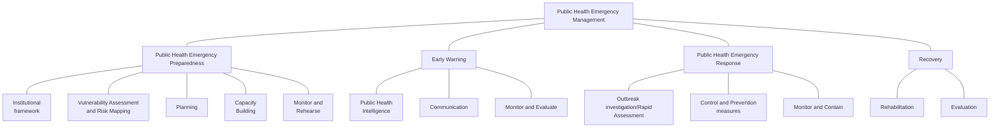
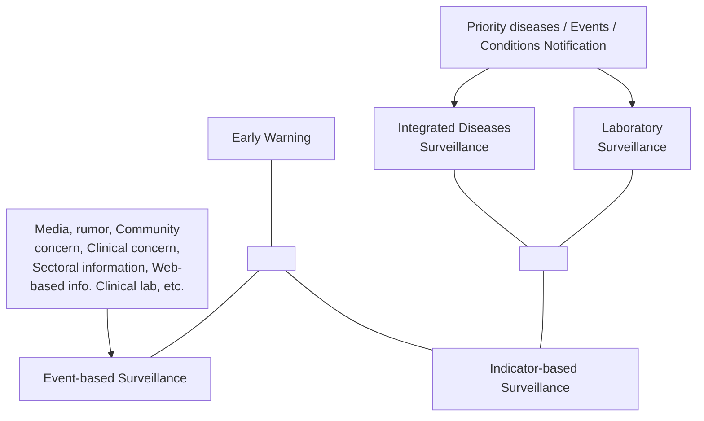
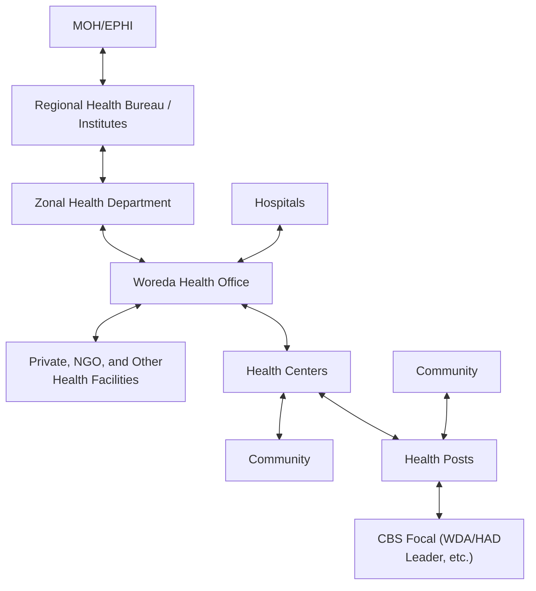
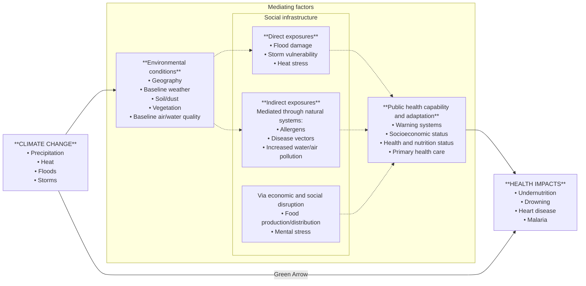
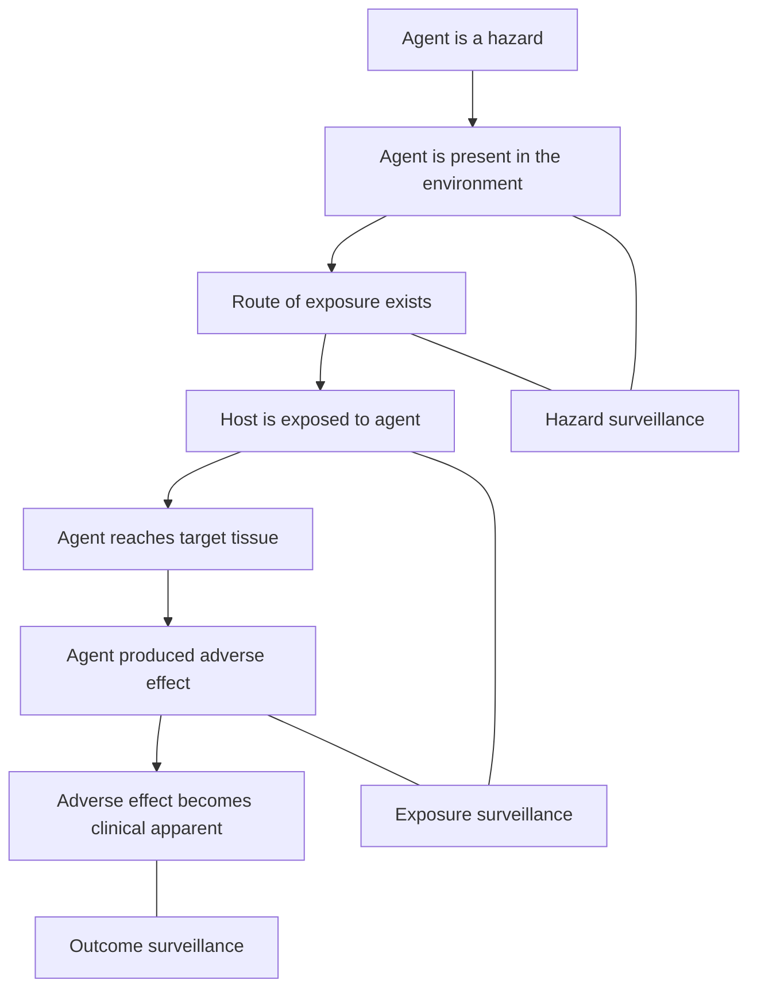
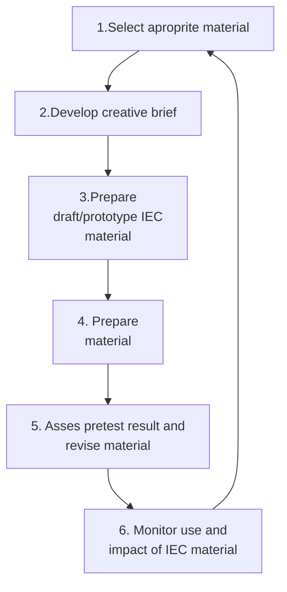
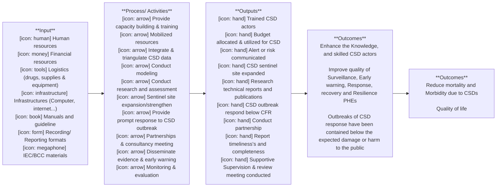
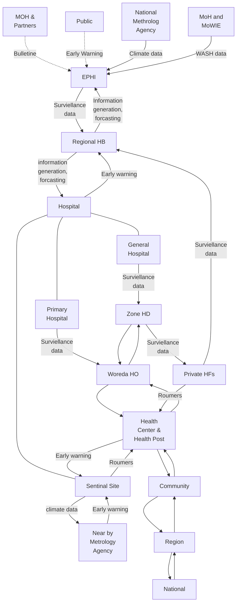

# EPHI: Climate-Sensitive Diseases Surveillance Manual (2022)

<!-- page 1 -->

# Climate Sensitive Diseases Surveillance and Early Warning System Implementation Manual

## Ethiopian Public Health Institute

## Public Health Emergency Management

Addis Ababa, Ethiopia
June 2022

<!-- page 2 -->

# Table of Contents

List of tables iii
List of figures iv
List of Annexes v
Acknowledgement vi
Contributors vii
Abbreviations and Acronyms viii
Foreword ix
Overview x
Program description xi
Purpose xi
Chapter One: Public Health Emergency Management (PHEM) 1
1.1 Early Warning System 3
1.2 Public Health Emergency Preparedness 8
1.3 Public Health Emergency Response 9
1.4 Recovery for Public Health Emergency 10
Chapter Two: Climate Change and Health 11
2.1. Climate change and weather 11
2.2. Impact of climate change on health 12
2.3. Impacts of climate change on WASH and health 14
2.4 Vulnerability, mitigation and adaptation measures for climate change 18
Chapter III: Climate service to the health community/partners 24
3.1 Types of climates and weather information useful to health partners 24
3.2 Importance of climate services and information to the health community 26
3.3 Health-tailored climate service 27
3.4 Developing Biometeorology Service in Ethiopia 28
Chapter IV: Climate-informed disease early warning system 31
4.1 Core elements of Climate-informed disease Early Warning Systems 31
4.2. Environmental public health surveillance system (EPHSS) 36
4.3. Laboratory based surveillance 37
4.4 Climate sensitive Diseases Surveillance and Response 40
4.5 Vector surveillance 49
4.6 Outbreak investigation to CSD 50

<!-- page 3 (printed ii) -->

Chapter V: Data Management and Analysis for Climate Sensitive Disease Surveillance 52
5.1 Introduction data management 52
5.2 Required data for climate sensitive disease early warning system 52
5.3 Data capturing or data reporting methods of CSD surveillance 55
5.4 Tools for data management and visualization 56
5.5 Modeling for Climate Sensitive Disease 59

Chapter VI: Public Health Emergency Risk Communication 62
6.1 Introduction to Emergency Risk Communication 62
6.2 Emergency Risk Communication Strategies 62
6.3 Communicating the public on climate sensitive disease emergencies situation 64

Chapter VII: Coordination and collaboration 70
7.1 Concept of Coordination and collaboration 70
7.2 Importance of the coordination 71
7.3 Coordination mechanism and its characteristics 71
7.4 Stakeholders, their role and responsibilities 74

Chapter VIII: Monitoring and Evaluation Climate Sensitive Diseases /CSDs Surveillance 78
8.1 CSD Early warning Monitoring and Evaluation System 78
8.2 Monitoring and Evaluation Framework for CSDS Early warning System 80
8.3 Monitoring and Evaluation Matrix 83
8.4 Methods of data collection for M&E 88

Glossary 91
Annex 94
References 98

<!-- page 4 (printed iii) -->

## List of tables

Table 1: List of priority diseases or health conditions targeted for Ethiopia, 2022 5
Table 2: The main impacts of the various climate-related hazards on water supply system 15
Table 3: Impacts of climate change on sanitation services 16
Table 4: Relative priority of investigative and control efforts, during an outbreak 51
Table 5: Summary table of Stakeholders, their role and expectation/assumptions 74

<!-- page 5 (printed iv) -->

# List of figures

Figure 1: Main pillars of public health emergency management 1
Figure 2: Components of early warning system 4
Figure 3: Surveillance system flow chart in Ethiopia 6
Figure 4: Reporting periods for immediately and weekly reportable diseases 7
Figure 5: Diagrammatic presentation of the impacts of climate change on human health 13
Figure 6: Diagrammatic illustrations of climate change pathways and its impact on human health 18
Figure 7: Relative Health Vulnerability Index by Region, Ethiopia 2015 20
Figure 8: Elements of climate-informed disease early warning systems 36
Figure 9: The process by which an environmental agent produces an adverse effect and the corresponding types of public health surveillance. 37
Figure 10: Approaches for Emergency Risk Communication (ERC) material development 66
Figure 11: Emergency Risk Communication Framework 66
**Figure 12**: Logic model of Climate Sensitive Diseases early warning system 82
Figure 13 Climate integrated disease surveillance system data flow chart 89

<!-- page 6 -->

# List of Annexes

**Annex 1:** Diseases, type of specimens and recommended tests at health facilities 94
**Annex 2:** Case definition for priority climate Sensitive diseases 95
**Annex 3:** Summary for epidemic threshold for selected climate sensitive diseases 97

<!-- page 7 (printed vi) -->

## Acknowledgement

The Ethiopian public health institute would like to thank all those who participated in the development of this climate sensitive disease surveillance and early warning implementation manual. This document provides a standardized guide to stakeholders in implementing climate sensitive disease surveillance and early warning systems in Ethiopia.

The Ethiopian Public Health Institute extends its gratitude to MOH, WHO-DFID project, UKAID who provided technical support and funding to produce this manual.

Moreover, EPHI would also thank all climate sensitive disease surveillance technical working group members, individuals and organizations who contribute for the development of this implementation manual.

<!-- page 8 (printed vii) -->

## Contributors

|S.n|Name|Organization|
|-|-|-|
|1|Mr. Waltaji Terfa|WHO|
|2|Mr. Zewdu Assefa|EPHI|
|3|Mr. Yeshitila Mogessie|WHO/EPHI|
|4|Mr. Misganaw Tewachew|MoH|
|5|Dr. Nigusie Yohanis|EPHI|
|6|Mr. Belay Bezabih|WHO/EPHI|
|7|Mr. Yosef Nigusie|EPHI|
|8|Mr. Kefyalew Amene|EPHI|
|9|Mr. Yibeyin Mulualem|EPHI|
|10|Mr. Melaku Abebe|UNICIEF/EPHI|
|11|Mr. Wondosen Temesigen|NMA|
|12|Mr. Shambel Habebe|EPHI|
|14|Mr. Melaku seyoum|EPHI|
|14|Mr. Sileshi Demelash|EPHI|
|15|Mr. Abraham Lilay|EPHI|
|16|Dr. Beyene Moges|EPHI|
|17|Mr. Aschalew Abayneh|EPHI|

<!-- page 9 (printed viii) -->

## Abbreviations and Acronyms

**AFRO** WHO-Region Office for Africa

**BCC** Behavioral Change Communication

**BI** Breteau Index

**BPR** Business Process Reengineering

**CDC** Center for Disease control

**CFR** Case Fatality Rate

**CI** Container Index

**CRGE** Climate Resilient Green Economy

**DFID:** Department For International Department for International development

**DRMC** Disaster Risk Management Commission

**ENSO** Elino Southern Oscillation

**EPHI** Ethiopian Public Health Institute

**EPHS** Environmental Public Health Surveillance

**EWS** Early Warning System

**GHG** Green House Gas

**HI** House Index

**HNAP** Health National Adaptation Plan

**HVI:** Human Vulnerability Index

**IDSR** Integrated Disease Surveillance and Response

**IEC** Information

**IHR** International Health Regulation

**IMS** Incident Management System

**IPCC** Intergovernmental Panel on Climate Change

**MOH:** Ministry of Health

**NGO** Non-Governmental Organization

**NMA** National Meteorology Agency

**PCR** Polymerase Chain Reaction

**PHEM** Public Health Emergency Management

**PHEOC** Public Health Emergency Operation Center

**PPV** Positive Predictive Value

**PR** Public Relation

**RCP** Representative Concentration Pathway

**RDT** Rapid Diagnostic Test

**SNNPR** Southern nations Nationalities Peoples Region

**SOCO** Single Overarching Communications Outcome

**SOP** Standard Operating Procedure

**THI** Temperature Humidity Index

**US** United State

**WASH** Water Sanitation and Hygiene

**WDC** Water Development Commission

**WHO** World Health Organization

<!-- page 10 (printed ix) -->

## Foreword

Globally, since the early 1990s, the changing climate has been a hot topic under discussion by global experts and politicians due to its profound impact on the worldwide health, economy, ecology and trade.

Understanding climate and environmental effects on infectious disease ecology through interdisciplinary efforts due to complexity of the natural and human system provides opportunities to simulate, investigate, and predict transmission dynamics.

Monitoring the potential impacts of climate change on health is important for a number of reasons. The provisions of epidemiological evidence supported by climate service are needed to inform policy-makers, health practitioners and communities about the magnitude of climate change effects on health. As part of surveillance systems, climate service (information) can help to determine the requirements for the effectiveness of preventive and adaptive strategy of health to climate variables and change.

In this regard, Ethiopia with the financial and technical support of the World Health Organization has been working on establishing the monitoring of potential effects of climate change on health. Based on the national health adaptation plan, Ethiopia has established sentinel surveillance sites for selected priority diseases in selected eleven health facilities (health center and hospitals) of eight regions with the aim to integrate public health surveillance data with the meteorological and environmental data in order to enhance the early warning and surveillance systems and inform policy decision makers, public health practitioners and community on the magnitude of the effect of climate change.

Thus, this implementation manual is prepared to guide all program implementers and other stakeholders who are taking part in climate sensitive diseases surveillance and early warning systems.

**Aschalew Abayneh**

**Deputy Director General**

**Ethiopian Public Health Institute**

<!-- page 11 -->

## Overview

Over the past decades, the fact that climate change and its impact on health have become increasingly understood and recent evidence suggests that the associated changes in temperature and precipitation are already adversely affecting population health; the future burden of disease attributable to climate change will depend in part on the timeliness and effectiveness of the interventions implemented.

Though Ethiopia's contribution to global warming is minimal over the past decades, the temperature has increased at about 0.2°C per decade. The increase in minimum temperatures is more pronounced with roughly 0.4°C per decade. The mean annual temperature in the country will increase in the range of 1.7-2.1°C by 2050 and in the range of 2.7-3.4°C by 2080 which contributes to the existence of extreme weather events.

Extreme weather events such as floods, droughts and landslides, which are attributed to climate change, claim millions of lives each year. The World Health Organization predicts that climate change will result in 250,000 additional deaths per year between 2030 and 2050 of which 60,000 deaths/year will be related to malaria and 48,000 deaths/year to diarrheal disease. Many infectious diseases are climate-sensitive, including vector-borne diseases, such as malaria, dengue fever, and yellow fever and waterborne diseases such as cholera and diarrheal diseases. Arthropod vectors may expand or alter their ranges because of climate change, introducing vector-borne diseases into new areas and waterborne diseases can occur with heavy rainfall and contamination of water supplies.

This implementation manual has eight chapters; introduction to public health emergency management, climate change and health, climate service for health community, climate-informed disease early warning system, data management and modeling for climate sensitive diseases, public health emergency risk communication, stakeholder’s role and responsibility and monitoring and evaluation.

<!-- page 12 (printed xi) -->

## Program description

The health vulnerability assessment to climate change was conducted in 2015 by MoH with support of WHO-DFID project generated health vulnerability index (HVI) for Ethiopia. The country is categorized into four classes of vulnerability index (least vulnerable, moderately vulnerable, highly vulnerable and very highly vulnerable).

Strengthening and implementing Climate Sensitive Disease Surveillance and Early Warning systems and take steps to increase public awareness on consequences of climate sensitive diseases is one of the adaptations options identified for the four categories of HVI and recommended that public health must move from a focus on surveillance and response to a greater emphasis on prediction and prevention. Linking the increasing skill of meteorologists in forecasting extreme events with effective public health interventions and projections of more frequent and more intense extreme events in a changing climate. This helps to increase the importance of designing and implementing early warning systems that take into consideration the possibility of extremes outside the historic range.

The Ethiopian Public Health Institute in collaboration with regional health bureaus and the technical support of WHO country office has initiated the implementation of climate sensitive disease surveillance and early warning systems through WHO-DFID project in December 2017 by establishing eleven sentinel sites in eight regions of the country. The sentinel site mainly works on the five selected priority diseases (Malaria, Yellow fever, Dengue Fever, Meningitis and Cholera) by integrating public health surveillance, meteorological, WaSH, environmental and other public health determinant data.

Hence, health workforce development, developing climate-related disease forecasting models, enhancing the national public health surveillance systems capacity in addressing climate-related risks and addressing the issue of climate change and health in policy and guidelines are the key interventions to reduce the impacts of climate change on public health.

## Purpose

The purpose of this implementation manual is to provide a comprehensive guide for implementing climate sensitive diseases surveillance and early warning systems through integrating public health surveillance, meteorological, WASH, environment and other public health determinant data.

<!-- page 13 (printed 1) -->

# Chapter One: Public Health Emergency Management (PHEM)

Public Health Emergency Management (PHEM) is defined as the process of anticipating, preventing, preparing for, detecting, responding to, controlling, and recovering from the consequences of public health threats in order that health and economic impacts are minimized.

During country wide reform initiative aimed at bringing effectiveness and efficiency in execution of various works using the Business Process Reengineering (BPR) as a tool in 2009, by adapting best practices from around the world and tailored to the country’s context taking into consideration the national threats and the mission of the MoH, the Public Health Emergency Management (PHEM) system was designed to ensure rapid detection of any public health threats, preparedness and prompt response to and recovery from various public health emergencies.

The PHEM process is fully integrated, adaptable, all-hazards and all health approach national preparedness and response system. This core process comprises four sub processes which are: public health emergency preparedness, early warning, response and recovery.

Source: PHEM guideline 2012

Figure 1: Main pillars of public health emergency management

<!-- page 14 (printed 2) -->

## Public Health Emergency Operation Center (PHEOC)

PHEOC is a physical or virtual space that public health emergency management personnel assemble, coordinate operational information and resources, strategically manage public health events and emergencies at all levels. The primary objectives of the PHEOC at national, subnational levels are:

* Improving continuity, collection, organization, analysis, presentation and utilization of data and information,

* Communication and coordination with internal and external response partners, preparation of public communications to support community awareness, outreach and social mobilization,

* Identification, prioritization, acquisition, deployment and tracking of resources such as human, material and financial to support all PHEOC functions,

* Mobilization of resources, monitoring financial commitments and providing administrative services

A functional PHEOC supplements early warning system, supports effective coordination of responses and enhances real-time communication at all levels of public health emergency systems. The PHEOC applies the standard management structure known as Incident Management Structure (IMS). An IMS is a standard management structure that applies to preparedness and response activities.

The five recognized essential IMS functions (management, operations, planning, logistics and administration / finance) will be developed during the response to PHEs depending on the scale, type and complexity of the incident. When the IMS is activated, depending on the scale of the incident, positions will be identified in the IMS. Experts will be identified from the roster to fill the identified positions. Regular training of people identified in the roster and simulation exercises to test the plans, procedures, and systems is very significant.

Public Health Emergency Operation Center (PHEOC) activation levels are designated based upon a level of effort.

There are three modes of operations of PHEOC.

* **Watch Mode:** it corresponds to the normal day to day activities.

<!-- page 15 (printed 3) -->

*   **Alert Mode:** which is the early standby phase of activation when an emergency has occurred or is imminent;

*   **Response/Activation Mode:** which is the phase during the PHEOC activation period.

Depending on pre-settled activation and deactivation criteria, PHEOC could be activated or deactivated partially or fully to meet the demands of the situation

## 1.1 Early Warning System

Early warning is the identification of a public health threat by closely and frequently monitoring identified indicators and predicting the risk it poses on the health of the public and the health system. The purpose of early warning is to enable the provision of timely and effective information to the public and to responders, through identified institutions that allow preparing for effective response or taking action to avoid or reduce risk.

**Major indicators of early warning include:**

*   An increase in the number of cases beyond expected /occurrence of outbreaks,

*   Unexplained morbidity and mortality,

*   Malnutrition,

*   Evidence of increase in Zoonotic disease and/or related vectors,

*   Environmental changes such as air pollution, water quality changes, contamination,

*   Drought, flood, severe weather (metrological information),

*   Agricultural events such as reduced harvest, occurrence of pests or diseases,

*   Refugees, internally displaced people, disruption of health services and infrastructure,

*   Important industrial accidents; chemical spills etc.

### 1.1.1 Components of early warning system

Public health surveillance is "the ongoing, systematic collection, analysis, and interpretation of health-related data essential to the planning, implementation, and evaluation of public health practice, closely integrated with the timely dissemination of these data to those responsible for prevention and control". It is also defined as "Information for Action". The purpose of surveillance is to assess public health status, trigger public health action, define public health priorities and evaluate programs. An early warning system uses event-based and indicator-based surveillance to monitor threats, risks and priority diseases respectively (as shown in the figure 3 below).

<!-- page 16 (printed 4) -->

Figure 2: Components of early warning system

Event-based surveillance is defined as the organized collection, monitoring, assessment and interpretation of mainly unstructured ad hoc information regarding health events or risks, which may represent an acute risk to human health. Event-Based Surveillance is a functional component of weekly activity reports.

Indicator based surveillance is routine reporting of cases of disease and it is commonly health care facility-based.

It is clear that surveillance could not be carried out for all diseases and conditions. Therefore, in Ethiopia 32 diseases and conditions (18 are immediately notifiable whereas 14 are weekly reportable) are selected to be included into the routine surveillance. These diseases are selected based on one or more of the following criteria.

* Diseases which have high epidemic potential

* Required internationally under IHR2005

* Diseases targeted for eradication or elimination

* Diseases which have a significant public health importance

<!-- page 17 (printed 5) -->

* Diseases that have available effective control and prevention measures for addressing the public health problem they pose.

Table 1: List of priority diseases or health conditions targeted for Ethiopia, 2022

|Immediately Notifiable Diseases/Conditions|Weekly Reportable Diseases/condition|
|-|-|
|1. Poliomyelitis (Acute Flaccid Paralysis)|1. Dysentery|
|2. Anthrax|2. Malaria|
|3. Human Influenza caused by new subtype|3. Diarrhea with dehydration in children less than 5 years of age|
|4. Cholera|4. Acute jaundice syndrome within 14 days of illness|
|5. Dracunculiasis / Guinea worm|5. Severe pneumonia in children under 5 years age|
|6. Measles|6. Meningitis|
|7. Adverse Events Following Immunization (AEFI)|7. Severe Acute Malnutrition|
|8. Chikungunya|8. Moderate acute malnutrition|
|9. COVID-19|9. Relapsing fever|
|10. Dengue fever|10. New HIV cases|
|11. Neonatal Tetanus|11. Tuberculosis|
|12. Rabies|12. Diabetes new cases|
|13. Smallpox|13. Hypertension new cases|
|14. Severe Acute Respiratory Syndrome (SARS)|14. Scabies|
|15. Viral Hemorrhagic Fever ( RVF, EVD, Marburg, Lassa fever…)||
|16. Yellow fever||
|17. Maternal death||
|18. Perinatal death||

The identified 32 diseases and conditions are classified into two reporting periods (immediately and weekly) depending on their epidemic potential, acute severity, diseases targeted for elimination and eradication. Figure 4 describes the time of reporting in the surveillance system

In addition to the aforementioned 32 priority diseases and health conditions to be reported, any unusual health events or clusters of diseases are expected to be reported. Region specific disease or events that are public health important and which warrant surveillance can be added to the surveillance system of the region.

### 1.1.2 Reporting mechanism and algorithm

Case definition, reporting formats, alert and action thresholds are pre-determined for the diseases/conditions under indicator-based disease surveillance.

<!-- page 18 (printed 6) -->

There are standard case definitions and community case definitions for nationally notifiable diseases under indicator-based surveillance. A standard case definition of the 32 reportable diseases and conditions were developed to be used at health centers and above level and a community case definition, which is a simplified case definition adapted to suit to health extension workers (HEWs). A syndromic based case definition is also developed to be used by every community member. These 32 priority diseases and conditions were classified in to 18 syndromic case definitions (refer Public Health Emergency Management guideline 2022 and Community and Event Based Surveillance implementation manual 2022 for further information).

Reporting flow and reporting period is depicted in the below figure.

Source: adapted from Community and Event Based Surveillance implementation manual 2022.

Figure 3: Surveillance system flow chart in Ethiopia

<!-- page 19 (printed 7) -->

The identified 32 diseases and conditions are classified into two reporting periods (immediately and weekly) depending on their epidemic potential, severity, diseases targeted for elimination and eradication.

### Weekly Reportable Diseases / Events / Conditions

* **Monday till mid-day**: Health facility to Woreda health office
* **Tuesday till mid-day**: Woreda health office to Zonal health department
* **Wednesday till mid-day**: Zonal health department to Regional health bureau
* **Thursday**: Regional health bureau to EPHI

### Immediately Notifiable Diseases / Events / Conditions

* **Health facility to Woreda health office**
* **Woreda health office to Zone health department**
* **Zone health department to Regional health office**
* **Regional health office to EPHI**

Notification and from each level to the next level within 30 min. Arrive EPHI in 2hrs

Figure 4: Reporting periods for immediately and weekly reportable diseases.

DHIS2 is a newly introduced electronic report system designed to improve disease surveillance and health information systems.

<!-- page 20 (printed 8) -->

### 1.1.3 Surveillance functions and attributes

**Core functions of surveillance systems**

* Case detection

* Data analysis and interpretation

* Case registration

* Epidemic preparedness

* Case confirmation

* Response and control

* Reporting

* Feedback

**Support functions of surveillance systems**

* Standards and guidelines

* Resources

* Training

* Monitoring and evaluation

* Supervision

* Coordination

* Communication facilities

**Surveillance attributes:** used to ensure the quality and effectiveness of the public health surveillance. The attributes are completeness, timeliness, usefulness, sensitivity, positive predictive value (PPV), specificity, representativeness, simplicity, flexibility, acceptability, and reliability. (Refer WHO Communicable disease surveillance and response guideline)

### 1.2 Public Health Emergency Preparedness

Preparedness is defined as “the range of deliberate, critical tasks and activities necessary to build, sustain, and improve the operational capability to prevent, protect against, respond to, and recover from incidents”. Public health emergency preparedness involves both activities directed at preventing possible public health emergencies and planning to ensure an adequate response if an emergency occurs.

The aim of preparedness is to strengthen capacity in recognizing and responding to public health emergencies through conducting regular risk identification and analysis, establishing partnership and collaboration, enhancing community participation and implementing community-based interventions and strategic communication during the pre-emergency phase and ensuring their monitoring and evaluation.

<!-- page 21 (printed 9) -->

**The main objectives of health emergency preparedness include:**

* Preventing avoidable crisis and catastrophes;

* Reducing morbidity and mortality effects;

* Availing resources;

* Minimizing disruption to health services;

* Maintaining business continuity as far as possible;

* Reducing disruption to society as much as possible.

In the public health context, the preparedness sub-process is comprised of the following broad activities:

* Coordination and collaboration;

* Vulnerability assessment and risk mapping;

* Planning for identified risks and hazards;

* Capacity building;

* Monitoring and rehearsal or simulation.

The way forward to implement sound preparedness measures is to accomplish first and foremost a paradigm shift from managing emergencies to managing risks.

### 1.3 Public Health Emergency Response

The public health emergency response focuses on rapid assessment of outbreaks, outbreak investigations, implementing control and prevention measures, and monitoring of the interventions.

The response is rapid and it limits the number of cases and geographical spread, shortens the duration of the outbreak and reduces fatalities.

Upon receipt of an alert, rumor, or detection of a deviation from the disease or condition from the expected trend while performing weekly surveillance data analysis, communicate the respective level immediately for verification. For some communicable diseases like cholera and yellow fever, a single suspect case is the trigger for taking action, reporting the case to a higher level, and conducting an investigation. For other diseases such as malaria, dysentery etc, the trigger is when a case threshold is reached. Some outbreaks or public health emergencies occur suddenly while others occur gradually giving you time to think.

<!-- page 22 (printed 10) -->

Public health emergency response to disease outbreaks, disasters, displacements, and other public health issues requires the integration and effective application of skills of multidisciplinary experts and logistics. Emergency response activities depending on the emergency response mechanisms could be initiated with or without the activation of the Public Health Emergency Operation Center (PHEOC) incident management system.

### 1.4 Recovery for Public Health Emergency

Recovery is defined as the process of rebuilding, restoring, and rehabilitating the community following an emergency, but it is more than simply the replacement of what has been destroyed and the rehabilitation of those affected.

Recovery is best achieved when the affected community is able to exercise a high degree of self-determination. Recovery is a complex and long running process that will involve many more sectors and participants. Therefore, recovery plans are implemented and coordinated with all responsible government sectors at all levels, in collaboration with the non-profit sector and nongovernmental relief organizations.

The recovery phase should begin at the earliest opportunity following the onset of an emergency, running in cycle with the response to the emergency. It continues until the disruption has been rectified, demands on services have returned to normal levels, and the needs of those affected have been met.

The key principles for recovery and rehabilitation of the health sector include:

*   **Equity:** Expansion of service to underserved areas, the poor and vulnerable population;

*   **Effectiveness:** Increasing the access to and the quality of key services;

*   **Appropriateness:** Adoption of new service delivery models to respond to new health needs if the previous system was outdated; and

*   **Efficiency:** Greater overall efficiency with savings used to finance some of these measures.

<!-- page 23 (printed 11) -->

# Chapter Two: Climate Change and Health

## 2.1. Climate change and weather

### 2.1.1 Weather and weather forecast

Weather is a meteorological phenomenon that occurs on a short time scale. A weather forecast is a statement saying what the weather will be like the next day or for the next few days. Weather forecasters try to answer questions like: What will the temperature be tomorrow? Will it rain? How much rain will we have? Will there be thunderstorms?

Nowadays, most weather forecasts are based on models, which incorporate observations of air pressure, temperature, humidity and winds to produce the best estimate of current and future conditions in the atmosphere. A weather forecaster then looks at the model output to figure out the most likely scenario. The accuracy of weather forecasts depends on both the model and on the forecaster's skill. Short-term weather forecasts are accurate for up to a week. Long-term forecasts, for example seasonal forecasts, tend to use statistical relationships between large-scale climate signals such as ENSO and precipitation and temperature to predict what the weather will be like in one to four months’ time.

### 2.1.2 Climate and climate change

Climate is the average weather conditions for a particular location and period of time. It is a mean status of long-term weather or the statistical status (month, season, annual, several years, decades, centuries, and even longer). Climate prediction is a statement about what will happen or might happen on climate in the future; the act of saying what will happen in the future: the act of predicting something. Climate predictions take a much longer-term view. These predictions try to answer questions like how much warmer will the Earth be 50 to 100 years from now? How much more precipitation will there be? How much will sea level rise? Climate predictions are made using global climate models. Unlike weather forecast models, climate models cannot use observations because there are no observations in the future.

Climate Change is the change in the state of climate that can be identified by changes in the mean and/ variability of its properties and that persist for an extended period typically for decades or longer (IPCC). Climate change has been observed since the industry revolution due to human activities and the utilization of fossil fuel as a source of energy. The mean global temperature has

<!-- page 24 (printed 12) -->

been increasing due to anthropogenic activities which produced greenhouse gases (GHGs). The primary gases which are responsible for greenhouse effect are Carbon dioxide (CO2), Methane (CH4), Nitrous Oxide (N2O), Hydro-fluorocarbons (HFCs), perfluorocarbons (PFCs), Sulphur-hexafluoride (SF6), Nitrogen Trifluoride (NF3) and Water Vapour. These GHGs retain the heat radiation reflected back from the earth which in return makes the earth warmer.

A climate trend analysis of Ethiopia indicated a 15-20% reduction in annual rainfall in parts of the country since the 1970s. Similarly; another analysis of the climate data of more than five decades indicated that the amount of rainfall has been constant on a national average with a declining trend in northern Ethiopia, increasing rainfall intensity and variability trend in central Ethiopia, and increasing rainfall in southern Ethiopia. However; this climate change is also linked with the Elino and southern oscillation (ENSO) phenomena, leading to droughts, floods, heavy rain, food insecurity, disease outbreaks and land degradation.

### 2.2. Impact of climate change on health

Over the past decades, the fact that climate change and its impact on health have become increasingly understood and recent evidence suggests that the associated changes in temperature and precipitation are already adversely affecting population health.

The cause of climate change can be due to natural or human, some of the more prominent one for natural causes are volcanoes, the earth’s tilt, and ocean currents. All of us in our daily lives contribute to our bit for this change in the climate like deforestation, industrialization...

Though Ethiopia`s contribution to global warming is negligible over the last decades which has increased about 0.2°C per decade. The increase in minimum temperatures is more pronounced with roughly 0.4°C per decade. The mean annual temperature in the country will increase in the range of 1.7-2.1°C by 2050 and in the range of 2.7-3.4°C by 2080 which contributes to the existence of extreme weather events. Extreme weather events such as floods, droughts and landslides, which are attributed to climate change, claim millions of lives each year. Many infectious diseases are climate-sensitive, including vector-borne diseases, such as malaria, dengue fever, and yellow fever and waterborne diseases such as cholera and diarrheal diseases

<!-- page 25 (printed 13) -->

Climate change affects the social and environmental determinants of health. The impact of climate change is still hitting Ethiopia and most developing countries by expanding the range of malaria to highland areas, increased incidence of waterborne illnesses, such as diarrhea, cholera and dysentery; aggravation of respiratory diseases caused by allergens and air pollution, increased malnutrition and exacerbating vulnerability to diseases.

Climate change has both directly and indirectly affected human health. The direct health impacts include physiological effects of exposure to higher temperatures, increasing incidences of non-communicable diseases such as respiratory and cardiovascular disease and injuries and death due to extreme weather events such as droughts, floods, heat waves, storms and wildfires. Climate change has indirect effects on health due to ecological changes, such as food and water insecurity and the spread of climate-sensitive infectious diseases, and also to societal responses to climate change, such as population displacement and reduced access to health services.

### Impact of Climate Change on Human Health

*   **Severe Weather**
    *   Injuries, fatalities, mental health impacts
*   **Air Pollution**
    *   Asthma, cardiovascular disease
*   **Changes in Vector Ecology**
    *   Malaria, dengue, encephalitis, hantavirus, Rift Valley fever, Lyme disease, chikungunya, West Nile virus
*   **Increasing Allergens**
    *   Respiratory allergies, asthma
*   **Water Quality Impacts**
    *   Cholera, cryptosporidiosis, campylobacter, leptospirosis, harmful algal blooms
*   **Water and Food Supply Impacts**
    *   Malnutrition, diarrheal disease
*   **Environmental Degradation**
    *   Forced migration, civil conflict, mental health impacts
*   **Extreme Heat**
    *   Heat-related illness and death, cardiovascular failure

*Note: The central graphic indicates driving factors: Rising Temperatures, More Extreme Weather, Rising Sea Levels, and Increasing $CO_{2}$ Levels.*

Source: Slide courtesy of George Luber, CDC

Figure 5: Diagrammatic presentation of the impacts of climate change on human health

<!-- page 26 (printed 14) -->

## 2.3. Impacts of climate change on WASH and health

Drinking-water and sanitation are foundations of public health and development. Most impacts will be experienced through more droughts, floods, and less predictable rainfall and water flows, thus creating a number of risks for water and sanitation services. It can also generate risks that directly affect the operation of services. Climate induced disaster results lack of sanitation, inadequate water supplies and poor hygiene which impacts displaced communities much more susceptible to illness and death from climate change related diseases.

### 2.3.1 Impacts of climate change on water supply system and health

A sustainable water supply service consists of a number of components, including the extraction (through abstraction or pumping), treatment, storage, and distribution of drinking water to users within a given area. The water distributed should be affordable, of good quality and available in sufficient quantities when needed. The service level is dependent on the local context, needs and technical and financial resources. The service is vulnerable to changes in water resource availability and quality as well as to other climate-related hazards.

Water and climate change are inextricably linked, as the effects of climate change are first felt through water: through droughts, floods and storms. These disasters can destroy water supplies, or leave behind contaminated water and put the lives of millions of children at risk. Without clean water, children are at risk of diseases such as diarrhea, which already kills over 800 children under five every day.

Climate change has a direct effect on water temperature, precipitation frequency and intensity. These effects are pathogen and pollutant specific, and risks for human disease are markedly affected by local conditions, including regional water and sewage treatment capacities and practices. Domestic water treatment plants may be susceptible to climate change leading to human health risks. For example, droughts may cause problems with increased concentrations of effluent pathogens and overwhelm water treatment plants.

Climate also indirectly impacts waterborne disease through changes in pH, nutrient and contaminant runoff, salinity of water sources, and water security. These indirect impacts are likely to result in degradation of fresh water available for drinking, washing, and food cooking, particularly in developing countries where much of the population still uses untreated surface water

<!-- page 27 (printed 15) -->

from rivers, streams, and other open sources. Even in countries that treat water, climate-induced changes could lead to damage or flooding of water and sewage treatment facilities, increasing the risk of waterborne diseases.

Climate related hazards may decrease the water quality and quantity or causes for service interruptions. Some of the consequences of climate change on water supply are: -

* Drop in service quality and people use a poor-quality alternative water resources during service interruptions;

* Increase in conflicts of use during periods of water scarcity;

* Greater migration or people leaving as they have no water, creating political, social and environmental issues;

* Impacts on infrastructure development and facilities,

* Impacts on service quality, which encompasses the quality of the water distributed and service availability (water supply continuity and the pressure available to the end-user).

Some of the impacts of climate change on water supply are summarized in the table below.

Table 2: The main impacts of the various climate-related hazards on water supply system.

|Climate-related Hazards|Impact on Specific Consumption|Impact on Infrastructure and Facilities|Impact on Service Quality|
|-|-|-|-|
|\* Rising sea levels, \* Saltwater intrusion|\* Consumption halted when salt levels in the water distributed reached a certain threshold and the water is no longer suitable for drinking.|\* Infrastructure corrosion|\* Services halted due to high salt levels, which cannot be reduced through treatment.|
|\* Rise in average temperatures \* Variability of seasonal rainfall patterns \* Heat waves \* Droughts|\* Increase in water needs and in volumes withdrawn for all uses (domestic, agricultural, industrial, etc.).|\* Weakened facilities (overused of facilities, damage pumps, cracking of concrete)|\* Interrupted or temporarily reduced services due to lack of available water resources. \* Drop in the quality of water distributed|
|\* Increase in the frequency and intensity|\* Water contamination, water shortage|\* Facilities are weakened, less|\* Service interruptions due to damaged facilities.|

<!-- page 28 (printed 16) -->

|of extreme weather events:|Increase in conflicts of use during periods of water scarcity;|efficient and damaged:|Water points are inaccessible (landslides, floods).|
|-|-|-|-|
|\* Sudden and intense rain events (result flooding)|\* Greater migration|\* Water reservoirs are weakened after having been placed under too much pressure and stress.|\* Drop in the quality of water distributed|
|\* Storms, winds|\* create political, social & environmental issues;|||

### 2.3.2 Impacts of climate change on sanitation services and health

The main focus of sanitation is to minimize the health and environmental risks of failing to hygienically dispose of pathogen-containing wastewater and excreta. Implementation of a sustainable sanitation service is a human right that entitles every person to have access to toilet facilities that ensure privacy and dignity. However, the entire sanitation chain can be exposed to a range of climate-related hazards. It is also important to protect water resources as climate change weakens natural ecosystems.

The major impacts of climate change on sanitation services can be classified into three;

1. Impacts on service operations, such as damage to infrastructure or disruptions to treatment processes;

2. Impacts on the environment, particularly on natural ecosystems and water resources;

3. Social and health impacts.

Table 3: Impacts of climate change on sanitation services

|Climate-related Hazards|Impact on Service Operations|Impact on the Environment|Social and Health Impacts|
|-|-|-|-|
|\* Rise in average temperatures|\* Biological treatment processes fail to function.|\* A drop in water resource quality (b/c not properly treated).|\* Olfactory pollution (N₂O).|
|\* Variability of seasonal rainfall patterns|\* Condition of infrastructure and facilities deteriorate(H2S)|\* Disruptions to ecosystems and biodiversity (aquatic ecosystems)|\* Hydrogen supplied inhalation due to heat increasing|
|\* Heat waves||||
|\* Droughts||||

<!-- page 29 (printed 17) -->

|\* Increase in the frequency and intensity of extreme weather events:|\* Collapse of latrines if not built properly|\* Toilet pits are flooded and a mixture of wastewater and storm water overflows onto public roads;|\* People no longer have working sanitation facilities available, as these have been destroyed or can no longer be used.|
|-|-|-|-|
|\* Sudden and intense rain events|\* Pit emptying services are disrupted|||
|\* Storm|\* Break down of sewer systems due to flooding|\* Storm water runs into the sewers causing these to overflow and wastewater treatment plants are by-passed.|\* Increase in waterborne diseases|
|\* Winds|\* Treatment processes fail to function correctly due to hydraulic overload.|||

### 2.3.3 Climate change impact Pathway

A useful approach to understand how climate change affects health is to consider specific exposure pathways and how they can lead to human disease. Exposure pathways differ over time and in different locations, and climate change related exposures can affect different people and different communities to different degrees.

There are three basic pathways by which climate change affects health:

* **Direct impacts**, which relate primarily to changes in the frequency of extreme weather including heat, drought, and heavy rain

* **Effects mediated through natural systems**, for example, disease vectors, water-borne diseases, and air pollution

* **Effects heavily mediated by human systems**, for example, occupational impacts, undernutrition, and mental stress

Exposure to multiple climate change threats can occur simultaneously, resulting in compounding or cascading health impacts. Climate change threats may also accumulate over time, leading to longer-term changes in resilience and health. Whether or not a person is exposed to a health threat or suffers illness or other adverse health outcomes from that exposure depends on a complex set of vulnerability factors.

<!-- page 30 (printed 18) -->

Source: *Human Health: Impacts, Adaptation, and Co-Benefits*

Figure 6: Diagrammatic illustrations of climate change pathways and its impact on human health

## 2.4 Vulnerability, mitigation and adaptation measures for climate change

### 2.4.1 Health Vulnerability

Vulnerability is the degree to which a system is susceptible to, or unable to cope with the adverse effects of climate change, including climate variability and extreme weather. Everyone is vulnerable to climate change. However, some groups are particularly vulnerable based on social, economic, environmental and biological factors. Vulnerable groups disproportionately impacted by climate change include people living in poverty, people without air conditioning, outdoor workers, children, the elderly, pregnant women, people with chronic and acute illness, and people who are disabled.

Vulnerability also defined in the public health context is the degree to which a system is susceptible to injury, damage, or harm. This broad definition emphasizes the importance of well-functioning institutions and the accessibility to quality healthcare that safeguards individual and population health. Although there are multiple interpretations of the term vulnerability in the global change literature, it needs to define vulnerability as being a function of **exposure, sensitivity** and **adaptive capacity**. Vulnerability is determined by a function of the character, magnitude, and rate of climate

<!-- page 31 (printed 19) -->

variations to which a system is exposed, its sensitivity and its adaptive capacity. Exposure is the nature and degree to which a system is exposed to significant climate variations. Exposure is the weather or climate-related hazard, including the character, magnitude and rate of climate variation.

Sensitivity is the degree to which a system is affected, either adversely or beneficially by climate related stimuli. Adaptive capacity refers to the whole capabilities, resources and institutions of the country to implement adaptive measures. It is the ability of a system to adjust to climate change (including climate variability and extremes), to moderate the potential damage from it, to take advantage of its opportunities, or to cope with its consequences.

These vulnerabilities can be experienced from a regional or systemic level to community, household and individual levels. Public health practitioners can play an important role in educating their own communities as well as the broader public about these and other health risks associated with climate change.

The environment can affect most human diseases and illnesses. There are certain populations that are at increased risk from environmental factors that affect health, and such populations’ present unique concerns when considering the health risks from climate change.

### Climate change vulnerability assessment

A climate vulnerability assessment identifies where health susceptibilities exist due to climate change, which will continue to alter the magnitude, frequency, duration, and geographic extent of various climate-related exposures that are detrimental to human health.

Climate and health vulnerability assessment involves five key steps;

1. Determine the scope of the assessment;

2. Identify known risk factors for potential health outcomes;

3. Acquire spatial information on risk factors;

4. Assess adaptive capacity and

5. Conduct an assessment of vulnerability

<!-- page 32 (printed 20) -->

Figure 7: Relative Health Vulnerability Index by Region, Ethiopia 2015

### 2.4.2 Adaptation measures for climate change

Adaptation is the adjustment in natural or human systems in response to actual or expected climatic stimuli or their effects, which moderates harm or exploits beneficial opportunities (IPCC). Adaptation involves efforts to limit our vulnerability to climate change impacts through various measures not necessarily dealing with the underlying cause of those impacts.

Countries, regions, ministries, institutions and communities have been developing preparedness plans to safeguard residents and prevent harm from a host of environmental and manmade threats throughout history. Public health professionals have a key role to play in preparing and adapting to these climate challenges. They can help to identify and predict changes that are specific and unique to climate change as well as identify the health risks to the public as part of the overall framework of preparedness.

<!-- page 33 (printed 21) -->

Climate adaptation involves several steps and many stakeholders. Steps of the climate change adaptation process include:

A. Identify current and future climate changes relevant to ecological, economic and human systems;

B. Assess vulnerabilities and risks;

C. Develop an adaptation strategy that prioritizes interventions by risk;

D. Identify opportunities for benefits across sectors;

E. Implement adaptation options and

F. Monitor and evaluate adaptation options and strategies and adjust as needed.

The ultimate goal of climate change adaptation is to reduce climate-related impacts, including harmful health impacts. Similar to the disease prevention model, adaptation can occur at three levels:

* Primary prevention (adaptation)is the development of an early warning system; example protection of drinking water from contamination in the event of extreme precipitation and flooding

* Secondary prevention (adaptation)is enhancing a surveillance system to track and monitor a potential climate change-related disease.

* Tertiary prevention (adaptation)is improving diagnosis and treatment of a disease, thereby reducing morbidity or mortality.

### Adaptation Options

The following are the major adaptation options identified by health vulnerability assessment

1. Improve public health surveillance systems

2. Establish Health and Climate data management system

3. Strengthening Early warning systems:

4. Improved Public Health Services

5. Improved Water, Sanitation, and Hygiene system

6. Human Resource Development

7. Enhanced public awareness and attitudes

8. Implementing climate resilient health system and health care facility guiding tool

9. Targeted intervention to regional contexts by enhanced financial resources

<!-- page 34 (printed 22) -->

## 10. Partnership, coordination and collaboration

Important consideration in adaptation

Adaptation will vary depending on the time, scale and scope of the system or place for which adaptation is being developed. Important factors and questions to consider throughout the adaptation process are:

1. The current state of community preparedness for combating disease;

2. Recent climate trends;

3. Uncertainties associated with climate variability and change;

4. Projected impact of climate change, including health impacts;

5. Immediate local and regional actions to prepare for the effects of climate change;

6. Timing and location of implemented adaptation activities; and

7. Barriers, constraints and limitations to implementing adaptation strategies

### 2.4.3 Mitigation Measures to Climate Change

Mitigation is an effort to reduce/prevent emission of greenhouse gases (GHGs) or to enhance their removal from the atmosphere by sinks. It is a human intervention to reduce the sources or enhance GHG sinks. Mitigation involves reducing the magnitude of climate change subdivided into two alternative strategies: emissions reduction and geo-engineering.

The health sector should lead by example, reducing health systems’ emissions of greenhouse gases (GHG) while helping to stimulate change in the entire health system supply chain. To achieve that, health care facilities need to be made safer, more resilient, and more environmentally friendly. Reducing emissions helps mitigate the impacts of climate change and improves air quality, with beneficial health gains. A coordinated effort to reduce emissions by health and other sectors would have a truly global positive impact.

The following are the mitigation Strategies for climate change even if it is not particularly related to health system

* Decrease fossil fuel combustion:

    - [yes] Facilitate the transition from fossil fuels to renewable energy and improved energy efficiency across all economic sectors

    - [yes] Increase public transport, particularly to inadequately serviced areas

<!-- page 35 (printed 23) -->

* ✓ Increase active transport use and safety, for example by funding the construction of bicycle and pedestrian paths

* ✓ Ensure that public and active transport is incorporated into the planning phase of new developments, by using environmentally and health-sensitive urban planning.

* ✓ Ensure clean cook stoves and cooking solutions

* ● Reduce fossil fuel extraction

* ● Decrease emissions from agriculture and from food production

* ● Improve energy efficiency of homes and buildings

* ● Integrating animal manure waste management systems

* ● Practicing agroforestry

* ● Develop and implement sustainable low carbon health systems strategy

<!-- page 36 (printed 24) -->

## Chapter III: Climate service to the health community/partners

The National Metrology Agency (NMA) studies the impacts of changing climate on society and ecosystems in a broad variety of ways by collecting and analyzing climatology data of atmospheric air. Climate Service is provision of one or more climate products or advice in such a way as to assist decision-making by individuals or organizations.

According to the National Metrology Agency, Ethiopia has three seasons according to rainfall distribution and three climate zones according to elevation.

The three seasons of the year are:

1 **Kiremt**: June-Sep is the summer season. Heavy rain falls in these four months.

2 **Bega**: Oct-Jan is the dry season with frost in the morning especially in January.

3 **Belg**: Feb-May is the autumn season with occasional showers. May is the hottest month in Ethiopia.

The three climatic zones are:

1 **Kola**: is below 1830 meters in elevation and has an average annual temperature of about 27 degrees Celsius with annual rainfall about 510 millimeters.

2 **Woinadega**: includes the highlands areas of 1830 - 2440 meters in elevation and an average annual temperature of about 22 degrees Celsius with annual rainfall between 510 and 1530 millimeters.

3 **Dega**: is above 2440 meters in elevation with an average annual temperature of about 16 degrees Celsius with annual rainfall between 1270 and 1280 millimeters.

### 3.1 Types of climates and weather information useful to health partners

The type of weather and climate information that can be useful to health decisions varies greatly according to four factors:

* The health problem being addressed,

* The timescale of climate-related risk,

* The geographic scope of the problem, and

* Availability and quality of data.

The principal determining factor of what climate information may be decision-relevant depends on the health problem, decision, or policy-relevant research question to be addressed starting with

<!-- page 37 (printed 25) -->

what is known about the environmental and climate sensitivity of the health outcome of interest. If appropriate diagnostics reveal statistically significant associations between key variables, and a climate signal is understood, then climate information may be helpful to estimate population risk, monitor the effectiveness of health planning and interventions, and detect, monitor and anticipate climate-sensitive health hazards (e.g. flooding, pathogen transmission, extreme temperatures), up to days, months, years or even decades in advance.

Critically, climate is only one of many factors that influence health outcomes and health service delivery. However, climate and weather conditions can have complex direct and indirect effects on health risk management. For climate-smart public health, (i.e. climate appropriate investment in and deployment of public health and health care, policy and services), information on the degree of direct influence that climate and weather bear on health risks and outcomes should complement well-founded understandings of short- and long-term climate influences on proximal determinants of health, such as drinking water, food security, disaster management, and urban planning.

The second determining factor of what climate information may be decision-relevant is the timeframe of when identified risks may occur (today, next year, or 20 years from now) and when decisions need to be made. For example, information to trigger emergency response actions will turn to daily or weekly forecasts of extreme weather risks.

The third factor to determine which climate information may be decision-relevant is the spatial scale of problem and information. Health data is presented at a specific spatial resolution (e.g. at the facility level, the district level, the provincial level etc.). Climate information must be available at the appropriate spatial scale to match the health data. Many climate products are simply too crude to match with point or district-based health information, and techniques for aggregating comparative scales such as district, province, or national level are often needed.

Fourthly, the quality and timeliness of information will determine its adequacy and relevance for use in the public health context. The professional and ethical standards of public health practice demand that the information used for making decisions about people’s lives and well-being are held to robust standards and methods. Health professionals must scrutinize available information with the recognition that data quality may be poor, measurement biases may exist, the skill of forecasts are regionally and seasonally specific, and that conditions of uncertainty must be clearly documented for users and decision makers. Health professionals may deem climate information unusable if products are not validated, unreliable, or other conditions cannot be met. Furthermore,

<!-- page 38 (printed 26) -->

if information cannot be provided in a timely manner, it may not be usable. For example, if observed or forecasted climate information is available, but not updated routinely in a timely manner, it cannot be used for early warning systems.

For national, regional, zonal or district level health decision-making, discussion with the National Meteorological Agency (NMA) who are most often responsible to collect and produce climate and weather information, and understanding of local data sharing policies, is a first step to identifying the relevant, available, and accessible weather and climate service.

## 3.2 Importance of climate services and information to the health community

### 3.2.1 Importance of climate services to the health community

Health professionals are increasingly concerned about how changing patterns of climate variability and long-term climate change are mediating health risks and affecting their ability to protect the health of citizens. The direct and indirect influences of meteorological and climatic conditions can result in acute health impacts, as well as slow onset changes in health risk determinants. At one end of a spectrum, extreme weather events can seriously affect people’s mental and physical health and can compromise their access to health care, food, clean water and physical safety, resulting in vulnerability, illness, injury or death. At the opposite end, even small or gradual changes in weather and climatic conditions – such as Rainfall, temperature, humidity or wind direction – can result in significant shifts in people’s exposure to harmful or beneficial conditions, from disease transmission to changing water quality.

Public health policy and practice is founded upon evidence-based decision-making. In the context of climate change, information from the health domain alone is insufficient. It has thus become imperative for public health professionals to take a multi-disciplinary approach to problem solving, which includes building partnerships that generate appropriate, integrated and actionable scientific knowledge about the health impacts of climate and weather exposure.

### 3.2.2 Importance of climate information to the health community

‘Climate-informed’ health decisions are the use of techniques to understand and apply knowledge about how climate in the past, present, or future influences health outcomes, health risks, and health service delivery. A range of techniques can be used to integrate spatial and time-scaled weather and climate information in combination with clinical, epidemiological and other health

<!-- page 39 (printed 27) -->

data (for example, ecological suitability for vector proliferation in the case of vector-borne disease) in order to understand for example, climate exposure - health outcome associations, or how health risk dynamics are influenced by climatic conditions. At a broad level, health decisions that can benefit from being informed by weather and climate information include:

* Risk and vulnerability identification;

* Disease control strategies;

* Health policy and regulations;

* Disease monitoring and surveillance;

* Financial and human resource allocation;

* Pharmaceutical, health supply, pesticide and vaccine supply flow;

* Health infrastructure sitting and maintenance;

* Emergency preparedness;

* Community education and public health information dissemination, for example through public service announcements and alerts to raise awareness of risks;

* Targeted public advisories, medicines or supplies for vulnerable populations;

* Training of the health workforce for potential outbreaks or signs of illness (even including side-effects of medicines in extreme temperatures);

* Impact assessment of climate sensitive interventions.

Measurable benefits of climate informed decisions can include lives saved and reduced case burden thanks to early warnings and preparedness measures; optimization of financial, human, and other resources; and improved planning resulting in reduced stress and strain on health delivery systems due to increased awareness and preparedness of extreme weather or climate related influences.

### 3.3 Health-tailored climate service

Health tailored -climate service is "Climate services are a new type of health service that can improve the effectiveness of our core business –detecting disease, monitoring health risks, anticipating problems, and taking action to save lives".

Health risks are on the rise due to climate change. More frequent and intense extreme events such as heat waves, extreme precipitation, coastal flooding and prolonged droughts bring dramatic and immediate, as well as more complex and long-term, impacts on human health. Many of the climate

<!-- page 40 (printed 28) -->

events we are experiencing today, such as high-magnitude heat waves, are unprecedented, but likely to become more commonplace in a warming world.

Risk factors for health are multiple and often difficult to distinguish from one another. Case studies demonstrate that the range of health risks related to climate variability and change are heavily interwoven with prevailing ecological conditions, human development and habitation patterns, and social and individual choices. For example, the vulnerability of populations in coastal cities and small islands increases when unplanned urbanization, lack of access to water and sanitation and health care services interacts with sea-level rise and more extreme weather events. Addressing these risks therefore requires action by a range of sectors, such as urban planning, water, food security and safety, and health systems, which are each affected by climate shocks and pressures in unique ways.

Climate services provide actionable information and products about the past, present and future climate and weather conditions. Climate services take many forms. They are not only about information products, but represent partnerships and comprise the entire process of bringing relevant stakeholders together to develop tailored evidence, tools, and information services that help solve problems for different sectors. Sometimes a climate service can be as simple as having an enabling data sharing policy and good relations that allow for regular or periodic information exchange between health authorities and NHMS; and other times a climate service may reflect years of joint research and capacity building to co-develop, regularly produce, and use specific products such as public advisories. For example, climate services can be developed to monitor how and where smoke plumes move during forest fires to anticipate when and where populations may be in harm’s way; to identify climate influences on disease dynamics; to map disease transmission risks at high spatial resolution to indicate when and where populations may be at risk for seasonal disease exposure and better target vector control interventions; to provide customized information for high-risk populations during heat waves; or to understand drought risks and reduce vulnerabilities to rapid and slow onset impacts of droughts.

### 3.4 Developing Biometeorology Service in Ethiopia

The National Meteorological Agency (NMA) of Ethiopia has been given a responsibility to establish meteorological stations all over Ethiopia, and to collect data, analyze, interpret meteorological and climate information and forecast weather, and issue early warnings. It also

<!-- page 41 (printed 29) -->

provides applied meteorological services specialized for agriculture, water, health and air navigation. Under the Development meteorology department there are three teams which provide weather and climate information for different sectors, those teams are:

1 Agro Meteorology team which provide information for the agriculture sector,

2 Hydro Meteorology team which provides information for the water sector and

3 Bio Meteorology team which provides information for the Health Sector.

### 3.4.1 General activities of Biometrology

By definition, climate services are an end-to-end multifaceted process through which a partnership creates a fit-for-purpose information solution. The process of developing a climate service starts with an active discussion between climate information producers and users about specific problems: such as the context, ultimate application, and user specifications.

Following careful problem definition, six common components frequently comprise the approaches taken to develop and deliver climate products and services for health. These include activities to create an enabling environment, build capacity, conduct research, develop and deliver products and services, apply the knowledge, and evaluate the products and user-experience. Each component serves a specific goal in the overall process. These components are not necessarily sequential, but very often must occur simultaneously to design, develop, and apply useful weather and climate services.

Biometeorology team prepares Ten days, monthly, mid-season and Seasonal bulletin which provide climate information for the health sector. The bulletin mainly focuses on malaria outbreak forecasts and the comfort condition of each day using indexes.

### 3.4.2 Product and Services

The main products and services given by the Biometrology to the health sector are:

* Malaria prevalence and climatic favorability

* Temperature Humidity Index (THI) Conditions

* NMA Map Room Service

Malaria is one of mostly known virulent infectious disease, which is sensitive to climate conditions. Environment by itself encourages the interactions among the Anopheles mosquito, malaria parasites and human hosts, providing:

<!-- page 42 (printed 30) -->

* Surface water in which mosquitoes can lay their eggs;

* Humidity for adult mosquito survival; and Temperatures that allow both the mosquito and the malaria parasite to develop and survive.

* As per Grover-Kopek et al. 2006; the suitable climatic conditions for transmission of malaria in Africa are; when the; Malaria index:

    1. Monthly precipitation accumulation is at least 80 mm,

    2. Monthly mean temperature is between 18°C and 32°C and

    3. Monthly mean relative humidity is at least 60%.

With respect to Temperature-Humidity Index (THI), the climatic condition for human being was developed by the US weather Bureau in 1959; it is applied to the temperature and humidity datum over representative stations of the country in order to review the weather condition which was comfort, moderate and discomfort over all areas covered by indicated climate data sources.

Criteria to Produce THI:

* THI = 0.55\*(T)+0.2(Td) +5.3 or (0.8) \*(T) + (RH\*T)/500

Where,

* T - mean temperature of the day °c

* Td- Dew Point Temperature

* RH - The mean relative humidity of a day in %

**According to this approach there are three cases:**

CASE 1: THI value >26 almost all the population feel discomfort i.e. Uncomfortable

CASE 2: THI value b/n 21-26 half of the population feels comfort i.e. Moderate

CASE 3: THI VALUES < 21 almost all population feel comfort i.e. Com

The climate and society map room are a collection of maps and other figures that monitor climate and societal conditions at present and in the recent past. The maps and figures can be manipulated and are linked to the original data. Even if you are primarily interested in data rather than figures, this is a good place to see which datasets are particularly useful for monitoring current conditions.

<!-- page 43 (printed 31) -->

## Chapter IV: Climate-informed disease early warning system

Climate-informed disease early warning system is a new approach of multi-hazard public health early warning systems aimed at anticipating risks and triggering early prevention and response. This will be achieved through integrated systems that timely monitor climate/meteorological, WASH and other social and environmental determinants and climate-related disease determinants to dynamically evaluate and communicate future disease risks to trigger prompt public health action.

Early Warning Systems (EWS), and their associated services and response plans, have a proven track record in reducing morbidity, mortality and economic losses associated with climate-risks in many parts of the world, and are considered low regrets options for adapting to climate change. In the context of the rapidly changing environment and risk landscape, these systems are essential for building adaptive capacity and strengthening the climate-resilience of health systems.

### 4.1 Core elements of Climate-informed disease Early Warning Systems

The primary goal of Climate-informed Disease Early Warning Systems is to save people’s lives and reduce disease burden. Therefore, they need to be people-centered and ensure that populations are their ultimate beneficiaries. The core components of people’s centered early warning systems have been previously defined by International Strategy for Disaster Reduction (ISDR) platform for the promotion of early warning are tailored here to the health needs:

#### 4.1.1 Risk knowledge

In order to implement climate-informed early warning system it is a must to have risk knowledge to understand climate hazards, disease sensitivity to climate conditions and population vulnerabilities. These elements required profound understanding of climate hazardous conditions, their frequency of occurrence, frequent intensity, evolution and spatial scales and their impact on disease and different population groups. Therefore, one of the first steps towards developing a climate-informed health EWS is conducting epidemiological analysis to understand disease’s sensitivity to weather and climate conditions.

To conduct this analysis, it is important to have good quality and consistent historical data on disease and climate conditions that allow exploring their statistical linkages as well as sufficient human capacity to conduct such analysis.

<!-- page 44 (printed 32) -->

As the effects of climate conditions on health are strongly mediated by other environmental and social factors, it is important to have a clear understanding of the causal pathways connecting climate and the diseases under consideration. For example, the transmission of water and food-borne infectious diseases is affected by weather and climate conditions, but also by levels of poverty, agricultural practices, water-resource management, water quality monitoring, hygiene and sanitation practices and food prices. These environmental and social factors are commonly also affected by weather and climate conditions, thereby creating complex pathway systems that should be carefully analyzed.

Differences in population’s vulnerabilities need to be understood to evaluate risks. For example, community risk perceptions play a key role in determining risk levels, and the context for introducing early warning information and response measures. Traditional community risk knowledge, coping strategies and protective behavior can provide valuable information to assess the vulnerability of the community to specific risks. This knowledge needs to be integrated into later steps of the climate-informed health EWS design, to increase community acceptance, ownership and action in response to warnings.

Some examples of activities to be performed to generate knowledge on the risk faced are:

* Define pathways of climate impacts on health.

* Understand social and environmental determinants of health

* Correlate historical disease and climate data in space and time to understand linkages between climate and health conditions.

* Evaluate population vulnerabilities to different hazards.

* Establish risk thresholds and indicators based on the known climate-disease associations and population vulnerabilities.

As part of their efforts to adapt to climate change, some countries might have already conducted Vulnerability and Adaptation assessment. These assessments often analyze disease sensitivity to climate conditions, estimate future risks, identify population’s vulnerabilities and prioritize adaptation options, one of which may be establishment of Early Warning Systems for a specific disease. Therefore, these assessments could be a valuable source of information for the development of Early Warning Systems (refer chapter III for details on the Vulnerability and Adaptation assessment).

<!-- page 45 (printed 33) -->

### 4.1.2 Risk detection, monitoring, analysis and forecasting

Risk knowledge will allow defining the hazards and vulnerabilities that need to be tracked to monitor risks levels, forecast potential health impacts and set risks thresholds to trigger alerts. The ability to monitor these hazards and vulnerabilities relies on availability of robust Climate Observation and Health Information Systems that generate consistent, complete and timely climate and health data, at adequate temporal and spatial scales.

Forecasting algorithms make use of past and present data to issue impact forecasts with confidence intervals. The longer and better quality the data is, the more precise the forecasts will be. Therefore, the availability of reliable and long series of past data, and the timely collection and sharing of new data to update these algorithms, is crucial to produce reliable warnings with sufficient lead time to allow for effective response.

The impact of certain hazards might vary over time, as vulnerabilities decrease and disease transmission dynamic changes. It is therefore important to revise and update the forecasting algorithm regularly to ensure that new disease ecology and determinants are captured. For better forecasting, co-production is very important.

In the case of climate and health, health professionals depend on strong partnerships with the National Meteorological Services and other partners to access relevant data and capacity to solve health challenges and questions related to weather and climate. Where good quality data, capacity, and knowledge sharing capabilities exist, the health community may rapidly expand their use of climate information with multi-sectoral arrangements.

Experts of health, climate, environment and other sectors come together with shared data of their respective sources and put it in appropriate technology of statistical analysis such as modeling in order to forecast disease occurrence for various time intervals. So that early warning informed decision making will be in place for preparedness and response activities. Hence, when there is a public health problem or decision is needed, integration of data and coproduction of various products becomes particularly important; i.e., integrated health and weather forecasts, projections should be done together.

Co-production not only expands the available expertise and knowledge that can be harnessed for problem solving; but helps to make informed judgments about the uncertainty and the probabilistic

<!-- page 46 (printed 34) -->

nature of future weather and climate conditions, and then future disease occurrences. Joint accountability for the generation and use of probabilistic information is fundamental.

Developing tailored climate products, prediction of disease occurrence based on integrated data from various sources and services that can be fully mainstreamed into public health decision-making, policy and operations is a multifaceted process. It calls for first clearly identifying the problem and information needs; having the capacity to interpret the information provided by climate products; having mechanisms to incorporate this information into decision-making; building communication channels with partners and communities involved in risk management or response; and monitoring mechanisms to evaluate the performance of the products.

Some examples of activities to be performed to monitor and forecast risks are:

* Evaluate the volume of routine data available.

* Sign data sharing agreements with key stakeholders.

* Build integrated surveillance systems, by integrating data from various sources (meteorological stations, satellites, local sensors, private health facilities, health units, hospitals etc.).

* Produce and validate predictive models.

* Set risk thresholds.

* Regularly update the forecasting algorithm to ensure they capture changes in disease transmission dynamics.

### 4.1.3 Warning dissemination and communication

EWS are more than just prediction tools. One of the most important functions of an EWS is to issue consistent, clear and actionable warnings in a commonly understood way and to ensure that they reach all stakeholders involved in the required response actions. Standard messages should be crafted and a communication protocol established during the EWS development process.

If a warning is correctly generated but the system fails to communicate the warning to the key recipients, the EWS would have failed to achieve its main goal to provide extended time for preparedness and response action. Hence, communication channels should be selected carefully to ensure warnings reach the targeted actors and vulnerable populations. Messages should be tailored to the socio-cultural context and language of the targeted population.

<!-- page 47 (printed 35) -->

Some examples of the activities to be performed to issue and communicate warnings are:

* Evaluate communication channels to reach out to key stakeholders and communities.

* Define a warning communication protocol.

* Identify the warnings with an authoritative emblem or logo.

* Craft standard messages in the local languages and appropriate to the educational level of the targeted populations.

### 4.1.4 Early response

Enabling more effective and earlier action is the key aim of an Early Warning System. Therefore, EWS requires not just the generation and dissemination of accurate and reliable warnings, but capacity to respond and coordination at all levels. Standard preparedness and response protocols for different types of warnings should be defined as part of the EWS development process. Specific training should be held for all stakeholders involved. Protocols should be piloted in advance to ensure that sufficient understanding and capacity exists to react upon warnings.

Protocols should define the specific and complementary roles and responsibilities to all stakeholders involved in the response, from local population and community leaders to national institutions. Their roles and responsibilities should be carefully defined and their understanding and capacity to hold these responsibilities should be periodically checked. Some examples of the activities to be performed as part of this element are:

* Evaluate response capacity and competencies at all levels.

* Analyze response needs for each type of warning.

* Define preparedness and response protocols.

* Define the responsibilities of each type of actor to avoid duplicities and ensure all necessary tasks are covered.

* Establish a stakeholder coordination mechanism.

* Pilot the established protocols at all levels by organizing response simulations.

* Revise and improve protocols periodically, accounting for new capacity levels.

<!-- page 48 (printed 36) -->

*   **Risk knowledge**
    *   Goal: understand climate hazards, diseases sensitive to climate conditions and population's vulnerabilities
*   **Risk detection, monitoring analysis and forecasting**
    *   Goal: To detect, monitor risks and anticipate their impacts with the best possible degree of certainty
*   **Warning, dissemination and communication**
    *   Goal: To issue clear and actionable warning and ensure the communication channels are appropriate and reached the targeted community
*   **Early response**
    *   Goal: To ensure that communities and institutions at national, regional and local timely respond to warnings

Figure 8: Elements of climate-informed disease early warning systems

## 4.2. Environmental public health surveillance system (EPHSS)

Environmental public health is concerned with environmental hazards (all the physical, chemical and biological factors external to a person, capable of causing harm), the environmental exposure to those hazards, the possible resultant health outcomes (for example, asthma caused by air pollution).

Environmental effects on health are associated with many different factors such as: environmental degradation, water and soil pollution, and food contamination; global environmental problems, such as the reduction of biodiversity, the degradation of the ecosystem through deforestation, global warming, ozone layer depletion and contamination by persistent organic chemicals, waste cycle mismanagement and industrial disasters.

Public health surveillance focuses only on health outcomes (e.g., diseases, disabilities, or injuries), surveillance of hazards (or risk factors) and exposure is also critical to environmental public health practice (Figure 9). Hazard surveillance is the "assessment of the occurrence of, distribution of, and the secular trends in levels of hazards (toxic chemical agents, physical agents, biomechanical stressors, as well as biological agents) responsible for disease and injury." Exposure surveillance is the monitoring of individual members of the population for the presence of an environmental agent or it's clinically apparent (e.g., subclinical or preclinical) effects.

<!-- page 49 (printed 37) -->

The specific role of EPHSS is to collect, collate and analyse environmental health data to inform interventions to reduce the burden of disease. Environmental public health surveillance often requires more information than is available from a single source.

*Source: Surveillance in Environmental Public Health: Issues, Systems, and Sources*

Figure 9: The process by which an environmental agent produces an adverse effect and the corresponding types of public health surveillance.

Environmental Public Health Surveillance System (EPHSS) makes evidence-based information on these environmental matters available to PHEM, stakeholders, partners and collaborating organizations. Public Health Emergency Management (PHEM) and other public health bodies lack integrated population-based surveillance to connect information about different aspects of a hazard, and make it easy to apply public health principles, to implement measures to reduce harm.

### 4.3. Laboratory based surveillance

Laboratory-based surveillance, one of the pillars of monitoring infectious disease trends, relies on data produced in clinical and/or public health laboratories. It is also one of the primary strategies for tracking emerging diseases including climate sensitive diseases in the population, allowing for early detection and appropriate action. Countries should therefore strengthen their capacity for early detection and identification of organisms that cause diseases of public health importance

<!-- page 50 (printed 38) -->

related to climate and environmental change. Currently, diagnostic laboratories worldwide submit strains or samples to a relatively small number of reference laboratories for characterization and typing.

As it has been established globally long ago, laboratory-based surveillance and case definition of diseases are very important to screen cases in identified health facilities of the pilot project sites in order to collect biological samples. In this manual, details of laboratory surveillance not dealt, rather basic sample collection, handling, transportation and testing or diagnostic methods are highlighted.

### 4.3.1 Specimen Collection and Handling

Laboratory tests begin with obtaining a good specimen. Laboratory specimens should be collected and handled according to the specimen collection guideline, SOP and job aids to prevent most laboratory errors that occur in the pre-analytical phase. Rejection of poor-quality referred specimens’ leads to significant delays in obtaining laboratory results, with attendant delay in patient care. On the other hand, laboratory specimens usually contain infectious agents and pose a risk to all who handle them within the laboratory and during transportation to the testing site. Standard measures must be taken to ensure that the specimens collected are of good quality and that appropriate bio-safety measures are used in handling them.

The specimen must be transported to the referral laboratory for examination as quickly as reasonably possible. Specimens should be maintained at the correct temperature and under conditions suitable for examination.

### 4.3.2 Classification of infectious substance

It is very crucial to know the classification of infectious substances for proper packaging and transportation of samples. An infectious substance is classified as Category A if it is transported in a form that, when exposure to it occurs, could cause permanent disability, or life-threatening or fatal disease in otherwise healthy humans or animals. In other words, if the substance were released from the craft carrying it or from the protective packaging used during the transportation, it could have severe consequences on the health of any humans or animals that came into contact with it.

<!-- page 51 (printed 39) -->

Infectious substances are sub-classified as Category B when they contain biological agents capable of causing infection in humans or animals, but NOT meeting the criteria for Category A; that is, the consequences of an infection are not considered severely disabling or life-threatening.

### 4.3.3 Packaging and Transportation

The packaging and transportation of laboratory specimen should be done as follows:

* Referral specimens should be properly packed with due attention to temperature requirements and labeled by the referring laboratory personnel and sent to the reference site for examination.

* Packaging aims to maintain integrity of specimens and ensure personnel safety during transportation.

* Where possible, specimens being referred (programmatic specimens to the same testing site should be transported together to minimize transportation costs.

* Plastic vials should be used for specimens whenever possible to prevent damage during transportation. If glass tubes are used, they should be well padded.

* Courier staff should also be trained on biosafety and quality measures, including how to deal with spillages during transportation, as well as documentation requirements for the referral chain. All the three parties (referring laboratory, postal office and reference laboratory) in the referral system should have a specimen tracking system.

* The shipment day(s) should be specified in each facility for tests.

* Incidents during specimen transportation which may affect quality of the specimen or safety of personnel should be managed and documented by the courier in consultation with the quality officer and safety officer.

* When selecting the mode of transport, consideration should be given to distance to the testing site and the topography, to maintain specimen integrity and particularly to avoid deterioration of specimens.

* Packaging and shipping must follow the international standards using a triple packaging system.

<!-- page 52 (printed 40) -->

### Triple packaging

Triple packaging system has three layers (primary, secondary and outer packaging) of protection

**1. Primary packaging:** Primary receptacle(s) must not contain more than 500 ml or 500 g. the entire contents of the primary receptacle is specimen. It should be water tight. Multiple primary receptacles must be wrapped individually to prevent breakage. Use screw-cap conical test tubes or cryo-vials. Do not use Eppendrof tubes, with tape or parafilm around the cap.

**2.Secondary packaging:** Secondary packaging must also be watertight and need to use enough absorbent material (e.g. paper towels, cotton balls, filter paper, etc.) to absorb the entire contents of all primary receptacles in case of leakage or damage. The primary or secondary container must withstand, without leakage, an internal pressure producing a pressure differential of 95 kPa between -40°C and +55°C. It must be at least 100 mm (4 inches) in the smallest overall. Follow the packaging manufacturer or other authorized party's packing instructions included with the secondary packaging.

The secondary packaging may contain several primary containers. Examples of watertight secondary containers include Ziplock plastic bags. If dry ice is needed to keep specimens frozen, it should be put between the secondary and tertiary packaging. Dry ice must be placed only OUTSIDE the secondary packaging.

**3.External/Outer packaging:** An outer shipping container protects secondary packaging from physical damage and avoids breakage or perforation while in transit. It contains specimen data forms, letters, and other types of information that identify or describe the specimen and identify the shipper and receiver, and any other documentation required. The smallest overall external dimension must be 10 mm and 9-meter-high falling test has to be ok. It must not contain more than 4 L or 4 kg. Corrugated cardboard is the usual choice. NB: Styrofoam boxes, plastic bags, or paper envelopes are unacceptable outer containers for shipping biological materials.

## 4.4 Climate sensitive Diseases Surveillance and Response

It will be essential to identify climate change impacts, to detect new trends, risk factors or vulnerable populations, to test hypotheses or to evaluate intervention measures. As such, surveillance has been identified as one priority to develop in a perspective of climate change. The French High Committee on Public Health recommended in 2009 "to implement or reinforce the surveillance of health and environmental factors that could be modified by climate change". This climate sensitive disease surveillance project has the opportunity to define a framework to integrate a climate change perspective into public health surveillance. Its conclusions will be used to orientate future work on climate change and health surveillance.

<!-- page 53 (printed 41) -->

### 4.4.1 Climate sensitive diseases targeted for surveillance globally

Climate sensitive diseases are mainly categorized into water and food borne, vector-borne and airborne.

### Vector-Borne:

Changes in mean climatic conditions and climate variability affect human health via indirect pathways, particularly via changes in biological and ecological processes that influence infectious disease transmission and food yields.

Both the infectious agent (protozoa, bacteria, viruses, etc) and the associated vector organism (mosquitoes, ticks, sand flies, etc.) are very small and devoid of thermostatic mechanisms. Their temperature and fluid levels are therefore determined directly by the local climate. Hence, there is a limited range of climatic conditions (the climate envelope) within which each infective or vector species can survive and reproduce.

The mosquito is one of the most important arthropod vectors involved in the transmission of various vector-borne pathogens, and increased precipitation can cause mosquito densities to increase through provision of additional aquatic habitat. In a study of US wetlands that never dry compared to wetlands that dry annually, it was found that mosquito densities increase dramatically following natural drought events, and this was explained in the main through loss of competitors and predators thus allowing a rapid increase in mosquito numbers following re-colonization resulting from re-wetting post-drought. Some of climate sensitive vector borne diseases are Malaria, Dengue Fever, Plague, Lyme disease, Rocky Mountain spotted fever, Encephalitis: St. Louis, Murray Valley, Western Equine, Ross River fever, Hantavirus pulmonary syndrome, Leishmaniasis, African Trypanosomiasis, Tularemia, Onchocerciasis (River Blindness).

### Water & Food Borne:

Increases in water temperature, precipitation frequency and severity, evaporation-transpiration rates, and changes in coastal ecosystem health could increase the incidence of water contamination with harmful pathogens and chemicals, resulting in increased human exposure.

Decreased water availability is a defining feature of most droughts. Related to this, water quality can also be affected. The relationship between water quantity and quality is complex. An important

<!-- page 54 (printed 42) -->

point, not always fully appreciated, is that both are necessary for good health. Seasonal variations in water related health outcomes are well-recognized.

Diseases which are transmitted by water and hence potentially affected by drought include amoebiasis, hepatitis A, salmonellosis, schistosomiasis, shigellosis, typhoid and paratyphoid (enteric fever). Evidence is, however, scarce. Few papers directly addressed this topic and were limited to drought-associated E.coli O15; cholera, and Leptospirosis. In all these studies, it is important to note that drought was not the only exposure underlying the outbreak; a whole chain of risk factors was responsible. Some of climate sensitive water and food borne diseases are cholera, other non-cholera Vibrio Spp, schistosomiasis, giardiasis, cryptosporidiosis, human enteric viruses, Enteroviruses, campylobacteriosis, salmonella enteritis.

### Airborne disease

Changes in the climate affect the air we breathe both indoors and outdoors. Warmer temperatures and shifting weather patterns can worsen air quality, which can lead to asthma attacks and other respiratory and cardiovascular health effects. Wildfires, which are expected to continue to increase in number and severity as the climate changes, create smoke and other unhealthy air pollutants. Rising carbon dioxide levels and warmer temperatures also affect airborne allergens, such as ragweed pollen.

As soils become increasingly dry during a drought, dust circulated in the air is more likely. The United States dust bowl drought of the 1930s is a particularly well known example of this: hundreds and perhaps thousands of people who lived in the Great Plains died from "dust pneumonia," a respiratory condition brought on by inhalation of excessive amounts of dust and dirt. Dust can be harmful via two mechanisms: pathogen carriage and direct trauma from inhaled particulates.

Increases in air and water pollution due to climate change are at the origin of both respiratory infections and aggravation of chronic respiratory diseases, such as asthma. The extent to which air pollution is also responsible for the development of such complex diseases is still under debate. Overall, reducing air pollution might contribute to lessening the impact of climate change on patients. Some of the climate sensitive air-borne diseases are Meningococcal meningitis, coccidiomycosis, Respiratory syncytial virus, Legionnaire's disease, Influenza.

### 4.4.2 Climate sensitive diseases under sentinel surveillance in Ethiopia

<!-- page 55 (printed 43) -->

Climate sensitive diseases prioritized under climate sensitive disease surveillance in Ethiopia are Dengue fever, Malaria, Yellow fever, Cholera and Meningococcal Meningitis. With support of WHO-DFID project CSDS sentinel sites are established to monitor these climate sensitive diseases. Some of the criteria are used to select the sentinel sites in the country:

* Previously affected by outbreak of these diseases

* Risk assessment findings about these diseases

* Affected by recurrent outbreak of these diseases

* Attack rate of diseases

* Meteorology site proximity

* Availability of woreda and health facilities surveillance experts

* Access to communication network (road, telephone, internet)

* Representing the regional and national context

* Feasible for monitoring/supervision

## 1 Dengue Fever

Dengue fever is a mosquito-borne tropical disease caused by the dengue virus. Symptoms typically begin three to fourteen days after infection. This may include a high fever, headache, vomiting, muscle and joint pains, and a characteristic skin rash. Recovery generally takes two to seven days. In a small proportion of cases, the disease develops into the life-threatening dengue fever, resulting in bleeding (asiņošana), and blood plasma leakage, or into dengue shock syndrome, where dangerous low blood pressure occurs.

Dengue is spread by several species of mosquito of the Aedes type. The virus has five different types; infection with one type usually gives lifelong immunity to that type, but only short-term immunity to the others. A number of tests are available to confirm the diagnosis including detecting antibodies.

The mosquito Aedesaegypti is abundant in Neotropical regions, where environmental factors (e.g., rainfall, temperature, and relative humidity) favor its life cycle. Global distribution of Ae. Aegyptis strongly influenced by climatic factors, with temperatures of 10° C or lower limiting larval development and adult survival. Optimal temperatures for development, longevity, and fecundity are between 22° C and 32°C. With higher temperatures in the favorable survival range of

<!-- page 56 (printed 44) -->

Ae.aegypti, egg-laying time decreases, causing an increase in egg number. Moreover, the extrinsic incubation period of the dengue virus is reduced, resulting in higher rates of viral transmission.

A projected temperature elevation of 2° C by the end of the 21st century will likely broaden the distribution of dengue worldwide (Donalísio and Glasser, 2002). For every 2–10°C of variation of the maximum temperature, there was an average increase of 22.2–184.6% in the number of dengue cases.

Weather variables identified by different studies as predictor for dengue fever outbreak are max/min/average temperature, mean/diurnal range of humidity, rainfall amount, number of rainy days, number of days exceeding different temperature thresholds, hours of sunshine and wind speed. Other notable variables: Drainage patterns, population mobility, changes in land use.

The main objective of dengue disease surveillance is usually to detect and forecast outbreak activity. An unexpected and unusual increase in the number of fever cases which are negative to all known fever causing diseases such as malaria, typhoid fever and etc should be an alert (early warning sign) that the fever could be due to dengue fever.

The most common survey methodology is to employ larval (active immature, including pupae) sampling procedures rather than egg or adult collections. The basic sampling unit is the house or premise, which is systematically searched for water-holding containers. Containers are examined for the presence of mosquito larvae, pupae, and larval and pupal skins.

Three indices used for assessing infestation are:

* House (premise) index (HI)
* Container index (CI)
* Breteau index (BI)

**High larval index** = House Index ≥5% and/or Breteau Index ≥ 20;

**Low larval index** = House Index ≤5% and/or Breteau Index ≤ 20;

**Breteau index** = (Number of positive containers / Number of houses inspected) X 100

**House index** = (Number of infested houses / Number of houses inspected) X 100

**Container index** = (Number of positive containers / Number of containers inspected) X 100
**RT PCR** = Real time polymerase chain reaction

<!-- page 57 (printed 45) -->

## 2 Malaria

Approximately 75 million people (68%) live in malaria risk areas in Ethiopia, primarily at altitudes below 2,000 meters. Malaria is mainly seasonal with unstable transmission in the highland fringe areas and of relatively longer transmission duration in lowland areas, river basins and valleys.

On average, 60%-70% of malaria cases have been due to *P. falciparum*, with the remainder caused by *P. vivax*. *Anopheles arabiensis* is the main malaria vector; *An. pharoensis*, *An. funestus* and *An. nili* play a role as secondary vectors.

The early detection, containment and prevention of malaria epidemics constitute one of the four main elements of WHO’s global malaria control strategy. Within the past 20 years, a few countries have begun to develop EWS which use climatic transmission risk indicators. Progress towards operational systems has been limited, however, because of poor inter-sectoral collaborations and lack of evidence of the cost-effectiveness of malaria EWS. WHO has supported the development of malaria EWS by establishing a technical support network together with a framework that not only defines generic concepts but also identifies early warning and detection indicators which potentially could predict the timing and severity of malaria epidemics (WHO 2001, 2002b).

Several field projects have been initiated (e.g. in Ethiopia, Kenya and Sudan) but it is not possible to draw definite conclusions from these studies, as the results have yet to be analyzed carefully.

The duration of sporogony is dependent on temperature. At a temperature of 25 °C, 12–14 days are required for *P. falciparum* (or about 4 feeding cycles). Slightly less for *P. vivax* (11–12 days), at lower temperatures, Sporogony takes longer time.

Below 19 °C for *P. falciparum*, and 16 °C and for the other species Sporogony does not complete. Time factors (durations) are all temperature-dependent. Eggs are not resistant to drying and hatch within 2-3 days, although hatching may take up to 2-3 weeks in colder climates. From egg to emerging adult: 7 days at 31 °C and 20 days at 20 °C. From one blood-meal to the next (or from one oviposition to the next): 2–3 days at 31 °C expectation of life of the adult female: 5–7 days.

In general, weather variables identified by different studies that can contribute to malaria outbreak are max/min/average temperature, mean/diurnal range of humidity, rainfall amount/average, number of rainy days, number of days exceeding different temperature thresholds, hours of

<!-- page 58 (printed 46) -->

sunshine, and wind speed are contributing risk factors. Other notable variables: Altitude, Vegetation index, Entomological.

## 3 Yellow fever

Yellow fever virus (YFV) is a vector borne Flavivirus endemic to Africa and Latin America. Nearly 90% of the global burden occurs in Africa where it is primarily transmitted by Aedes spp, with Aedes aegypti the main vector for urban yellow fever. Mosquito life cycle and viral replication in the mosquito are heavily dependent on climate, particularly temperature and rainfall. High temperatures and heavy rain are associated with epidemics.

In general weather variables that can help to monitor yellow fever outbreak are max/min/average temperature, mean/diurnal range of humidity, rainfall amount/average, number of rainy days, number of days exceeding different temperature thresholds, hours of sunshine, wind speed are contributing risk factors. Other notable variables: Vegetation index, Entomological data .Intrinsic population factors also are important.

Yellow fever is an epidemic prone disease and one of the priority diseases. It is one of the immediately reportable diseases. Data will be collected using the standard case-based investigation form. YF surveillance activities should be strengthened at all levels of the health system. Prompt laboratory confirmation of circulating pathogens is an essential strategy for early detection of YF outbreaks. Early detection of suspected cases and confirmation of cases and outbreaks (collect lab specimen and test).

There is a lifelong vaccine to prevent yellow fever infection which is a mandatory requirement for travelers who came in or/and travel out of the country. The vaccine can be given for any individuals (avoiding the contraindications) aged 9 months to 59 years and traveling to/living in areas at risk for yellow fever virus infection. In outbreak situations, mass vaccination is given for ages above 6 months.

## 4 Cholera

Cholera is a diarrheal disease caused by infection of the intestine with the gram-negative bacteria Vibrio cholerae, either type O1 or O139. Both children and adults can be infected. It is one of the key indicators of social development and remains a challenge to countries where access to safe drinking water and adequate sanitation cannot be guaranteed. It is also one of the waterborne

<!-- page 59 (printed 47) -->

climate-sensitive diseases. Studies have confirmed the strong link between cholera epidemics and fluctuations in climate that suggests potential for constructing climate-based early warning systems for this disease. Cholera was the first disease for which surveillance and reporting was initiated on a large scale (WHO 2000). Due to its high impact, it is one of three diseases currently reportable under the International Health Regulations (IHR) of 1969, which state that the first cases of cholera (both indigenous and imported) should be reported to WHO within 24 hours. Weekly notifications of these reports are published in WHO’s Weekly Epidemiological Records which are freely available. Annual cases and the number of deaths reported to WHO (with substantial gaps) are available for Africa, the Americas and Europe from 1970 onwards and for Asia from 1949. In 1998, 74 countries reported annual cholera cases and deaths.

Risk factors contribute for cholera outbreak are increases in temperature, presence of heat waves, daily precipitation, heavy rainfall, presence of flooding, increases in sea and air temperatures as well as El Niño events associated with epidemics. Salinity and temperature associated with V. cholerae growth in marine environment. Sanitation and human behavior also are important. Other notable variables: Variability of river discharge, changes in population density, tree cover also contribute for the occurrence of the outbreak.

## 5 Meningococcal Meningitis

Meningococcal meningitis is a contagious disease caused by Gram-negative diplococci bacteria called Neisseria meningitidis (Nm). Neisseria meningitidis only infects humans; there is no animal reservoir. It is transmitted through close contact with infected persons through respiratory secretions or saliva while sneezing or coughing. Then the bacteria colonize the nasopharynx of susceptible individuals.

Climate’s role in meningitis outbreaks is poorly understood; as yet there have been no attempts to initiate the development of climate-based EWS for this disease. Although the transmission of meningococci has been linked to areas with low absolute humidity, this relationship has not been quantified. However, it is well-known that more important risk factors for meningitis outbreaks are human-related, including vaccination programs and socioeconomic determinants. Projecting the future risk of meningitis involves a number of uncertainties because many factors in addition to climate influence the disease and may change in the future, such as vaccination, cultural and behavioral practices, and prevalence of other related diseases.

<!-- page 60 (printed 48) -->

Study results indicate statistically significant increases in meningitis cases during most months of the meningitis season (approximately November–May) in the future, across both time periods. Changes are largest and have the strongest statistical significance (p < 0.01) in the hot, dry peak months of the meningitis season, with increases during March from a present-day rate of 22 cases per 100 000 of population to rates ranging from 29 (RCP2.6) to 30 (RCP8.5) for 2020–35 and 31 (RCP2.6) to 42 (RCP8.5) for 2060.

Meningitis Erupt during the hot and dry season. It subsides after the beginning of the rainy season. In Ethiopia the outbreaks occur during dry seasons (December-April) and end at the beginning of the rainy season (May-June). Increases in temperature and decreases in humidity associated with epidemics.

The association between this disease and dust stems out of suggestions from a number of studies, that dust is likely the key element that converts the N. meningitidis bacteria from its benign form to its pathogenic one. The distribution and seasonality of meningitis is widely believed to be associated with maximum and minimum temperature, humidity, rainfall, wind speed, sunshine, and dustiness. Increases in temperature and decreases in humidity associated with epidemics.

The outbreak is widely believed to be associated with dusty conditions that arise out of dryness and drought. Meningitis outbreaks erupt during the hot and dry season and subsides after the beginning of the rainy season. In Ethiopia the outbreaks occur during dry seasons (December-April) and end at the beginning of the rainy season (May-June).

To detect meningitis outbreak, verify the diagnosis by clinical or laboratory tests;

* use of standard case definitions and
* CSF collection through LP for lab tests

At the start of an epidemic, 30 CSF samples to be collected to determine the Nm serogroup. Once the serogroup has been confirmed, LP should no longer be done for diagnosis.

Only outbreaks caused by Meningococcal A, C and W135 are preventable by mass vaccination. An emergency mass vaccination warranted when epidemic threshold has been reached/passed. The recommendation is to vaccinate 2-30 years of age. Antibodies are detected 5 to 8 days after a single injection. Protection vaccine lasts 3 to 5 years. In adults, the effectiveness of the vaccine is 85 to 90%. Meningitis epidemic is said to be controlled; when the attack rate descends below the alert threshold over two consecutive weeks.

<!-- page 61 (printed 49) -->

## 4.5 Vector surveillance

Vectors are organisms that transmit disease causing pathogens and more important than any other effect produced by medical and veterinary pests. There are two types of vectors based on disease transmission mechanism:

*   **Biological Vector:** An arthropod vector in whose body the infecting organism develops or multiplies before becoming infective to the recipient individual.

*   **Mechanical Vector:** An arthropod vector which transmits an infectious organism from one host to another but which is not essential to the life cycle of the parasite.

**Vector surveillance:** Is an essential component of disease vector control programs, operational activities and research. It is an ongoing systematic process of collection, analysis, interpretation and dissemination of information about the vector for appropriate action.

**Entomological investigation:** Is the study of the biological, behavioral and ecological factors that enable mosquito vectors to transmit diseases from one person to another. The aim is for a systematic investigation of the relationship between the vector, its ecology and behavior, the parasite and the host in order to develop and implement effective vector control strategies.

Entomological surveillance is used to determine changes in the geographical distribution and density of the vector, evaluate control programs, obtain relative measurements of the vector population over time and facilitate appropriate and timely decisions regarding interventions. It may also serve to identify areas of high-density infestation or periods of population increase. A number of methods are available for detecting or monitoring immature and adult vector populations. Selection of appropriate sampling methods depends on the surveillance objectives, levels of infestation, available funding and skills of personnel.

**Vector Control:** Is any method to limit or eradicate the insects or other arthropods (here collectively called "vectors") which transmit disease pathogens. The most frequent type of vector control is mosquito control using a variety of strategies. Several of the "neglected tropical diseases" are spread by such vectors.

<!-- page 62 (printed 50) -->

## 4.6 Outbreak investigation to CSD

Common terms to be considered during outbreak investigation are:

* **Endemic:** refers to the constant presence and/or usual prevalence of a disease or infectious agent in a population within a geographic area.

* **Hyperendemic:** refers to persistent, high levels of disease occurrence.

* **Epidemic:** the occurrence of more cases of disease than expected in a given area or among a specific group of people over a particular period of time.

* **Outbreak:** epidemic limited to localized increase in the incidence of disease.

* **Cluster:** aggregation of cases in a given area over a particular period without regard to whether the number of cases is more than expected.

* **Pandemic:** refers to an epidemic that has spread over several countries or continents, usually affecting a large number of people.

* **Sporadic:** refers to a disease that occurs infrequently and irregularly.

Usually, outbreaks are uncovered by analyzing routine surveillance data, laboratories reports and healthcare providers to health departments, community and patient reports. Outbreak investigation is a method for identifying and evaluating people who have been exposed to an infectious disease or affected by an unusual health Event. The investigation provides relevant information for taking immediate action and improving long-term disease prevention activities.

Outbreak investigations are done to:

* Primarily to control or prevent the spread of disease;

* To determine the causes of disease, its source & mode of transmission

* To know magnitude of the problem

* To determine who is at risk

* Research & training opportunities

* For public, political and legal concerns

* Assess the size and extent of the outbreak

* Plan the best allocation of resources

* Decide whether control measures are working

The balance between control measures and further investigation depends on how much is known about the cause, the source, and the mode of transmission of the agent.

<!-- page 63 (printed 51) -->

Table 4: Relative priority of investigative and control efforts, during an outbreak

|Causative Agent|Source/Mode of Transmission Known known Unknown|Source/Mode of Transmission Unknown Investigation +Control +++ Investigation +++Control +++|Source/Mode of Transmission Unknown Investigation +++Control + Investigation +++Control +|
|-|-|-|-|

+++ = highest priority + = lowest priority

Once the decision to conduct a field investigation of an acute outbreak has been made, working quickly is essential — as is getting the right answer. In other words, epidemiologists must conduct investigations that are “quick and clean.” Under such circumstances, epidemiologists find it useful to have a systematic approach to follow, such as the sequence listed below. This approach ensures that the investigation proceeds without missing important steps along the way.

The following steps are proposed to be followed during an outbreak investigation process:

1. Establish the existence of an outbreak

2. Prepare for field work

3. Verify the diagnosis

4. Construct a working case definition

5. Find cases systematically and record information (Active case search)

6. Perform descriptive epidemiology

7. Develop hypotheses

8. Evaluate hypotheses epidemiologically

9. As necessary, reconsider, refine, and re-evaluate hypotheses

10. Compare and reconcile with laboratory and/or environmental studies

11. Implement control and prevention measures

12. Initiate or maintain surveillance

13. Communicate findings, (Refer PHEM guideline 2012)

<!-- page 64 (printed 52) -->

## Chapter V: Data Management and Analysis for Climate Sensitive Disease Surveillance

### 5.1 Introduction data management

Information revolution is one of the four transformation agendas in HSTP I. It refers to the phenomenal advancement in the methods and practice of collecting, analyzing, presenting, and disseminating information that can influence decisions in the process of transforming economic and social sectors. It entails a radical shift from traditional methods of data utilization to a systematic information management approach powered by a corresponding level of technology. The Information Revolution is not only about changing the techniques of data and information management; it is also about bringing about fundamental cultural and attitudinal change regarding perceived value and practical use of information.

The achievement of this vision entails robust monitoring and evaluation (M&E) systems that reveal the status of utilization of health services and desirable healthy practices using key equity lenses. This is addressed through the establishment of an effective cycle of data gathering, sharing, analysis, understanding, reporting, and application in decision making.

Though PHEM focuses on multi-hazard early warning system approach, it mainly focuses on disease surveillance. Multi-hazard early warning system empowers individuals and communities threatened by hazards to act in sufficient time and in an appropriate manner to reduce the possibility of personal injury and illness, loss of life and damage to property, assets and the environment. This can be done through integrating data from different sources such as PHEM, Meteorology agency, WASH, and Agriculture, CSA ... using offline and web-based approaches for data management. The analysis is reflected by the (weekly, monthly, quarterly, yearly) epidemiological bulletin that gives overview of CSDS indicators, as well as public health threats for action taken at different levels: national, regional, zonal or at sentinel sites.

### 5.2 Required data for climate sensitive disease early warning system

To establish climate-informed early warning, different data from different sectors is required. The main data variables required for this project are disease and meteorological variables. Prioritized disease case and death count for this project are yellow fever, dengue fever, cholera, malaria and

<!-- page 65 (printed 53) -->

meningitis. The main meteorological variables required are rainfall, relative humidity, maximum, minimum and average temperature, sunshine hour and wind speed.

Other relevant information: water supply coverage, latrine coverage, latrine utilization, water quality monitoring data, open deification free kebele coverage, vegetation index, land management, vulnerability to flooding, population density etc.

Retrospective meteorological and disease data are required to develop prediction models for specified diseases mentioned above.

### 5.2.1 Data sources for climate sensitive disease surveillance and early warning

The sources of data to integrate health data with metrology, WASH and environmental information are;

1. **EPHI**: weekly surveillance data on malaria, cholera, dengue fever, yellow fever and meningitis

2. **Meteorology Agencies**: information on temperature (min, max, average), rainfall (min, max, average), humidity (min, max, average) temperature, SSHR and wind speed

3. **MWEI/MOH**: Water supply coverage, latrine coverage, latrine utilization, ODF kebele, water microbial status

4. **EFCCC/MOA**: vegetation index, land management

5. **CSA**: Population, shape files

### 5.2.2 Identify nature or type of variables/data elements

There are variables considered from different sources. The nature of variables (data elements) in this climate sensitive disease surveillance system are classified:

* Based on the nature the **Outcome [response]** variables selected disease burden e.g. malarial weekly count are count data, **Predictors (risk factors)** [Metrological, WASH, and Environmental] are metric or continuous and **spatial** variables [regions, zones and sentinel sites] are also categorical in nature.

* Based on time: except spatial components all the data element under this project is **Time Series** data.

<!-- page 66 (printed 54) -->

This step is to mean preparing or computing the necessary indicator for selected five diseases from the surveillance. The indicators may be the sum of weekly reported cases or rate of incidence of cases over time. We can utilize either count or rate during modeling based on the type of model we are going to build.

Computing or setting indicators of meteorology or other variables may include maximum, minimum, average or total value based on how the data set is organized by time and place. In this step the indicators for specified data elements or variables are defined. The indicators are specifically measurement, minimum, maximum, average or total.

### 5.2.3 Climate sensitive data dimensions

For any data visualization and analysis understanding the data structure and dimensions are very crucial to select the type tools or methods or models. Accordingly, the climate sensitive disease early warning system has the following three dimensions as described below:

1. **“Time” Dimension** [when dimension]:

This indicated that at what time period the data is reported or observed over time. The reporting periods in this project are commonly week, month, quarter, or year, or quarter

2. **“Spatial” dimension** [what or organization unit]:

This may show us from where the data is collected or observed or variables in columns include regions, zone or sentinel sites. The data in this section may include shape files or GIS data more complex (Vector vs Raster formats. We use this organizational hierarchy to see the spatial distribution disease incidence for early warning for instance.

3. **“What” Dimension:**

This refers to what to be reported overtime from selected sentinel sites and sources selected to get the relevant information includes selected diseases indicators, Climate or weather-related indicators such Rainfall, Temperature, Humidity, Environmental indicators. The data set or all information reported from different sources should converted into the same time scale or reporting period for the analysis or modeling based on the availability of data i.e. setting or changing all data

<!-- page 67 (printed 55) -->

set into weekly, or monthly or quarterly to simplify our analysis or modeling i.e. aggregating weekly into monthly or aggregating weekly data into monthly

## 5.3 Data capturing or data reporting methods of CSD surveillance

Once the source of data is identified, data elements are selected, indicators are defined for the variables; the next step is developing the data reporting form or template to integrate the system. Tools used to collect or report data/information for climate sensitive disease surveillance data can be Excel, ODK, DHIS2 and other applicable data sharing tools and platforms.

### A. ODK

ODK is an open-source kit to capture or collect surveillance data as a weekly or daily base. Its web-based method of capturing. The data collected in this system is directly stored centrally to the ODK-server at EPHI from different sentinel sites and sources for modeling and visualization. It is simple to implement, collect data and easy to improve data quality and validation as compared to offline tools such as Excel and SPSS. It also aggregates the collected data on a server in an integrated way and extracts it in useful formats.

### B. DHIS2

This is also a web-based data integration tool that helps to store the data from different sources and sentinel sites once access or privileges are given to the organizations where data to be collected such as Metrology agencies, WaSH, Environment.

Integrating DHIS2 with other sectors working on climate change enables to: -

* Establish inter-Sectoral collaboration in the age of climate change

* Provide a quick and efficient way to integrate different sectoral information for early warning and risk communication purpose

* Strengthen basic health system capacity

* Improve climate sensitive disease surveillance and early warning System

* Transform health information system by incorporating different sectoral data

* To import external datasets and analyze their contents alongside health information using pivot tables, charts and GIS-based maps.

<!-- page 68 (printed 56) -->

* Alert occurrence of disease emergencies

* Map disease outbreaks against water sources

* Support a better and more coordinated response between health and other sector

## 5.4 Tools for data management and visualization

There are different tools to be used for data management, visualization and modeling of climate sensitive disease data. The commonly used tools in our country are Excel, ArcGis /QGis and SPSS.

### A. Excel

Excel is easy to use, store, manage data & make simple dashboards, but easy to make mistakes. It is useful for data visualization using pivot tables, charts, line graphs and advanced dashboards, but without modular data validation rules.

**Data manipulation in Excel**

Excel has a variety of functions available. Here are some of the most common functions for data analysis in excel;

* SUM: This function adds all of the values of the cells in the argument.

* AVERAGE: This function determines the average of the values included in the argument. It calculates the sum of the cells and then divides that value by the number of cells in the argument.

* COUNT: This function counts the number of cells with numerical data in the argument. This function is useful for quickly counting items in a cell range.

* MAX: This function determines the highest cell value included in the argument.

* MIN: This function determines the lowest cell value included in the argument

**Data visualization in Excel**

* Presenting data using **pivot table**

* Data presentation with **Column charts** use vertical bars to represent data: used to work with many different types of data, but they're most frequently used for comparing information.

* **Presenting with Line graphs**: it is ideal for showing trends. The data points are connected with lines, making it easy to see whether values are increasing or decreasing over time.

<!-- page 69 (printed 57) -->

* **Presenting with Pie charts** makes it easy to compare proportions. Each value is shown as a slice of the pie, so it's easy to see which values make up the percentage of a whole.

* **Presenting with Bar graphs** works just like Column charts, but they use horizontal bars instead of vertical bars.

* **Presenting Area charts** are similar to line charts, except that the areas under the lines are filled in.

* **Presenting with Scatter Plot:** It is used to see whether a relationship existed between the two measures.

* **Presenting with Other tools include:** Surface charts, bubble radar,

### B. SPSS

SPSS is a statistical software for data management and analysis of different types of data such as time series data. It doesn’t store geo-spatial and image data. It’s used for building predictive models using climate sensitive disease data such as the count, time series model or ARIMA (Autoregressive Integrated Moving Average) model for forecasting. It’s also easily inter-operable i.e. import excel data to SPSS environment for advanced analysis.

**Data management in SPSS includes:**

* Creating SPSS template for data storing

* Import/Export data to and from SPSS

* Merging file or data from different sources

* Splitting data, selecting file, aggregating file/ data

* Transforming, recoding, sorting data, ranking data or weighting

**Data visualization using SPSS including:**

* Producing pivot table

* Constructing or presenting data using graphs such line graphs, bar graphs

* Presenting 2D or 3D charts or graphs, presenting time series data with trend lines

**Descriptive Data Analysis in SPSS**

* Producing Exploratory data analysis

* Presenting data with frequency distribution

<!-- page 70 (printed 58) -->

* Presenting or summarizing data with descriptive statistics: mean, max, min, range, IQR, variance or standard deviation

### Advanced Statistical Analysis in SPSS

* Comparing mean between or among groups: t-test, anova

* Correlation analysis

* Regression analysis: linear, binary, count or ordinal or multinomial

* GLM (general linear model): Poisson, binomial, spatial or survival

* Time series analysis: AR, MA, ARIMA, VAR

* Multivariate Analysis: FA, PCA, Classification, MANOVA,

## C. ArcGIS and Q-GIS

ArcGIS and Q-GIS are powerful, complex software and recommended for mapping or spatial visualization. Both are used for spatial prediction, identify spatial relationship or correlation and easy to create good looking maps once the data have been entered into the system. Both of them are inter-operable to import the excel data into ArcGIS and Q-GIS environment for mapping

### Data management in ArcGIS and Q-GIS

* Spatial joining i.e. joining the excel file into attribute table

* Clipping the shape file

* Sleeting spatial file, merging spatial file,

* Import and export file into or from the ArcGis environment

### Data Visualization in ArcGIS and Q-GIS

* Disease mapping, spatial distribution of disease incidence

* Explore data spatially

* Hotspot analysis

* Cluster analysis

* Buffering

### Spatial Modeling in ArcGIS and Q-GIS

* Disease modeling: Identifying spatially weighted risk factors

* Spatial prediction, interpolation, kriging,

<!-- page 71 (printed 59) -->

* Geostatistical analysis with ArcGis

**D. ‘R’ Software**

It is used for especially advanced data visualization, mapping and modeling climate sensitive disease data. It uses a different R package for modeling, visualization and mapping data.

* **ggplot2** used for advanced data visualization

* **Surveillance** package used to model weekly epidemiological data and risk factors related to the five selected diseases in our case.

## 5.5 Modeling for Climate Sensitive Disease

It is a simplified, mathematically-formalized way to approximate reality (i.e., what generates your data) and to make predictions and forecasting. It is also usually specified as a mathematical relationship between one or more outcome variables with the other predictor variables. Modeling used for:

* Identifying the risk factors for the response or their inter-relationship

* Early warning and risk communication based on the identified risks from the mode

* Predicting the future values based on the new observation from the selected sentinel

### Data preparation and processing for modeling:

* Cleaning the data for outliers or errors

* Checking the assumption for modeling such over-dispersion: our response count data [disease count, malaria count for instance]

* Completeness of the data

* Arrange all the data set as weekly base or monthly for visualization or facilitating data for modeling

* Compute the necessary measures such as average, rate, minimum or maximum, attack rate, prevalence rate, fatality rate, attack rates,

### Model identification:

In this section we are going to identify the appropriate model based on the nature of response variables. The variables here are weekly disease count; thus, the variables (response: malaria,

<!-- page 72 (printed 60) -->

cholera, dengue,) are counts. Therefore, the model we are going to build is count regression i.e. Poisson regression model (generalized linear model) or Time series Poisson regression model. One most important step in model building parameter estimation to investigate the impact or the extent effect of each risk factor or predictors on the incidence of diseases for early warning and risk communication. The set of parameters of interest to be estimated are:

* The effect of meteorological variables on the disease incidence

* The effect of environmental factors on the incidence of diseases occurrence

* The effect of water related factors on the incidence of selected diseases, denoted by β’s which are given in the above model.

### Tools for Model Estimation

This involves advanced computation or programming for building the final model for early warning and risk communication. SPSS and R are used to build predictive models for CSDS and early warning purpose.

### Model Selection

The best model that describes or best fit the climate sensitive disease data based on:

* **AIC** – Akaka’s information criteria

* **BIC**- Bayesian information Criteria

* **DIC**- Deviance information Criteria

### Model Diagnostics and approach

This model diagnostics is to investigate whether the assumption model is violated or not and manage the outlier observation to transform the data or rebuild the predictive model.

The following are the model diagnostic approaches;

* Graphical method such as residual plot to check the adequacy of the model: residual analysis

* Statistical / numerical approach: employing statistical testing methods for assumptions and outlier observation i.e. to assess how the model is predictive enough.

* R is powerful for model diagnostic rather than SPSS

<!-- page 73 (printed 61) -->

### Spatial Modeling: Disease mapping

This is also used to build spatially weighted regression models to take into account spatial effects into the model. The response variable is count (selected disease counts) in nature as described in the above section, thus, the spatial count regression model will be built to from the data for spatial prediction, interpolation, risk area identification, suitability analysis, etc. Here ArcGIS and advanced R programming will be used to handle spatial disease modeling and prediction.

### Other Recommended Model for Climate Sensitive Disease Modeling

There are models recommended or to be fitted using climate sensitive disease data based on the nature data. Once all models are possible models are fitted the next step is selecting the model (s) that best fit the model based on the predictive power /performance or information criteria.

The recommended model that we are going to fit for climate sensitive disease data include:

* Dynamic non-linear model

* Time series Poisson regression model

* Time series regression model

* Stochastic model such state dependent models

* Generalized linear mixed models

<!-- page 74 (printed 62) -->

## Chapter VI: Public Health Emergency Risk Communication

### 6.1 Introduction to Emergency Risk Communication

Emergency risk communication is the real-time exchange of information between experts, officials, and the public who are at risk and face a crisis that threatens their safety and security. Risk Communication provides audiences with relevant information about the climatic situation; climate related diseases, anticipated public health issues, proposed preparedness and required responses through interactive ways of information sharing.

The purpose of risk communication is to enable the public to make quick, informed decisions about their health, property, community, and wellbeing when an incident occurs unexpectedly and outside of their control. Effective risk communication between government agencies, partners, NGOs and the public help to make better decisions, mobilize human and other resources proactively, increase trust and reduce anxiety and correct misconceptions. In addition, effective emergency risk communication is vital to a response and it helps people to cope with the situation, rebuild a sense of order in their lives and counter harmful behaviors that are known to arise during a crisis.

### 6.2 Emergency Risk Communication Strategies

Emergency risk communication strategies are communication approaches which can guide our communication planning and intervention process. There are about four risk communication strategies;

* Precautionary advocacy,

* outrage management,

* crisis and

* Health education/stakeholders’ relationship.

Emergency risk communication strategy and principles support the public health practitioners, officials and other stakeholders to:

* Create an opportunity to communicate health risks according to a plan that is sensitive to the needs of the community.

* Integrate the community into the process of managing the risk.

* Help establish confidence and reduce fear, anger, or rage.

* Disseminate clear, concise, and audiences’ need based information.

<!-- page 75 (printed 63) -->

There are differences in required information types between the experts/official and the communities during public health emergencies, the way information disseminated and the public inters to listen determines the decision-making process.

### What do people want?

* Facts to protect themselves and their families.

* Ability to make informed decisions.

* Participate actively in the response and recovery

* Confidence that resources are being administered effectively and fairly.

* Return to normal.

### What leaders want?

* Reduce injury, illness, and death

* Implement response and recovery plans with least amount of resistance

* Avoid misuse and waste of scarce resources

* Reassure the public

* Avoid panic

Communicating the CSD related information to the public during CSD outbreak control ultimately to the individuals’ and groups or organizations’ taking immediate action to prevent further spread of infection and potential loss of life and loss of social integrity. Thus, sharing information in a timely and accurate manner can help the public to make informed decisions, dispel rumors and misunderstandings that might otherwise result in fear, panic, suspicion, or indifference.

Information is necessary for rapid and effective assistance for those affected by the emergency or to prevent an emergency proactively. Because, it is the basis for coordination and decision making, essential for the organization to gain credibility and visibility, facilitate individual’s, communities’ and social behavior change towards the desired behavior, minimize costs (human lives, financial, human power, time) and help people to accept the imperfect nature of choice much better.

In stressful situations, people take in process and act on information differently. They tend to simplify messages, hold onto current beliefs, look for additional information and opinions and believe the first message.

<!-- page 76 (printed 64) -->

## 6.3 Communicating the public on climate sensitive disease emergencies situation

Communities expect to hear from their leaders in times of climate related health emergencies. They want to know if they are safe and what is being done to protect them. When the correct information is disseminated quickly through trusted channels/sources, it can reduce morbidity, death and sufferings. Communicating in an opportune, transparent, and credible manner during a crisis situation is a key leadership skill. Keep in mind that communicating during crises and emergencies is different from communicating during normal conditions. This makes crisis communication an important part of your overall leadership approach to address emergency situations. Understanding the pattern of a crisis can help communicators anticipate the information needs of the public, stakeholders, and the media.

Climate sensitive disease surveillance sentinel sites and respective PHEM structures are expected to collect, organize, analyze, interpret and communicate climate related health risks to alert the health system and the public to take action to the anticipated health risks through different media.

### Working with the media

During climate related health emergencies, the media can consume your time, but they are necessary. They are the best mechanism for reaching many of your audience in a short time. The media are especially important during the first hours or days of climate related health emergencies. Social media such as Twitter, Facebook and Websites are increasingly important and a very fast form of communication. However, the mainstream media, particularly television and radio, still have the widest distribution. In some cases, traditional/local media will be the best way to reach many parts of the public during an emergency. Media professionals generally accept their community and professional responsibilities, particularly during a crisis.

### Public communication material development

Message development is putting together information that needs to be conveyed to the general public and to the intended audiences during an emergency. Developing key messages allows multiple partners to speak with one voice, in a clear and concise way. As the same, consistent messages are disseminated across all channels of communication in a harmonized manner, they reinforce each other and increase the effectiveness of risk communication efforts. The message developed for risk communication needs to qualify and fulfill The 7 ‘C’s:

<!-- page 77 (printed 65) -->

1. Command attention;

2. Clarify message;

3. Communicate the benefit;

4. Consistency Counts;

5. Cater to the heart and the Mind;

6. Create Trust;

7. Call for action:

To develop communication materials, a single Overarching Communications Outcome (SOCO) that can be used to create behavior-change communication messages for a specific audience to clarify the point that you want. Communication objectives need to answer the following question like what is your issue? Why focus on your issue now? Who needs to change? and what changes do you want to see?

The following are approaches for developing communication materials;

1. Select appropriate SBCC material which includes types, strength and limitations, context specific, targeted audience targeted, selecting and mixing BCC materials for more impact.

2. Develop a creative brief session; it is critical to describe the importance and elements of a creative brief and also map and collect available materials for table top exercise.

3. Prepare draft / prototype SBCC materials or adapt existing materials based on the designed guidelines for developing new BCC materials, or selecting / adapting existing ones and qualities of effective BCC materials.

4. Pretest materials using designed qualitative checklists.

5. Assess and analyze the pretest and revise materials accordingly.

6. Monitoring the use and impact of SBCC materials/Channels.

<!-- page 78 (printed 66) -->

Figure 10: Approaches for Emergency Risk Communication (ERC) material development

The information or messages crafted based on the identified SOCO which focused on targeted people's concerns can bring the desired changes and they need to be to the point what the audience needs to change.

* **Expert speak like this**
    * Long
    * Complete
    * Logical explanation
    * Point

* **People listen like this**
    * Point
    * Reason
    * Evidence

Figure 11: Emergency Risk Communication Framework

<!-- page 79 (printed 67) -->

## The Elements of Emergency Risk Communication message mapping

The three elements to considered when emergency risk communication messages are planned:

1. **Content:** The public’s awareness of government is heightened in a crisis. They listen to what government agencies say because they are the primary source of information.

2. **Messenger:** The spokesperson should be credible, honest, open, and as transparent as possible.

3. **Method of Delivery:** This is how the message is delivered – news, social media, newsletters, flyers, etc.

## Audience Analysis and Message Mapping

Understanding the needs of the audience based on their relationship to the incident, demographic differences and cultural differences will help to deliver the intended message.

### Audience Needs

One way to determine audience needs is to look at their psychological proximity to an incident. They may be psychologically close to an incident because they are; physically and emotionally involved with the incident themselves, concerned about family members who are affected by the incident, emergency workers who want to help them and employees with jobs or industries that are impacted by the incident.

### Demographic Differences include

Demographic Differences include age, education, income level, religious beliefs, geographic location, languages spoken and read, cultural norms and values, current subject knowledge and experience

### Cultural Differences

Cultural Differences include language and perception of risk, beliefs about institutions, credible sources of information, rituals for grief and death, beliefs about family relationships and roles, beliefs about acceptable and appropriate forms of communication, emphasis on the individual vs. the groups.

<!-- page 80 (printed 68) -->

## Message Mapping

Message mapping is a framework used to create compelling, relevant messages for various audience segments. It also serves as an organizational alignment tool to ensure message consistency.

Initial messages should be short, relevant, repeated and communicated using positive action steps. There are 5 Communication Mistakes to be avoided

1. Mixed messages from multiple experts.

2. Information released late.

3. Paternalistic attitudes.

4. Not countering rumors and myths in real-time.

5. Public power struggles and confusion.

When developing your messages, it should be facts, be concise and focused, include only relevant information, use positive action steps, repeat the message, use personal pronouns when discussing the organization, respect the community values, promise only what can be delivered, avoid speculation, avoid humor and use plain language.

### The Basic Principles of Plain Language are:

* Write in an active voice.

* Write in a friendly but professional tone.

* Choose words with one definition of connotation.

* Use measurements that are familiar to your audience.

* Choose familiar terms and use them consistently.

* Use acronyms with caution.

* Use numbers when they help you make your point.

* Quickly engage the reader and tell them what to do.

* Give the most important information first.

* Give clear, easy-to-understand helpful actions to take.

* Explain why the action is important.

* Use concrete nouns

<!-- page 81 (printed 69) -->

**The following are the Principles of Crisis and Emergency Risk Communication (CERC):**

* Be first: public health emergency is time-sensitive

* Be right: Accuracy establishes credibility

* Be credible: Honesty should not be compromised --- tell the truth

* Express empathy

* Promote action

* Show respect

### Community Engagement

Community Engagement is working collaboratively with groups affiliated by geographic proximity, special interest to address specific issues. A powerful vehicle to bring change that will improve the health of the community that Involves partnerships and coalitions that help mobilize resources and influence systems.

Community leaders and social networks can be valuable partners to support public health strategies, distribute information and counter rumors. These partners may be familiar, trusted, and influential with the target audience and more likely to motivate the public to take recommended actions. Community engagement requires collaborating with communities in joint activities designed to address specific local problems (public health emergencies) in order to build social trust.

In order to carry out community forums we need to consider the points; Acknowledge their concerns, share power, be trustworthy, identify alternatives, present evidence-based facts and encourage fact-finding and empower group decision-making and choose want versus need criteria.

<!-- page 82 (printed 70) -->

## Chapter VII: Coordination and collaboration

### 7.1 Concept of Coordination and collaboration

Coordination means working together in a logical way towards some common result or goal when it multisectoral involvement to attain common goal. The operational definition of coordination, however, varies among personnel from different agencies. Definitions of coordination range from centralized coordination to simple information sharing between organizations. No organization working alone can address the magnitude or the complexity of the needs associated with climate related emergency. There are government agencies, public service institutions, community groups such as farmers or youth groups, civic and religious organizations, NGOs, local leaders and local groups with roles and responsibilities in disaster preparedness and response.

Coordination can be primely divided in to two internal coordination it the coordination with in one sector to utilize resources effectively and efficiently among different functional unity of the sector it may horizonal as well vertical coordination system. The other is External coordination which establish a relationship between sectors or organization to have better understanding of sectors to strength the involvements of all actors and utilize resources effectively and efficiently to achieve common goal.

**Table 6.1: this table shows the difference between coordination and collaboration**

|Coordination|Collaboration|
|-|-|
|Medium connections, work-based trust|Dense interdependent connection, high trust|
|Structured communication flows, formalized project-based information sharing|Frequent communication|
|Joint policies, programs and aligned resources|Tactical information sharing|
|Semi-interdependent goals|System change|
|Power remains with parent organization|Pooled, collective resources|
|Commitment and accountability to parent organization and project|Negotiated shared goals|
|Rational timeframe medium-based on prior project|Power is shared between organization|

<!-- page 83 (printed 71) -->

||Commitment and accountability to network first and community and parent organization|
|-|-|
||High risk/high reward|

### 7.2 Importance of the coordination

A program needs to integrate the efforts, skills and capacities of different sectors in order to achieve common Goals. It is vital to coordinate climate sensitive disease surveillance between organizations carrying it out. Sharing Reliable, up to date information on climate sensitive disease is an essential input for implementation of effective presentation, mitigation and response measure. The purpose of coordination is eliminating fragmentation, gaps and duplication in services and efforts that enable utilization of resources effectively.

Effective coordination among various responders is critical to successful preparation and response to Emergencies. At its best; coordination can eliminate gaps and duplication in service, determine an appropriate division of responsibility and establish a framework for information sharing, program collaboration and joint planning. Ultimately, it is the responsibility of the government to ensure the safety and preparedness of its citizenry, and to coordinate the work of the various organizations involved in risk identification, preparedness and response.

Climate change effects are wide and borderless and affect most sectors directly or indirectly. Therefore, establishing coordination/ partnership with the beneficiary communities as well as line ministries and other partners who have great contribution to overcome the adverse effects of climate change on health is very important. These implementing bodies need to build their capacity to ensure efficiency and effectiveness of the project. There for EPHI identified and established coordination form among different sectors on the implementation of climate sensitive disease surveillance and early warning system in the country.

### 7.3 Coordination mechanism and its characteristics

Methods used for ensuring coordination include written memoranda of understanding (MoU), ToR, or other similar agreements, setting coordination platform at each level. In coordinated systems, independent actors share information and work with a common purpose. It may be either voluntary or mandated, and carried out through formal or informal agreements.

<!-- page 84 (printed 72) -->

The lead institution for the implementation of the CSD -EWS project" EPHI" need to be assisted by all stakeholders to succeed the project objective. EPHI is working to achieve the objective by creating CSD Technical Working Groups (TWG) from national to woreda level. The member of TWG comes from different acting agencies.

Coordination is the integration, unification, synchronization of the efforts of the different sectors/organizations to provide unity of action for pursuing common goals. The management of an organization endeavors to achieve optimum coordination through its basic functions of planning, organizing, staffing, directing, and controlling. Therefore, coordination is not a separate function of management because management is successful only if it can achieve harmony between different organizations.

Here are some important features of coordination;

**It integrates sectoral Effort:** The need for coordination is felt when group effort is needed for the accomplishment of an objective. In short, it can be said that coordination is related to the group effort and not an individual effort. The question of coordination does not arise if the job is done by one person only.

**It Ensures Unity of Action:** The nature of coordination is creating unity in action. It means during the coordinating process an effort is made to create unity among the various activities of an organization.

**It is a Continuous Process:** It is not a job that can be performed once and for all, but its need is felt at every step. Many activities are performed in a business. Sometimes or the other, if any one of the activities goes on fluctuating either for more or less than required, the whole organizational balance is disrupted. Thus, a close watch has to be kept on all the activities to maintain the balance.

**It is the Responsibility of all actors:** Coordination is needed at all, i.e., vertical, horizontal and lower managerial levels. Different activities performed at all levels are equally important. Thus it is the responsibility of all the sectors that they make efforts to establish coordination. That is why it could not be said that coordination is of more importance to any one particular managerial level or a manager.

<!-- page 85 (printed 73) -->

**Deliberate Function:** Coordination is never established by itself but it is a deliberate effort. Only cooperation does not suffice but coordination is also needed. For example, a teacher aspires to teach effectively (this is cooperation) but the timetable is not prepared in the school (this is a lack of coordination). In this situation, classes cannot be arranged for. Here, the effort made by the teacher is meaningless, in the absence of coordination. On the other hand, in the absence of cooperation, coordination dissatisfies the employees. Thus, both are required at a given point in time.

<!-- page 86 (printed 74) -->

## 7.4 Stakeholders, their role and responsibilities

Table 5: Summary table of Stakeholders, their role and expectation/assumptions

|Sn.|Stakeholder list|Role of stakeholder|Expectation from CSD program|Way of communication|
|-|-|-|-|-|
|1|Ethiopian Pubic Health Institute|\* Avail/share relevant data on climate sensitive diseases \* Collect, analyze, interpret and monitor CSDs data \* Develop prediction model for CSDs \* Lead and coordinate investigation and response of CSD outbreaks \* Mobilize resources for CSDS implementation \* Conduct and lead operational researches CSDs \* Scale up, monitor and support the implementation CSDS \* Conduct regular supportive supervision to CSDS sentinel sites \* Provide capacity building activity on CSDs \* Develop and implement CSDS related documents|\* Data \* Awareness \* Prediction \* Alerting \* Response \* Coordinate|\* Report \* Early warning \* Email \* Letter \* Meeting (in-person, virtual)|
|2|Ministry of Health|\* Avail/share relevant and required health service delivery data and information \* Advise and collaborate in the investigation and control of diseases \* Collaborate and provide technical and financial support \* Promote and develop climate informed health program/initiatives \* Coordinate and lead the management of public health threats|\* National climate change adaptation strategy is in place \* CSD and climate related data is in available \* CSD related preparedness is completed \* Means of communication already existed (letter, email, SMS, phone call, meeting)|\* Report \* Early warning \* Email \* letter \* Meeting (in-person, virtual)|

<!-- page 87 (printed 75) -->

|3|National Metrology Agency|\* Avail relevant weather and climate related data/information \* Participate in outbreak prediction model development for CSDs \* Provide historical weather suitability maps for CSDS prone areas \* Provide awareness creation on biometeorology for stakeholders|\* Development partners will support the strengthening and expansion \* Climate related data is available \* Means of communication already existed|\* Report \* Early warning \* Letter \* Meeting (in-person, virtual)|
|-|-|-|-|-|
|4|National Disaster Risk management commission|\* Share public health related data/information focusing on CSDS \* Advise and participate in investigations and control of climate induced diseases \* Revise the national disaster risk policy and strategy considering climate change induced diseases|\* Analyze and interpret surveillance data \* Public health related surveillance data is in place \* CSD related preparedness completed \* Means of communication already existed|\* Report \* Early warning \* letter \* Meeting (in-person, virtual)|
|5|Commission of Environment, Forest and Climate Change|\* Provide data/information about ecosystems/habitats \* Advise on human activities on the environment \* Coordinate and collaborate the operationalization of environmental related researches \* Coordinate and facilitate resource mobilization efforts by the climate resilience green economy implementers|\* Research questions existed \* Climate data available which enables to forecast the future climate \* Modernized technologies available to be applied within the commission|\* Early warning \* letter \* Meeting (in-person, virtual)|

<!-- page 88 (printed 76) -->

||||\* Commission is capable to implement those technologies \* Means of communication already existed||
|-|-|-|-|-|
|6|Ministry of Agriculture|\* Avail relevant data/information on zoonotic and vector borne diseases \* Advise and collaborate in the investigation, response and control of climate sensitive zoonotic diseases \* Participate in the development and implementation of guidelines on climate resilient public health system|\* Modernized technologies available to be applied by the commission \* Climate data available and climate change is forecasted \* Means of communication already existed|\* Early warning letter|
|7|Water Development Commission|\* Share relevant data/information \* Conduct and share woreda hotspot classification with estimated number of vulnerable populations \* Participate in the development and implementation of SOP for emergency WaSH intervention \* Revise/develop policies, strategic frameworks & guidelines considering CSDs|\* The capacity is full in terms of resource (logistic, finance, expert) \* Technologies in place to be applied by the ministry \* Means of communication already existed|\* Early warning letter|

<!-- page 89 (printed 77) -->

|8|Ministry of Transport|\* Provide data/information about vehicle gas emission \* Notify any health events happening at road and vehicle station construction sites \* Integrate capacity building activities to their staff on preventing Climate Sensitive Diseases|\* Develop mass transport infrastructure \* Develop electric infrastructure for vehicles \* Implement existing NMT strategy|\* Early warning letter|
|-|-|-|-|-|
|9|Ethiopian Investment Commission|\* Regulate and control investments in order to fit an environmentally friendly implementation approach \* Advocate technology transfer and collaboration agreements to safeguard the environment \* Ensure the fulfillment of minimum requirements of WaSH and essential health services for staff at investment corridors \* Avail public health surveillance focal at investment corridors \* Notify any health events happening at investment sites \* Share relevant data/information regarding new investment sites, eg. population mobility|\* Technologies exist to be applied by investors \* Government support is in place \* Investors had the capacity to implement \* Means of communication already existed|\* Early warning letter|
|10|Other Stakeholders|\* Share relevant CSD related data/information \* Collaborate in conducting climate change and health related scientific researches \* Support the CSD outbreak investigation and control \* Participate in conducting joint supportive supervisions and assessments \* Use green technologies to reduce emission from industries, \* Use renewable energy for cement industries|\* Select modern green technologies for industries \* Construct green infrastructure|\* Early warning Letter \* Media brief/announcement \* Meeting in-person \* Report \* Meeting (in-person, virtual)|

<!-- page 90 (printed 78) -->

## Chapter VIII: Monitoring and Evaluation Climate Sensitive Diseases /CSDs Surveillance

### 8.1 CSD Early warning Monitoring and Evaluation System

**Monitoring** is the systematic process of collecting, analyzing and using information to track a program’s progress toward reaching its objectives and to guide management decisions. Monitoring usually focuses on processes, such as when and where activities occur, who delivers them and how many people or entities they reach. Monitoring is conducted after a program has begun and continues throughout the program implementation period. Monitoring is sometimes referred to as process, performance or formative evaluation.

Monitoring and evaluation (M&E) system should be an essential element of climate sensitive disease surveillance program, which providing a way to assess the progress achieving its goals and objectives and informing key stakeholders and program designers (WHO/EPHI) about the implementation status, the expected results, the areas which need modification and documentation or scale up of lesson learned related to climate sensitive diseases /CSD.

CSD early warning system monitoring is through the use of benchmarks, process and output indicators should be an inherent component of Climate sensitive diseases program and identified problem of implementation of planned activities, ensure that planned targets are achieved in a timely manner and provide a basis for re-adjusting resource allocation based on ongoing needs and priorities.

Monitoring of CSD PHEs conducted through different mechanisms through routine systems from lower level up to national EPHI. Outbreaks of CSD were monitored on daily and weekly bases by using the comparator to declare an outbreak and to early warning what we call it threshold, in addition climate and WASH data gave us additional information for prediction of public health emergencies. Furthermore, supportive supervision will be carried out to know the program will be all the activities the program expected to implement with respect to the target and time period. Performance monitoring and evaluation meetings will be in place and will be carried out between stakeholders and implementers.

**Evaluation** of CSD is through a systematic and objective assessment of an ongoing or completed program or policy, its design, implementation and results. The aim is to determine the relevance

<!-- page 91 (printed 79) -->

and fulfillment of objectives, development efficiency, effectiveness, impact and sustainability. The evaluation of program outcome and impact indicators is more suitable for independent or external organizations, but it will be carried out by the internal evaluator also.

Indicators are the real measures in routine monitoring and during evaluating programs with respect to sated target. Indicators are categorized into input, process, output, outcome and impact indicators which are listed in the logic model. The input and process indicators will be monitored routinely at every stature to ensure availability and efficient utilization of resources and activities are getting done while the output indicators would be assessed to check the delivery of outputs to the final users. The outcome and impact indicators will be validated with the different evaluation approaches, whether the program implementation stage or at the end of program period.

In order to plan evaluation in harmony with the most appropriate evaluation method, it is necessary to understand the difference between evaluation types. There are several types of evaluations that can be conducted, some of them included in formative and summative evaluation. The program stage and scope will determine the level of effort and the method evaluation to be used.

**Formative/Process evaluation** ensures that a program or program activity is feasible, appropriate, and acceptable before it is fully implemented and the existing one is being adapted or modified to determine whether program activities have been implemented as intended.

**Summative/Outcome evaluation** measures program effects in the target population by assessing the progress in the outcomes/Impact or objectives and ultimate goal of the program is to achieve.

### Monitoring and evaluation Question

Monitoring and evaluation of climate sensitive diseases should answer specific questions and should provide information that is credible and useful, enabling the incorporation of lessons learned in the decision-making process of stockholders. Here are some questions raised and that will be answered during monitoring and finally at the time of evaluation;

1. **Inputs (Resource):** the questions will be raised on the areas of resources required to implement CSD to perform the activities? (Are resources adequate?)

2. **Process (Activities):** the questions will be raised on activities have actually been implemented? (Are CSD program implemented according to the plan?)

<!-- page 92 (printed 80) -->

3. **Outputs (Immediate result):** the questions will be raised on planned activities have been achieved the targets?

4. **Outcomes (Intermediate Effect):** the questions will be raised on been achieved as a result of the outputs?
(eg.What extents of outbreaks of CSD response have been contained below the expected damage or harm to the public?)

5. **Impacts (Long-term Effect):** what has been achieved as a result of the outcomes or what contribution is being made to the overall goal? Are there negative or positive anticipated impacts? (What is the impact of investments on climate sensitive disease/CSD related morbidity and mortality?)

## 8.2 Monitoring and Evaluation Framework for CSDS Early warning System
Framework is key elements of M&E that illustrate the components of a program and the sequence of steps needed to achieve the desired outcomes. For this program monitoring and evaluation logic model was suitable due to different reasons and importance.

A Logic model is used for planning, describing, managing, communicating and evaluating a program that shows graphically the relationships between a CSD program’s activities and its intended result, state the assumptions that underlie, and the context in which the program operates.

Key terms used in logic models for CSDs program:

* **Inputs:** The resources needed to implement the activities

* **Activities:** What the program and its staff do with those resources

* **Outputs:** Tangible products, capacities, or deliverables that result from the activities

* **Outcomes:** Changes that occur in other people or conditions because of the activities and outputs

* **Impacts:** [Sometimes] The most distal/long-term outcomes

* **Assumptions** are the beliefs we have about the program or intervention and the resources involved. Assumptions include the way we think the program will work and based on research, best practices, past experience and common sense.

* **Contextual Factors** describe the environment in which the program exists and external factors that interact with and influence the program or intervention. These factors may

<!-- page 93 (printed 81) -->

influence implementation, participation, and the achievement of outcomes. Contextual factors are the conditions over which we have little or no control that affect success.

<!-- page 94 (printed 82) -->

* [icon: arrow] Environmental and climate change (global warming)
* [icon: arrow] Engagement of stakeholders in climate adaptation options low
* [icon: arrow] The country experienced with different CSD outbreaks
* [icon: arrow] Community adaptation of new technologies is low
* [icon: arrow] Budget shortage

* [icon: arrow] High Global intention to climate change and CSDs
* [icon: arrow] Different strategies in the place &
* [icon: arrow] Enabling environment (existing infrastructure, PHEM)
* [icon: arrow] Public awareness on most of CSDs improved
* [icon: arrow] The emerging and re-emerging of CSDs PHEs

Figure 12: Logic model of Climate Sensitive Diseases early warning system

<!-- page 95 (printed 83) -->

## 8.3 Monitoring and Evaluation Matrix

The M&E Matrix summarizes a Monitoring and Evaluation Plan by including a list of methods to be used in collecting the data which provides a visual format for presenting the indicators and their corresponding activities for each objective of the CSD surveillance and early warning. The following table showed some of the monitoring and evaluation questions which are not limited and major indicators of CSD surveillance and early warning systems.

The indicators should fulfill **SMART** criteria: unless difficult to measure the result

*   **Specific**; it must be able to be translated into operational terms and made visible.

*   **Measurable**; it has the capacity to be counted, observed, analyzed, tested, or challenged.

*   **Achievable**; the target accurately specifies the amount or level of what is to be measured in order to meet the result/outcome.

*   **Relevant**; it should be a valid measure of the result/outcome.

*   **Time frame**; it should state when it will be measured.

The below indicators are selected to monitor and evaluate CSD surveillance and early warning systems. Some of the indicators are adopted and collected through the routine PHEM system, so monitoring and evaluation of such an indicator means indirectly to the PHEM system.

Table 6.4: Monitoring and evaluation metric of CSD surveillance and Early warning system

|Program Input: Climate Sensitive Disease surveillance and Early warning Monitoring Questions|Program Input: Climate Sensitive Disease surveillance and Early warning Indicator|Program Input: Climate Sensitive Disease surveillance and Early warning Formula|Program Input: Climate Sensitive Disease surveillance and Early warning Numerator / Denominator|Program Input: Climate Sensitive Disease surveillance and Early warning Sources of Data|Program Input: Climate Sensitive Disease surveillance and Early warning Frequency of Data Collection|Program Input: Climate Sensitive Disease surveillance and Early warning Responsibility|Program Input: Climate Sensitive Disease surveillance and Early warning Disaggregate|
|-|-|-|-|-|-|-|-|
||Proportion of budget allocated for CSD program|Budget allocated for CSD / Planned budget for CSD|Numerator: Budget allocated for CSD Denominator: Planned budget for CSD|EPRP, program budget plan|Annual|EPHI and Region|-Budget sources -Objectives|

<!-- page 96 (printed 84) -->

## Program Input: Climate Sensitive Disease surveillance and Early warning

|Monitoring Questions|Indicator|Formula|Numerator Denominator|Sources of Data|Frequency of Data Collection|Responsibility|Disaggregate|
|-|-|-|-|-|-|-|-|
|Are resources adequate for the implementation of CSD?|Proportion of sentinel sites with functional computer for CBS purposes||# of sites with functional computer|Inventory records and reports|Annual|EPHI, MOH|-Region -HF type -Season of non-functionality|
|||# of health facilities expected||||||
||Proportion surveillance units having CSD modeling database||# of health facilities with CSD modeling database|Reports|Bi-annual|EPHI and RHB|-Region -HF type -Type of model|
|||# health facilities with functional computer||||||
||Proportion of medical supplies readily available for managing CSD PHEs in accordance to EPRP||Medical supplies readily available for managing CSD PHEs for the next 6 months|Inventory records|Bi annual|EPHI, EPSA|-Type of items -By expiry date -Sources|
|||Medical supplies required for managing CSD PHEs for the next 6 months||||||

|Program Process: Climate Sensitive Disease surveillance and Early warning Monitoring Questions|Program Process: Climate Sensitive Disease surveillance and Early warning Indicator|Program Process: Climate Sensitive Disease surveillance and Early warning Formula|Program Process: Climate Sensitive Disease surveillance and Early warning Numerator Denominator|Program Process: Climate Sensitive Disease surveillance and Early warning Sources of Data|Program Process: Climate Sensitive Disease surveillance and Early warning Frequency of Data Collection|Program Process: Climate Sensitive Disease surveillance and Early warning Responsibility|Program Process: Climate Sensitive Disease surveillance and Early warning Disaggregated|
|-|-|-|-|-|-|-|-|
|Which of the planned activities have actually been implemented?|Number of trained actors on CSD related issues|Number of trained actors||Training document|Annually|EPHI|-Time -Region|
||Number of national & international partnership|Number of partnerships held||MOU,TOR and reports|Annual|MoH and EPHI|-Partnership type -Time|
||Number of technical working group meeting|Number of technical working group meetings||Minutes and report|Quarterly|EPHI, RHB and TWG|-Time -Objectives|
|||Number of alert or risk communicated||Alert letter, emails|Quarterly|EPHI, RHB, ZHD|- CSD PHEs type -Time|

<!-- page 97 (printed 85) -->

|Are CSD surveillance & early warning program implemented according to the planned?|Proportion of early warning or risk communication on CSD Proportion of sentinel site submit weekly surveillance report timely Proportion of sentinel site submit weekly surveillance report Proportion of sentinel sites reported meteorology data Proportion of CSD PHEs notified according to standard (within 30 minute) Proportion of suspected CSD PHEs that were verified within 48 Hrs. of detection|Number of detected CSD PHEs # of sentinel site submit report Monday# of sentinel site # sentinel site submits weekly surveillance report# of sentinel site # of sentinel site avail metrology data# of expected sentinel site # of CSD PHEs notified according to standard# of CSD PHEs occurred # of CSD PHEs verified within 48 Hrs. of detection# of CSD PHEs occurred|Weekly report, e-reporting Report, e-reporting system Report e-reporting system Rumor log book Rumor log book, OI and Report|Weekly Weekly Weekly Weekly Weekly|EPHI, RHB, sentinel site EPHI, EMA, RHB, sentinel site EPHI, MoH, EMA, RHB, sentinel site EPHI, RHB and ZHD and woredas and HF EPHI, RHB and ZHD and woredas|-Time-Regions & Sentinel site -Time -CSD PHEs type-Regions-Time -CSD PHEs type-Regions-Time|
|-|-|-|-|-|-|-|

**Program Output: Climate Sensitive Disease surveillance and Early warning**

|Monitoring Questions|Indicator|Formula|Numerator Denominator|Sources of Data|Frequency of Data Collection|Responsibility|Disaggregated|
|-|-|-|-|-|-|-|-|
||Proportion of CSD PHEs conduct outbreak investigation (OI)|# of CSD PHEs OI documents # of CSD PHEs happened|OI document|Annual|EPHI, RHB and Other stakeholders|-CSD PHEs type -Regions||
||Proportion of CSD PHEs having after action review (AAR/IAR)|# of CSD PHEs AAR documents # of CSD PHEs happened|AAR document|Annual|EPHI, RHB and Other stakeholders|-CSD PHEs type -Regions||
||Proportion of allocated budget utilized|Total Utilized budget for time period|Financial report|Quarterly|EPHI and Regions|-Source -Objective||

<!-- page 98 (printed 86) -->

|How many of the planned targets have been achieved?|Number of SBCC material of CSD distributed Number of new CSD sentinel site established Number of research and assessment conducted related to CSD issue Number of dissemination workshop organized for evidences Number of supervisions conducted Number of performance review meeting held Case Fatality Rate of CSD Attack Rate of CSD|Total allocated for specified period Number of any IEC/BCC material of CSD distributed Number of new CSD sentinel site expanded # of research and assessment conducted Number of finding dissemination workshop for research and evaluation Number of supervisions conducted as planned Number of performance review meeting heldas # of death due to specific CSD # of cases specific CSD # of cases specific CSD Total population of area|Printed and Audios/video material Report from site Technical reports and publications Minute, SITRIP Feedbacks and report Minute & report Line list and report # of cases specific CSD Line list and report Total population of area|Annual Annual Annual Annual Bi-annual Bi-annual During PHEs occurrence # of cases specific CSD During PHEs occurrence Total population of area|EPHI and Stakeholder EPHI, EMA and Region MOH, EPHI, Universities and research Institute MOH, EPHI, Universities and research Institute EPHI, RHB, ZHD, woredas and HF EPHI, RHB, ZHD, woredas and HF EPHI, RHB, ZHD, woredas and HF # of cases specific CSD EPHI, RHB, ZHD, woredas and HF Total population of area|-Region -Type IEC/BCC-Region-Objective -Region -Type-Objective -Type-Place-Participants -Place-Objective -Participants -Disease type-Place # of cases specific CSD -Disease type-Place Total population of area|
|-|-|-|-|-|-|-|

**Program outcome and Impact: Climate Sensitive Disease surveillance and Early warning**

|Evaluation Questions|Indicator|Formula|NumeratorDenominator|Sources of Data|Frequency of Data Collection|Responsibility|Disaggregated|
|-|-|-|-|-|-|-|-|

<!-- page 99 (printed 87) -->

|What is the impact of investments on climate sensitive disease/CSD related mortality?|Proportion of public health risks averted Number of program evaluation and economic evaluation conducted related to impact of CSD issue|Number of PHEs not occurredNumber of identified risks of CSD PHEs Number of program and/or economic evaluation researches|EPRP and Report Technical reports and publication|Annual When needed but after program matured|EPHI, Regions-Time-Region MOH, EPHI, Universities and research Institute-Type of evaluation|
|-|-|-|-|-|-|
|What extent of outbreaks of CSD response has been contained below the expected damage or harm to the public?|Proportion of CSD PHEs controlled within the standard of mortality|Number of PHEs occurred & contained within standard of CFR Number of PHEs occurred in specified time period|Reports and Line-list|Annually|EPHI, Regions -Time -Region -CSD type|
||Proportion of sentinel sites trained professionals on CSD, develop skill of forecast by using climate & surveillance data|# of trained professionals on CSD forecast PHEs # of Sentinel site trained professionals on CSDs|Assessment report|When needed after 1 year| -Region -Professional|

<!-- page 100 (printed 88) -->

### 8.4 Methods of data collection for M&E

Most of the information for monitoring and evaluation of climate sensitive diseases surveillance and early warning can be gathered through reviews of routine program documents (report, line-list, rumor-book etc.), from Meteorology climate data and WASH data, developing and conducting surveys, focus group discussions and meetings with participants and other beneficiaries; and interviews with project staff, host country officials and other stakeholders. The information flow from lower level (community) up to EPHI and the feedback mechanism should follow PHEM information flow map but additional information sources will be in place in addition to surveillance data.

<!-- page 101 (printed 89) -->

**Legend**

|Report & Data|Data source other than system|Data type|Responsibile to collect, analysis and interprite data|Information user out of the system|
|-|-|-|-|-|
|Feedback & early warning|||||

Figure 13 Climate integrated disease surveillance system data flow chart

The method of data collection will usually depend on the indicator being measured, the frequency of measurement, and the level of precision of the measurements. Evaluation can be done through special studies and surveys while the data for monitoring purposes should, as far as possible but for monitoring different data sources, can be used.

Potential sources of data for routine monitoring and periodic evaluation include;

* Health registers (inpatient & outpatient)

* Laboratory registers/records and results feedback

* Weekly reports and epidemiological bulletins

<!-- page 102 (printed 90) -->

* Self-assessment reports (where they exist)

* Rumor log- book and case reports (line list)

* Outbreak investigation and response reports

* Minutes of surveillance coordination meetings

* Monitoring and evaluation data and reports

* Surveillance staff and stakeholders

* Meteorological report/data

<!-- page 103 (printed 91) -->

# Glossary

**Adaptation:** **Adjustment** in natural or human *systems* in response to actual or expected climatic *stimuli* or their effects, which moderates harm or exploits beneficial opportunities

**Adaptive capacity** refers to behavioral, institutional, and technological responses and adjustments to lessen the potential impact.

**Anthropogenic:** Resulting from or produced by human beings

**Climate:** is defined as the ‘average *weather*’, or more rigorously, as the statistical description in terms of the mean and variability of relevant quantities over a period of time ranging from months to thousands or millions of years.

**Climate change:** A change of *climate*, which is attributed directly or indirectly to human activity that alters the composition of the global *atmosphere* which is in addition to natural *climate variability* observed over comparable time periods. See also *climate variability*.

**Climate model:** A numerical representation of the *climate system* based on the physical, chemical, and biological properties of its components, their interactions and *feedback* processes, and accounting for all or some of its known properties.

**Climate prediction:** A climate prediction or climate forecast is the result of an attempt to produce an estimate of the actual evolution of the climate in the future, e.g., at seasonal, interannual or long-term time scales. See also climate projection and climate (change) scenario.

**Climate projection:** The calculated response of the climate system to emissions or concentration scenarios of greenhouse gases and aerosols, or radiative forcing scenarios, often based on simulations by climate models.

**Climate threshold:** The point at which external forcing of the climate system, such as the increasing atmospheric concentration of greenhouse gases, triggers a significant climatic or 8 environmental event which is considered unalterable, or recoverable only over very long time-scales, such as widespread bleaching of corals or a collapse of oceanic circulation systems.

**Climate variability:** Climate variability refers to variations in the mean state and other statistics (such as standard deviations, statistics of extremes, etc.) of the *climate* on all temporal and spatial scales beyond that of individual *weather* events.

<!-- page 104 (printed 92) -->

**Coping capacity:** The means by which people or organizations use available resources and abilities to face adverse consequences that could lead to a *disaster*. In general, this involves managing resources, both in normal times as well as during crises or adverse conditions.

**Climate change Impacts:** Consequences of *climate change* on natural and human systems. Depending on the consideration of *adaptation*, one can distinguish between potential impacts and residual impacts.

**Climate change Mainstreaming:** The potential impacts of *climate change* are considered and appropriate *adaptation* measures are integrated as normal practice within ongoing programme activities.

**Climate change Mitigation:** An *anthropogenic* intervention to reduce the *anthropogenic* forcing of the *climate system*; it includes strategies to reduce *greenhouse gas* sources and emissions and enhancing *greenhouse gas* sinks.

**Climatology:** is a branch of Meteorological science that focuses on the study of climate over a period of time.

**Disaster:** A serious disruption of the functioning of a community or a society causing widespread human, material, economic or environmental losses which exceed the ability of the affected community or society to cope using its own resources.

**Disaster risk:** The potential disaster losses, in lives, health status, livelihoods, assets and services, which could occur to a particular community or a society over some specified future time period.

**Disaster risk management:** The systematic process of using administrative directives, organizations, and operational skills and capacities to implement strategies, policies and improved coping capacities in order to lessen the adverse impacts of *hazards* and the possibility of *disaster*.

**Drought:** The phenomenon that exists when precipitation is significantly below normal recorded levels, causing serious hydrological imbalances that often adversely affect land resources and production systems.

**Disaster Preparedness:** The knowledge and capacities developed by governments, professional response and recovery organizations, communities and individuals to effectively anticipate, respond to, and recover from, the impacts of likely, imminent or current *hazard* events or conditions.

**Exposure:** is the existence of weather or climate-related hazards, including the character, magnitude and rate of climate variation.

<!-- page 105 (printed 93) -->

**Food security:** a situation that exists when people have secure access to sufficient amounts of safe and nutritious food for normal growth, development and an active and healthy life.

**Global warming:** Global warming refers to the gradual increase, observed or projected, in global surface temperature, as one of the consequences of *radioactive forcing* caused by *anthropogenic emissions*.

**Greenhouse gases:** Those gaseous constituents of the atmosphere, both natural and anthropogenic, that absorb and emit radiation at specific wavelengths within the spectrum of thermal infrared radiation emitted by the Earth's surface, the atmosphere itself, and by clouds.

**Hazard:** A dangerous phenomenon, substance, human activity or condition that may cause loss of life, injury or other health impacts, property damage, loss of livelihoods and services, social and economic disruption, or environmental damage.

**Resilience:** The ability of a social or ecological system to absorb disturbances while retaining the same basic structure and ways of functioning, the capacity for self-organization, and the capacity to adapt to stress and change.

**Risk (climate-related):** the result of interaction of physically defined hazards with the properties of the exposed systems (i.e., their sensitivity or (social) vulnerability. Risk can also be considered as the combination of an event, its likelihood, and its consequences.

**Risk management:** is the implementation of strategies to avoid unacceptable consequences.

**Sensitivity:** includes the extent to which health, or the natural or social systems on which health outcomes depend, are sensitive to changes in weather and climate.

**Susceptibility:** refers to intrinsic biological factors that can increase the health risk of an individual at a given exposure level.

**Weather** is the day-to-day state of the atmosphere, and its short-term variation in minutes to weeks.

<!-- page 106 (printed 94) -->

# Annex

## Annex 1: Diseases, type of specimens and recommended tests at health facilities

|Diseases|Specimen type|Specimen volume|Storage Temperature|Transport|Types of tests|
|-|-|-|-|-|-|
|Meningitis|CSF|3-5ml (two tubes)|Room temperature|TIM|\* Microscopic examination (direct & after Gram staining on sediment \* from centrifugation)) \* Latex agglutination test for *N. meningitidis*, *S.pneumoniae* and Hib \* Anti-sera anti Neisseria meningitidis serotypes (W135, A, B, C, X, Y) \* Culture, identification and antimicrobial resistance testing \* PCR (if possible)|
||Blood|1-3ml for children 5-10ml for adults|Room temperature for 4-6 hrs before incubation at 35°C|TSY Broth|\* Latex agglutination ((N. meningitis., S. pneum., Hib)) \* Anti-Neisseria meningitidis A, C, W135 \* Blood Culture \* Identification tests \* Anti-M susceptibility|
|Cholera|Stool|Small amount in clean container/Swab|4°C up to 2-3 days -70°C for more than 3 days|Cary-Blair|\* Isolation of *Vibrio cholerae* O1 from stool specimens & antimicrobial resistance testing \* Anti-sera anti-Vibrio O139 (Sero-grouping) \* Anti-sera anti Vibrio cholera O1 Inaba and Ogawa (Serotyping)|
|Yellow fever|Serum|5ml|4-8°C|Cold box|\* IgM|
||Blood, post-mortem Liver|5ml|4-8°C|VTM|\* Virus isolation|
||Serum, other tissue Specimens|5ml|4-8°C|VTM|\* Virus detection|
|Dengue fever|Blood, Serum|||||
|Malaria|peripheral Blood|||||

<!-- page 107 (printed 95) -->

## Annex 2: Case definition for priority climate Sensitive diseases

|Diseases|Community case definition|Suspected case|Probable case|Confirmed case|
|-|-|-|-|-|
|Dengue Fever||Any person with acute febrile illness of 2-7 days duration with 2 or more of the following: headache, retro-orbital pain, myalgia, arthralgia, rash, hemorrhagic manifestations, leucopenia|Epidemiological link to a confirmed case or traveled to areas of established dengue fever outbreak|A suspected case with laboratory confirmation (positive IgM antibody, rise in IgG antibody titers, positive PCR or viral isolation)|
|Malaria|Any person with fever OR fever with headache, back pain, chills, vomiting OR suspected case confirmed by RDT|Any person with fever or fever with headache, rigor, back pain, chills, sweats, myalgia, nausea, and vomiting diagnosed clinically as malaria||Suspected case confirmed by microscopy or RDT for plasmodium parasite|
|Yellow Fever|Any Person with fever, headache, vomiting, bleeding from gum, nose, eye or skin|A person with acute onset of fever followed by jaundice within two weeks of onset of first symptoms (Hemorrhagic manifestations may occur)|Any suspected case with one of the following: Presence of yellow fever IgM antibody in the absence of yellow fever immunization within 30 days before onset of illness; Or Positive postmortem liver histopathology Or Epidemiological link to a confirmed case or established outbreak|A suspected case with laboratory confirmation with detection of yellow fever specific IgM; or detection of yellow fever antigen in the blood or viral isolation|

<!-- page 108 (printed 96) -->

|Cholera|Any person 5 years of age or more with profuse acute watery diarrhea and vomiting|In an area where the disease is not known to be present, a patient aged 5 years or more develops severe dehydration or dies from acute watery diarrhea; In an area where there is a cholera epidemic, a patient aged 5 years or more develops acute watery diarrhea, with or without vomiting|Epidemiologically linked to confirmed cholera case or established outbreak|A suspected case in which Vibrio cholerae O1 or O139 has been isolated from their stool.|
|-|-|-|-|-|
|Meningococcal Meningitis|Any person with fever, severe headache and neck stiffness|Any person with sudden onset of fever (>38.5 °C rectal or 38.0 °C axillary) and one of the following signs: neck stiffness, altered consciousness, or other meningeal signs such as bulging fontanel, convulsion|Any suspected case with turbid, cloudy or purulent *CSF* or with a CSF leukocyte count >10 cells/mm³ or with microscopic examination (Gram stain) showing ***Gram-negative diplococcic*** In infants: CSF leukocyte count >100 cells/mm³; or CSF leukocyte count 10–100 cells/mm³ AND either an elevated protein (>100 mg/dl) or decreased glucose (<40 mg/dl) level.|A suspected or probable case confirmed by isolation of Neisseria meningitides from CSF or blood by culture, PCR or agglutination test|

<!-- page 109 (printed 97) -->

## Annex 3: Summary for epidemic threshold for selected climate sensitive diseases

|No.|CSDs|Type of specimen|Bases|Alert|Epidemic|
|-|-|-|-|-|-|
|1|Meningitis|CSF & Blood|Pop >30000|3/week|10/week|
||||Pop <30000|2/week|5/week doubling of cases in 3 wks|
|2|Malaria|Blood|-Malaria epidemic monitoring chart -Confirmed cases|Come closer to threshold line|Crossing the threshold line -3/4 three yrs -doubling of case -SPS>30%|
|3|Cholera,|Stool|Case|-|1|
|4|Yellow fever|Serum|Case|-|1|
|5|Dengue fever|Serum|Case|-|1|

<!-- page 110 (printed 98) -->

## References

1. www.pseau.org/fr/eau-et-changement-climatique (WASH Services and Climate Change Impacts and Responses)

2. The Health Benefits of Mitigating Climate Change

3. Health national adaptation plan

4. Ethiopia’s Climate Resilient Green Economy National Adaptation Plan (2019)

5. National Framework of Climate Resilient Health Sector (MOH)

6. The Health Benefits of Mitigating Climate Change

7. National Metrological Agency (NMA). Training manual for the farming community on the use of weather, climate and Agro-meteorological strict climate information in Ethiopian, November 2017.

8. EPHI. National PHEM Guideline. Ethiopia, 2012. www.pseau.org/fr/eau-et-changement-climatique

9. https://public.wmo.int/en/media/news/climate-services-health

10. https://library.wmo.int/doc_num.php?explnum_id=4463

11. https://public.wmo.int/en/resources/world-meteorological-day/wmd-2018/multi-hazard/warning-dissemination-and-communication

12. Information Revolution Roadmap: Ethiopian Ministry of Health, April 2016
