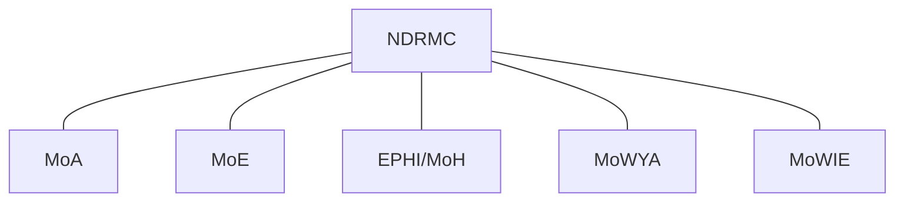
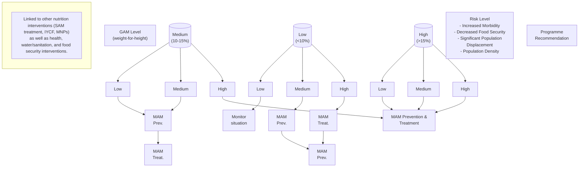
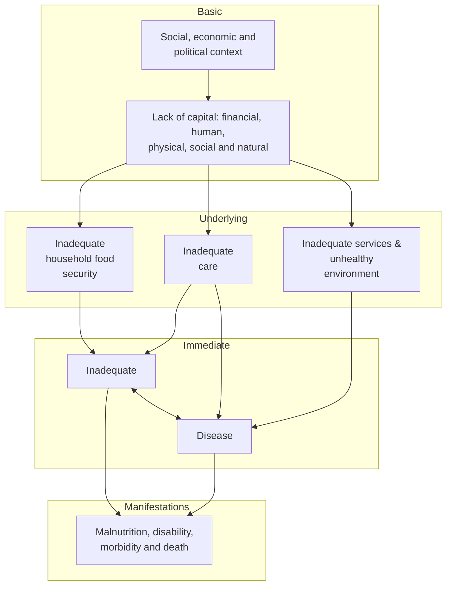

# EPHI: Emergency Nutrition Guideline (2022)

<!-- page 1 -->

# National Guideline For Emergency Nutrition Intervention

**Ethiopian Public Health Institute**
**Addis Ababa Ethiopia, February 2022**

<!-- page 2 (printed I) -->

# Table of Contents

Table of Contents I
List of Tables and Figures III
Abbreviations and Acronyms IV
Definitions of Terms VI
Acknowledgement XI
Foreword XII
1. INTRODUCTION 1
1.1. Overview of nutrition in emergencies 1
1.2. Rationale 5
1.3. Purpose and scope of the guideline 5
1.4. Users of the guideline 6
2. NUTRITIONAL PREPAREDNESS 7
2.1. Planning for identified risks and hazards 10
2.2. Coordination and collaboration 10
2.3. Capacity development 1
2.4. Surge Capacity 2
2.5. Resource Mobilization 2
2.6. Logistics Management 2
3. NUTRITION SURVEILLANCE 3
3.1. Nutrition Surveillance 3
3.2. Nutrition assessments in an emergency 4
3.3. Analyzing, Interpreting and Reporting of Nutrition Data in an Emergency 7
3.4. Early Warning 9
4. EMERGENCY FOOD AID AND NUTRITION RESPONSES 11
4.1. Emergency food aid response 11
4.2. Implementing Emergency Nutrition Interventions 14
4.2.2. Treatment of severe acute malnutrition (SAM) 20
4.3. Prevent and treat of micronutrient deficiencies during an emergency 23
4.4. Diseases related Undernutrition 26
4.5. Infants and Young Child Feeding in Emergencies (IYCF-E) 28

<!-- page 3 (printed II) -->

4.6. Food Safety during Emergency 33
4.7. Psychosocial considerations during emergency nutrition response 35
## 5. SUPPLY MANAGEMENT IN EMERGENCY 38
## 6. MONITORING AND EVALUATION (M&E) 43
## 7. REFERENCE 51
## 8. ANNEX 53
Annex 1. Emergency Treatment of SAM 53
Annex 2. Monthly Nutritional screening reporting form for children aged 6-59 months old 56
Annex 3. Monthly Nutritional screening reporting form for Pregnant and Lactating Women (PLW) 57
Annex 4. Vitamin A Supplementation and Deworming Reporting form for children aged 6-59 months 58
Annex 5. Essential Commodities for the Management of SAM and MAM 59
Annex 6. The UNICEF conceptual framework for undernutrition 62
Annex 7. The IPC Reference Table 63
Annex 8. Standards for population nutritional requirements – for planning purposes in the initial stage of an emergency 64
Annex 9. Bin Card 65

<!-- page 4 (printed III) -->

## List of Tables and Figures

### List of Tables

Table 1. Nutrition surveillance benchmarks 4
Table 2. Summary of nutrition assessment tools during an emergency 6
Table 3. Emergency nutrition surveillance data Inventory 8
Table 4. Classification of situation severity based on IPC classification 10
Table 5. General food rations (grams) 14
Table 6. When to open and close/phase out a SFP 19
Table 7. Supplementation to prevent vitamin A deficiency 26
Table 8. Performance outcome indicators 48
Table 9. Exit Categories for Therapeutic and Supplementary Feeding 49
Table 10. Summaries of indicators used for therapeutic feeding 50

### List of Figures

Figure 1 Risk Analysis and Monitoring Graph 9
Figure 3. Programme recommendation for Prevention of Acute Malnutrition and Treatment 17

<!-- page 5 (printed IV) -->

## Abbreviations and Acronyms

|>|Greater than|L|Length|
|-|-|-|-|
|≥|Greater than or equal to|||
|<|Less than|LRTI|Lower Respiratory Tract Infection|
|AIDS|Acquired Immune Deficiency Syndrome|μg|Micro Gram|
|ALOS|Average Length of Stay|MAM|Moderate Acute Malnutrition|
|ART|Anti-Retroviral Therapy|MANTF|Multi-Agency Nutrition Task Force|
|ARV|Anti-Retroviral|Mg|Milligram|
|AWD|Acute Watery Diarrhoea|Ml|Milliliter|
|AWG|Average Weight Gain|Mm|Millimeter|
|BSFP|Blanket Supplementary Feeding Programme|MND|Micro Nutrient Deficiency|
|BMS|Breast Milk Substitutes|MDDs|Micro-nutrient Deficiency Disorders|
|CHD|Community Health Day|MICS|Multiple Indicator Cluster Surveys|
|CM|Centimeter(s)|MOH|Ministry of Health|
|CMAM|Community based Management of Acute malnutrition|MUAC|Mid-Upper Arm Circumference|
|CMR|Crude Mortality Rate|NGO|Non-Governmental Organization|
|CTC|community based therapeutic care|NGT|Naso-Gastric Tube|
|EDHS|Ethiopian Demographic Health Survey|NDRMC|National Disaster and Risk Management Commission|
|ENU|Emergency Nutrition Unit|NNP|National Nutrition Programme|
|EPHI|Ethiopian Public Health Institute|OCHA|Office for the Coordination of Humanitarian Affairs|
|EPRP|Emergency Preparedness and Response Plan|ORS|Oral Rehydration Solution|
|EPSA|Ethiopian Pharmaceutical Supply Agency|OTP|Outpatient Therapeutic Programme|
|||PDCAAS|Protein Digestibility Corrected Amino Acid Score|
|EWS|Early-warning System|PHEM|Public Health Emergency management|
|FBF|Fortified Blended Foods|PLHIV|Person or People Living with HIV|
|G|Gram(s)|PLW|Pregnant and Lactating Women|
|GAM|Global Acute Malnutrition|PSNP|Productive Safety Net Programme|
|GBV|Gender Based Violence|ReSoMal|Rehydration Solution for Malnutrition|
|GFD|General Food Distribution|RHB|Regional Health Bureau|
|GMP|Growth Monitoring Promotion|RNI|Reference Nutrient Intake|

<!-- page 6 -->

|HBC|Home Based Care|RUSF|Ready –to-Use Supplementary Food|
|-|-|-|-|
|HC|Health Center|RUTF|Ready –to-Use Therapeutic Food|
|Hb|Hemoglobin|SAM|Severe Acute Malnutrition|
|HEP|Health Extension Program|SC|Stabilization Centre|
|HEW|Health extension worker|SENA|Seasonal Need Assessment|
|HIV|Human immuno virus|SFP|Supplementary Feeding Programme|
|HP|Health Post|TSFP|Targeted Supplementary Feeding Program|
|HSTP|Health Sector Transformation plan|TB|Tuberculosis|
|IASC|Inter-Agency Standing Committee|UNICEF|United Nations International Children’s Emergency Fund|
|IDP|Internally Displaced People|WASH|Water Sanitation and Hygiene|
|IDSR|Integrated Diseases Surveillance and Response|WFP|World Food Programme|
|IPC|Integrated Food Security Phase Classification|WFA|Weight for Age|
|IU|International Unit|WFL|Weight for Length|
|IYCF\_E|Infant and You Child Feeding in Emergencies|WFH|Weight for Height|
|Kcal|Kilo calorie|WHO|World Health Organization|
|KG|Kilogram|ZHD|Zonal Health Department|

<!-- page 7 (printed VI) -->

## Definitions of Terms

|Terms|Definition|
|-|-|
|**Acute Malnutrition**|Acute malnutrition is a form of under nutrition. It is caused by a decrease in food consumption and/or illness resulting in bilateral pitting oedema or sudden weight loss. It is defined by the presence of bilateral pitting oedema or wasting (low mid-upper arm circumference \[MUAC] or low weight-for-height \[WFH]).|
|**Anthropometry**|Anthropometry is the study and technique of human body measurement. It is used to measure and monitor the nutritional status of an individual or population group.|
|**Blanket Supplementary Feeding Program (BSFP)**|BSFP is an intervention that aims to prevent acute malnutrition among vulnerable group. A supplementary ration is provided for everyone in an identified vulnerable group for a defined period. This might be all children 6 to 24 months or 6 to 59 months and/or all pregnant and lactating women, regardless of their nutritional status.|
|**Bilateral Pitting Oedema**|Bilateral pitting oedema, also known as kwashiorkor or edematous malnutrition, is a sign of severe acute malnutrition (SAM). It is defined by bilateral pitting oedema of the feet and verified when thumb pressure applied on top of both feet for three seconds leaves a pit (indentation) in the foot after the thumb is lifted. It is an abnormal infiltration and excess accumulation of serous fluid in connective tissue or in a serous cavity.|
|**Community-Based Management of Acute Malnutrition (CMAM**|CMAM refers to the management of acute malnutrition through: 1) inpatient care for 6-59 months old SAM children with medical complications and under 6 months SAM infants with/without medical complications; 2) outpatient therapeutic programme (OTP) for 6-59 months old SAM children without medical complications 3) community outreach; and 4) services or programmes for children 6 to 59 months and PLW with moderate acute malnutrition (MAM).|
|**Emergency or humanitarian crisis**|An **emergency** or **humanitarian crisis** is an event(s) which critically threatens the health, safety, security or wellbeing of a large group of people. A crisis is triggered by a hazard that may be natural or man-made, with rapid or slow onset, and of short or protracted duration.|
|**F75**|Formula 75 (75 kcal/100ml) is a therapeutic milk recommended by WHO for the stabilization phase of children with SAM and medical complication.|

<!-- page 8 (printed VII) -->

|Terms|Definition|
|-|-|
|**F100**|Formula 100 (100 kcal/100ml) is a therapeutic milk recommended by WHO for the nutrition rehabilitation of children with SAM after stabilization in the SC. F100 has a similar nutrient composition to RUTF.|
|**F100 Diluted**|Formula F100 diluted (100kcal/130ml) is a therapeutic milk recommended by WHO for the stabilization and rehabilitation of infants 0-6 months of age with SAM and without bilateral pitting edema in the SC.|
|**Food Security**|Food security occurs when people, at all times, have physical and economic access to sufficient, safe and nutritious food that meets their dietary needs and food preferences for an active and healthy life. A family (or country) may be food secure, yet include individuals who are nutritionally insecure. Food security is therefore a necessary but not sufficient condition for nutrition security. Hunger is an outcome of food insecurity, where dietary intake, at population level, falls below minimum requirements (typically averaged as 2,100 kcal per person per day).|
|**Fortified Blended Foods (FBF)**|FBF are a mixture of cereals and other ingredients such as soya beans or pulses that have been milled, blended, pre-cooked by extrusion or roasting, and fortified with a pre-mix of a sufficient amount and range of vitamins and minerals. Super Cereal Plus is an example of FBF.|
|**Global Acute Malnutrition (GAM**|GAM is a population-level indicator referring to overall acute malnutrition defined by the presence of bilateral pitting oedema or wasting defined by WFH < -2 z-score (WHO standards). GAM is the sum of severe and moderate acute malnutrition (GAM = SAM + MAM).|
|**Mid-Upper Arm Circumference (MUAC) Indicator**|Low MUAC is an indicator for wasting, used for a child that is 6– 59 months of age. MUAC < 11.5 cm indicates severe wasting, or SAM. MUAC ≥ 11.5 cm and < 12.5 cm indicates moderate wasting, or MAM.|
|**Moderate Acute Malnutrition (MAM)**|MAM, or moderate wasting, is defined by a MUAC ≥ 11.5cm and < 12.5 cm or a WFH ≥ -3 z-score and < -2 z-score (WHO standards) in children 6-59 months. MAM can also be used as a population-level indicator defined by WFH ≥ -3 z-score and < -2 z-score (WHO standards).|
|**Micronutrient deficiencies (MND)**|Micronutrient deficiencies (MND) are a form of undernutrition that is related to vitamins and minerals. Deficiencies of iron, iodine, vitamin A and zinc are amongst the top-10 leading causes of death through disease in developing countries. Other|

<!-- page 9 (printed VIII) -->

|Terms|Definition|
|-|-|
||deficiencies which are more specific to emergencies include those of thiamine (B1), riboflavin (B2); niacin (B3) and vitamin C.|
|**Outpatient Therapeutic Program (OTP) for Management of SAM Without Medical Complications**|OTP is a service treating patients with SAM without medical complications through the provision of routine medical treatment and nutrition rehabilitation with RUTF. Patients attend outpatient care at regular intervals (usually once a week) until the discharge criteria are reached.|
|**Public Health Emergency Management (PHEM)**|PHEM is a process of anticipating, preventing, preparing for, detecting, responding to, controlling and recovering from consequences of public health threats in order that health and economic impacts are minimised.|
|**Ready-to-Use Supplementary Food (RUSF)**|RUSF is an energy-dense, mineral- and vitamin-enriched food specifically designed to treat MAM. RUSF has a similar nutrient composition to RUTF, but has a different source of protein and a vitamin and mineral premix. RUSF is soft and can be consumed easily by children from the age of 6 months without adding water. Like RUTF, RUSF is not water-based, meaning that bacteria cannot grow in it and that it can be used safely at home without refrigeration and in areas where hygiene conditions are not optimal. Unlike fortified blended food it does not require preparation before consumption. Plumpy’sup® is an example of a known lipid-based RUSF.|
|**Ready-to-Use Therapeutic Food (RUTF)**|RUTF is an energy-dense, mineral- and vitamin-enriched food specifically designed to treat SAM. RUTF has a similar nutrient composition to F100. RUTF is soft and can be consumed easily by children from the age of 6 months without adding water. Unlike F100, RUTF is not water-based, meaning that bacteria cannot grow in it and that it can be used safely at home without refrigeration and in areas where hygiene conditions are not optimal. It does not require preparation before consumption. Plumpy’nut® is an example of a known lipid-based RUTF.|
|**Severe Acute Malnutrition (SAM)**|SAM is defined by the presence of bilateral pitting oedema or severe wasting (MUAC < 11.5 cm or a WFH < -3 z-score \[WHO standards]) in children 6-59 month. A child with SAM is highly vulnerable and has a high mortality risk.|
|**Severe Wasting**|Severe wasting is a sign of SAM. It is defined by a MUAC < 11.5 cm or a WFH < -3 z-score \[WHO standards]) in children 6-59 months. Severe wasting is also called non edematous malnutrition. The child with severe wasting has lost fat and muscle and appears very thin (e.g., signs of “old man face” or “baggy pants” \[folds of skin over the buttocks]).|

<!-- page 10 (printed IX) -->

|Terms|Definition|
|-|-|
|**Severe Wasting with Bilateral Pitting Oedema**|Severe wasting with bilateral pitting oedema is the simultaneous condition of severe wasting (MUAC < 11.5 cm or WFH/WFL <- 3Zscore) and bilateral pitting oedema of any grade (+, ++ or +++).|
|**Sphere Project or Sphere Standards**|The Sphere Project Humanitarian Charter and Minimum Standards in Disaster Response is a voluntary effort to improve the quality of assistance provided to people affected by disaster and to enhance the accountability of the humanitarian agencies in disaster response. Sphere has established Minimum Standards in Disaster Response (often referred to as Sphere Standards) and indicators to describe the level of disaster assistance is needed. Visit \[www\.sphereproject.org]\(http\://www\.sphereproject.org/) for more information.|
|**Stabilization Centre (SC)**|SC is a service to treat children with SAM with medical complications until their medical condition is stabilized and the complication is resolved (usually four to seven days). Treatment then continues in OTP until discharge criteria's are reached. Inpatient care for SAM with medical complications is provided in a hospital or health facility with 24-hour care capacity.|
|**Super Cereal plus**|Super Cereal Plus is a blend of cereals and legumes (mostly corn/wheat/rice and soy), pre-cooked, available in dry form and fortified with vitamins and minerals. Its formulation was designed to target Pregnant and Lactating Women (PLW) and malnourished individuals on ART/DOTS. The nutritional profile consists of 752-939 kcal, 31-38g protein (16%), 16-20g fat (19%). Meets RNI and PDCAAS. The shelf life reaches 12 months. The packages come with 25kg (net) bags.|
|**Targeted Supplementary Feeding Program (TSFP)**|TSFP is an intervention that aims to treat patients with MAM, and prevents deterioration to the condition to SAM. The supplementary food ration is targeted to individuals with MAM in specific vulnerable groups such as children age 6 to 59 months and malnourished pregnant and lactating women with infants under 6 months of age.|
|**Under nutrition**|Under nutrition is a consequence of a deficiency in nutrient intake and/or absorption in the body. The different forms of under nutrition that can appear isolated or in combination are acute malnutrition (bilateral pitting oedema and/or wasting), stunting, underweight (combined form of wasting and stunting), and micronutrient deficiencies.|
|**Underweight**|Underweight is a composite form of under nutrition including elements of stunting and wasting and is defined by a weight-for-|

<!-- page 11 (printed X) -->

|Terms|Definition|
|-|-|
||age (WFA) z-score below 2 SDs of the median (WHO standards). This indicator is used in growth monitoring and promotion (GMP) and child health and nutrition programmes aimed at the prevention and treatment of under nutrition.|
|**Wasting**|Wasting is a form of acute malnutrition. It is defined by a MUAC < 12.5 cm or a WFH < -2 z-score \[WHO standards]) in children 6-59 months.|
|**Weight-for-Age Index (WFA)**|The WFA index is used to assess underweight. It shows how a child’s weight compares to the weight of a child of the same age and sex in the WHO standards. The index reflects a child’s combined current and past nutritional status.|
|**WFH/WFL**|The WFH/WFL index is used to assess wasting. It shows how a child’s weight compares to the weight of a child of the same length/height and sex in the WHO standards. The index reflects a child’s current nutritional status.|

<!-- page 12 (printed XI) -->

# Acknowledgement

The national emergency nutrition intervention guideline was prepared with the active participation of nutrition experts from several organizations, regions, institutions and agencies in the country.

The Ethiopian Public Health Institute greatly appreciates Mr. Biruk Tadesse (Senior Nutrition Expert) for leading and coordinating the entire process of this guideline development and finalization.

The development of this guideline was carried out under the auspices of Ethiopian Public Health Institute. In this regard, the support extended by Mrs. Mesfin Wossen (A/Director of Diseases and Health Events Surveillance and Response Directorate) is gratefully acknowledged.

Special appreciations and thanks go to the following individuals who have provided significant support and contribution for the development of this guideline:

1. Biruk Tadesse (EPHI)

2. Dessalegn Geleta (EPHI)

3. Mekonnen Balcha (DRMC)

4. Dr. Betty Lanyero (WHO)

5. Emana Alemu (EPHI)

6. Yoseph Teklu (UNICEF)

7. Rashid Abdulai (UNICEF)

8. Habtamu Ayigegn (EPHI)

9. Yibeyin Mulualem (EPHI)

10. Shiberu Kelbesa (MOH)

11. Miraf Tesfaye (MOH)

12. Dr. Yared Abebe (JSI)

13. Cecile Basquine (UNICEF)

14. Muzemil Muktar (WFP)

<!-- page 13 (printed XII) -->

# Foreword

The Ethiopian Public Health Institute (EPHI) is working as a technical arm of the ministry of health to deliver comprehensive health emergency management in the country. This guideline is primarily intended for all stakeholders involved in emergency nutrition intervention at the woreda, zonal, regional and federal levels. It also provides health workers, nutritionists and humanitarian actors with enhanced skills, knowledge and attitude to address the challenges that they used to encounter during emergency nutrition response.

Addressing malnutrition requires complementary multisectoral strategies and approaches that respond both to long-term development challenges and to immediate needs, linked to the survival and well-being of families and communities. Natural and man-made disasters can destroy lives and livelihoods and wipe out years of development gains in a matter of hours or even seconds. When the resilience of families degrades in emergency situations, so does their nutritional status.

It is with our profound hope that the guidance and operational recommendations provided by this guideline can contribute to shift from reactive emergency response to proactive anticipative risk reduction and management resulting in better health and nutrition outcomes for the population.

While EPHI acknowledges that technical knowledge and expertise continue to evolve in the area of emergency nutrition intervention through time, the effective use of this guideline marks an important milestone. In that regard, EPHI calls upon all stakeholders to work together for the purpose of further improvement on emergency nutrition intervention.

Aschalew Abayneh

Ethiopian Public Health Institute

Deputy Director General

<!-- page 14 (printed 1) -->

# 1. INTRODUCTION

## 1.1. Overview of nutrition in emergencies

Humanitarian crises exacerbate nutritional risks and often lead to an increase in acute malnutrition. Emergencies include both man-made (conflict) and natural disasters (floods, drought, cyclones, typhoons, earthquakes, volcanic eruptions, etc.). Complex emergencies are combinations of both man-made and natural disasters, often of a protracted nature. Millions of people are affected by humanitarian crises every year. The increasing frequency and scale of emergencies requires nutrition to be addressed in all phases of a response.1

Crisis situations, whether acute or protracted, impact on a range of factors that can increase the risk of undernutrition, morbidity and mortality. They may involve: the large-scale destruction of property and infrastructure; the erosion of livelihood strategies and purchasing power; a breakdown of and reduced access to essential services including health services, water supply and sanitation; and displacement of large numbers of people. Emergencies can also disrupt social systems and the quality of care/feeding practices. Household access to food may be negatively affected and people may find themselves in over-crowded settlements with their families being divided. As a result, at the individual level, there is often an increased risk of deteriorating health and nutritional status, resulting in a greater likelihood of death.

Young children and pregnant and lactating women are particularly vulnerable to undernutrition from a physiological point of view, due to their increased nutrient requirements for growth and development. Young children are also exposed to a higher risk (compared to other population groups) of contracting infections, which can further increase nutrient requirements, impede nutrient use and reduce appetite.2

**Who are most vulnerable to undernutrition in emergencies?**

1 USAID, Multi-sectoral nutrition strategy 2014-2025, Technical Guidance Brief on Nutrition in Emergency

2 Addressing Undernutrition in Emergencies; European Commission; Brussels, 12.3.2013 SWD(2013) 72 final

<!-- page 15 (printed 2) -->

Some population groups are more nutritionally vulnerable than others in emergencies based on physical, geographical, social, economic, and refugee status as described below:

## Physiological vulnerability

Individuals can be physiologically vulnerable for two reasons. Firstly, nutrient requirements increase at certain ages. Infants and young children who are growing and developing quickly are particularly vulnerable as are pregnant and lactating women who require more nutrients for intra-uterine growth and to breastfeed their infants. Reduced appetite and ability to eat can also create vulnerability. Older people, the disabled and people living with chronic illness such as HIV and AIDS may all suffer from a reduction in appetite, difficulties in chewing and difficulties in accessing food, all of which makes them vulnerable to undernutrition.3

## Geographic vulnerability

In some emergencies, populations who live in certain geographical areas are at particular nutritional risk. For example, those living in drought or flooding-prone areas are likely to be less food and nutritionally secure. Certain livelihood groups are vulnerable where natural resources become scarce and populations who reside in areas prone to conflict or in densely populated urban areas (slums) are also nutritionally vulnerable.

## Social vulnerability

The poorest households are often some of the most vulnerable to emergencies as they often struggle the most to cope with shocks. The impact of the food, fuel and economic crisis in 2008 and again in 2011 is a good example of this. With fewer resources, poor people resort to eating less frequently, and consuming a less diverse and nutrient deficient diet.

There is evidence that vulnerable households (and their most nutrition-vulnerable members, objective of this document) are likely not have access and/or cannot afford a nutritious diet (Fill the Nutrient Gap 2020). Most of the relief food security interventions are designed to provide rations looking at fulfilling k-calories only (not other macro- and micro-nutrients). This is so because nutritious diets can be up to five to eight times more expensive than k-calories-based diets. However, EPHI has developed mechanisms to prioritize the resources, when limited (ToR

3 Older men and women are those aged over 60 years, according to the UN, but a definition of ‘older’ can vary in different contexts.

<!-- page 16 (printed 3) -->

of the National Technical Working Group for the Cost / Non-Affordability of Healthy Diets 2020).

Gender also plays a role in a person’s social vulnerability. Women/girls and men/boys face different risks in relation to deterioration of their nutritional status in emergency contexts. These different vulnerabilities are related both to their differing physiological nutritional requirements and to socio-cultural factors related to gender. For example in some emergency situations where food is in short supply, women and girls may be more likely to reduce their food intake as a coping strategy in favor of other household members. This can contribute to acute malnutrition among women and girls. Furthermore because of social traditions men and boys may be favored and fed better than women and girls in some societies.

### Political vulnerability

Communities or individuals exposed to violence or marginalization may be vulnerable. Emergency situations can lead to population migration and displacement. Refugees and IDPs who flee with little or no resources are at greater risk of being food insecure as they may be completely cut off from their normal food sources, social structures and coping mechanisms. Refugees often reside in inhospitable and isolated parts of the country. Their situation also depends on the size of the refugee or IDP population, whether they are living in large overcrowded camps, in small groups or with host families, whether they have access to land and income earning opportunities, and on the food security of the host country and population themselves. Populations hosting refugees and IDPs are also often increasingly vulnerable to nutrition crises.

### Specific vulnerabilities within Ethiopia

In Ethiopia pastoralists, primarily found in four regions - Afar, Oromia, Somali and the SNNP regional states - are a particularly vulnerable group. As an economic and social system, pastoralism operates effectively in low and highly variable rainfall conditions. However, with an increasing population, climate change and increased barriers to international markets, pastoralist livelihoods systems are becoming increasingly vulnerable. Traditional livestock practices have deteriorated and there has been significant degradation of some wet season grazing areas. Additionally, grazing land has been taken away from pastoralists for other purposes, such as farming and settlement along pastoralist migratory routes. The pressures on pastoralists and their

<!-- page 17 (printed 4) -->

livelihoods, particularly in times of drought, make them highly vulnerable to acute and chronic food insecurity and malnutrition.

Seasonal vulnerability is also cause for concern in Ethiopia given the dependence of agriculturalists on rain for the meher/belg harvests. Like pastoralists, in times of drought their available food and monetary resources decrease dramatically often resulting in spikes in undernutrition. Studies in rural Ethiopia have shown that in some situations child height growth velocity follows a seasonal pattern and that seasonal undulations in food security manifest as energy stress among women, men and children.

### What types of malnutrition occur during emergencies?

Of concern in emergencies is the increased risk of moderate and severe acute malnutrition because acute malnutrition is strongly associated with death. On average household members with moderate acute malnutrition are five to eight times more numerous than the ones with signs of severe acute malnutrition.

In many long-term emergencies, however, the prevalence of acute malnutrition may be relatively low while the rates of other forms of malnutrition, such as stunting, are high. Stunting inhibits a child from reaching his or her full physical and mental potential. It can have a major impact on work output and national economic development. Furthermore, small mothers have small babies who are more likely to be sick and die. Stunting therefore is becoming an increasingly important measure of nutritional wellbeing in chronic emergencies.

### Causes of acute malnutrition

The UNICEF conceptual framework, found in Annex 6, is a useful tool to help understand the many factors that can impact on nutrition status. It identifies three levels of causality: immediate, underlying and basic which can all be disrupted during emergencies.

The immediate causes of acute malnutrition are a lack of dietary intake, or disease. This can be a result of consuming too few nutrients or an infection which can increase requirements and prevent the body from absorbing the nutrients consumed. Whether or not an individual gets enough food (both staple and nutrient-dense) to eat or whether s/he is at risk of infection is mainly the result of factors operating at the household and community level such as:

<!-- page 18 (printed 5) -->

* Inadequate household food and nutrition security

* Inadequate care

* Inadequate services and unhealthy environment

In practice there is significant overlap in the three groups of underlying causes.

All three clusters of underlying causes of undernutrition are subject to seasonal variation. For example, access to food typically reduces prior to the harvest when workload is also high (for agricultural producers), or prior to the rains when workload finding water and pasture is high (for pastoralists).

The third level of factors contributing to undernutrition operates at the basic level. This refers to the resources available (human, structural, financial) and how they are used (the political, legal and cultural factors). Political, legal and cultural factors may defeat the best efforts of households to attain good nutrition.

## 1.2. Rationale

Ethiopia is facing recurrent natural hazards and manmade humanitarian crisis and associated high burden of nutritional emergencies. Due to this, field practitioners often caught in day-today emergency response and may fall short of developing and maintaining comprehensive and effective emergency nutrition preparedness and response guidance, tools and resources to help them ease the process.

Therefore, EPHI, MoH and NDRMC has developed this interim guidance to help country level nutrition clusters, nutrition sector coordination and nutrition working groups to strengthen collective emergency nutrition preparedness, surveillance and response towards effective protection of the nutritional status of populations.

## 1.3. Purpose and scope of the guideline

The purpose of this guideline is to provide harmonised practical direction to service providers, policy makers, programmers, and stakeholders on the current standards and recommendations on emergency nutrition interventions.

<!-- page 19 (printed 6) -->

The guideline also aims to:

* Guide nutritionists and humanitarian workers in their analysis of the situation and in putting contextual factors other than the nutritional situation into perspective in order to fully understand the response environment.

* Guide nutritionists and health workers in drawing up a strategy for nutritional-health intervention that best meets the needs of a particular emergency.

* Coordinate decision-making regarding nutritional-health intervention in emergency situations.

* Strengthen the coordination of emergency response among stakeholders

## 1.4. Users of the guideline

A variety of Nutrition programmers, health service providers and institutions working on nutrition can benefit from this guideline. It is designed for use by:

1. Emergency Nutrition Program managers and PHEM officers at National, Regional, Zonal, Sub City and Woreda levels

2. Health service providers at community and health facility level (health extension workers, health workers at OTP/SC and surveillance officers

3. Teaching institutions that train health professionals

4. Nutrition experts and humanitarian workers

5. Government officials within relevant ministries

6. Donors and UN agencies (UNICEF, WFP, WHO)

7. Nongovernmental organizations (NGOs)

<!-- page 20 (printed 7) -->

## 2. NUTRITIONAL PREPAREDNESS

Preparedness is usually associated with measures taken in advance or in anticipation of an emergency. It can also be seen as an early action and capacity development tool which aims to mitigate negative impacts, by improving the overall effectiveness, efficiency, timeliness of response and recovery.

Preparedness is part of risk-informed programming (which also includes disaster risk reduction, climate change adaptation, peace building and social protection). In most emergencies, external support can take days and in some cases weeks to arrive. Therefore, it is vital that there is a plan in place, based on the available in-country capacity, to deal with the initial phase of an emergency.

### Preparedness actions

#### Coordination

* Nutrition in emergency coordination mechanism established

* Terms of reference for nutrition cluster staff are available

* TOR for the nutrition cluster are agreed upon

* Technical working group and strategic advisory group created and TOR available

* Contact list of nutrition sector partners is available and updated

* The nutrition cluster participate and contribute to inter-sector coordination

* Cluster members are familiar with humanitarian principles, cluster approach and accountability to affected populations

#### Information management (IM)

* Role and responsibilities for IM agreed upon with government and cluster members

* A platform for storing and sharing documents is operational

* Data collection tools harmonized and available to all members

#### Needs assessment, analysis and monitoring

* Rationale and methods for needs assessment and analysis understood by partners

* Historical nutrition data are retrieved and analyzed

* Nutrition is included in joint/common rapid assessment

* Rapid and standard nutrition assessment are agreed by all partners

* Nutrition screenings and surveillance systems are set up

<!-- page 21 (printed 8) -->

### Resources

* Donor relation is established

* Cluster members are familiar with CERF and common appeals mechanisms

* Cluster members build preparedness for supplies management

### Implementation and monitoring

* Capacity mapping is performed and regularly updated

* Preparedness measures for specific nutrition interventions are taken

* Gap Analysis is performed and regularly updated

* Rapid response mechanism implementation is discussed

* A capacity building strategy/plan is designed

* Monitoring and evaluation of preparedness is performed

### Communication and advocacy

* A communication and advocacy strategy is need to agree with members and implementers

### Communication and advocacy accountability to affected populations (AAP)

### Risk analysis & monitoring

The IASC defines risk analysis and monitoring as the first pillar of emergency preparedness planning. A clear and common understanding of the risks which may trigger a crisis significant enough to require a coordinated response is fundamental to the entire preparedness process. The risk analysis informs the planning while monitoring ensures that the process is responsive to emerging risks.

Emergency response plan methods for risk analysis and monitoring actions

1. **Identify the hazards** by answering the following questions: what phenomenon, activity or conditions may affect the nutrition status of the population (natural disasters, armed conflicts, epidemics, financial crisis...)? If more than one is identified, how do they interact? How are these likely to develop over time? What are the causal pathways?

2. **Ranking the risks**: all hazards should be ranked by the perceived impact (on a scale 1-5) and likelihood of happening (on a scale 1-5). Risk=Impact x Likelihood. Risks should then be ranked from low to high.

<!-- page 22 (printed 9) -->

3. **Defining thresholds**: thresholds for the risk values, as above calculated, should then be set by the HCT or NCC and the actions needed when exceeded are defined (e.g. when risk > 10 initiate contingency planning).

4. **Monitoring the risk**: a mechanism should be established to track the hazards and in particular those with a high-risk value.

The following chart shows a risk analysis matrix where seriousness is calculated as Impact multiplied by Likelihood.

|IMPACT|1 Very unlikely|2 Unlikely|3 Moderately likely|4 Likely|5 Very likely|
|-|-|-|-|-|-|
|Critical 5|5|10|15|20|25|
|Severe 4|4|8|12|16|20|
|Moderate 3|3|6|9|12|15|
|Minor 2|2|4|6|8|10|
|Negligible 1|1|2|3|4|5|

**Seriousness = Impact x Likelihood**

Figure 1 Risk Analysis and Monitoring Graph

<!-- page 23 (printed 10) -->

## 2.1. Planning for identified risks and hazards

Planning of emergency nutrition should primarily depend on the strategic national/regional PHEM plan, EPRP, bi-annual rapid seasonal need assessment, woreda hotspot classification, nutritional surveys and other nutritional findings.

The different steps involved in the development of an emergency nutrition preparedness plan are:

* Mapping of stakeholders

* Identify and establish preparedness planning team from different stakeholders

* Identifying the vulnerable areas and groups within the population (physiological, geographical and political vulnerability)

* Assessing and estimating the number of expected malnutrition cases including micronutrient deficiencies to anticipate the risks of possible epidemics

* Defining the "thresholds" for the emergency response (the health system can no longer manage the cases without the support of external bodies)

* Monitoring the prevalence and number of cases of acute malnutrition

* Develop plans to prevent, protect against, respond to, and recover from natural and man-made disasters

* Ensure the integration of emergency nutrition preparedness plan with stakeholders

* Prepare monitoring mechanisms and tools to ensure preparedness plan is operationalized

## 2.2. Coordination and collaboration

**At Federal level: -** The Disaster Risk Management Commission (DRMC) and/or the equivalent bodies at subnational and local levels are responsible for coordinating preparedness and responses to emergencies, including those caused by natural and man-made hazards. During emergency nutrition intervention the coordination of numerous sectors, partners and UN agencies are very important. It is essential to increase cooperation and collaboration between health and other sectors (e.g. agriculture, water, energy, law enforcement, transport, migration, foreign affairs and trade) before, during and after all types of emergencies.

<!-- page 24 (printed 11) -->

Multi Agency Nutrition Task Force (MANTF) which is the technical taskforce at federal level oversees and ensures the proper technical operation of preparedness and response activities. Health and nutrition operational activities are planned and monitored through the national health emergency operation centers (PHEOCs). Strategic Emergency Coordination Centre (ECC) and Public Health Emergency Operation Centers (PHEOCs) with their respective center at regional level are responsible for mobilizing and prioritizing the resources. The information about the emergency is centrally gathered and communicated through these channels.

**At Regional/zonal level:** Multi sectoral emergency nutrition coordination forum comprising of all concerned sectors, UN agencies, and NGOs coordinated the emergency technical activities at regional level. The regional DRM-TWG Coordination and Emergency Operation Centers (EOCs) will be activated based on the preset criteria if necessary. The regions are therefore preparing Emergency Preparedness and Response Plans (EPRPs) and carryout search and rescue operations and to coordinate joint impact assessment and humanitarian response to affected and displaced peoples.

**At Woreda/Community level:** Local governmental structures with representatives of at risk communities closely coordinate awareness creation and messaging of the threats and take appropriate emergency response measures including relocating at risk population. Activities include dissemination of alert messages and continuous monitoring updates, and coordination of emergency response at times of emergency. Incident command Posts would be established depending on the severity of the disaster.

<!-- page 25 (printed 1) -->

||MoA|MoE|EPHI/MoH|MoWYA|MoWIE|
|-|-|-|-|-|-|
|**Roles and Responsibilities**|\* General Food Rationing that meets nutrient requirements (adequate Food basket composition, include the use of fortified vegetable oil)  \* Enhancement of livelihoods, food and nutrition security in selected communities through improved diversification of food sources.  \* Linkages between national social safety nets or Cash Transfer (CT) programs and nutrition interventions e.g., women and mothers engaged in an IYCF focused SBC program are eligible for CT programs; or households engaged in promotion of adequate complementary feeding activities are eligible for CT programs.|\* ECD kits are made available at mother-baby friendly spaces  \* Integrated SBC strategies with a focus on promoting adequate childcare and feeding practices|\* MUAC screening of under-five and PLW conducted as part of integrated vaccination campaign or any other health campaign  \* Formation of peer groups (mother to mother support groups) promoting adequate IYCF practices as well as attendance to ANC and PNC clinics.  \* Maternal nutrition and health promotion activities target pregnant women by providing counseling and education on maternal nutrition and IYCF, promotion of healthy/safe antenatal/postnatal practices, and referral to medical ANC services/delivery assistance.  \* Integrated health and nutrition interventions for IDPs and affected communities (CMAM, micronutrients, immunization, treatment of diarrhea and pneumonia, prevention of malaria).|\* Protection risks assessments, gender analysis are undertaken by Nutrition partners and results informed the design of the Nutrition response  \* Gender based violence (GBV) prevention is integrated to the Nutrition response|\* Besides nutrition, key messages on hygiene practices are delivered as part of the nutrition services.  \* In some communities, a group of resourceful individuals is created to promote preventive practices including those identified as indirect causes of malnutrition related to WASH.  \* Integrated SBC strategies with a focus on promoting IYCF practices, hygiene practices, use of safe drinking water and use of improved sanitation facilities.  \* SMART and KAP surveys include WASH indicators|

<!-- page 26 (printed 2) -->

|\* Multi-sectoral KAP surveys include nutrition, food security and livelihood indicators among others.  \* Linkages between GFD and nutrition services (MUAC screening, referral to CMAM programs, provision of MN supplements, promotion and referral to antenatal care)  \* Nutrition SMART and KAP surveys include assessment of General Food Ration coverage|\* Supporting health facilities to provide MNCH and nutrition services through outreach activities (ANC, PNC, newborn care, IYCF counselling, growth monitoring, micronutrient distribution (vitamin A) and deworming tablets, management of childhood illness etc.).  \* Linkages between BSFPs and nutrition services (MUAC screening, referral to CMAM programs, provision of MN supplements, promotion and referral to antenatal care)  \* Nutrition SMART and KAP surveys include health indicators||
|-|-|-|

<!-- page 27 (printed 1) -->

Steps to establish strong coordination and collaboration:

1. Mapping of all governmental and non-governmental organization working on nutrition and identify area of intervention

2. Establish technical working group. If there is existing similar committee/working group or team, it is better to use the existing group.

3. Establish communication platform

4. Develop term of reference and agree on it

5. Regular meeting and discussion

6. Implementation of activities based on agreed TOR

7. Monitor and evaluate the implementation of preparedness activities

8. Training on critical topics relevant for the members of the coordination and filling knowledge gaps – e.g. coverage surveying mechanisms.4

## 2.3. Capacity development

Before implementing capacity buildings activities, it is better to define, identify and plan needs that what you want to provide. According to the public health emergency management; the capacity development activities classified into two:

* System Capacity Building:

    - [yes] To simultaneously develop and strengthen nutrition and PHEM programs, partnership, multispectral relationship, reporting system

* Human Capacity Building

    - [yes] Develop and strength a comprehensive short and long term capacity building training for health and nutrition professionals.

    - [yes] Strengthen capacity of women, women organization and women development arms

4 Source: Global Nutrition Cluster Handbook, UNICEF 2013

<!-- page 28 (printed 2) -->

## 2.4. Surge Capacity

Surge capacity is the ability of an organization to rapidly and effectively increase its available resources in a specific geographic location in order to meet increased demand to stabilize or alleviate suffering in any given population. It used when there are unforeseen emergencies, disasters to mobilize staff from different regions/zones/woredas within short period of time.

Effective surge capacity requires access to resources: human, financial and material. People and money are undisputedly the core elements, and the availability of human resources for swift deployment is the anchor of any response.

Surge capacity mechanism includes not only the different standing capacities i.e. people, money and materials but also the tools, policies, procedures and resource configurations that an agency/organization adopts when mobilising that capacity.

## 2.5. Resource Mobilization

Emergency nutrition response needs a huge resource to effectively and productively respond to emergency situation and to get the intended result. Mobilizing resources is the key activity in emergency nutrition response for utilization of resources timely manner to implement the predetermined goals. It needs to map the resources and identify in what means the resources got.

Resource mobilization refers to not only funds but also human resources, goods and services.

* Financial resources: Government budget and local resources

* Human resources: permanent staff of government, seconded staff, NGOs staff, volunteers, interns

* Goods and Services: Vehicles, Printing facilities, training, advice services, communication equipment, etc

## 2.6. Logistics Management

The logistics management of acute malnutrition should be handled jointly with the governmental non-governmental organizations and UN agencies including EPHI, EPSA, UNICEF, MOH and WFP. The emergency supply chain management will be done based on emergency supply chain playbook. Annex 4 and 5 provides a list the essential supplies needed for the management of SAM and MAM.

<!-- page 29 (printed 3) -->

# 3. NUTRITION SURVEILLANCE

## 3.1. Nutrition Surveillance

It is the process of gathering, analyzing, interpreting and dissemination of nutrition information. The purpose of nutrition surveillance is to detect changes in the nutrition status of the population over a period. Nutrition surveillance information will guide planning, implementation, and evaluation of health and nutrition services/interventions. It is also defined as “Information for Action”.5 Nutrition surveillance involves the systematic collection and analysis and interpretation of nutrition data:

- Data from the periodic nutrition surveys

- Results from the periodic nutrition screening

- Reports from the supplementary and therapeutic feeding centres and health clinics

- Health surveillance data

- Morbidity and mortality data

Early warning information on household food insecurity, climate, agriculture and livelihood should be used in the analysis of the nutrition status of the population.

### Indicators of malnutrition during an emergency

All identified surveillance systems collect data to track indicators on the acute malnutrition and micronutrient status of children and pregnant and lactating women, infant and young child feeding practices, and the anthropometric status of children 0–59 months of age and pregnant and lactating women (namely underweight, stunting, and wasting, which were collected across all systems).

* Indicators of malnutrition during emergencies

    - Weight-for -height

    - Mid-upper arm circumference

    - Bi lateral pitting eodema

<!-- page 30 (printed 4) -->

**Table 1. Nutrition surveillance benchmarks**

|Nutrition situation|Recommended actions|
|-|-|
|Acute malnutrition rate >15% OR 10%-14% with aggravating factors\*|Emergency food aid: general food ration Blanket supplementary feeding Therapeutic feeding of severely malnourished individuals|
|Acute malnutrition rate 10-14% OR 5%-9% with aggravating factors\*|No general rations Targeted supplementary feeding Therapeutic feeding of severely malnourished|
|Acute malnutrition rate < 10% with no aggravating factors|No emergency food and nutrition intervention|

Aggravating factors include the following: ƒ

* Household food insecurity; ƒ

* High prevalence of HIV/AIDS; ƒ

* Crude mortality rate greater than 1/10,000/day; ƒ

* Under-five crude mortality rate greater than 2/10,000/day; ƒ

* Epidemic of measles or whooping cough (pertussis); ƒ

* High prevalence of respiratory or diarrhoeal diseases; ƒ

* High prevalence of pre-existing malnutrition, e.g., underweight and/or stunting.

## 3.2. Nutrition assessments in an emergency

An understanding of the context of the emergency nutrition situation is necessary to develop an appropriate response. Analysis of data on the affected population and area increases the understanding of the extent and possible causes of malnutrition. Thorough assessment that includes a good understanding of the community, its context and its concerns should guide all emergency response planning. Information should be collected on community structures (both formal and informal), key stakeholders (traditional authorities, traditional and modern health practitioners, civil society etc), literacy levels, who is responsible for children, who makes key decision on household resource allocation, attitudes to health and malnutrition and health seeking behavior.

<!-- page 31 (printed 5) -->

### 3.2.1. Rapid Nutrition Assessments/Screening (Rapid Survey)

Rapid Nutrition Assessments can be undertaken as part of initial assessments to obtain an overview of the nutritional situation, and determine areas and population groups affected by an emergency. The information collected during rapid assessment provide information on gender disparities in nutritional status in a population when results are disaggregated by sex, and age groups (0-6 months, 6 to 24 months, and 24 to 59 months) and pregnant and lactating women.

Rapid assessments are frequently multi-agency (involve several agencies) and multi-sectoral (involve several technical sectors) in order to have a broad analysis of risks, needs and priorities and to make recommendations to ensure all the health and nutrition needs of an emergency-affected population are met6.

It is also reasonable to recommend and implement nutrition interventions temporarily based on RA results. However the RA should not be taken as a substitute for the standard nutrition assessment. Once an appropriate intervention has been identified, a standard emergency nutrition assessment should be conducted simultaneously with implementation7

### 3.2.2. Repeated surveys

Repeated surveys refer to statistically representative population-based surveys carried out at regular intervals. This category covers national surveys regularly undertaken in stable situations such as the national Demographic Health Surveys (DHS), the UNICEF supported Multiple Indicator Cluster Surveys (MICS), SMART survey, partner’s emergency nutrition surveys and the World Bank supported Living Standards Measurement Surveys (LSMS). It also includes small-scale surveys that are carried out to guide specific nutrition-related programs. Repeated small scale surveys are used in planning, monitoring and evaluating development projects and are also commonly used during emergencies8 - these are mainly based on MUAC measurements and contribute to define specific situations.

***

6 Cluster GN. A Toolkit for Addressing Nutrition in Emergency Situations. 2008;(June):1–87. Available from: papers2://publication/uuid/A41A3FB2-C81D-42B9-AB2D-FDDA52DD4DD2

7 ENCU/DPPA. Guiding Principles for Rapid Nutrition Assessments. 2006;(March):1–16. Available from:

8 Jeremy Shoham, Fiona Watson CD. The use of nutritional indicators in surveillance systems. Tech Support Facil to FAO ’ s FIVIMS Manag by Nutr Work. 2001;1–49.

<!-- page 32 (printed 6) -->

### 3.2.3. Community-based sentinel sites surveillance

Sentinel site surveillance refers to the monitoring of purposively selected communities or service delivery sites. Data are collected on all potential respondents (Children 0–59 months of age and PLW) who visit sentinel sites and health clinics.

Table 2. Summary of nutrition assessment tools during an emergency

|Methodology|Appropriate for|
|-|-|
|SMART ( "Full SMART") survey|\* Usually recommended for an area wider than Woreda such as adjacent woredas (zone) with relatively homogenous population. \* Where there is no recent nutrition data and access to the survey areas is relatively good|
|Rapid SMART survey|\* Where a full SMART survey is not feasible. \* In contexts where access to survey area is limited. \* Small geographic area in delimited zone (e.g., group of villages, IDP/Refugee camps or settlements, urban slums, , neighborhoods and at times woredas) in a population who share similar characteristics (equally affected by crisis, having equal access to services, similar cultural practices, same livelihood zone, etc.)|
|Rapid Nutrition Assessment (RNA)|\* Where conducting population surveys is not possible. \* In a very small area such as IDPs settlements and worst affected areas (to determine worst case scenario). \* Used to determine the need for more thorough assessment using SMART survey methodology.|
|MUAC screening using CDC tools|\* Where conducting population surveys is not possible. \* Concurrently with active case finding for treatment of acute malnutrition. \* *Can be done in small and wider geographic areas such as through* MUAC screening campaigns or routine services delivery. \* *Monitoring trends in proportion of acute malnutrition in defined* geographic area.|

<!-- page 33 (printed 7) -->

## 3.3. Analyzing, Interpreting and Reporting of Nutrition Data in an Emergency

Data collection is the key aspect of the early warning and surveillance in Ethiopia. The system collects and analyses early warning data and publishes EW bulletins for dissemination. The process involves collection of large amount of data for its regular monitoring and baseline database. There are different types of data that are collected by the EWS. Both quantitative and qualitative data are collected regularly on a weekly and monthly basis using a well-structured forms or questionnaires

Regular monitoring system is a continuous activity, which focuses on tracking potential risks for nutrition conditions at the earliest time possible so that, appropriate measures can be taken to reduce disaster risks - before risks turn to disasters. The major interests of the nutrition sector are the determinants of factors of malnutrition such as production (crop, livestock and other related variables), people’s access to food (market supply and price, asset and other sources of household income) and communities’ consumption (food consumption, nutrition, water and health). Other threats/shocks like drought, flooding, El Nino, price volatility are regularly monitored.

Once data are analyzed, the survey results should be put in context to explain the findings and make recommendations for interventions. In order to fulfill these challenges, the following questions need to be answered:

*   How critical are the level of malnutrition and mortality for the population in the current season and within the context of the area?

*   How can the nutrition and mortality levels be explained?

The interpretation of the results is probably the most difficult part of a nutrition survey because there is no standard method for interpreting nutrition data, and there are many different factors to consider at the same time. However, a proper interpretation of the results is crucial in order to design the right intervention.

The nutrition assessment report should provide an accurate account of the nutrition situation in a given area for intervention planning, decision-making, and advocacy. The report should be

<!-- page 34 (printed 8) -->

presented in the standard format which has been developed and should be used by all agencies undertaking nutrition surveys in Ethiopia

**Table 3. Emergency nutrition surveillance data Inventory**

|Data|Data Source|Data collection periods|Geographic area/level of administration|
|-|-|-|-|
||National/Regional/Zonal /Woreda|Weekly and Monthly|Woreda/Regional|
|Health||||
|Malaria|EPHI/Region/Zone /Woreda|weekly|Facility/Woreda|
|Measles|EPHI/Region/Zone /Woreda|Weekly|Facility/Woreda|
|Cholera|EPHI/Region/Zone /Woreda|weekly|Facility/Woreda|
|Diarrheal diseases|EPHI/Region/Zone /Woreda|Weekly|Facility/Woreda|
|SAM Admission inpatient|MoH/EPHI/Region/Zone /Woreda|Weekly/Monthly|Facility/Woreda|
|SAM admission outpatient|MoH/EPHI/Region/Zone /Woreda|Weekly/Monthly|Facility/Woreda|
|SAM Death|MoH/EPHI/Region/Zone /Woreda|Weekly/Monthly|Woreda|
|MAM admission|MoH/ EPHI/RHB/ZHD /WoHO|Weekly/Monthly|Facility/Woreda|
|Nutritional screening Coverage|MoH and EPHI/RHB/ZHD /WoHO|Monthly|Woreda|
|Prevalence of Global (% GAM)|MoH and EPHI/RHB/ZHD /WoHO|Survey|Woreda|
|Proxy GAM and Proxy SAM|MoH and EPHI/RHB/ZHD /WoHO|Screening|Woreda|
|Vitamin A Coverage Prevalence of Micronutrient deficiency (Vit. A.B.C,D)|EPHI/EDHS|Survey|Woreda|
|KAP on IYCF\_E|MOH/EPHI/partners|Survey|Woreda|
|Water and Sanitation and Hygiene (WASH)|MoWIE/MOH/EPHI/Partners|Monthly|Woreda|
|Education and child protection|MoE/ MoWYC|Monthly|Woreda|
|Cost and non-affordability analysis based on food market monitoring and household expenditure surveys|MoA|Monthly|Region, tailored zone as per need|

<!-- page 35 (printed 9) -->

## 3.4. Early Warning

Early warning is the complex process aimed at reducing the impact of the hazard by providing timely and relevant information through monitoring identified indicators9. Data collected through nutrition surveillance systems is used for early warning of a deteriorating nutrition situation to enable mitigating actions to be taken. An early warning system produces an alert. This alert is specific to an area or a livelihood zone, and it provides advance notice. As a result of the warning, there is time to make substantial adjustments as appropriate according to the context. The early warning system includes three components: a process to monitor indicators, a contextualized analysis of their values and trends, and the means to communicate these findings. Early warning information is generated using immediately, weekly, monthly reports and the at the baseline, which then leads to early action/early response. The early action has two dimensions: the disaster risk reduction activities (which are linked with development) and the early response (saving livelihood based on contingency plan).10

### 3.4.1. Early Warning Indicators

Early warning indicators can be categorized based on degree to which they warn about impending disaster: early indicators; stress indicators and late indicators. As the name suggests, early indicators give sufficient lead time to take measures that minimize the negative impact of the anticipated shock. Stress indicators are people’s own perception of the current food and nutrition security situation and their response to it. Late indicators, also known as outcome indicators, are used to assess the physical and behavioral consequences of a disaster (that has already happened) on the affected population.

Two important points to make about indicators: First, it is important to recognize that an early indicator in one agro-ecology or livelihood zone may be a stress or late indicator in another one and vice versa. For example, death of livestock may be considered an early indicator in crop dependent areas but it is a late indicator in pastoral areas where livelihoods heavily depend on livestock. Likewise, a late indicator for one sector may be an early indicator of another sector.

9 UNDP Five approaches to build functional early warning system, 2018

10 Ababa A. National Disaster Risk Management Commission of Ethiopia Guideline for Multi-hazard , Multi-sectoral and Area-specific Early Warning and Early Response in Ethiopia Early Warning and Emergency Response Directorate. 2017;(April).

<!-- page 36 (printed 10) -->

Crop damage by pest infestation is late indicator for crop sector but may serve as early indicator for health and nutrition. Second, a single indicator is unlikely to provide a realistic assessment of the situation or the imminence of a disaster. It is often a combination of indicators that result in shocks such as food shortages (of both staple and nutrient-dense items).

### 3.4.1. Nutrition Early warning threshold

In Ethiopia, the standard framework for assessing the severity of a situation are multi-agency seasonal (Meher and Belg) needs assessments (SENA), Household Economy Analysis (HEA) baselines, regular food and nutrition security monitoring and early warning, verification assessments and disaster area assessments This framework identifies proportion of households with food energy gap or livelihood change strategies that can endanger lives or livelihoods.

**Table 4. Classification of situation severity based on IPC classification**

|||Phase 1None/Minimal|Phase 2Stressed|Phase 3Crisis|Phase 4Emergency|Phase 5Catastrophe/Famine|
|-|-|-|-|-|-|-|
|First-level outcome|Food consumption (focus on energy intake)|Adequate|Minimally adequate|Moderately inadequate|Very inadequate|Extremely inadequate|
||Livelihood change (assets and strategies)|Sustainable|Stressed|Accelerated depletion|Extreme depletion|Near collapse of strategies and assets|
|Second-level outcome|Nutritional status|Minimal|Alert|Serious|Critical|Extreme critical|
||Mortality|CDR: <0.5 / 10,000 / day|CDR: <0.5 / 10,000 / day|CDR: 0.5 - 0.99 / 10,000 / day|CDR: 1 - 1.99 / 10,000 / day or >2 x reference|CDR: >2 / 10,000 / day|
|Contributing factors|Food availability, access utilization and stability|Adequate|Borderline adequate|Inadequate|Very inadequate|Extremely inadequate|
||Hazards and vulnerability|None or minimal effects|Stressed livelihoods and food consumption|Results in assets and food losses|Results in large food assets and food losses|Results in near complete collapse of livelihood assets|

<!-- page 37 (printed 11) -->

## 4. EMERGENCY FOOD AID AND NUTRITION RESPONSES

This chapter describes the range of food and nutrition interventions that are commonly employed in emergencies. An effective nutrition response usually involves several integrated interventions to maximize the impact

There is no fixed blueprint for which interventions to employ in nutrition emergencies, however it is useful to consider the following:

* The severity of the situation (including the mortality, the food security situation, trends in undernutrition and the likely determinants of undernutrition and whether the situation is likely to get better or worse), which dictates the urgency of the response.

* The sub-groups of the population that are at greatest nutritional risk.

* The community understands of their situation and levels of capacity.

* The cost and feasibility of possible responses.

### 4.1. Emergency food aid response

General food ration distributions should be introduced only when absolutely necessary, targeted to those most in need but discontinued as soon as possible. The aim of the emergency food aid response is to deliver timely an adequate quantity and quality of food to the affected population to reduce the risk of acute malnutrition and mortality so that communities, households and individuals can survive and recover from the emergency situation. Implementing adequate food aid early in combination with public health measures will maintain the nutritional status of the affected population.

**General Food Ration (GFR)**

The aims of the General Food Ration are:

* To ensure that emergency affected populations have adequate food intakes; and

* To reduce the risk of acute malnutrition and mortality.

<!-- page 38 (printed 12) -->

GFR is provided to households highly affected by food insecurity. Organization and coordination is the key to success of a food distribution operation. If the population is entirely depending on general food rations as a source of food, then the rations must provide at least 2100 kcal per person per day, and in most cases, because of limited resources, do not provide the minimum dietary requirements of micronutrients (vitamin and minerals). This is a challenge, and requires prioritizing resources for households with children and PLW in view of the first 1,000 days of life approach.

General food rations are usually provided as dry rations for people to cook in their homes. The local community’s food habits, tastes and preferences must be taken into consideration when distributing general food rations.

GFR bridges the gap between the population's requirements and their own food resources from market trading, wage labour, garden plots, community sharing, food stocks, small livestock etc. The same ration is given to every member of the household regardless of age or individual need. The food basket for the GFR consists of food commodities in sufficient quantities to meet a family's basic nutritional requirements and provide a buffer against shortages or spoilage. Adequate fuel, cooking utensils, mills and other grinding facilities must also be available to assisted households and communities. Some bartering and trading of food aid and sale of small livestock to the local population to buy other foods should be expected to a certain degree and should not be discouraged; refugees typically set up marketplaces in camps. Bartering and trading generally improves dietary diversity and quality and provides income to buy essential non-food items such as clothes or soap. Trading foods does not mean that beneficiaries do not need all the rations. More expensive foods that give higher returns are more likely to be traded while cheaper foods are more likely to be consumed by beneficiaries

**The basic food basket/general food ration includes the following:**

* A culturally acceptable staple food such as maize, wheat, rice, millet, sorghum or oats

* A pulse or legume, which is a source of complementary protein such as lentils, beans, peas or peanuts (groundnuts); *f*

* Red palm oil (a natural rich source of vitamin A), vitamin A fortified vegetable oil such as groundnut, Soya, sunflower, rapeseed oil; *f*

<!-- page 39 (printed 13) -->

* A fortified blended food and the main one distributed by the World Food Programme is Corn-Soy Blend; *f*

* Iodized salt.

Sugar and locally available meat or fish can also be part of the food basket. Where possible, the food basket should also include locally available and culturally acceptable foods such as fruits, vegetables, condiments/spices, tea and coffee in order to add nutrients, taste and variety to basic foods, to increase the palatability, familiarity and acceptability of prepared foods and for the preparation of cultural/traditional foods and dishes. Populations generally will not consume a monotonous diet of three commodities (e.g., wheat, beans and oil) for months at a time (see Table 5 below).

**Dried Skim Milk (DSM)** should not be part of the food basket and should not be distributed to the population because of the high risk of contamination when prepared with unclean water or under unsanitary conditions because of the danger DSM poses for young children in particular. The only safe use of DSM is for therapeutic feeding under strict supervision. Breast milk substitutes should be used only in very exceptional circumstances and when provided as generic, non-brand formula. **The International Code of Marketing of Breast-milk Substitutes states:**

* No donations of breast-milk substitutes, bottles or teats should be given to any part of the health care system and donations made to institutions outside the health care system to infants who have to be fed on breast-milk substitutes should be continued as long as the infants concerned need them.

Table 5. Presents five examples of General Food Rations that meet minimum energy, protein, fat and micronutrient requirements and that provide about 2,100 kcal, which is the established international average minimum energy requirement.

<!-- page 40 (printed 14) -->

Table 5. General food rations (grams)

|Food item|1|2|3|4|5|
|-|-|-|-|-|-|
|Cereal|400|450|350|400|400|
|Pulses|60|60|100|60|50|
|Vitamin A fortified oil|25|25|25|30|30|
|Fortified blended foods|50|40|50|40|45|
|Iodized salt|5|5|5|5|5|
|Sugar|15||20||25|
|Fish/meat||10||30||

## 4.2. Implementing Emergency Nutrition Interventions

In an emergency setting, emergency nutrition interventions are programs set-up to

* Integrated management of acute malnutrition (SAM and MAM) as per the MoH protocol

* Provide other critical nutrition services (i.e. growth monitoring, micronutrient supplementation, protection of infant and young child feeding practices) and,

* Provide food to a population that does not have access to food (both staple and nutrient-dense), while filling the nutrient gap (not only kilocalories)

In essence, the emergency nutrition intervention works to reduce high rates of acute malnutrition of large, vulnerable populations. There are three types of emergency nutritional interventions: general dietary programs, supplementary and therapeutic feeding programs. The supplementary feeding programs (SFP) are an ideal nutrition intervention for management of moderately acute malnourished patients whereas the therapeutic feeding programs (TFP) is ideal for management of severely acute malnourished patients. Emergency nutrition interventions require substantial resources to setup and monitor NGOs often to support EPHI with the implementation. The intervention should identify a vulnerable population, distribute food, offer basic medical treatment, micronutrient supplementation and if possible nutrition education.

<!-- page 41 (printed 15) -->

### 4.2.1. Prevention and treatment of MAM

Acute malnutrition, or “wasting,” is a condition that generally results from weight loss due to illness and/or reduced food intake. The degree of acute malnutrition of children and PLW is classified as either moderate or severe based on anthropometric and clinical measures. Children and PLW with MAM have a greater risk of dying because of their increased vulnerability to infections as well as the risk of developing SAM, which is immediately life threatening.

At present the most common interventions for the management (prevention and treatment) of MAM in emergencies are SFPs. During emergency situations, SFPs should be a short-term measure and not as a means for compensating for inadequate household food security or general rations.11 This is possible if the same household can get access to social protection programmes (e.g. PSNP), with a clear nutrition-sensitive focus. A significant and continued reduction in the prevalence of MAM is likely only if an SFP is implemented alongside adequate general food rations, which are looking at the cost and at the non-affordability of a nutritious diet in the target households. New evidence is showing that cash-transfers for the households, with appropriate SBCC component, and when markets are functional can be a more efficient manner to prevent / rehabilitate MAM.

### Supplementary Feeding Program

The goal of supplementary feeding programs (SFP) is to rehabilitate individuals affected by Moderate Acute Malnutrition or at risk of becoming malnourished by providing a supplementary food ration which is highly nutritious.

* **Supplementary Feeding Programs:** There are two ways to distribute food commodities during emergencies: **on-site feeding** (or wet ration) and **take-home** (or dry ration). The ideal dry ration supplementary food provides 1000 to 1200Kcal; 35g to 45g of protein; and fat supplies 30% of required energy. On-site feeding supplementary food provides 500 to 700Kcal per beneficiary per day; includes 15g to 25g of protein; and fat supplies 30% of required energy

11 IASC 2008; A Toolkit for Addressing Nutrition in Emergency Situations.

<!-- page 42 (printed 16) -->

## When to establish a SFP

The decision about whether to implement SFPs should take into consideration:

1. Malnutrition rates: current and previous prevalence of GAM and SAM in children 6-59 months, reported in Z scores.
2. Contextual factors: including the causes of malnutrition, the socio-economic situation, the food security situation, general ration quantity and coverage, as well as the presence of other humanitarian interventions.
3. Public health priorities: whether other priority needs are already being met (shelter, water health care, etc.).
4. Available human, material and financial resources and the objectives of the project.

A decision making framework relating malnutrition rates and SFPs adapted by the GoE's DRMFSS from WHO is outlined below in Table 8

**Principles of SFPs**

* SFPs aim to prevent and rehabilitate acute malnutrition.
* A take-home specialized nutritious food is provided to the patient (children under five and pregnant and lactating women), with follow-up visits conducted at a nearby health facility every two weeks.
* For SFPs to achieve the intended outcomes, it is critical that effective and appropriate linkages are made with food security interventions to avoid the risk of sharing the specialized nutritious food with other members of the household.

There are two types of SFP: **blanket** and **targeted**.

**Blanket Supplementary Feeding Programs**

The main aim of a blanket SFP is to prevent widespread acute malnutrition and to reduce excess mortality among those at-risk by providing a food/micronutrient supplement for all members of the vulnerable group (e.g. children under five, people with HIV and AIDS, elderly and the chronically ill).

<!-- page 43 (printed 17) -->

**Blanket SFPs may be set up under one or a combination of the following circumstances:**

* At the onset of an emergency when general food distribution systems are not adequately in place.

* Problems in delivering/distributing the general ration.

* When large numbers of mild and moderately acute malnourished individuals are likely to become severe due to aggravating factors.

* Anticipated increase in rates of acute malnutrition due to seasonally induced epidemics

* In case of micronutrient deficiency outbreaks, to provide micronutrient-rich food to the target population.

### Targeted Supplementary Feeding Programs

This program is set up when:

❖ There are large numbers of mild and moderately acute malnourished individuals.

❖ A large number of children are likely to become mildly or moderately acute malnourished due to aggravating factors like serious food insecurity or high levels of disease.

❖ There are children discharged from an existing therapeutic feeding programs

❖ A high prevalence of people with HIV and AIDS.

❖ A high prevalence of micronutrient deficiencies.

❖ There is short-term hunger among preschoolers.

Figure 2. Programme recommendation for Prevention of Acute Malnutrition and Treatment

<!-- page 44 (printed 18) -->

## Duration and closure of SFPs

Closing down nutritional interventions is a complex process involving overall assessment of the health, nutrition, food security, and other situation. Phase out criteria must not be seen as a set of strict rules but should be viewed within the context of the situation. The closure of an SFP should be designed in a phased approach in consultation with local authorities. Table 5 below outlines criteria for opening and closing a SFP.

Depending on the magnitude of the emergency situation, SFPs can be phased out in a progressive manner, for example:

* ⇒ a Blanket SFP accompanied by a TFP (with/without GFD) followed by

    - ⇒ a Targeted SFP accompanied by a TFP (with GFD) followed by

        - ⇒ return to only GFD and routine PHC activities for management of SAM

The duration of a **blanket SFP** depends on the scale and severity of the emergency, as well as the effectiveness of the initial response12. The situation should be assessed at regular intervals and the programme re-oriented as needed depending on whether the situation has improved (e.g. adequate general rations established, epidemics are under control, and safe and sufficient water is present). The nutritional status of the population should be assessed (for example through an anthropometric survey) before the decision to close a blanket SFP is taken. At the end of this period, if the situation is still poor, either blanket feeding could be continued or targeted feeding could replace the programme to ensure that the most vulnerable are treated.

When feasible and appropriate, a gradual process of handover and integration into local primary health services, community health programmes like safe motherhood, HIV/ AIDS, immunization, integrated management of childhood illnesses (IMCI) should be undertaken.

*For both blanket and targeted SFPs, partners should assess the situation 3 months before the end of the programme and ensure proposals to continue are sent to donors in a timely manner to avoid breaks in supplies or the unintended closure of SFPs. **Table 6** below summarizes the open and phased closure criteria.*

12 Initial planning timeframes generally anticipate a duration of 3 months for a blanket SFP.

<!-- page 45 (printed 19) -->

Table 6. . When to open and close/phase out a SFP

|Blanket SFP When to open|Targeted SFPs When to open|
|-|-|
|\* At the onset of an emergency if a reliable pipeline for an adequate GFD is not fully in place. \* The prevalence of GAM is ≥20 % or 15 – 19 % among children 6-59 months, plus aggravating factors. \* An increase in prevalence of acute malnutrition is anticipated due to seasonal deterioration in underlying causes of undernutrition, e.g. during a lean season in a highly food insecure or difficult to reach population. \* To prevent malnutrition in the most vulnerable part of the population e.g. 6-23 months. \* To prevent malnutrition in newborns through the nutritional support of pregnant and lactating women. \* The population is difficult to reach due to logistical and/or security problems when more frequent and targeted SFP is not possible due to time, access and implementing partner capacity limitations. \* In case of *micronutrient deficiency* outbreaks, to support overall response, through provision of micronutrient-rich food, fortified commodities, or micronutrient supplementation to the target population.|\* There are large numbers of malnourished individuals OR a prevalence of >15% GAM¹³ (or 10-14% with aggravating factors) among children 6-59 months. \* There is an increase in acute malnutrition compared to previous nutritional trends. \* There are large numbers of children who are at-risk of becoming malnourished due to factors like poor food security and high rates of disease, i.e. a prevalence of 5-9% acute malnutrition in the presence of aggravating factors.|
|**When to close**||

13 Prevalence of acute malnutrition reflects the proportion of the child population (aged from six to 59 months) whose weight for height is below -2 Z-scores , and or/bilateral oedema (swelling).

<!-- page 46 (printed 20) -->

|Blanket SFP|Targeted SFPs|
|-|-|
|\* When the prevalence of GAM among children under 5 is < 15% with no aggravating factors OR \* When the prevalence of GAM among children under 5 is < 10% in presence of aggravating factors \* When there is reliable and adequate food accessibility and availability meeting minimum nutritional requirements. Food security may be ensured through general food distribution or local production (GFD should include specific fortified food for children and vulnerable individuals and continue for a minimum of 4-6 months after SFP closure). \* When no seasonal deterioration of nutritional status is expected/anticipated \* When mortality among children under 5 years is < 2.3/10,000/day AND the crude mortality rate is < 1.14/10,000/day \* When no major population influx is expected \* When there has been a consistent decrease in SFP admissions/beneficiaries for 2 consecutive months \* When disease control measures are effective.|\* When there is reliable and adequate food accessibility and availability meeting minimum nutritional requirements. Food security may be ensured through general food distribution or local production (GFD should continue for a minimum of 4- 6 months after SFP closure). \* When the prevalence of GAM is <10% without aggravating factors. \* When control measures for infectious diseases are effective. \* When no seasonal deterioration in nutritional situation is expected/ anticipated. \* When there are less than 30 children remaining in the programme|

## 4.2.2. Treatment of severe acute malnutrition (SAM)

### Objectives and overview of a therapeutic feeding programme

Therapeutic feeding programmes aim to rehabilitate individuals with SAM. SAM is characterized by severe wasting and/or bilateral pitting oedema. The management of SAM includes the package of activities aiming to decrease mortality and morbidity related to acute malnutrition and potentially contributing to a reduction in its prevalence.

Until recently individuals with SAM were treated exclusively as in-patients in hospitals. Developments in ready to use therapeutic foods (RUTF) over the past 7 years however, evidence

<!-- page 47 (printed 21) -->

of impact and a new classification of acute malnutrition have resulted in an improved approach to treatment where, depending on the severity of SAM, individuals can be effectively treated on an outpatient basis or through a combination of inpatient and outpatient services. **See Annex 7** for details on the new classification of acute malnutrition which includes criteria for defining SAM with and without complications.

## Components of a therapeutic feeding programme

### Outpatient care

Patients with appetite and no medical complication or those completely recovered from any medical complications can be treated at home on an out-patient basis. The OTP is run from a health center or health post. In the OTP, the patient visits the health facility every week or every 2 weeks. During the routine visits the health worker assesses progress; monitors weight gain, and checks for associated medical complications that may require referral to inpatient care. The patient receives routine medication as necessary and RUTF supplies for the next week (or two weeks in areas where visits are every 2 weeks). Individual counseling and health and nutrition education in groups is also provided during these visits.

### Inpatient care

Complicated cases need medicalised attention in the first phase of recovery. Treatment for inpatient care in Ethiopia is provided through Therapeutic Feeding Units (TFU) in hospitals or health centers and follows WHO guidance.1415 Children 6-59 months admitted into inpatient therapeutic care for stabilization of their condition will be referred to outpatient care as soon as their medical complications are resolving, their appetite has returned and any oedema is reduced.

Children with SAM have delayed mental and behavioral development. To address this, sensory stimulation should be provided to the children throughout the period they are in inpatient care.

14 WHO (1999) Management of severe malnutrition: a manual for physicians and other senior health workers Geneva: WHO

15 WHO (2003) Guidelines for the inpatient treatment of severely malnourished children Geneva WHO

<!-- page 48 (printed 22) -->

### Community mobilization

The quality of engagement with communities is a vital determinant of the success of the OTP. Community mobilization, a range of activities that help implementers understand the affected communities, build relationships with them and foster their participation in programme activities, is crucial for effective early case-finding. Early case finding and the quality of service provision are the two most important determinants of case fatality rates, programme coverage and impact. Sensitization messages should provide essential information about the programme’s aims and methods. If sufficient initial efforts are put into sensitization, self-referrals from the community will occur. However, to maximize coverage, it is important to supplement self-referral with continual active case-finding.

***For additional information on the steps and procedures for treating severely malnourished children a Therapeutic Feeding Unit (TFU), hospital or in the community see:***

 **FMOH (2019), Guideline for the Management of Acute Malnutrition**

### ❖ Health and Water/Sanitation

* Early and accelerated management of sanitation, hygiene, water sources, and health programs for common childhood illness (e.g., diarrhoea, measles) should augment the management of acute malnutrition during an emergency.

* Feeding centres and distribution sites should include access to safe water for drinking and for hand-washing.

### Escalate Strategy for Emergency Nutrition Response

An exit strategy should be developed right at the beginning of the emergency nutrition response programs through strong involvement of the district health teams and/or staff of the relevant health facilities.

An exit strategy indicates when an emergency intervention should be phased out or closed down. In emergency nutrition interventions this occurs when the levels of acute malnutrition have reduced (<10% with no aggravating factors) or crude mortality rates <1/10,000/day. It is also important that food security should have improved and that there are no other aggravating factors such as severe climatic conditions and inadequate shelter.

<!-- page 49 (printed 23) -->

**Other factors to consider may include:**

* Net reduction in the number of children attending the centers (through improvement in the nutritional status or the displacement of the population etc.)

* Depletion of food stock without being renewed

* End of or lack of financial funding

* Epidemiological control of infectious diseases is effective

Programs closure must be done gradually over a period of 3-6 months. It is desirable to start with a reduction in the rations, stopping new admissions, establishing hand-over solutions, and training of identified focal person(s) for the specific programs

## 4.3. Prevent and treat of micronutrient deficiencies during an emergency

Micronutrient deficiencies (MND) occur when individuals have inadequate access to essential micronutrients or perhaps are unable to absorb or retain micronutrients due to disease or infection.

Like other forms of malnutrition, micronutrient deficiencies are exacerbated by the emergency context due to disrupted or insufficient access to micronutrient-rich foods. Deficiencies can lead to enhanced susceptibility to infectious diseases, which in emergency contexts are often a by-product of over-crowded or poor, unhygienic living conditions after population displacement. If individuals are suffering from MND, there is an increased risk of acute morbidity and death due to common illnesses that arise during emergencies.

It is important to understand the health and nutritional context that the affected individuals came from before the emergency. If MND are endemic in the pre-emergency context, it is fair to assume that they will be exacerbated during the emergency and a micronutrient response will be necessary.

Combating MND is difficult because there are often no visible signs or symptoms until the deficiency are severe. Biochemical tests can be conducted to measure levels of specific micronutrients in the body, but these surveys are costly, often not feasible during an emergency situation and therefore not recommended. Clinical case definition can also be problematic and in emergencies can often only be determined through individual response to supplementation.

<!-- page 50 (printed 24) -->

The diagnosis of some MND is possible through simple clinical examination (such as iron-deficiency anaemia and vitamin A). Indicators of these deficiencies can then be incorporated into health or nutritional surveillance systems. Careful training of staff is required to ensure that assessment is accurate. Deficiencies of micronutrients such as vitamin C (scurvy), niacin (pellagra), thiamine (beriberi) and riboflavin (ariboflavinosis), are the most commonly observed in food aid dependent populations16

Over 10% of deaths among children under five years of age are attributed to deficiencies in Vitamin A, zinc, iron and iodine. 17

### Typical deficiencies found in emergencies

Micronutrient malnutrition is commonly caused by an inadequate intake of one or more vitamins or minerals. Infectious diseases can worsen the problem of an inadequate diet by increasing nutrient requirements and reducing nutrient absorption18. Micronutrient malnutrition is often exacerbated in emergencies and is a significant cause of impaired immunity, illness and death.

Globally, iron deficiency anaemia is the most common micronutrient disorder, with large numbers of people also affected by iodine and vitamin A deficiencies. In addition, epidemics such as pellagra, scurvy, beriberi, and ariboflavinosis occur in populations affected by severe poverty or experiencing crisis. During emergencies in Ethiopia, reported Micronutrient Deficiency Diseases (MDDs)19 have included Vitamin C (1989), Vitamin A and anaemia (2001). A low diversity diet with the absence of micronutrient-fortified foods is a strong predictor of MDDs. Appropriate ration planning and monitoring of food assistance programmes can greatly reduce the risk of micronutrient malnutrition; while ensuring that MDDs are monitored as part of the health information system is important for effective surveillance.

When micronutrient deficiencies are not only due to infections, the dietary component has to be carefully observed, and check on the ration composition (micronutrients) provided in the relief interventions.

16 Micronutrient Initiative Toolkit, Micronutrient Initiative, Ontario, Canada 2005

17 See table 6 in: Black, R.E. et al, for the Maternal and Child Undernutrition Study Group. Lancet 2008; 371: 243

18 Excessive intakes of micronutrients can also be harmful. For example, in the case of iodine, goitre may develop in people who have either too little or too much iodine in their diet, and very high levels of iron can be lethal. Most micronutrients have a defined safe upper level of intake.

19 The term micronutrient deficiency disorder is also used when referring to micronutrient malnutrition and MDD

<!-- page 51 (printed 25) -->

On the basis of assessed needs, the following nutrition strategies both treat and prevent MND during emergencies is recommended. The combination of response options adopted depends on the level and severity of the problem:

* Provision of fresh food items that are complementary to a general food ration (e.g. through fresh food vouchers);

* Provision of fortified food aid commodities20 such as fortified cereal, CSB+/++ (corn soya blend), lipid-based nutrient supplement and iodized salt and/or powders or sprinkles for home fortification in the general ration;

* Special attention to the quality of complementary feeding for children under two years of age;

* Distribution of micronutrient supplements21 either as single micronutrient (e.g. Vitamin A for children, iron/folic acid for pregnant women) or population-level supplementation22 in the case of widespread deficiencies of specific micronutrients, such as scurvy (vitamin C deficiency), pellagra (niacin deficiency) and beri-beri (vitamin B and thiamine deficiencies);

* Integration of micronutrients into the prevention and treatment of certain diseases. Zinc has been shown to be effective in the management of diarrhoeal diseases (prevention of future episodes as well as reduction in the duration of current episodes), which in turn can have serious nutritional consequences;

* Provision of vitamin A alongside, for example, measles vaccinations, can help to protect children against infection. The Commission therefore supports interventions aimed at incorporating zinc and vitamin A into delivery of healthcare services (e.g. through the provision of zinc with low-osmolality oral rehydration salts (ORS).

## Distribution of micronutrient supplements

The distribution of micronutrient supplements is a critical approach in combating micronutrient malnutrition. Vitamin A capsules for children and iron and folic acid tablets for pregnant women are well established components of preventive public health programmes

20 See WHO/FAO 2006: http://www.who.int/nutrition/publications/micronutrients/9241594012/en/ and WHO 2009: http://www.who.int/nutrition/publications/micronutrients/wheat_maize_fortification/en/
21 See WHO (2006): http://www.who.int/making_pregnancy_safer/publications/Standards1.8N.pdf
22 See WHO/WFP/UNICEF 2007: http://www.who.int/nutrition/publications/micronutrients/WHO_WFP_UNICEFstatement.pdf

<!-- page 52 (printed 26) -->

## Vitamin A supplementation

*Xerophthalmia* (clinical signs of deficiency) is often reported during nutritional emergencies. Supplementation reduces mortality among children 6 to 59 months by roughly 23 per cent in populations with clinical signs of VAD.

A standard prophylactic supplementation regimen in emergencies is recommended in the early-stage emergency response. The recommended doses for preventive use are given in **Table 10** Due to the toxic effect of excess doses, those known to have received a routine high-dose vitamin A supplement within the 30 days previous to a supplementation intervention should NOT receive an additional dose. It is important to monitor supplementation of vitamin A in children discharged from TFPs; children re-admitted to SFPs and children who have recently participated in mass measles vaccination campaigns where vitamin A was distributed and record vitamin A supplementation on the child growth card or other health-related cards.

Table 7. Supplementation to prevent vitamin A deficiency23

|Population group|Oral dose|Frequency of dose|
|-|-|-|
|Infants 0-6 months|50,000 IU|Once|
|Infants 6-12 months|100,000 IU|Every 4-6 months|
|Children > 1 year|200,000 IU|Every 4-6 months\*|
|Pregnant and other women aged 15-49|Not more than 10,000 IU|Daily|
|Breastfeeding women|200,000 IU|Once during the first 8 weeks after delivery\*\*|

\*Adequate protection can also be achieved with smaller, more frequent doses, e.g., 10,000 IU weekly or 50,000 IU monthly.

\*\*If the mother is not breastfeeding, the supplement should be given within 6 weeks of delivery to prevent any risk of teratogenicity (malformation of the baby) in a subsequent pregnancy.

### 4.4. Diseases related Undernutrition

There are strong linkages between health and nutrition status and consequently programming in the two sectors should be well-coordinated. A number of priority health interventions will significantly impact the nutritional status of the population; while many nutrition interventions are conducted through the health care system.

23 Source: World Health Organization (2000) *The Management of Nutrition in Major Emergencies*. WHO: Geneva.

<!-- page 53 (printed 27) -->

In emergencies, with displaced, overcrowded populations and often a break down in health services, infectious diseases become more prevalent and risks of epidemics are elevated. The most important interventions to prevent epidemics are:

1. Improving sanitary conditions through ensuring clean and adequate water supplies, personal and food hygiene and sanitation

2. Avoiding overcrowding

3. Providing vector control (such as mosquito nets and residual spraying)

4. Providing essential health services to treat new cases of disease and vaccinating against measles and meningitis.

The major causes of excess morbidity and mortality in emergencies are acute respiratory infections, diarrhoeal diseases, malaria (where prevalent), measles and undernutrition.

Other communicable diseases such as meningococcal meningitis and typhoid may cause large scale epidemics, while tuberculosis may result in high levels of morbidity and mortality among emergency affected populations, especially in long term emergencies where living conditions are poor. Poor reproductive health, trauma/injury, mental health and psychosocial issues contribute to excess morbidity and mortality, while gender based violence (GBV) and its consequences, including HIV, are also a major concern.

Prompt diagnosis and appropriate treatment of communicable diseases according to protocols and guidelines is essential to reduce and prevent excess mortality in emergencies.

 **See EPHI/PHEM (2011) Guideline on Public Health Emergency Management**

### Common diseases related Undernutrition

Undernutrition can be caused and aggravated by diseases, therefore supporting free access to healthcare and promoting a healthy environment is an essential component of the prevention and treatment of acute undernutrition The synergistic relationship between undernutrition, micronutrient deficiencies and various infectious and parasitic diseases is well known (including diarrhoeal diseases, HIV/AIDS, tuberculosis, intestinal helminthic infection, respiratory infections, malaria and measles).

<!-- page 54 (printed 28) -->

Undernutrition and micronutrient deficiencies facilitate infection, and some infections may result, directly or indirectly, in the development of undernutrition and micronutrient deficiencies. However, in the current programmatic structure of nutritional programmes, the importance of underlying diseases is often unaddressed.

Taking into account the specific needs of children below five years of age and their mothers as well as pregnant women; the following interventions are needed:

* De-worming as part of integrated child health programmes,

* Prevention and early treatment of diarrhoeal diseases,24

* Prevention and early treatment of measles and malaria.25

Acute lower respiratory tract infections (ALRTI) are a major cause of morbidity and mortality in emergencies. It is estimated that 25-30% of deaths in children under-5 years are due to ALRTIs, and 90% of these deaths are due to pneumonia.26

Risk factors for pneumonia include low birth weight, undernutrition, vitamin A deficiency, poor breastfeeding practices, poor ventilation in shelters (smoke from indoor fires for cooking or heat), chilling in infants and overcrowding.

## 4.5. Infants and Young Child Feeding in Emergencies (IYCF-E)

In the context of humanitarian assistance for nutrition, IYCF refers to a range of nutrition and care interventions that improve child survival and growth. These include appropriate and evidence-based support for (exclusive) breastfeeding and counseling, formula or emergency feeding interventions when necessary, nutrient-dense complementary feeding interventions for children > 6 months, support for improved care practices, child development and child protection. Special attention should be paid to address any cultural practices surrounding breastfeeding and feeding that may discriminate girls.27

24 See Joint WHO/UNICEF Statement (2004): http://whqlibdoc.who.int/hq/2004/WHO_FCH_CAH_04.7.pdf

25 See Conclusions and recommendations of the WHO Consultation on prevention and control of iron deficiency in infants and young children in malaria-endemic areas (2006, currently under revision)

http://www.who.int/nutrition/publications/micronutrients/FNBvol28N4supdec07.pdf

26 World Health Organisation, Ed. Connolly, M.A. (2005). Communicable disease control in emergencies: A field manual. Geneva; WHO.

27 Addressing Undernutrition in Emergencies; European Commission; Brussels, 12.3.2013 SWD(2013) 72 final

<!-- page 55 (printed 29) -->

In a humanitarian crisis, other less recognized influences on IYCF practices must be addressed including security, privacy and shelter for mothers. The psychosocial components of nutrition (including the psychological, emotional and social dimensions of a child and mother's health and wellbeing) are of crucial importance, as they can have a considerable impact on nutritional status. Nutrition has extremely close links with care practices and a child's nutritional status is often determined as much by feeding practices, home environment and the attention received from primary caretaker as by the food consumed. Evidence also indicates that inclusion of psychosocial stimulation for mothers and children in programmes for the treatment of undernutrition can improve long-term health and development of children.28

Whilst the focus is on reinforcing good IYCF practices that are also advocated in non-emergency situations, there is a greater sense of urgency in emergencies as the consequences of poor IYCF practices are heightened. Population displacement, overcrowding, food insecurity, poor water and sanitation, decreased availability of caregivers and an overburdened health care system all negatively impact on a mother’s capacity to feed and care for her young infants and children and may overwhelm the capacity of the family to provide adequate support.

Infants who are not breastfed are especially at risk: recent research reveals that breastfeeding has the potential to reduce mortality in children under-5 by 12%29 to 20%30, which is more than any other preventative measure31. Timely and appropriate complementary feeding also features in the top three interventions for preventing deaths in children under 5 years, with the potential to prevent a further 6% of deaths32.

The Mini-DHS 2019 found that 59% of children under-6 months are exclusively breastfed and 71% of infants 6-9 months are given complementary foods. A strong intervention in an emergency can be a catalyst for improvement in IYCF practices over the longer term.

A timely, appropriate response on IYCF-E relies on policy development and implementation, coordination, strong communication and advocacy, assessment and

28 Nahar; B., Hamadani, J.D., Ahmed, T., Tofail, F.; Rahman, A.; Huda; S.N.; et al (2008): Effects of psychosocial stimulation on growth and development of severely malnourished children in a nutrition unit in Bangladesh. European Journal of clinical nutrition; September 2008.

29 R Black et al (2008). Maternal and child undernutrition: global and regional exposures and health consequences. *The Lancet*, 371: 243–60.

30 Save the Children UK (2009). *Hungry for Change*.

31 Black, R.E., et al. (2003) *Where and why are 10 million children dying every year?* The Lancet. 361.

32 Jones G et al (2003) *How many child deaths can we prevent this year? (Child survival II);The Lancet;* 65–71

<!-- page 56 (printed 30) -->

monitoring, technical capacity and resources. The prevailing IYCF practices of an emergency-affected population should inform the IYCF-E response.

Multi-sectoral collaboration, coordination and preparedness at all levels is needed to meet the broad nutritional and care needs33 and integrate IYFC-E support into services that target mothers, infants and young children implementing basic measures (such as providing shelter, security, access to adequate household food and water, non-food items). Frontline assistance to mothers and caregivers with young children is also required in the early response and may include IYCF interventions such as breastfeeding counseling and support, artificial feeding and complementary feeding interventions.

### When are IYCF-E interventions implemented during an emergency?

In every emergency context, a minimum or basic level of MANTF intervention is indicated, even in areas where economic, nutrition and health indicators are relatively good pre-crisis. Initial rapid assessments (IRA) should always include key information on MANTF and be supported by informed observation and discussion.

Early assessment should establish pre-crisis feeding practices based on standard indicators; exclusive breastfeeding rate in 0-<6months, the proportion of infants currently not breastfed; conspicuous availability of breast milk substitutes, milk products, or bottles; and any reported issues by the population (mothers/caregivers) and health professionals regarding IYCF.

### Artificial feeding in emergencies

Any support of artificial feeding in an emergency should be based on a needs assessment by skilled technical staff including a risk analysis on whether it is an acceptable, feasible, affordable, sustainable and safe (AFASS). This applies both in the context of HIV where replacement feeding may have been established pre-crisis or in any population where infants may be artificially fed. Infants and young children supported in these programs must be monitored closely and AFASS criteria reassessed periodically.

33 (Source: The Sphere Project (2011). Sphere Handbook, ‘Chapter 3: Minimum Standards in Food Security and Nutrition’. The Sphere Project, Geneva.)

<!-- page 57 (printed 31) -->

## AFASS Criteria

**Acceptable:** The mother perceives no problem in replacement feeding. Potential problems may be cultural, social, or due to fear of stigma and discrimination.

**Feasible:** The mother (or family) has adequate time, knowledge, skills, resources and support to correctly mix formula or milk and feed the infant up to 12 times in 24 hours.

**Affordable:** The mother and family, with community or health system support if necessary, can pay the cost of replacement feeding without harming the health or nutrition status of the family

**Sustainable:** Availability of a continuous supply of all ingredients needed for safe replacement feeding for up to one year of age or longer.

**Safe:** Replacement foods are correctly and hygienically prepared and stored, and fed preferably by cup.

### IYCF_E indicators:

* ➢ Early initiation rate of breastfeeding in newborn infants. This is a key benchmark of the effectiveness of an emergency response.

* ➢ The proportion of infants under six months that are exclusively breastfed compared to pre-crisis rate; this should not go down.

* ➢ Non-breastfed infants have access to an adequate amount of an appropriate breast milk substitute, and are provided with the supportive conditions and access to healthcare needed to reduce the risks from artificial feeding.

* ➢ Incidence of watery diarrhea in infants 0-6m, 6-12m, 12-24m.

* ➢ Proportion of children aged 6-24 months with access to nutritious, energy dense complementary foods

### IYCF-E Core Interventions

1. Establishment of Supportive Spaces (IYCF Corner and/or Mother Baby Area)

2. Basic Frontline Feeding Support

3. Group Education & Information sharing (MTM SG)

4. Nutrition care and counseling for PLWs

5. Support for Early Initiation of Exclusive Breastfeeding

6. Skilled IYCF Counseling (One-on-one)

7. Further IYCF support for particularly vulnerable children

<!-- page 58 (printed 32) -->

8. Access to safe, adequate and appropriate complementary foods

9. Management of non-breastfed infants

## Basic multi-sectoral actions

a) Priority access for PLWs to essential services

b) Prevention of separation of children from their caregivers

c) Registration of households with PLW, children 0 – 23 m and higher risk groups

d) Private and safe spaces to breastfeed

e) Standardized, clear and accurate messages on IYCF-E

## Messages to support effective breastfeeding

* Your breast milk is providing essential food and protecting your baby against illness

* When feeding, hold baby closely and keep baby’s head, neck and body in a straight line.

* Breastfeed frequently, day and night (at least 8 times a day if baby is less than 6 months)

* Hold baby close to your breast against your skin, even when not feeding

* Using a baby sling/wrap can help keep your baby close and will help baby feel secure (local context dependent – assess whether practiced in the area or not)

* Feed your baby whenever he/she shows you they want to drink, including at night

* If baby is less than 6 months, they need only breast milk and nothing else. Do not give water, tea, other milk or any other food to the baby before they are 6 months old.

* If baby is more than 6 months, continue to provide breast milk as the main source of fluid

* Let baby finish one breast, then offer the other breast

* Avoid giving baby feeding bottles or pacifiers HIV/AIDS and Nutrition

## Why nutrition for people living with HIV/AIDS is important in emergencies

In emergencies, there is often reduced access to nutritious foods, health services, and sanitation. Pre-emergency HIV services such as ARTs, home based care (HBC), nutritional support and palliative care programmes may be disrupted. The health status of people living with HIV can deteriorate rapidly under these conditions and pose an additional burden on strained emergency services. The ability of mothers and other carers living with HIV to provide optimal nutrition and care for their children may be affected and subsequently affect the nutritional status of those

<!-- page 59 (printed 33) -->

children. The lack of awareness and prevention programmes, disrupted families, and gender based violence may increase spread of HIV through the community. Whilst the prevention and treatment of acute malnutrition in children is always considered a priority in emergencies, HIV and AIDS may also increase the prevalence of adult acute malnutrition in the emergency context.

The challenges faced in emergencies fall within all the three pillars of HIV/AIDS programming, namely:

* Prevention

* Health care and treatment

* Support and care

## 4.6. Food Safety during Emergency

In the emergency context, displaced or devastated communities are often dependent on the provision of food aid to meet their basic nutritional requirements. When food aid is provided, issues around food handling, preparation and storage are highlighted because the normal food systems, including cooking facilities and access to fuel and water are often disrupted and yet food must continue to be prepared and eaten. In an emergency, food-borne illnesses are common due to inadequate hygiene and poor infrastructures. The link between food safety and malnutrition is very clear with poor food handling leading to diarrhoea and other gastro-intestinal complaints.

The ease of preparation of food aid commodities is especially important during the early stages of an emergency. People are often weak and malnourished due to the emergency situation and need rapid access to appropriate food that is easy to prepare and consume despite the potential lack of fuel and cooking facilities.

### Food Handling, Preparation and Storage

Food handling, preparation and storage consider how food aid is packaged, delivered, prepared and stored. Standards that detail the quality of food commodities and a system of quality control for all commodities must be implemented to ensure that food distributed to beneficiaries is of good quality; safe for human consumption; and meets the required specifications (WFP, 2005).

<!-- page 60 (printed 34) -->

This intervention is very important to stick to the one of the protection principles of Sphere standards of enhancing the safety, dignity and rights of people, and avoid exposing them to harm.

## Sphere Standard and key indicators

* Food commodities conform to national (recipient country) and other internationally accepted standards

* All imported packaged food has a minimum six-month shelf life on arrival in the country and is distributed before the expiry date or well within the 'best before' period

* There are no verifiable complaints about the quality of food distributed

* Food packaging is sturdy, convenient for handling, storage and distribution, and not a hazard for the environment

* Food packages are labelled in an appropriate language with, for packaged foods, the date of production, the 'best before' date and details of the nutrient content.

* Storage conditions are adequate and appropriate, stores are properly managed and routine checks on food quality are carried out in all locations

* There are no adverse health effects resulting from inappropriate food handling or preparation at any distribution site

* Recipients of food aid are informed about and understand the importance of food hygiene

* There are no complaints concerning difficulties in storing, preparing, cooking or consuming the food distributed

* Every household has access to appropriate cooking utensils, fuel and hygiene materials

* Individuals who cannot prepare food or cannot feed themselves have access to a carer who prepares appropriate food in a timely manner and administers feeding where necessary

* Where food is distributed in cooked form, staff has received training in safe storage, handling of commodities and the preparation of food and understands the potential health hazards caused by improper practices

<!-- page 61 (printed 35) -->

## 4.7. Psychosocial considerations during emergency nutrition response

**Psychosocial support:** refers to the actions that address both the psychological and social needs of individuals, families, and communities. Psycho-social support is essential for maintaining good physical and mental health and provides an important coping mechanism for people during difficult times.

Mental health and psychosocial problems in emergencies are highly inter-connected. The problems may be predominantly social or psychological in nature:

Significant problems of a predominantly social nature include:

*   Pre-existing (pre-emergency) social problems (e.g. extreme poverty; belonging to a group that is discriminated against or marginalized; political oppression, women, children);

*   Emergency-induced social problems (e.g. family separation; disruption of social networks; destruction of community structures, resources and trust; increased gender-based violence); and

*   Humanitarian aid-induced social problems (e.g. undermining of community structures or traditional support mechanisms) during food and non-food item distribution

Similarly, problems of a predominantly psychological nature include:

*   Pre-existing problems (e.g. severe mental disorder; alcohol abuse);

*   Emergency-induced problems (e.g. grief, non-pathological distress; depression and anxiety disorders, including post-traumatic stress disorder (PTSD)); and

*   Humanitarian aid-related problems (e.g. anxiety due to a lack of information about food distribution).

Thus, mental health and psychosocial problems in emergencies encompass far more than the experience of PTSD

### What are the psychosocial components of nutrition?

Nutrition has extremely close links with care practices and a child’s nutritional status is often determined as much by feeding practices, home environment and the attention received from the primary caretaker as by the food he/she eats.

<!-- page 62 (printed 36) -->

## Why are psychosocial issues key in emergencies?

In emergency situations, the social, physical and psychological damages produce changes in behavior and emotions, which impact on feeding practices.

The poor nutritional, mental or physical health of caregivers in an emergency context may render them unable to provide psychosocial stimulation to their children and affect their own and their children feeding practices. Similarly, the capacities to care for children or any other vulnerable groups within the population might be overwhelmed, increasing the risk of malnutrition and potentially limiting the efficiency of nutrition treatment. As a result, emergencies can provoke and aggravate cases of chronic or acute malnutrition and micronutrient deficiencies through the impact they have on psychosocial well-being.

## When should psychosocial issues be addressed?

Psychosocial issues should be addressed in all emergency programmes wherever possible and during and even post emergencies since psychological time is not directly correlated with chronological time; people may still be affected 2 years after the end of the war by a specific and traumatic event.

## How are psychosocial issues implemented during emergency nutrition intervention?

Strengthening the traditional care system in the community, even in emergency settings, can be ideal in terms of cultural appropriateness, empowerment and sustainability. Solutions within the families can often provide the best opportunities to support care practices and survival.

Within emergency nutrition programmes, different activities to support the psychosocial aspects of nutrition may be put in place. These can include:

* Stimulating the children and helping the families to favour the child’s development, including the psychological and emotional aspects.

* Supporting play-sessions for mother and child, and ensuring that a play area with toys is available to parents and staff to interact with malnourished children.

* Offering social and psychological support to the families or caretakers

<!-- page 63 (printed 37) -->

* PLW with malnutrition should be screened for mental disorders and linked to MHPSS service (PFA, counseling, psychotropic medication, ...)

* Staff training in psychosocial issues to improve their knowledge, understanding, and attitude towards patients and their families.

* Offering breastfeeding corners for pregnant and breastfeeding women to provide mothers with a space to share experiences receive advice and reinforce self-esteem.

* Collaborating and networking with local services and/or specialized organizations to assist and support especially vulnerable groups (PLW, girls, those with disabilities, ...)

* Facilitating discussions between the families and the staff when a severely malnourished child has to be treated in an inpatient facility to clarify who will take care of the rest of the family and the household in the absence of the mother. This emphasizes the need for processes that support mothers and family structures.

Even if some activities target the caregiver and/or the child specifically, it is essential to work closely with the whole family.

<!-- page 64 (printed 38) -->

## 5. SUPPLY MANAGEMENT IN EMERGENCY

Emergencies happen suddenly such as in conflict situation or flooding and cause large casualties and significant damages to society. In general, a disaster can be defined as “a shocking event that seriously disrupt the functioning of a community or society, by causing human, material, economic or environmental damage34. When a large-scale disaster happens, immediate emergency responses are needed in order to save lives and relieve and control the damages. Emergency logistics is “the support function that ensures the timely delivery of emergency resources and rescue services into the affected locations so as to assist in rescue activities to aiding people in their survival during and after a disaster.35

Large scale Emergency nutrition will require mobilization of metric tonnes of bulk supplies such as RUTF, RUSF, F75, F100, treatment kits and other essential medicines, which delivery is time-sensitive to avert excess mortalities. This section guides with steps to be taken to ensure that logistic and supply mobilization is rapid, streamlined as much as possible while maintaining national standards. There is no fixed blueprint but useful to consider the following essential steps during planning and response:

1. Needs Assessment

2. Resource mapping and mobilization

3. Procurement

4. Pre-positioning, warehouse and storage

5. Distribution

6. Transportation

### 1. Needs Assessment

Needs assessments in nutrition emergencies involve systematically gathering and analysing information relating to the needs, conditions, and capacities of affected population – diverse women, men, girls, and boys of all ages, including those with specific needs – in order to determine gaps between a current situation and minimum national standards. It must be

34 Galindo, G.; Batta, R. Review of recent developments in OR/MS research in disaster operations management. Eur. J. Oper. Res. 2013, 230, 201–211. [CrossRef]

35 Danish Refugee Council (DRC). Programmes Handbook, Emergency Logistics and Transport Management; DRC: Copenhagen, Denmark, 2008; Chapter 8i; pp. 1–9.

<!-- page 65 (printed 39) -->

conducted rapidly with the active involvement of persons affected and the national stakeholders and partner (UN, NGOs and civil society). This will help to define the type of emergencies such as conflicts, climate related (drought, flooding, desert Locust infestation, etc...) Population displacements, disease outbreaks and their impact on the community with the required interventions.

* Rapid nutrition assessment on scope and scale of emergency, geographical areas, number of affected people

* Determine needs and formulate response requirements in close coordination with all relevant stakeholders

* Assess and determine the existing capacities at different administrative levels (kebele, woreda, zonal, regional, Federal)

* Assess the available supplies, warehouses, vehicles, means of transport, contractors

* Determine additional needs based on gaps identified

* Determine existing transport infrastructure: by road, by air, donkeys/camels

* Differentiate appropriate entry points: sea/air/land

## 2. Resource mapping and mobilization

Resource mobilization involves fund raising for the humanitarian response against humanitarian response plans. Effective emergency response and ensuring positive nutrition outcomes for crisis affected populations require substantial funding and successful resource mobilization will thus rely on a understanding of the humanitarian financing landscape in Ethiopia during the time of crisis together, resources available to the government and transparently mapping other actors, their priorities and resources commitment. The Government with a commitment to protecting lives of the citizens will facilitate accelerated mobilization of logistics and resources through the following steps.

- Response plan development led by the government showing all needs, funding, human resource, logistics, supplies and quantities.

- Identify available resources, gaps and explore on who will contribute what

- Conduct stakeholder analysis to identify actors among government partners (UN, INGOs...) and other actors, private sector

<!-- page 66 (printed 40) -->

* Based on the stakeholder analysis, assign key tasks linked to the response plan

* Establish coordination forum for regular up (daily weekly, biweekly as needed)

## 3. Forecasting and Procurement

Qualities of Successful humanitarian response include the ability to rapidly identify needs and engage in fundraising, forecasting, procuring, transporting, distributing, and delivering products and services to people in need. Procurement of products (e.g., medicines, food, or non-food items) and services (e.g., transportation, warehousing, and data collection and analysis) is a critical activity for emergency nutrition response. Huge proportion of humanitarian response budgets go to procurement and thus, strict ethical guidelines must be followed while striving to simplify procurement process to ensure accountability, integrity of supplies and protect mis-use of national guidelines. The following benchmarks are to be observed:

* Establish rapid procurement processes appropriate to the emergency situation to ensure the country has the resources needed to meet identified needs.

    - Establish a list, specification and quantity of the items required for the emergency response.

    - Maintain pre-qualified suppliers of standard essential items for emergency response locally/ internationally. Assess their delivery capacity/time for appropriate follow up action

    - Place emergency procurement and notify the government authorities organizing the emergency response

    - Lead Government authority coordinates with regulatory bodies (customs agencies and the EFDA) to hasten the process

## 4. Pre-positioning, warehouse and storage

As a preparedness measure, the government of Ethiopian and emergency nutrition response actors must pre-position emergency supplies at the national, regional, zonal and woreda levels in preparation for humanitarian responses. The goal is to ensure that supplies and logistics are closer to the affected areas for timely response.

<!-- page 67 (printed 41) -->

* In the response plan, ensure that different items needed, quantities and geographic area they are needed are clearly mapped with a delivery plan

    * Minimum stock of three months should be maintained at all times.

* Map existing warehouse capacity including EPSA hubs, RHB stores, Woreda Health Office, Health Facilities, Partners and selected temporary storage sites

* Make arrangements for warehousing and storage to protect supplies and ensure accountability through an organized system until they can be delivered to their ultimate recipient.

* Ensuring standard documentation using standard recording and reporting formats.

* Coordination with the security authority for safeguarding and protecting supplies

* Ensure Coordinated transportation and delivery to maximize efficiency

* Regular updates on prepositioning provided at various levels and red-flags on depleting stocks for urgent replenishment.

## 5. Distribution

The ultimate objective of the process in the logistics management process is to ensure that the supplies get into the hands of the actual intended recipients at the time they need it and where they need it. This is end-user delivery and all bottlenecks must be consciously removed to achieve this objective. For emergency nutrition response the following steps will be followed:

* Clearly established channels of distribution including Health system, MHNTs, Local admin

* Link distribution channels to key actors based on established cluster database maintained by the nutrition cluster

* Establish new partnerships where gaps are identified (i.e. lack of key actors)

* Key actors linked with prepositioning sites.

* Deliver the response to the people affected by a disaster (or to partners entrusted with distribution of relief supplies) according to plan through well-organized distribution systems that ensure accountability to prevent misuse or wastage.

* Use standard Recording, reporting and requesting formats and procedures to ensure stock monitoring

<!-- page 68 (printed 42) -->

## 6. Transport

* Put in place transport arrangements to ensure supplies reach the places they are needed.

* Develop a transport strategy that takes in to account the need for different types of transport means to deliver supplies from one place to another.

* Define your transport requirements for personnel and supplies.

* Consider all transport modes and always establish alternative options.

* Identify what supplies or people need to be moved and to where.

* Identify feasible, available transport options, requirements, route and schedule planning.

* Arrange contracts with transport providers.

* Ensure insurance terms are included.

* Ensure all appropriate transport documents are in place.

* Ensure appropriate controls are in place at sending and receiving stages

* Consider and develop a strategy for back transportation of equipment and material after the emergency is over

<!-- page 69 (printed 43) -->

## 6. MONITORING AND EVALUATION (M&E)

Monitoring and Evaluation (M&E) activities form an integral part of all nutrition interventions to improve quality, accountability and provide opportunities for learning.

**Monitoring** is the periodic oversight of the implementation of an activity to establish the extent to which input deliveries, work schedules, other required actions and targeted outputs are proceeding according to plan, so that timely action can be taken to correct deficiencies detected.

**Evaluation** is a process to determine as systematically and objectively as possible the relevance, effectiveness, efficiency and impact of activities in the light of specified objectives.

There are guidelines for the M&E for nutrition and nutrition-related interventions in emergencies. These are detailed in the intervention guidelines highlighted within each section of these guidelines. The Sphere Project provides the most widely accepted indicators for food security and nutrition interventions in humanitarian emergencies.

📖 **See The Sphere Project (2011). Humanitarian Charter and Minimum Standards in Humanitarian Response. Chapter 3: Food Security and Nutrition.**

### 6.1. Monitoring GFD

A good monitoring system should determine:

* ***Appropriate targeting:*** whether the decision to target food within a certain geographical area is appropriate.

* ***Verify if the most vulnerable received the food aid:*** whether the groups in greatest need were identified in the assessment and received the food aid.

* ***Realistic objectives:*** whether the objectives of the GFD were achievable and realistic.

* ***Effects:*** whether (and to what extent) adverse effects of food assistance were avoided and whether asset depletion of households was halted.

    * Pipeline management (how much food is needed, how much is available and timing of the arrival of food supplies)

    * Food management (storage, warehousing, logistics, transport, etc.)

    * Number and identification of beneficiaries (numbers of people in need, registration, ration criteria, exit and entry criteria)

    * Management of food distribution (frequency, location)

<!-- page 70 (printed 44) -->

Box 1: Sphere Standard and key indicators relevant to GFD

> 

> **Food Security, Food Transfers Standard 1: General nutrition requirements**
> 

> Ensure the nutritional needs of the disaster-affected population including those most at risk are met.
> 

> **Key indicators**
> 

> * There is adequate access to a range of foods, including a staple, pulses (or animal products) and fat sources that together meet nutritional requirements.
> 

> * There is adequate access to iodized salt for the majority (>90%) of households
> 

> * There is adequate access to additional sources of niacin (eg pulses, nuts, dried fish) if the staple is maize or sorghum.
> 

> * There is adequate access to adequate sources of riboflavin where people are dependent on a very limited diet.
> 

> * There are no cases of scurvy, pellagra, beriberi or riboflavin deficiency
> 

> * The prevalence of vitamin A deficiency, iron deficiency anemia and iodine deficiency disorders are not of public health significance.

See DRMFSS (2011) National Guidelines on Targeting Relief Food Assistance

## 6.2. Monitoring interventions for the treatment of MAM

The monitoring of MAM interventions can be divided into individual case monitoring, programme performance monitoring and community assessments. The supply system (management and transportation of equipment, materials, drugs, therapeutic foods) will also require monitoring and reporting.

**Box 2: Sphere key indicators for MAM**

> 

> *These indicators are primarily applicable to the 6–59 month age group, although othe age groups may be part of the programme.*
>
> 

> * More than 90 per cent of the target population is within less than one day’s return walk (including time for treatment) of the programme site for dry ration supplementary feeding programmes and no more than one hour’s walk for on-site supplementary feeding programmes.
> 

> * Coverage is >50 per cent in rural areas, >70 per cent in urban areas and >90 per cent in a camp situation.
> 

> * The proportion of discharges from targeted supplementary feeding programmes who have died is <3 per cent, recovered is >75 per cent and defaulted is <15 per cent.

 Refer to **Guidelines for the management of moderate acute malnutrition 2011** for available tools.

<!-- page 71 (printed 45) -->

## 6.3. Monitoring interventions for the treatment of SAM

Monitoring enables health workers, supervisors and managers to ensure that appropriate treatment is given to individuals and that the services provided are effective.

Box below summarizes the Sphere key indicators against which interventions for the management of SAM should be monitored and evaluated.

**Box 3: Sphere key indicators for interventions for the management of SAM**

> *These indicators are primarily applicable to the 6–59 month age group, although others may be part of the programme.*
>
> *   More than 90 per cent of the target population is within less than one day’s return walk (including time for treatment) of the programme site.
> *   Coverage is >50 per cent in rural areas, >70 per cent in urban areas and >90 percent in camp situations.
> *   The proportion of discharges from therapeutic care who have died is <10 percent, recovered is >75 per cent and defaulted is <15 per cent

Routine data are collected for monthly reporting on:

*   Number of new admissions

*   Number of discharges by category: cured, died, defaulted, non-recovered

*   Number of children in treatment (beneficiaries registered).

In Ethiopia, the TFP Performance Monitoring Score Card is used by FMOH and partners for monitoring the OTP during site visits. This comprehensive monitoring tool collects information on both process and performance indicators, as well as recording stock requirements and relevant issues affecting programme performance. It also provides a framework for mentoring HEWs during the monitoring visit.

📖 *See MOH (2019) Guideline for the Management of Severe acute malnutrition*

## 6.4. Monitoring micronutrient interventions

**Box 4: Sphere indicators for M&E of micronutrient interventions in emergencies**

> *   Cases of micronutrient deficiencies are treated according to current best clinical practice
> *   Micronutrient interventions accompany public health interventions to reduce common diseases associated with emergencies such as measles (Vitamin A) and diarrhoea (zinc).

<!-- page 72 (printed 46) -->

As for other nutrition interventions, M&E of micronutrient interventions and their impact is important to identify:

*   Whether the intervention is functioning adequately

*   Whether the intervention is available, affordable and acceptable to the target population

*   To what extent the intervention is being used by the population i.e. coverage

*   The impact of the intervention on micronutrient status of target population.

Guidance for monitoring interventions relating to Vitamin A, iodine and iron, as well as identification of the public health significance of deficiencies can be found in:

📖*See FMOH (2004) National guideline for control and prevention of micronutrient deficiencies.*

## 6.5. Monitoring IYCF-E interventions

The relevant Sphere minimum standards and key indicators against which interventions should be monitored are found in **Box 12** below.

**Box 5: Sphere minimum standards and key indicators for IYCF interventions in emergencies**

> 

> **Infant and young child feeding standard 1: Policy guidance and coordination**
> 

> *Safe and appropriate infant and young child feeding for the population is protected through implementation of key policy guidance and strong coordination.*
>
> 

> **Key indicators**
> 

> *   A national and/or agency policy is in place that addresses IYCF and reflects the Operational Guidance on Infant and Young Child Feeding in Emergencies
> 

> *   A lead coordinating body on IYCF is designated in every emergency
> 

> *   A body to deal with any donations of BMS, milk products, bottles and teats is designated
> 

> *   Code violations are monitored and reported.
>
> 

> **Infant and young child feeding standard 2: Basic and skilled support**
> 

> *Mothers and caregivers of infants and young children have access to timely and appropriate feeding support that minimizes risks and optimizes nutrition, health and survival outcomes.*
>
> 

> **Key indicators:**
> 

> *   Measurement of standard WHO indicators for early initiation of breastfeeding, exclusive breastfeeding rate in children <6 months, and continued breastfeeding rate at 1 and 2 years
> 

> *   Caregivers have access to timely, appropriate, nutritionally adequate and safe complementary foods for children 6 to <24 months
> 

> *   Breastfeeding mothers have access to skilled breastfeeding support.
> 

> *   There is access to Code-compliant supplies of appropriate BMS and associated support for infants who require artificial feeding.

<!-- page 73 (printed 47) -->

*Refer to the **Operational guidance on infant and young child feeding in emergencies, developed by the interagency Infant Feeding in Emergencies (IFE) Core Group.***

The principle elements of a GFD that require monitoring include:

## 6.6. Monitoring Performance Indicators

The performance of SAM and MAM services can be analysed from the weekly and monthly reports and outcomes compared to international sphere standards

* **Indicators**

The outcomes are calculated as a proportion of SAM or MAM programme discharges over the period (usually monthly, quarterly or annually). The following outcomes are monitored.

1. **Cure rate:** Proportion who are discharged from SAM or MAM treatment having reached the cure discharge criteria.

$$Cure\ rate\ (\%) = \frac{Total\ disharged\ cured}{Cured + Died + Defaulted + Non\ responders} \times 100$$

2. **Default rate:** Proportion discharged having defaulted.

$$Default\ rate\ (\%) = \frac{Total\ disharged\ defaulters}{Cured + Died + Defaulted + Non\ responders} \times 100$$

3. **Deaths:** Proportion discharged having died while registered for SAM or MAM treatment.

$$Death\ rate\ (\%) = \frac{Total\ disharged\ died}{Cured + Died + Defaulted + Non\ responders} \times 100$$

4. **Non-cured:** Proportion discharged having not achieved the cure discharge criteria.

$$Non\ responder\ rate\ (\%) = \frac{Total\ disharged\ non\ responders}{Cured + Died + Defaulted + Non\ responders} \times 100$$

<!-- page 74 (printed 48) -->

* **Other Service Indicators**

**Average length of stay (ALOS):** The period in number of days that a patient spends in treatment from admission to discharge. LOS is only calculated for children patients cured. It should be calculated separately for patients with wasting and bilateral pitting oedema since these will have different LOS.

$$Average Length of Stay (LOS) = \frac{Sum LOS}{Number of cards or cases in the sample}$$

**Average Weight Gain (AWG):** The rate of weight gain per kilogram of body weight per day. AWG is only calculated for patients discharged cured.

*Weight Gain*
$$= \frac{Discharge weight in grams - minmum weight in grams}{Minimum weight in kg \times number of days between minimum weight and discharge day}$$

$$Average Weight Gain (AWG) = \frac{Sum of weight gains (in grams per kg bodyweight per day)}{Number of cards or cases in the sample}$$

* **Outcome Indicators**

The table below provides the international reference standards for MAM and SAM outcome indicators.

Table 8. Performance outcome indicators

|Indicator|Management of SAM|Management of MAM|
|-|-|-|
|Cured|> 75%|> 75%|
|Defaulted|< 15%|< 15%|
|Died|< 10%|< 3%|
|Non- responder|Not stated|Not stated|
|Length of stay|60 days||
|Average Weight Gain|\*>5 g/kg/day|Not applicable|
|Coverage: urban|> 70%|> 70%|
|Coverage: rural|> 50 %|> 50 %|

<!-- page 75 (printed 49) -->

## Indicators for Monitoring and Evaluation

In addition to benchmark indicators for assessing efficiency and effectiveness of SFP and TFP listed in the relevant preceding sections, below are examples of currently used indicators in refugee and no refugee situations.19

Table 9. Exit Categories for Therapeutic and Supplementary Feeding

||||
|-|-|-|
|INPATIENT CARE for the Management of SAM with Medical Complications|OUTPATIENT CARE for the Management of SAM without Medical Complications|SUPPLEMENTARY FEEDING for the Management of MAM|
|EXIT CATEGORY: CURED|||
|Child 6-59 months meets outpatient care discharge criteria Infant < 6 months meets inpatient care discharge criteria|Child 6-59 months meets discharge criteria|Child 6-59 months meets discharge criteria|
|EXIT CATEGORY: DIED|||
|Child dies while in inpatient care|Child dies while in outpatient care|Child/PLW dies while in supplementary feeding|
|EXIT CATEGORY: DEFAULTED|||
|Child is absent for 2 consecutive days|Child is absent for 3 consecutive visits|Child/PLW is absent for 3 consecutive visits|
|EXIT CATEGORY: NON-RECOVERED|||
|Child does not reach discharge criteria after 4 months in treatment (medical investigation previously done)|Child does not reach discharge criteria after 4 months in treatment (medical investigation previously done)|Child/PLW does not reach discharge criteria after 4 months in treatment (medical investigation previously done)|

<!-- page 76 (printed 50) -->

## Indicators for Inpatient TFP

Table 10. Summaries of indicators used for therapeutic feeding

|Indicators for Therapeutic Feeding Programmes for Children 6-59 months Indicator|Indicators for Therapeutic Feeding Programmes for Children 6-59 months Description|Indicators for Therapeutic Feeding Programmes for Children 6-59 months Formula|Indicators for Therapeutic Feeding Programmes for Children 6-59 months Units|Indicators for Therapeutic Feeding Programmes for Children 6-59 months Standard|
|-|-|-|-|-|
|Mean length of stay|Average length stay for recovered children|Sum No days of admission of recovered children 6-59 months/ No 6-59 months exists due to recovery||Inpatient care till full recovery 1 month Inpatient and outpatient care combined < 2 months|
|Average weight gain|Average No grams that recovered children gained per Kg per day since admission into TFP|Sum \[(weight on exit (g) minus minimum weight (g))/(weight on admission (kg)) x duration of treatment (days)] / No recovered children This should be presented by category (marasmus or kwashiorkor) of the recovered children|g/kg/day|Inpatient care till full recovery >= 8g/kg/day Inpatient and outpatient care combined >=4g/kg/day|
|Recovery rate|Proportion of U5 exits from TFP due to recovery|No of 6-59 months recovered/ Total No of U5 exits (recovered, died, defaulted) x 100|%|> 75%|
|Death rate|Proportion of U5 exits from TFP due to death|No U5 deaths/Total No of U5 exists (recovered, died, defaulted) x 100|%|< 10%|
|Default rate|Proportion of U5 exits from TFP due to default|No of U5 defaulters/Total No of U5 exits (recovered, died, defaulted) x 100|%|< 15%|

<!-- page 77 (printed 51) -->

## 7. REFERENCE

1. Global Nutrition Report, [www.globalnutritionreport.org](http://www.globalnutritionreport.org/), 2018

2. Ethiopia: Humanitarian Response Situation Report No. 16 (November 2017)

3. Global report on food crises www.fsincop.net @FSIN_News 2019

4. Ethiopian Demographic health survey report 2016

5. UNICEF Ethiopia | www.unicef.org/ethiopia country briefing note on nutrition, 2016

6. Kasolo F, Roungou JB, Perry H (eds.): Technical guidelines for integrated disease surveillance and response in the African region, 2 edn. Brazzaville, Republic of Congo. Atlanta, Georgia, USA; 2010.

7. Guidelines for selective feeding: the management of malnutrition in emergencies January 2011

8. EHaNRI, Centre PHEM: Public health emergency management guidelines for Ethiopia. In. Addis Ababa. Ethiopia: Federal ministry of health of Ethiopia; 2012.

9. WFP Consolidated Framework of WFP Policies- An Updated Version (October 2007). Rome, World Food Programme, 2007. http://www.wfp.org/sites/default/files/wfp137486~2.pdf

10. WFP. Definition of Emergencies. Rome, World Food Programme, 2005. http://docustore.wfp.org/stellent/groups/public/documents/eb/wfp043676.pdf

11. OCHA. OCHA Orientation Handbook on Complex Emergencies, 1999, http://www.reliefweb.int/library/documents/ocha__orientation__handbook_on__.htm

12. IASC. Transitioning to the WHO Growth Standards: Implications for Emergency Nutrition Programmes. IASC Nutrition Cluster Informal Consultation Meeting Report. Geneva,2008.http://www.humanitarianreform.org/humanitarianreform/Portals/1/cluster%20approach%20page/clusters%20pages/Nutrition/WHO%20growth%20standards%20meeting%20report%20FINAL.pdf

13. WHO. Management of Severe Malnutrition: a Manual for Physicians and Other Senior Health Workers. Geneva: World Health Organization, 1999. [http://whqlibdoc.who.int/hq/1999/a57361.pdf](http://whqlibdoc.who.int/hq/1999/a57361.pdf)

14. Collins S, Duffield A and Myatt M. Adults: Assessment of Nutritional Status in Emergency-Affected Populations. Geneva, the United Nations System Standing Committee on Nutrition, 2000. http://www.unscn.org/layout/modules/resources/files/AdultsSup.pdf

<!-- page 78 (printed 52) -->

15. WFP. Food and Nutrition Handbook. Rome, World Food Programme, 2000. http://foodquality.wfp.org/FoodNutritionalQuality/WFPNutritionPolicy/tabid/362/Default.aspx?PageContentID=537

16. IASC/Global Nutrition Cluster/Nutrition Works. Harmonized Training Materials Package. IASC Global Nutrition Cluster, UNICEF, New York, NY, 2008. http://oneresponse.info/GLOBALCLUSTERS/NUTRITION/Pages/Harmonized%20Training%20Package.aspx

17. UNHCR. Health Information System (HIS) – Standards and Indicators Guide (Revised January 2010). Geneva, High Commissioner for Refugees, 2010. http://www.unhcr.org/protect/PROTECTION/4614ab8e2.pdf

18. Ethiopian Mini Demographic and Health Survey Report 2019

19. Operational Guidance on Infant and Young Child Feeding in Emergencies. Version 3.0. IFE Core Group, 2017.

20. By a registered medical practitioner under the Bangladesh Medical and Dental Council Act, 2010 (Act No. 61 of 2010)

21. Section 5.2.8 Operational Guidance on IFE (full reference above)

22. Section 5.2.8 Operational Guidance IFE

23. WHO Guiding Principles for feeding infants and young children during emergencies. WHO Geneva, 2004

24. WHO, UNICEF, Micronutrient Forum, Vitamin A supplements, a guide to their use in the treatment and prevention of vitamin A deficiency. 3rd edition. Geneva

25. The Rehydration Project, Diarrhoea.org website, Copyright 1996-2007 Rehydration Project

<!-- page 79 (printed 53) -->

# 8. ANNEX

## Annex 1. Emergency Treatment of SAM

|CONDITION|IMMEDIATE ACTION|
|-|-|
|Dehydration|**If a patient with SAM and acute diarrhoea or severe vomiting has any signs of dehydration** (e.g., sunken eyes with recent onset of diarrhoea), **and is *not* lethargic or unconscious:** **DO NOT GIVE IV FLUID; rehydrate orally as follows:** \* Give 50 ml 10% glucose or sugar water (infants 25 ml) orally or by nasogastric tube (NGT). \* Give ReSoMal 5 ml/kg every 30 minutes for 2 hours orally (if child is too ill, give ReSoMal by NGT). \* Monitor pulse and respiration rates every 30 minutes during rehydration. \* Then, give ReSoMal 5–10 ml/kg every 2 hours in alternate hours with F-75 10 ml/kg every 2 hours for up to 10 hours. **STOP if patient displays signs of hydration:** clinically well and an alert, normal eye, tears, moist tongue, and drinks normally. **STOP if patient shows signs of over-hydration (which may lead to congestive heart failure):** fast breathing, increase in both respiratory rate (≥5 breaths/min) **AND** pulse rate (≥25 beats/min).|
|Shock|**If the patient has signs of shock** (cold hands with slow capillary refill (longer than 3 seconds) and/or weak or fast pulse) **and is lethargic or unconscious:** \* Give oxygen, 1–2 litres/minute. \* Keep the patient warm. \* Give sterile 10% glucose 5 ml/kg IV. \* Give IV fluid at 15 ml/kg for 1 hour, using one of the following solutions (in order of preference): - Ringer’s lactate with 5% dextrose\* \* *Add sterile potassium chloride (20 mmol/L).* - (Or if above not available use 0.45% saline with 5% glucose\*) **DO NOT GIVE AS A BOLUS** \* Monitor pulse and respiration rates every 10 minutes. \* Give antibiotics. **STOP IV if the child shows signs of over-hydration (may lead to congestive heart failure):** fast breathing, increase in both respiratory rate (≥ 5 breaths/min) **AND** in pulse rate (≥ 25 beats/min). Other signs of heart failure are: distension of the jugular veins, enlarged liver, eyelid oedema, gallop rhythm, fine crackling in the lungs.|

<!-- page 80 (printed 54) -->

If there are signs of improvement after giving IV fluid for an hour, continue to give IV fluid 15 ml/kg for a second hour.

**If there are NO signs of improvement after the first hour of IV fluid, assume patient has septic shock.** In this case:

* Give maintenance fluids 4 ml/kg/hour while waiting for blood.

* Order 10 ml/kg fresh whole blood and when blood is available, stop oral intake and IV fluids.

* Give Furosemide 1 ml/kg IV at the start of the transfusion.

* Transfuse whole fresh blood 10 ml/kg slowly over 3 hours. If there are signs of heart failure, give 7 ml/kg packed cells instead of whole blood.

**If the patient with SAM has signs of shock, but is not lethargic or unconscious:**

* Keep the patient warm.

* Give 10% glucose 5 ml/kg or 50 ml 10% glucose or sugar water (infants 25 ml) orally or by NGT.

* Give antibiotics.

* Proceed immediately to full assessment and treatment; initiate oral or nasogastric feeding with F-75.

**Hypoglycaemia** | **If the patient with SAM has hypoglycaemia** (blood glucose < 3 mmol/L or < 54 mg/dl):
---|---

| * Give sterile 10% glucose 5 ml/kg IV, then 50 ml 10% glucose or sugar water (infants 25 ml) by NGT, or what is first available.

| * Keep the patient warm.

| * Give antibiotics.

| * Start feeding with F-75.

**Hypothermia** | **If the patient with SAM has signs of hypothermia** (< 35°C axillary temperature):
---|---

| * Warm the patient.

| * Give sterile 10% glucose 5 ml/kg IV or 50 ml 10% glucose or sugar water (infants 25 ml) by NGT.

| * Give antibiotics.

| * Start feeding with F-75.

**Severe pneumonia** | **If the patient with SAM has signs of severe pneumonia** (central cyanosis, severe respiratory distress, inability to drink or retain fluids (i.e. vomiting everything), convulsions, low chest wall in-drawing, stridor (in a calm child), or fast breathing):
---|---

| * Give oxygen, 1-2 litres/minute.

| * Keep the child warm.

| * Give antibiotics.

| * Initiate cautious feeding by NGT.

**Convulsions** | **If the patient with SAM has signs of convulsions:**
---|---

| * Give Diazepam or Paraldehyde rectally.

| * Turn the unconscious child onto his/her side to reduce the risk of aspiration and stabilise the body position.

| * Give sterile 10% glucose 5 ml/kg by IV.

<!-- page 81 (printed 55) -->

|Condition|Clinical Management|
|-|-|
|**Severe anaemia**|**If the patient with SAM has very severe anaemia** (Hb < 4 g/dl or < 6 g/dl with respiratory distress), a blood transfusion is required: \* Give whole fresh blood 10 ml/kg body weight slowly over 3 hours. If there are signs of anaemic heart failure, give 7 ml/kg packed cells over 3 hours rather than whole blood. \* Stop all oral intake and IV fluids during the transfusion. \* Give Furosemide 1 ml/kg IV at the start of the transfusion.|
|**Congestive heart failure**|**If the patient with SAM develops signs of fluid overload or heart failure during rehydration** (the first sign is fast breathing; other danger signs are increases in respiratory rate (≥ 5 breaths/min) and in pulse rate (≥25 beats/min), distension of the jugular veins, an enlarged liver, eyelid oedema, gallop rhythm, and fine crackling in the lungs): \* Stop all food intake and IV fluids. Do not give any fluids until the heart failure has improved. \* Give Furosemide 1 mg/kg IV. Monitor the patient closely when giving furosemide and reassess the child frequently until symptoms improve. Give Digoxin 15 μg/kg IV only if the diagnosis of heart failure is unmistakable (elevated jugular venous pressure).|
|**Signs of Blindness**|**If the patient with SAM has dry conjunctiva or cornea, corneal clouding or ulceration, Bitot’s spots, or keratomalacia:** \* Give vitamin A immediately (< 6 months 50,000 IU, 6–12 months 100,000 IU, > 12 months 200,000 IU) and repeat on day 2 and day 14. \* For corneal ulceration, instil 1 drop of Atropine (1%) into the affected eyes for pain and to prevent the lens from pushing out. \* Administer Chloramphenicol eye drops every 3 hours or apply Tetracycline eye ointment every 4 hours and bandage the child’s eyes when he/she is stable. NOTE: Children with vitamin A deficiency are likely to be photophobic and will keep their eyes closed. It is important to examine the eyes very gently to prevent corneal rupture.|

<!-- page 82 (printed 56) -->

## Annex 2. Monthly Nutritional screening reporting form for children aged 6-59 months old

|Region|Zone|Woreda|Year (Gregorian)|Month (Gregorian)|Implementation Modality (HEP, CHD,EOS)|Total Population|Screening Target Pop (6-59mo) 13.94%|# 6-59mo with bilateral oedema|# 6-59mo MUAC <11.5cm|# 6-59mo MUAC 11.5-12.5cm|# 6-59mo MUAC >=12.5cm|Total # of 6-59mo screened|% 6-59mo Screening Coverage|
|-|-|-|-|-|-|-|-|-|-|-|-|-|-|
|||||||||||||||
|||||||||||||||
|||||||||||||||
|||||||||||||||
|||||||||||||||
|||||||||||||||
|||||||||||||||
|||||||||||||||
|||||||||||||||
|||||||||||||||
|||||||||||||||
|||||||||||||||
|||||||||||||||
|||||||||||||||
|||||||||||||||
|||||||||||||||
|||||||||||||||

<!-- page 83 (printed 57) -->

## Annex 3. Monthly Nutritional screening reporting form for Pregnant and Lactating Women (PLW)

|Region|Zone|Woreda|Year (Gregorian)|Month (Gregorian)|Implementation Modality (HEP,CHD,EOS)|Total Population|Screening Target Pop PLW (3.9%)|#PLW with MUAC <23cm|Total # PLW screened|% PLW Screening Coverage|% PLW with MUAC <23cm|
|-|-|-|-|-|-|-|-|-|-|-|-|
|||||||||||||
|||||||||||||
|||||||||||||
|||||||||||||
|||||||||||||
|||||||||||||
|||||||||||||
|||||||||||||
|||||||||||||
|||||||||||||
|||||||||||||
|||||||||||||
|||||||||||||
|||||||||||||
|||||||||||||
|||||||||||||
|||||||||||||

<!-- page 84 (printed 58) -->

## Annex 4. Vitamin A Supplementation and Deworming Reporting form for children aged 6-59 months

|Region|Zone|Woreda|Year (Gregorian)|Month (Gregorian)|Total Population|Target population for VAS (6-59 months) 13.94%|# 6-11months supplemented with Vit A.|# 12 - 59 months supplemented with Vit A.|Total # 6 - 59 months supplemented with Vit A|Vit A Supplementation Coverage (6-59 months)|Target population for Deworming (24 -59 months) 10.43%|# of children dewormed (24 - 59 months)|Deworming Coverage (%)|
|-|-|-|-|-|-|-|-|-|-|-|-|-|-|
|||||||||||||||
|||||||||||||||
|||||||||||||||
|||||||||||||||
|||||||||||||||
|||||||||||||||
|||||||||||||||
|||||||||||||||
|||||||||||||||
|||||||||||||||
|||||||||||||||
|||||||||||||||
|||||||||||||||
|||||||||||||||
|||||||||||||||

<!-- page 85 (printed 59) -->

## Annex 5. Essential Commodities for the Management of SAM and MAM
### Essential Commodities for the Management of Inpatient (SC)

|Item or Product|Unit|Quantity|
|-|-|-|
|Adhesive plaster|Packet||
|Paediatric cannula|Packet||
|Feeding syringe- 60ml|Packet||
|Syringe with needle (5ml)|Packet||
|NG tube-6|Packet||
|NG tube-8|Packet||
|NG tube-12|Packet||
|Thermometer|Piece||
|Mebendazole or Albendazole|Tablet||
|Amoxicillin|Tablet||
|Ampicillin IV|Vial||
|Water for injection (5ml)|Vial||
|Gentamicin IV|Vial||
|Paracetamol|Bottle||
|Ceftriaxone IV|Vial||
|Glucose Solution IV|Packet||
|ReSoMal|Packet||
|F-75|Tin||
|F-100|Tin||
|RUTF|Packet||
|Inpatient Care Multi-Chart|Piece||
|Referral Slip|Piece||
|Monthly Statistics Report for Acute Malnutrition|Piece||
|Registration Book for SAM|Piece||
|Vitamin A|Tablet||
|Weighing Scale|Piece||
|MUAC Tapes|Piece||
|Length/Height Board|Piece||
|WFH/WFL Reference Tables|Piece||
|Quick Reference Guide|Piece||
|Guidelines for the Management of Acute Malnutrition|Piece||
|IEC Materials|Set||
|Cups/Tumblers|Piece||
|Spoons|Piece||
|Water Jug with lid|Piece||
|Wooden Pallets|Piece||

<!-- page 86 (printed 60) -->

## Essential Commodities for the Management of OTP

|Item or Product|Unit|Quantity|
|-|-|-|
|Mebendazole or Albendazole|Tablet||
|Amoxicillin|Tablet||
|Thermometer|Piece||
|RUTF|Packet||
|OTP Card (0-69 months)|Piece||
|OTP Card (0-6 months)|Piece||
|Ration Card|Piece||
|Referral Slip|Piece||
|Registration Book for SAM|Piece||
|Weighing Scale|Piece||
|MUAC Tapes|Piece||
|Length/Height Board|Piece||
|WFH/WFL Reference Tables|Piece||
|Quick Reference Guide|Piece||
|Guidelines for the Management of Acute Malnutrition|Piece||
|IEC Materials|Set||
|Cups/Tumblers|Piece||
|Spoons|Piece||
|Water Jug with lid|Piece||
|Wooden Pallets|Piece||

<!-- page 87 (printed 61) -->

## Essential Commodities for the Management of MAM

|Item or Product|Unit|Quantity|
|-|-|-|
|Specialised Nutritious Foods (RUSF or Super Cereal)|Packet||
|TSFP Treatment and Follow-up Card|Piece||
|Specialised Nutritious Food Ration Card|Piece||
|Referral Slip|Piece||
|Registration Book for MAM – Children 6-59 months|Piece||
|Registration Book for MAM – Pregnant and Lactating Women|Piece||
|Monthly Statistics Report for Acute Malnutrition|Piece||
|Mebendazole or Albendazole|Tablet||
|Vitamin A|Tablet||
|Scorecard for the Management of Acute Malnutrition|Piece||
|Weighing Scale|Piece||
|MUAC Tapes|Piece||
|Length/Height Board|Piece||
|WFH/WFL Reference Tables|Piece||
|Quick Reference Guide|Piece||
|Guidelines for the Management of Acute Malnutrition|Piece||
|IEC Materials|Set||
|Cooking Demonstration Equipment|Piece||
|Cups/Tumblers|Piece||
|Spoons|Piece||
|Water Jug with lid|Piece||
|Wooden Pallets|Piece||

<!-- page 88 (printed 62) -->

## Annex 6. The UNICEF conceptual framework for undernutrition

<!-- page 89 (printed 63) -->

## Annex 7. The IPC Reference Table

|Phase Classification|Phase Classification|Key Reference Outcomes Current or imminent outcomes on lives and livelihoods. Based on convergence of direct and indirect evidence rather than absolute thresholds. Not all indicators must be present for classification..|
|-|-|-|
|**1A**|**Generally Food Secure**|**Crude Mortality Rate** < 0.5 / 10,000 / day **Acute Malnutrition** <3 % (w/h <-2 z-scores) **Stunting** <20% (h/age <-2 z-scores) **Food Access / Availability** usually adequate (> 2,100 kcal ppp day), stable ***Dietary Diversity*** consistent quality and quantity of diversity **Water Access / Avail.** usually adequate (> 15 litres ppp day), stable **Hazards** moderate to low probability and vulnerability ***Civil Security*** prevailing and structural peace ***Livelihood Assets*** generally sustainable utilization (of 6 capitals) **Crude Mortality Rate** <0.5 / 10,000 / day; U5MR<1 / 10,000 / day|
|**2**|**Moderately / Borderline *Food Insecure***|**Acute Malnutrition** >3% but <10 % (w/h <-2 z-score), usual range, stable **Stunting** >20% (h/age <-2 z-scores) **Food Access / Availability** borderline adequate (2,100 kcal ppp day); unstable ***Dietary Diversity*** chronic dietary diversity deficit **Water Access / Avail.** borderline adequate (15 litres ppp day); unstable ***Hazards*** recurrent, with high livelihood vulnerability ***Civil Security*** Unstable; disruptive tension ***Coping*** “insurance strategies” ***Livelihood Assets*** stressed and unsustainable utilization (of 6 capitals) ***Structural*** Pronounced underlying hindrances to food security **Crude Mortality Rate** 0.5-1 / 10,000 / day, U5MR 1-2 / 10,000 / day|
|**3**|**Acute Food and Livelihood Crisis**|**Acute Malnutrition** 10-15 % (w/h <-2 z-score), > than usual, increasing ***Disease*** epidemic; increasing **Food Access / Availability** lack of entitlement; 2,100 kcal ppp day via asset stripping ***Dietary Diversity*** acute dietary diversity deficit ***Water Access / Avail.*** 7.5-15 litres ppp day, accessed via asset stripping ***Destitution / Displacement*** emerging; diffuse ***Civil Security*** limited spread, low intensity conflict ***Coping*** “crisis strategies”; CSI > than reference; increasing ***Livelihood Assets*** accelerated and critical depletion or loss of access|
|**4**|**Humanitarian Emergency**|**Crude Mortality Rate** 1-2 / 10,000 / day, >2x reference rate, increasing; **Mortality Rate** U5MR > 2 / 10,000 / day **Acute Malnutrition** >15 % (w/h <-2 z-score), > than usual, increasing ***Disease*** Pandemic **Food Access / Availability** severe entitlement gap; unable to meet 2,100 kcal ppp day ***Dietary Diversity*** Regularly 3 or fewer main food groups consumed ***Water Access / Avail.*** < 7.5 litres ppp day (human usage only) ***Destitution / Displacement*** concentrated; increasing ***Civil Security*** widespread, high intensity conflict ***Coping*** “distress strategies”; CSI significantly > than reference ***Livelihood Assets*** near complete & irreversible depletion or loss of access|
|**5**|**Famine / Humanitarian Catastrophe**|**Crude Mortality Rate** > 2 / 10,000 / day (example: 6,000 / 1,000,000 / 30 days) **Acute Malnutrition** > 30 % (w/h <-2 z-score) ***Disease*** Pandemic **Food Access / Availability** extreme entitlement gap; much below 2,100 kcal ppp day **Water Access / Avail.** < 4 litres ppp day (human usage only) ***Destitution / Displacement*** large scale, concentrated ***Civil Security*** widespread, high intensity conflict ***Livelihood Assets*** effectively complete loss; collapse|

<!-- page 90 (printed 64) -->

## Annex 8. Standards for population nutritional requirements – for planning purposes in the initial stage of an emergency

|Nutrient|Minimum population requirements\*|
|-|-|
|Energy|2,100 kcal|
|Protein|53g (10% of total energy)|
|Fat|40g (17% of total energy)|
|Vitamin A|550μg RAE|
|Vitamin D|6.1μg|
|Vitamin E|8.0mg alpha-TE|
|Vitamin K|48.2μg|
|Vitamin B1 (Thiamine)|1.1mg|
|Vitamin B2 (Riboflavin)|1.1mg|
|Vitamin B3 (Niacin)|13.8mg NE|
|Vitamin B6 (Pyridoxine)|1.2mg|
|Vitamin B12 (Cobalamin)|2.2μg|
|Folate|363μg DFE|
|Pantothenate|4.6mg|
|Vitamin C|41.6mg|
|Iron|32mg|
|Iodine|138μg|
|Zinc|12.4mg|
|Copper|1.1mg|
|Selenium|27.6μg|
|Calcium|989mg|
|Magnesium|201mg|

\*Expressed as reference nutrient intakes (RNI) for all nutrients except energy and copper

Source: *The Sphere Project (2011). Humanitarian Charter and Minimum Standards in Humanitarian Response. Geneva: The Sphere Project.*

Alpha-TE – alpha-tocopherol equivalents

RAE – retinol activity equivalents

NE – niacin equivalents

DFE – dietary folate equivalents

<!-- page 91 (printed 65) -->

# Annex 9. Bin Card

## Bin Cards

**Name of the Health Facility:** [________________________________________________________________________________]

**Product Name, Strength and Dosage Form** [________________________________________________________________]

**Unit of Issue:** [________________________]

**Maximum Stock Level:** [________________________] **Emergency Order Point:** [________________________]

**Average Monthly Consumption (AMC):** [________________________]

|Date|Doc. No. (Receiving or Issuing)|Received from or Issued to|Quantity Received|Quantity Issued|Quantity Loss/Adj|Quantity Balance|Batch No.|Expiry Date|Remarks|
|-|-|-|-|-|-|-|-|-|-|
|||||||||||
|||||||||||
|||||||||||
|||||||||||
|||||||||||
|||||||||||
|||||||||||
|||||||||||
|||||||||||
|||||||||||
|||||||||||
|||||||||||
|||||||||||
|||||||||||
|||||||||||
|||||||||||
|||||||||||
|||||||||||
|||||||||||

<!-- page 92 (printed 66) -->

