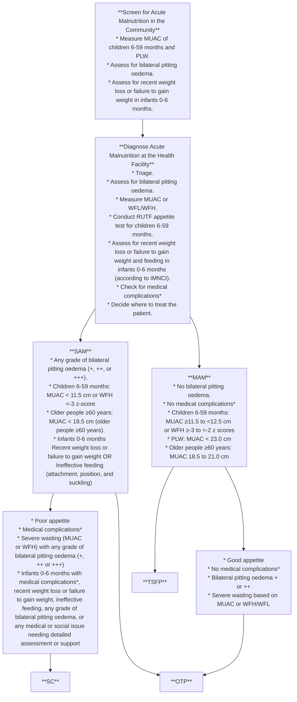
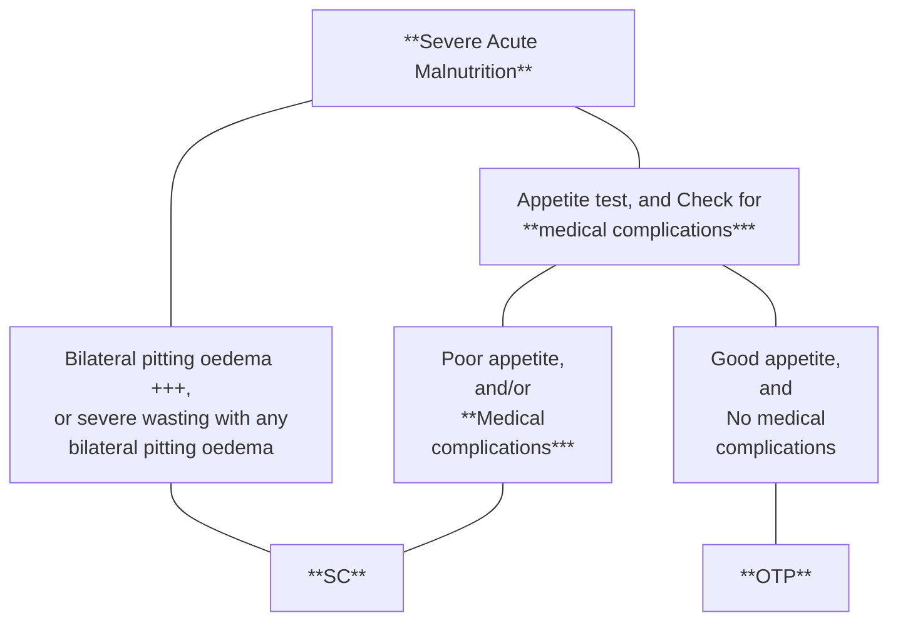
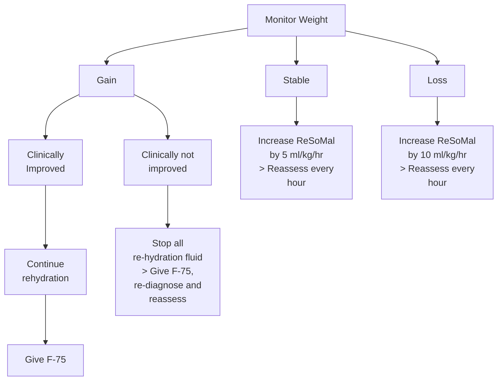
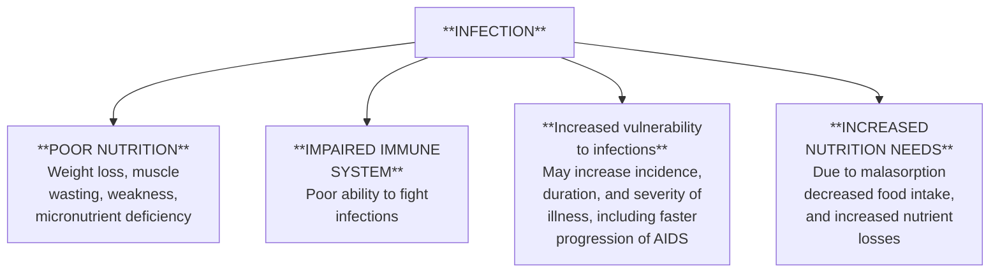
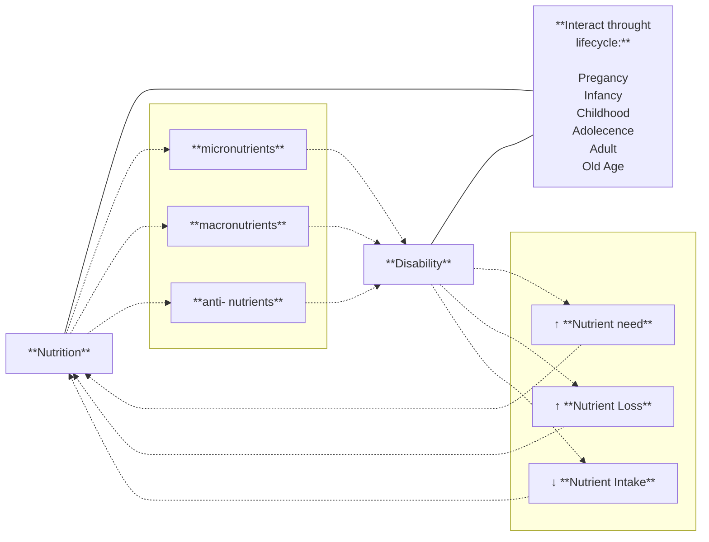
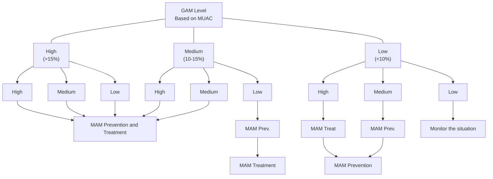

# Ministry of Health: National Guideline for the Management of Acute Malnutrition (May 2019; copy hosted by the Global Nutrition Cluster)

<!-- page 1 -->

Ministry of Health

# National Guideline for the Management of Acute Malnutrition in Ethiopia

May 2019

<!-- page 2 -->

## Recommended Citation

Government of Ethiopia, Federal Ministry of Health. 2019. National Guideline for the Management of Acute Malnutrition. Addis Ababa: FMOH.

## Contact Information:

Federal Ministry of Health
Post Office Box 1234
Sudan Street
Addis Ababa
Ethiopia

Telephone: +251 11 5517011
Fax: +251 11 551 9366
Email: nutritionexpert12@gmail.com or moh@ethionet.et

<!-- page 3 -->

# National Guideline for the Management of Acute Malnutrition in Ethiopia

May 2019

<!-- page 4 -->

## Foreword

Ethiopia has made tremendous strides in reducing child mortality and morbidity. According to the Demographic Health Survey, the prevalence of stunting declined from 58% in 2000 to 38% in 2016. However, the prevalence of wasting has remained fairly static at 12% in 2000 and 10% in 2016. To address malnutrition in all its forms, the Government is applying two programmatic approaches. The first focuses on increasing access to and availability of food through improved economic growth, better agricultural production systems along with promotion of good nutrition practices and prevention of malnutrition. The second approach aims to strengthen early warning systems and timely emergency response, including wide-scale delivery of services for the management of acute malnutrition.

The Federal Ministry of Health (FMOH) developed the first Protocol for the Management of Severe Acute Malnutrition (SAM) in 2007, and the Guideline for the Management of Moderate Acute Malnutrition (MAM) in 2012. This National Guideline for the Management of Acute Malnutrition in Ethiopia replaces the previous two guidelines. It includes the latest World Health Organisation (WHO) guidelines and recommendations, and emerging national and international evidence. It is also aligned to the National Nutrition Programme (NNP) II 2016- 2020, the National Food and Nutrition Policy and the Health Sector Transformation Plan (HSTP) 2015/16 - 2019/20.

This National Guideline for the Management of Acute Malnutrition in Ethiopia aims to improve access to quality services for the management of SAM and MAM. Health care providers, academic institutions, development partners and individuals involved in the management of acute malnutrition should use this guideline as the primary point of reference for curative and preventive service delivery, training, monitoring and supervision.

The Federal Democratic Republic of Ethiopia, Ministry of Health, takes this opportunity to acknowledge the financial and technical support of the various partners, individuals and institutions who took part in the process of revising this guideline. Together, we shall end malnutrition in Ethiopia.

**Lia Tadesse, MD, MHA**
**State Minister of Health**

<!-- page 5 -->

# Acknowledgements

The National Guideline for the Management of Acute Malnutrition in Ethiopia has been revised to include the latest WHO guidelines and recommendations, and emerging national and international evidence on acute malnutrition. The revision process started in 2016 and was completed in 2018 after conducting a study on the implications of Ethiopia’s adoption of the 2013 WHO guidelines, particularly the admission and discharge criteria for the management of acute malnutrition.

The FMOH sincerely acknowledges the financial and technical contribution of United National International Children’s Emergency Fund (UNICEF), WHO, World Food Programme (WFP), United States Agency for International Development (USAID), Concern Worldwide, GOAL, Save the Children International (SCI), USAID Transform Primary Health Care Project, and Valid International.

## Revision in 2016

The FMOH gratefully acknowledges the technical contributions of the following individuals who participated in the 2016 revision of the guideline: Israel Hailu (FMOH), Dr. Tewoldebrhan Daniel (UNICEF), Kidist Negash (UNICEF), Etsegenet Asseffa (WHO), Tayech Yimer (WFP), Dr. Abdulaziz Ali (WFP), Jundi Ahmmed (WFP), Dr. Hailu Tesfaye (SCI), Molla Melese (Gonder University), Lubaba Hussein (Concern Worldwide), Mestawet Gebru (Tufts University, Africa Regional Office).

## Revision in 2018

The FMOH’s Maternal and Child Health Directorate-Nutrition Case Team led the 2018 revision of the guidelines with technical and financial support of development partners.

<!-- page 6 -->

The FMOH greatly appreciates the following individuals who supported the revision and finalisation of the National Guideline for the Management of Acute Malnutrition in Ethiopia in 2018.

* Mr. Birara Melesse and Mrs. Frezer Abebe for leading and coordinating the process

* Alice Nkoroi, Acute Malnutrition Guidelines Consultant

* Members of the Community-based Management of Acute Malnutrition (CMAM) Technical Working Group (TWG): Frezer Abebe (FMOH), Dr. Yared Tadesse (FMOH), Dr. Belaynesh Yifru (FMOH), Getu Assefa (FMOH), Kebede Mengistu (FMOH), Miraf Tesfaye (FMOH), Shibru Kalbessa (FMOH), Dr. Betty Pido Lanyero (WHO), Dr. Bereket Yalew (WHO), Getahun Beyene (WHO), Halima Babyad (WHO), Jasinta Hyachits Achen (UNICEF), Nyauma Nyasani (UNICEF), Kiyeon Yoon (UNICEF), Banchiliyew Getahun (UNICEF), Tayech Yimer (WFP), Kemeria Barsenga (WFP), Orla Mary O’Neill [Emergency Nutrition Cluster Unit (ENCU)], Mathewos Tamiru (ENCU), Melanie Thurber (USAID), Dr. Yared Abebe (USAID Transform Primary Health Care Project), Sinksar Simeneh (SCI), Mitswat Mulaw (THDR), Nicky Dent (Concern Worldwide), Dr. Mengistu Tafesse (ABH Partners), Shiferaw Fisseha (SAKBusiness and Personal Development PLC), Yosef Beyene [Ethiopia Public Health Institute (EPHI)], Dr. Paluku Bahwere (Valid International), Helina Tufa (GOAL), Kidist Negash (HelpAge International) and Metasebia Legesse (Care International ).

Finally, the FMOH would like to recognize all of the programme managers and technical staff who contributed to the finalization of the document.

<!-- page 7 -->

# Table of Contents

* **11** Abbreviations and Acronyms
* **13** Definition of Terms
* **17** 1. Introduction
* **17** Purpose and Scope of the Guideline
* **18** Use of the Guideline
* **18** What is New in The Guideline
* **23** 2. Integrating Acute Malnutrition Services into the Health System
* **23** 2.1 Acute Malnutrition in the Context of Ethiopia
* **30** 2.2 Roles and Responsibilities of Stakeholders
* **33** 3. Community Outreach
* **33** 3.1 Planning Community Outreach
* **34** 3.2 Implementing Community Outreach
* **36** 4. Management of Severe Acute Malnutrition (SAM)
* **37** 4.1 Outpatient Therapeutic Programme (OTP) for the Management of SAM Without Medical Complications
* **47** 4.2 Stabilisation Centre (SC) for the Management of SAM With Medical Complications
* **83** 5. Management of Moderate Acute Malnutrition (MAM)
* **83** 5.1 Principles of Supplementary Feeding Programmes (SFPs)
* **84** 5.2 Blanket Supplementary Feeding Programme (BSFP)
* **85** 5.3 Targeted Supplementary Feeding Programme (TSFP)
* **93** 6. Managing Acute Malnutrition in Other Vulnerable Groups
* **93** 6.1 Acute Malnutrition and HIV/AIDS
* **94** 6.2 Acute Malnutrition and TB
* **95** 6.3 Acute Malnutrition in Older People (≥ 60 Years)
* **96** 6.4 Acute Malnutrition and Disability
* **98** 7. Supply Management
* **98** 7.1 Essential Supplies for Acute Malnutrition
* **98** 7.2 Procurement
* **98** 7.3 Requesting Supplies
* **100** 7.4 Receiving Supplies
* **100** 7.5 Stock Management

<!-- page 8 -->

101 7.6 Reporting Supplies
102 8. Monitoring, Reporting and Evaluation
102 8.1 Monitoring Community Outreach
102 8.2 Monitoring Individual Patient Treatment
104 8.3 Reporting
106 8.4 Monitoring Programme Performance
109 8.5 Supportive Supervision
109 8.6 Coverage Assessment
110 References
112 Annex 1. Home Visit Checklist
113 Annex 2. Management of Acute Watery Diarrhoea (AWD) and SAM
118 Annex 3. Antibiotics for Patients with SAM
120 Annex 4. F-75 Reference Tables for Stabilisation Phase (Severe Wasting)
123 Annex 5. F-75 Reference Tables for Stabilisation Phase (Bilateral Pitting Oedema +++)
126 Annex 6. How to Insert a Nasogastric Tube (NGT)
128 Annex 7. F-100 Reference Tables
131 Annex 8. Toys for Children
132 Annex 9. F-100-Diluted Reference Table for Infant 0-6 Months Old
134 Annex 10. Decision Tree on the Management of MAM
135 Annex 11. Specialised Nutritious Foods
136 Annex 12. Nutrient Requirements for PLHIV
137 Annex 13. Essential Commodities for the Management of SAM
139 Annex 14. Essential Commodities for the Management of MAM
140 Annex 15. Bin Card
141 Annex 16. Stock Record Card
142 Annex 17. OTP Treatment and Follow-up Card
144 Annex 18. Stabilisation Centre (SC) Multi-chart
146 Annex 19. TSFP Treatment and Follow-up Card for Children 6-59 Months
147 Annex 20. TSFP Treatment and Follow-up Card for Pregnant and Lactating Women
148 Annex 21. TSFP Identification Card for Admitted Patients
149 Annex 22. Referral Slip for the Management of Acute Malnutrition
150 Annex 23. Registration Book for SAM Treatment
151 Annex 24. Registration Book for MAM Treatment - Children 6-59 Months
152 Annex 25. Registration Book for MAM Treatment – PLW
153 Annex 26. Monthly Statistics Report for SAM and MAM
154 Annex 27. Monthly Supplies Report for SAM and MAM
155 Annex 28. Acute Malnutrition Performance Monitoring Scorecard

<!-- page 9 -->

# List of Tables

26 Table 1. Assessing and Classifying Acute Malnutrition in Infants 0-6 Months
28 Table 2. Assessing and Classifying Acute Malnutrition in Children 6-59 Months
37 Table 3. OTP Admission Criteria
37 Table 4. OTP Entry Categories
38 Table 5. RUTF Appetite Test Results
39 Table 6. OTP Action Protocol
41 Table 7. Routine Medication and Treatment in OTP
42 Table 8. RUTF Reference Table (92 g Sachet Containing 500 Kcal)
45 Table 9. OTP Discharge Criteria
45 Table 10. OTP Exit Categories
47 Table 11. SC Admission Criteria
48 Table 12. SC Entry Categories
56 Table 13. Choice of Broad-Spectrum Antibiotics in SC
58 Table 14. Vitamin A Treatment Dosages
59 Table 15. Albendazole or Mebendazole
61 Table 16. Preparation of F-75 Feeds using the New Tin Formulation
63 Table 17. RUTF Reference Table (92 g Sachet Containing 500 Kcal), with the Amounts for Transition in the SC
65 Table 18. Preparation of F-100 Feeds using the New Tin Formulation
70 Table 19. Frequent Causes of Failure to Respond to Inpatient Treatment
70 Table 20. Criteria for Failure to Respond to Treatment
72 Table 21. Criteria for Discharge and Transferring Children 6-59 Months
73 Table 22. SC Exit Categories
74 Table 23. SC Admission Criteria for Infants 0-6 Months
75 Table 24. SC Entry Categories
75 Table 25. Doses of Iron Syrup if F-100 Is Used in Rehabilitation
77 Table 26. Preparation of F-100-Diluted Feeds using the New Tin Packaging
79 Table 27. Discharge Criteria for the Breastfed Infants 0-6 Months
79 Table 28. SC Exit Categories
82 Table 29. Discharge Criteria for the Non-Breastfed Infants 0-6 Months
83 Table 30. Types of SFPs

<!-- page 10 -->

|85|Table 31. TSFP Admission Criteria|
|-|-|
|85|Table 32. TSFP Entry Categories|
|87|Table 33. Routine Medication and Treatment for Children in TSFP|
|87|Table 34. Routine Medication and Treatment for PLW in TSFP|
|88|Table 35. FBF Ration Size per Patient|
|90|Table 36. RUSF Ration Size per Patient|
|92|Table 37. TSFP Discharge Criteria|
|92|Table 38. TSFP Exit Categories|
|95|Table 39. Admission and Discharge Criteria for SAM in Older People|
|96|Table 40. Admission and Discharge Criteria for MAM in Older People|
|99|Table 41. Example on How to Quantify Supplies Need|
|103|Table 42. The Filing System used in SC, OTP and TSFP|
|105|Table 43. Summary of Entry and Exit Categories|
|107|Table 44. Outcome Indicators|
|108|Table 45. Data Quality Assurance|

## List of Figures

* 25 Figure 1. Flow Chart on the Management of Acute Malnutrition
* 36 Figure 2. Decision Process for SAM Case Management
* 53 Figure 3. Treatment of Dehydration
* 55 Figure 4. Monitoring Patients on ReSoMal
* 77 Figure 5. Supplementary Suckling Technique
* 89 Figure 6. Preparation of the FBF Porridge
* 93 Figure 7. Cycle of Poor Nutrition and Infection
* 97 Figure 8. Interactions Between Malnutrition and Disability
* 108 Figure 9. Acute Malnutrition Data Flow

<!-- page 11 -->

# Abbreviations and Acronyms

|Abbreviation|Meaning|
|-|-|
|Greater than||
|≥|Greater than or equal to|
|<|Less than|
|AIDS|Acquired Immune Deficiency Syndrome|
|ART|Anti-Retroviral Therapy|
|ARV|Anti-Retroviral|
|AWD|Acute Watery Diarrhoea|
|AWG|Average Weight Gain|
|BSFP|Blanket Supplementary Feeding Programme|
|CBNC|Community Based Newborn Care|
|cm|Centimetre(s)|
|CSAS|Centric Systematic Area Sampling|
|CTC|Cholera Treatment Centre|
|dL|Deci-litre(s)|
|EPI|Expanded Programme on Immunisation|
|ETAT|Emergency Triage Assessment and Treatment|
|FBF|Fortified Blended Foods|
|g|Gram(s)|
|GAM|Global Acute Malnutrition|
|GFD|General Food Distribution|
|GMP|Growth Monitoring Promotion|
|Hb|Haemoglobin|
|HC|Health Centre|
|HDA|Health Development Army|
|HDG|Health Development Group|
|HEW|Health Extension Worker|
|HIV|Human Immunodeficiency Virus|
|HMIS|Health Management Information System|
|HP|Health Post|
|HSTP|Health Sector Transformation Plan|

|Abbreviation|Meaning|
|-|-|
|ICCM|Integrated Community Case Management|
|IMNCI|Integrated Management of Newborn and Childhood illness|
|IPLS|Integrated Pharmaceutical Logistics Systems|
|IU|International Unit(s)|
|IV|Intravenous|
|IYCF|Infant and Young Child Feeding|
|Kcal|Kilocalorie(s)|
|Kg|Kilogram(s)|
|L|Litre(s)|
|LOS|Length of Stay|
|LRTI|Lower Respiratory Tract Infection|
|µg|Microgram(s)|
|MAM|Moderate Acute Malnutrition|
|mg|Milligram(s)|
|ml|Millilitre(s)|
|mm|Millimetre(s)|
|FMOH|Federal Ministry of Health|
|MUAC|Mid-Upper Arm Circumference|
|NGT|Naso-Gastric Tube|
|NNP|National Nutrition Programme|
|ORS|Oral Rehydration Solution|
|OTP|Outpatient Therapeutic Programme|
|PFSA|Pharmaceutical Fund and Supply Agency|
|PHCU|Primary Health Care Unit|
|PLHIV|Person or People Living with HIV|
|PLW|Pregnant and Lactating Women|
|PSNP|Productive Safety Net Programme|
|ReSoMal|Rehydration Solution for Malnutrition|
|RHB|Regional Health Bureau|
|RUSF|Ready-to-Use Supplementary Food|

<!-- page 12 -->

|RUTF|Ready-to-Use Therapeutic Food|
|-|-|
|S3M|Simple Spatial Survey Method|
|SAM|Severe Acute Malnutrition|
|SBCC|Social Behaviour Change Communication|
|SC|Stabilisation Centre|
|SFP|Supplementary Feeding Programme|
|SLEAC|Simplified Lot quality assurance sampling Evaluation of Access and Coverage|
|SQUEAC|Semi-Quantitative Evaluation of Access and Coverage|
|TSFP|Targeted Supplementary Feeding Programme|
|TB|Tuberculosis|
|UNICEF|United Nations International Children’s Emergency Fund|
|WASH|Water Sanitation and Hygiene|
|WFP|World Food Programme|
|WFA|Weight-For-Age|
|WFL|Weight-For-Length|
|WFH|Weight-For-Height|
|WHO|World Health Organisation|
|ZHD|Zonal Health Department|

<!-- page 13 -->

## Definition of Terms

|Term|Definition|
|-|-|
|Acute Malnutrition|Acute malnutrition is a form of undernutrition. It is caused by a decrease in food consumption and/or illness resulting in bilateral pitting oedema and/or sudden weight loss. It is defined by the presence of bilateral pitting oedema or wasting \[low Mid-Upper Arm Circumference (MUAC) or low Weight-For-Height (WFH)/Weight-For-Length (WFL)].|
|Anthropometry|Anthropometry is the study and technique of human body measurement. It is used to measure and monitor the nutritional status of an individual or population group.|
|Appetite Test|Appetite test is the decisive criteria for participation in Outpatient Therapeutic Programme (OTP). The test is done at admission and at all OTP follow-on visits to ensure that the child 6–59 months or older can eat Ready-to-Use Therapeutic Food (RUTF). If the patient has no appetite, s/he must be referred to the Stabilisation Centre (SC).|
|Blanket Supplementary Feeding Programme (BSFP)|BSFP is an intervention that aims to prevent acute malnutrition among vulnerable groups. A supplementary food ration is provided to everyone in an identified vulnerable group for a defined period. This might be all children 6–24 or 6–59 months old and/or all Pregnant and Lactating Women (PLW), regardless of their nutritional status.|
|Bilateral Pitting Oedema|Bilateral pitting oedema, also known as kwashiorkor or oedematous malnutrition, is a sign of Severe Acute Malnutrition (SAM). It is defined by bilateral pitting oedema of the feet and verified when thumb pressure applied on top of both feet for three seconds leaves a pit (indentation) in the feet after the thumb is lifted. It is an abnormal infiltration and excess accumulation of serous fluid in connective tissue or in a serous cavity. Grades of bilateral pitting oedema are + (mild), ++ (moderate) and +++ (severe).|
|Community-Based Management of Acute Malnutrition (CMAM)|CMAM refers to the community-based management of acute malnutrition through: 1) SC for the management of SAM with medical complications; 2) OTP for the management of SAM without medical complications; 3) community outreach; and 4) services or programmes for the management of Moderate Acute Malnutrition (MAM).|

<!-- page 14 -->

|Term|Definition|
|-|-|
|Community Outreach|Community outreach for CMAM is a continuous process that includes the following activities: community assessment, formulating a community outreach strategy, developing and disseminating messages and materials, training on community service providers, community mobilisation, active case-finding and referral, home visits and follow-up, and linking with other community programmes and initiatives.|
|F75|Formula 75 (75 kcal/100 ml) is a therapeutic milk recommended by WHO for the stabilisation phase of patients with SAM and medical complications.|
|F100|Formula 100 (100 kcal/100ml) is a therapeutic milk recommended by WHO for nutrition rehabilitation of children with SAM after the stabilisation phase in the SC. F100 has a similar nutrient composition to RUTF.|
|F100 Diluted|Formula 100 Diluted (130 kcal/100ml) is a therapeutic milk recommended by WHO for the stabilisation and nutrition rehabilitation of infants 0-6 months with SAM and without bilateral pitting oedema in the SC.|
|Fortified Blended Foods (FBF)|FBF are a mixture of cereals and other ingredients such as soya beans or pulses that have been milled, blended, pre-cooked by extrusion or roasting, and fortified with a pre-mix of a sufficient amount and range of vitamins and minerals. Super Cereal Plus is an example of FBF.|
|GAM|GAM is a population-level indicator referring to overall acute malnutrition defined by the presence of bilateral pitting oedema or wasting defined by WFH < -2 z-score (WHO standards). GAM is a sum of SAM and MAM (GAM = SAM + MAM).|
|Height-for-Age (HFA) Index|The HFA index is used to assess stunting. It shows how a child’s height compares to the height of a child of the same age and sex in the WHO standards. This index reflects a child’s past nutritional status.|
|Moderate Acute Malnutrition (MAM)|MAM, or moderate wasting, is defined by a MUAC ≥ 11.5 cm and < 12.5 cm or a WFH ≥ -3 z-score and < -2 z-score (WHO standards) in children 6-59 months old. MAM can also be used as a population-level indicator defined by WFH ≥ -3 z-score and < -2 z-score (WHO standards).|
|MUAC Indicator|Low MUAC is an indicator for wasting. In a child that is 6–59 months of age, MUAC < 11.5 cm indicates severe wasting, or SAM. MUAC ≥ 11.5 cm and < 12.5 cm indicates moderate wasting, or MAM.|
|Outpatient Therapeutic Care (OTP) for Management of SAM Without Medical Complications|OTP is a service treating patients with SAM without medical complications through the provision of routine medical treatment and nutrition rehabilitation with RUTF. Patients attend OTP every week until the discharge criteria are reached.|

<!-- page 15 -->

|Term|Definition|
|-|-|
|Ready-to-Use Supplementary Food (RUSF)|RUSF is an energy-dense, mineral- and vitamin-enriched formulation specifically designed to treat MAM. The composition of RUSF is different to that of RUTF which is designed to treat SAM. RUSF is soft and can be consumed easily by children from the age of 6 months without adding water. It is not water-based, meaning that bacteria cannot grow in it and that it can be used safely at home without refrigeration and in areas where hygiene conditions are not optimal. Unlike fortified blended foods (FBF), RUSF does not require preparation before consumption. Plumpy’sup® is an example of a known lipid-based RUSF.|
|Ready-to-Use Therapeutic Food (RUTF)|RUTF is an energy-dense, mineral- and vitamin-enriched formulation specifically designed to treat SAM. RUTF has a similar nutrient composition to F100. RUTF is soft and can be consumed easily by children from the age of 6 months without adding water. Unlike F100, RUTF is not water-based, meaning that bacteria cannot grow in it and it can be used safely at home without refrigeration and in areas where hygiene conditions are not optimal. It does not require preparation before consumption. Plumpy’nut® is an example of a known lipid-based RUTF.|
|Severe Acute Malnutrition (SAM)|SAM is defined by the presence of bilateral pitting oedema or severe wasting (MUAC < 11.5 cm or a WFH < -3 z-score \[WHO standards]) in children 6-59 months old. A patient with SAM is highly vulnerable and has a high mortality risk. SAM can also be used as a population-based indicator defined by the presence of bilateral pitting oedema or severe wasting (WFH < -3 z-score \[WHO standards]).|
|Severe Wasting|Severe wasting is a sign of SAM. It is defined by a MUAC < 11.5 cm or a WFH < -3 z-score \[WHO standards]) in children 6-59 months. Severe wasting is also called marasmus. The patient with severe wasting has lost fat and muscle and appears very thin (e.g., signs of “old man face” or “baggy pants” \[folds of skin over the buttocks]).|
|Severe Wasting with Bilateral Pitting Oedema|Severe wasting with bilateral pitting oedema is the simultaneous condition of severe wasting (MUAC < 11.5 cm or WFH <-3 in children 6-59 months) and bilateral pitting oedema (of any grade +, ++ or +++).|
|Sphere Project or Sphere Standards|The Sphere Project Humanitarian Charter and Minimum Standards in Disaster Response is a voluntary effort to improve the quality of assistance provided to people affected by disaster and to enhance the accountability of the humanitarian agencies in disaster response. Sphere has established Minimum Standards in Disaster Response (often referred to as Sphere Standards) and indicators to describe the level of disaster assistance needed. Visit www\.sphereproject.org for more information.|

<!-- page 16 -->

|Term|Definition|
|-|-|
|Stabilisation Centre (SC)|SC is a service treating patients with SAM with medical complications until their medical conditions are stabilised and complications are resolved (usually four to seven days). Treatment then continues in OTP until the discharge criteria are reached. SC for SAM with medical complications is provided in a Health Centre or Hospital with 24-hour care capacity.|
|Stunting|Stunting, or chronic undernutrition, is a form of undernutrition and presents as low height-for-age (HFA). It is defined by an HFA z-score below two SDs of the median (WHO standards). Stunting is a result of prolonged or repeated episodes of undernutrition which can start before birth.|
|Targeted Supplementary Feeding Programme (TSFP)|TSFP is an intervention that aims to treat patients with MAM, and prevents deterioration of the condition to SAM. The supplementary food ration is targeted to individuals with MAM in specific vulnerable groups such as children age 6-59 months and malnourished pregnant women and lactating women with infants under 6 months of age.|
|Undernutrition|Undernutrition is a consequence of a deficiency in nutrient intake and/or absorption in the body. The different forms of undernutrition that can appear isolated or in combination are acute malnutrition (bilateral pitting oedema and/or wasting), stunting, underweight (includes elements of wasting and stunting), and micronutrient deficiencies.|
|Underweight|Underweight is a composite form of undernutrition including elements of stunting and wasting and is defined by a weight-for-age (WFA) < -2 z-score (WHO standards).|
|Wasting|Wasting is a form of acute malnutrition. It is defined by a MUAC < 12.5 cm or a WFH < -2 z-score (WHO standards) in children 6-59 months.|
|WFA Index|The WFA index is used to assess underweight. It shows how a child’s weight compares to the weight of a child of the same age and sex in the WHO standards. The index reflects a child’s combined current and past nutritional status.|
|WFH/WFL Index|The WFH/WFL index is used to assess wasting. It shows how a child’s weight compares to the weight of a child of the same height/length and sex in the WHO standards. The index reflects a child’s current nutritional status.|

<!-- page 17 -->

# 1 Introduction

Ethiopia is prone to recurrent droughts that impact food security and water availability, and contribute to high rates of malnutrition in the country. Over the past decade, the Government has applied a two-pronged approach to address malnutrition. The first aspect of the approach focuses on increasing access and availability to food through improved economic growth, better agricultural production systems along with promotion of good nutrition practices and prevention of malnutrition. The second aspect aims to strengthen early warning systems and timely emergency response, including wide-scale delivery of services for the management of acute malnutrition.

This *National Guideline for the Management of Acute Malnutrition in Ethiopia* aims to improve access to quality services for Severe Acute Malnutrition (SAM) and Moderate Acute Malnutrition (MAM). It incorporates the latest international and national evidence on acute malnutrition. The guideline replaces the Protocol for the Management of SAM (2007), and the Guideline for the Management of MAM (2012). It also partially replaces content provided in the Guideline for HIV/AIDS and Nutrition (2010).

## Purpose and Scope of the Guideline

The purpose of this guideline is to provide harmonised practical direction to service providers, policy makers, programmers, and stakeholders on the current standards and recommendations on acute malnutrition. The guideline also aims to:

* Prevent deterioration of acute malnutrition through early identification, referral, follow-up, and referring patients to other health and nutrition interventions.

* Treat acute malnutrition to reduce associated morbidity and mortality.

The guideline is aligned to the National Nutrition Programme (NNP) II 2016-2020 and the Health Sector Transformation Plan (HSTP) 2015/16 - 2019/20. It targets children 0-59 months, Pregnant and Lactating Women (PLW), older people (≥ 60 years), and other vulnerable groups including; HIV/AIDS, tuberculosis (TB), and disabilities. The guideline complements other health and nutrition interventions and should be used alongside the following documents:

<!-- page 18 -->

1. *Comprehensive Integrated Nutrition Services, 2016*

2. *National Guideline on Adolescent, Maternal, Infant and Young Child Nutrition, 2016*

3. *National Implementation Guideline for Integrated Community Case Management of Childhood Illnesses and Newborn Care, 2017*

4. *National Guidelines for Comprehensive HIV Prevention, Treatment and Care, 2018/19*

5. *National Guidelines for Management of Tuberculosis (TB), Drug Resistant-TB and Leprosy in Ethiopia, 2017*

6. *National Malaria Guidelines, 2018*

7. *Standard Treatment Guidelines for General Hospitals, 2014*

8. *Standard Treatment Guidelines for Primary Hospitals, 2014*

9. *Standard Treatment Guidelines for Health Centres, 2014*

## Use of the Guideline

The guideline should be used by facility- and community-based service providers. It can also be used by policymakers, programme advisors, coordinators, and managers working at national and sub-national levels to design, implement, monitor, and evaluate nutrition programmes.

The National Guideline for the Management of Acute Malnutrition in Ethiopia comes with a set of implementation tools including **quick reference guides, monitoring and reporting tools,** and **training materials.**

## What is New in The Guideline

The table below summarises changes made to the revised guideline in comparison to the Protocol for the Management of SAM (2007), and the Guideline for the Management of MAM (2012). The changes reflect most recent evidence and best practices on the management of acute malnutrition.

<!-- page 19 -->

|1 Admission and Discharge Criteria for Children 6-59 Months: Old|1 Admission and Discharge Criteria for Children 6-59 Months: SAM admission was based on MUAC <11.0 cm and any degree of bilateral pitting oedema. Children receiving SAM treatment were discharged when they reach a WFH percentage of the median of 85% for two consecutive visits.|
|-|-|
|New|Admission for SAM treatment is now based on MUAC <11.5 cm or any degree of bilateral pitting oedema or WFH <-3 z-score; for MAM treatment a MUAC of ≥11.5 to <12.5 cm or WFH ≥-3 to <-2 z-score is used. Children receiving SAM or MAM treatment should be discharged when they reach a MUAC ≥ 12.5 cm or WFH ≥ -2 z-scores and have no bilateral pitting oedema for two consecutive visits.|
|Old|*Used the NCHS reference standards WFH percentage of the median to determine admission for treatment.*|
|New|If WFH is used, only use the WFH z-score of the WHO growth standards.|
|Old|WFH percentage of the median was used to determine discharge regardless of the criteria used to admit the patient for the management of SAM.|
|New|◆ The anthropometric indicator that is used to confirm SAM should also be used to assess whether a child has reached nutritional recovery, i.e., if MUAC is used to identify that a child has SAM, then MUAC should be used to assess and confirm nutritional recovery and discharge. Similarly, if WFH is used to identify that a child has SAM, and then WFH should be used to assess and confirm nutritional recovery and discharge. ◆ Children admitted with only bilateral pitting oedema should be discharged based on either MUAC or WFH. ◆ Percentage weight gain should not be used as a discharge criterion.|
|2 Use of Antibiotics in Children 0-59 Months||
|Old|Cotrimoxazole or amoxicillin were used as routine medication for SAM without medical complications.|
|New|Only amoxicillin is used as a routine medication for all patients with SAM without medical complications. If a patient is HIV positive and receiving cotrimoxazole according to the National Guidelines for Comprehensive HIV Treatment and Care, then amoxicillin is given in addition as a routine SAM medication.|
|Vitamin A Supplementation for Children 0-59 Months||
|Old|A high dose of vitamin A was routinely given to all children with SAM regardless of the therapeutic food they were receiving.|
|New|◆ A high dose of vitamin A is not given to patients if they are receiving therapeutic foods that comply with WHO specifications. A high dose of vitamin A is given on admission only if the therapeutic foods provided are not fortified as recommended in the WHO specifications and vitamin A is not part of other daily supplements. ◆ If the patient with SAM has eye signs of vitamin A deficiency or recently had measles (within the past 3 months), a high dose of vitamin A (50,000 IU, 100,000 IU or 200,000 IU depending on age) is given on day 1, 2, and 15, regardless of the therapeutic food they are receiving.|

<!-- page 20 -->

|3 Folic Acid Supplementation for Children 0-59 Months: Old|3 Folic Acid Supplementation for Children 0-59 Months: On the day of admission, a single dose of folic acid (5mg) was given to children with SAM and clinical signs of anaemia.|
|-|-|
|New|Folic acid should not be given routinely to SAM children receiving therapeutic foods (F-75, F-100 or RUTF) that comply with WHO specifications, as they contain enough amounts of folic acid.|
|4 Therapeutic Feeding Approach for SAM with Medical Complications During Transition Period||
|Old|Either F-100 or RUTF was recommended for use during transition.|
|New|During the transition period, RUTF is introduced alongside F-75. The child drinks water freely. If the child does not consume the prescribed amount of RUTF, F-75 is used to top-up the feed. The amount of RUTF is increased over 2–3 days until the child consumes the full required amount of RUTF.|
|5 Fluid Management of with SAM with Medical Complications||
|Old|◆ Children 0-59 months with SAM who presented with dehydration but not in shock were rehydrated slowly, either orally or by Naso-Gastric Tube (NGT) using Rehydration Solution for Malnutrition (ReSoMal).|
||◆ Oral Rehydration Solution (ORS) was not used for oral or nasogastric rehydration of children with SAM.|
||◆ For patients with SAM and signs of shock or severe dehydration who could not be rehydrated orally or by NGT, IV fluids of half-strength Darrow’s solution with 5% glucose or Ringer’s lactate solution with 5% glucose were used for treatment. If not available, 0.45% saline with 5% glucose were used.|
|New|◆ Children 0-59 months with SAM who present with dehydration but not in shock should be rehydrated slowly, either orally or by NGT using ReSoMal (5-10ml/kg/h up to a maximum of 12 hours).|
||◆ ORS should not be used for oral or nasogastric rehydration in children with SAM with dehydration.|
||◆ Patients with SAM and signs of shock or severe dehydration and who cannot be rehydrated orally or by NGT should be treated with IV fluids of Ringer’s lactate solution with 5% dextrose. If not available, 0.45% saline and 5% dextrose should be used.|
||◆ Low osmolarity ORS is recommended instead of ReSoMal if a patient is diagnosed with profuse watery diarrhoea or acute watery diarrhoea (AWD).|
||◆ Guidance has been provided on the management of AWD in patients with SAM (see Annex 2 for details).|

<!-- page 21 -->

## 6 Management of Acute Malnutrition in the Context of HIV/AIDS

|6 Management of Acute Malnutrition in the Context of HIV/AIDS: Old|6 Management of Acute Malnutrition in the Context of HIV/AIDS: \[icon: blue diamond]|6 Management of Acute Malnutrition in the Context of HIV/AIDS: Same treatment of malnutrition was recommended for all patients with SAM irrespective of their HIV status.|
|-|-|-|
||\[icon: blue diamond]|The treatment of malnutrition was started at least one week before the introduction of Anti-Retroviral Therapy (ART) to diminish the risk of serious side effects from the drugs.|
||\[icon: blue diamond]|Children with HIV were given co-trimoxazole preventive therapy. In addition, amoxicillin was also given.|
|New|\[icon: blue diamond]|All patients failing to respond to SAM or MAM treatment should be offered HIV counselling and testing.|
||\[icon: blue diamond]|Refer HIV-positive patients with SAM and MAM for treatment according to National Guidelines for Comprehensive HIV Prevention, Treatment and Care.|
||\[icon: blue diamond]|HIV-positive children with SAM or MAM should be given the same antiretroviral therapy (ART) treatment regimen, in the same doses, as patients with HIV who do not have SAM or MAM.|
||\[icon: blue diamond]|Children with SAM or MAM who are HIV-positive should be managed using the same specialised nutritious foods (i.e., F-75, F-100, RUTF, RUSF, or FBF) as those with SAM or MAM who are HIV-negative.|
||\[icon: blue diamond]|Children with SAM and MAM who are HIV-positive should follow the same guidance for micronutrient supplementation including Vitamin A, iron, folic acid and zinc for diarrhoea management as those with SAM and MAM who are HIV-negative.|
||\[icon: blue diamond]|Children with SAM who are HIV-positive and qualify for ART should be started on treatment as soon as possible after stabilisation.|
||\[icon: blue diamond]|HIV-positive children with SAM who are started on ART treatment should be monitored closely 6–8 weeks following initiation of ART.|
||\[icon: blue diamond]|HIV-positive children with SAM in whom persistent diarrhoea does not resolve with standard management should be investigated to exclude carbohydrate intolerance and infective causes, which may require different management, such as modification of fluid and feed intake, or antibiotics.|

## 7 Management of Infants 0-6 Months of Age

|7 Management of Infants 0-6 Months of Age|7 Management of Infants 0-6 Months of Age|7 Management of Infants 0-6 Months of Age|
|-|-|-|
|Old||Infants 0-6 months with a WFL of < 70% of the percentage of the median and visible signs of wasting or bilateral pitting oedema were referred for the management of SAM in the SC.|
|New||Infants 0-6 months of age should be managed in SC if they meet the following criteria:|
||\[icon: blue diamond]|Any grade of bilateral pitting oedema (+, ++ or +++)|
||\[icon: blue diamond]|WFL < -3 z-score|
||\[icon: blue diamond]|Any serious clinical conditions or medical complications as outlined for children 6-59 months.|
||\[icon: blue diamond]|Recent weight loss or failure to gain weight.|
||\[icon: blue diamond]|Ineffective feeding (attachment, positioning and suckling) directly observed for 15-20 min, ideally in a supervised, separated area.|
||\[icon: blue diamond]|Any medical or social issue needing more detailed assessment or intensive support (e.g., disability, depression of caregiver, or other adverse social circumstances).|

<!-- page 22 -->

## 8 Management of MAM in Children 6-59 Months and PLW

**Old** Targeted Supplementary Feeding Programme (TSFP) was implemented at the community level. Services were delivered by Non-Governmental Organisations (NGOs) and not integrated with routine health services.

**New**
* TSFP will be integrated to routine health services in priority areas identified by the FMOH.
* TSFP should be integrated with the treatment of SAM, particularly in OTP, to ensure a continuum of care for acute malnutrition.

## 9 Management of Acute Malnutrition in Older People (≥ 60 years)

**Old** No guidance was provided on the management of acute malnutrition in the older people.

**New** This guideline provides guidance on the management of acute malnutrition in older people. Care and treatment follow the same protocols as that of children 6-59 months, below is the admission criteria for older people:
* MUAC < 18.5 cm admit for management of SAM in Outpatient Therapeutic Programme (OTP).
* MUAC ≥ 18.5 to 21.0 cm admit for management of MAM in TSFP.

## 10 Supply Management

**Old** No guidance was provided on the integrated supply management of SAM and MAM commodities.

**New** This guideline provides guidance on the supply management of SAM and MAM commodities and facilitates future integration into the Integrated Pharmaceutical Logistics Systems (IPLS). Guidance provided includes requesting and receiving supplies, stock management, and reporting of supplies.

<!-- page 23 -->

## 2 Integrating Acute Malnutrition Services into the Health System

This chapter highlights the core aspects of the care and treatment for SAM and MAM, and integration into the routine health system. The chapter also summarises the roles and responsibilities of the stakeholders engaged with the management of acute malnutrition in the Ethiopian context.

### 2.1 Acute Malnutrition in the Context of Ethiopia

In line with the NNP II 2016-2020 and the HSTP 2015/16-2019/20, services for the management of SAM and MAM should be delivered through the health system including; Health Posts (HP), Health Centres (HC), Woreda, Zonal, Regional and referral Hospitals.

### Community and Household Level

Good community outreach is critical in ensuring early identification of SAM and MAM cases. Community outreach also aims to empower communities and families to understand the causes of malnutrition, and prevent and manage acute malnutrition in their communities.

For maximum impact, community outreach activities should be integrated with other community-based health and nutrition interventions. These include Integrated Management of Newborn and Childhood illness (IMNCI), Integrated Community Case Management and Community Based Newborn Care (ICCM-CBNC), child health campaigns, Infant and Young Child Feeding (IYCF) and Growth Monitoring Promotion (GMP). Community outreach activities should also be linked to multi-sectoral nutrition programmes, and initiatives to eradicate poverty and improve food security; Water, Sanitation and Hygiene (WASH), and social protection.

Health Extension Workers (HEWs) collaborate with the community-based structures such as health committees and engage with the Health Development Army (HDA)/Health Development Group (HDG) to screen and refer cases to the appropriate service for treatment. See Figure 1, the flow chart on the management of acute malnutrition.

<!-- page 24 -->

### Health Post Level

The HPs provide primary health care services such as disease prevention and control, hygiene and environmental sanitation, family health services, and health education and communication. The service provider at the HP works closely with the network of the HDA/HDG to facilitate the management of SAM and MAM. The service provider diagnoses acute malnutrition and provides Outpatient Therapeutic Programme (OTP) and Targeted Supplementary Feeding Programme (TSFP) services. They also determine patients who have medical complications and refer them to the Stablisation Centre (SC)

### Health Centre Level

The HC provides 24-hour SC for the management of SAM with medical complications. The HC also manages and provides technical support to a cluster of one to five HPs within its vicinity.

### Hospital Level

Woreda, Zonal, Regional and referral Hospitals provide higher level referral points where further care can be provided to patients with SAM and more complex medical complications. The referral Hospitals have the facilities and expertise to manage situations that may require administration of oxygen, blood transfusion, and other critical care.

<!-- page 25 -->

Figure 1. Flow Chart on the Management of Acute Malnutrition

\* **Medical complications include:** Poor appetite, intractable vomiting, convulsions, lethargy, not alert, unconsciousness, high fever (axillary temperature >39 0C), lower respiratory tract infection, dehydration, persistent diarrhoea, severe anaemia, hypoglycaemia, hypothermia (axillary temp. < 35 0C), severe skin lesions, eye signs of vitamin A deficiency.

<!-- page 26 -->

## Table 1. Assessing and Classifying Acute Malnutrition in Infants 0-6 Months

|Ask|Look and Feel|Signs|Classify|Treat|
|-|-|-|-|-|
|Ask for signs of medical complications:  Is the patient: \* Too weak to suckle effectively? \* Vomiting everything?  Does the patient have: \* Recent weight loss or failure to gain weight?  Does the patient have: \* Blood in stool? \* Diarrhoea > 14days? \* Cough > 14 days, or had contact with TB patients? \* Bleeding tendencies? \* History of recent sunken eyes? \* Convulsion(s) (more than one or prolonged for > 15 min)?|1. Check for presence of bilateral pitting oedema \* Does the infant have bilateral pitting oedema?  2. Check the WFL \* Is the infant's WFL < -3 z-score?  3. Check for medical complications: \* Poor appetite \* Intractable vomiting \* Convulsions \* Lethargy, not alert \* Unconsciousness \* High fever (axillary temp. >39 °C) \* Lower respiratory tract infection \* Dehydration \* Persistent diarrhoea \* Severe anaemia \* Hypoglycaemia, hypothermia (axillary temp. <35 °C) \* Severe skin lesions \* Eye signs of vitamin A deficiency|\* Any grade of bilateral pitting oedema (+, ++ or +++) OR \* WFL < -3 z score OR: \* Recent weight loss or failure to gain weight. OR: \* Ineffective feeding (attachment, positioning and suckling) directly observed for 15-20, minutes, ideally in supervised separate area. OR: \* Presence of any of the following medical complications: \[icon: diamond] Poor appetite \[icon: diamond] Intractable vomiting \[icon: diamond] Convulsions \[icon: diamond] Lethargy, not alert \[icon: diamond] Unconsciousness \[icon: diamond] High fever \[icon: diamond] Lower respiratory tract infection \[icon: diamond] Dehydration \[icon: diamond] Persistent diarrhoea \[icon: diamond] Severe anaemia \[icon: diamond] Hypoglycaemia \[icon: diamond] Hypothermia \[icon: diamond] Severe skin lesions \[icon: diamond] Eye signs of vitamin A deficiency|SAM with and without medical complications.|Refer/Admit in SC.|

<!-- page 27 -->

|Assessment|Criteria|Classification|Action||
|-|-|-|-|-|
|4. Check for any other medical or social issues? \* Does the infant have medical or family issues that need more detailed assessment or support?|OR: \* Any medical or social issue needing more detailed assessment or intensive support (e.g. disability, depression of caregiver, or other adverse social circumstances).||||
||5. Check the mother's MUAC. \* Is the mother's MUAC < 23.0cm?|\* WFH ≥-3 to <-2 Z scores \* No bilateral pitting oedema AND \* No medical complications \* Clinically well and alert  **Mother has a MUAC of < 23.0 cm**|MAM|Assess the infant's feeding and counsel the mother or caregiver on appropriate IYCF practices. Emphasize on establishing effective exclusive breastfeeding. ◈ If feeding problems, follow up in 5 days. ◈ If no feeding problem, follow up in 30 days. ◈ Admit the mother to TSFP. ◈ Refer the mother for Productive Safety Net Programme (PSNP).|
|\* WFH ≥ -2 Z score AND \* No bilateral pitting oedema||No acute malnutrition.|Congratulate and counsel the mother on appropriate IYCF practices.||

<!-- page 28 -->

Table 2. Assessing and Classifying Acute Malnutrition in Children 6-59 Months

|Ask|Look and Feel|Signs|Classify|Treat|
|-|-|-|-|-|
|Ask for signs of medical complications:  Is the patient: \* Too weak to suckle effectively? \* Vomiting everything?  Does the patient have: \* Blood in stool? \* Diarrhoea > 14days? \* Cough > 14 days, or had contact with TB patients? \* Bleeding tendencies? \* History of recent sunken eyes? \* Convulsion(s) (more than one or prolonged for > 15 min)?|1. Check for presence of bilateral pitting oedema \* Does the infant have bilateral pitting oedema? \* If yes, is it +++ (generalised involving upper arms and face)?  2. Check MUAC \* Is the child's MUAC < 11.5cm?  3. Check the WFL \* Is the infant's WFL < -3 z-score?  4. Check for medical complications: \* Poor appetite \* Intractable vomiting \* Convulsions \* Lethargy, not alert \* Unconsciousness \* High fever (axillary temp. >39 °C) \* Lower respiratory tract infection \* Dehydration|\* Any grade of bilateral pitting oedema (+, ++ or +++) OR \* WFL < -3 z score OR: \* Recent weight loss or failure to gain weight. OR: \* Ineffective feeding (attachment, positioning and suckling) directly observed for 15-20, minutes, ideally in supervised separate area. OR: \* Presence of any of the following medical complications: \[icon: half-filled circle] Poor appetite \[icon: half-filled circle] Intractable vomiting \[icon: half-filled circle] Convulsions \[icon: half-filled circle] Lethargy, not alert \[icon: half-filled circle] Unconsciousness \[icon: half-filled circle] High fever \[icon: half-filled circle] Lower respiratory tract infection \[icon: half-filled circle] Dehydration \[icon: half-filled circle] Persistent diarrhoea \[icon: half-filled circle] Severe anaemia|SAM with and without medical complications.|Refer/Admit in SC.|

<!-- page 29 -->

|Medical Complications / Signs|Clinical Criteria / Anthropometry|Classification|Action|
|-|-|-|-|
|■ Persistent diarrhoea ■ Severe anaemia ■ Hypoglycaemia, hypothermia (axillary temp. <35 °C) ■ Severe skin lesions ■ Eye signs of vitamin A deficiency|\[icon: diamond] Hypoglycaemia \[icon: diamond] Hypothermia \[icon: diamond] Severe skin lesions \[icon: diamond] Eye signs of vitamin A deficiency|||
||■ Bilateral pitting oedema + or ++ OR ■ MUAC <11.5 cm OR ■ WFH <-3 z-score AND ■ Appetite test passed ■ No medical complications ■ Clinically well and alert|SAM without medical complications|Admit in OTP.  (See section 4.2 for the treatment and care plan)|
||■ MUAC ≥11.5 to <12.5 cm ■ WFH ≥ -3 to <-2 z scores ■ No bilateral pitting oedema AND ■ No medical complications ■ Clinically well and alert|MAM|Admit in TSFP and counsel on appropriate IYCF practices  (See chapter 5.0 for the treatment and care plan)|
||■ MUAC ≥ 12.5 cm ■ WFH ≥ -2 z score AND ■ No bilateral pitting oedema|No acute malnutrition.|Congratulate and counsel the mother on appropriate IYCF practices.|

<!-- page 30 -->

## 2.2 Roles and Responsibilities of Stakeholders

Described here are the roles and responsibilities of the various stakeholders involved in the management of acute malnutrition within the Ethiopian health system.

### 2.2.1 The Health System

#### The Federal Ministry of Health (FMOH)

* Provides national guidance on the management of acute malnutrition, in line with the NNP II 2016-2021.

* Ensures that adequate numbers of skilled health professionals are assigned to health facilities.

* Ensures programme quality through monitoring and supervision.

* Coordinates national activities including orientations, trainings, and consultation workshops.

* Mobilises resources for the implementation of SAM and MAM activities.

* Ensures continuous supply of essential commodities to all Regional Health Bureaus (RHBs), see Annex 13 and 14 for the list of essential SAM and MAM supplies.

* When necessary, reviews policy and implementation guidelines.

#### The Regional Health Bureaus (RHBs) and Zonal Health Department (ZHD)

* Provides programme implementation guidance to the Zonal Health Department (ZHD) and Woreda health offices.

* Coordinates and supports implementation of training at HC and HP level.

* Conducts monitoring and supervision to the HCs, and HPs at the Woreda level.

* Mobilises resources for trainings at the Regional, Zonal and Woreda level.

* Ensures continuous supply of essential commodities to all Zones and Woredas, see Annex 13 and 14 for the list of essential SAM and MAM supplies.

* Ensures quality and timely reporting of activities within the Region and Zone.

#### The Woreda Health Office

* Coordinates and supports training of health care providers and HEWs.

* Ensures continuous supply of essential commodities to all health facilities, see Annex 13 and 14 for the list of essential SAM and MAM supplies.

<!-- page 31 -->

* Strengthens the referral and communication system between HCs and HPs.

* Ensures that the HC service providers conduct regular supportive supervision to the HPs.

* Conducts supportive supervision and regular review meetings with HCs and HPs.

* Ensures timely reporting of activities to the ZHD.

## The Primary Health Care Unit (PHU) and Referral Health Centre (HC)

* Coordinates and participates in training of health care providers and HEWs.

* Builds the capacity of HEWs on the management of acute malnutrition.

* Ensures a continuous supply of specialised nutritious foods to all HPs within the Kebele catchment area.

* Conducts supportive supervision to the HPs.

* Ensures that IMNCI/ICCM-CBNC activities are implemented and coordinated within the Kebele catchment areas.

* Submits accurate and timely Monthly Statistics Reports for the Management of Acute Malnutrition.

## The Health Post (HP) Level

* Ensures quality implementation of SAM and MAM activities.

* Ensures that SAM and MAM services are delivered routinely through the health care system.

* Ensures continuous availability and proper utilization of the essential supplies for SAM and MAM, see Annex 13 and 14 for the list of essential SAM and MAM supplies.

* Ensures that IMNCI/ICCM-CBNC activities are implemented at the HP.

* Prepares and submits accurate and timely Monthly Statistics Reports for the Management of Acute Malnutrition.

* Engages with and builds the capacity of the HDA/HDG on how to conduct community mobilisation, referral, follow-up, counselling, and support of patients with acute malnutrition.

* Collaborates with the HDA/HDG to conduct home visits, follow-up and referrals of SAM and MAM patients.

* Ensures that PLW and families with SAM and MAM patients are enrolled to the Productive Safety Net Programme (PSNP) and that they understand the conditions for the support they receive.

<!-- page 32 -->

### The Health Development Army/Health Development Group (HDA/HDG)

* Conducts health promotion and counselling at the community level.

* Mobilises communities and refers caregivers to the HEW for screening of acute malnutrition.

* Counsels and supports caregivers ensuring that the referred cases report to the HP.

* Counsels and supports the caregiver with treatment compliance on the consumption of specialised nutritious foods and routine medications.

### 2.2.2 The United Nations (UN) and Donor Agencies

* Advocates for the management of acute malnutrition, and children’s rights to food and nutrition.

* Contributes to mobilisation of resources for implementation of prioritised activities.

* Provides funds to implement the National Guideline for the Management of Acute Malnutrition.

* Provides technical support to FMOH and RHB to facilitate the management of acute malnutrition in an integrated manner.

* Supports the FMOH and RHB to implement their respective roles and responsibilities.

### 2.2.3 Non-governmental Organisations (NGOs) and Community-Based Organisations (CBOs)

* Advocates for the management of acute malnutrition, and children’s rights to food and nutrition.

* Provides technical support to the ZHD, Woreda health office, HCs, HPs, and communities to facilitate the management of acute malnutrition in an integrated manner.

* Supports ZHD, Woreda health office, HCs and HPs to implement their respective roles and responsibilities.

* Where possible, provides direct support to families and communities, especially those under difficult circumstances.

<!-- page 33 -->

## 3 Community Outreach

This chapter highlights why community involvement and empowerment are critical to improving access and uptake of acute malnutrition services. The chapter also describes the core components of community outreach activities and those who should be involved in service delivery.

### 3.1 Planning Community Outreach

#### 3.1.1. Community Assessments

In the case of sudden increase or decrease in the SAM and MAM case load, the HEWs, under the guidance of the Woreda health office and PHCU nutrition focal person should conduct a community assessment to understand if acute malnutrition services are meeting the demand of the population at the Kebele level. The community assessment should:

* Engage with the HDA/HDG with 30 households organised into groups of one to five women to:

    - Share data on acute malnutrition in the area.

    - Explain any increases or decreases in the levels of acute malnutrition.

    - Discuss the causes and possible solutions to addressing acute malnutrition in the community.

* Engage with the health committees, agriculture extension workers, teachers, and other community workers to identify opportunities for collaborating in addressing acute malnutrition in the area.

* Identify available initiatives and non-governmental organisations supporting health, nutrition and food security activities in the area.

* Identify barriers and enablers to nutrition and health including attitudes and health-seeking behaviours.

#### 3.1.2. Formulation of a Community Outreach Strategy

* Identify the best mechanisms to improve community outreach activities.

* Organise meetings with the community and religious leaders to ask for their continued support in acute malnutrition services.

* Develop a plan and define the roles and responsibilities for the people who will be involved in community outreach and mobilisation activities.

<!-- page 34 -->

### 3.1.3. Develop Messages and Materials

* Develop simple and clear messages that are easy to understand. Graphic images or pictures should be used to explain complex concepts.

* Disseminate acute malnutrition messages using the HDA/HDG structure, and other health and nutrition information communication channels.

* Methods of disseminating information may include: word of mouth, letters, phone calls, local radio, churches, mosques, and meetings with community members and religious leaders.

### 3.1.4. Training Community Service Providers

Training of community service providers cover the following:

* Community case-finding strategies.

* How to refer cases to the HP.

* How to conduct home visits for cases needing special attention.

* Acute malnutrition messages and how to disseminate them.

## 3.2 Implementing Community Outreach

### 3.2.1 Partnership with the Community

The HEW should maintain a constant and continuous dialogue with the community leaders and members and report back to the Woreda health office through the PHCU. They should involve the HDA/HDG, religious leaders, health committees, and agriculture extension workers in community outreach activities. This will increase awareness and ownership of acute malnutrition services.

How can the HEW ensure continuous dialogue with the community?

* Develop monthly plans with the HDA/HDG.

* Hold monthly meetings with the HDA/HDG to review plans and address concerns, maintain changes in behaviour, and share success stories.

* In collaboration with the HDA/HDG, organise monthly community meetings to discuss and disseminate information on acute malnutrition and other health and nutrition topics.

How can you know that there is good community involvement in acute malnutrition?

* Caregivers seek early treatment for acute malnutrition.

* A decrease in the number of patients with SAM with medical complications.

* A reduction in the default rate.

<!-- page 35 -->

### 3.2.2 Case Finding and Referral

The following are strategies for case finding:

* House-to-house screening visits by HEW.

* Community screening during community health days, growth monitoring, and routine immunisation. Other available opportunities are community meetings, market days, church, general food distribution, school events, and other community-based nutrition sensitive activities.

* Screening at health facility outpatient department, inpatient wards, GMP, HIV and TB clinics, antenatal and postnatal clinics.

* Self-referrals from the communities as community members become more aware of acute malnutrition.

#### How should case finding be conducted?

Children 6-59 months and PLW:

* Measure MUAC

* Assess for bilateral pitting oedema

Infants under 6 months of age:

* Assess for bilateral pitting oedema

* Assess for recent weight loss or failure to gain weight.

### 3.2.3 Follow-up and Home Visits

The HEW should determine priority cases that need a home visit and coordinate with the HDA/HDG to monitor the patients. A home visit is critical for patients who:

* Are losing or not gaining weight, based on the action protocol (see Table 6).

* Have a deteriorating medical condition (see Table 6).

* Are not responding to treatment (see Table 6).

* Have refused referral to the SC.

* Are absent or defaulted treatment (defaulters are patients absent for 2 consecutive visits).

* Are infants < 6 months of age and have been discharged from SC.

Annex 1, the Home Visit Checklist should be used as a guide during the home visit.

### 3.2.4 Referral to Other Programmes and Initiatives

Families of patients with SAM and MAM, and PLW should be enrolled for PSNP. The primary caregiver of a SAM or MAM child should be exempt from public work during the treatment period. They should also be referred to other available health, WASH, food security and livelihoods interventions.

<!-- page 36 -->

## 4 Management of Severe Acute Malnutrition (SAM)

This chapter describes the principles, criteria and process of managing children with SAM in the SC and OTP. The chapter also highlights on how to triage and the decision-making process for SAM case management. See Figure 2 below.

Figure 2. Decision Process for SAM Case Management

\* **Medical complications include:** Poor appetite, intractable vomiting, convulsions, lethargy, not alert, unconsciousness, high fever (axillary temperature >39 0C), lower respiratory tract infection, dehydration, persistent diarrhoea, severe anaemia, hypoglycaemia, hypothermia (axillary temp. < 35 0C), severe skin lesions, eye signs of vitamin A deficiency.

<!-- page 37 -->

## 4.1 Outpatient Therapeutic Programme (OTP) for the Management of SAM Without Medical Complications

OTP provides services to children with SAM with a good appetite and no medical complications. Treatment and care are provided at home with weekly follow-up visits at a nearby health facility.

*Table 3. OTP Admission Criteria*

* Bilateral pitting oedema + or ++
OR
* MUAC <11.5 cm
OR
* WFH <-3 z-score
AND
* Appetite test passed
* No medical complications
* Clinically well and alert
OR Referred from SC after stabilisation

*Table 4. OTP Entry Categories*

|Category|Definition|
|-|-|
|New admission|New case who meets the admission criteria for OTP (see Table 3).|
|Readmission|Re-admitted for treatment in OTP due to relapse or a returned defaulter who meets the admission criteria.|
|Relapse|Cured within the past 3 months and now meets the admission criteria for OTP (see Table 3). Relapse cases require special attention, therefore should be referred to start treatment in SC.|
|Returned defaulters|Defaulted within the past 3 months and has returned to continue treatment in OTP. A returned defaulter should be re-admitted if they meet the admission criteria.|
|Transfers-in|Continuing treatment in OTP after stabilisation in SC or has moved in from another facility where s/he was receiving OTP.|

<!-- page 38 -->

### 4.1.2 Admission Procedure for Children 6-59 Months

### STEP 1: Triage

* Identify and manage very sick patients and those referred from the community or SC first, before the health and nutrition education session is conducted.

### Take Anthropometric Measurements to Confirm Nutritional Status

* Determine the age of the patient based on the health card or caregiver’s recall.

* Check for presence of bilateral pitting oedema and record the findings.

* Measure MUAC and record the measurement.

* Measure and record weight.

* Measure and record height or length (if at HC level).

* Determine WFH/WFL z-score using the reference charts (if at HC level).

* If infant 0-6 months of age, assess for recent weight loss or failure to gain weight, and assess feeding according to IMNCI.

* Classify nutritional status.

### Conduct an RUTF Appetite Test for Children 6-59 Months

* Conduct the RUTF appetite test in a quiet, separate area.

* Explain to the caregiver the purpose and procedure of the appetite test.

* Ask the caregiver to:

    - Wash hands with soap before feeding the RUTF.

    - Gently offer the RUTF.

    - Encourage the child to eat the RUTF without force-feeding.

    - Offer plenty of clean, safe drinking water.

* Give the caregiver one sachet of RUTF.

* Observe the child eating the RUTF.

* Determine whether he/she passes or fails the appetite test (see Table 5).

Table 5. RUTF Appetite Test Results

|Pass Appetite Test|Fail Appetite Test|
|-|-|
|The child eats some of the RUTF within 30 minutes.|The child refuses to eat the RUTF after 30 minutes.|

<!-- page 39 -->

## Conduct a Medical Assessment

* Conduct a medical assessment and record in the OTP Treatment and Follow-up Card. See Annex 17.

* Take the medical history, immunisation, feeding history, and assess signs and symptoms.

* Conduct a physical examination and record the findings.

* Diagnose and treat malaria according to the National Malaria Guidelines.

* Check the patient's HIV and/or TB status if known.

* Determine whether the child needs referral to SC or treatment in the OTP. See Table 6 below for the action protocol.

* Explain the findings of the medical assessment to the caregiver.

*Table 6. OTP Action Protocol*

|Sign|Referral to SC|Follow-Up Home Visit|
|-|-|-|
|BILATERAL PITTING OEDEMA|Grade +++|Bilateral pitting oedema not reducing by week 3|
||Severe wasting with bilateral pitting oedema||
||Develops or increases in severity||
||No reduction for 2 weeks||
||Not resolved after 3 weeks||
|APPETITE / ANOREXIA|No appetite or unable to eat, fail RUTF appetite test.|Child eats < 75% of the RUTF a week by third visit|
|VOMITING|Intractable|General medical deterioration|
|TEMPERATURE|Fever: axillary temperature > 39°C||
||Hypothermia: axillary temperature < 35°C||
|RESPIRATION RATE (rr)|≥ 60 respirations/minute for under 2 months||
||≥ 50 respirations/minute from 2 to 12 months||
||≥ 40 respirations/minute from 1 year to 5 years||
||≥ 30 respirations/minute for over 5 years||
||Any chest in-drawing||
|ANAEMIA|Very pale (severe palmer pallor), difficulty breathing||
|SUPERFICIAL INFECTION|Extensive infection requiring intravenous or intramuscular treatment||
|ALERTNESS|Very weak, apathetic, unconscious||
||Fitting/convulsions||
|HYDRATION STATUS|Dehydration based primarily on recent history of diarrhoea, vomiting, fever or sweating and on recent appearance of clinical signs of dehydration as reported by the caregiver or patient||
|WEIGHT CHANGES||Below admission weight on week 3 (non-oedematous children)|
||Weight loss for 3 consecutive weighing (non-oedematous children)|Weight loss for 2 consecutive weeks (non-oedematous children)|
||Static weight for 5 consecutive weighing|Static weight for 3 consecutive weeks|
|GENERAL|Caregiver or patient requests SC|Returned from SC (first 2 weeks)|
|||Refused referral to SC|
|NOT RESPONDING|Patient that is not responding to treatment is referred to SC for further investigation||

<!-- page 40 -->

## Refer the Patient who Fails Appetite Test and Has Medical Complications to the SC

If the child is 6-59 months old and has medical complications or fails the appetite test, start life-saving treatment1:

* Provide sugar water solution to avoid hypoglycaemia. Sugar water contains 10 g of sugar dissolved in 100 ml of water.

* Refer the child to the closest SC.

* Record findings and the treatment given on the Referral Slip. See Annex 22.

* Explain the following to the caregiver:

    - Severity of the condition and the need for referral to SC

    - Need to keep the child warm during transportation

    - Need to give frequent, small amounts of 10 percent sugar water solution during transportation

    - If breastfeeding, need to frequently breastfeed the child

**NOTE: All infants 0-6 months of age with SAM with or without medical complications should be referred to the SC.**

## STEP 2: Admit Patients with Appetite and No Medical Complications to the OTP

If the child 6-59 months has no medical complications and has a good appetite, admit to the OTP:

* Explain the OTP treatment procedures and care that will be provided.

* Decide which OTP admission entry category to assign to the patient (see Table 4).

* Assign a registration number if the patient is a new admission.

* Give routine medicines (see Table 7).

* Give RUTF based on the child's weight (see Table 8).

* Complete the OTP Treatment and Follow-up Card.

* Register the patient in the Registration Book for SAM Treatment. See Annex 23.

* Advise the caregiver to seek medical care at the nearest health facility immediately if child becomes ill while at home or refuses to eat RUTF.

### 4.1.3 Medical Treatment and Care for Children 6-59 Months

Give routine medicines as indicated in Table 7 below. Carefully check the records of patients who were previously treated in SC or other OTP to avoid prescribing medicines that have already been given.

1**Medical complications include:** poor appetite, intractable vomiting, convulsions, lethargy, not alert, unconsciousness, high fever (>39 °C), lower respiratory tract infection, dehydration, persistent diarrhoea, severe anaemia, hypoglycaemia, hypothermia (<35 °C), severe skin lesions, eye signs of vitamin A deficiency.

<!-- page 41 -->

Table 7. Routine Medication and Treatment in OTP

|Name of Medication|When to Give|Age|Dose|Prescription|
|-|-|-|-|-|
|10% sugar water solution|During referral to SC to prevent hypoglycaemia|All ages|50 ml|Once, orally|
|AMOXICILLIN|On admission of all SAM patients|All ages|25 mg/kg, every 12 hours, for 5 days.|Oral: 25 mg/kg, every 12 hours, for 5 days|
|ANTIMALARIAL|On admission if positive malaria test|All ages|Refer to the National Malaria Guidelines|Refer to the National Malaria Guidelines|
|ALBENDAZOLE or MEBENDAZOLE|After 1 week for treatment in OTP|24- 59 months|Albendazole 400 mg Mebendazole 500 mg|Single dose, orally|
|MEASLES VACCINE|On the fourth week if the child has not yet received the measles vaccine|9–59 months|Refer to the National Expanded Programme on Immunisation (EPI) Guidelines|Refer to the National EPI Guidelines|
|OTHER VACCINES|Update vaccinations based on EPI schedule|All ages|Refer to the National EPI Guidelines|Refer to the National EPI Guidelines|

## Important Notes on Routine Medication and Treatment in OTP

**HIV/AIDS and TB:** If possible, offer HIV counselling and testing, and TB testing to all patients with SAM, especially if readmitted or not responding to treatment.

**Antibiotic treatment with Amoxicillin:** If the patient is HIV+ or HIV-exposed and taking Cotrimoxazole prophylaxis, Amoxicillin should also be given. Medical treatment and care should follow the National Guidelines for Comprehensive HIV Prevention, Treatment and Care.

**Vitamin A:** Do not give an additional high dose of vitamin A to children with SAM in the OTP as RUTF contains an adequate amount of vitamin A.

*   A high dose (50,000 IU, 100,000 IU or 200,000 IU, depending on age) of vitamin A should be given on admission only if the therapeutic foods given are not fortified as recommended in WHO specifications and if vitamin A is not part of other daily supplements and was not given to the child in the past one month. (Note: RUTF is fortified).

*   A high dose of vitamin A should be given on day 1 to all patients with SAM and eye signs of vitamin A deficiency (e.g., night blindness, Bitot’s spots, corneal ulceration) and to all patients with SAM and recent measles (now or in the past 3 months). The second and third doses should be given on day 2 and day 15, irrespective of the type of therapeutic food they are receiving.

*   All patients who show signs of vitamin A deficiency should be referred for treatment in SC.

<!-- page 42 -->

**Iron and Folic Acid:** Iron and folic acid should not be given routinely to children in OTP as RUTF contains iron and folic acid. If anaemia is identified, it should be treated according to IMNCI/ICCM-CBNC guidelines, and treatment should begin after 14 days of SAM treatment. If severe anaemia, refer for treatment in SC. Malaria testing and treatment should be done before the iron and folic acid treatment is given.

**Zinc:** Do not give zinc supplements to treat diarrhoea in SAM patients in the OTP. RUTF contains adequate amounts of zinc.

**ORS:** ORS contains high sodium and is inappropriate for patients with SAM. ORS is only used if the SAM patient has profuse watery diarrhoea, or AWD. Patients who require treatment for dehydration should be referred for SC. In SC, patients with dehydration are treated with ReSoMal. The use of ReSoMal is inappropriate in an OTP setting.

### 4.1.4 Nutrition Rehabilitation for Children 6-59 Months

* Use the reference Table 8 below to determine the amount of RUTF to give at each weekly visit, based on the patient's weight.

Table 8. RUTF Reference Table (92 g Sachet Containing 500 Kcal)

|Weight of Child (kg)|Sachets per Day|Sachets per Week|
|-|-|-|
|3.5 - 3.9|1 ½|11|
|4.0 – 5.4|2|14|
|5.5 – 6.9|2 ½|18|
|7.0 – 8.4|3|21|
|8.5 – 9.4|3 ½|25|
|9.5 – 10.4|4|28|
|10.5 – 11.9|4 ½|32|
|≥ 12|5|35|

<!-- page 43 -->

◆ Explain the following on the feeding procedure:

* Do not give RUTF to infants 0-6 months. They should be exclusively breastfed.

* If the child is 6-23 months, continue to breastfeed on demand. Mother’s milk is best for infants and young children.

* Feed small amounts of RUTF until the allocated daily ration is finished, and before eating any other food (apart from breast milk).

* Encourage the child to eat as often as possible (every 3 hours during the day).

* If the child is breastfeeding, offer breast milk on demand and before feeding RUTF.

* Offer plenty of safe drinking water while eating RUTF.

* Do not mix RUTF with liquids as this might cause bacterial growth.

## 4.1.5 Monitoring During OTP Follow-Up Visits

◆ Monitor the following parameters and record information on the OTP Treatment and Follow-up Card at each follow-up visits.

* MUAC

* Weight

* Height/length (if at HC level, measure once a month)

* WFH/WFL z-score (if at HC level, check on admission, every month, and on discharge)

* Degree of bilateral pitting oedema (0, +, ++, +++)

* Weight loss (patients who lose weight or have weight fluctuations should receive a home visit and/or further medical examination)

* Clinical signs: body temperature, respiration rate, dehydration, anaemia, and skin infection

* Standard medical history: stool, vomiting, fever, and cough

* Appetite test

* Any illness suffered since the last visit

* Any action taken, or medication given in response to a health condition

◆ Repeat the RUTF feeding procedure on every follow-up visit and ask the caregiver to repeat back.

◆ Inform the caregiver on the treatment progress.

◆ Conduct individual and/or group counselling on health, WASH, and IYCF.

<!-- page 44 -->

* Indicate any necessary follow-up actions on the OTP Treatment and Follow-up Card, such as:
    

    - Home visits for patients requiring special attention. See Table 6 for the action protocol.
    

    - Referral to the SC.

### Prioritize Patients for a Home Visit

Conduct a home visit if the patient:

- Is losing or not gaining weight

- Has a deteriorating medical condition

- Is not responding to treatment

- Has refused SC

- Is absent or defaulted treatment (defaulters are patients absent for 2 consecutive visits)

### Referral to SC Based on the Action Protocol

* Refer patients with a poor appetite, deteriorating nutritional status, and/or a medical complication. See Table 6 for the action protocol.

* Issue a Referral Slip to the patient referred for treatment in the SC.

### Failure to Respond to Treatment

It is recommended that patients who are referred to SC due to failure to respond to treatment be tested for HIV and TB which are common underlying causes of acute malnutrition.

The following are other frequent causes of failure to respond to treatment:

* Inappropriate evaluation of the patient’s health condition or missed medical complication

* Non-adherence to the RUTF protocol

* Non-adherence to the routine medication protocol

* Inadequate guidance provided for home care

* Inappropriate frequency of visits to the health facility and reception of RUTF

* Inadequate intake or sharing of RUTF and/or medicines with other family members

<!-- page 45 -->

## 4.1.6 Discharge Criteria and Exit Categories for Children 6-59 Months

*Table 9. OTP Discharge Criteria*

Note: The same anthropometric indicator that is used to identify and confirm SAM on admission should be used to determine recovery and discharge from treatment

**If admitted with bilateral pitting oedema, discharge cured when:**

* No bilateral pitting oedema for 2 consecutive visits

* AND MUAC ≥ 12.5 cm or WFH/WFL ≥ -2 z-score

* AND Clinically well and alert

**If admitted based on MUAC, discharge cured when:**

* MUAC ≥ 12.5 cm

* AND No bilateral pitting oedema

* AND Clinically well and alert

**If admitted based on WFH/WFL, discharge cured when:**

* WFH/WFL ≥ -2 z-score

* AND No bilateral pitting oedema

* AND Clinically well and alert.

*Table 10. OTP Exit Categories*

|Category|Definition|
|-|-|
|Cured|Has reached the discharge criteria for SAM treatment (see Table 9).|
|Died|Dies while receiving treatment in the OTP.|
|Defaulted|Absent for two consecutive visits. Default should be confirmed.|
|Non-responder|Does not reach the SAM discharge criteria after 16 weeks (4 months) in treatment.|
|Transferred-out|Condition has deteriorated or not responding to treatment according to action protocol and referred for treatment in the SC, *or* moved out to receive OTP in another facility.|

<!-- page 46 -->

### 4.1.7 Discharge Procedure for Children 6-59 Months

* Give feedback to the caregiver on the final treatment outcome.

* Ensure that the caregiver understands how to use continuing medications.

* Give the final one week supply of RUTF ration.

* Record the exit category (see Table 10) on the Registration Book for SAM and the OTP Treatment and Follow-up Card.

* Counsel on WASH, good nutrition, and IYCF practices.

* Advise the caregiver to immediately go to the nearest health facility if they experience any signs of deterioration.

* Refer the caregiver to PSNP and other complementary health and nutrition services.

<!-- page 47 -->

## 4.2 Stabilisation Centre (SC) for the Management of SAM With Medical Complications

### 4.2.1 Admission Criteria and Entry Categories for Children 6-59 Months

*Table 11. SC Admission Criteria*

* ◆ Bilateral pitting oedema +++
**OR**
* ◆ Any grade of bilateral pitting oedema combined with severe wasting (MUAC <11.5 cm or WFH < -3 z score)
**OR**
* ◆ Bilateral pitting oedema +, ++
**OR**
* ◆ Severe wasting (MUAC <11.5 cm or WFH < -3 z score)
**WITH** any of the following medical complications:
    - ◈ Poor appetite
    - ◈ Intractable vomiting
    - ◈ Convulsions
    - ◈ Lethargy, not alert
    - ◈ Unconsciousness
    - ◈ High fever (axillary temperature > 39°C)
    - ◈ Lower respiratory tract infection
    - ◈ Dehydration
    - ◈ Persistent diarrhoea
    - ◈ Severe anaemia
    - ◈ Hypoglycaemia
    - ◈ Hypothermia (axillary temperature < 35°C)
    - ◈ Severe skin lesions
    - ◈ Eye signs of vitamin A deficiency
**OR** Referred from outpatient care according to the action protocol

<!-- page 48 -->

Table 12. SC Entry Categories

|Category|Definition|
|-|-|
|New admissions|New case who meets the admission criteria for SC (see Table 11).|
|Readmission|Re-admitted for treatment in SC due to relapse or a returned defaulter who meets the admission criteria.|
|Relapse|Cured within the past 3 months and now meets the admission criteria for SC (see Table 11).|
|Returned defaulters|Defaulted within the past 3 weeks and has returned to continue treatment in SC. A returned defaulter should be re-admitted if they meet the admission criteria.|
|Transfers-in|Referred to the SC because condition deteriorated in OTP or has moved in from another facility where s/he was receiving care in SC.|

### 4.2.2 Admission Procedure

#### STEP 1: Triage

Follow Emergency Triage Assessment and Treatment (ETAT) principles. Patients with SAM with medical complications should be identified as having priority signs that require prompt assessment and treatment. Assess and treat the following:

* Obstructed breathing

* Severe respiratory distress

* Central cyanosis

* Shock (cold hands, capillary refill time longer than 3 seconds, fast heart rate with weak pulse, and low or unmeasurable blood pressure)

* Unconsciousness

* Convulsions

* Dehydration

* Severe anaemia

* Hypoglycaemia

* Hypothermia

* Congestive heart failure

If any of the above signs are present, begin immediate emergency treatment.

<!-- page 49 -->

### STEP 2: Take Anthropometric Measurements to Confirm Nutritional Status

* Determine the age of the patient based on the health card or caregiver’s recall.

* Check for presence of bilateral pitting oedema and record the findings.

* Measure MUAC and record the measurement.

* Measure and record weight.

* Measure and record height or length.

* Determine WFH/WFL z-score using the reference charts.

* Classify nutritional status.

### STEP 3: Conduct Medical Assessment

* Take a medical history to determine risk factors for SAM and record the following information on the SC Multi-chart. See Annex 18.

* Take a feeding history and record findings in the SC Multi-chart.

* Conduct a general physical examination and examine for complications of SAM.

* Diagnose and treat malaria according to the National Malaria Guidelines.

* Offer HIV counselling and testing services; if positive, link the patient to HIV treatment and care. Refer to the current National Guidelines for Comprehensive HIV Prevention, Treatment and Care.

* Check:
    

    - Blood glucose
    

    - Haemoglobin
    

    - Urine analysis (to rule out nephrotic syndrome in oedematous patients)

### STEP 4: Admit and Initiate Medical and Nutrition Treatment in SC

* Explain to the caregiver the SC treatment procedures and care that will be provided.

* Initiate feeding and medical treatment immediately.

* Complete records as follows:
    

    - Assign a registration number if the patient is a new admission.
    

    - Decide the SC entry category to assign the patient. See Table 12.
    

    - Complete the SC Multi-chart.
    

    - Register the patient in the Registration Book for SAM Treatment.

<!-- page 50 -->

## 4.2.3 Treatment and Care of Children 6-59 Months

Treatment and care of patients with SAM with medical complications is divided into the following phases:

* Stabilisation phase in which life-threatening problems are identified and treated, specific deficiencies are corrected, metabolic abnormalities are reversed, and feeding is established using F-75.

* Transition which prepares the patient for the rehabilitation phase. RUTF (or F-100) is gradually introduced and the patient’s condition carefully monitored.

* Rehabilitation phase when intensive feeding is given to recover most of the lost weight, emotional and physical stimulation are increased. In most cases, rehabilitation will take place in OTP using RUTF. There are a few exceptions where the patient cannot be safely transferred to OTP:

    - Patients who do not tolerate RUTF, in this case F-100 is used for rehabilitation.

    - Patients who have no access to an OTP near their homes.

    - Patients whose caregiver refuses OTP, despite being counselled.

### 4.2.3.1 Treat and Prevent Hypoglycaemia

Hypoglycaemia is a low level of glucose in the blood. In a child with SAM, the level considered low is than < 3 mmol/litre (or <54 mg/dl). Hypoglycaemia and hypothermia (low temperature) usually occur together and are signs of infection. Check for hypoglycaemia whenever hypothermia (axillary temperature < 35.0° C or rectal temperature < 35.5° C) is found. Frequent feeding is important in preventing both conditions.

**Prevention**

* Feed F-75 every 2 hours, starting straight away, if possible.

* Always give feeds throughout the day and night.

**Treatment**

If the patient is conscious and a glucose test shows < 3 mmol/L or 54 mg/dl, give:

* A 50 ml bolus of 10% glucose or 10% sucrose or 10% dextrose solution (i.e., 37.5 ml of distilled water with 12.5 ml of 40% dextrose) orally or by NGT, then feed F-75 every 30 minutes for 2 hours, (giving 1/4 of the 2-hour F-75 feed each time).

* Give antibiotics (see Table 13).

* Feed F-75 every 2 hours, day and night.

<!-- page 51 -->

If the patient is unconscious, lethargic or convulsing, give:

* Intravenous (IV) sterile 10 % glucose solution (5 ml/kg of body weight), followed by 50 ml of 10% glucose or sucrose or dextrose solution by NGT, then feed F-75 every 30 minutes for 2 hours, giving 1/4 of the 2-hour feed each time.

* Give antibiotics (see Table 13).

* Feed F-75 every 2 hours, day and night.

### Monitor

* Blood glucose:

    - If low, repeat the glucose test after two hours, taking blood from the child’s finger or heel. Once treated, most patients stabilise within 30 minutes.

    - If blood glucose falls to < 3 mmol/L, give a further 50 ml of 10% glucose or sucrose solution and continue feeding every 30 minutes until stable.

    - If blood glucose is 3 mmol/L or higher, change to 2-hourly feeds of F-75. If still low, make sure antibiotics and F-75 have been given. Keep giving F-75 every half-hour.

* Axillary temperature: If < 35.0° C, repeat the glucose test.

* Level of consciousness: If this deteriorates, repeat the glucose test.

Note: If you are unable to test for blood glucose levels, assume that all children with SAM have hypoglycaemia and treat accordingly.

## 4.2.3.2 Treat and Prevent Hypothermia

Hypothermia is low body temperature. A SAM patient is hypothermic if the axillary temperature is below 35°C or if the rectal temperature is below 35.5°C.

### Prevention

* Feed F-75 every 2 hours, starting straight away.

* Always give feeds throughout the day and night.

* Keep the patient covered and away from drafts.

* Warm your hands before touching the patient (both health service providers and caregivers).

* Keep the child dry and promptly change wet nappies, clothes, and bedding.

* Avoid exposure (e.g., bathing, prolonged medical examinations).

* Let the child sleep with the mother/caregiver at night for warmth.

* Maintain room temperature between 28° C and 32° C.

<!-- page 52 -->

### Treatment

If the axillary temperature is < 35.0° C or rectal temperature is < 35.5° C:

* Feed F-75 straight away (or start rehydration, if needed).

* Re-warm the patient: Either clothe the patient (including head), cover with a warmed blanket, and place a heater or lamp nearby (do not use a hot water bottle), or put the child on the mother’s bare chest (skin to skin) and cover both of them (kangaroo technique).

* Give antibiotics (see Table 13).

### Monitor

* Body temperature every 30 minutes for the first 2 hours

* Body temperature: During re-warming, take temperature every 2 hours until it rises to > 36.5° C (take every 30 minutes if heater is used).

* Ensure the patient is always covered, especially at night.

* Feel for warmth.

* Blood glucose level: Check for hypoglycaemia whenever hypothermia is diagnosed.

## 4.2.3.3 Treat and Prevent Dehydration

* Dehydration is difficult to diagnose in patients with SAM. Clinical signs associated with dehydration in those well-nourished (dry mouth, sunken eyes, skin lying in folds, etc.) are often present in SAM patients without dehydration.

* Ask if the patient had watery diarrhoea or vomiting, accompanied by recent changes in appearance; if yes, assume dehydration and give ReSoMal. ReSoMal is a modification of ORS, it contains less sodium, more sugar, and more potassium than ORS and is intended for SAM children with diarrhea.

* If the patient is diagnosed with profuse watery diarrhea or AWD, ORS is recommended instead of ReSoMal. See Annex 2 on the management of AWD and SAM.

### Prevention

To prevent dehydration when a patient has continuing watery diarrhoea:

* Keep feeding with F-75.

* Replace the approximate volume of stool losses with ReSoMal.

  - Give ReSoMal after each watery stool: for children without bilateral pitting oedema, 50–100 ml if child is under 2 years, and 100-200ml if child is above 2 years.

  - If the child has bilateral pitting oedema, give 30 ml of ReSoMal per each watery stool.

* NOTE: It is common for SAM children to pass many small, unformed stools. These should not be confused with profuse watery stools and do not require fluid replacement.

* If the child is breastfed, encourage the caregiver to continue breastfeeding.

<!-- page 53 -->

## Treatment

* Give ReSoMal 5 mls/kg every 30 minutes for the first 2 hours.

* Then, if still dehydrated, give ReSoMal 5–10 ml/kg per hour. Alternate with F-75, up to a maximum of 10 hours.

* Encourage the mother/caregiver to give the fluid slowly and to persist, even if the child is slow to take the fluids. Give the mother/caregiver only the amount of fluid required for the next hour.

* If the patient is refusing or vomiting, insert NGT and commence fluids via NGT.

* Length of rehydration is dependent on the patient’s thirst and fluid loss from vomiting and stools.

* Do not treat dehydration with intravenous fluids because children can become overloaded with fluid very quickly, which is very dangerous and can lead to heart failure and death.

* If breastfeeding, encourage the caregiver to continue.

During treatment, rapid respiration and pulse rates should slow down and the child should begin to pass urine.

Figure 3. Treatment of Dehydration

* **Treatment of Dehydration**
    * ONLY Rehydrate until the weight deficit (measured or estimated) is corrected and then STOP- DO NOT give extra fluids to “prevent recurrence”
    * **Conscious**
        * **ReSoMal**
        * Give:
            * 5 ml/kg every 30 minutes for the first 2 hours
            * 5-10 ml/kg once per hour, alternate with F-75 every 30 minutes for 10 hours
    * **Unconscious**
        * **IV Fluids**
        * Ringer’s Lactate Solution with 5% glucose OR 0.45% Saline solution with 5% glucose at 15ml/kg the first hour, then reassess.
        * If improving, give 15 ml/kg during second hour.
        * If conscious, give ReSoMal via NGT.
        * If not improving – assume other causes such as septic shocks

<!-- page 54 -->

## Monitor Rehydration Progress

Observe the patient every 30 minutes for 2 hours, then hourly for the next 6–12 hours, recording:

* Pulse rate

* Respiratory rate

* Urine frequency

* Stool/vomit frequency

* Signs of improvement:

    - Decreasing pulse and respiration rate

    - Reduced thirst

    - Increasing urinary output

    - Patient is more alert

* Signs of over-hydration

    - Increased heart rate (by 25 beats a minute)

    - Increased respiration (by at least five breaths a minute)

    - Signs of increased oedema (such as puffy eyelids)

    - Prominent neck veins and enlargement of the liver

Continued rapid breathing and pulse during rehydration suggest coexisting infection or over-hydration. If there are signs of over-hydration, stop ReSoMal immediately and reassess in one hour.

NOTE: Low blood volume can coexist with oedema. Do not use an IV for rehydration except in cases of shock, and then do so with care, infusing slowly to avoid flooding the circulation and overloading the heart.

<!-- page 55 -->

*Figure 4. Monitoring Patients on ReSoMal*

### 4.2.3.4 Correct Electrolyte Imbalance

◆ Children with SAM have excess body sodium, even though plasma sodium may be low; giving high sodium loads will cause death. They are also deficient in potassium and magnesium and these deficiencies may take at least 2 weeks to correct. Oedema is partly due to these imbalances. Do not treat oedema with a diuretic.

◆ Therapeutic foods (F-75, F-100, and RUTF) and ReSoMal contain extra potassium and magnesium.

### 4.2.3.5 Treat and Prevent Infection

In a patient with SAM, typical signs of infection, such as fever, are often absent and infections are often hidden. Therefore, give a broad-spectrum antibiotic routinely on admission. Table 13 below summarises the choice of broad-spectrum antibiotics for patients with SAM. Also see Annex 3 for the antibiotics and formulations.

<!-- page 56 -->

Table 13. Choice of Broad-Spectrum Antibiotics in SC

|IF:|GIVE:|
|-|-|
|NO MEDICAL COMPLICATIONS|Amoxicillin oral: 25 mg/kg every 12 hours for 5 days or until referral to OTP|
|MEDICAL COMPLICATIONS (shock, hypoglycaemia, hypothermia, dermatosis with raw skin/fissures, respiratory or urinary tract infections, or lethargic/sickly appearance)|\*Gentamicin IV or IM (5 mg/kg) once daily for 7 days, plus: Ampicillin IV or IM (50 mg/kg) every 6 hours for 2 days \[followed by] \*\*Amoxicillin oral (25 mg/kg), every 12 hours for 5 days|
|Resistance to Amoxicillin and Ampicillin and Presence of Medical Complications|In the case of sepsis or septic shock, give: IV/IM ceftriaxone (children or infants over 1 month of age (50 mg/kg every 8 to 12 hours) + oral ciprofloxacin (5 to 15 mg/kg 2 times per day) If suspected staphylococcal infection, add: IV/IM cloxacillin (12.5–50 mg/kg/dose four times a day, depending on the severity of the infection).|
|Specific Infection Requires an Additional Antibiotic|Add specific antibiotic as per the Ethiopia Standard Treatment Guidelines.|
|If HIV-positive or Child who is HIV Exposed.|Cotrimoxazole oral according to the National Guidelines for Comprehensive HIV Prevention, Treatment and Care.|

\*If the child is not passing urine, gentamicin may accumulate in the body and cause deafness. Do not give the second dose until the child is passing urine.

\*\*If amoxicillin is not available, give ampicillin, 50 mg/kg orally every 6 hours for 5 days.

<!-- page 57 -->

## 4.2.3.6 Treatment of SAM Complications and Associated Conditions

### Shock

Shock from dehydration and sepsis are likely to coexist in children with SAM. They are difficult to differentiate on clinical signs alone. Children with dehydration will respond to IV fluids. Those with septic shock and no dehydration will not respond. The amount of fluid given is determined by the child’s response. Over hydration must be avoided.

**To start treatment:**

* Give oxygen.

* Give sterile 10% glucose (5 ml/kg) by IV.

* Give IV fluid at 15 ml/kg over 1 hour. Use Ringer’s lactate with 5% dextrose; or 0.45% half-normal saline with 5% dextrose.

* Measure and record pulse and respiration rates every 10 minutes.

* Give antibiotics (see Table 13).

**If there are signs of improvement (pulse and respiration rates are lower after 1 hour):**

* Repeat IV 15 ml/kg over 1 hour, then switch to oral or NGT rehydration with ReSoMal, 10 ml/kg/h for up to 10 hours. (Leave IV in place in case required again).

* Give ReSoMal in alternate hours with F-75, then continue feeding with starter F-75.

If the child fails to improve after the first hour of treatment (15 ml/kg), assume that the child has septic shock. In this case:

* Give maintenance IV fluids (4 ml/kg/h) while waiting for blood,

* When blood is available, transfuse fresh whole blood at 10 ml/kg slowly over 3 hours.

* Then, begin feeding with F-75.

If the child gets worse during treatment (breathing increases by 5 breaths or more/min and pulse increases by 25 or more beats/min): stop the infusion to prevent the child’s condition worsening.

### Severe Anaemia

Anaemia is a serious problem if it is very severe. Give a blood transfusion if the haemoglobin (Hb) concentration is < 4 g/dl or if Hb concentration is 4-6 g/dl and there are signs of congestive heart failure.

* Stop oral intake and IV during the blood transfusion.

* Give Furosemide 1 mg/kg intravenously at the start of the blood transfusion.

* Give a blood transfusion of whole fresh blood (10 ml/kg) slowly over 3 hours (or 5-7 ml/kg packed red cells if there are signs of congestive heart failure).

<!-- page 58 -->

*   Wait 3 hours after the transfusion before feeding.

*   Do not give a second transfusion, even if the haemoglobin is still low, for at least 3 days.

*   Do not give iron in the stabilisation phase or during transition.

## Measles

Give measles vaccine according to the Expanded Programme on Immunisation (EPI) schedule. If the child has an active case of measles or has had measles recently (in the past 3 months), give a high dose of vitamin A on days 1, 2, and 15, following the dosages in Table 14.

Table 14. Vitamin A Treatment Dosages

|Age|Oral Dose|
|-|-|
|< 6 months|50,000 IU (15,000 µg)|
|6–11 months|100,000 IU (30,000 µg)|
|≥ 12 months|200,000 IU (60,000 µg)|

## Eye Signs of Vitamin A Deficiency

*   Corneal ulceration due to vitamin A deficiency requires emergency treatment and care.

*   Put 1 drop of Atropine into the affected eye three times daily to relax the eye and prevent the lens from being pushed out.

*   Give a high dose of vitamin A on days 1, 2, and 15, following dosages in Table 14.

*   Cover the affected eye with a damp gauze pad (dampen with 0.9% saline) and bandage to hold the pad in place.

*   If necessary, put mittens or bandages on the child’s hands to prevent him/her from touching his/her eyes.

*   If there is pus or inflammation, use Chloramphenicol or Tetracycline eye drops 4 times daily for 7–10 days.

**NOTE:** Children with vitamin A deficiency are likely to be photophobic and will keep their eyes closed. It is important to examine the eyes very gently to prevent corneal rupture.

<!-- page 59 -->

## Dermatosis (Skin Lesions)

Signs:

* Hypo-pigmentation or hyper-pigmentation

* Desquamation

* Ulceration (spreading over limbs, thighs, genitalia, groin, and/or behind the ears)

* Exudative lesions (resembling severe burns), often with secondary infections, including candida

**Treatment:**

* Protect skin from further damage by handling the patient gently. Infections enter the body easily through broken skin or fissures.

* If the child has mild or moderate dermatosis, use regular soap for bathing.

* If severe dermatosis, bathe for 10-15 minutes/day in 1% potassium permanganate solution. This dries the lesions, helps prevent loss of serum, and inhibits infection. If the child has severe dermatosis but is too sick to be bathed, dab 1% potassium permanganate solution on the lesions and dress oozing areas with gauze to keep them clean.

* If 1% potassium permanganate is not available, dress with silver sulfadiazine impregnated tulle dressings or cream (1%) once per day; if unavailable, apply barrier cream (10% zinc oxide ointment, castor oil ointment, petroleum jelly, or gentian violet paint). Use a different tube of ointment for each child to avoid spreading infection.

* At night and in cold conditions, dress raw areas with sterile paraffin gauze.

* For sore areas around the perineum, leave nappies off and keep the area dry. Apply nystatin cream twice daily if the diaper area is colonized with candida.

## Parasitic Worms

Give Albendazole at the start of rehabilitation (on day 7), when the patient is being discharged to OTP. If Albendazole is not available, give Mebendazole (see Table 15).

Table 15. Albendazole or Mebendazole

|AGE|ALBENDAZOLE|MEBENDAZOLE|
|-|-|-|
|< 2 year|None|None|
|≥ 2 years|400 mg single dose|500 mg single dose|

<!-- page 60 -->

### Diarrhoea

* ◆ Diarrhoea is common in SAM children, but it should subside during the first week of treatment with cautious feeding. In the rehabilitation phase, loose, poorly formed stools are no cause for concern, if weight gain is satisfactory.

* ◆ Mucosal damage and giardiasis are common causes of continuing diarrhoea. Where possible examine the stools by microscopy. If cysts or trophozoites of giardia lamblia are found, give:

    - ◈ Metronidazole (7.5 mg/kg 8-hourly for 7 days)

    - ◈ Treat with metronidazole if stool microscopy cannot be undertaken or if there is clinical suspicion of giardiasis.

### Oral Thrush

Treat oral thrush with oral nystatin suspension (100,000 IU/ml). Give 1–2 ml 4 times a day for 7 days.

### Malaria

Treat Malaria according to the National Malaria Guidelines.

### HIV/AIDS and TB

See chapter 6 on the management of acute malnutrition in the context of HIV/AIDS and TB.

### 4.2.3.7 Correct Micronutrient Deficiencies

* ◆ Patients with SAM have vitamin and mineral deficiencies (especially potassium and magnesium). Although anaemia is common, do not give iron in the stabilisation phase or during transition because giving iron can make infections worse.

* ◆ Vitamins and minerals, including vitamin A, folic acid, zinc, and copper, are present in therapeutic food (F-75, F-100 and RUTF) that complies with WHO specifications, therefore it is not necessary to give additional doses of these micronutrients.

* ◆ If the patient has eye signs of vitamin A deficiency (e.g., corneal clouding, corneal ulceration, Bitot’s spots), or if the patient has recent measles (now or in the past 3 months), give oral vitamin A on days 1, 2, and 15. See Table 14 for the dosage to give.

<!-- page 61 -->

## 4.2.4 Feeding Children 6-59 Months

### Stabilisation Phase

In the stabilisation phase, a cautious approach is required because of the patient’s fragile physiological state and reduced homeostatic capacity. Feeding should be started as soon as possible after admission and should be designed to provide just enough energy and protein to maintain basic physiological processes.

* Give small, frequent feeds of F-75 every 2 hours, orally or by NGT.

* F-75 contains 75 kcal and 0.9 g of protein per 100 ml

* If breastfed child, encourage the child to continue breastfeeding.

Preparation of F-75 Feeds using the New Tin Formulation

1. Boil water to make it safe for drinking.

2. Ensure that the water temperature is not below 70°C (i.e., cooled for not less than 3-5 minutes after boiling).

3. Add the water to the F-75 therapeutic milk powder. See Table 16.

4. Whisk the mixture vigorously until the powder dissolves in the water.

5. Cool the prepared milk to feeding temperature before administering

Table 16. Preparation of F-75 Feeds using the New Tin Formulation

|White Scoops of F-75|Water (ml)|\*Volume of F-75 Milk (ml)|
|-|-|-|
|1|25|28|
|2|50|56|
|3|75|84|
|4|100|112|
|5|125|140|
|6|150|168|
|7|175|196|
|8|200|224|
|9|225|252|
|10|250|280|
|20|500|560|
|Tins of F-75|Water (ml)|\*Volume of F-75 Milk (ml)|
|1 Tin (400 grams)|2200|2480|
|2 Tins (800 grams)|4400|4960|

\*Note that the F-75 milk volumes provided are estimates; the health care provider should measure the amount of milk to feed the child based on his/her body weight.

<!-- page 62 -->

### Quantity of F-75 to Feed

The amount of F-75 per feed is calculated based on the patient’s admission weight. Annexes 4 and 5 provide the recommended amount of F-75 for patients with severe wasting and those with severe bilateral pitting oedema (+++). Use the day 1 weight to determine how much to give, even if the patient loses or gains weight in this phase.

### Feeding Procedure in Stabilisation Phase

Feed by cup and saucer. Only feed with an NGT when the patient is unable to take enough F-75 by mouth. Enough is defined as intake of 80% of the milk. An NGT should be used if the child:

* Takes less than 80% of the prescribed diet on two consecutive feeds during stabilisation

* Has pneumonia (rapid respiration rate) and difficulty swallowing

* Has painful lesions/ulcers of the mouth

* Has a cleft palate or other physical deformity

* Is very weak and shows difficulty remaining conscious

The NGT should only be used in the stabilisation phase. See Annex 6 on how to insert an NGT.

### Monitoring during Stabilisation Phase

* Measure and record weight on the SC Multi-chart and plot it on the chart each day.

* Assess and record the degree of oedema (0, +, ++, +++) each day.

* Measure MUAC on admission, and then once per week.

* Monitor body temperature, pulse, and respiration every 4 hours.

* Assess and record any standard clinical signs (stools, vomiting, dehydration, cough, skin conditions, and perianal lesions) daily.

* Note and record in the patient record each day whether the patient is absent, vomits, or refuses a feed, and whether the patient is fed by NGT or is given an IV infusion or blood transfusion.

NOTE: During stabilisation, diarrhoea should gradually diminish, and children with bilateral pitting oedema should start losing weight. If diarrhoea continues despite cautious re-feeding or worsens substantially, re-evaluate the patient.

<!-- page 63 -->

## Transition

Use the following criteria to assess a patient’s readiness to transition from the stabilisation phase:

* Appetite has returned (i.e., easily finishes all F-75 milk).

* Subsiding bilateral pitting oedema (e.g., severe oedema [+++] has been reduced to at least moderate oedema [++]).

* No serious medical problems, such as vomiting, watery diarrhoea, dehydration, nasogastric feeding, respiratory distress, or any complication that requires IV infusion, are present.

* **Transition Using RUTF**

* During this period, introduce RUTF gradually alongside F-75. Some children may initially refuse the RUTF; continue to offer RUTF at every feed until they begin to eat the prescribed amounts.

The recommended energy intake during transition is 100-135 kcal/kg bodyweight/day.

### RUTF Quantities

* The full day’s amount of RUTF should be given to the caregiver and the amount taken should be checked before each feeding time.

* When the patient is taking more than 75% of the daily prescribed amount of RUTF, he/she should be referred to OTP and continue treatment at home. See Table 17 for RUTF to give per day, according to the patient’s body weight and the 75% daily ration.

Table 17. RUTF Reference Table (92 g Sachet Containing 500 Kcal), with the Amounts for Transition in the SC

|Weight (kg)|Sachets per Day|75% of Daily Ration|Sachets per Week|
|-|-|-|-|
|3.5 - 3.9|11/2|1 1/4|11|
|4.0 – 5.4|2|1 1/2|14|
|5.5 – 6.9|2 1/2|2|18|
|7.0 – 8.4|3|2 1/2|21|
|8.5 – 9.4|3 1/2|2 3/4|25|
|9.5 – 10.4|4|3|28|
|10.5 – 11.9|4 1/2|3 1/2|32|
|≥ 12|5|4|35|

<!-- page 64 -->

### Feeding Procedure during Transition

* Provide RUTF to the caregiver.

* Do not give RUTF to infants 0-6 months.

* Encourage the patient to have small, frequent RUTF feeds every 4 hours (six times per day).

* Breastfed children should be offered breast milk on demand before being fed RUTF.

* Offer clean, safe drinking water during and after the RUTF feed.

* Every 3–4 hours, provide the same amount of F-75 therapeutic milk as in the stabilisation phase.

* When the patient finishes 50 percent of the RUTF, reduce the volume of F-75 provided by 50 percent.

* Stop providing F-75 when the patient can finish 75–100 percent of the daily RUTF ration.

### Transition Special Cases Who Cannot Tolerate RUTF

In rare cases, some patients are not able to consume RUTF, such as those with problems with swallowing due to severe mouth sores, cleft palate, or neurological problems such as cerebral palsy. In these circumstances, the patient should transition from F-75 to F-100. Ongoing counselling should also be given to caregivers to explain the patient’s condition and the implications for feeding.

### Quantities of F-100 During Transition

* The volume of feeds remains the same as in the stabilisation phase.

* Give 130 ml of F-100 (150 kcal) per kg body weight per day.

* Use the F-100 reference table (see Annex 7) for the volume of F-100 to give per feeding, according to the patient’s body weight.

**Preparation of F-100 using the New Tin Formulation**

1. Boil water to make it safe for drinking.

2. Ensure that the water temperature is not below 70°C (i.e., **cooled for not less than 3-5 minutes after boiling**).

3. Add the water to the F-100 therapeutic milk powder. See Table 18.

4. Whisk the mixture vigorously until the powder dissolves in the water.

5. Cool the prepared milk to feeding temperature before administering.

<!-- page 65 -->

*Table 18. Preparation of F-100 Feeds using the New Tin Formulation*

|Blue Scoops of F-100|Water (ml)|\*Volume of F-100 Milk (ml)|
|-|-|-|
|1|25|29|
|2|50|58|
|3|75|87|
|4|100|117|
|5|125|145|
|6|150|174|
|7|175|203|
|8|200|234|
|9|225|261|
|10|250|290|
|20|500|580|
|Tins of F-100|Water (ml)|\*Volume of F-100 Milk (ml)|
|1 Tin (400 grams)|2200|2158|
|2 Tins (800 grams)|4400|4316|

\*Note that the F-100 milk volumes provided are estimates; the health care provider should measure the amount of milk to feed the child based on his/her body weight.

<!-- page 66 -->

### Give the Feed based on the Child’s Body Weight

The procedures and timing of F-100 feeds in the transition phase are the same as the F-75 feeds in the stabilisation phase (see “Feeding Procedure in the Stabilisation Phase” on page 62). Breastfed children should be offered breast milk on demand before being fed F-100. Patients should never be force-fed.

### Monitoring during Transition

Monitor and record the following parameters on the SC Multi-chart:

* Weight

* Degree of oedema (0, +, ++, +++)

* Body temperature, pulse, and respiration

* Standard clinical signs, such as stool, vomiting, dehydration, cough, and respiration.

* MUAC (measure and record each week)

* Other relevant data (e.g., absences, refusal of feed)

* Mood or smile

### Progression from the Transition Phase

* Recovering patients can progress to OTP. Only those who cannot eat RUTF remain in SC. Patients experiencing certain complications should be returned to the stabilisation phase.

### Criteria to Move Back from the Transition Phase to the Stabilisation Phase

* The patient should be moved back to the stabilisation phase if there is:

* Weight gain of more than 10 g/kg/day in association with an increase in respiratory rate (indicative of excess fluid retention)

* Increasing or developing oedema

* A rapid increase in the size of the liver

* Any sign of fluid overload

* Tense abdominal distension

* A complication that necessitates an IV infusion

* A need for feeding by NGT

* Significant refeeding diarrhoea leading to weight loss

NOTE: It is common for patients to have some change in stool frequency when their diet changes. This does not need to be treated unless there is weight loss. Having several loose stools without weight loss is not a criterion for moving back to the stabilisation phase.

<!-- page 67 -->

## Criteria to Move from the Transition Phase to Rehabilitation in the OTP

* A good appetite: Passes the appetite test and takes more than 75 percent of the daily RUTF ration.

* Oedema reduced to moderate (++) or mild (+). If wasting with bilateral pitting oedema, oedema should completely disappear.

* Medical complications are resolving.

* Clinically well and alert.

## Criteria to Move from the Transition Phase to the Rehabilitation Phase in SC (for the Very Few Exceptions Who Cannot Transition to RUTF)

* A good appetite: Takes all the F-100 prescribed for the transition phase (150 kcal/kg/day).

* Oedema reduced to moderate (++) or mild (+). If wasting with bilateral pitting oedema, oedema should completely disappear.

* Medical complications are resolving.

* Clinically well and alert.

## Rehabilitation Phase (Catch-up Diet for Rapid Growth)

* In the rehabilitation phase, a vigorous approach to feeding is required to achieve very high energy intakes and rapid weight gain of > 10 g/kg/day. RUTF or F-100 are used during the rehabilitation phase.

* **Patients progressing to the rehabilitation phase who consume RUTF should be transferred from SC to OTP and monitored weekly at a facility close to his/her home. Refer to section 4.1 of this guideline for case management in OTP.**

* A very small number of patients who progress from the transition phase will require to continue with the rehabilitation phase in SC.

## Dietary Treatment for the Small Proportion in Need of Inpatient Rehabilitation

* Provide F-100 according to patient’s body weight.

* Give feeds every four hours of F-100 per day.

## Quantities of F-100 during Rehabilitation

* Give 200 ml of F-100 (200 kcal) per kg of bodyweight per day.

* Use the reference tables in Annex 7 for the volume of F-100 to give per feed in the inpatient rehabilitation phase, according to patient’s bodyweight.

<!-- page 68 -->

### Preparation of F-100

* Prepare F-100 feeds as indicated on Table 18.

### Feeding Procedure in Rehabilitation Phase

* Feed by cup and saucer.

* Breastfed children should be offered breast milk on demand before being fed F-100.

* After the feed, always offer additional F-100 if the patient takes all the feed given quickly and easily. The patient should be allowed to take as much as he/she wants.

### Monitoring during Rehabilitation in the SC

Monitor and record the following parameters on the SC Multi-chart:

* Weight (daily)

* Degree of oedema: 0, +, ++, or +++ (daily)

* Body temperature, respiration, and pulse (two times per day)

* Standard clinical signs, such as stool, vomiting, dehydration, cough, and respiration (daily)

* MUAC (each week)

* Other data, such as absence, refusal of feed, etc. (daily)

* Findings of full medical examinations (daily)

* If a patient develops any signs of a medical complication while receiving treatment in rehabilitation phase, he/she should be referred to the stabilisation phase.

## 4.2.5 Provide Sensory Stimulation and Emotional Support

Sensory stimulation should be provided to the children throughout the period they are in SC, including:

* Tender loving care

* A cheerful, stimulating environment

* Structured play therapy for 15–30 minutes per day

* Maternal involvement, when possible, for comforting, feeding, bathing, and playing with the child

### The Environment

* The room should be brightly coloured, with decorations that interest children.

* A radio can provide background music.

* The atmosphere in the room should be relaxed, cheerful, and welcoming.

<!-- page 69 -->

### Play Activities

*   The mother should engage with the child by talking, singing, playing simple games, and gazing into the child’s eyes with a smile. Love and affection are important for quick recovery from SAM.

*   Play materials (e.g., toys) should be available for the children. These can be made locally by mothers while their children are in the SC to keep them busy and stimulate them.

### Physical Activities

*   Use tins as a drum and bang them with sticks.

*   Put things ‘in’ and ‘out’ of a cup and teach these words whilst doing the action.

*   Build towers with small blocks of wood.

*   Make a ball (e.g., stuff a sock) and throw or kick the ball.

*   Sing songs with actions (e.g., clapping hands).

*   Play games like counting toes.

*   Look at and talk about pictures.

*   Teach parts of the body, or the names of clothes, when dressing.

*   Teach words like ‘water’ and ‘splash’ when bathing.

See Annex 8 for examples of toys for children.

## 4.2.6 Failure to Respond to Treatment

Some patients in SC may fail to respond to treatment or their condition may deteriorate. The most frequent causes of failure to respond to inpatient treatment are listed in Table 19.

<!-- page 70 -->

Table 19. Frequent Causes of Failure to Respond to Inpatient Treatment

**Problems related to the health facility:**

* Lack of adherence to SAM treatment protocols

* Poor environment for the patient with SAM

* Failure to complete the Multi-chart correctly resulting in data gaps relevant to the patient’s progress

* Insufficient staff (particularly at night) or inadequately trained staff

* Inadequate supervision and constant rotation of staff in the treatment facility

* Inaccurate weighing scales

* Incorrect feed preparation, or feeds given incorrectly

**Problems related to the individual child:**

* Infections, especially diarrhoea (amoebiasis, giardiasis, dysentery), pneumonia, TB, urinary infection, otitis media, malaria, HIV/AIDS, schistosomiasis, and/or hepatitis/cirrhosis

* Other serious underlying diseases or conditions, such as congenital abnormalities (e.g., Down’s Syndrome), neurological damage (e.g., cerebral palsy), or inborn errors of metabolism

* Insufficient feeds given

* Psychological trauma (particularly in families living with HIV and in refugee situations)

* Vitamin and mineral deficiencies

* Rumination

* Malabsorption

Patients who meet any of the criteria on Table 20 should be diagnosed as failing to respond to treatment.

Table 20. Criteria for Failure to Respond to Treatment

|Criteria|Time after Admission|
|-|-|
|Failure to regain appetite|Day 4|
|Failure to start to lose oedema|Day 4|
|Oedema still present|Day 10|
|Failure to gain at least 5 g/kg bodyweight|Day 10|

◆ The patient with failure to respond to treatment requires extensive medical evaluation to look for causal factors; overall case management practices should also be reviewed (e.g., evaluation of adherence to treatment protocol, availability of trained staff).

◆ Record ‘Failure to respond to treatment’ on the individual treatment chart and schedule the patient to be seen by a senior experienced clinician or send to a referral hospital.

◆ Corrective measures should be taken to strengthen specific areas that need improvement in the facility’s SAM management practice while ensuring that treatment protocols are adhered to and that staff are supervised adequately.

<!-- page 71 -->

## Required Actions When Patients Fail to Respond to Treatment

* Keep accurate records of all patients who fail to respond to the treatment. These records should include, at a minimum, patient's age, sex, date of admission, MUAC on admission, principal diagnosis, treatment, and where appropriate, date, time, and apparent cause of death.

* Systematically examine the common causes of failure to respond and identify areas where case management practices should be improved to rectify problems.

* If the above actions are not immediately successful, an external evaluation should be conducted by an expert experienced in the management of SAM with medical complication. An investigation into the organisation and application of the treatment protocol should be carried out as part of the evaluation.

* Review staff supervision with refresher training, if necessary.

* Recalibrate scales.

<!-- page 72 -->

### 4.2.7 Transfer to OTP and Discharge of Children 6-59 Months

*Table 21. Criteria for Discharge and Transferring Children 6-59 Months*

**1. Stabilised and Transferred to OTP:**

* Appetite has returned (passed a RUTF appetite test; the child eats more than 75% of the daily RUTF prescription) and start of weight gain.

* Medical complications are resolving.

* Bilateral pitting oedema is decreasing (if severe wasting with bilateral pitting oedema admission, bilateral pitting oedema is completely resolved).

* Clinically well and alert.

**2. Discharged after Full Recovery (CURED) in SC:**

**Note:** The same anthropometric indicator that is used to identify and confirm SAM on admission should be used to determine recovery and discharge from treatment.

**If admitted with bilateral pitting oedema, discharge cured when:**

* No bilateral pitting oedema for 2 consecutive visits

* AND MUAC ≥ 12.5 cm or WFH/WFL ≥ -2 z-score

* AND Clinically well and alert

**If admitted with bilateral pitting oedema, discharge cured when:**

* MUAC ≥ 12.5 cm

* AND No bilateral pitting oedema

* AND Clinically well and alert

**If admitted based on WFH/WFL, discharge cured when:**

* WFH/WFL ≥ -2 z-score

* AND No bilateral pitting oedema

* AND Clinically well and alert

<!-- page 73 -->

*Table 22. SC Exit Categories*

|Category|Definition|
|-|-|
|Cured|Has reached the discharge criteria for SAM treatment, i.e., the special cases that were not referred to OTP (see Table 21).|
|Died|Dies while receiving treatment in the SC.|
|Defaulted|Absent for two consecutive days. Default should be confirmed.|
|Non-responder|Patient who remained in treatment in the SC does not reach the SAM discharge criteria after 16 weeks (4 months) in treatment.|
|Stabilised|Condition has stabilised and referred to continue treatment in OTP.|
|Transferred-out|Moved to another facility for further medical care or moved out to receive care in another SC|

## 4.2.8 Discharge Procedure from SC to the OTP

* Give feedback to the caregiver on the final treatment outcome.

* Ensure that the caregiver understands how to use continuing medications.

* Give a Referral Slip to the caregiver to bring to the OTP. Ensure that all medications given and important instructions to be continued in OTP are indicated.

* Update the SC Multi-chart and Registration Book for SAM with the exit category (see Table 22).

* Counsel the caregiver on the importance of continuing care in the OTP and indicate which OTP the caregiver should attend and when.

* Give adequate RUTF to last until the next OTP appointment at the site nearest to the patient’s home.

* Counsel on how to use the RUTF.

* Counsel on WASH, good nutrition, and IYCF practices.

* Advise the caregiver to immediately go to the nearest health facility if they experience any signs of deterioration.

<!-- page 74 -->

### 4.2.9 Treatment and Care of Infants 0-6 Months of Age

Admission Criteria and Entry Categories for Infants 0-6 Months of Age

Table 23. SC Admission Criteria for Infants 0-6 Months

*   Any grade of bilateral pitting oedema (+, ++ or +++)
**OR**
*   WFL < -3 z score
**OR**
*   Recent weight loss or failure to gain weight.
**OR**
*   Ineffective feeding (attachment, positioning and suckling) directly observed for 15-20, minutes, ideally in supervised separate area.
**OR**
*   Presence of any of the following medical complications:
    - Poor appetite
    - Intractable vomiting
    - Convulsions
    - Lethargy, not alert
    - Unconsciousness
    - High fever
    - Lower respiratory tract infection
    - Dehydration
    - Persistent diarrhoea
    - Severe anaemia
    - Hypoglycaemia
    - Hypothermia
    - Severe skin lesions
    - Eye signs of vitamin A deficiency
**OR**
*   Any medical or social issue needing more detailed assessment or intensive support (e.g. disability, depression of caregiver, or other adverse social circumstances).

<!-- page 75 -->

Table 24. SC Entry Categories

|Category|Definition|
|-|-|
|New admission|New case who meets the admission criteria for SC (see Table 23).|
|Readmission|Re-admitted for treatment in SC due to relapse or a returned defaulter who meets the admission criteria.|
|Relapse|Cured within the past 3 months and now meets the admission criteria for SC (see Table 23).|
|Returned defaulters|Defaulted within the past 3 weeks and has returned to continue treatment in SC. A returned defaulter should be re-admitted if they meet the admission criteria.|
|Transfers-in|Has moved in from another facility where s/he was receiving care in SC.|

## Management of the Breastfed Infant 0-6 Months

* Prioritize re-establishing effective exclusive breastfeeding.

* Promote and support the mother or caregiver to breastfeed.

* Assess the physical and mental health status of mothers or caregivers and provide relevant treatment and support.

### Routine Medicines and Supplements

**Choice of Broad-Spectrum Antibiotics**

* The choice of broad-spectrum antibiotics for infants 0-6 months is the same as that of children 6-59 months. See Annex 3.

**Ferrous Sulphate**

* Provide daily doses of iron syrup orally (see dosage instructions on Table 25).

Table 25. Doses of Iron Syrup if F-100 Is Used in Rehabilitation

|Weight of Child|Dose of Iron Syrup: Ferrous Fumarate 100mg per 5ml (20mg elemental iron per ml)|
|-|-|
|3–6 kg|0.5 ml|
|6–10 kg|0.75 ml|
|10–15 kg|1 ml|

Note that the above dosages are very small (less than 1/4 teaspoon) and need to be measured with a syringe.

<!-- page 76 -->

## Dietary Treatment

The objective is to supplement the child's breastfeeding with therapeutic milk while stimulating breast milk production.

* The infant should be breastfed as frequently as possible. Breastfeed every 3 hours for at least 20 minutes (more if the child cries or demands more).

* Between 30 minutes and 1 hour after a normal breastfeeding session, give maintenance amounts of therapeutic milk.

    - Give F-100-Diluted to breastfed infants without bilateral pitting oedema. F-100-Diluted is prepared by adding 30% water to dilute full strength F-100. See Table 25.

    - Give F-75 to infants with bilateral pitting oedema and change to F-100-Diluted when the oedema is resolved.

    - Never give full strength F-100 to infants 0-6 months old.

    - Quantities of F-100-Diluted or F-75 to Give the Breastfed Infant

    - Give F-100-Diluted or F-75 every 3 hours (8 feeds per day).

    - Use the reference tables (see Annex 9) for amounts of F-100-Diluted or F-75 to give to infant.

    - Use the supplementary suckling technique (see Figure 5). The quantity of F-100-Diluted or F-75 should not be increased as the child starts to gain weight.

## Preparation of F-100-Diluted using the New Tin Formulation

1. Boil water to make it safe for drinking.

2. Ensure that the water temperature is not below 70°C (i.e., cooled for not less than 3 – 5 minutes after boiling).

3. Add water to F-100 therapeutic milk. See Table 26.

4. Whisk the mixture vigorously until the powder dissolves in the water.

5. Cool the prepared milk to feeding temperature before administering.

6. Give the feed based on the child's body weight. See Annex 9.

<!-- page 77 -->

Table 26. Preparation of F-100-Diluted Feeds using the New Tin Packaging

|Blue Scoops of F-100 / Tins of F-100|Water (ml)|\*Volume of F-100-Diluted Milk (ml)|
|-|-|-|
|Blue Scoops of F-100|||
|1|33|38|
|2|65|75|
|3|98|113|
|4|130|152|
|5|163|189|
|6|195|226|
|7|228|264|
|8|260|304|
|9|293|339|
|10|325|377|
|20|650|754|
|Tins of F-100|||
|1 Tin (400 grams)|2860|2805|
|2 Tins (800 grams)|5720|5611|

\*Note that the F-100 Diluted milk volumes provided are estimates; the health care provider should measure the amount of milk to feed the child based on his/her body weight.

# Supplementary Suckling Technique

Use the supplementary suckling technique to re-establish or commence breastfeeding, and to provide maintenance amounts of F-100-Diluted to severely malnourished infants. The technique entails having the infant suckle the breast while also taking supplementary F-100-Diluted through a fine tube that runs alongside the nipple. The infant is nourished by the supplementary F-100-Diluted and the suckling stimulates the breast to produce more milk. Follow the steps below:

* The caregiver holds a cup of F-100-Diluted or F-75.

* One end of an NGT (size no 8) is put in the cup and the other end of the tube is placed on the breast, at the nipple.

* The infant is offered the breast, ensuring proper attachment.

* The cup should be held 5–10 cm below the level of the nipple for easy suckling. If the child has a strong suckle, the cup can be lowered to up to 30 cm below nipple-level.

Figure 5. Supplementary Suckling Technique

<!-- page 78 -->

After feeding is completed, the tube is flushed through with clean water using a syringe. It is then spun (twirled) rapidly to remove the water in the lumen of the tube by centrifugal force. If possible, the tube is then exposed to direct sunlight to kill bacteria.

### Individual Monitoring

Monitor and record the following parameters on the SC Multi-chart:

* Weigh the infant 0-6 months with a scale graduated to within 10 g (or 20 g)

* Degree of oedema (0, +, ++, or +++)

* Body temperature, pulse, and respiration

* Standard clinical signs: stool, vomiting, dehydration, cough, and respiration.

* Other relevant data, e.g., if the child is absent, vomits or refuses a feed; whether the patient is fed by NGT or given an IV infusion or transfusion.

### Supportive Care for Mothers

* Provide mothers with supportive care for breastfeeding.

* Focus on creating conditions that will facilitate and increase breastfeeding, such as establishing safe “breastfeeding corners” for mothers and infants, one-on-one counselling, and mother-to-mother support.

* Assess the mother’s mental health for signs and symptoms of depression, anxiety, trauma, or other emotional distress. Traumatised and depressed mothers may have difficulty caring for their infants and require mental and emotional support to effectively breastfeed.

* Assess the mother’s nutritional status using MUAC, if < 23.0 cm, admit in the TSFP (see “Management of MAM” on chapter 5 )

* Explain to the mother the different treatment steps her child will go through. Try to strengthen the mother’s confidence and discourage self-criticism for her perceived inability to provide adequate breast milk.

* Alert the mother of the risk of a new pregnancy during this period.

### Adequate Nutrition and Supplementation for Breastfeeding Mothers

Breastfeeding mothers need about 500 kcal per day of extra energy. Essential micronutrients in breast milk come from the mother’s diet or micronutrient supplements. It is important that the mother’s nutrient and energy needs be met. The mother should consume at least 2,500 kcal per day. The health facility should provide nutritious food for the mother. Dehydration may interfere with breast milk production; it is important to ensure that the mother drinks at least 2 litres of water per day.

<!-- page 79 -->

## Discharge and Exit Categories for the Breastfed Infant 0-6 Months

Table 27. Discharge Criteria for the Breastfed Infants 0-6 Months

**Discharge when the following criteria has been met:**

* Successful re-lactation and effective breastfeeding has been achieved.

* Gaining weight on exclusive breastfeeding (i.e., more than 5 g/kg/day for at least 3 successive days).

* No bilateral pitting oedema.

* Clinically well and alert.

* Infant has been checked for immunization and other routine interventions.

* Mothers or caregivers have been linked with community-based follow-up and support.

Table 28. SC Exit Categories

|Category|Definition|
|-|-|
|Cured|Has reached the discharge criteria for SAM treatment *(see Tables 27 for breastfed and Table 29 non-breastfed infants)*.|
|Died|Dies while receiving treatment in the SC.|
|Defaulted|Absent for two consecutive days. Default should be confirmed.|
|Non-responder|Does not reach the SAM discharge criteria after 16 weeks (4 months) in treatment.|
|Transferred-out|Moved to another facility for further medical care, or, moved out to receive care in another SC.|

## Discharge Procedure

* Give feedback to the caregiver on the final treatment outcome of the infant.

* Ensure that the caregiver understands how to use and continue medications.

* Measure weight and assess for bilateral pitting oedema in the infant.

* Be sure to update the SC Multi-chart and Registration Book for SAM with the treatment outcome. See Table 28.

* If the mother has a MUAC of < 23.0 cm, provide a 2-week ration of the specialised nutritious food, complete a Referral Slip and refer her to continue with TSFP at the nearby health facility.

* Counsel on the importance of continuing care in the TSFP and indicate which TSFP site the caregiver should attend and when.

<!-- page 80 -->

## Management of the Non-Breastfed Infant 0-6 Months

* Prioritize establishing, or re-establishing effective exclusive breastfeeding by the mother. If available and culturally accepted, support the female caregiver with re-lactating.

* If there is no realistic prospect of the infant being breastfed, manage the infant using F-75 (if bilateral pitting oedema) or F-100-Diluted.

Treatment of non-breastfed infants 0-6 months is divided into stabilisation phase, transition, and rehabilitation phase.

## STABILISATION PHASE

### Routine Medicines and Supplements

#### Choice of Broad-Spectrum Antibiotics

The choice of broad-spectrum antibiotics for infants 0-6 months is the same as that of children 6-59 months. See Annex 3.

#### Ferrous Sulphate

Provide daily doses of iron syrup orally (see Table 25).

#### Dietary Treatment

The dietary treatment for non-breastfed infants is the same as that of breastfed infants. See "Dietary Treatment" on page 76.

#### Feeding Procedure

Apply the same feeding procedure for infants 0-6 months as that of children 6-59 months in the stabilisation phase (see "Feeding Procedure in Stabilisation Phase" on page 62).

#### Individual Monitoring

Monitor and record the following parameters on the SC Multi-chart:

* Weigh the infant 0-6 months with a scale graduated to within 10 g (or 20 g)

* Degree of oedema (0, +, ++, or +++)

* Body temperature, pulse, and respiration

* Standard clinical signs: stool, vomiting, dehydration, cough, and respiration.

* Other relevant data (e.g., if the child is absent, vomits, or refuses a feed; whether the patient is fed by an NGT or is given IV infusion or transfusion)

<!-- page 81 -->

### Criteria to Progress from the Stabilisation Phase to the Transition Phase

Two criteria must be met for children to progress from the stabilisation to the transition phase:

* Return of appetite.

* Lessening of oedema, which normally consists of appropriate and proportionate weight loss as oedema starts to subside (children with severe oedema (+++) should remain in the stabilisation phase until their oedema can be categorized as moderate (++).

## TRANSITION

### Routine Medicines and Supplements

Routine antibiotic therapy should be continued during the transition phase until the child is transferred to the rehabilitation phase.

### Dietary Treatment

* Use the standard protocol for older children in the transition phase, with one modification—use only F-100-Diluted.

* Increase the volume of F-100-Diluted feeds by 30%, as compared to the amount given during the stabilisation phase. See Annex 9 for F-100-Diluted to give to non-breastfed infants in the transition phase.

### Individual Monitoring

Continue with monitoring during transition as outlined for children 6-59 months. (see “Monitoring during Transition” on page 66).

* Criteria to Progress from the Transition Phase to the Rehabilitation Phase

* The following criteria should be met before the infant progresses from the transition to the rehabilitation phase:

* A good appetite, defined as taking almost all (at least 90%) of the F-100-Diluted prescribed for the transition phase.

* Complete loss of bilateral pitting oedema.

* Completed a minimum 2-day stay in the transition phase.

* No medical complications.

<!-- page 82 -->

## REHABILITATION PHASE

### Dietary Treatment

Use the standard protocol for older children in the rehabilitation phase, with the following modifications:

* Use F-100-Diluted.

* Infants should receive twice the volume of F-100-Diluted per feed, as compare to the amount given during the stabilisation phase. See Annex 9 for the amounts of F-100-Diluted to give to non-breastfed infants in the rehabilitation phase.

### Individual Monitoring

Continue with monitoring in rehabilitation phase as outlined for children 6-59 months. (see "Monitoring during Rehabilitation in the SC" on page 68).

### Discharge Criteria and Exit Categories for the Non-Breastfed Infant 0-6 Months

Table 29. Discharge Criteria for the Non-Breastfed Infants 0-6 Months

> 

> **Discharge when the following criteria has been met:**
> 

> * Infant is feeding well with the replacement feed.
> 

> * Has adequate weight gain and has a WFL ≥ -2 z-score.
> 

> * No bilateral pitting oedema.
> 

> * Clinically well and alert.
> 

> * Infant has been checked for immunization and other routine interventions.
> 

> * Mothers or caregivers have been linked with community-based follow-up and support

### Discharge Procedure

Follow the same discharge procedure as that of breastfed infants. See "Discharge Procedure" on page 79

<!-- page 83 -->

# 5 Management of Moderate Acute Malnutrition (MAM)

This chapter describes two types of Supplementary Feeding Programmes (SFPs) used to manage MAM. The chapter highlights on the principles, criteria, and process of implementation. It is recommended that MAM interventions are linked with SAM treatment, IYCF, and social behaviour change communication (SBCC), WASH and other health and nutrition interventions. Households of MAM patients should also be referred for PSNP.

## 5.1 Principles of SFPs

* SFPs aim to prevent and rehabilitate acute malnutrition.

* A take-home specialised nutritious food is provided to the patient, with follow-up visits conducted at a nearby health facility every two weeks.

* For SFPs to achieve the intended outcomes, it is critical that effective and appropriate linkages are made with food security interventions to avoid the risk of sharing the specialised nutritious food with other members of the household.

* Table 30 below shows the two types of SFPs, Blanket Supplementary Feeding Programme (BSFP) and Targeted Supplementary Feeding Programme (TSFP).

Table 30. Types of SFPs

|BSFP|TSFP|
|-|-|
|■ A supplementary ration is provided to everyone in an identified vulnerable group for a defined period. For example, all children 6-23 or 6-59 months, or all pregnant and lactating women, regardless of their nutritional status.  ■ Anthropometric indicators are *not* used to determine those admitted or discharged from treatment. However, beneficiaries are screened to identify those in need of SAM treatment.|■ A supplementary ration is targeted to individuals with MAM in specific vulnerable groups. The vulnerable groups usually include children 6-59 months and pregnant and lactating women with infants under 6 months of age who have MAM.  ■ TSFP might also include individuals with special needs such as people living with HIV (PLHIV), tuberculosis (TB) patients and the older people with MAM.  ■ Specific anthropometric criteria are used to determine those admitted and discharge from treatment.|

<!-- page 84 -->

## 5.2 Blanket Supplementary Feeding Programme (BSFP)

### When Should BSFP be Established?

BSFP is implemented when the Global Acute Malnutrition (GAM) levels are high and food insecurity is severe. It can be implemented as part of an emergency response or as a response to seasonal shocks to prevent spikes in acute malnutrition. BSPF aims to prevent acute malnutrition or further deterioration of nutritional status among identified vulnerable groups. See Annex 10 for the decision tree on MAM.

### Admission Criteria and Discharge Criteria

* The admission and discharge criteria for BSFP does not rely on anthropometric indicators.

* Define the targeted groups, for example, all children aged 6-23 months or 6-59 months, or all PLW.

* BSFP normally operates for a period of about 3-6 months, after the situation has stabilized, it is closed and those registered are discharged.

### Treatment and Follow-Up Procedure in BSFP

* Register all individuals within the defined target group for the BSFP.

Screen the individuals by measuring MUAC and assessing for bilateral pitting oedema. The screening is conducted to identify cases who may require referral for SAM management. It is not used for admission to the BSFP.

* Provide a two-week supply of specialised nutritious foods to all those registered for BSFP.

* Monitor individual nutritional status by measuring MUAC and assessing for bilateral pitting oedema during each bi-weekly follow-up visit.

* Ensure provision of other health services such as: vitamin A supplementation, deworming, insecticide treated nets, water purification tablets, and health and nutrition education.

### When Should BSFP be Closed?

BSFP should be closed when GAM is below 10% with no aggravating factors and the following met:

- The general food distribution is reliable and adequate, or food security is acceptable.

- Effective public health and disease control measures are in place.

- No seasonal deterioration of nutritional status is expected.

- The population size is stable, with no new displacement expected.

- There is availability and access to WASH facilities.

- Nutrition sensitive interventions are in place.

<!-- page 85 -->

## 5.3 Targeted Supplementary Feeding Programme (TSFP)

TSFP should be integrated with routine health services and OTP services where possible. It aims to: 1) treat patients with MAM; 2) prevent deterioration from MAM to SAM; 3) prevent mortality associated with MAM; and 4) prevent deterioration in maternal nutritional status and subsequently prevent poor birth outcomes.

### 5.3.1 Admission Criteria and Entry Categories

**Admission Criteria**

Table 31. TSFP Admission Criteria

|Children 6–59 Months|Pregnant Women and Lactating Women (up to 6 Months Postpartum)|
|-|-|
|\* MUAC ≥11.5 to <12.5 cm \* WFH ≥ -3 to <-2 Z scores \* No bilateral pitting oedema **AND** \* No medical complications \* Clinically well and alert|\* MUAC < 23.0 cm|

**Entry Categories**

Table 32. TSFP Entry Categories

|Category|Definition|
|-|-|
|New admissions|New case who meet admission criteria for TSFP (see Table 31).|
|Readmission|Re-admitted for treatment in TSFP due to relapse or a returned defaulter who meets the admission criteria.|
|Relapse|Cured within the past 3 months and now meets the admission criteria for TSFP (see Table 31).|
|Returned defaulters|Defaulted within the past 3 months and has returned to continue treatment in TSFP. A returned defaulter should be re-admitted if they meet the admission criteria.|
|Transfers-in|Has moved in from another facility where s/he was receiving TSFP.|

<!-- page 86 -->

### 5.3.2 Admission Procedure

Once a decision has been made to admit the patient in TSFP, the steps below should be completed during the admission process.

### Step 1: Take Anthropometric Measurements and Confirm Nutritional Status

* Determine the age of the patient based on the health card or caregiver's recall.

* Check for bilateral pitting oedema and record the findings.

* Measure MUAC of the patient and record the measurement.

* Measure and record weight of the patient.

* Measure and record height or length (if at HC level).

* Determine WFH/WFL z-score using the reference charts (if at HC level).

* Classify nutritional status.

### Step 2: Admit to the TSFP

* Explain the TSFP treatment procedures and care that will be provided.

* Decide which TSFP admission entry category to assign to the patient (see Table 32).

* Assign a registration number if the patient is a new admission.

* Give routine medicines in TSFP. See Table 33 and Table 34.

* If scheduled immunisations have not been given, administer them.

* Give the specialised nutritious food (see Table 35 for Fortified Blended Food (FBF) and Table 36 for Ready-to-Use Supplementary Food (RUSF)

* Complete the TSFP Treatment and Follow-up Card. See Annexes 19 and 20.

* Register the patient in the registration book for MAM treatment. Be sure to use the appropriate registration book for children or PLW.

* Provide nutrition counselling and education, including IYCF.

* Issue the patient with the TSFP Identification Card. See Annex 21.

* Advise the caregiver or patient when to return for the next visit.

* Refer to other health and nutrition services such as antenatal care, post-natal care, and PSNP.

<!-- page 87 -->

### 5.3.3 Medical Treatment and Care

* Check and provide routine medications such as vitamin A, deworming, and routine immunizations. See Table 33 and Table 34 for the routine medications to give to children and PLW in TSFP.

Table 33. Routine Medication and Treatment for Children in TSFP

|Name of Medicine|When|Age|Dose|Prescription|
|-|-|-|-|-|
|Albendazole Or|On admission|24-59 months|400 mg|Single dose on admission|
|Mebendazole|On admission|24-59 months|500 mg|Single dose on admission|
|Measles vaccination|On admission if the child has not received the measles vaccine before.|9-59 months|Refer to the national EPI guidelines|Refer to the national EPI guidelines|
|Vitamin A|On admission|6-59 months|6-11 months: 100,000 IU 12-59 months: 200,000 IU|Single dose, if not provided within the last six months|

Table 34. Routine Medication and Treatment for PLW in TSFP

|Name of Medicine|When|Physiological Status|Dose|Prescription|
|-|-|-|-|-|
|Albendazole Or|Second or Third trimester|Pregnant or lactating|400 mg|Single dose on admission, if not already received in antenatal or postnatal care.|
|Mebendazole|Second or Third trimester|Pregnant or lactating|500 mg|Single dose on admission, if not already received in antenatal or postnatal care.|

### 5.3.4 Nutrition Rehabilitation

* There are a range of specialised nutritious foods used for nutrition rehabilitation of patients with MAM. See Annex 11.

* Fortified blended food (FBF) e.g., Super Cereal Plus, and ready-to-use supplementary food (RUSF) are the two types of specialised nutritious foods used for management of MAM in Ethiopia.

* Ideally RUSF is used for nutrition rehabilitation of children with MAM, if not available, FBF should be used.

<!-- page 88 -->

### Fortified Blended Food (FBF)

* FBF requires to be cooked with clean drinking water prior to consumption.

* Give a take-home ration of FBF to the patient with MAM. See Table 35 for the amount to give.

Table 35. FBF Ration Size per Patient

|Target Group|Daily Quantity|Ration for Two Weeks|Ration for one Month|
|-|-|-|-|
|Children 6-59 months|200 g|3.0 kg|6.0 kg|
|PLW|250 g|3.75 kg|7.5 kg|

### STEP 1: Health, nutrition, and hygiene education

* Conduct health, nutrition, and hygiene education.

* Explain the following key messages on FBF to the caregiver or patient:

    - The ration is for the patient with MAM. Do not share with the rest of the family.

    - Do not give FBF to infants 0-6 months. They should be exclusively breastfed.

* If the child is 6-23 months, continue to breastfeed on demand. Mother's milk is best for infants and young children.

    - FBF should be consumed in addition to, and not as a substitute for, the household diet and breastfeeding.

    - Ensure that the FBF porridge is consumed within 30 minutes of cooking, this will avoid contamination.

    - Once the FBF has been prepared, the remainder should be store in a closed bag in a cool, dry and hygienic place, away from insects or rodents.

### STEP 2: Demonstrate how to prepare the FBF porridge

* Demonstrate to the caregivers or patient how to prepare FBF at home, see Figure 6 on the preparation of the FBF porridge.

### STEP 3: Distribute the FBF

* Distribute the ration of FBF to the caregiver or patient, see Tables 34 and 35 for the amount to give.

<!-- page 89 -->

# Figure 6. Preparation of the FBF Porridge

* Wash hands thoroughly using water and soap.

**Step 1:**

**Step 3:**

**Step 2:**

**Step 4:**

* Also wash the utensils with soap and water.

* If the water to be used for preparation is not clean safe drinking water, it should be boiled for 15-20 minutes before adding the FBF.

* Open the FBF bag carefully.

* Mix 1 part (e.g., cup) of the FBF with 4 parts (e.g., cups) of water.

1 Cup of the FBF

4 Cups of Water

* Cook mixture over low heat for 5-10 minutes stirring constantly.

* Prepare to a thick porridge (not too thick or too thin).

Good thickness

Poor thickness

* Serve warm and consume within 30 minutes.

* Tightly close the bag of remaining FBF.

<!-- page 90 -->

## RUSF

* RUSF is a ready-to-use food that does not require to be prepared, cooked, or mixed with water prior to consumption.

* See Table 36 for RUSF to give.

Table 36. RUSF Ration Size per Patient

|Food Item|Daily Quantity|For Two Weeks|For One Month|
|-|-|-|-|
|RUSF|1 Sachet|15 Sachets|30 Sachets|

### Health, nutrition, and hygiene education

* Explain the following to the caregiver or patient:

    - Gently mix by pressing the sachet for 30 seconds.

    - Make a small opening in the corner of the sachet. The patient can eat directly from the sachet.

    - Drink clean safe drinking water while eating the RUSF to keep hydrated.

    - If the child is breastfeeding, continue to offer breast milk on demand.

    - RUSF is complementary to the normal meals not a replacement, therefore should be consumed between normal meals, continue consuming other nutritious foods during the treatment.

    - RUSF is ready to be used, therefore should not be mixed with other foods.

    - If the patient has diarrhoea, do not stop feeding. Continue to breastfeed and give extra food and clean water.

    - Once opened, store the RUSF sachet in a clean, cool and dry place

## 5.3.5 Monitoring During TSFP Follow-Up Visits

* Monitor the following parameters and record information on the TSFP Treatment and Follow-up Card at each follow-up visits.

    - MUAC

    - Weight

    - Height/length (if at HC level, measure once a month)

    - WFH/WFL z-score (if at HC level, check on admission, every month, and on discharge)

    - Presence of bilateral pitting oedema

<!-- page 91 -->

* Weight gain (patients who lose weight, do not gain weight, or have weight fluctuations should receive special attention during home visits)

* Inform the caregiver or patient on the progress of treatment.

* Conduct individual and/or group counselling on health, WASH, and IYCF.

* Indicate any necessary follow-up actions on the TSFP Treatment and Follow-up Card, such as:

    - Home visits for patients requiring special attention

    - Transfer to OTP for patient whose nutritional status deteriorates to SAM

* Prioritize patients for a home visit if the patient:

    - Is losing or not gaining weight

    - Is absent or defaulted treatment (defaulters are patients absent for 2 consecutive visits).

## Failure to Respond to Treatment

HIV/AIDS or TB may be the underlying cause of acute malnutrition, it is recommended that patients who are failing to respond to MAM treatment are offered HIV counselling and testing, and TB testing. Other reasons for failure to respond to treatment may include:

* Problems with the application of the protocol

* Home and social circumstances of the individual

* Excessive sharing of the TSFP ration

### Steps to take if a patient with MAM is failing to respond to treatment:

1. Review the patient’s TSFP Treatment and Follow-up Card to confirm that the TSFP protocols are adhered to correctly. Ensure that the details on the card are correct.

2. Conduct a full medical examination and nutrition assessment. If the MAM patient presents with any signs of medical complications or nutrition deficiencies, conduct further investigation and/or provide treatment.

3. Conduct a home visit to assess the patient’s home and social situation. Assess if the patient is taking the treatment correctly, if the treatment is acceptable and tolerated, or if it is being shared with other members of the household. See Annex 1 for home visit checklist.

<!-- page 92 -->

## 5.3.6 Discharge Criteria and Exit Categories

Table 37. TSFP Discharge Criteria

|Children 6–59 Months|Pregnant Women and Lactating Women (up to 6 Months Postpartum)|
|-|-|
|If admitted based on MUAC, discharge cured when: ◆ MUAC ≥ 12.5 cm for two consecutive visits ◆ AND Clinically well and alert|MUAC ≥ 23.0 cm for two consecutive visits|
||**OR**|
|If admitted based on WFH/WFL discharge cured when: ◆ WFH/WFL ≥ -2 z-score for two consecutive visits ◆ AND Clinically well and alert|Lactating mother whose infants reaches 6 months of age.|

Table 38. TSFP Exit Categories

|Category|Definition|
|-|-|
|Cured|Has reached the discharge criteria for MAM treatment (see Table 37).|
|Died|Dies while receiving treatment in TSFP.|
|Defaulted|Absent for two consecutive visits. Default should be confirmed.|
|Non-responder|Does not reach the MAM discharge criteria after 16 weeks (4 months) in treatment.|
|Transferred-out|Condition has deteriorated to SAM and referred for OTP, or, moved out to receive TSFP in another facility.|
|Other|Pregnant woman who has delivered or a lactating woman whose infant is 6 months.|

5.3.7

* Give feedback to the caregiver or patient on the final treatment outcome.

* Give the final 2-week supply of the specialised nutritious food (FBF or RUSF).

* Record the exit category (see Table 38) in the Registration Book for MAM and the TSFP Treatment and Follow-up Card.

* Counsel on WASH, good nutrition, and IYCF practices.

* Advise the caregiver or patient to immediately go to the nearest health facility if they experience any signs of deterioration.

* Refer the caregiver to PSNP and other complementary health and nutrition services.

<!-- page 93 -->

## 6 Managing Acute Malnutrition in Other Vulnerable Groups

This chapter describes the management of acute malnutrition in other vulnerable groups including in the context of HIV/AIDS, TB, older people, and clients with disabilities. It also highlights the key considerations and procedures for case management.

### 6.1 Acute Malnutrition and HIV/AIDS

The link between nutrition and infections such as HIV/AIDS and TB is well established. Poor nutrition impairs the immune response and makes it more difficult for the body to fight infections. Infections can alter the way the body absorbs and uses nutrients, increase energy and nutrient needs, and increase nutrient losses, all of which can lead to undernutrition. See Figure 7 below

Figure 7. Cycle of Poor Nutrition and Infection

Adapted from: Regional Centre for Quality of Health Care and FANTA. 2003. Handbook: Developing and Applying National Guidelines on Nutrition and HIV/AIDS. Kampala and Washington, DC: RCQHC and FANTA/FHI 360.

<!-- page 94 -->

In People Living with HIV (PLHIV), optimal nutrition is critical to effective HIV care and treatment; when the body’s immune system is compromised due to HIV or AIDS, this can contribute to malnutrition and susceptibility to infection. On the other hand, a person who is well-nourished is more likely to maintain a stronger immune system that helps fight the HIV infection. See Annex 12 for the nutrient requirements for PLHIV.

The following recommendations are key when managing SAM and MAM in the context of HIV/AIDS:

* All patients failing to respond to SAM or MAM treatment should be offered HIV counselling and testing.

* Refer HIV-positive patients with SAM and MAM for treatment according to National Guidelines for Comprehensive HIV Prevention, Treatment and Care

* HIV-positive children with SAM or MAM should be given the same ART treatment regimen, in the same doses, as patients with HIV who do not have SAM or MAM.

* Children with SAM or MAM who are HIV-positive should be managed using the same specialised nutritious foods (i.e., F-75, F-100, RUTF, RUSF, or FBF) as those with SAM or MAM who are HIV-negative.

* Children with SAM or MAM who are HIV-positive should follow the same guidance for micronutrient supplementation including Vitamin A, iron, folic acid, and zinc for diarrhoea management as those with SAM and MAM who are HIV-negative.

Additionally, the following specific recommendations will apply to PLHIV who have SAM:

* Children with SAM who are HIV-positive and qualify for antiretroviral therapy (ART) should be started on treatment as soon as possible after stabilisation of medical complications.

* HIV-positive children with SAM who are started on ART treatment should be monitored closely 6–8 weeks following initiation of ART.

* HIV-positive children with SAM in whom persistent diarrhoea does not resolve with standard management should be investigated to exclude carbohydrate intolerance and infective causes, which may require different management such as modification of fluid and feed intake, or antibiotics.

## 6.2 Acute Malnutrition and TB

Acute malnutrition increases the risk of TB and vice-versa and, as a result, acute malnutrition is highly prevalent among people with TB (see Figure 7). Children and pregnant women are particularly vulnerable to the effects of acute malnutrition and TB. Women with TB may be at higher risk for pre-eclampsia and other complications during pregnancy. TB also increases the risk of premature birth, low birth weight, and perinatal death.

* The following should therefore be considered when managing acute malnutrition in the context of TB:

* Actively screen for acute malnutrition in TB patients and provide treatment and care for SAM or MAM based on their nutritional status.

* All patients failing to respond to SAM or MAM treatment should be tested for TB as a possible underlying cause of acute malnutrition.

<!-- page 95 -->

* Children with SAM or MAM and TB infection should be managed using the same specialised nutritious foods (i.e., F-75, F-100, RUTF, RUSF, or FBF) as those with SAM or MAM who do not have TB infection.

* If TB is strongly suspected in a child with acute malnutrition (i.e., if the child has had contact with an adult TB patient, poor growth despite good intake, chronic cough, or a chest infection that has not responded to antibiotics):

    - Perform a Mantoux test (NOTE: false negatives are frequent).

    - Take a chest x-ray, if possible.

    - If the test is positive or there is a strong suspicion of TB, treat according to National TB Guidelines.

## 6.3 Acute Malnutrition in Older People (≥ 60 Years)

### 6.3.1 Community Outreach

* Older people include all men and women ≥ 60 years of age.

* Screen for acute malnutrition in the community by measuring MUAC and assessing for bilateral pitting oedema.

* Older people with a MUAC < 21.0 cm and/or bilateral pitting oedema should be referred for management at a nearby HP.

### 6.3.2 Admission and Discharge Criteria for the Management of SAM

Table 39. Admission and Discharge Criteria for SAM in Older People

|Admission Criteria|Discharge Criteria|
|-|-|
|■ Bilateral pitting oedema **OR** ■ MUAC < 18.5 cm **AND** ■ Appetite passed ■ Clinically well and alert|■ MUAC ≥ 18.5 cm for two consecutive visits **AND** ■ No bilateral pitting oedema **AND** ■ Clinically well and alert|

<!-- page 96 -->

### 6.3.3 Considerations for the Management of SAM

* Follow the SAM treatment protocol for children 6-59 months to manage SAM in older people ≥ 60 years who meet the admission criteria in Table 39.

* Discharge patient to TSFP when they have a MUAC ≥ 18.5 cm and no bilateral pitting oedema.

* Report data using the "other" category of the Monthly Statistics Report for Acute Malnutrition. (See Annex 26).

### 6.3.4 Admission and Discharge Criteria for the Management of MAM

Table 40. Admission and Discharge Criteria for MAM in Older People

|Admission Criteria|Discharge Criteria|
|-|-|
|\* MUAC ≥18.5 to <21.0 cm **AND** \* No bilateral pitting oedema \* Appetite passed \* Clinically well and alert **OR Discharged** from OTP|\* MUAC ≥ 21.0 cm for two consecutive visits **AND** \* Clinically well and alert|

### 6.3.5 Considerations for the Management of MAM

* Follow the TSFP treatment protocol for children 6-59 months to manage MAM in older people ≥ 60 years who meet the MAM admission criteria in Table 40.

* Provide the following routine medications to older people:

    - Single high dose of vitamin A (200,000 IU) on admission to TSFP.

    - Single dose of Mebendazole or Albendazole (500 mg) on admission to TSFP.

    - Folic acid 10-20 mg for 30 days.

* Report data using the "other" age category of the Monthly Statistics Report for Acute Malnutrition.

## 6.4 Acute Malnutrition and Disability

* As nutrition outcomes improve and patients who previously would have died now survive, disability is becoming a more common underlying factor of admissions in acute malnutrition services. There are important links and interactions between disability and malnutrition, each can cause or contribute to the other (see Figure 8).

* The principles, criteria, and process for the management of SAM and MAM in infants 0-6 months and children 6-59 months without disabilities will apply in the care and treatment of those with disabilities.

<!-- page 97 -->

* People with disability may not be able to reach or access food as well as people without disabilities. They may also have impaired swallowing or lose nutrients through vomiting. Cerebral palsy and cleft lip/palate are some of the common disabilities in patients with acute malnutrition. The following considerations should be made in the context of disabilities:

* Proactively screen for acute malnutrition to identify and manage disability and associated conditions for the following reasons:
    

    - To counsel and advise the patient or caregiver about the disability
    

    - To offer disability-specific feeding advice and treatment
    

    - To have more realistic outcome expectations (e.g., the patient may be much slower to gain weight)
    

    - To ensure that the patient is referred to appropriate support services/organisations

* Conduct regular home visits to households of people with disability to support and follow-up those receiving care and treatment.

Figure 8. Interactions Between Malnutrition and Disability

Source: Kerac M. et al. 2014. The interaction of malnutrition and neurologic disability in Africa. Seminars in Pediatric Neurology, 21 (1). pp. 42-9. ISSN 1071-9091 DOI.

<!-- page 98 -->

# 7 Supply Management

This chapter describes the essential supplies for acute malnutrition and their management. It also highlights on the processes and procedures that need to be undertaken to ensure consistent availability of SAM and MAM supplies at the facility level.

## 7.1 Essential Supplies for Acute Malnutrition

An efficient and uninterrupted supply management should always be maintained. Annex 13 and 14 provides a list the essential supplies needed for the management of SAM and MAM.

## 7.2 Procurement

Procurement of the essential SAM and MAM supplies should follow national and international standards and regulations.

## 7.3 Requesting Supplies

The quantity of supplies needed will depend on the SAM or MAM caseload, the amount normally used in each period (e.g., each quarter), frequency of requests, and the existing storage capacity.

### 7.3.1 Quantifying the Need

The first step in requesting supplies is to quantify the need. When quantifying needs at the health facility, woreda, zonal or regional level, the service provider should do the following:

1. Identify the item or product needed.

2. Determine the number of SAM or MAM cases receiving treatment in the area. To do this, use the routine programme data, or in the absence of routine programme data, use the most recent prevalence of SAM or MAM in the area

3. Determine the average consumption of the item or product.

4. Decide the period for which supplies are needed (i.e,one month, three months, or one year). This will be based on the storage space available, the distance to the collection point, and product expiry date.

5. Calculate the need using the caseload, average consumption, and period for which supplies are needed. Add a 10% buffer stock to the need. Consider recent events such as influx of internally displaced people that will increase the need and modify the buffer accordingly. See Table 41.

6. Finally, check the current stock levels for the balance. Subtract the stock balance from the estimated need.

<!-- page 99 -->

Table 41. Example on How to Quantify Supplies Need

## Estimating RUTF Needs

* Estimate on average children 6-59 months will consume about 2 ½ sachets of RUTF a day.

* Each carton of RUTF contains 150 sachets of RUTF.

Example: Facility X has 20 children 6-59 months in OTP at the end of September 2018. The health facility will estimate the amount of RUTF needed for the next three months as follows:

* RUTF required for 1 child with SAM for 1 months = **75 sachets** (2.5 *30 days)

* RUTF required for 20 children for 3 months = **4500 sachets** (75*20 children*3)

* Add 10% buffer stock = **4,950** (4500+450)

* Convert to cartons = **33 cartons** (4,950/150)

**Total amount to order for 3 months = 33 cartons of RUTF.**

Note: Always request full cartons of RUTF.

## Estimating RUSF Needs

Children 6-59 months will consume 1 sachet of RUSF each month

* Each carton of RUSF contains 150 sachets of RUSF.

Example: Facility X had 100 beneficiaries receiving TSFP services at the end of June 2018. The health facility will estimate the amount of RUSF needed for the next three months as follows:

* RUSF required for 1 child with MAM for 1 month = 30 sachets

* RUSF required for 100 children for three months = 9,000 sachets (30*100 children*3)

* Add 10% buffer stock = 9,900 sachets (9000+900)

* Convert to cartons = 66 cartons (9,900/150)

**Total amount to order for 3 months = 66 cartons of RUSF.**

Note: Always request full cartons of RUSF.

## Estimating FBF Needs

* Children 6-59 months will consume 6 kg of FBF each month.

Example: Facility X had 100 children receiving TSFP services at the end of August 2018. The health facility will estimate the amount of FBF needed for the next three months as follows:

* FBF required for 1 child with MAM for 1 month = **6 kg**

* FBF required for 100 children for three months = **1,800 kg** (6*100 beneficiaries*3)

* Add 10% buffer stock = **1,980 kg** (1800+180)

* Convert kg into metric tonnes = **1.98 MT** (1980/1000)

**Total amount to order for 3 months = 1.98 MT of FBF**

* Pregnant or lactating women will consume 7.5 kg of FBF each month.

Facility X had 60 PLW receiving TSFP services at the end of August 2018. The health facility will estimate the amount of FBF needed for the next three months as follows:

* FBF required for 1 pregnant or lactating woman in 1 month = **7.5 kg**

* FBF required for 60 PLW for three months = **1,350 kg** (7.5*60beneficiaries*3)

* Add 10% buffer stock = **1,485 kg** (1350+135)

* Convert kg into metric tonnes = **1.485 MT** (1980/1000)

**Total amount to order for 3 months = 1.485 MT of FBF**

**NOTE:** in addition to specialised nutritious foods equipment and materials such as treatment cards, Multi-charts, and registration books should always be quantified and included in the request for supplies.

<!-- page 100 -->

### 7.3.2 Place a Request

Supplies should be requested at the end of the month, in emergency situations, a request may be placed before the end of the month. To place a request for supplies, complete the “request for supplies” columns in the Monthly Supplies Report for SAM and MAM. See Annex 27. Be sure to take note of the following:

1. Each item should be requested on its own row with a clear description of quantity needed, unit, and period of request in months.

2. Request for complete packs or cartons. For example, if you need 1000 sachets of RUTF, 1 carton contains 150 sachets, 1000/150 = 6.67 cartons, therefore, request 7 cartons.

## 7.4 Receiving Supplies

At least two people should receive and check the new deliveries before they are put in the storage facility. The following should be checked:

* Delivery note, packing list, and contents against a copy of the requested items or products.

* Contents and quantity against the product list. Physically count to confirm.

* Outer and inner packaging for any signs of damage.

* Labels are legible and include complete information including the expiry date.

* Check the shelf life and expiry date. Do not accept products if the expiry date has passed.

* For equipment, check that all spare parts, accessories, instruction manuals, and warranty documents are included.

* Note any inconsistencies and report immediately to the next level.

* If the correct amount and condition of supplies matches the delivery note, receive and sign. Ensure that someone else verifies and signs a copy for record.

* File delivery documents together with the request documents.

* Store items and products immediately. Be sure to update the Bin Card and Stock Record Card with the quantities received. See Annex 15 and 16 respectively.

## 7.5 Stock Management

### 7.5.1 Organising the Store

* SAM and MAM supplies should be stored in the general health facility store or pharmacy. Ensure that therapeutic and supplementary food products are not stored together with harmful chemicals.

* The storage facility should meet the following conditions:

    - The structure including the roof, ceiling, walls, and floor should be well maintained and lit.

    - Secure and always locked

    - Clean, tidy, and free of pests and rodents

    - Dry and at room temperature of 25-30°C

    - Well ventilated with adequate space for storage

<!-- page 101 -->

*   Has shelves or wooden pallets at least 10 cm from the wall

*   Not exposed to direct sunlight

*   Items and products should be arranged by expiry date to make it easy to follow the "First-Expiry, First-Out" (FEFO) principle.

*   Expired, damaged, or items no longer in use should be separated while awaiting disposal.

*   Expired items or products should be reported to the Food and Drug Authority through the Pharmaceutical Fund and Supply Agency for disposal according to rules and regulations.

### 7.5.2 Monitoring Stock

*   The Bin Card and Stock Record Card should always be up-to-date with items or products received or issued.

*   The HEW or store keeper should do a physical stock count of all items and products at the end of every month, before writing the monthly report.

*   Be alert of stock outs, as soon noted, a request should be placed immediately.

*   In case of excess stock, check the expiry date and report if the items or products need to be re-distributed to another location.

*   Carry out an inventory of stock at least once a year.

### 7.5.3 Issuing Supplies

*   Always record products or items issued from the store in the Bin Card and Stock Record Card.

*   Record therapeutic or supplementary food commodities issued to beneficiaries in the treatment card and ration card.

## 7.6 Reporting Supplies

Report the essential SAM and MAM supplies at the end of every month using the Monthly Supplies Report for SAM and MAM. To prepare the report:

1. Confirm that each item or product is sorted by expiry date.

2. Carry-out a physical stock count.

3. Verify the following data from the Bin Card and Stock Record Card; received, issued, and losses or adjustments.

Note the following:

*   The stock balance at the end of the previous month should always equal the stock balance at the beginning of the current month.

*   The reason for losses or adjustment should always be noted in the remark's column of the Monthly Supplies Report for SAM and MAM.

<!-- page 102 -->

## 8 Monitoring, Reporting and Evaluation

This chapter describes the process and tools used to monitor and report SAM and MAM services. It also highlights on the methods used to evaluate access and coverage of SAM and MAM services.

### 8.1 Monitoring Community Outreach

Monitoring of community outreach activities is crucial in ensuring maximum coverage and access to SAM and MAM services. The following should be monitored at the community level:

* Training and capacity building activities conducted with the HDA/HDG.

* Frequency of community meetings and mobilisation activities, including the number and type of community groups and key stakeholders involved.

* Number of people screened and referred for treatment for acute malnutrition. Screening data should be compared with those who actually arrive to the health facility to obtain SAM and MAM services.

* Reasons for default and barriers to accessing care and treatment for SAM and MAM.

### 8.2 Monitoring Individual Patient Treatment

#### 8.2.1 Registration Number

A registration number should be issued to each patient admitted to the OTP, SC, or TSFP. The registration number has the following information:

* The patient number which is assigned sequentially

* The service code indicating where treatment was initiated (i.e., OTP, SC or TSFP)

* The patient’s medical record number.

* The same registration number should be maintained even if the patient is transferred or referred for services in another health facility.

* The registration number should be used in all monitoring and referral documents pertaining to the patient. These include the Multi-chart, treatment and follow-up cards, ration card, registration books, and referral slip.

<!-- page 103 -->

### 8.2.2 Individual Treatment and Follow-up Card

Outpatient Therapeutic Programme (OTP) Treatment and Follow-up Card

The OTP Treatment and Follow-up Card should be issued to each patient admitted to the OTP. See Annex 17. The card is used to record information on the initial medical history, physical examination, routine medications, and follow-up visits.

### Stabilisation Centre (SC) Multi-chart

The SC Multi-chart should be issued to each patient admitted to the SC. See Annex 18. The Multi-chart is used to record information on the initial care, medical and physical assessment, daily surveillance, and treatment outcomes.

### Targeted Supplementary Feeding Programme (TSFP) Treatment and Follow-up Card

Patients receiving treatment for MAM should be issued a TSFP Treatment and Follow-up Card. The card is used to record anthropometric information, rations, and routine medications provided to the patient. See Annex 19 and Annex 20 for TSFP cards for children and PLW respectively.

### TSFP Identification Card

A TSFP Identification Card should be issued to every patient admitted and receiving MAM treatment. The patient keeps the card and uses it for identification during follow-up visits at the health facility. See Annex 21 for the TSFP Identification Card for Admitted Patients.

### Filing System

An efficient system of filling the SC Multi-charts, OTP and TSFP cards should be maintained during admission, feeding, drug administration and follow-up of children. Each health facility should have two files for each service (i.e., SC, OTP or TSFP). Table 42 below summarizes how the Multi-charts and treatment and follow-up cards should be filed.

Table 42. The Filing System used in SC, OTP and TSFP

|File 1 Currently in Treatment|File 2 Discharged|
|-|-|
|\* Currently in SC, OTP or TSFP|\* Cured \*|
|\* Absentees|\* Defaulters \*\*|
|\* Transfers from one TSFP to another/or from one OTP to another|\* Non-responder|
||\* Deaths|
||\* Others (i.e., pregnant women who delivered or lactating women whose infant is ≥ 6 months)|

\* A separate file may be required for discharged cured cases due to the large number of cards.
\*\* If defaulters return for treatment, monitoring continues with the same card/registration number.

<!-- page 104 -->

### 8.2.3 Registration Books

The registration books provide a summary of SAM and MAM treatment. They help with the compilation of the Monthly Statistics Report for SAM and MAM. The registration books include information on the patient admission criteria and discharge outcomes. There are three separate registration books used for the management of SAM and MAM:

* Registration book for SAM Treatment. See Annex 23.

* Registration book for MAM treatment – Children 6-59 Months and Older. See Annex 24.

* Registration book for MAM Treatment – PLW. See Annex 25.

### 8.2.4 Referral Slip

If a patient is referred from OTP to SC and vice versa, or from TSFP to OTP, a referral slip should be given to the caregiver with instructions on how and when to go where. The referral slip should also provide information on medication or treatment provided prior to referral. See Annex 22.

## 8.3 Reporting

* The Monthly Statistics Report for SAM and MAM is used to record data on SAM and MAM admissions, transfers, and discharges. See Annex 26.

* The Monthly Supplies Report for SAM and MAM captures data on supply management including request for supplies. See Annex 27.

* Each health facility, woreda, zone and region should submit the monthly statistics report and monthly supplies report to the next level for consolidation and further analysis.

Table 43 below provides a summary of the entry and exit categories in SAM and MAM treatment.

<!-- page 105 -->

Table 43. Summary of Entry and Exit Categories

|SC for the Management of SAM with Medical Complications|OTP for the Management of SAM without Medical Complications|TSFP for the Management of MAM|
|-|-|-|
|Entry Categories|||
|**New admission:** New case who meets the admission criteria for SC.|**New admission:** New case who meets the admission criteria for OTP.|**New admission:** New case who meets the admission criteria for TSFP.|
|**Readmission:** Re-admitted for treatment in SC due to relapse or a returned defaulter who meets the admission criteria.|**Readmission:** Re-admitted for treatment in OTP due to relapse or a returned defaulter who meets the admission criteria.|**Readmission:** Re-admitted for treatment in TSFP due to relapse or a returned defaulter who meets the admission criteria.|
|**Relapse:** Cured within the past 3 months and now meets the admission criteria for SC.|**Relapse:** Cured within the past 3 months and now meets the admission criteria for OTP. Relapse cases require special attention therefore should be referred to start treatment in SC.|**Relapse:** Cured within the past 3 months and now meets the admission criteria for TSFP.|
|**Returned defaulter:** Defaulted within the past 3 weeks and has returned to continue treatment in SC. A returned defaulter should be re-admitted if they meet the admission criteria.|**Returned defaulter:** Defaulted within the past 3 months and has returned to continue treatment in OTP. A returned defaulter should be re-admitted if they meet the admission criteria.|**Returned defaulter:** Defaulted within the past 3 months and has returned to continue treatment in TSFP. A returned defaulter should be re-admitted if they meet the admission criteria.|
|**Transfers in:** Referred to the SC because condition deteriorated in OTP or has moved in from another facility where s/he was receiving care in SC.|**Transfers in:** Continuing treatment in OTP after stabilisation in SC or has moved in from another facility where s/he was receiving OTP.|**Transfers in:** Has moved in from another facility where s/he was receiving TSFP.|
|Exit Categories|||
|**Cured:** Has reached the discharge criteria for SAM treatment, i.e., the special cases that were not referred to OTP.|**Cured:** Has reached the discharge criteria for SAM treatment.|**Cured:** Has reached the discharge criteria for MAM treatment.|
|**Died:** Dies while receiving treatment in the SC.|**Died:** Dies while receiving treatment in the OTP.|**Died:** Dies while receiving treatment in the TSFP.|
|**Defaulted:** Absent for two consecutive days. Default should be confirmed.|**Defaulted:** Absent for two consecutive visits. Default should be confirmed.|**Defaulted:** Absent for two consecutive visits. Default should be confirmed.|
|**Non-responder:** Patient who remained in treatment in the SC does not reach the SAM discharge criteria after 16 weeks (4 months) in treatment.|**Non-responder:** Does not reach the SAM discharge criteria after 16 weeks (4 months) in treatment.|**Non-responder:** Does not reach the MAM discharge criteria after 16 weeks (4 months) in treatment.|
|**Stabilised:** Condition has stabilised and referred to continue treatment in OTP.|**Transfer out:** Condition has deteriorated or not responding to treatment according to action protocol and referred for treatment in the SC or moved out to receive OTP in another facility.|**Transfer out:** Condition has deteriorated to SAM and referred for OTP or moved out to receive TSFP in another facility.|
|**Transfer out:** Moved to another facility for further medical care or moved out to receive care in another SC.||**Others:** Pregnant woman who has delivered or a lactating woman whose infant is 6 months|

<!-- page 106 -->

## 8.4 Monitoring Programme Performance

The performance of SAM and MAM services can be analysed from the monthly report and outcomes compared to international Sphere standards.

### 8.4.1 Programme Indicators

The outcomes are calculated as a proportion of SAM or MAM programme discharges over a period, usually monthly, quarterly, or annually. When calculating SAM outcomes, the SC and OTP discharges should be combined for a comprehensive analysis of the SAM programme performance.

The following programme outcomes are monitored.

1. **Cure rate**: Proportion who are discharged from SAM or MAM treatment having reached the cure discharge criteria.

$$ \text{Cure rate (\%)} = \frac{\text{Total discharged cured}}{\text{Cured + Died + Defaulted + Non responders}} \times 100 $$

2. **Default rate**: Proportion discharged having defaulted.

$$ \text{Default rate (\%)} = \frac{\text{Total discharged defaulted}}{\text{Cured + Died + Defaulted + Non responders}} \times 100 $$

3. **Death rate**: Proportion discharged having died while registered for SAM or MAM treatment.

$$ \text{Death rate (\%)} = \frac{\text{Total discharged died}}{\text{Cured + Died + Defaulted + Non responders}} \times 100 $$

4. **Non-responder**: Proportion discharged having not achieve the cure discharge criteria.

$$ \text{Non-responder rate (\%)} = \frac{\text{Total discharged non responder}}{\text{Cured + Died + Defaulted + Non responders}} \times 100 $$

### 8.4.2 Other Service Indicators

**Average length of stay (LOS)**: The number of days that a patient spends in treatment from admission to discharge. LOS is only calculated for patients cured.

$$ \text{Average Length of Stay (LOS)} = \frac{\text{Sum LOS}}{\text{Number of cards or cases in the sample}} $$

**Average Weight Gain (AWG)**: The rate of weight gain per kilogram of body weight per day. AWG is only calculated for patients discharged cured.

$$ \text{*Weight Gain} = \frac{\text{Discharge weight in grams - Minimum weight in grams}}{\text{Minimum weight in kg} \times \text{number of days between minimum weight and discharge day}} $$

$$ \text{Average Weight Gain (AWG)} = \frac{\text{Sum of weight gains (in grams per kg bodyweight per day)}}{\text{Number of cards or cases in the sample}} $$

\*Note: When calculating the LOS and weight gain, separate the OTP cards in two group: those who had bilateral pitting oedema, and those with wasting (MUAC + WFH).

<!-- page 107 -->

### 8.4.3 Outcome Indicators

The table below provides the international reference standards for MAM and SAM outcome indicators.

Table 44. Outcome Indicators

|Indicator|Management of SAM|Management of MAM|
|-|-|-|
|Cured|> 75%|> 75%|
|Defaulted|< 15%|< 15%|
|Died|< 10%|< 3%|
|Non-responder|Not stated|Not stated|
|Length of stay|Approximately 60 days|Approximately 90 days|
|Average Weight Gain|\*>5 g/kg/day|Not applicable|

\*A weight gain of 5g/kg/day is a suggested guideline (WHO 2005) for community-based programmes. Weight gains may vary for patients with wasting and bilateral pitting oedema.

### 8.4.4 Data Compilation and Quality Assurance

* Following the compilation and analysis of the Monthly Statistics Report for Acute Malnutrition, the reports should be sent to the Woreda health office for entry into the Health Management Information System (HMIS), and then to Zonal, Regional, and Federal levels. Figure 9 illustrates the data flow.

* The compilation sheets should be used for compiling data from various sites. Excel or other spreadsheet software can be used to facilitate calculations, minimise errors, and speed-up data processing.

<!-- page 108 -->

Figure 9. Acute Malnutrition Data Flow

* Federal Ministry of Health
    * \* Federal Referral Hospitals
* Regional Health Bureau
    * \* Regional Hospitals
* Zonal Health Departments
    * \* Zonal Hospitals
* Woreda Health Office
    * \* Woreda Hospitals
* Health Centre
* Health Post

Facility service providers, managers, and supervisors should consider the following aspects to ensure data quality. (See Table 45).

Table 45. Data Quality Assurance

|Accuracy|Whether the data recorded and reported are correct|
|-|-|
|Reliability|Whether the data are consistent. This can be checked by comparing the data from previous months or the same month in previous years.|
|Completeness|Whether all necessary data elements are filled. At the cluster health centre level or above, the completeness of health facility reports (i.e., facility reporting rate) give an indication of programme functionality and performance.|
|Timeliness|Whether all expected reports are ready and submitted within a specified time frame.|
|Legibility|Whether the data written, transcribed and/or printed is readable.|
|Accessibility|Whether the needed data is available for individual SAM or MAM patient care, programme planning, or decision making.|

<!-- page 109 -->

## 8.5 Supportive Supervision

The Woreda health offices, ZHD and RHBs should conduct regular supportive supervision visits to health facilities. The supervisor(s) should use the supervisor scorecard to monitor the quality of service delivery. See Annex 28. The following should be reviewed during the visit:

* Adherence to admission and discharge criteria for SAM and MAM

* Accurate patient tracking, completion of treatment cards, registers, and report forms

* Proper completion of the treatment and monitoring cards

* Adherence to the medical treatment and nutrition rehabilitation protocols

* Progress of individual children, checking for consistent weight gain

* Routine and active follow-up and referral of cases

* SAM and MAM supply management

* Linkage and referral with other health and nutrition interventions

## 8.6 Coverage Assessment

Coverage assessments is specific to the evaluation of the acute malnutrition service delivery. It identifies the proportion of cases with acute malnutrition who are receiving services within a given area (Kebele, Woreda, Zone or Region).

For example:

*Treatment Coverage for Acute Malnutrition* = $\frac{\text{Number receiving treatment for SAM+MAM}}{\text{Total number of SAM+MAM cases in the area}}$

Coverage assessments can be conducted using the following techniques and methods:

* The Simplified Lot Quality Assurance Sampling Evaluation of Access and Coverage (SLEAC) is a low-cost classification-based version of Centric Systematic Area Sampling (CSAS). SLEAC is used together with the Semi Quantitative Evaluation of Access and Coverage (SQUEAC) which uses a semi-quantitative approach to investigate factors that influence the coverage of services. More information on SQUEAC and SLEAC is available at: https://www.fantaproject.org/monitoring-and-evaluation/squeac-sleac.

* The Simple Spatial Survey Method (S3M) is an improved version of the CSAS. The advantage of S3M is that it can be used for wide scale assessment of coverage at a relatively low cost. The S3M is also easy to understand and apply. More information on S3M are available at: http://www.validinternational.org/coverage/workshop/articles_files/pictureBookS3M.pdf

<!-- page 110 -->

## References

1. Briend, A.; Mwangome, M.K.; and Berkley, J.A. 2017. "Using Mid-Upper Arm Circumference to Detect High-Risk Malnourished Patients in Need of Treatment." Preedy, V.R. and Patel, V.B. (eds.). Handbook of Famine, Starvation, and Nutrient Deprivation. DOI 10.1007/978-3-319-40007-5_11-1.

2. Dessie, M. et al. 2015. Community Engagement for CMAM. Coverage Monitoring Network. Available at: http://www.coverage-monitoring.org/wp-content/uploads/2015/07/Technical-brief-Community-Engagement-for-CMAM-20151.pdf.

3. Federal Ministry of Health (FMOH). 2015. Health Sector Transformation Plan (HSTP) 2015/16 – 2019/20. Addis Ababa: FMOH. Available at: http://www.moh.gov.et/hu/web/guest/-/health-sector-transformation-plan?inheritRedirect=true

4. Food and Nutrition Technical Assistance III Project (FANTA). 2018. Training Guide for Community-Based Management of Acute Malnutrition (CMAM). Washington DC: FHI 360/FANTA. Available at: https://www.fantaproject.org/focus-areas/nutrition-emergencies-mam/cmam-training

5. Food, Medicine and Health Administration and Control Authority of Ethiopia (FMHACA). 2014. Standard Treatment Guidelines for General Hospital. Addis Ababa: FMHACA.

6. FMHACA. 2014. *Standard Treatment Guidelines for Primary Hospital*. Addis Ababa: FMHACA.

7. FMHACA. 2014. *Standard Treatment Guidelines for Primary Health Centres*. Addis Ababa: FMHACA.

8. FMOH. 2016. *Health Sector Transformation Plan 2015/16-2019/20*. Addis Ababa: FMOH.

9. FMOH. 2010. *Integrated Management of Newborn and Childhood Illness (IMNCI)*. Addis Ababa: FMOH.

10. FMOH. 2012. *Management of Moderate Acute Malnutrition Guidelines*. Addis Ababa: FMOH.

11. FMOH. 2018. *National Guidelines for Comprehensive HIV Prevention, Care and Treatment*. Addis Ababa: FMOH.

12. FMOH. 2017. *National Guidelines for Management of Tuberculosis (TB), Drug-Resistant TB and Leprosy in Ethiopia*. Addis Ababa: FMOH.

13. FMOH. 2016. *National Guidelines on Adolescent, Maternal Infant and Young Child Nutrition*. Addis Ababa: FMOH.

14. FMOH. 2017. *National Implementation Guidelines for Integrated Community Case Management of Childhood Illnesses and Newborn Care*. Addis Ababa: FMOH.

15. FMOH. 2016. *National Nutrition Programme (NNP) II 2016-2020*. Addis Ababa: FMOH.

16. FMOH. 2007. *National Protocol for the Management of Severe Acute Malnutrition*. Addis Ababa: FMOH.

<!-- page 111 -->

17. Global Nutrition Cluster. 2015. *CMAM Caseload Calculations (SAM and MAM Treatment)*. Available at: http://nutritioncluster.net/resources/caseload-targets-supplies-calculator/

18. Global Nutrition Cluster. 2017. *Moderate Acute Malnutrition: A Decision Tool for Emergencies*. Available at: http://nutritioncluster.net/?get=002086%7C2014/07/MAM-Decision-Tool-final-June-2014-corrected.pdf

19. Kerac, M. et al. 2014. "The interaction of malnutrition and neurologic disability in Africa." *Seminars in Pediatric Neurology*, 21 (1). pp. 42-9. ISSN 1071-9091 DOI. Available at: http://researchonline.lshtm.ac.uk/1924646/

20. Sphere Association. 2018. *The Sphere Handbook: Humanitarian Charter and Minimum Standards in Humanitarian Response, Fourth Edition*. Geneva: Sphere. Available at: http://www.spherehandbook.org/en/contents-3/

21. World Health Organisation (WHO). 2013. *Guideline: Nutrition Care and Support for Patients with Tuberculosis*. Geneva: WHO. Available at: http://apps.who.int/iris/bitstream/handle/10665/94836/9789241506410_eng.pdf;jsessionid=7AF68F46055D29DFC3CABBFD623638B2?sequence=1

22. WHO. 2013. *Guideline: Updates on the Management of Severe Acute Malnutrition in Infants and Children*. Geneva: WHO. Available at: http://www.who.int/nutrition/publications/guidelines/updates_management_SAM_infantandchildren/en

23. WHO. 2003. *Guidelines for the Inpatient Treatment of Severely Malnourished Children*. Geneva: WHO. Available at: http://www.who.int/nutrition/publications/severemalnutrition/9241546093/en/

24. WHO. 1999. *Management of Severe Malnutrition: A Manual for Physicians and Other Senior Health Workers*. Geneva: WHO. Available at: www.who.int/nut/publications

25. WHO. 2013. *Pocket Book of Hospital Care for Children: Guidelines for Management of Common Childhood Illnesses. 2nd Edition*. Available at: http://www.who.int/maternal_child_adolescent/documents/child_hospital_care/en/

26. WHO and UNICEF. 2009. *WHO Child Growth Standards and Identification of Infants and Children with Severe Acute Malnutrition: A Joint Statement*. Available at: http://www.who.int/nutrition/publications/severemalnutrition/9789241598163/en/

<!-- page 112 -->

# Annex 1. Home Visit Checklist

**Health Extension Worker (HEW)/ Community Worker's Name**: [________________________________________________]

**Name of Patient**: [________________________] **Date of Visit**: [________________________]

**Kebele**: [________________________] **Gott**: [________________________]

|Feeding Practices: Is the specialised nutritious food (i.e., RUTF, RUSF or FBF) present in the home?|Feeding Practices: Yes|Feeding Practices: No|
|-|-|-|
|If not, where is the specialised nutritious food?|||
|Is the available specialised nutritious food enough to last until the next OTP or TSFP follow-up visit?|Yes|No|
|Is the specialised nutritious food being shared or eaten only by the patient?|Shared|Patient only|
|Is the patient given other foods in addition to the specialised nutritious food?|Yes|No|
|If yes, what type of food?|||
|How many times in a day does the patient eat?|||
|Does someone help/encourage the patient to eat?|Yes|No|
|What does the caregiver do if the patient does not want to eat?|||
|If 0–23 months old, is the child currently breastfeeding?|Yes|No|
|Caring Practices (Children 0–59 months)|||
|Are both parents alive and healthy?|Yes|No|
|Who cares for the child during the day?|||
|Does the child look washed and clean?|Yes|No|
|Health and WASH|||
|Is clean water available to the household?|Yes|No|
|What is the household's main source of water?|||
|Is soap available for use by household members?|Yes|No|
|Does the patient wash hands and face before feeding?|Yes|No|
|Is food covered and protected from flies?|Yes|No|
|What action does the caregiver take when the child has diarrhoea?|||
|Food Security|||
|Does the household currently have food available?|Yes|No|
|What is the main household source of income?|||
|Is the household registered for PSNP?|Yes|No|
|Does the household receive any other form of external support?|Yes, specify: \[\_\_\_\_\_\_\_]|No|

<!-- page 113 -->

# Annex 2. Management of Acute Watery Diarrhoea (AWD) and SAM

Key Messages:

* All patients with SAM and suspected AWD must be treated at a Cholera Treatment Centre (CTC) as rehydration should be addressed before nutrition care and treatment is initiated.

* Nutritional status of patients with AWD should be assessed as management differs if the patient has SAM.

* Patients with SAM have different physiology so they must be rehydrated slowly. IV fluids should only be used for SAM patients in shock because of the high risk of fluid overload and heart failure.

* Children with SAM and AWD must be treated for dehydration using low-osmolarity Oral Rehydration Solution (ORS). Do not use ReSoMal.

* During rehydration, closely monitor signs of fluid overload.

* Re-assess and re-classify nutritional status after rehydration. Adjust management if needed.

* Patients with SAM and AWD should be treated with the same therapeutic feeds, following the feeding protocol for patients with SAM and medical complications.

* As soon as the patient has recovered from AWD, nutritional status should be reassessed and the child referred to the Stabilisation Centre (SC).

* Breastfed infants should continue with breastfeeding as it the safest source of nutrition.

## Principles of Management

### Diagnosis

* A diagnosis of AWD is considered if:

    - There is evidence of high output diarrhoea (one stool an hour).

    - Diarrhoea appears pale and straw-coloured.

    - Diarrhoea may be accompanied by vomiting and nausea.

    - A patient’s family members have been diagnosed with or have been suspected of having AWD.

* A diagnosis of SAM should be made before starting treatment of AWD.

In children 6-59 months check:

- Is there bilateral pitting oedema?

- Is MUAC < 11.5cm?

- Is WFH < -3 z-score?

<!-- page 114 -->

In infants 0-6 months check:

*   Is there bilateral pitting oedema?

*   Is WFL < -3 z-score?

*   Does the infant have recent weight loss or failure to gain weight?

◆ For a patient with SAM and diarrhoea, do a rapid diagnostic test (Crystal VC Dipstick), a screening test for AWD, if available. Collect stool samples for confirmatory diagnostic testing.

Note: Diagnosis of SAM in patients with AWD can be difficult as dehydration can cause loss of body weight and affect the MUAC and WFH/WFL measurement. Weight and MUAC must be reassessed after rehydration and at discharge from the CTC to confirm the nutritional status and refer for appropriate nutrition care and treatment.

◆ Diagnosis of dehydration in a patient with SAM and AWD should be considered if:

*   There is a clear history of a recent change in the patient's appearance.

*   The eyes are sunken since the start of diarrhoea or vomiting (history confirmed by mother or caretaker).

◆ Diagnosis of shock in a patient with SAM should be considered if the patient shows signs of weak or absent radial or femoral pulse, cool or cold hands and feet, low or unreportable blood pressure, or if there is loss of consciousness.

## Management

◆ AWD results in extensive loss of fluid and electrolytes and can kill rapidly so rehydration should be addressed before nutrition care and treatment initiated. Do not keep patients with AWD in OTP or SC, immediately refer them to a CTC for rehydration and to avoid cross infection.

◆ Management depends on the dehydration status of the patient. See steps 1 to 7 below for details.

◆ Oral rehydration with low osmolarity ORS should be used. ReSoMal should not be used to rehydrate patients with SAM and AWD.

◆ Patients with SAM and AWD, who present with dehydration but are not in shock, should be rehydrated slowly using ORS.

◆ Because of the high risk of fluid overload and heart failure, IV hydration should be avoided in children with SAM and AWD unless if the patient is in shock.

◆ Therapeutic foods already contain adequate zinc, therefore children with SAM and AWD receiving F-75, F-100 or RUTF should not receive additional zinc supplements.

◆ Breastfed children should continue to breastfeed.

<!-- page 115 -->

## STEPS: Management of AWD with SAM

### STEP 1: Determine nutritional status

*   Does the patient have SAM?
    

    *   If no, use the Standard Rehydration Procedures for AWD and refer to the AWD Clinical Guidelines
    

    *   If yes, follow step 2 (assess for dehydration and shock in the SAM patient)

### STEP 2: Assess dehydration and shock in patients with SAM

*   **Take history:** Presence of AWD (number of motions, colour, consistency, presence of blood in stool)
*   **Clinical Signs**
    *   **Not Dehydrated**
        *   Eyes not sunken
        *   Drinks normally (not thirsty)
        *   Urine output normal
        *   **Action:** Follow Step 3
    *   **Dehydrated and conscious**
        *   Restless, irritable
        *   Drinks eagerly, thirsty
        *   Dry mouth/mucous membranes
        *   Recent change in patient's appearance
        *   **Action:** Follow Step 4
    *   **Dehydrated and in Shock**
        *   Unresponsive or semiconscious
        *   Has cold hands and feet
        *   Plus either:
            *   Slow capillary refill (> 3 seconds) OR
            *   Weak or fast pulse
        *   **Action:** Follow Step 5

### STEP 3: Treatment for non-dehydrated patients with SAM and AWD

*   Continue breastfeeding and age-appropriate food.

*   Administer ORS to replace ongoing losses:
    

    *   If < 2 years old, 50-100 ml per loose stool
    

    *   If > 2 years old, 100-200 ml per loose stool

*   As soon as the patient is stable, refer to the SC for the management of SAM.

### STEP 4: Treatment for dehydrated patients with SAM and AWD - CONSCIOUS and able to drink.

*   5 ml/kg of ORS every 30 minutes for the first 2 hours

*   5-10 ml/kg per hour of ORS, alternating with F-75, for a maximum of 10 hours or until the fluid deficit is corrected

<!-- page 116 -->

* Adjust ORS intake during rehydration phase to compensate for on-going fluid loss in high-output stooling

* After rehydration give:

    - If < 2 years and wasted, 50-100 ml of ORS orally after each watery stool.

    - If > 2 years and wasted, 100-200 ml of ORS orally after each loose stool.

    - If the child has bilateral pitting oedema, give 30 ml of ORS orally per each loose stool.

* If the patient cannot drink adequately or is unable to drink, administer ORS via NGT.

## STEP 5: Treatment for dehydrated patients with SAM and AWD- in shock

* If the patient has the following signs of shock:

    - Unresponsive or semi-conscious

    - Absent or weak pulse

    - Cold hands and feet

    - Continuing vomiting after introduction of NGT OR

    - Presence of abdominal distension

* Give IV treatment as follows:

    - Give IV Ringer lactate with 5% dextrose.

    - 15 ml/kg/h for the first hour then reassess, if there is improvement (a decrease in respiratory and pulse rates), same amount repeated for another one hour.

    - After 2 hours of IV fluids, give 10 ml/kg per hour of ORS orally or via NGT until the deficit is corrected or until the patient is fully rehydrated.

    - Adjust IV flow rate during the rehydration phase to compensate for ongoing fluid loss in high-output stooling.

* Check every 10 minutes for heavy or laboured breathing.

* In case of presence of one or more signs of fluid overload or cardiac failure (heavy, laboured breathing, engorged jugular vein pressure or increased oedema) then stop the IV and consult a physician.

## STEP 6: Ongoing monitoring

Continue to check the patient’s status. Reassess the following after 1 hour:

* If the breathing status worsens, then stop IV infusion.

* If you do not see improvement, consider septic shock.

* If you do see improvement, continue the same amount of IV fluid for the next one hour.

<!-- page 117 -->

## STEP 7: Rehydration complete

* Rehydration is complete when:
    

    - Patient is no longer thirsty.
    

    - Urine production has normalised.
    

    - Other signs of dehydration have resolved.

* Once hydration is re-established, measure MUAC. If MUAC is still less than 11.5 cm, continue with treatment for non-dehydrated children with SAM.

* Initiate feeding and treat medical complications such as hypothermia and/or hypoglycaemia.

<!-- page 118 -->

## Annex 3. Antibiotics for Patients with SAM

|IF:|GIVE:|GIVE:|GIVE:|
|-|-|-|-|
|NO MEDICAL COMPLICATIONS|Amoxicillin oral: 25 mg/kg every 12 hours for 5 days or until referral to OTP|||
|MEDICAL COMPLICATIONS (shock, hypoglycaemia, hypothermia, dermatosis with raw skin/fissures, respiratory or urinary tract infections, or lethargic/sickly appearance)|\*Gentamicin IV or IM (5 mg/kg) once daily for 7 days, plus: |-------------------------------------------------------------------------------- Ampicillin IV or IM (50 mg/kg) every 6 hours for 2 days|Followed by: \*\*Amoxicillin oral (25 mg/kg), every 12 hours for 5 days|
|Resistance to Amoxicillin and Ampicillin and Presence of Medical Complications|In the case of sepsis or septic shock, give: IV/IM ceftriaxone (children or infants over 1 month of age (50 mg/kg every 8 to 12 hours) + oral ciprofloxacin (5 to 15 mg/kg 2 times per day) -------------------------------------------------------------------------------- If suspected staphylococcal infection, add: IV/IM cloxacillin (12.5–50 mg/kg/dose four times a day, depending on the severity of the infection).|||
|Specific Infection Requires an Additional Antibiotic|Add specific antibiotic as per the Ethiopia Standard Treatment Guidelines.|||
|If HIV-positive or Child who is HIV Exposed.|Cotrimoxazole oral according to the National Guidelines for Comprehensive HIV Prevention, Treatment and Care.|||

\*If the child is not passing urine, gentamicin may accumulate in the body and cause deafness. Do not give the second dose until the child is passing urine

\*\*If amoxicillin is not available, give ampicillin, 50 mg/kg orally every 6 hours for 5 days

Specific Formulations and Body Weight Ranges for Antibiotics for SAM Children in SC

|ANTIBIOTIC|ROUTE/DOSE/ FREQUENCY/ DURATION|FORMULATION|
|-|-|-|
|Amoxicillin|Oral: 25 mg/kg body weight every 12 hours for 5 days|Syrup, 125 mg/5 ml Syrup, 250 mg/5 ml|
|Ampicillin|IV or IM: 50 mg/kg every 6 hours for 2 days|Vial of 500 mg mixed with 2.1 ml sterile water to give 500 mg /2.5 ml|
|Metronidazole|Oral: 5mg/kg twice a day for 4 days maximum|Suspension, 40mg/ml|
|Benzylpenicillin|IV or IM: 50,000 units/kg body weight every 6 hours for 5 days|IV: vial of 600 mg mixed with 9.6 ml sterile water to give 1,000,000 IU/10 ml IM: vial of 600 mg mixed with 1.6 ml sterile water to give 1,000,000 IU/2 ml|

<!-- page 119 -->

|ANTIBIOTIC|ROUTE/DOSE FREQUENCY/ DURATION|FORMULATION|DOSES FOR SPECIFIC BODY WEIGHTS (Use closest weight)||||||||||
|-|-|-|-|-|-|-|-|-|-|-|-|-|
||||3 kg|4 kg|5 kg|6 kg|7 kg|8 kg|9 kg|10 kg|11 kg|12 kg|
|Gentamicin|IV or IM: 5 mg/kg once daily for 7 days|IV/IM: vial containing 20 mg (2 ml at 10 mg/ml), undiluted|2.25 ml|3.0 ml|3.75 ml|4.5 ml|5.25 ml|6.0 ml|6.75 ml|7.5 ml|8.25 ml|9.0 ml|
|||IV/IM: vial containing 80 mg (2 ml at 40 mg/ml) mixed with 6 ml sterile water to give 80 mg/8 ml|2.25 ml|3.0 ml|3.75 ml|4.5 ml|5.25 ml|6.0 ml|6.75 ml|7.5 ml|8.25 ml|9.0 ml|
|||IV/IM: vial containing 80 mg (2 ml at 40 mg/ml), undiluted|0.5 ml|0.75 ml|0.9 ml|1.1 ml|1.3 ml|1.5 ml|1.7 ml|1.9 ml|2.0 ml|2.25 ml|

Specific Formulations and Body Weight Ranges for Antibiotics for SAM Children in SC

|Weight of Child|Dose of Iron Syrup: Ferrous Fumarate 100mg per 5ml (20mg elemental iron per ml)|
|-|-|
|3 up to 6 kg|0.5 ml|
|6 up to 10 kg|0.75 ml|
|10 kg to 15 kg|1 ml|

<!-- page 120 -->

## Annex 4. F-75 Reference Tables for Stabilisation Phase (Severe Wasting)

|Weight of Child (kg)|Volume of F-75 per Feed (ml)a: Every 2 Hoursb (12 Feeds)|Volume of F-75 per Feed (ml)a: Every 3 Hoursc (8 Feeds)|Volume of F-75 per Feed (ml)a: Every 4 Hours (6 Feeds)|Daily Total (130 ml/kg)|80% of Daily Totala (Minimum)|
|-|-|-|-|-|-|
|2.0|20|35|45|260|210|
|2.2|25|35|50|286|230|
|2.4|25|40|50|312|250|
|2.6|30|40|55|338|270|
|2.8|30|45|60|364|290|
|3.0|35|50|65|390|310|
|3.2|35|50|70|416|335|
|3.4|35|55|75|442|355|
|3.6|40|60|80|468|375|
|3.8|40|60|80|494|395|
|4.0|45|65|85|520|415|
|4.2|45|70|90|546|435|
|4.4|50|70|95|572|460|
|4.6|50|75|100|598|480|
|4.8|50|80|105|624|500|
|5.0|55|80|110|650|520|
|5.2|55|85|115|676|540|
|5.4|60|90|115|702|560|
|5.6|60|90|120|728|580|
|5.8|65|95|125|754|605|
|6.0|65|100|130|780|625|
|6.2|65|100|135|806|645|
|6.4|70|105|140|832|665|
|6.6|70|105|145|858|685|
|6.8|75|110|145|884|705|
|7.0|75|115|150|910|730|
|7.2|80|115|155|936|750|
|7.4|80|120|160|962|770|
|7.6|80|125|165|988|790|
|7.8|85|125|170|1014|810|
|8.0|85|130|175|1040|830|
|8.2|90|135|180|1066|855|

<!-- page 121 -->

|8.4|90|135|180|1092|875|
|-|-|-|-|-|-|
|8.6|95|140|185|1118|895|
|8.8|95|145|190|1144|915|
|9.0|100|145|195|1170|935|
|9.2|100|150|200|1196|955|
|9.4|100|155|205|1222|980|
|9.6|105|155|210|1248|1000|
|9.8|105|160|210|1274|1020|
|10.0|110|165|215|1300|1040|
|10.2|110|165|220|1326|1060|
|10.4|115|170|225|1352|1080|
|10.6|115|170|230|1378|1100|
|10.8|115|175|235|1404|1125|
|11.0|120|180|240|1430|1145|
|11.2|120|180|245|1456|1165|
|11.4|125|185|245|1482|1185|
|11.6|125|190|250|1508|1205|
|11.8|130|190|255|1534|1225|
|12.0|130|195|260|1560|1250|
|12.2|130|200|265|1586|1270|
|12.4|135|200|270|1612|1290|
|12.6|135|205|275|1638|1310|
|12.8|140|210|275|1664|1330|
|13.0|140|210|280|1690|1350|
|13.2|145|215|285|1716|1375|
|13.4|145|220|290|1742|1395|
|13.6|145|220|295|1768|1415|
|13.8|150|225|300|1794|1435|
|14.0|150|230|305|1820|1455|
|14.2|155|230|310|1846|1475|
|14.4|155|235|310|1872|1500|
|14.6|160|235|315|1898|1520|
|14.8|160|240|320|1924|1540|
|15.0|165|245|325|1950|1560|
|15.2|165|245|330|1976|1580|
|15.4|165|250|335|2002|1600|
|15.6|170|255|340|2028|1620|
|15.8|170|255|340|2054|1645|
|16.0|175|260|345|2080|1665|
|16.2|175|265|350|2106|1685|
|16.4|180|265|355|2132|1705|

<!-- page 122 -->

|16.6|180|270|360|2158|1725|
|-|-|-|-|-|-|
|16.8|180|275|365|2184|1745|
|17.0|185|275|370|2210|1770|
|17.2|185|280|375|2236|1790|
|17.4|190|285|375|2262|1810|
|17.6|190|285|380|2288|1830|
|17.8|195|290|385|2314|1850|
|18.0|195|295|390|2340|1870|
|18.2|195|295|395|2366|1895|
|18.4|200|300|400|2392|1915|
|18.6|200|300|405|2418|1935|
|18.8|205|305|405|2444|1955|
|19.0|205|310|410|2470|1975|
|19.2|210|310|415|2496|1995|
|19.4|210|315|420|2522|2020|
|19.6|210|320|425|2548|2040|
|19.8|215|320|430|2574|2060|
|20.0|215|325|435|2600|2080|

a Volumes in these columns are rounded to the nearest 5 ml.

b Give 2-hourly feeds for at least the first day. When there is little or no vomiting, moderate diarrhoea (< 5 watery stools per day), and the child finishes most feeds, change to 3-hourly feeds.

c After a day on 3-hourly feeds, if there is no vomiting, less diarrhoea, and the child finishes most feeds, change to 4-hourly feeds.

<!-- page 123 -->

## Annex 5. F-75 Reference Tables for Stabilisation Phase (Bilateral Pitting Oedema +++)

|Weight with +++ Oedema (kg)|Volume of F-75 per Feed (ml)a: Every 2 Hoursb (12 Feeds)|Volume of F-75 per Feed (ml)a: Every 3 Hoursc (8 Feeds)|Volume of F-75 per Feed (ml)a: Every 4 Hours (6 Feeds)|Daily Total (100 ml/kg)|80% of Daily Total (Minimum)|
|-|-|-|-|-|-|
|3.0|25|40|50|300|240|
|3.2|25|40|55|320|255|
|3.4|30|45|55|340|270|
|3.6|30|45|60|360|290|
|3.8|30|50|65|380|305|
|4.0|35|50|65|400|320|
|4.2|35|55|70|420|335|
|4.4|35|55|75|440|350|
|4.6|40|60|75|460|370|
|4.8|40|60|80|480|385|
|5.0|40|65|85|500|400|
|5.2|45|65|85|520|415|
|5.4|45|70|90|540|430|
|5.6|45|70|95|560|450|
|5.8|50|75|95|580|465|
|6.0|50|75|100|600|480|
|6.2|50|80|105|620|495|
|6.4|55|80|105|640|510|
|6.6|55|85|110|660|530|
|6.8|55|85|115|680|545|
|7.0|60|90|115|700|560|
|7.2|60|90|120|720|575|
|7.4|60|95|125|740|590|
|7.6|65|95|125|760|610|
|7.8|65|100|130|780|625|
|8.0|65|100|135|800|640|
|8.2|70|105|135|820|655|
|8.4|70|105|140|840|670|
|8.6|70|110|145|860|690|
|8.8|75|110|145|880|705|
|9.0|75|115|150|900|720|
|9.2|75|115|155|920|735|

<!-- page 124 -->

|9.4|80|120|155|940|750|
|-|-|-|-|-|-|
|9.6|80|120|160|960|770|
|9.8|80|125|165|980|785|
|10.0|85|125|165|1000|800|
|10.2|85|130|170|1020|815|
|10.4|85|130|175|1040|830|
|10.6|90|135|175|1060|850|
|10.8|90|135|180|1080|865|
|11.0|90|140|185|1100|880|
|11.2|95|140|185|1120|895|
|11.4|95|145|190|1140|910|
|11.6|95|145|195|1160|930|
|11.8|100|150|195|1180|945|
|12.0|100|150|200|1200|960|
|12.2|100|155|205|1220|975|
|12.4|105|155|205|1240|990|
|12.6|105|160|210|1260|1010|
|12.8|105|160|215|1280|1025|
|13.0|110|165|215|1300|1040|
|13.2|110|165|220|1320|1055|
|13.4|110|170|225|1340|1070|
|13.6|115|170|225|1360|1090|
|13.8|115|175|230|1380|1105|
|14.0|115|175|235|1400|1120|
|14.2|120|180|235|1420|1135|
|14.4|120|180|240|1440|1150|
|14.6|120|185|245|1460|1170|
|14.8|125|185|245|1480|1185|
|15.0|125|190|250|1500|1200|
|15.2|125|190|255|1520|1215|
|15.4|130|195|255|1540|1230|
|15.6|130|195|260|1560|1250|
|15.8|130|200|265|1580|1265|
|16.0|135|200|265|1600|1280|
|16.2|135|205|270|1620|1295|
|16.4|135|205|275|1640|1310|
|16.6|140|210|275|1660|1330|
|16.8|140|210|280|1680|1345|
|17.0|140|215|285|1700|1360|
|17.2|145|215|285|1720|1375|
|17.4|145|215|290|1740|1390|

<!-- page 125 -->

|17.6|145|220|295|1760|1410|
|-|-|-|-|-|-|
|17.8|150|225|295|1780|1425|
|18.0|150|225|300|1800|1440|
|18.2|150|230|305|1820|1455|
|18.4|155|230|305|1840|1470|
|18.6|155|235|310|1860|1490|
|18.8|155|235|315|1880|1505|
|19.0|160|240|315|1900|1520|
|19.2|160|240|320|1920|1535|
|19.4|160|240|325|1940|1550|
|19.6|165|245|325|1960|1570|
|19.8|165|250|330|1980|1585|
|20.0|165|250|335|2000|1600|

a Volumes in these columns are rounded to the nearest 5 ml.

b Give 2-hourly feeds for at least the first day. When there is little or no vomiting, moderate diarrhoea (< 5 watery stools per day), and the child finishes most feeds, change to 3-hourly feeds.

c After a day on 3-hourly feeds, if there is no vomiting, less diarrhoea, and the child finishes most feeds, change to 4-hourly feeds.

<!-- page 126 -->

## Annex 6. How to Insert a Nasogastric Tube (NGT)

### Before Insertion

* NGT feeding is usually received poorly by mothers, since it is considered invasive. Mothers should be counselled on:
    

    - How the tube will assist the child
    

    - Anticipated discomfort during insertion
    

    - Improved comfort after insertion

* Educate the mother on the path the NGT will take (i.e., an already existing connection from the nose, through the throat, and into the stomach). Allow the mother to express her fears, concerns, and questions to facilitate acceptance and adherence.

* This is a clean procedure; health care workers should, therefore, wash their hands thoroughly with soap prior to putting on gloves in readiness for the insertion. The child’s face and torso should also be washed with soap and rinsed.

* Once correctly inserted, conduct a confirmatory test to ensure the NGT is in the stomach by:
    

    - Aspirating abdominal contents and testing on a litmus paper. A pH of less than 7 confirms stomach placement.
    

    - Pushing in air using the feeding syringe and listening to the abdomen for air sounds as you push in the air.

### Feeding Using an NGT

* Emphasise the following messages with the caregiver: good hygiene practices, washing hands before feeds, and keeping utensils clean and dry.

* Assist the primary caregiver with administering the first feed; demonstrate the correct feeding position, which is the upright position.

* After attaching the feeding syringe to the NGT, milk should be poured in and allowed to flow downward freely using gravity. In cases where the free flow of milk is not achieved, raise up the feeding syringe and NGT apparatus to a higher position.

* The NGT can also be squeezed for several seconds and then released to facilitate the flow.

* **ONLY** when these attempts fail should a plunger be used in a slow, twisting motion. This will aid in pushing the milk downward with minimal air entry.

<!-- page 127 -->

* Caregivers should be allowed to feed the child using the NGT once given a demonstration on how to feed correctly using an NGT.

* Feeding should be done when the child is calm to avoid backflow of gastric contents; if the child is still breastfeeding, allow the child to be breastfed.

* Change the tube if blocked. Do not plunge F-75 through the NGT; let it drip in or use gentle pressure.

* Abdominal distension can occur with oral or NGT feeding, but it is more likely with NGT feeding. If the child develops a hard, distended abdomen with very little bowel sound, give 2 ml of a 50% solution of magnesium sulphate IM.

* Remove the NGT when the child either takes:
    

    - 80% of the day’s amount orally; or
    

    - Two consecutive feeds fully by mouth.

Exception: If a child takes two consecutive feeds fully by mouth during the night, wait until morning to remove the NGT, just in case it is needed again in the night.

<!-- page 128 -->

## Annex 7. F-100 Reference Tables

|(kg)|Minimum ml|Maximum ml|Minimum ml|Maximum ml|Minimum (150 ml/kg/day)|Maximum (220 ml/kg/day)|
|-|-|-|-|-|-|-|
|2.0|40|55|50|75|300|440|
|2.2|40|60|55|80|330|484|
|2.4|45|65|60|90|360|528|
|2.6|50|70|65|95|390|572|
|2.8|55|75|70|105|420|616|
|3.0|55|85|75|110|450|660|
|3.2|60|90|80|115|480|704|
|3.4|65|95|85|125|510|748|
|3.6|70|100|90|130|540|792|
|3.8|70|105|95|140|570|836|
|4.0|75|110|100|145|600|880|
|4.2|80|115|105|155|630|924|
|4.4|85|120|110|160|660|968|
|4.6|85|125|115|170|690|1012|
|4.8|90|130|120|175|720|1056|
|5.0|95|140|125|185|750|1100|
|5.2|100|145|130|190|780|1144|
|5.4|100|150|135|200|810|1188|
|5.6|105|155|140|205|840|1232|
|5.8|110|160|145|215|870|1276|
|6.0|115|165|150|220|900|1320|
|6.2|115|170|155|225|930|1364|
|6.4|120|175|160|235|960|1408|
|6.6|125|180|165|240|990|1452|
|6.8|130|185|170|250|1020|1496|
|7.0|130|195|175|255|1050|1540|
|7.2|135|200|180|265|1080|1584|
|7.4|140|205|185|270|1110|1628|
|7.6|145|210|190|280|1140|1672|
|7.8|145|215|195|285|1170|1716|

<!-- page 129 -->

|8.0|150|220|200|295|1200|1760|
|-|-|-|-|-|-|-|
|8.2|155|225|205|300|1230|1804|
|8.4|160|230|210|310|1260|1848|
|8.6|160|235|215|315|1290|1892|
|8.8|165|240|220|325|1320|1936|
|9.0|170|250|225|330|1350|1980|
|9.2|175|255|230|335|1380|2024|
|9.4|175|260|235|345|1410|2068|
|9.6|180|265|240|350|1440|2112|
|9.8|185|270|245|360|1470|2156|
|10.0|190|275|250|365|1500|2200|
|10.2|190|280|255|375|1530|2244|
|10.4|195|285|260|380|1560|2288|
|10.6|200|290|265|390|1590|2332|
|10.8|205|295|270|395|1620|2376|
|11.0|205|305|275|405|1650|2420|
|11.2|210|310|280|410|1680|2464|
|11.4|215|315|285|420|1710|2508|
|11.6|220|320|290|425|1740|2552|
|11.8|220|325|295|435|1770|2596|
|12.0|225|330|300|440|1800|2640|
|12.2|230|335|305|445|1830|2684|
|12.4|235|340|310|455|1860|2728|
|12.6|235|345|315|460|1890|2772|
|12.8|240|350|320|470|1920|2816|
|13.0|245|360|325|475|1950|2860|
|13.2|250|365|330|485|1980|2904|
|13.4|250|370|335|490|2010|2948|
|13.6|255|375|340|500|2040|2992|
|13.8|260|380|345|505|2070|3036|
|14.0|265|385|350|515|2100|3080|
|14.2|265|390|355|520|2130|3124|
|14.4|270|395|360|530|2160|3168|
|14.6|275|400|365|535|2190|3212|
|14.8|280|405|370|545|2220|3256|
|15.0|280|415|375|550|2250|3300|
|15.2|285|420|380|555|2280|3344|
|15.4|290|425|385|565|2310|3388|
|15.6|295|430|390|570|2340|3432|
|15.8|295|435|395|580|2370|3476|
|16.0|300|440|400|585|2400|3520|

<!-- page 130 -->

|16.2|305|445|405|595|2430|3564|
|-|-|-|-|-|-|-|
|16.4|310|450|410|600|2460|3608|
|16.6|310|455|415|610|2490|3652|
|16.8|315|460|420|615|2520|3696|
|17.0|320|470|425|625|2550|3740|
|17.2|325|475|430|630|2580|3784|
|17.4|325|480|435|640|2610|3828|
|17.6|330|485|440|645|2640|3872|
|17.8|335|490|445|655|2670|3916|
|18.0|340|495|450|660|2700|3960|
|18.2|340|500|455|665|2730|4004|
|18.4|345|505|460|675|2760|4048|
|18.6|350|510|465|680|2790|4092|
|18.8|355|515|470|690|2820|4136|
|19.0|355|525|475|695|2850|4180|
|19.2|360|530|480|705|2880|4224|
|19.4|365|535|485|710|2910|4268|
|19.6|370|540|490|720|2940|4312|
|19.8|370|545|495|725|2970|4356|
|20.0|375|550|500|735|3000|4400|

<!-- page 131 -->

# Annex 8. Toys for Children

**Ring on a string (from 6 months)**

Thread cotton reels and other small objects (e.g. cut from the neck of plastic bottles) on to a string. Tie the string in a ring, leaving a long piece of string hanging.

**In-and-out toy (from 9 months)**

Any plastic or cardboard container and small objects (not small enough to be swallowed).

**Push-along toy (from 12 months)**

Make a hole in the centre of the base and lid of a cylindrical-shaped tin. Thread a piece of wire (about 60 cm long) through each hole and tie the ends inside the tin. Put some metal bottle tops inside the tin and close the lid.

**Pull-along toy (from 12 months)**

As above, except that string is used instead of wire.

**Doll (from 12 months)**

Cut out two doll shapes from a piece of cloth and sew the edges together, leaving a small opening. Turn the doll inside-out and stuff with scraps of materials. Stitch up the opening and sew or draw a face on the doll.

**Rattle (from 12 months)**

Cut long strips of plastic from coloured plastic bottles. Place them in a small transparent plastic bottle and glue the top on firmly.

**Drum (from 12 months)**

Any tin with a tightly fitting lid.

**Mirror (from 18 months)**

A tin lid with no sharp edges.

**Posting bottle (from 12 months)**

A large transparent plastic bottle with a small neck and small long objects that fit through the neck (not small enough to be swallowed).

**Blocks (from 9 months)**

Small blocks of wood. Smooth the surfaces with sandpaper and paint in bright colours, if possible.

**Stacking bottle tops (from 12 months)**

Cut at least three identical round plastic bottles in half and stack them.

**Nesting toys (from 9 months)**

Cut off the bottom of two bottles of identical shape, but different size. The smaller bottle should be placed inside the larger bottle.

**Puzzle (from 18 months)**

Draw a figure (e.g. a doll) using a crayon on a square- or rectangular-shaped piece of cardboard. Cut the figure in half or quarters.

**Book (from 18 months)**

Cut out three rectangular-shaped pieces of the same size from a cardboard box. Glue or draw a picture on both sides of each piece. Make two holes down one side of each piece and thread string through to make a book.

WHO 97402

<!-- page 132 -->

## Annex 9. F-100-Diluted Reference Table for Infant 0-6 Months Old

|Reference Table for Maintenance Amounts of F-100-Diluted to Give to an Individual Breastfed Infant per Feed Bodyweight (kg)|Reference Table for Maintenance Amounts of F-100-Diluted to Give to an Individual Breastfed Infant per Feed F-100-Diluted (ml per Feed) (Assumes 8 Feeds per Day, Given 3-Hourly)|
|-|-|
|1.3|25|
|1.3–1.5|30|
|1.6–1.7|35|
|1.8–2.1|40|
|2.2–2.4|45|
|2.5–2.7|50|
|2.8–2.9|55|
|3.0–3.4|60|
|3.5–3.9|65|
|4.0–4.4|70|

|Reference Table for Amounts of F-100-Diluted or F-75 (with Bilateral Pitting Oedema) to Give to Non-Breastfed Infants in the Stabilisation Phase Bodyweight (kg)|Reference Table for Amounts of F-100-Diluted or F-75 (with Bilateral Pitting Oedema) to Give to Non-Breastfed Infants in the Stabilisation Phase F-100-Diluted or F-75 (ml per Feed), 8 Feeds per Day, No Breastfeeding (3-Hourly Feeds)|
|-|-|
|≤ 1.6|30|
|1.6–1.8|35|
|1.9–2.1|40|
|2.2–2.4|45|
|2.5–2.7|50|
|2.8–2.9|55|
|3.0–3.4|60|
|3.5–3.9|65|
|4.0–4.4|70|

<!-- page 133 -->

|Reference Table for Amounts of F-100-Diluted to Give to Non-Breastfed Infants 0–6 Months in the Transition Phase Bodyweight (kg)|Reference Table for Amounts of F-100-Diluted to Give to Non-Breastfed Infants 0–6 Months in the Transition Phase F-100-Diluted (ml per Feed), 8 Feeds per Day, No Breastfeeding (3-Hourly Feeds)|
|-|-|
|≤ 1.6|45|
|1.6–1.8|53|
|1.9–2.1|60|
|2.2–2.4|68|
|2.5–2.7|75|
|2.8–2.9|83|
|3.0–3.4|90|
|3.5–3.9|96|
|4.0–4.4|105|

|Reference Table for Amounts of F-100-Diluted to Give to Non-Breastfed Infants 0–6 Months in the Rehabilitation Phase Bodyweight (kg)|Reference Table for Amounts of F-100-Diluted to Give to Non-Breastfed Infants 0–6 Months in the Rehabilitation Phase F-100-Diluted (ml per Feed), 6 to 8 Feeds per Day, No Breastfeeding|
|-|-|
|≤ 1.6|60|
|1.6–1.8|70|
|1.9–2.1|80|
|2.2–2.4|90|
|2.5–2.7|100|
|2.8–2.9|110|
|3.0–3.4|120|
|3.5–3.9|130|
|4.0–4.4|140|

<!-- page 134 -->

# Annex 10. Decision Tree on the Management of MAM

**Risk Level**
* Increased morbidity (e.g. AWD, Measles, Malaria, ARI and other communicable diseases).
* Decreased food security (based on the integrated foods security and nutrition classification).
* GFD is absent, delayed and/or below nutrient requirements.
* Lack of nutrition sensitive interventions.
* Deteriorating pasture conditions or other slow onset risks e.g. climate change.
* Significant population displacement.
* High population density.
* Inadequate availability and/or access to WASH.

**Programme Recommendation.**

> Closely monitor the GAM levels and risk factors through routine surveillance, sentinel sites, preparedness plans, etc.

MAM prevention and treatment interventions should be linked with SAM treatment, IYCF and SBCC, WASH and other health and nutrition interventions. Households of MAM patients should also be referred for PSNP throughout the year.

MAM treatment with TSFP should be integrated with routine health services and OTP where possible.

<!-- page 135 -->

# Annex 11. Specialised Nutritious Foods

|Objective Generic Term|Treatment of Severe Acute Malnutrition (SAM) Ready-to-Use Therapeutic Foods (RUTF)|Treatment of Moderate Acute Malnutrition (MAM) Ready-to-Use Supplementary Foods (RUSF)|Treatment of Moderate Acute Malnutrition (MAM) Fortified Blended Foods (FBF)|
|-|-|-|-|
|Purpose|RUTF given during treatment of uncomplicated SAM with continued breastfeeding|RUSF given to treat moderate acute malnutrition with continued breastfeeding|FBF given to treat moderate acute malnutrition with continued breastfeeding|
|Target Group|6–59 months|6–59 months, others including pregnant and lactating women and older people (≥ 60 years)|6–59 months, others including pregnant and lactating women and older people (≥ 60 years)|
|Energy and Nutrient/ Ration or Dose|500 kcal 12.5g protein 31.9g fat|510 kcal 13g protein (10% energy) 31g fat (55% energy) Meets WHO nutrient content guidance for MAM foods.|820 kcal 33g protein (17% energy) 20g fat (23% energy) Meets WHO nutrient content guidance for MAM foods.|
|Packaging|Packet = 92g|Packet = 100g|Primary: 15kg carton with 10 bags. Secondary: 13.5kg carton with 9 bags.|
|Shelf Life|24 months|24 months|18 months|
|Ration or Dose|According to weight: 200 kcal/kg/day|1 packet/day 100g/day|200g/day|

Adapted from: Global Nutrition Cluster. 2017. Moderate Acute Malnutrition: A Decision Tool for Emergencies. Available at: http://nutritioncluster.net/?get=002086%7C2014/07/MAM-Decision-Tool-final-June-2014-corrected.pdf.

<!-- page 136 -->

## Annex 12. Nutrient Requirements for PLHIV

Nutrient needs depend on age; physical changes, such as pregnancy and breastfeeding; and level of activity. For PLHIV, energy requirements are influenced by severity of disease state. The nutrient requirements of various groups of people are shown below.

|Age group|Healthy|HIV-infected Asymptomatic|HIV-infected Symptomatic|HIV-infected Severely undernourished|
|-|-|-|-|-|
|Children||10% more energy|20% more energy|50%–100% more energy|
|6–11 months|690|760|830|150–220 kcal/kg of body weight/day|
|12–23 months|900|990|1080|150–220 kcal/kg of body weight/day|
|2–5 years old|1260|1390|1510|150–220 kcal/kg of body weight/day|
|6–9 years old|1650|1815|1980|75–100 kcal/kg of body weight/day|
|10–14 years old|2,020|2,220|2,420|60–90 kcal/kg of body weight/day|
|Adults ≥ 18 years|||||
|Non-pregnant and lactating|2,000–2,580|10% more energy|20% more energy||
|Pregnant and lactating women|2,460–2,570\*|(210–258 more kcal)|(420 more kcal)||

\* The requirements for adults also apply to pregnant and lactating women, in addition to the usual extra requirements for pregnancy and lactation.

Source: Adapted from: WHO. 2009.

### Protein

Protein should constitute 12%–15% of dietary intake (50–80 g/day or 1 g/kg of ideal body weight).

According to WHO, there is no evidence that PLHIV have different protein requirements than healthy HIV-negative people.

### Fat

Fat/oil intake should not be more than 35% of total energy needs. People with HIV and/or TB should consume the same percentage of energy from fat as healthy people.

### Vitamins and Minerals

Eating a varied diet is the best way to ensure adequate intake of vitamins and minerals. Where dietary intake of vitamins and minerals may not be enough to correct nutritional deficiencies, or the recommended intakes cannot be achieved, high-risk groups, such as pregnant and lactating women, may need multiple micronutrient supplements.

<!-- page 137 -->

# Annex 13. Essential Commodities for the Management of SAM

Stablisation Centre Essential Commodities for the Management of SAM with Medical Complications

|Item or Product|Unit|Minimum Quantity Per Facility|
|-|-|-|
|Medical Supplies and Equipment|||
|Adhesive plaster|Packet|1|
|Pediatric cannula|Packet|3|
|Feeding syringe (60ml)|Packet|1|
|Syringe with needle (5ml)|Packet|8|
|Nasogastric tube (size 6)|Packet|2|
|Nasogastric tube (size 8)|Packet|2|
|Nasogastric tube (size 12)|Packet|2|
|Thermometer|Piece|1|
|Medicine|||
|Mebendazole or Albendazole|Tablet|Based on expected caseload.|
|Amoxicillin|Tablet|Based on expected caseload.|
|Ampicillin IV|Vial|Based on expected caseload.|
|Water for injection (5ml)|Vial|Based on expected caseload.|
|Gentamicin IV|Vial|Based on expected caseload.|
|Paracetamol|Bottle|Based on expected caseload.|
|Ceftriaxone IV|Vial|Based on expected caseload.|
|Ciprofloxacin|Tablet|Based on expected caseload.|
|Cloxacillin|Vial|Based on expected caseload.|
|Glucose solution IV|Packet|Based on expected caseload.|
|Vitamin A|Tablet|Based on expected caseload.|
|ReSoMal|Packet|Based on expected caseload.|
|Anthropometric Equipment|||
|Weighing scale|Piece|1|
|MUAC tapes (child)|Piece|4|
|Length/height board|Piece|1|
|Specialised Nutritious Foods|||
|F-75|Tin|Based on expected caseload.|
|F-100|Tin|Based on expected caseload.|
|RUTF|Packet|Based on expected caseload.|
|Monitoring, Reporting and Reference Materials|||
|Stablisation Centre Multi-chart|Piece|Based on expected caseload.|

<!-- page 138 -->

|Referral Slip|Piece|20|
|-|-|-|
|Monthly Statistics Report for SAM and MAM|Piece|1|
|Monthly Supplies Report for SAM and MAM|Piece|1|
|Registration Book for SAM|Piece|1|
|WFH/WFL Reference Tables|Piece|1|
|Quick Reference Guide|Piece|1|
|Guidelines for the Management of Acute Malnutrition|Piece|1|
|IEC Materials|Set|1|
|Food Preparation and Other Materials|||
|Cups/tumblers|Piece|10|
|Spoons|Piece|10|
|Water jug with lid|Piece|2|
|Wooden pallets|Piece|2|

## OTP for the Management of SAM without Medical Complications

|Item or Product|Unit|Minimum Quantity Per Facility|
|-|-|-|
|Medical Supplies and Equipment|||
|Thermometer|Piece|1|
|Medicine|||
|Mebendazole or Albendazole|Tablet|Based on expected caseload.|
|Amoxicillin|Tablet|Based on expected caseload.|
|Anthropometric Equipment|||
|Weighing scale|Piece|1|
|MUAC tapes (child)|Piece|4|
|Specialized Nutritious Foods|||
|RUTF|Packet|Based on expected caseload.|
|Monitoring, Reporting and Reference Materials|||
|OTP Treatment and Follow-up Cards|Piece|Based on expected caseload.|
|Referral Slip|Piece|20|
|Registration Book for SAM|Piece|1|
|Monthly Statistics Report for SAM and MAM|Piece|1|
|Monthly Supplies Report for SAM and MAM|Piece|1|
|Quick Reference Guide|Piece|1|
|Guidelines for the Management of Acute Malnutrition|Piece|1|
|IEC Materials|Set|1|
|Food Preparation and Other Materials|||
|Cups/tumblers|Piece|10|
|Spoons|Piece|10|
|Water jug with lid|Piece|2|
|Wooden pallets|Piece|2|

<!-- page 139 -->

## Annex 14. Essential Commodities for the Management of MAM

|Item or Product|Unit|Minimum Quantity Per Facility|
|-|-|-|
|Medicine|||
|Mebendazole or Albendazole|Tablet|Based on expected caseload|
|Vitamin A|Tablet|Based on expected caseload|
|Anthropometric Equipment|||
|Weighing scale|Piece|1 to 2 depending on facility caseload|
|MUAC tapes (child)|Piece|4|
|MUAC tapes (adult)|Piece|4|
|Specialised Nutritious Foods|||
|RUSF or FBF|Packet|Based on expected caseload|
|Monitoring, Reporting and Reference Materials|||
|TSFP Treatment and Follow-up Card|Piece|Based on expected caseload|
|TSFP Identification Card|Piece|Based on expected caseload|
|Referral Slip|Piece|20|
|Registration Book for MAM―Children 6─59 months|Piece|1|
|Registration Book for MAM―PLW|Piece|1|
|Monthly Statistics Report for SAM and MAM|Piece|1|
|Monthly Supplies Report for SAM and MAM|Piece|1|
|Quick Reference Guide|Piece|1|
|Guidelines for the Management of Acute Malnutrition|Piece|1|
|IEC Materials|Set|1|
|Food Preparation and Other Materials|||
|Cooking Demonstration Equipment|Piece|1|
|Cups/tumblers|Piece|20|
|Spoons|Piece|20|
|Water jug with lid|Piece|2|
|Wooden pallets|Piece|5|

<!-- page 140 -->

## Annex 15. Bin Card

- **Name of the Health Facility**:     
- **Product Name**:     
- **Unit of Issue**:     
- **Maximum Stock Level**:     
- **Average Monthly Consumption (AMC)**:     
- **Emergency Order Point**:     

|Date|Doc. No. (Receiving or Issuing)|Received from or Issued to|Quantity Received|Quantity Issued|Quantity Loss/Adj|Quantity Balance|Batch No.|Expiry Date|Remarks|
|-|-|-|-|-|-|-|-|-|-|
|||||||||||
|||||||||||
|||||||||||
|||||||||||
|||||||||||
|||||||||||
|||||||||||
|||||||||||
|||||||||||
|||||||||||
|||||||||||
|||||||||||
|||||||||||
|||||||||||
|||||||||||
|||||||||||
|||||||||||
|||||||||||
|||||||||||
|||||||||||
|||||||||||
|||||||||||
|||||||||||
|||||||||||
|||||||||||

<!-- page 141 -->

# Annex 16. Stock Record Card

* **Name of the Health Facility**:     
* **Product Name**:     
* **Unit of Issue**:     
* **Maximum Stock Level**:     
* **Average Monthly Consumption (AMC)**:     
* **Emergency Order Point**:     

|Date|Doc. No. (Receiving or Issuing)|Received from or Issued to|Quantity: Received|Quantity: Issued|Quantity: Loss/Adj|Quantity: Balance|Unit Price: Birr|Unit Price: Cent|Expiry Date|Remarks|
|-|-|-|-|-|-|-|-|-|-|-|
||||||||||||
||||||||||||
||||||||||||
||||||||||||
||||||||||||
||||||||||||
||||||||||||
||||||||||||
||||||||||||
||||||||||||
||||||||||||
||||||||||||
||||||||||||
||||||||||||
||||||||||||
||||||||||||
||||||||||||
||||||||||||
||||||||||||
||||||||||||
||||||||||||
||||||||||||
||||||||||||
||||||||||||
||||||||||||

<!-- page 142 -->

# Annex 17. OTP Treatment and Follow-up Card

## ADMISSION DETAILS: OTP Treatment Card

* **Full Name**:     
* **Registration Nº**:      /      /     
* **Age (months)**:     
* **Sex**:
    - M [ ]
    - F [ ]
* **Date of admission**:     
* **Mother’s Name**:     
* **Reg. Nº**:     
* **Region**:     
* **Woreda**:     
* **Kebele**:     
* **OTP Site**:     
* **Distance to the house (hours)**:     
* **Referred by**:
    - Community Volunteer [ ]
    - Other (neighbours etc.) [ ]
    - Self-referred [ ]
* **Name**:     
* **Admission (circle)**:
    - New Case [ ]
    - Relapse [ ]
    - Returned Defaulter [ ]
    - From Routine or Community Health [ ]
    - Days     
    - From Stabilisation Centre [ ]
    - Stabilisation Centre Refusal [ ]
* **Re-Admission (relapse)**:
    - No [ ]
    - Yes [ ]
* **Additional information**:     

### Admission Anthropometry

* **Bilateral pitting oedema**:
    - + [ ]
    - ++ [ ]
    - +++ [ ]
* **MUAC (cm)**:     
* **Weight (kg)**:     
* **Height/length (cm)**:     
* **Weight for height/length (WFH)**:     
* **Admission criteria**:
    - Bilateral pitting oedema [ ]
    - MUAC [ ]
    - Weight for height [ ]
    - Other:     

### History

* **Diarrhoea**:
    - yes [ ]
    - no [ ]
* **# Stools/day**:
    - 1-3 [ ]
    - 4-5 [ ]
    - >5 [ ]
* **Vomiting**:
    - yes [ ]
    - no [ ]
* **Passing urine**:
    - yes [ ]
    - no [ ]
* **Cough**:
    - yes [ ]
    - no [ ]
* **If bilateral pitting oedema, how long swollen?**:     
* **Appetite**:
    - good [ ]
    - poor [ ]
    - none [ ]
* **Breastfeeding status (children 6 to 23 months)**:
    - yes [ ]
    - no [ ]
* **Additional information**:     

### Physical Examination

* **Respir. rate (# min)**:
    - <30 [ ]
    - 30 – 39 [ ]
    - 40 - 49 [ ]
    - 50+ [ ]
* **Chest Indrawing**:
    - yes [ ]
    - no [ ]
* **Temperature ºC**:     
* **Conjunctiva**:
    - normal [ ]
    - pale [ ]
* **Eyes**:
    - normal [ ]
    - sunken [ ]
    - discharge [ ]
* **Dehydration**:
    - None [ ]
    - moderate [ ]
    - severe [ ]
* **Ears**:
    - normal [ ]
    - discharge [ ]
* **Mouth**:
    - Normal [ ]
    - sores [ ]
    - candida [ ]
* **Enlarged lymph nodes**:
    - none [ ]
    - neck [ ]
    - axilla [ ]
    - groin [ ]
* **Hands & feet**:
    - normal [ ]
    - cold [ ]
* **Skin changes**:
    - none [ ]
    - scabies [ ]
    - peeling [ ]
    - ulcers / abscesses [ ]
* **Disability**:
    - yes [ ]
    - no [ ]
* **Additional information**:     

### Routine Medications

* **ADMISSION: Drug**: Amoxicillin
    - **date**:     
    - **Dosage**:     
* **Measles Immunisation**:
    - No [ ]
    - Yes [ ]
    - **date**:     
* **Malaria treatment**:
    - yes [ ]
    - no [ ]
    - **date**:     
* **Fully immunised**:
    - No [ ]
    - Yes [ ]
* **2nd VISIT: drug**: Mebendazole/Albendazole
    - **date**:     
    - **Dosage**:     

### Other Medication

* **Drug**:     
    - **Date**:     
    - **Dosage**:     
* **Drug**:     
    - **Date**:     
    - **Dosage**:     

### Transfer-in and Transfer-out during treatment for SAM

#### Transfer In

|Location|Date|Reg No of other Facility|Reason|
|-|-|-|-|
|||||

#### Transfer Out

|Location|Date|Reg No.|
|-|-|-|
||||

### Home Visit

|Date|Reason for Home Visit|Date of Home Visit|Findings|
|-|-|-|-|
|||||

<!-- page 143 -->

**FOLLOW UP: OTP**

|NAME|||||||Registration No|Registration No|Registration No|Registration No|/ /|/ /|/ /|/ /|/ /|/ /|/ /|
|-|-|-|-|-|-|-|-|-|-|-|-|-|-|-|-|-|-|
|Week|ADM (=0)|1|2|3|4|5|6|7|8|9|10|11|12|13|14|15|16|
|Date||||||||||||||||||
|Anthropometry||||||||||||||||||
|Bilateral Pitting Oedema (+ ++ +++)||||||||||||||||||
|MUAC (cm)||||||||||||||||||
|Weight (kg)||||\*||\*||||||||||||
|Weight loss \* (Y/N)||||||||||||||||||
|Height/length (cm)||||||||||||||||||
|Weight for Height/length||||||||||||||||||
|\* If below admission weight on week 3 refer for home visit; If no weight gain by week 5 refer to SC||||||||||||||||||
|History||||||||||||||||||
|Diarrhoea (# days)||||||||||||||||||
|Vomiting (# days)||||||||||||||||||
|Fever (# days)||||||||||||||||||
|Cough (# days)||||||||||||||||||
|Physical examination||||||||||||||||||
|Temperature (⁰C)||||||||||||||||||
|Respiratory rate (# /min)||||||||||||||||||
|Dehydrated (Y/N)||||||||||||||||||
|Anaemia / palmar pallor||||||||||||||||||
|Skin infection (Y/N)||||||||||||||||||
|Appetite test / feeding||||||||||||||||||
|RUTF test (Passed/Failed)||||||||||||||||||
|RUTF (# units given)||||||||||||||||||
|Breastf eeding||||||||||||||||||
|Action / follow up||||||||||||||||||
|ACTION NEEDED (Y/N)||||||||||||||||||
|Other medication (see||||||||||||||||||
|Name of examiner||||||||||||||||||
|VISIT OUTCOME||||||||||||||||||
|OK=Continue A=Absent DF= Defaulter (Absent for 2 consecutive visits and confirmed by a home visit) T=Transfer RR=Refused referral C=Cured NR=Non-responder HV= Home visit D=Died||||||||||||||||||
|Action taken during follow-up (include date)||||||||||||||||||
|Name of outreach worker:||||||||||||||||||

<!-- page 144 -->

# Annex 18. Stabilisation Centre (SC) Multi-chart

## STABILISATION CENTRE (SC) MULTI-CHART FOR SEVERE ACUTE MALNUTRITION

**Registration #**:     
**Sheet #**:     
**Full Name**:     
**Address (Kebele, Woreda, Region)**:     

**Referred from**:     
**Age (d/m/y specify)**:     
**Sex**:     
**Breastfeeding (Y/N)**:     
**Complementary feeding (Y/N)**:     

**Major Problems**:
1.     
2.     
3.     

**Date of admission (DD/MM/YY)**:     
**Time**:      AM/PM
**Re-admission (Y/N)**:     
(Relapse or Returned defaulter: circle type of readmission)
**From**:     
**Old registration #**:     

**Date of Discharge (DD/MM/YY)**:     
*   Cured [ ]
*   Died [ ]
*   Defaulted [ ]
*   Non-responder [ ]
*   Transfer-out [ ] To:     

**Causes**:
    
    
    
    

**Followed up by**:     

||Date|ADM.|1|2|3|4|5|6|7|8|9|10|11|12|13|14|15|16|17|18|19|20|
|-|-|-|-|-|-|-|-|-|-|-|-|-|-|-|-|-|-|-|-|-|-|-|
|Hieght (cm)|||||||||||||||||||||||
|Weight (kg)|||||||||||||||||||||||
|WFH z-score|||||||||||||||||||||||
|MUAC (cm)|||||||||||||||||||||||
|Bilateral pitting oedema (0, +, ++, +++)|||||||||||||||||||||||

|WEIGHT CHART|ADM.|1|2|3|4|5|6|7|8|9|10|11|12|13|14|15|16|17|18|19|20|
|-|-|-|-|-|-|-|-|-|-|-|-|-|-|-|-|-|-|-|-|-|-|

||Date|ADM.|1|2|3|4|5|6|7|8|9|10|11|12|13|14|15|16|17|18|19|20|
|-|-|-|-|-|-|-|-|-|-|-|-|-|-|-|-|-|-|-|-|-|-|-|
|Phase|||||||||||||||||||||||
|Diet Name|||||||||||||||||||||||
|ml/feed|||||||||||||||||||||||
|Nub/feed/day|||||||||||||||||||||||
|ml/day|||||||||||||||||||||||
|Iron added in F-100|||||||||||||||||||||||
|THERAPEUTIC DIET|Time- 1||||||||||||||||||||||
||A= Absent||||||||||||||||||||||
||V= Vomit||||||||||||||||||||||
||R= Refuse||||||||||||||||||||||
||NG = NG Tub||||||||||||||||||||||
||IV = IV Fluid||||||||||||||||||||||
||Time- 2||||||||||||||||||||||
||Amount Taken||||||||||||||||||||||
||Time- 3||||||||||||||||||||||
||Amount Taken||||||||||||||||||||||
||Time- 4||||||||||||||||||||||
||Amount Taken||||||||||||||||||||||
||Time- 5||||||||||||||||||||||
||100% \[yes] \[yes]||||||||||||||||||||||
||\[yes] \[yes]||||||||||||||||||||||
||75% \[yes] \[yes]||||||||||||||||||||||
||\[yes] \[yes]||||||||||||||||||||||
||Time- 6||||||||||||||||||||||
||\[yes] \[yes]||||||||||||||||||||||
||\[yes]||||||||||||||||||||||
||Time- 7||||||||||||||||||||||
||50% \[yes]||||||||||||||||||||||
||Time- 8||||||||||||||||||||||
||25% \[yes]||||||||||||||||||||||
||\[yes]||||||||||||||||||||||

<!-- page 145 -->

||ADM.|1|2|3|4|5|6|7|8|9|10|11|12|13|14|15|16|17|18|19|20|
|-|-|-|-|-|-|-|-|-|-|-|-|-|-|-|-|-|-|-|-|-|-|
|=ml=extra|9|||||||||||||||||||||
||10|||||||||||||||||||||
|=ml=extra|11||||||X|||||||||||||||
||12|||||||||||||||||||||
|Porridge||||||||||||||||||||||
|Family Meal||||||||||||||||||||||
|Other||||||||||||||||||||||

|SURVEILANCE CHART|Date Diarrhoea (Y/N) Vomit Dehaydration (Y/N) Cough (Y/N) Septic Shock (Y/N) Respiratory Rate Pale Conjuctiva (Y/N) Temp. AM Ax/Rect Temp. PM Ax/Rect Deramtosis( 0, +, ++, +++) Liver Size (cm) Failure to Respond|||||||||||||||||||||
|-|-|-|-|-|-|-|-|-|-|-|-|-|-|-|-|-|-|-|-|-|-|

|ROUTINE MEDICINE|Date Antibiotics-1 Time: Malaria Treatment Worm treatment in Phase 2|Antibiotics-1 Time:|Antibiotics-1 Time:|Antibiotics-1 Time:|Antibiotics-1 Time:|Antibiotics-1 Time:|Antibiotics-1 Time:|Antibiotics-1 Time:|Antibiotics-1 Time:|Antibiotics-1 Time:|Antibiotics-1 Time:|Antibiotics-1 Time:|Antibiotics-1 Time:|Antibiotics-1 Time:|Antibiotics-1 Time:|Antibiotics-1 Time:|Antibiotics-1 Time:|Antibiotics-1 Time:|Antibiotics-1 Time:|Antibiotics-1 Time:|Antibiotics-1 Time:|
|-|-|-|-|-|-|-|-|-|-|-|-|-|-|-|-|-|-|-|-|-|-|

|SPECIAL MEDICINE|Antibiotics-2 Time: Amp Antibiotics-3 Time: ReSoMal (ml) IV Fluids Blood NG Tube|||||||||||||||||||||
|-|-|-|-|-|-|-|-|-|-|-|-|-|-|-|-|-|-|-|-|-|-|

*Enter name, dose and route of administration (oral- PO , intramascular-IM or intravenous-IV) for each drug. Enter "X"in the upper left corner if prescribed - the nurse signs the box when the drug is given.*

|TEST RESULTS|Date Hb/PCV Glucose Test Malaria Test TB Test HIV Test|||||||||||||||||||||
|-|-|-|-|-|-|-|-|-|-|-|-|-|-|-|-|-|-|-|-|-|-|

**OBSERVATION:** Is the history and examination sheet filled in .................... Y/N

|Card|Birth|1|2|3|4|
|-|-|-|-|-|-|
|Y||||||
|N||||||
|BCG||||||
|Polio||||||
|Pentavalent||||||
|Measles||||||

### Discharge

|Counselling and Education Given on|Date|Sign|
|-|-|-|
|Cause of Malnutrition|||
|Diarrhoea, RTI, Fever|||
|Skin, eye and ear infection|||
|Play and stimulation|||
|Child nutrition|||
|Child care|||

<!-- page 146 -->

# Annex 19. TSFP Treatment and Follow-up Card for Children 6-59 Months

|TSFP Treatment and Follow-up Card for Children 6-59 Months of Age Mother's/Guardian's Name: Child's Name: Date of Admission: Health Post: Follow-up Visit|TSFP Treatment and Follow-up Card for Children 6-59 Months of Age Mother's/Guardian's Name: Child's Name: Date of Admission: Health Post: Admission|TSFP Treatment and Follow-up Card for Children 6-59 Months of Age 1|TSFP Treatment and Follow-up Card for Children 6-59 Months of Age 2|TSFP Treatment and Follow-up Card for Children 6-59 Months of Age 3|TSFP Treatment and Follow-up Card for Children 6-59 Months of Age 4|TSFP Treatment and Follow-up Card for Children 6-59 Months of Age Registration No: Sex (M/F): Age (months): Village/Gott: 5|TSFP Treatment and Follow-up Card for Children 6-59 Months of Age Registration No: Sex (M/F): Age (months): Village/Gott: 6|TSFP Treatment and Follow-up Card for Children 6-59 Months of Age 7|TSFP Treatment and Follow-up Card for Children 6-59 Months of Age 8|
|-|-|-|-|-|-|-|-|-|-|
|Date||||||||||
|Anthropometry||||||||||
|Weight (kg)||||EMPTY\*||EMPTY\*||||
|MUAC (cm)||||||||||
|\*\*Bilateral Pitting Odema (0, +, ++, +++)||||||||||
|\* If below admission weight on 4th week in TSFP conduct home visit, if no weight gain on 8th week in TSFP refer for further medical assessment. \*\*If a child has bilateral pitting oedema, they should be referred to the OTP and treated according to the Action Protocol.||||||||||
|Medical History||||||||||
|Diarrhoea (# days)||||||||||
|Vomiting (# days)||||||||||
|Fever (# days)||||||||||
|Cough (# days)||||||||||
|Routine Medication||||||||||
|Vitamin A||||||||||
|Mebendazole/ Albendazole||||||||||
|Type of Specialised Nutritious Food||||||||||
|Quantity/Ration size (No. of sachets/ packets)||||||||||
|Signature/ Thumb print||||||||||
|Action & Visit Outcome||||||||||
|Action Needed (Y/N)||||||||||
|Visit Outcome||||||||||
|CODES for Visit Outcome: OK=Continue A=Absent DF=Absent for 2 consecutive visits and confirmed by a home visit T=Transfer RR=Refused referral C=Cured NR=Non-responder HV= Home visit D=Died||||||||||

<!-- page 147 -->

# Annex 20. TSFP Treatment and Follow-up Card for Pregnant and Lactating Women

**TSFP Treatment and Follow-up Card for Pregnant and Lactating Women**

**Full Name:**       **Registration No:**     
**Date of Admission:**       **Kebele:**     
**Pregnant Woman: Expected Delivery Date:**       **Village/Gott:**     
**Lactating Woman: Date the baby reaches 6 months:**       **Health Post:**     

|Follow-up Visit|Admission|1|2|3|4|5|6|7|8|
|-|-|-|-|-|-|-|-|-|-|
|Date||||||||||
|Weight (Kg)||||||||||
|MUAC (cm)||||||||||
|Mebendazole/ Albendazole||||||||||
|Type of Specialised Nutritious Food||||||||||
|Quantity/Ration size (No. of sachets/ packets)||||||||||
|Signature/ Thumb print||||||||||
|Visit Outcome||||||||||

**CODES for Visit Outcome: OK**=Continue **A**=Absent **DF**=Absent for 2 consecutive visits and confirmed by a home visit **T**=Transfer **RR**=Refused referral **C**=Cured **NR**=Non-responder **HV**=Home visit **D**=Died **Other:** pregnant woman who has delivered or lactating woman whose infant is ≥ 6 months

<!-- page 148 -->

## Annex 21. TSFP Identification Card for Admitted Patients

**TSFP Identification Card for Admitted Patients.**

|Name: Mother's/Guardian's Name: Sex (M/F):||Registration No: Date of Admission: Age(in Months):||
|-|-|-|-|
|Pregnant Woman: Expected Delivery Date:||Village/Gott:||
|Lactating Woman: Date the infant reaches 6 months:||Health Post:||

**TSFP Identification Card for Admitted Patients.**

|Name: Mother's/Guardian's Name: Sex (M/F):||Registration No: Date of Admission: Age(in Months):||
|-|-|-|-|
|Pregnant Woman: Expected Delivery Date:||Village/Gott:||
|Lactating Woman: Date the infant reaches 6 months:||Health Post:||

**TSFP Identification Card for Admitted Patients.**

|Name: Mother's/Guardian's Name: Sex (M/F):||Registration No: Date of Admission: Age(in Months):||
|-|-|-|-|
|Pregnant Woman: Expected Delivery Date:||Village/Gott:||
|Lactating Woman: Date the infant reaches 6 months:||Health Post:||

**TSFP Identification Card for Admitted Patients.**

|Name: Mother's/Guardian's Name: Sex (M/F):||Registration No: Date of Admission: Age(in Months):||
|-|-|-|-|
|Pregnant Woman: Expected Delivery Date:||Village/Gott:||
|Lactating Woman: Date the infant reaches 6 months:||Health Post:||

<!-- page 149 -->

# Annex 22. Referral Slip for the Management of Acute Malnutrition

|Full Name:||Registration No:||
|-|-|-|-|
|Caregiver/Mother's Name:||Sex (M/F):||
|Woreda:||Age:||
|Kebele:||Referred From:||
|Gott:||Date of Referral:||

|REFERRAL DATA:|REFERRAL DATA: On Admission|REFERRAL DATA: During Referral|
|-|-|-|
|MUAC:|||
|Weight:|||
|Height:|||
|WFL/WFH:|||

**INFANTS 0—6 MONTHS OF AGE:**

Is infant exclusively breastfeeding? (circle)      **Y**      **N**

**REFERRAL NOTES:**

**Referral from OTP to SC or Further Medical Investigations:**

|Reason for Referral|Circle as Appropriate|Circle as Appropriate|
|-|-|-|
|Bilateral pitting oedema (+++)|Y|N|
|Severe wasting with any bilateral pitting oedema|Y|N|
|Severe wasting or bilateral pitting oedema ( or ++) with medical complications|Y|N|
|Poor appetite and deteriorating nutrition and/or medical condition based on the action protocol.|Y|N|
|Referred for further medical investigations.|Y|N|

**Referral from SC to OTP:**

|Reason for Referral|Circle as Appropriate|Circle as Appropriate|
|-|-|-|
|Stabilised medical complications|Y|N|

**Treatment or Medications Given:**

|Treatment/medications|Specify|
|-|-|
|Antibiotic||
|Malaria Treatment||
|*Mebendazole/Albendazole*||
|Measles Immunisation||
|Other medications...........||

**Comments:**

<!-- page 150 -->

# Annex 23. Registration Book for SAM Treatment

|Registration Book for the Management of SAM - SC and OTP 1. Registration Number.|Registration Book for the Management of SAM - SC and OTP 2. Medical Record Number (MRN)|Registration Book for the Management of SAM - SC and OTP 3. Full Name|Registration Book for the Management of SAM - SC and OTP 4. Address (Village/Gott)|Registration Book for the Management of SAM - SC and OTP 5. Sex (F/M)|Registration Book for the Management of SAM - SC and OTP 6. Age (months)|Registration Book for the Management of SAM - SC and OTP Admission/Entry Information 7. New Admission (Y/N)|Registration Book for the Management of SAM - SC and OTP Admission/Entry Information 8. Relapse (Y/N)|Registration Book for the Management of SAM - SC and OTP Admission/Entry Information 9. Returned Defaulter (Y/N)|Registration Book for the Management of SAM - SC and OTP Admission/Entry Information 10. Transfer-in from other facility, SC or OTP (Y/N)|Registration Book for the Management of SAM - SC and OTP Admission/Entry Information 11. Admission Date (DD/MM/YY)|Registration Book for the Management of SAM - SC and OTP Admission/Entry Information 12. Bilateral Pitting Odema (N, +, ++, +++)|Registration Book for the Management of SAM - SC and OTP Admission/Entry Information 13. MUAC (cm)|Registration Book for the Management of SAM - SC and OTP Admission/Entry Information 14. Weight (kg)|Registration Book for the Management of SAM - SC and OTP Admission/Entry Information 15. Height (cm)|Registration Book for the Management of SAM - SC and OTP Admission/Entry Information 16. WFH/WFL|Registration Book for the Management of SAM - SC and OTP Admission/Entry Information 17. Recent weight loss or failure to gain weight (Infants 0-6 months). (Y/N)|Registration Book for the Management of SAM - SC and OTP Admission/Entry Information 18. Severe wasting with bilateral pitting oedema (Y/N)|Registration Book for the Management of SAM - SC and OTP Discharge/Exit Inormation 19. Discharge Date (DD/MM/YY)|Registration Book for the Management of SAM - SC and OTP Discharge/Exit Inormation 20. Bilateral Pitting Odema (N, +, ++, +++)|Registration Book for the Management of SAM - SC and OTP Discharge/Exit Inormation 21. MUAC (cm)|Registration Book for the Management of SAM - SC and OTP Discharge/Exit Inormation 22. Weight (kg)|Registration Book for the Management of SAM - SC and OTP Discharge/Exit Inormation 23. Height (cm)|Registration Book for the Management of SAM - SC and OTP Discharge/Exit Inormation 24. WFH/WFL|Registration Book for the Management of SAM - SC and OTP Discharge/Exit Inormation 25. Adequate weight gain. (Infants 0-6 months) (Y/N)|Registration Book for the Management of SAM - SC and OTP Discharge/Exit Inormation 26. Outcome (Cured, Died, Defaulted, Non-responder, Stabilised, Transfer-out)|Registration Book for the Management of SAM - SC and OTP 27. Remarks|
|-|-|-|-|-|-|-|-|-|-|-|-|-|-|-|-|-|-|-|-|-|-|-|-|-|-|-|
||||||||||||||||||||||||||||
||||||||||||||||||||||||||||
||||||||||||||||||||||||||||
||||||||||||||||||||||||||||
||||||||||||||||||||||||||||
||||||||||||||||||||||||||||
||||||||||||||||||||||||||||
||||||||||||||||||||||||||||
||||||||||||||||||||||||||||
||||||||||||||||||||||||||||
||||||||||||||||||||||||||||
||||||||||||||||||||||||||||
||||||||||||||||||||||||||||
||||||||||||||||||||||||||||
||||||||||||||||||||||||||||
||||||||||||||||||||||||||||
||||||||||||||||||||||||||||
||||||||||||||||||||||||||||
||||||||||||||||||||||||||||
||||||||||||||||||||||||||||

|Count of Number of Children.|
|-|
||

|Count of Admissions by Criteria. Bilateral pitting Odema|Count of Admissions by Criteria. MUAC or WFH/WFL|
|-|-|
|||

|Count of Discharge Outcomes.|
|-|
|Cured|
|Died|
|Defaulted|
|Non-responder|
|Stabilised|
|Transfer-out|
||

<!-- page 151 -->

# Annex 24. Registration Book for MAM Treatment - Children 6-59 Months

|Registration Book for MAM - TSFP for Children 6-59 Months 1. Registration Number|Registration Book for MAM - TSFP for Children 6-59 Months 2. Medical Record Number (MRN)|Registration Book for MAM - TSFP for Children 6-59 Months 3. Full Name|Registration Book for MAM - TSFP for Children 6-59 Months 4. Address (Village/Gott)|Registration Book for MAM - TSFP for Children 6-59 Months 5. Sex (F/M)|Registration Book for MAM - TSFP for Children 6-59 Months 6. Age (months)|Registration Book for MAM - TSFP for Children 6-59 Months 7. New Admission (Y/N)|Registration Book for MAM - TSFP for Children 6-59 Months 8. Relapse (Y/N)|Registration Book for MAM - TSFP for Children 6-59 Months 9. Returned Defaulter (Y/N)|Registration Book for MAM - TSFP for Children 6-59 Months 10. Transfer-in from other TSFP|Registration Book for MAM - TSFP for Children 6-59 Months Admission/ Entry Information 11. Admission Date (DD/MM/YY)|Registration Book for MAM - TSFP for Children 6-59 Months Admission/ Entry Information 12. MUAC (cm)|Registration Book for MAM - TSFP for Children 6-59 Months Medication Administered 13. Vit A. (Y/N)|Registration Book for MAM - TSFP for Children 6-59 Months Medication Administered 14. Mebendazole/Albendazole (Y/N)|Registration Book for MAM - TSFP for Children 6-59 Months Discharge/ Exit Information 15. Discharge Date (DD/MM/YY)|Registration Book for MAM - TSFP for Children 6-59 Months Discharge/ Exit Information 16. MUAC (cm)|Registration Book for MAM - TSFP for Children 6-59 Months Discharge/ Exit Information 17. Outcome (Cured, Died, Defaulted, Non-responder, Transfer-out)|Registration Book for MAM - TSFP for Children 6-59 Months 18. Remarks|
|-|-|-|-|-|-|-|-|-|-|-|-|-|-|-|-|-|-|
|||||||||||||||||||
|||||||||||||||||||
|||||||||||||||||||
|||||||||||||||||||
|||||||||||||||||||
|||||||||||||||||||
|||||||||||||||||||
|||||||||||||||||||
|||||||||||||||||||
|||||||||||||||||||
|||||||||||||||||||
|||||||||||||||||||
|||||||||||||||||||
|||||||||||||||||||
|||||||||||||||||||
|||||||||||||||||||
|||||||||||||||||||
|||||||||||||||||||
|||||||||||||||||||
|||||||||||||||||||

|Count of Discharge Outcomes.|Count of Discharge Outcomes.|
|-|-|
|Cured||
|Died||
|Defaulted||
|Non-responder||
|Transfer-out||

<!-- page 152 -->

## Annex 25. Registration Book for MAM Treatment – PLW

Registration Book for MAM- PLW

|1. Registration Number.|2. Medical Record Number (MRN)|3. Full Name|4. Address (Village/Gott)|5. Expected Delivery Date (DD/MM/YY)|6. Age (months)|Admission/Entry Caegories 7. New Admission (Y/N)|Admission/Entry Caegories 8. Relapse (Y/N)|Admission/Entry Caegories 9. Returned Defaulter (Y/N)|Admission/Entry Caegories 10. Transfer-in from other TSFP|11. Admission Date (DD/MM/YY)|12. MUAC (cm)|13. Mebendazole/ Albendazole (Y/N)|Discharge/Exit Categories 14. Discharge Date (DD/MM/YY)|Discharge/Exit Categories 15. MUAC (cm)|Discharge/Exit Categories 16. Outcome (Cured, Died, Defaulted, Non-responder, Transfer-out, other)|17. Remarks|
|-|-|-|-|-|-|-|-|-|-|-|-|-|-|-|-|-|
||||||||||||||||||
||||||||||||||||||
||||||||||||||||||
||||||||||||||||||
||||||||||||||||||
||||||||||||||||||
||||||||||||||||||
||||||||||||||||||
||||||||||||||||||
||||||||||||||||||
||||||||||||||||||
||||||||||||||||||
||||||||||||||||||
||||||||||||||||||

|Count of Discharge Outcomes.|Count of Discharge Outcomes.|
|-|-|
|Cured||
|Died||
|Defaulted||
|Non-responder||
|Transfer-out||
|Other||

<!-- page 153 -->

# Annex 26. Monthly Statistics Report for SAM and MAM

**Region**: [_______________________________________________________] **Name of Facility**: [______________________________________________________]
**Zone**: [_________________________________________________________] **Report Prepared by**: [_______________________________________________________]
**Woreda**: [______________________________________________________] **Month/Year of Reporting**: [___________________________________________________]
**Type of Facility**: [_________________________________________________] **Opening Date**: [____________________________________________________________]

## SEVERE ACUTE MALNUTRITION (SAM)

|Service|Age|Total at the beginning of the month (A)|New Admissions MUAC or WFH/WFL (B)|New Admissions Bilateral pitting oedema (C)|Re-admissions Relapse (D)|Re-admissions Returned Defaulters (E)|Transfers-in from OTP, SC or other facility (F)|Total Admissions \[(G)=B+C+D+E+F]|Discharged Cured (H)|Discharged Died (I)|Discharged Defaulter (J)|Discharged Non-responder (K)|Stabilised to OTP (L)|Transfers-out to SC or other facility (M)|Total Discharged \[(N)=H+I+J+K]|Total at the end of the month \[(O)=A+G-N]|
|-|-|-|-|-|-|-|-|-|-|-|-|-|-|-|-|-|
|OTP|6-59 months||||||||||||\[icon: black square]||||
||Other, e.g. Older people||||||||||||\[icon: black square]||||
||Total||||||||||||\[icon: black square]||||
|Stabilisation Centre (SC)|< 6 months||||||||||||||||
||6-59 months||||||||||||||||
||Other, e.g. Older people||||||||||||||||
||Total||||||||||||||||
||||||||||%|%|%|%|||||
|||||||||TARGET (Sphere Standards)|>75%|<10%|<15%||||||

## MODERATE ACUTE MALNUTRITION (MAM)

|Service|Age|Total at the beginning of the month (A)|New Admissions MUAC or WFH/WFL (B)|New Admissions Bilateral pitting oedema (C)|Re-admissions Relapse (D)|Re-admissions Returned Defaulters (E)|Transfers-in from other facility (F)|Total Admissions \[(G)=B+C+D+E+F]|Discharged Cured (H)|Discharged Died (I)|Discharged Defaulter (J)|Discharged Non-responder (K)|Transfers-out to other facility (L)|Others, pregnant and delivered or lactating and infant > 6 months (M)|Total Discharged \[(N)=H+I+J+K+L+M]|Total at the end of the month \[(O)=A+G-N]|
|-|-|-|-|-|-|-|-|-|-|-|-|-|-|-|-|-|
|Targeted Supplementary Feeding Programme (TSFP) for Children 6-59 months and other|6-59 months||||||||||||||||
||Other, e.g. Older people||||||||||||||||
||Total||||||||||||||||
|TSFP for Pregnant and Lactating Women|Pregnant||||||||||||||||
||Lactating||||||||||||||||
||Total||||||||||||||||
||||||||||%|%|%|%|||||
|||||||||TARGET (Sphere Standards)|>75%|<3%|<15%||||||

**Report Completed By**: [______________________] **Date**: [_______________________] **Report Approved By**: [______________________] **Date**: [_______________________]

<!-- page 154 -->

# Annex 27. Monthly Supplies Report for SAM and MAM

**Region**: [_______________________________________________________] **Name of Facility**: [__________________________________________________________]
**Zone**: [_________________________________________________________] **Report Prepared by**: [_______________________________________________________]
**Woreda**: [______________________________________________________] **Month/Year of Reporting**: [_________________________________________________]
**Type of Facility**: [_________________________________________________] **Opening Date**: [____________________________________________________________]

### Supply Management for SAM

|Item or Product|Unit|Stock balance at the beginning of the month (A)|Received in the month (B)|Issued in the month (C)|Losses or Adjustments (D)|Stock balance at the end of the month \[(E)= A+B-C-D)]|Request for Supplies Quantity needed|Request for Supplies Units|Period of request in months|Remarks|
|-|-|-|-|-|-|-|-|-|-|-|
|RUTF|Sachets||||||||||
|F-75|Tins||||||||||
|F-100|Tins||||||||||
|ReSoMal|Sachets||||||||||
|SC Kits|Kits||||||||||
|Other, specify:\_\_\_\_\_\_\_\_|||||||||||
||||||||||||

### Supply Management for MAM

|Item or Product|Unit|Stock balance at the beginning of the month (A)|Received in the month (B)|Issued in the month (C)|Losses or Adjustments (D)|Stock balance at the end of the month \[(E) = A+B-C-D)]|Request for Supplies Quantity needed|Request for Supplies Unit|Period of request in months|Remarks|
|-|-|-|-|-|-|-|-|-|-|-|
|RUSF|Sachets||||||||||
|Fortified Blended Food (FBF), e.g. Super Cereal Plus|Packets||||||||||
|Other, specify:\_\_\_\_\_\_\_\_|||||||||||
||||||||||||

**Report Completed By**: [_______________________] **Date**: [_______________________] **Report Approved By**: [______________________] **Date**: [_______________________]

<!-- page 155 -->

**Management of Severe Acute Malnutrition (SAM) Performance Monitoring Scorecard**

**WOREDA ACTION LOG**

- **Region**:     
- **Zone**:     
- **Woreda**:     
- **Monitoring Team leader**:     
- **Date of Supervision**:     
- **No of Kebeles**:     
- **No of OTP sites**:     
- **HC OTP**:     
- **HP OTP**:     
- **No of SCs**:     
- **Approximate OTP site Coverage**:     %

|Woreda Total at beginning of the month|Woreda Total at beginning of the month|DISCHARGED|DISCHARGED|PERFORMANCE LAST MONTH|
|-|-|-|-|-|
|New Admissions:|||||
|MUAC or WFH/WFL||Cured:||Cure Rate (%):|
|Bilateral Pitting Oedema||Died:||Death Rate (%):|
|Re-admissions:||Defaulter:||Default Rate (%):|
|Relapse:||Non-responder:|||
|Returned Defaulters||Stabilised to SC|||
|Transfer -in from OTP, SC or other facility||Transfer out to OTP or other facility|||
|Total Admissions:||Total Discharges:||Average Length of Stay (in days):|
|Total cases at the end of the month|||||

- **Monthly Screening U5**: Estimated U5 population (target) =     ; No Screened last month =      (    %); No of SAM U5      (    %); No MAM U5      (    %)

- **Monthly Screening PLW**: Estimated PLW population (target) =     ; No PLW MAM      (    %)

- **Major Constraints**
    -     
    -     
    -     
    -     
    -     
    -     

- **Recommendations**
    -     
    -     
    -     
    -     
    -     
    -     
    -     
    -

<!-- page 156 -->

National Guideline for the Management of Acute Malnutrition in Ethiopia
May 2019
