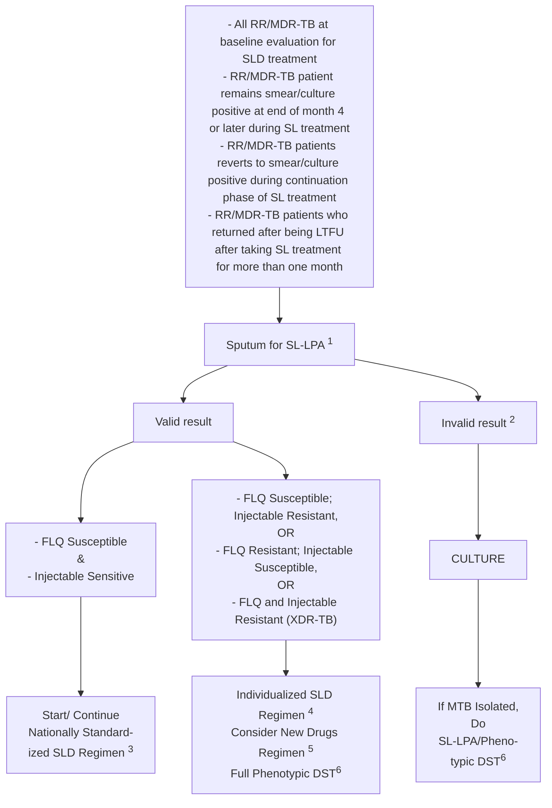
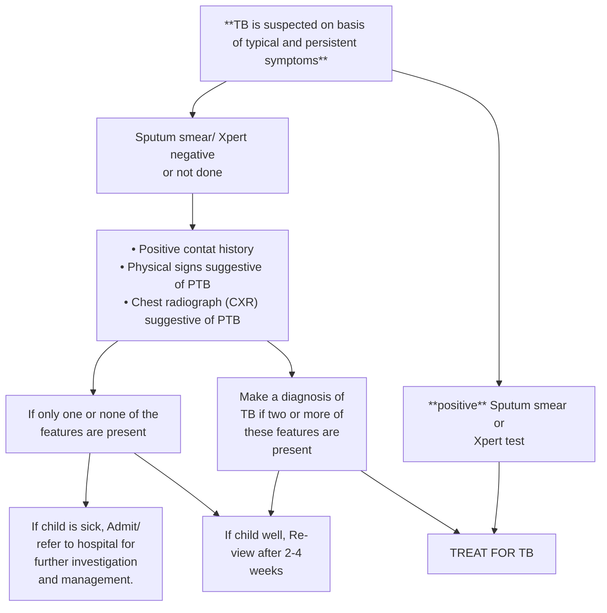
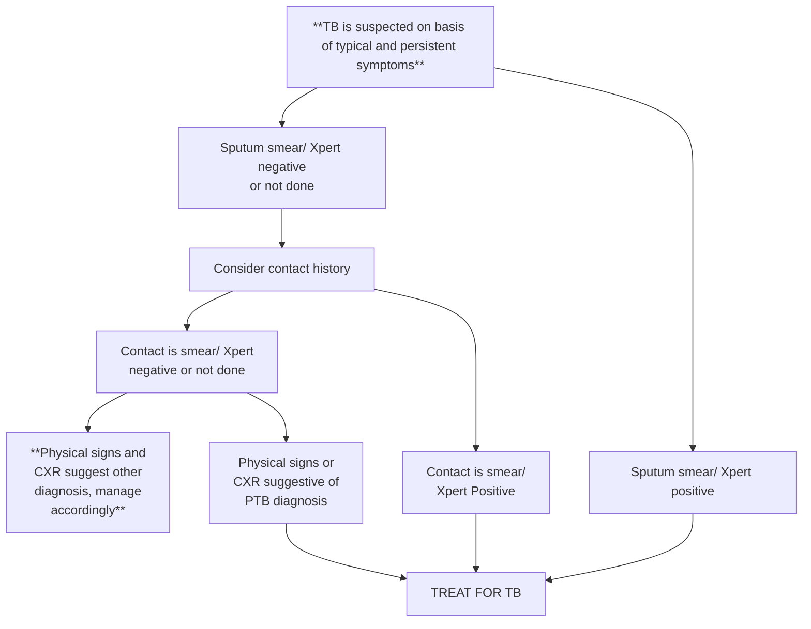
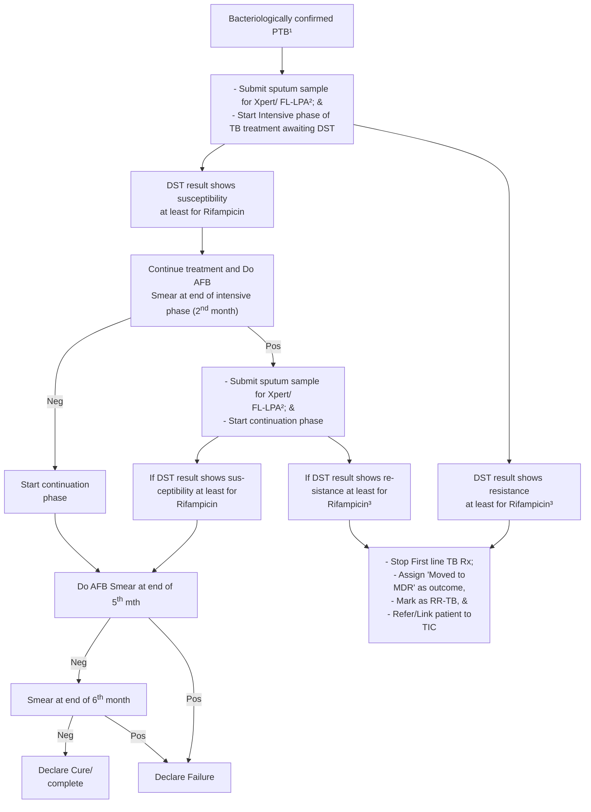
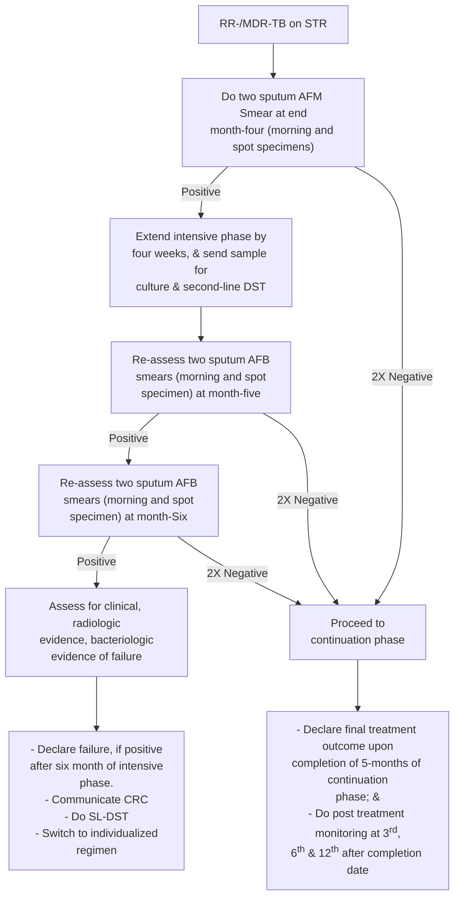
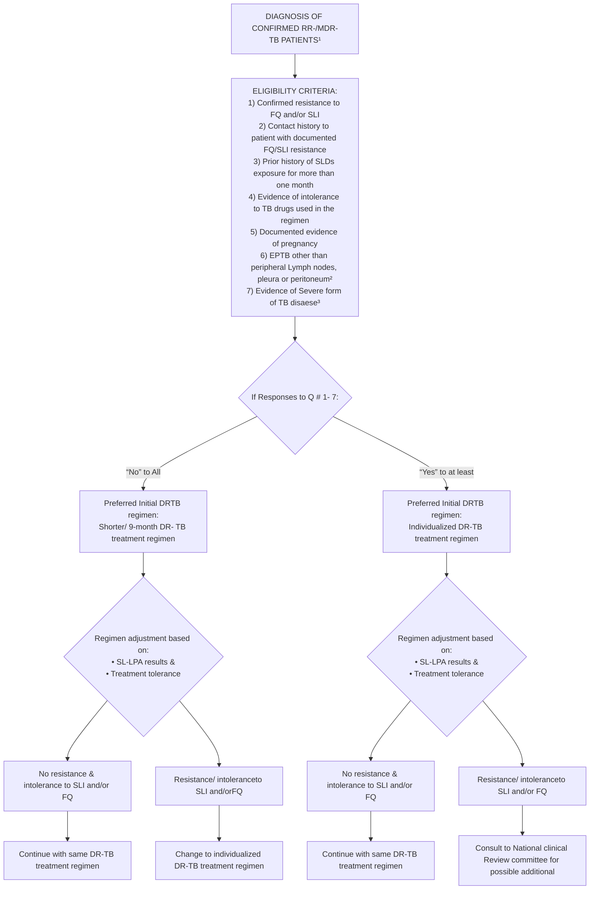
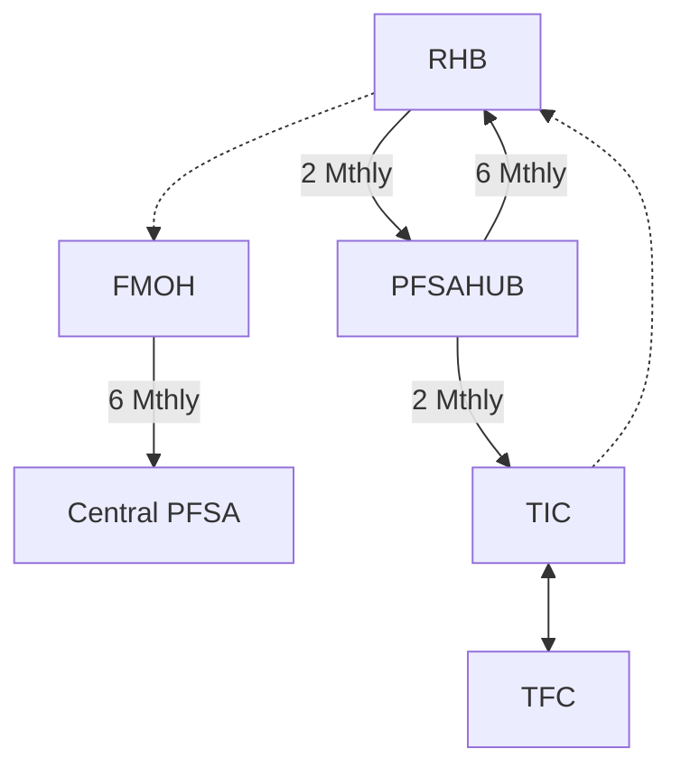
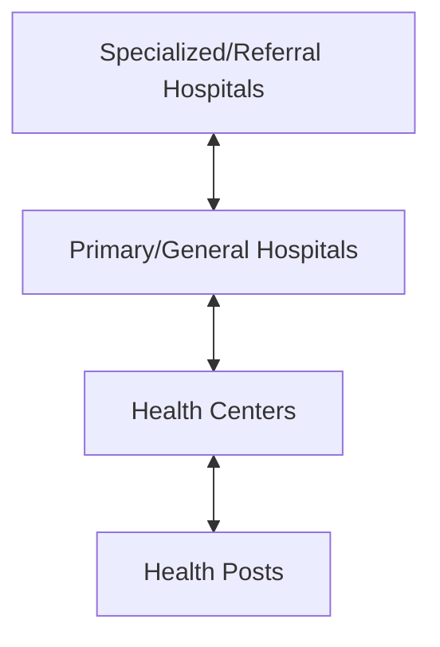
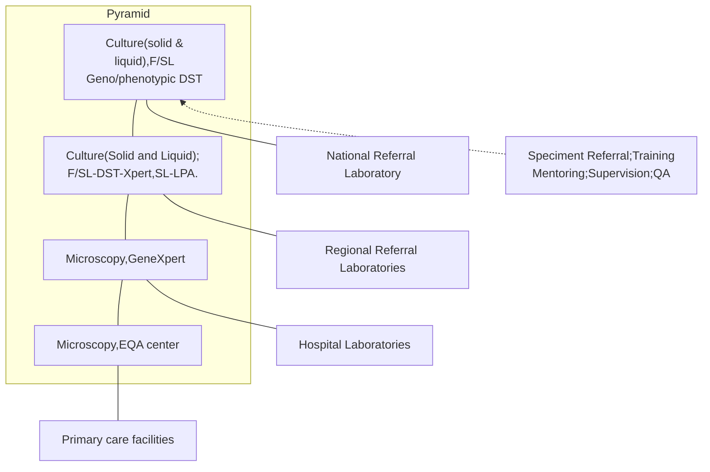
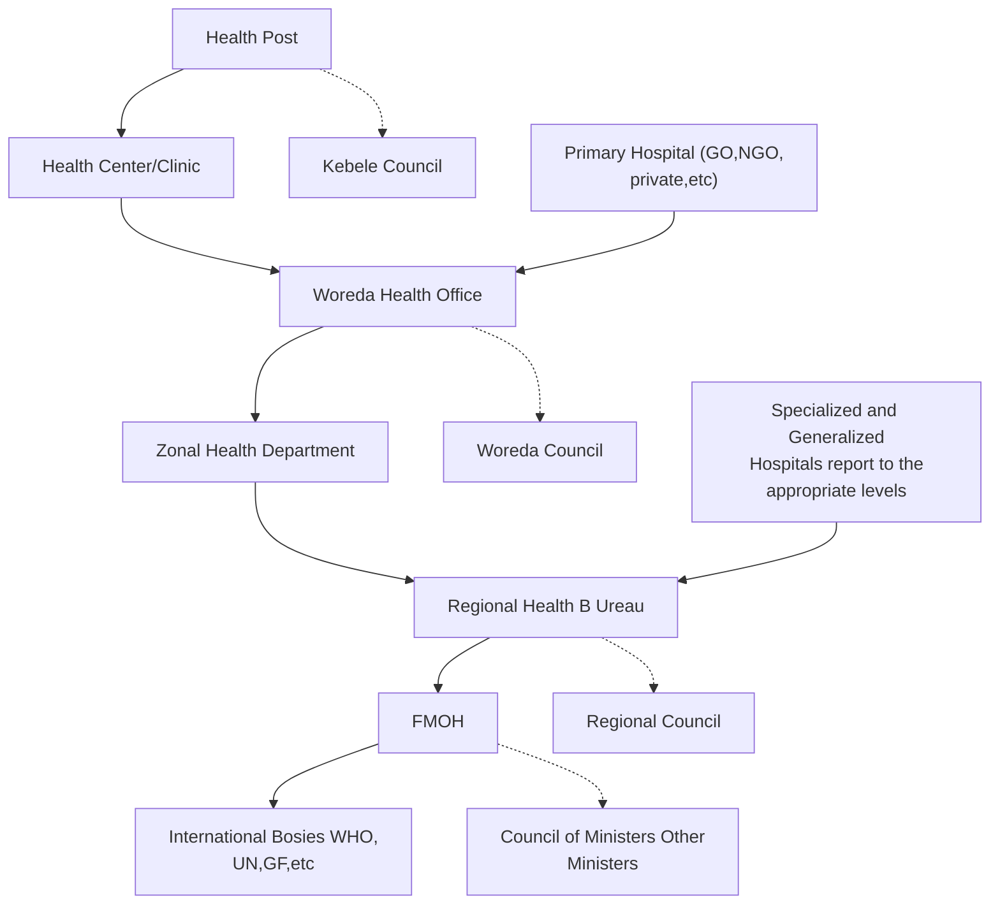

# Ministry of Health: National Guidelines for TB, DR-TB and Leprosy, 6th edition (2017; copy hosted by WHO AFRO)

<!-- page 1 -->

Federal Democratic Republic of Ethiopia
Ministry of Health

# NATIONAL GUIDELINES FOR TB, DR-TB AND LEPROSY IN ETHIOPIA

## SIXTH EDITION

November 2017
ADDIS ABABA

<!-- page 2 -->

# GUIDELINES FOR MANAGEMENT OF TB, DR-TB AND LEPROSY IN ETHIOPIA

## SIXTH EDITION

November 2017
Addis Ababa

<!-- page 3 -->

## FOREWORD

Tuberculosis (TB) is a major public health problem throughout the world by infecting an estimated one-third of the world’s population and putting them at risk of developing active disease during their lifetime. Tuberculosis is the leading cause of deaths every year among the infectious disease worldwide alongside HIV. It kills more than five thousand children, women and men each day.

According to the Global TB Report 2017, 10.6 million people are estimated to have fallen ill with TB in 2016 while an estimated 1.3 million people died of TB. In addition, an estimated 4.1% of these new TB cases and 19% of the previously treated cases are believed to harbour Drug resistant-TB with an estimated 240 000 deaths annually due to Drug resistant-TB.

Ethiopia is among the 30 High TB, HIV and MDR-TB Burden Countries, with annual estimated TB incidence of 177/100,000 populations and death rate of 25 per 100,000 populations for 2016. Among the notified TB cases in 2016, 2.7%) of new TB cases and 14% among previously treated TB cases were also estimated to harbour drug resistant TB.

Ethiopia has notified 125,836 new TB cases and enrolled 702 drug-resistant TB case in 2016. Although the majority of TB cases has affected the productive age group, 15 100 (12%) cases were reported among children aged under 15 year. HIV co-infection impedes the TB control efforts contributing to around 8% of annually notified TB cases.

Ethiopia has successfully achieved the millennium development goals set for TB in 2015. The country’s has expressed its commitment to accelerate the fight to end TB epidemic by 2035 by endorsing the new post-2015 Global “END TB strategy” and has already aligned the National TB Strategic Plan within the framework of National Health Sector Transformation Plan.

The National End TB strategy aims to end the TB epidemic by reducing TB related deaths by 95% and by cutting incident TB cases by 90% between 2015 and 2035; and to ensure that no family is burdened with catastrophic expenses due to TB. The strategy calls for use of robust TB case finding strategies and use of rapid diagnostic technologies to address the gap in finding the missed TB cases and threat of Drug resistant TB. The program is committed to improve access and equitable TB services to vulnerable and marginalized population groups where TB burden concentrates and most delays happen due to socio-economic and legal barriers. The program has also recognized the need for research and innovations to sharply bend the TB epidemic curve to meet the ambitious targets for 2035.

This guideline expresses the strong governmental commitment by introducing the most up-to-date National strategies, recommendations, clinical and programmatic

<!-- page 4 -->

practices towards provision of patient-centered quality TB/DR-TB care. The national leprosy control strategy, programmatic recommendations and clinical care guidance is also provided in separate section.

Finally, I would like to call all actors of Tuberculosis in the country to actively engage in their concerted efforts towards ending the TB epidemic by 2020 in Ethiopia to achieve universal health coverage for all segments of the population as in the country’s transformation plan to join the middle income countries.

**Kebede Worku MD, MPH**
State minister of Health, FDRE

<!-- page 5 (printed iii) -->

## ACKNOWLEDGEMENT

The revision process of this sixth edition of national guideline has undergone multiple consultations and continuous involvement of experts on TB, DR-TB, TB/HIV and Leprosy(see annex 1 for the list of contributors).

I would like to acknowledge experts working at the National TB control program for their outstanding contributions and coordination efforts for the realization of this guideline.

The Ministry also owes appreciation for the below mentioned senior experts on development and reviewing of the section of the guidelines:

* Dr Amsalu Bekele (consultant pulmonologist/Addis Ababa university college of health sciences), Dr Aschalew Worku (Pulmonary and critical care physician/Addis Ababa university college of health sciences), Dr Tewodros Haile (Pulmonary and critical care physician/Addis Ababa university college of health sciences) and Dr Fraser Wares( USAID/challenge TB/KNCV) on the development of this guidelines.

* Dr Ahmed Bedru, Dr Lemma Ketema and Dr Workabeba Abebe from Ethiopian pediatric society reviewed the childhood TB section of the guideline

* Dr Abebe Bekelem FCS (ECSA) Associate professor of surgery, Addis Ababa University College of health sciences, developed the surgical intervention of TB/DR-TB patients.

The core writing group leading the revision of this guidelines consist of Dr Anteneh Kassa, Dr Eshetu Kebede, Addisalem yilma, Dr Blen Ayele, Dr Andargachew Kumsa, Dr Daniel Kokebu, Dr Yohannes Molla, Dr yewilsew Kassie, Dr Beniam Feleke and Dr Kassa Hailu.

Finally, the Federal Ministry of Health of Ethiopia is thankful to all the TB partner organizations for their limitless technical and financial support in the revision of this guideline and covering the printing cost of the document.

Biruck Kebede, BSc, MPH

A/Director, Diseases Prevention and control Directorate
FDRE Ministry of Health

<!-- page 6 (printed iv) -->

## ACRONYMS

**AIDS**: Acquired Immunodeficiency Syndrome

**ART**: Anti-Retroviral Treatment

**COPD**: Chronic Obstructive Pulmonary Disorders

**CSOs**: Civil Society Organizations

**CPT**: Cotrimoxazole Preventive Treatment

**DOT**: Directly Observed Treatment

**DOTs**: Directly Observed Treatment, Short-Course

**DST**: Drug Susceptibility Test

**EPHI**: Ethiopian Public Health Institute

**EPTB**: Extra-Pulmonary Tuberculosis

**EQA**: External Quality Assurance

**FMOH**: Federal Ministry of Health

**HAART**: Highly Active Anti-Retroviral Treatment

**HCT**: HIV Counseling and Testing

**HEP**: Health Extension Program

**HEW**: Health Extension Worker

**HIV**: Human Immunodeficiency Virus

**HMIS**: Health Management Information System

**IGRA**: Interferon gamma release Assay

**IPT**: Isoniazid Preventive Therapy

**IPLS**: Integrated pharmaceutical Logistic system

**IRIS**: Immune Reconstitution Inflammatory Syndrome

**MB**: Multi-Bacillary leprosy

**MDR-TB**: Multi-Drug Resistant TB

**MDT**: Multi-Drug Therapy

**OI**: Opportunistic Infection

**PB**: Pauci-Bacillary leprosy

**PLHIV**: People Living With HIV/AIDS

**POD**: Prevention of Disability in Leprosy

**PPM**: Public-Private/Public-Public Mix

**QA**: Quality Assurance

**RHB**: Regional Health Bureau

**RRL**: Regional Reference Laboratory

**SCC**: Short Course Chemotherapy

**SLD**: Second line anti-TB drugs

**SOPs**: Standard Operating Procedures

**TB**: Tuberculosis

**TST**: Tuberculin skin test

**XDR-TB**: Extensively Drug Resistant Tuberculosis

<!-- page 7 (printed v) -->

# TABLE OF CONTENTS

**TITLES**	**PAGE**

|FOREWORD|I|
|-|-|
|ACKNOWLEDGEMENTS|III|
|ACRONYMS|IV|
|TABLE OF CONTENTS|V|
|LIST OF TABLES|IX|
|LIST OF FIGURES|X|
|LIST OF BOXES/DIAGRAMS|XI|

**1 KEY RECOMMENDATIONS OF THE GUIDELINE**	**1**

|**2 INTRODUCTION TO TUBERCULOSIS AND NATIONAL STRATEGY**|**8**|
|-|-|
|- 2.1 Overview of Tuberculosis|8|
|- 2.2 Tuberculosis Situation in Ethiopia|8|
|- 2.3 Finding Missed TB Cases in Ethiopia|8|
|- 2.4 Addressing the Dual TB and HIV Burden|8|
|- 2.5 Emergence of Threats of Drug Resistant TB|9|
|- 2.6 History of National TB Control Program|10|
|- 2.7 National TB Control Strategy|10|

|**3 BASIC CONCEPTS AND CLINICAL PRESENTATION OF TUBERCULOSIS**|**12**|
|-|-|
|- 3.1 Transmission and Pathogenesis|12|
|- 3.2 Evolution of TB Infection and Disease|12|
|- 3.3 Determinants of Transmission of TB Bacilli|12|
|- 3.4 Risk Factors for Developing Active TB|13|
|- 3.5 Clinical Presentation of Tuberculosis|13|

|**4 DIAGNOSIS OF TUBERCULOSIS AND TB CASE FINDING**|**16**|
|-|-|
|- 4.1 Tuberculosis Diagnostic Methods|16|
|- 4.2 Additional Supportive Methods|18|
|- 4.3 TB Case Finding Strategies|19|

|**5 APPROACH TO DIAGNOS OF TBUBERCULOSIS**|**23**|
|-|-|
|- 5.1 Diagnosis of Pulmonary Tuberculosis in Adults and Adolescents|23|
|- 5.2 Diagnosis of Extra-Pulmonary Tuberculosis in Adults and Adolescents|24|
|- 5.3 Diagnosis of TB Among HIV Positives|25|
|- 5.4 Diagnosis of Drug Resistant Tuberculosis|26|
|- 5.5 National TB/DR-TB Diagnostic Policies and Algorithms for Tuberculosis|28|

|**6 DIAGNOSIS OF TUBERCULOSIS IN CHILDREN**|**33**|
|-|-|
|- 6.1 Integrated Childhood TB Care Service|33|
|- 6.2 Characteristic Presentations of TB in Children|33|
|- 6.3 Approach to Diagnose TB in Children|34|

<!-- page 8 (printed vi) -->

6.4 Diagnosis of Tuberculosis in HIV Positive Children 38
6.5 Diagnosis of DR-TB in Children 39
**7 TREATMENT OF LATENT TB INFECTION 42**
7.1 National Policy on Treatment of Latent TB Infection in Ethiopia 42
7.2 Identification of Eligible Population for LTBI and Treatment 42
7.3 Management of LTBI in contacts of Drug Susceptible Tuberculosis 42
7.4 Adherence and Completion of Preventive Treatment 43
7.5 Program Management, Monitoring and Evaluation 44
7.6 Preventive Therapy of LTBI in a New Born 45
7.7 Management of TB infection in contacts of Drug Resistant TB 45
**8 DEFINITION OF TERMS AND PATIENT REGISTRATION 46**
8.1 Case Definitions 46
8.2 Classifications of Tuberculosis 47
8.3 TB Treatment Outcome 48
**9 TREATMENT OF DRUG SUSCEPTIBLE TUBERCULOSIS 51**
9.1 Objectives of TB Treatment 51
9.2 Essential Properties of Tuberculosis Treatment 51
9.3 Anti-Tuberculosis drugs Dosing 51
9.4 Standard TB Treatment 52
9.5 Standard Treatment Regimen Drug Susceptible Tuberculosis 53
9.6 Treatment of Extra-Pulmonary Tuberculosis 54
9.7 Treatment of Drug Susceptible TB In Children 54
9.8 Pre-Treatment Evaluation and Preparation for Treatment 55
9.9 Monitoring Treatment Responses 56
9.10 Management of Treatment Interrupters 59
**10 TREATMENT OF DRUG RESISTANT TB 61**
10.1 Principles of Dug Resistant Tuberculosis Treatment 61
10.2 Anti-TB Medicines used in Treatment of Drug Resistant TB 62
10.3 Recommended DR-TB Treatment Approach in Ethiopia 65
10.4 Shorter Standardized DR-TB Treatment 66
10.5 Individualized DR-TB Regimen 73
10.6 Approach to Managing Patients Interrupting Treatment 79
10.7 Approach to DR-TB Failure 81
10.8 Treatment of DR-TB in Children 83
10.9 Extra-Pulmonary Drug-Resistant TB 86
10.10 Adjuvant Therapies in Drug Resistant TB 87
10.11 Pre-Treatment Screening and Patient Evaluation 87
10.12 Patient Triaging to the Appropriate DR-TB Regimen Strategy 89
10.13 Treatment Monitoring and Follow-up 91
10.14 Post Treatment Monitoring 94
10.15 Management of Mono- and Poly-Drug Resistant TB Cases 95

<!-- page 9 (printed vii) -->

**11 TREATMENT OF TB/DR-TB IN SPECIAL SITUATIONS AND CONDITIONS-------96**
**12 MANAGEMENT OF ADVERSE EFFECTS AND PHARMACOVIGILANCE----------100**
12.1 General Approaches to the Managements of Adverse Effects--------------------- 100
12.2 Management Approaches of Adverse Effects During Treatment-------------------101
12.3 Management of Specific Drug Adverse Effects---------------------------------------- 103
12.4 Framework for Active TB Drug Safety Monitoring and Management ------------ 110
**13 TB/HIV COLLABORATIVE AND CO-MORBIDITIES-------------------------------------- 115**
13.1 TB/HIV Collaborative Activities------------------------------------------------------------- 115
13.2 Tuberculosis and Malnutrition---------------------------------------------------------------118
13.3 Tuberculosis and Diabetes Mellitus------------------------------------------------------- 121
13.4 Tuberculosis and COPDS-------------------------------------------------------------------- 122
13.5 Tuberculosis in Elderly ---------------------------------------------------------------------- 122
**14 PATIENT CARE AND SUPPORT AND ADHERENCE TO TREATMENT------------ 124**
14.1 Integrated Patient-Centered Care and Support---------------------------------------- 124
14.2 Supervision of Treatment---------------------------------------------------------------------124
14.3 Recommended Combined Treatment Adherence Support Interventions-------- 125
14.4 Palliative Care for TB and DR-TB Patients---------------------------------------------- 126
14.5 Terminal Illness and End of Life Care----------------------------------------------------- 127
**15 IMPLEMENTING TB INFECTION CONTROL MEASURES----------------------------- 128**
15.1 Basics of TB Infection Control-------------------------------------------------------------- 128
15.2 Set of TB IC Activities------------------------------------------------------------------------- 128
15.3 Reducing Transmission of TB in Healthcare Facilities--------------------------------129
15.4 Infection Control for Congregate Settings------------------------------------------------130
15.5 Reducing Transmission in Households--------------------------------------------------- 132
**16 LEPROSY---------------------------------------------------------------------------------------------- 133**
16.1 Epidemiology of Leprosy in Ethiopia----------------------------------------------------- 133
16.2 National Leprosy Control Strategy-------------------------------------------------------- 133
16.3 Basics of Leprosy----------------------------------------------------------------------------- 134
16.4 Leprosy Case Funding Strategies--------------------------------------------------------- 134
16.5 Identification and Evaluation of Patient to Diagnose Leprosy---------------------- 135
16.6 Examination of the Peripheral Nerves, Eyes, Hands and Feet-------------------- 138
16.7 Case Definition, Classification and Treatment in Leprosy--------------------------- 143
16.8 Treatment of Leprosy------------------------------------------------------------------------ 145
16.9 Treatment in Special Conditions------------------------------------------------------------ 148
16.10 Monitoring of Treatment and Follow-up-------------------------------------------------148
16.11 Treatment Outcome-------------------------------------------------------------------------- 148
16.12 Retrieval of Absentees---------------------------------------------------------------------- 150
16.13 Referral of Leprosy Patients for Special Care-----------------------------------------150
16.14 Follow-up and Care After Release from Treatment---------------------------------- 150

<!-- page 10 (printed viii) -->

16.15 Complications of Leprosy and Their Management---------------------------------151
16.16 Prevention of Disability in Leprosy-----------------------------------------------------157
16.17 Prevention of Leprosy--------------------------------------------------------------------- 160
**17 COMMUNITY BASED TB CARE, ACSM & ENGAGING ALL CARE PROVIDERs---161**
17.1 Community Based TB Prevention Control---------------------------------------------161
17.2 ACSM Support for TBL Control Program---------------------------------------------- 162
17.3 Engaging All Care Providers in TB care------------------------------------------------164
**18 TUBERCULOSIS & LEPROSY LOGISTICS SUPPLY MAMANGEMNT SYSTEM-----166**
18.1 TBL logistic supply management system arrangement-----------------------------166
18.2 Distribution of First Line Anti-TB Drugs-------------------------------------------------166
18.3 Distribution of Second Line Anti-TB Drugs--------------------------------------------167
18.4 Distribution of Leprosy Commodities----------------------------------------------------168
18.5 Ant-TB Commodities Inventory Management at Facility Level--------------------169
18.6 Retinal Medicine Use and Adherence---------------------------------------------------169
18.7 TB Patient Kits System in Ethiopia-------------------------------------------------------169
**19 PROGRAMATIC MANAGEMENT OF TUBERCULOSIS--------------------------------172**
19.1 TBL Program Management Levels and Coordination Mechanisms-------------172
19.2 TBL Services at Health Facility Level---------------------------------------------------172
19.3 DR-TB Services in Ethiopia----------------------------------------------------------------173
19.4 TB Laboratory Services Organization, Coordination and Management--------176
19.5 Programmatic Monitoring and Evaluation of TB, Leprosy and DR-TB---------178
19.6 TBL, DR-TB and TB/HIV Data Quality Assurance----------------------------------- 179
19.7 Recording and Reporting formats in TB, Leprosy and DR-TB--------------------179
19.8 Key Programmatic Indicators in TBL, and TB/HIV------------------------------------180
**REFERENCE--------------------------------------------------------------------------------------------------181**
**ANNEXES------------------------------------------------------------------------------------------------------182**
Annex 1 Contributors List-------------------------------------------------------------------------------- 182
Annex 2 Common Clinical Presentations and Practical Considerations of EPTB--------- 183
Annex 3 Fact Sheet for Common TB Medicines Used in RR-TB----------------------------- 184
Annex 4 Checklist for Socio-economic Assessment of TB/DR-TB Patients------------------189
Annex 5 Surgery in the treatment of PTB Including DR-TB--------------------------------------190
Annex 6 Weight-based Anti-TB Drugs Dosing for adults------------------------------------------192
Annex 7 Pediatric Anti-TB Medicines Dosing------------------------------------------------------- 193
Annex 8 Clinical Management of Adverse Events Interest-------------------------------------- 194
Annex 9 Adjustment of Anti-TB Medications in Renal Insufficiency--------------------------- 202

<!-- page 11 (printed ix) -->

# LIST OF TABLES

|**TITLE**|**PAGE**|
|-|-|
|Table 1: Summary of Key Recommendations of the Guideline|1|
|Table 2: DR-TB Risk and TB Patient or Type|10|
|Table 3: Conducting Appropriate Clinical Evaluation and Management of TB Exposed Contacts|21|
|Table 4: Weight Based Dosing of INH Preventive Treatment Therapy for Children|43|
|Table 5: Definition of Treatment Outcomes for Drug Susceptible Tuberculosis|49|
|Table 6: Definition of Treatment Outcomes for Drug Resistant Tuberculosis|50|
|Table 7: Medicines Recommended for Treatment of Rifampicin Susceptible Tuberculosis|51|
|Table 8: The Essential Anti-TB Drugs and Their Recommendations|52|
|Table 9: First line TB Treatment Adult Dosing Chart Using Body Weight|52|
|Table 10: First line TB Treatment Pediatric Dosing Chart Using Body Weight|53|
|Table 11: Standard First Line Anti-TB Regimen for Patients Presumed or Known to Have Drug Sensitive TB|53|
|Table 12: Selecting a TB Treatment Regimen|55|
|Table 13: Management of New PTB Patients Interruption|59|
|Table 14: Managements of Re-treatment Patients Who interrupted Treatment for Two Weeks or More|60|
|Table 15: TB Medicines Recommended for the Treatment of RR/MDR-TB|63|
|Table 16: Cross Resistance of TB Drugs|65|
|Table 17: Treatment Regimen and Plan of Treatment|69|
|Table 18: Re-initiating Treatment for DR-TB Patient Who In-lost-to Follow Up for 2-6 Months|81|
|Table 19: Penetration of Anti-TB Drugs in Cerebrospinal Fluid|86|
|Table 20: Schedule for Clinical Monitoring in DR-TB Treatment|92|
|Table 21: TB Treatment in Special Situations and Conditions|96|
|Table 22: Classification and Management of ADRs|102|
|Table 23: Severity Grading and Recommended Actions for Common Adverse Events of Interests.|104|
|Table 24: General Definition of Severity|114|
|Table 25: Causality Categories Definition|114|
|Table 26: Guideline for TB and HIV Confected Adults and Adolescents|116|
|Table 27: Malnutrition Definition by Body Mass Indent|119|
|Table 28: Nutritional Care Plan and Management of Malnourished Patients with TB|120|
|Table 29: Summary of Clinical Manifestation of TB in Elderly|123|
|Table 30: Disabilities Grading Criteria for Leprosy|143|
|Table 31: Case Definition and Management of Leprosy|144|
|Table 32: PB-MDT Regimen|146|
|Table 33: MB-MDT Regimen|146|
|Table 34: Referral Criteria for Leprosy Patients for Special Care|150|
|Table 35: Adverse Effects of MDT Drugs|151|
|Table 36: Ambulatory Treatment of Severe Reversal Reactions with Prednisolone|154|
|Table 37: Criteria for Referral of Leprosy Patients to a Hospital during Reaction|155|
|Table 38: Differentiation for Leprosy Patient between Relapse and Reactions|155|
|Table 39: Self-care for Eyes Leprosy Patients|158|
|Table 40: First Line Anti- TB Drugs Formulations for Adults and Children|169|
|Table 41: Pre TB-Kit for New TB Patient|172|
|Table 42: Adjustments to be made to the Kit Based of Patients Weight Band for New TB|171|
|Table 43: Minimum Requirements of Centers for DR-TB Service Provision|174|

<!-- page 12 (printed x) -->

# LIST OF FIGURES

|**TITLE**|**PAGE**|
|-|-|
|Figure 1: National Diagnostic Algorithm for Patients with Presumptive TB|29|
|Figure 2: National Diagnostic Algorithm for RR/MDR-TB Patients|32|
|Figure 3: Approach to TB Diagnosis in HIV Uninfected Child|38|
|Figure 4: Approach to TB Diagnosis in HIV Infected Child|39|
|Figure 5: Diagnostic Algorithm for the Diagnosis of DR-TB in Children|41|
|Figure 6: Sputum AFB Follow up for bacteriologically confirmed TB Patient|58|
|Figure 7: Decision Tree to Guide the Transition to the Continuation Phase of Treatment with shorter standarized treatment ...|72|
|Figure 8: National DR TB Triaging and Decision Flowchart|91|
|Figure 9: Reporting Timeline of AE/SAE/AEIs|113|
|Figure 10: Examination of Nerves TO Diagnose Leprosy|137|
|Figure 11: Voluntary Muscle Testing of Eyes to Diagnose Leprosy|139|
|Figure 12: Voluntary Muscle Testing of Hands and Feet|140|
|Figure 13: Hand Foot Mapping Including Sensation Test to Diagnose Leprosy|141|
|Figure 14: Examination of the Eyes|142|
|Figure 15: MDT Blister Packs for Adults and Children|147|
|Figure 16: Overall Flow of Commodities and Information on IPLS|167|
|Figure 17: SLDs Distribution Flow from National Level to Treatment Centers|168|
|Figure 18: Bilateral Referral and Communication of TBL, TB/HIV and DRTB Services|176|
|Figure 19: TB and DR-TB Laboratory Services and Referral Linkage|176|
|Figure 20: HMIS Data Flow|178|

<!-- page 13 (printed xi) -->

# LIST OF BOXES

|Box NO.|TITLE|PAGE|
|-|-|-|
|Box 1:|Commonest Presentation of Pulmonary Tuberculosis|13|
|Box 2:|Symptoms and Signs of Presumptive TB Cases|23|
|Box 3:|Standard PTB Case Definition|24|
|Box 4:|First Line DST Screening Criteria|27|
|Box 5:|Second Line DST Screening Criteria|27|
|Box 6:|Approaches to Diagnose TB in Children|35|
|Box 7:|National Policy for Preventive Therapy for People Infected With HIV|44|
|Box 8:|The Principles of Drug Resistance TB Treatment|61|
|Box 9:|Eligible Patient Groups for the Standardized Shorter DR-TB Treatment Regimen|66|
|Box 10:|Steps to Design a Treatment Regimen and Medicines Used in Treatment of DR-TB|74|
|Box 11:|Essential Elements for Nutritional Counseling of All Patients with Active TB|121|
|Box 12:|Set of Measures for Facility Level TB IC Management Activities|129|
|Box 14:|Elements of National Leprosy Strategic Interventions|143|
|Box 15:|Definition of Treatment Outcome of Leprosy|149|

<!-- page 14 (printed 1) -->

## 1. SUMMARY OF KEY RECOMMENDATIONS OF THE GUIDELINE

This sixth edition of the national guidelines presents the most updated current guidance on programmatic and clinical management of patients with Tuberculosis and Leprosy in line with the global recommendations to hasten the efforts towards the control of TB epidemics in the country.

The programmatic areas explain aspects of TBL program and service organization, coordination and management, definition of terms and registration and guidance on TBL recording and reporting system. It also highlights on the TBL commodity supply system in the country. Strategies to engage all relevant stakeholders and empowering the community ownership is included with aim of equitable access to quality TB services.

The clinical sections, on the other hand, present the latest recommendations on TB and Leprosy case finding strategies approaches for patient evaluation and use of appropriate diagnostics in the national TB diagnostic algorithms. It as well presents details of treatment of patients with TB, DR-TB and leprosy as well as monitoring of response during treatment. Key recommendations in this document are summarized in table 1.

Table 1: Summary of Key Recommendations of the guidelines

|Thematic Area|Key Recommendations|
|-|-|
|**Identifying Presumptive TB Cases**|Patients with persistent and progressive cough for two or more weeks, (cough of any duration for HIV positives), fever, night sweats or loss of weight or chest X-ray abnormality suggestive of TB are presumptive TB Cases and prompt clinical evaluation is essential for early and rapid diagnosis.|
||Health extension workers should identify individuals with presumptive TB at health post or during their home visits and refer them to the catchment health centres for further evaluation and investigation.|
||Health Care Workers in health facilities should routinely screen for TB among individuals who are self-presenting to health facility using sensitive TB symptom-based algorithms/screening tools.|
||Intensified TB Case finding (ICF) and systematic screening for Active TB should be integrated into clinics serving people with predetermined TB risk groups.|
||All persons who have been in close contact with patients who have pulmonary TB should be traced and evaluated for Tuberculosis. Priority for contact investigation should be given to individuals: • with clinical features suggestive of TB, • aged < 5 years, • with known immunocompromising conditions, particularly HIV infection, or • Contacts of diagnosed or presumed DR-TB.|

<!-- page 15 (printed 2) -->

|Thematic Area|Key Recommendations|
|-|-|
|**Diagnosis of TB Cases**|The diagnosis of TB needs to be established by rapid and sensitive diagnostic tests (preferably Xpert MTB/RIF Ultra assay)|
||All patients with signs and symptoms of pulmonary TB who are capable of producing sputum should submit specimen for bacteriologic examination with Xpert MTB/RIF Ultra assay or sputum microscopy.|
||For persons living with HIV, with medium riskf of DR-TB, & children, Xpert MTB/RIF Ultra assay is preferred initial diagnostic test to increase yiled.|
||If Xpert service is not readily available on same day, sputum microscopy is recommended as interim test for TB diagnosis while sending speciemen for Xpert test to the networked testing site to avoid dignostic delay.|
||If Xpert service is accessible on same day, Xpert MTB/RIF test is recommended as the initial diagnostic test for all persons being evaluated for TB.|
||Chest X-rays, when available, should be performed early in the course of investigation of tuberculosis in seriously sick HIV positives, as a supplementary diagnostic test.|
||In seriously ill HIV positive patients, all available investigations should be done at one go to reduce the time to diagnosis and avoid preventable deaths|
||Patients with unexplained finding on CXR should submit sputum for confirmatory test preferably by X-pert MTB/RIF test to diagnose TB|
||Pathology studies should be considered from the appropriate specimen for the diagnosis of extra pulmonary TB.|
||Xpert MTB/RIF Ultra assay should be used in preference to conventional microscopy and culture as the initial diagnostic test for cerebrospinal fluid specimens from patients being evaluated for TB meningitis.|
||Xpert MTB/RIF Ultra assay is recommended as a replacement test for usual practices (including conventional microscopy, culture or histopathology) for testing specific non-respiratory specimens such as from lymph nodes and other tissues for patients suspected of having EPTB/DR-TB.|
||**A bacteriologically confirmed TB case** is a patient from whom at least one biological specimen is positive for mycobacterium TB either by smear microscopy, Xpert MTB/RIF, or culture.|
||**A clinically diagnosed TB case** is a patient who doesnot fulfill criteria for bacteriological confirmed case, but diagnosed with active TB by an experienced clinician and is decided to be given a full course of TB treatment.|
||An individual diagnosed with TB, in particular the pulmonary form, should undergo drug resistance screening test at least for rifampicin using rapid DST technique preferably by Xpert or FL-LPA before or within seven days of registration to receive TB treatment with first-line regimen.|

<!-- page 16 (printed 3) -->

|Thematic Area|Key Recommendations|
|-|-|
|**Screening and Diagnosis of Drug resista TB cases**|Presumptive DR-TB case is a person who presents with clinical features suggestive of TB or diagnosis of active TB and with either medium – or high-risk to harbour Drug resistant TB|
||Diagnosis of Drug resistant TB is made using rapid first and second line DST for TB.|
||Bacteriologically confirmed DR-TB refers to those patients with documented laboratory DST (phenotypic or molecular) results for DR-TB or Rifampicin Resistant TB|
||Clinically diagnosed DR-TB case refers to a person who is diagnosed to have DR-TB without documented DST result but the clinical panel team decided to empirically treat with SLD regimen.|
||All confirmed RR/MDR-TB patients should be tested for core second line drugs (flouroquinolones and injectable) using rapid DST techniques from sputum collected before or within one week of treatment initiation with second line TB regimen. *Culture-based DST for selected second- anti-TB agents should be performed for patients enrolled in individualized (longer) MDR-TB treatment.*|
||Antiretroviral therapy (ART) and routine co-trimoxazole preventive therapy (CPT) should be Initiated for TB patients living with HIV, regardless of their CD4 cell count. The preferred ART regimen is TDF +3TC+EFV.|
|**Diagnosis of TB in young children**|**Bacteriologic confirmation of TB in children** is reached if the TB bacilli are detected by Xpert MTB/RIF, AFB microscopy or culture from biologic specimen.|
||**Clinical diagnosis of TB in young children** may be safely made using structured algorithmic approach if two of the following three evidences are met: i) clinical features consistent with TB, ii) TB contact information and iii) TB suggestive changes on chest x-ray.|
||**Clinical diagnosis of TB in young chidren** can also be reached if the child has either: Radiological picture of Miliary pattern, Histopathological findings compatible with TB; or Presence of clinical features suggestive of TB, documented contact history and decision to treat TB by experienced clinician.|
|**Treatment of latent TB infection**|Treatment of latent TB infection as preventive therapy is recommended for TB-exposed under-five children & People living with HIV regardless of their ages.|
||6 months-INH monotherapy is most widely used recommended regimen for LTBI in both adults and children. A 3 months of INH plus rifampicin for children <15years or a 3-month regimen of weekly Rifapentine plus isoniazid for both children and adolescents are newly recommended as alternatives.|
||Symptom-based TB screening only is sufficient to rule out Active TB.|

<!-- page 17 (printed 4) -->

|Thematic Area|Key Recommendations|
|-|-|
||INH-based therapy should be administered for under-five asymptomatic children who are exposed to TB within the past one year.|
||INH-based therapy should be provided at least once to all HIV-infected individuals at time of enrollment to HIV care or later after ruling out active TB.|
||BCG vaccine should be adminstered to all infants at birth except for those with confirmed HIV-infection.|
|Monitoring of response and Treatment support|A patient-centred approach to treatment should be developed to promote adherence, improve quality of life and relieve suffering. This approach should be based on the patient’s needs and on mutual respect between the patient and the provider.|
||All TB patients receiving standard first line treatment should be monitored using clinical parameters during treatment. Besides, bacteriologically confirmed pulmonary TB patients need additional AFB microscopy|
||Bacteriologically confirmed pulmonary TB patients (i.e. those diagnosed by identification of bacilli by smear microscopy, culture or Xpert MTB/RIF assay) need their sputum to be checked using AFB microscopy at end of 2nd, 5th and 6th month of therapy|
|Treatment of Drug resistance TB|Patients with laboratory confirmed Rifampicin-/Multi drug resistant TB (RR/MDR-TB)require treatment with second-line TB regimens.|
||RR/MDR-TB patients should be treated using a 9-11 month shorter DR-TB treatment regimen unless they have resistance to core second-line anti-TB agents or meet other exclusion criteria. **Preferred regimen : 4-6 Km-Mfx-Pto-Cfz-Z-HH-E / 5 Mfx-Cfz-Z-E**|
||RR/MDR-TB patients who have resistance to core second-line anti-TB agents or meet other exclusion criteria for the shorter standarized regimen, a longer (individualized) regimen with at least five effective anti-TB agents in the intensive phase and four agents in the continuation phase is recommended for 20 or more months.|
||DR-TB patients for whom the construction of a regimen with four likely effective second-line drugs including a fluoroquinolone and an injectable *is not* possible or if patients possess high-risk of acquiring resistance to core second line drugs or at increased risk of unfavourable treatment outcome may benefit from treatment regimen constructed with addition of new and/or repurposed TB drugs as individualized DR-TB regimens.|
||Corticosteroids may be beneficial as an adjunctive therapy in DR-TB patients with severe respiratory insufficiency, central nervous system or pericardial involvement. Prednisone is commonly used, starting at approximately 1 mg/kg for 4-6 weeks and with gradual tapering.|

<!-- page 18 (printed 5) -->

|Thematic Area|Key Recommendations|
|-|-|
|**Treatment of Drug resistance TB**|Treatment of DR-TB in children generally follows the basic principles of regimen designing used in Adults. Empiric treatment is more likely needed in children as laboratory based DST confimation is not often possible.|
||The treatment of drug-resistant TB in patients with HIV is very similar to that in patients without HIV infection.|
||Surgery as an adjunct to chemotherapy for patients with localized disease can significantly improve outcomes where skilled thoracic surgeons and excellent pre- and postoperative care are available.|
||Pre-treatment thorough medical history, physical examination, and laboratory investigations should be systematically conducted for each and every patient with RR-/MDR-TB diagnosis in order to develop a comprehensive individual care plan.|
||In patients with Isoniazid-resistant Rifampicin-susceptible TB, 6-9 months of combination treatment with Rifampicin, ethambutol, pyrazinamide and Isoniazid, is recommended. Use of quinolones is not recommended.|
||A system to actively monitor and manage harms caused by anti-TB agents is required whenever drug resistant TB patients are treated with novel or repurposed medicines and MDR-TB regimens.|
||A patient-centred approach to treatment should be developed to promote adherence, improve quality of life and relieve suffering. This approach should be based on the patient’s needs and on mutual respect between the patient and the provider.|
||Once the patient has completed the course of treatment, Post treatment monitoring must be continued at least for 12 months.|
||Nutritional support is recommended for: • Severe Acute Malnutrition (SAM) in a patient with active TB. • Moderate Acute Malnutrition (MAM) in patient with: - TB/ HIV co-infections - MDR TB, and • Pregnant and lactating women with active TB.|
|**Leprosy**|All healthcare personnel should identify suspects by asking for symptoms of leprosy (e.g. skin changes) among persons who voluntarily visit medical services at OPD.|
||When a new leprosy case is detected, household and other close contacts of the patient should be examined for evidence of leprosy. If asymptomatic, they should be educated on early signs of the disease, the significance, and be advised to return if any suspected skin lesions or motor or sensory changes occur.|

<!-- page 19 (printed 6) -->

|Thematic Area|Key Recommendations|
|-|-|
|Leprosy|At Community level, HEWs and health development army (HDA) should create awareness about early signs and symptoms of leprosy, and provide patient support to facilitate self-reporting of suspected cases to the nearby health facility to receive appropriate evaluation and management.|
||Health workers need to have the necessary knowledge and skills to examine a patient for possible leprosy disease, especially in areas where cases of leprosy are known to present.|
||Pale or reddish discoloration of the skin with loss of or decreased sensation is the most common & early symptom of Leprosy.|
||Presence of one or more of the three cardinal signs of leprosy (Definite loss of sensation in a pale (hypo-pigmented) or reddish skin lesion, Thickened or enlarged peripheral nerve with or without tenderness, The presence of *acid-fast bacilli in a slit skin smear) is confirmatory to the diagnosis of Leprosy*|
||Leprosy patients are classified according to the WHO classification based on the number of leprosy skin lesions and nerve involvement: \* ***Pauci-bacillary (PB) Leprosy*** is a patient with One to five leprosy skin lesions or only one nerve trunk enlarged. \* ***Multi-bacillary (MB) Leprosy*** is a patient with six or more skin lesions or less than six skin lesions, that have a positive slit skin smear result or if there is involvement (enlargement) of more than one nerve.|
||After diagnosis of leprosy is made, the health workers need to examine the peripheral nerves, eyes, hands and feet as these are the most commonly affected organs by leprosy to determine the Disability Grade.|
||Pauci-bacillary (PB) Leprosy patients should be treated with daily self-administered dose of Dapsone and monthly supervised dose of Rifampicin & Dapsone (R & DDS). The daily self-administered dose is taken every day for 6 months. The monthly supervised dose is taken at the start of treatment (day 1) and every 28th day of the month for 6 consecutive months. The full course of treatment must be completed within 9 months after initiation of treatment.|
||Multi-bacillary (MB) Leprosy patients should be treated with daily, self-administered dose with Clofazemine and Dapsone and monthly, supervised dose with Rifampicin, Clofazemine & Dapsone (R, C & DDS). The daily, self-administered dose is taken every day for 12 months. The monthly, supervised dose is taken at the start of treatment (day 1) and then every 28th day of the month for 12 consecutive months. The full course of treatment must be completed within 15 months.|

<!-- page 20 (printed 7) -->

|Thematic Area|Key Recommendations|
|-|-|
|Leprosy|Examination of the eyes, hands and feet (including VMT-ST) should be done at any time if the patient complains loss of sensation and/or change in muscle strength or problem with vision, regularly every month as long as the patient is on MDT and just before Release From Treatment (RFT).|
||Leprosy patient who developed complications (leprosy reactions) should be properly evaluated and treated with steroids to prevent (further) disability during or after treatment.|

<!-- page 21 (printed 8) -->

## 2. INTRODUCTION TO TUBERCULOSIS AND NATIONAL STRATEGY

### 2.1 Overview of Tuberculosis

TB affects individuals of all ages and both sexes, and estimated to infect one-third of world population leaving increased pool of vulnerability to develop active TB. Besides, it tends to disproportionately concentrate among certain population groups that have either higher risk of exposure to infectious cases or increased risk of progression to active TB, if infected. Besides, it usually affects economically and culturally disadvantaged segment of a population where access to health services is often limited.

Despite the tremendous efforts and encouraging progresses obtained towards the control of TB epidemic since 1991, it remains to be the single infectious agent that takes more lives each year. The huge pool of missed TB cases, its strong association with HIV and the emergence of drug resistance to essential TB medicines puts TB among the serious threats that the world is facing at the moment.

### 2.2 Tuberculosis situations in Ethiopia

Tuberculosis is a major public health problem posing significant deleterious health impacts by affecting the productive segment of the population and resulting serious burden to the health system and exploiting the individuals/household economy. Despite the 42% of decline in the annual TB incidence from 369 cases per 100,000 populations in 1990 to 177 per 100,000 populations in 2016, the Ethiopia remains to be among the 30 countries reported with high burden of TB, TB/HIV and DR-TB for 2015 to 2020. TB related mortality is highlighted in the top ten reported causes of death among hospital admissions, with annual estimated death rate of 26 per 100,000 populations in 2015.

### 2.3 Finding Missed TB cases in Ethiopia

Ethiopia accounts for 3% of the annually 3 million missed people with TB by global health system. In 2016, estimated 35%(56,164) of incident TB cases were missed. Majority of missed cases are believed to concentrate among the poor, vulnerable and underserved communities. Addressing the missed cases does not only have an epidemiological implication but also rises a human right and equity issues.

An enhanced efforts with targetted strategies are much needed by recognizing the needs of vulnerable and underserved communities as key affected population for TB to accelerate the national TB control efforts towards TB control and elimination.

### 2.4 Addressing the dual TB and HIV burden

Despite the reported decline trends of HIV incidence rate in the country, there is a huge pool of HIV positive population directly drives the TB epidemic in Ethiopia, whereby 8% of annually notified TB patients were found to have HIV co-infection.

<!-- page 22 (printed 9) -->

The national responses in jointly addressing the TB and HIV epidemics begun in 2004 and have succeeded in saving lives of hundreds of thousands of affected citizens. Despite this, Tuberculosis (TB) remains to be the leading causes of death of people with HIV, accounting for around 40% of AIDS-related deaths. Both diseases together form a lethal combination, each speeding the other's progress.

In Ethiopia, 82% of notified TB patients in 2016 knew their HIV status while 82% of reported HIV-positive TB patients have accessed antiretroviral therapy. However, gaps remain and many are left behind in access to care as from the estimated 14,000 people who developed TB and were co-infected with HIV, only 7,843 people were diagnosed with both, HIV infection and TB disease on same year leaving TB/HIV co-infected people at increased risk of suffering and mortality.

Even though more than 400,000 HIV positive populations were enrolled in chronic HIV care with annual enrolment of around 30,000 newly diagnosed HIV positives in 2016, only 0.4% of them were diagnosed to have active Tuberculosis while only 40% of the newly enrolled HIV positives were reported to access preventive therapy as per national recommendation. This implies large segment of HIV-positive TB cases did not reach care.

## 2.5 Emergence of threats of Drug resistant TB

Over the decade, the TB control efforts have further stretched the growing health infra-structures with the efforts to detect, diagnose and managing drug resistant form of TB. Emergence of Tuberculosis that is resistant to essential TB medicines (i.e. Rifampicin with or without Isoniazid) has further impeded the promising gains to control TB epidemic.

Though exact estimation of the level of DR-TB is missing, 2.7% of New TB cases and 14% previously treated TB cases notified in the preceding reporting year are used approximate the burden. Additional resistance to core second line drugs, i.e. fluoroquinolones and/or injectable, has been a recent phenomenon in Ethiopia requiring treatment with the newly introduced novel and repurposed TB drugs though estimation of the actual prevalence is not yet well known. In the face of lack of national capacity to perform universal DST for all incident TB cases, the country is underperforming in ensuring early diagnosis and administering appropriate therapy.

### 2.5.1 Drivers of the epidemic and risk groups for Drug resistant TB

Development of drug resistance is hugely man-made problems resulting inadequate treatment due to suboptimal adherence, and continued transmission of resistant strains in the community following delayed diagnosis from lack of universal DST( testing all identified TB patients for drug resistance before or at start of TB treatment) and ineffective patients’ triaging for risk of Drug resistance. Previous TB treatment is the strongest risk factor to the development of drug resistance which is further complicated by on going person-to-person transmission of drug resistant strains in the household/community and health care or congregate settings as result of inadequate infection control and as result of factors that extend the infectious period such as

<!-- page 23 (printed 10) -->

delayed DR-TB diagnosis and treatment initiation, and delayed bacteriological conversion of sputum due to inappropriate MDR-TB therapy.

Under programmatic conditions, prioritization of patients on the basis of their risk of developing/acquiring DR-TB (see table 2), is applied for systematic screening of presumptive and diagnosed TB cases for possible drug resistant TB.

Table 2: DR-TB Risk and TB patient group/type

|DR-TB Risk|TB patient group/type|
|-|-|
|**High risk (>30%)**|\* Treatment failure of second course of TB treatment \* Treatment failure of New TB patient(i.e. positive sputum smear microscopy at fifth of treatment or later \* TB patients who presumed/known to develop active TB following history of contact with a DR-TB patient|
|**Medium risk (20-30%)**|\* TB patients in whom Tuberculosis is diagnosed after prior history of successful TB treatment( TB relapse) \* TB patient whose smear remains positive after two months of full TB treatment \* TB patient who discontinued TB treatment for eight consecutive weeks after receiving for one or more months \* TB patients with prolonged living-working history in settings known higher DR-TB prevalence such as congregated settings or health care facility|
|**Low risk (<5%)**|\* Newly diagnosed TB patient with no known contact history with DR-TB patient|

### 2.5.2 Prevention of Drug resistant TB

Knowing the complexity of programmatic, clinical and laboratory management of DR-TB, strengthening of recommended TB prevention strategies in Ethiopia could have pivotal effect in further control of DR-TB which emphasis on:

* Compliance to National Treatment guidelines/Protocols

* Ensuring optimal/effective first-line and second line therapy for TB patients

* Ensuring patient adherence and supervision of therapy, and patient support

* Implementation of optimal TB infection control measures in health facilities, congregate and household/community settings.

### 2.6 History of National TB Control program

Efforts to control tuberculosis in the country began in the early 1960s with the establishment of TB centers and sanatoriums in three major urban areas in the country. In 1976, Central Office of the National Tuberculosis Control Program (NTCP) was established. Since 1994, the National Tuberculosis & Leprosy Control program (NTLCP) was established to harmonize the co-ordination and management of TB and Leprosy at country level.

<!-- page 24 (printed 11) -->

In June 2000, the NTLCP became one team within the Disease Prevention and Control Department of the ministry. By 2009, the national TB and leprosy prevention and control program was led by the Agrarian Health Promotion and Disease Prevention Directorate alignment with the Agro-ecological context of population being served. Since 2013, the program is re-organized as national team within the disease prevention and control directorate of MOH to coordinate the core-functions of the Tuberculosis and Leprosy program together with the respective regional TB/HIV teams.

## 2.7 National TB control strategy

Ethiopia adopted the DOTS strategy since 1997 after successful pilot program with the development of the first combined Tuberculosis and Leprosy Prevention and Control Program manual. TB/HIV collaborative activities were piloted in 2004 and subsequently scaled up nationally. PPM DOTS, Community TB Care and MDRTB programs have also been piloted in subsequent years and integrated into the TBL and TB/HIV control program.

The national control program, through STOP TB strategy, had achieved to meet the MDG goals set for TB by 2015 by halving the TB incidence, prevalence and mortality from the 1990’s level. And has endorsed the “END TB strategy” and aligned with the country’s HSTP document to end TB by reducing TB incidence rate by 90% and TB related deaths by 95% compared to the 2015 baseline, and causing zero catastrophic costs to the patient and their household.

The END TB strategy encompasses a package of interventions and ten components organized under three pillars underpinning four core principles that necessitate government stewardship, a strong coalition with communities and civil society organization, a human rights-based, ethical and equitable approach to implementation, and adaptation of the strategy at the country level.

Furthermore, the national TB program has also re-prioritized the key strategic interventions in the five-year National TB strategic plan that paves towards achieving to reach the following ENDTB 90-(90)-90 targets set for 2020:

* Ensure 90% of all people with tuberculosis diagnosed and treated.

* Ensure 90% of the key populations in the country are diagnosed and treated

* Ensure 90% of people diagnosed successfully complete treatment with services to ensure adherence and social support

(The details can be accessed from FMOH. 2017 National TB strategic plan: 2017-2020)

<!-- page 25 (printed 12) -->

## 3. BASIC CONCEPTS AND CLINICAL PRESENTATION OF TB

### 3.1. Transmission and pathogenesis

M. tuberculosis is an airborne communicable disease that primarily affects the lung and most other body system with varying extents. It is caused by bacteria from Mycobacterium tuberculosis complex, mainly composed of M. tuberculosis and other closely related species like M. bovis and M. africanum. The bacilli spread as tiny particle (droplet nuclei with 1- 5 microns in diameter) expelled by the person with infectious pulmonary or laryngeal TB disease.

Predominant port of entry is the lungs (resulting pulmonary TB). Transmission occurs when another susceptible person inhales air containing these droplet nuclei. Infection begins with the multiplication of tubercle bacilli in alveolar macrophages, some of which spread through the bloodstream to seed in multiple organs. After 6-14 weeks, the immunological response usually halts the rapid bacillary multiplication and prevents the development of Active disease resulting in latent infection. And, lesions usually heal completely; however, bacilli may remain alive in the lesion.

### 3.2 Evolution of TB infection and disease

**Latent TB infection:** Individuals with latent TB infection do not have symptoms as there is no tissue destruction by the bacilli and are not infectious. In immunocompetent individuals, only 5-10% of infected persons develop active disease in their lifetime.

**Active TB disease** may arise from progression of the primary lesion after infection (Primary TB), or from endogenous reactivation of latent foci, which remained dormant since the initial infection, or from exogenous re-infection. The progression from LTBI to Active TB disease may occur at any time, from soon to many years later. Post-primary/secondary TB usually affects the lungs (Pulmonary TB) though any body part can be affected after haematogenous and/or lymphatic spread of the bacilli (extra-pulmonary TB). If massive haematogenic dissemination occurs, all organs can be affected (miliary TB).

**Prognosis of TB:** in the great majority (90-95%) of persons infected with M. Tuberculosis, the immune system either kills the bacilli or perhaps more often, keeps them suppressed (silent focus) resulting a latent TB infection.

### 3.3 Determinants of transmission of TB bacilli

Transmission is the result of the dynamics four major factors: the susceptibility of the host; degree of infectiousness of the source case; level of exposure (proximity, frequency and duration) and environmental factors (mainly determined by ventilation). The risk of transmission and establishing infection in a susceptible individual is therefore higher when there is prolonged household and/or close exposure to a person with infectious pulmonary TB.

<!-- page 26 (printed 13) -->

Congregated settings including prisons and detention centers, refugee camps, homes for the poor and homeless and urban settings for the poor dwellers are usually over-crowded and poorly ventilated that favours the increased transmission of tuberculosis. In addition, most inhabitants living in such settings are usually poor, with increased susceptibility to TB and faces TB related stigma that marginalizes them from accessing essential health services for early detection of TB.

## 3.4 Risk factors for developing Active TB

Population groups with conditions that predominantly compromise the immune system, including HIV/AIDS, Diabetes mellitus, malnutrition, chronic renal failure, individuals in their extremes of ages are at increased risk of Active TB if they are exposed to infectious TB cases.

## 3.5 Clinical Presentation of Tuberculosis

The clinical presentation of Tuberculosis varies depending on the organ involved, age of the person and their immune state.

Clinical presentation in immunocompetent individuals is most commonly the result of involvement of the lungs (more than 80% of cases); however, organ specific presentations may be seen upon involvement of extra-pulmonary organs, most commonly lymph nodes, pleura, spine, joints, genito-urinary tract, nervous system or abdomen:

> 

> **Note that the clinical presentation of Drug resistant-TB does not differ from the presentation seen in patient with Drug susceptible-TB.**

**Pulmonary Tuberculosis:** A persistent and progressive cough, often accompanied by non-specific systemic symptoms such as fever, night sweats or loss of weight, is the commonest presentation of pulmonary tuberculosis, see box 1 below.

**Box 1: Commonest Presentation of of Pulmonary Tuberculosis**

* Persistent cough for two or more weeks, (cough of any duration for HIV positives)
* Fever for more than 2 weeks
* Night sweats
* Unexplained weight loss

However, cough might not be the predominant presentation for certain population group, particularly in people living with HIV, young children, and severely malnourished. Hence, high index of suspicion is required to diagnose TB. A history of contact with infectious TB case, and presence of documented recent weight loss may indicate the presence of TB in such patients to warrant investigation.

Some patients may present with chest pains (due to pleurisy, muscle strain), breathlessness, localised wheeze due to local Tuberculous bronchitis, or because of external pressure on the bronchus by an enlarged lymph node.

<!-- page 27 (printed 14) -->

**Extra-pulmonary TB:** patients may present with non-specific symptoms such as unintentional weight loss, night sweats and fever for more than 2 weeks. Other symptoms depend on the site or organ affected. The most common types of extra-pulmonary tuberculosis are:

**Tuberculous lymphadenitis:** caused by lymphatic spread of the organism, is one of the commonest forms of extra-pulmonary TB. Involvement of lymph nodes is common in children and in person with advanced stages AIDS. The commonest sites of involvement in decreasing frequency are cervical, axillary and intra-abdominal lymph nodes.

**Clinical presentations:** slowly developing painless swelling on the sides of the neck is the commonest complaint. Initially cervical lymph nodes are firm and discrete, and may later be matted together and become fluctuant. The overlying skin may breakdown with the formation of abscesses and chronic discharging sinuses, which heal with scarring. In HIV infected patients, lymphadenopathies can be acute and resemble acute pyogenic lymphadenitis.

**Tuberculous pleural effusion:** Tuberculous is the commonest cause of a unilateral lymphocytic pleural effusion in HIV prevalent countries. It is the second most common form of HIV-related extra-pulmonary disease. Clinical features: is most often present as non-productive cough of acute onset, chest pain, shortness of breath and high temperature. Findings on clinical examination may include: tracheal and mediastinal shift away from the side of the effusion, decreased chest movement with stony dullness on percussion on the side of the effusion.

**TB of bones:** TB can affect any bone but most commonly affects the vertebral column. It is seen both in children and adults and can be severe, with neurological sequelae. Involvement of the intervertebral disc occurs by spread of a lesion from the vertebral body. In many cases more than one intervertebral disc is involved. It is characterized by loss of bone density and slow bone erosion, with the disc space being maintained for a long time (differentiating it from pyogenic infections). Involvement of the thoracic vertebra cause localized back pain, deformity of the spine, and in extreme cases an angulated kyphosis (gibbus). Spread may occur into the soft paravertebral tissue to form a so-called "cold abscess".

**TB of CNS:** is accompanied by high mortality and sequale. Tuberculous meningitis (TBM) and intracranial tuberculoma are the two most common forms. TBM is mainly a disease of childhood and young adult in developing countries. It usually evolves over 2 to 6 weeks. Clinical manifestation include focal neurological deficits, features of raised intracranial tension, signs of meningeal irritation, focal or generalized seizures and cranial nerve palsies, the sixth nerve involvement being the most common. Intracranial tuberculoma can be asymptomatic or produce headache, seizure or some type of neurological impairment. On brain imaging, solitary tuberculoma (size: few mm to 3-4 cm) are more frequent than multiple lesions.

<!-- page 28 (printed 15) -->

**Miliary TB:** is a severe manifestation of tuberculosis. It entails a hematogenous spread of the disease. Risk factors include extremes of ages (very young and elderly), malnourished, altered cell-mediated immunity such as HIV, chronic kidney disease, and solid organ transplant recipients. The most frequently affected organs are liver, spleen, lung, lymph nodes, meninges, bone marrow and the adrenal glands. The clinical presentation ranges from severe acute forms involving septic shock, multiple organ dysfunction syndrome and acute respiratory distress syndrome (ARDS) to a more frequent sub acute presentation with insidious symptoms such as trivial physical examination. Chest imaging shows micro-nodular infiltrates (miliary pattern) in two-thirds of patients that assist in the diagnosis of military TB.

<!-- page 29 (printed 16) -->

## 4. DIAGNOSIS OF TUBERCULOSIS AND TB CASE FINDING

Diagnosis of Tuberculosis employs the use of various diagnostic methods that are organized in various algorithms for appropriate evaluation and investigations of patients that are triaged to have presumptive TB diagnosis. This section discusses the nationally recommended TB diagnostic methods, TB cases finding strategies and the national TB and DR-TB diagnostic policies and algorithms.

### 4.1 Tuberculosis Diagnosis Methods

Diagnosis of Tuberculosis may be reached by proper investigations using either bacteriologic examination, imaging techniques, histopathology or biochemical analysis of body parts/fluids.

### Bacteriological examination Methods

**A. Smear Microscopy:** is used to identify acid fast bacilli on microscopic examination of stained sputum smears. It is the most efficient and applicable method to directly identify mycobacterial TB bacilli to make a diagnosis and also monitor treatment response in peripheral laboratories.

Two staining methods can be used to identify acid-fast bacilli: Ziel-Neelsen staining (ZN) or fluorescent auramine staining (LED FM). Smear microscopy has good specificity but very low sensitivity in detecting Tuberculosis bacilli in patients with low bacillary load in sputum.

Use of Light emitting diode (LED) microscopy saves time required to perform a test and has added sensitivity of 10% over ZN technique.

To ensure quality of TB diagnostic services, all AFB microscopy diagnostic centers should be quality assured as per the national AFB quality assurance protocol.

Further information on these techniques is presented on National AFB laboratory manuals.

**B. TB Culture:** is the gold standard test for definitive bacteriologic confirmation of TB diagnosis. It permits detection of a minimum of 10 to 100 viable bacilli per ml of sputum. It allows to perform drug susceptibility testing (DST) for TB from the isolates. It helps to monitor treatment response in DR-TB patients and for definition of treatment outcome. However, the long turnaround time for culture results limits its use in the diagnosis of Tuberculosis. Culture with DST takes even longer time. The technique is a relatively complex that requires a specialized laboratory set-up with level three bio-safety level and a well trained personnel. There are two types of TB culture techniques:

* **Solid culture:** Löwenstien-Jensen (LJ) media is culture media which with ease of preparation, low cost, and low contamination rate. Solid culture may take several weeks, 21-42 days, to detect growth and produce results. It is the gold standard for diagnosis of MTB.

<!-- page 30 (printed 17) -->

**Liquid culture:** Mycobacterial Growth Indicator Tube (MGIT) is highly enriched media for growing mycobacteria with added 10 % more sensitivity than LJ media, and can produce positive results rapidly. However, the method is prone to higher contamination rate and expensive.

**Identification:** rapid identification of Mycobacterium tuberculosis complex is done using an immune-chromatographic assay to differentiate MTB from Non-Tuberculosis mycobacterium (NTM) isolates grown on MGIT or LJ AFB medium.

**Drug susceptibility testing (DST):** is a technique that is used to screen for susceptibility of the TB bacilli for various Anti-TB drugs using either phenotypic or genotypic techniques:

## C. Phenotypic DST diagnostic methods

Phenotypic DST of M. tuberculosis may be determined either by observation of growth or metabolic inhibition in a medium containing anti-tuberculosis drug. The proportion method is the most preferred method, which calculates the proportion of resistant bacilli present in a strain. This technique is fairly well standardized with clinical samples for the major anti-tuberculosis drugs including Rifampicin, Isoniazid (high and low), Ethambutol, most injectable and quinolones.

## D. Genotypic/ Molecular Diagnostic methods

Employs DNA PCR technologies that are specifically designed to detect/confirm genetic mutations associated with drug resistance. The techniques may not detect uncommon mutations for which they are not designed for; hence, they do not provide exhaustive evidences to definitively exclude possible resistances in some of the patients. These techniques produce rapid results when performed directly from sputum samples, but may take several weeks if done after growing isolates on culture medium. Their indication in the clinical settings is mainly limited to rapid screening and diagnostic confirmation of drug resistant to certain core TB drugs. However, they are not generally recommended to be used to monitor the treatment response of a TB patient as they fail to distinguish live bacilli from dead ones. At present, Xpert MTB/RIF assays and LPA are the two genotypic techniques recommended in Ethiopia:

**Xpert MTB/RIF Assay:** is the rapid test used for detection of MTB and Rifampicin resistance directly from the sputum without need for prior smear examination. It is fully automated for sample processing, DNA extraction, amplification and detection, making it possible for molecular testing to be implemented closer to the service delivery points with medium level professionals and biosafety precautions similar to AFB microscopy. Xpert MTB/RIF assay detects more TB cases in patients likely to be missed by smear microscopy; therefore, is the preferred test for HIV positive individuals and children with presumed TB for health facilities having information access to the services. The Xpert test simultaneously produces susceptibility information of the bacilli for Rifampicin, the core drug in the treatment of Tuberculosis. Xpert MTB/RIF test is the primary screening and diagnostic test in Ethiopia for the diagnosis of Rifampicin resistant TB, which is a proxy test for MDR-TB.

<!-- page 31 (printed 18) -->

**Line Probe Assay (LPA):** Line Probe Assay is a rapid DST technique using molecular technology that shortens the time required to get the result, within two days, for quicker decision on patient management. It is a DNA strip test that makes use of PCR + reverse hybridization that detects specific mutations on Isoniazid and Rifampicin resistance determining genes of TB bacilli. In addition, it also detects certain resistance determining mutations for fluoroquinolone and injectable core second line TB drugs. LPA can be performed directly from sputum specimen or culture isolates. If the patient with TB is smear positive, the sputum contains enough bacilli to perform line probe assay directly on the sputum. However, if the sputum is smear negative, it is recommended to perform DST using line probe assay from isolates that has grown on culture medium first preferably in liquid medium to shorten the turn-around time. First line and second line LPA service in Ethiopia is available at national and in most regional reference laboratories and few referral MDR-TB hospitals.

## 4.2. Additional supportive methods

### A. Histo-Pathological Examination

Pathology plays a complementary role in confirming the diagnosis of TB. Multiplication of tubercle bacilli in any site of the human body causes a specific type of inflammation, with formation of characteristic granuloma that can be found on histo-pathological examination. Samples for pathologic examination can be collected using:

* Fine needle aspiration from accessible mass like peripheral enlarged lymph nodes

* Aspiration of effusions from serous membranes; serous fluid analysis however, is much less useful for diagnosis than histology and culture of a serous membrane biopsy specimen.

* Tissue biopsy from any body tissues such as serous membranes, skin, endometrium as well as bronchial, pleural, peritoneal, colonic, gastric or liver tissue.

### B. Radiological Examination

Chest X-ray is a rapid and convenient method to evaluate patients who cannot produce sputum or who have negative Xpert results and are HIV positive, and where extra pulmonary TB (such as pleural effusions and pericardial TB) is suspected. While CXR is non-specific for TB, the presence of infiltrates, lymph nodes or cavities is highly suggestive of TB. The x-ray findings must be interpreted in the light of the patient’s history and clinical findings. CXR is a useful tool that can be placed early for screening, triaging and assisting in the diagnosis of TB in clinical high risk groups. Where it is available and feasible in the outpatient care setting, CXR can be used as an effective primary screening and triage test for those clinical risk groups seeking care with any complaints. Person with unexplained chest x-ray findings that are suggestive of PTB should be evaluated with bacteriologic techniques to confirm TB. Other indications for the use of chest x-rays include;

<!-- page 32 (printed 19) -->

- To assist in the diagnosis of suspected complications of TB disease such as pneumothorax, pleural effusion or patients with frequent or severe hemoptysis.

- To help in diagnosing other concomitant lung diseases such as lung cancer, bronchiectasis, lung abscess and pneumoconiosis.

X-ray of the spines also helps to evaluate patients with suspected involvement of the vertebrae.

**C) Ultrasonography:** is useful in the diagnosis of TB pleural effusion, pericardial TB and peritoneal TB. Ultrasonography of the chest may be helpful in demonstrating fibrin bands, septations, pleural thickening, and multi-loculated pleural effusions.

## 4.3 TB Case Finding Strategies

In order to identify all people with TB, it is important to implement different case strategies that address the needs of most at-risk and vulnerable populations, while optimizing the current "patient-initiated pathway" that were used for decades as main case finding strategy.

### 4.3.1 Levels of Identification of Individuals with presumptive TB

Systematic identification of people with presumptive TB should employ a comprehensive approach that considers the living context of most affected population and potential barriers that prevents access to essential health services:

*   **Identification at community level:** Health extension workers, along HDA/WDA, CSOs, community volunteers and local associations, are suitable to identify individuals with presumptive TB in the community at health post, households and community level waiting institutions, and link them to nearby health centres for further management.

*   **Identification at Health facility level:** Health workers must regularly triage clients from OPDs and in-patients units of all health facilities (Public health facilities, NGO clinics, and private health facilities) and conduct appropriate TB care services.

*   **Identification at congregate settings and workplaces:** clinic staffs must conduct regular TB screening for all individuals living-working in high risk settings.

### 4.3.2 Optimizing "patient-initiated pathway" in all health facility

This refers to screening of TB among individuals who self-present to a health facility, which requires enhancing active health-seeking and strengthening the health systems to have the capacity to identify people who should undergo diagnostic investigations for TB. This approach is the generally recommended case finding approach that should be implemented at all service outlets of all health facilities. Optimizing the 'patient-initiated pathway' includes steps that aim to eliminate potential barriers to early case detection. The following main actions should be optimized along the patient-initiated pathway:

<!-- page 33 (printed 20) -->

* Improve knowledge and awareness of the community to enable them early recognize TB symptoms

* Ensure high awareness and knowledge in communities about health in general and TB and TB services in particular, to enable people recognize TB symptoms and take appropriate action to seek care from appropriate health facilities.

* Ensure client satisfaction to increase service utilization and peoples' health-seeking behaviours.

* Minimize barriers to health-care access and enable community to have access to TB services.

* Engage health-care providers both in the formal and informal health sector to engage with and improve presumptive TB identification, referral and diagnosis mechanisms across all public and private providers.

* Intensify identification of TB among clinical risk groups

* Minimize barriers to health-care access for People with limited access to basic Health services including Pastoral communities and urban poor slums

### 4.3.3 Approaches to systematic screening for active TB

This refers to the systematic identification of people with presumptive active TB in a predetermined and prioritized target group, using sensitive TB screening tools.

### A) Systematic active screening for TB for population with increased clinical risk

Strengthening identification of patients with Presumptive TB at health facility setting through an integrated, Intensified Symptom-based and/or CXR–based TB case finding is recommended for all individuals visiting:

* Chronic HIV/ART clinics

* Chronic disease clinics (DM, COPD, cancer, renal problems)

* Under-five clinics and.

* PMTCT/ANC clinics

* Therapeutic Feeding centers for malnutrition

* General OPD and Inpatient clinics

### B) Systematic active screening for TB for settings with increased risk of TB exposure

Integrated Symptom-based and/or CXR-based active TB screening is strongly recommended for predetermined and prioritized target groups with increased risk of TB exposure and/or disease: these include:

* Screening on entry: Symptom-based TB screening upon entry is recommended for prompt triaging of undiagnosed TB and initiate appropriate evaluation before admission and mixing up with potentially susceptible in habitants. Besides, this also helps to identify those who were receiving treatment prior to admission.

* Exit Screening of prisoners: it gives an opportunity to detect TB among inhabitants prior to the release to their family and community.

<!-- page 34 (printed 21) -->

* Periodic Mass Screening of inhabitants and staffs: Annual mass screening of inhabitants (or other segment of population) to identify those who develop TB and initiate intervention. However, trade-off between potential yield and cost-efficiency of this intervention should be analyzed before integrating as strategy.

* Arrange referral before release: inhabitants of high-risk settings could leave the institution unplanned predisposing those on TB treatment interruption; hence, referral arrangement upon transferring/releasing such inhabitants on treatment to nearby TB clinics to assist finishing their treatment should be given due emphasis by administrators’ of such institutions.

### C) TB screening strategy for Household and other close contacts

Contact investigation refers to the systematic evaluation of individuals who have been in close contact with potentially infectious TB cases within three months of the commencement of TB treatment. Systematic evaluation of people who have been in contact with potentially infectious cases of TB is recommended as an efficient, targeted approach to intensify TB case finding.

The main purposes of conducting contact screening and management are to identify contacts of all ages with undiagnosed TB disease among the contacts of an index case, do investigation to rule out active TB and to provide preventive therapy for contacts without TB disease that have increased susceptibility to develop Active TB disease following recent infection, (see table 3). Priority to conduct contact investigation should be given when the index TB cases either:

* has pulmonary TB,

* has presumptive or confirmed drug-resistant TB,

* is a child under 5 years of age or

* Is a PLHIV or

* From high-risk congregated settings such as prison, homeless shelters...

Table 3: Conducting Appropriate Clinical Evaluation and Management of TB Exposed Contacts

|scenario|condition|Patient management|
|-|-|-|
|**1. Source case is presumptive/confirmed Drug resistance TB (Contacts who are exposed to a source case with presumptive or confirmed DR-TB )**|1.1 If Contacts is clinically well and no active TB at time of evaluation|Do not give any chemoprophylaxis to prevent TB|
|||Educate the client to have quarterly clinical evaluation for at least two years|
||1.2 if the contact is sick and presumptive TB is diagnosed:|Do detailed clinical and laboratory evaluation to diagnose DR-TB and screening for drug resistant TB at least for Rifampicin|
|||If decided to treat for TB, do not treat such patient on first line Anti-TB treatment. Refer to MDRTB treatment center if facing difficulty of deciding on next action.|

<!-- page 35 (printed 22) -->

|scenario|condition|Patient management|
|-|-|-|
||1.3 if the contact gets sick on follow up evaluation|Conduct full clinical evaluation and work up for DR-TB as per the national recommendation of the national PMDT guideline|
|2. The source case has susceptible TB or low-risk for DR-TB, such contacts can safely be evaluated using TB screening question and decided on next action|2.1 if the contact is clinically well and no active TB at time of evaluation|Treat for latent TB infection if contact is under five children or PLHIV|
|||Educate the client to seek early medical attention if gets sick in 1 to 2 years’ time.|
||2.2 if the contact is sick and presumptive TB is diagnosed|Do detailed patient evaluation and investigation for Tuberculosis as per the guideline|
|||If TB is diagnosed, register the patient on the current open cohort and treat for TB|

*See national SOP on Contact Investigation for the details of guidance on conducting contact tracing and management.*

### D) TB screening strategy for People with limited access to basic Health services

For communities that are known to be underserved either due to their remote geographic location or their mobility or they face cultural or legal barriers may require a complimenratry strategies such as community screening through outreach services or mobile health services. These includes:

* •Pastoral communities
* • urban poor slums
* • remotely located rural communities
* • individuals from stigmatized and segregated communities such people with disabilities

Details provided on ‘National operational guide and implementation plan for Key Affected Population in Ethiopia. 2017’

<!-- page 36 (printed 23) -->

## 5. APPROACH TO DIAGNOSIS OF TUBERCULOSIS

The diagnosis of Tuberculosis relies on identification of individuals who meet the clinical criteria of presumptive Tuberculosis, conducting on proper evaluation for Tuberculosis and other conditions followed by investigation with sensitive confirmatory tools.

Use of effective case finding strategies along with standardized TB diagnostic algorithms with sensitive confirmatory diagnostic tools promotes early identification of presumptive TB cases, conduct of proper evaluation and investigation to diagnose cases of Tuberculosis. These approaches assist the delivery of quality assured TB diagnostic and treatment care services in the decentralized primary health care model of the country.

### 5.1 Diagnosis of Pulmonary Tuberculosis in Adult and Adolescents

Health care workers are recommended to promptly identify, triage and investigate patients who reports persistent cough of 2 weeks or more (or any duration if HIV positive), fever for more than 2 weeks, drenching night sweats, unexplained weight loss (more than 1.5 kg in a month). (See box 2 below).

Box 2: Symptoms or Signs of Presumptive TB Case

> 

> **Presumptive Tuberculosis case** refers to an individual who presents with symptoms or signs consistent with TB:
>
> 

> * Persistent cough of 2 weeks or more (or any duration if HIV positive)
> 

> * Fever for more than 2 weeks
> 

> * Drenching night sweats
> 

> * Unexplained weight loss (more than 1.5 kg in a month)
>
> 

> Criteria to conduct clinical and laboratory assessment for Active TB in adolescent and adult:
>
> 

> ⇨ persistent cough of two weeks or more (or any duration if HIV positive); or
> 

> ⇨ At least two of the remaining manifestations.

### 5.1.1 Evaluation of individuals with presumptive TB

Individuals who are identified as "TB screen positive" for TB screening question should undergo an appropriate clinical evaluation and investigation for TB and other conditions as per national guideline. All presumptive TB patients, including children, who are capable of producing sputum, should be evaluated for Tuberculosis using recommended bacteriologic techniques.

Approach to patients with presumptive pulmonary TB:

* Triaging and Fast-tracking of presumptive TB patients

* Conduct through clinical evaluation of the patient for TB and other conditions

* Assess presence of danger signs warranting urgent investigations

<!-- page 37 (printed 24) -->

* Determine the primary investigation method

* Collect sputum sample for bacteriological examination

* Perform lab examination using the appropriate bacteriological tests and supportive investigations to reach to proper diagnosis of the patient’s problem.

### 5.1.2 Considerations in the diagnosis of Clinically Diagnosed Pulmonary TB

To date, there is not reliable and accurate point-of-care TB diagnostic tool to detect all patients who have active TB leaving one-third of the estimated cases undetected. In patients in whom index of clinical suspicion remains high despite non revealing results from confirmatory methods, the care provider may continue investigating the patient for TB with the aid of supportive methods including imaging, hematology and histo-pathologic techniques. Treatment for common infections with Antibiotics, other than fluoroquinolones, may be administered while conducting further investigations for TB to benefit the patients for possible concomitant infection. Decision to treat with full course of TB treatment may be decided on the basis on evidences from supportive tests and with aid of sound clinical decision by TB expert. This is especially important in patients with profound immunosuppression where there is alteration on clinical presentation and low yield on confirmatory tests. The standard cases definitions of PTB is given in box 3 below and other more details are presented on section 5.3 diagnosis of TB in HIV positives.

**Box 3: Standard PTB cases definitions**

> **Standard Pulmonary TB cases definitions:**
>
> Pulmonary positive TB case is defined as:
> * A person who have at least one positive result on AFM microscopy; or
> * A person whose Xpert MTB/RIF test result detected Mycobacteria with susceptibility to Rifampicin.
>
> Pulmonary Negative Tuberculosis is defined as:
> * A person who have two negative result on AFB microscopy; and
> * In whom, Xpert MTB/RIF test results detects on mycobacterium and
> * Decision to empirically treat with full course of Ant-TB regimen is made with the help of evidences from supporting tests and with aid of sound clinical decision.

## 5.2 Diagnosis of Extra-pulmonary TB in Adult and Adolescents

Extra-pulmonary TB contributes to 20-30% of all TB cases. Lymphatic system and pleural membrane involvement constitute around 60% of all EPTB cases. EPTB involvement is more commonly seen in HIV patients with advanced immune-suppression and young children. All attempts should be made to confirm the diagnosis of TB using available techniques. Approach to Patient with presumptive extra-pulmonary TB:

<!-- page 38 (printed 25) -->

* Evaluate for concomitant pulmonary TB in patient suspected to have EPTB. As 10%–50% of EPTB patients have concomitant pulmonary involvement, all suspected cases of EPTB should be assessed for concomitant PTB with sputum examination.

* Consider samples collection using FNAc for all accessible sites( Lymph ones)

* Analyze specimens from EPTB sites (esp Lymph nodes) using Xpert MTB/RIF, smear, and culture whenever possible

* Analyze fluid aspirates (: pleural, peritoneal, CSF) for biochemical analysis in addition to smear microscopy, Xpert MTB/RIF assay and culture

* Negative results from EPTB sites may not be definitive evidence to rule out TB

* Offer HIV test as EPTB is commonly seen among HIV positives individuals

* Assess EPTB case for risk of drug resistance and do DST whenever possible

* Arrange early referral for patients with serious form of ETB to higher level (hospital)

See Annex 2 for details on common manifestation and practical approach for investigation.

## 5.3 Diagnosis of TB among HIV positives

Evidences show Tuberculosis to remain be the main causes of death among HIV positives. Rates of smear-negative pulmonary and extra-pulmonary tuberculosis have been rising in many countries with HIV epidemics including Ethiopia. The mortality rate among HIV-infected tuberculosis patients is higher than that of non-infected tuberculosis patients, particularly for those with smear-negative pulmonary and extra-pulmonary tuberculosis.

Delayed diagnosis, if not missed at all, may be an important cause of excess mortality in people living with HIV who have smear-negative pulmonary and extra-pulmonary tuberculosis. Hence, optimized use of rapid diagnostic techniques (i.e. Xpert test), and use of supportive evidences from Chest-x-ray, culture and pathologic studies with help of diagnostic algorithms and clinical expert decision are recommended. The recommended Investigation approaches are:

* HIV care service providers must routinely screen all HIV positives in care for TB at each visit.

* TB screening for people living with HIV should be using a clinical algorithm.

* Adults and adolescents who report any one of the symptoms of current cough, fever, weight loss or night sweats may have active TB and should be evaluated for TB and other diseases.

* Do thorough clinical evaluation of the patient, including exclusion of other OIs.

* Xpert MTB/RIF test is the preferred initial confirmatory diagnostic test

<!-- page 39 (printed 26) -->

* In settings where accessing Xpert service on same day is not feasible, do smear microscopy on two samples on spot, and send specimen for Xpert if Smear results turns negative.

* Chest X-rays, when available, should be performed early in the course of investigation of tuberculosis in seriously sick HIV positives.

* Pathologic studies should be considered from the appropriate specimen.

* In patients with negative sputum smears, sputum culture should be encouraged when possible as part of the diagnostic procedure for people living with HIV.

* In seriously ill HIV positive patients,

    o All available investigations should be done at one go to reduce the time to diagnosis and avoid preventable deaths.

    o Primary role of empirical antibiotic therapy is not to rule out TB, but to cover for concomitant bacterial infection in people living with HIV/AIDS with cough or serious illness.

* Sound clinical judgment is needed to put a seriously ill patient with negative Xpert MTB/RIF and/or sputum smear results on full course anti-tuberculosis treatment using only suggestive findings on radiography. In such circumstances, the clinical response of the patient has to be monitored and if possible repeat the Xpert tests.

* For patients with respiratory symptoms in whom tuberculosis is less likely and who are treated empirically for bacterial pneumonia or Pneumocystis Pneumonia (PCP), clinical response should not automatically exclude the diagnosis of tuberculosis.

* Acute bacterial pneumonia or PCP may occur in patients with underlying tuberculosis and patients should therefore be re-evaluated for tuberculosis, particularly if respiratory symptoms persist after treatment.

## 5.4 Diagnosis of Drug Resistant Tuberculosis

Diagnosis of Drug resistant TB relies on systematically targeted screening of patients known to have risk for contracting drug resistant TB using rapid first and second line DST for TB. However, efforts should be made to ensure access to universal DST for all newly diagnosed TB patients.

### 5.4.1 Diagnosis of resistance to first line TB drugs

Individuals with presumptive or confirmed diagnosis of Tuberculosis should be evaluated for risk of contracting drug resistant form of Tuberculosis. Every patient diagnosed to have tuberculosis should has susceptibility information at least for Rifampicin and preferably for Isoniazid, using rapid molecular techniques such as Xpert test or FL-LPA to ensure effectiveness of the treatment regimen. In the interim, priority of screening using rapid DST tests should be given for those patients who carry medium to high risk for drug resistant TB.

<!-- page 40 (printed 27) -->

TB patients with extra-pulmonary sites involvement should also be assessed for risk of drug resistant TB and appropriate specimen should be obtained for DST whenever possible, (see box 4).

**Box 4: First Line DST Screening Criteria**

> 

> ### First Line DST Screening criteria
> 

> * Presumptive/confirmed TB in patients with prior TB treatment history for one or more month
> 

> * Patients with presumed or confirmed TB with contact history with RR/MDR-TB1
> 

> * Presumptive/confirmed TB in patients from health care settings or congregated settings or other high MDRTB prevalent settings
> 

> * TB patients who remain smear positive at end of second months of treatment or later

1*Note that if a patient developed TB after exposure to a patient with documented RR/MDR-TB require, DST for both first and second line TB drugs indicated, whenever possible.*

### 5.4.2 Diagnosis of resistance to second line TB drugs

All confirmed RR-TB or MDR-TB patient require screening at least for core second line drugs using rapid DST techniques from sputum collected before or within one week of treatment with second line TB regimen. In addition, RR-/MDR-TB patients may require second line DST during the course of second line treatment based on the response to second line treatment. SL-LPA is nationally recommended initial screening test for resistance to the core second line drugs using the national algorithm for RR/MDRTB patient, (see box 5).

**Box 5: Second Line DST Screening Criteria**

> 

> ### Second line DST screening criteria
> 

> **RR/MDR-TB patient who meets** one of the following conditions:
>
> 

> * Bacteriologically confirmed pulmonary RR/MDR-TB patient at baseline, before initiation of treatment with regimen containing any of SLDs,
> 

> * Symptomatic contacts who develop TB after exposure with documented RR/MDR-TB
> 

> * Smear/culture positivity at end of four month of SLD treatment or later
> 

> * Smear/culture reversion to positive during continuation phase after conversion to negativity.
> 

> * Patient in whom the current SL regimen is seriously compromised because of drug intolerance
> 

> * Patients who returned after being lost to follow up after taking SL treatment for more than one month

<!-- page 41 (printed 28) -->

## 5.5 National diagnostic policies and Algorithms for TB/DR-TB

Rational use of TB diagnostics and drug susceptibility tests for TB drugs should consider the potential benefits of the test and patient-centeredness. The national algorithm for TB diagnosis, drug susceptibility testing and patient management expresses the following policy recommendations:

* All presumptive pulmonary TB cases should submit sputum for bacteriologic examination with Xpert MTB/RIF assay or sputum microscopy.

* If Xpert service is accessible on same day, Xpert MTB/RIF test is recommended as the initial diagnostic test for all persons with presumptive TB.

* If Xpert service is not readily available on same day, sputum microscopy should be used the primary diagnostic test for tuberculosis in the interim to avoid diagnostic delay. In the meantime, a sputum specimen should be sent for Xpert testing for Eligible populations group including HIV positives, children, and previously treated or other DR-TB risk group patients to detect additional cases of TB and/or screen for possible RR-TB.

* All individual diagnosed with TB should undergo drug resistance screening test at least for Rifampicin at baseline using rapid DST technique preferably by Xpert or FL-LPA.

* Patients with unexplained finding on CXR should submit sputum for confirmatory test preferably by X-pert MTB/RIF test.

* For all patients with confirmed RR/MDRTB, send sputum for SL-DST using LPA for core Second line drugs before or within one week of treatment initiation with DRTB regimen.

* DR-TB Patients with reported resistance on SL-LPA, are to be confirmed using culture and phenotypic DST while patient is managed on the basis of Xpert/LPA result.

* In patients in whom the diagnosis of TB remains in doubt despite negative results on AFB and/or Xpert tests; additional investigations may be performed as needed.

* Individuals with presumptive or confirmed TB should be offered rapid HIV test.

The National Diagnostic Algorithm for Patients with Presumptive TB is given under Figure 1:

<!-- page 42 (printed 29) -->

**Figure 1: National Diagnostic Algorithm for Patients with Presumptive TB**

* **PRESUMPTIVE TB CASE1**
    * **Access to Same day Xpert Service**
        * **Yes**
            * Submit one sputum specimen for Xpert
            * **XpertMTB/RIF Result**
                * **RR TB detected**
                    * =>Repeat Xpert and decide on final Dx; if RR-TB is detected in New patients.5
                    * => Treat as RR-TB at TIC if RR-TB is detected in patient with prior TB Rx
                * **MTB not detected Indeterminate/Error**
                    * -Repeat Xpert if test result is an error; OR if MTB is not detected: Consider alternative Dx & Treat4
                    * - if seriously sick, consult expert for "clinical TB Dx"
                * **MTB detected**
                    * => P/Pos TB
                    * => Link to TB clinic for TB Rx.
                    * => Do FL-DST at baseline using Xpert test or FL-LPA
        * **No**
            * **Check for high-risk criteria:**
                * - Patients with documented HIV infection
                * - Seriously sick Patients2
                * - Children under 14yrs of age
                * - Prior TB treatment history
                * - Contact history wih RR/MDRTB case (presumed proven)
                * - Patient from congregated settings or health care facility
                * - Presumed extrapulmonary TB3
            * **Yes (to any criteria)**
                * Submit three sputum specimens (Two on spot for AFB microscopy and send one for Xpert Testing)
                * Follow **XpertMTB/RIF Result** path above.
            * **No to All**
                * Submit two sputum specimens on the spot for AFB (30-60 minutes apart)
                * **AFB Microscopy Result**
                    * **One or more AFB Positive**
                        * => P/Pos TB
                        * => Link to TB clinic for TB Rx.
                        * => Do FL-DST at baseline using Xpert test or FL-LPA
                    * **Two AFB Negative results**
                        * => Consider alternative Dx and Treat4
                        * => If seriously sick, refer for Xpert test, CXR, pathology----- & consult expert for "Clinical TB Dx"

1 Presumptive TB is defined by symptoms & signs consistent with TB; mainly Persistent cough of two or more weeks(or cough of any duration if HIV positives).

2 In seriously sick patients for whom "HIV test is not done", Available investigations including xpert, CXR and HIV testing may be done in one –go to avoid delays and save patients 'live. Such patient are advised to be managed at Hospital level.

3 liquid Specimens from EPTB site(e.g. CSF)may be subjected to xpert test without additional processing.

4 Broad spectrum antimicrobials,excluding fluoroquinolone or anti-TB drugs is to be given for 10-14days.

5 one RR-TB xpert result in population groups with low DR-TB risk(<5%)needs to be repeated on fresh specimen.if repeat test detects RR-TB;link to TIC for Second line Anti-TB; if repeat test only detects MTB but not RR-TB,initiate first line Anti-TB treatment and monitor response.

<!-- page 43 (printed 30) -->

## Interpretation of sputum results:

Interpretation of test results and decision to treat for TB should be made carefully to avoid mis-management.

### 1) Results of Sputum AFB microscopy:

a) When Sputum microscopy shows one or two positive AFB results:

* Register the patient as bacteriologic confirmed TB cases, and

* Initiate first line Anti-TB regimen

* Refer 1 sputum for Xpert MTB/RIF testing or other molecular DST

b) When Sputum microscopy report says two negative AFB results:

* Give broad spectrum antimicrobials treatment for 10-14 days

* Re-evaluate after 10-14 days:

* If the Patient improves; rule out TB

* If the patient did not improve and diagnosis remains in doubt: Do Xpert MTB/RIF test

* Conduct additional testing (CXR, pathology)

### 2) Results of Xpert MTB/RIF Assay:

a) When Xpert MTB/RIF detects MTB without RIF resistance:

* start or continue patient on first line Anti-TB regimen

b) When Xpert MTB/RIF detects MTB with Rifampicin resistance:

* If Patients carry high or moderate risk for MDR-TB; Link the patient to TIC, register as Bacteriologically confirmed RR-TB, and start on Nationally recommended regimen for RR-TB; Send sputum for DST for core Second line drugs

* If RR-TB is reported in a patient considered to have low risk for DR-TB (i.e. below 5% risk of acquiring RR-TB); repeat Xpert MTB/RIF test immediately or refer the patient to the nearby TIC to avoid delay in the initiation of effective treatment;

    - if repeat test result shows RR TB again, treat with Second line drug;

    - If second test result shows MTB but susceptibility to Rifampicin, treat with first line TB drugs; monitor response.

c) When Xpert MTB/RIF does not detect MTB:

* If patient is seriously sick or HIV positive or TB diagnosis is still in doubt; refer to hospital for further investigation with CXR, ESR, histopathology...

* Consider repeat Xpert MTB/RIF test with fresh morning sample.

<!-- page 44 (printed 31) -->

* Use opinion of a senior clinician to decide on "clinical diagnosis of TB" and treatment with full course of Anti-TB.
* Antibiotic trial is not recommended in HIV positives and under-five children

d) When Xpert MTB/RIF tests become invalid/ error/ indeterminate:

* Repeat Xpert test on fresh sample (spot/morning) and decide based on the second result.

e) When Xpert MTB/RIF shows MTB but RR indeterminate result:

* Repeat the Xpert on fresh morning sample and treat based on the result of the latest xpert test.

<!-- page 45 (printed 32) -->

## Figure 2: National Diagnostic Algorithm for RR/MDR-TB Patients

* All RR/MDR-TB at baseline evaluation for SLD treatment
* RR/MDR-TB patient remains smear/culture positive at end of month 4 or later during SL treatment
* RR/MDR-TB patients reverts to smear/culture positive during continuation phase of SL treatment
* RR/MDR-TB patients who returned after being LTFU after taking SL treatment for more than one month

1 Second line LPA is recommended for rapid screening of resistance from FLQ and/or injectable from sputum of any DR-TB patient regardless of sputum result and all speciemen are also to be inoculated into culture.

2 Second generation LPA can be peformed from any sputum sample but with 20% invlaid result that needs to be inoculated into luiqud culture to isolate for possible MTB

3 if DST shows suceptiblity to both FLQs and injectable; patient can be manged with standardized regimen as per the national guideline.

4 if DST confims additional resistance to any of the core SLDs; regimen should be constructed individually if possible using DST susceptiblity information

5 Bedaqulin and Dalamanid are the new TB drugs recommended if resistnace is confimred either to FLQ, injectable or both(XDRTB).

6 place of phenotypic DST is not to re-confirm the result from SL-LPA but to look for uncommon mutation not picked up by SL-LPA. Hence, should only be performed if prescribed by senior clinician

<!-- page 46 (printed 33) -->

## 6. DIANGOSIS OF TUBERCULOSIS IN CHILDREN

### 6.1 Integrated childhood TB care service

Tuberculosis in young children often present with non-specific clinical presentation that TB, and are not managed, within the context of TB care services but rather in the IMNCI/ICCM platform that provides care to the sick child based on major childhood illnesses which systematically excludes Tuberculosis.

As a result health professionals often overlook TB and repeatedly treat them erroneously as sick child not improving to standard treatment in IMNCI. An important step towards improving the prevention and management of TB in children is the provision of integrated care.

In 2015, NTP in collaboration with child health program launched a national childhood TB roadmap that calls for roll out of an integrated childhood TB care services using IMNCI/ICCM platform and other relevant service delivery points such as MCH/PMTCT clinic, HIV/AIDS service, Nutrition program, etc. [Details provided on the national childhood TB roadmap]

### 6.2 Characteristic presentations of TB in Children

TB may present in children at any age but most commonly in less than 5 years of age. Pulmonary TB is the commonest form though up to 30-40% may have extra pulmonary organ involvement. Infants and young children (especially those under 2 years) are at greatest risk of developing severe, disseminated disease and the time between infection and disease can be shorter than in older children. Children under one year of age are more liable to develop Miliary and TB meningitis. The presentation and approach to diagnosis of pulmonary TB in older children (> 10 years) and adolescents is similar to that for adults.

After contact with an infectious source case, most immunocompetent children present with nonspecific symptoms of a chronic disease. The presentation in infants may be more acute, resembling acute severe, recurrent or persistent pneumonia. TB should be suspected when there is a poor response to appropriate conventional antibiotics. In such situations, there is often an identifiable source case, usually the mother or primary caregiver. Key risk factors for development of TB in children include:

* Household contact or other close contact with pulmonary TB cases

* Child’s age younger than 5 years

* HIV infection; and

* Severe malnutrition.

<!-- page 47 (printed 34) -->

## 6.3 Approach to Diagnose TB in Children

The diagnosis of TB can be made with confidence in the majority of children using careful clinical assessment. However, TB in children could easily be over or under diagnosed as obtaining appropriate specimen is usually not feasible, but bacteriological confirmation should be sought whenever possible by microscopy, culture or Xpert of respiratory or non-respiratory sample as indicated by the clinical presentation.

A trial of treatment with anti-TB medications is not recommended as a method to diagnose TB in children. The decision to treat a child should be carefully considered and once such a decision is made, the child should be treated empirically with a full course of therapy.

### 6.3.1 Identification of a child with presumptive TB

**Key actions needed for an integrated childhood TB service:**

* In the current national primary health care model, health care workers at under-five clinic should routinely screen and be able to diagnose TB at initial or follow-up evaluation of sick child especially among those not improving for standard treatment for pneumonia, malnutrition or malaria.

* Health Extension Workers (HEWs) who are working on ICCM and/or Community level should be able to identify screen and refer exposed children to infectious TB cases during their regular home visit or at time of initial evaluation of a sick child or during follow up.

* Likewise, health care worker at the TB clinic are expected to routinely trace and screen children who are close TB contacts of infectious TB cases.

### 6.3.2 Evaluation of a child with presumptive TB

Who should be evaluated for TB disease?

* A child with symptoms suggestive of TB, with history of exposure to an infectious pulmonary TB patient;

* A child with pneumonia, pleural effusion, or a cavitary or mass lesion in the lung that does not improve with standard antibiotic therapy;

* Patients with fever of unknown origin, failure to thrive, significant weight loss; severe malnutrition and/or other immunosuppressive conditions (such as measles in the previous 3 months, whooping cough, HIV, being on medication like steroids), or unexplained lymphadenopathy.

Health care workers need to have high index of suspicion of TB in a sick child especially in those who are not improving to standard treatment of common childhood infections or conditions and, for those who have contacts with a source case. (Please see box 6 below for the approaches to diagnose TB in children).

<!-- page 48 (printed 35) -->

## Box 6: Approaches to diagnose TB in children

> 

> **Approaches to diagnose TB in children:**
> 

> 1. Careful history (including history of TB contact and symptoms consistent with TB)
> 

> 2. Clinical assessment (including growth assessment)
> 

> 3. Diagnostic tests
> 

> \* Bacteriologic confirmatory tests (AFB microscopy, Xpert MTB/RIF assay & culture)
> 

> \* Chest X-ray
> 

> \* HIV testing
> 

> \* Histopathology, mainly for suspected extrapulmonary TB

### i. Careful medical history

The most common clinical presentation of pulmonary TB is persistent respiratory symptoms and poor weight gain. Note that in at-risk groups such as infants or HIV-infected, pulmonary TB can also present as acute pneumonia. The approach to diagnosis of TB in HIV-infected children is similar to that for HIV-uninfected children.

**Typical symptoms**

* Cough especially if persistent and not improving

* Weight loss or failure to gain weight

* Fever and/or night sweats

* Fatigue, reduced playfulness, less active

Especially if symptoms persist (>2-3 weeks) without improvement following other appropriate therapies (e.g. broad-spectrum antibiotics for cough; anti-malarial treatment for fever; or nutritional rehabilitation for malnutrition)

### Atypical clinical presentations of Tuberculosis in children:

**Acute severe pneumonia**

* Presents with fast breathing and chest in-drawing

* Occurs especially in infants and HIV-infected children

* Consider PTB if poor response to antibiotic therapy – if HIV infected also consider other HIV-related lung disease e.g. PCP

**Wheeze**

* Asymmetrical and persistent wheeze can be caused by airway compression due to enlarged Tuberculous hilar lymph nodes

* Consider PTB when wheeze is asymmetrical, persistent, and not responsive to bronchodilator therapy and associated with other typical features of TB.

### History of Contact

Young children living in close contact with a source case are at particular risk of acquiring TB infection and further progression to active disease usually within the first year of exposure/infection. A household contact is often found to be the source of infection in children under 5 years of age with TB; infants and young children are especially likely to have contracted TB at home. If no source case is readily identified at home,

<!-- page 49 (printed 36) -->

always ask for a person in close neighborhood or school with chronic cough. In addition, the identified index case should be assessed for possible case of drug resistant TB (the regimen of TB treatment, adherence and treatment outcome).

NB. If a source is not responding to standardized TB treatment, consider the possibility of drug-resistant TB.

### ii. Clinical Assessment (including Growth Assessment)

Physical examination is an important part and parcel of diagnosing childhood tuberculosis. There are no specific features on clinical examination that can confirm that the presenting illness is due to pulmonary TB. Some clinical signs, although uncommon, are highly suggestive of extra pulmonary TB.

* Physical signs highly suggestive of extra pulmonary TB:

    * Gibbus, especially of recent onset (resulting from vertebral TB);

    * Non-painful enlarged cervical lymphadenopathy, with or without fistula formation.

* Physical signs requiring investigation to exclude extra pulmonary TB:

    - meningitis not responding to antibiotic treatment, with a sub acute onset and/ or raised intracranial pressure;

    - pleural effusion;

    - pericardial effusion;

    - distended abdomen with ascites;

    - non-painful enlarged lymph nodes without fistula formation;
    Non-painful enlarged joints.

Children who are receiving therapeutic nutritional treatment or nutritional supplementation but are still not gaining weight, or are continuing to lose weight, should be considered as having a chronic disease, such as TB.

### iii. Diagnostic tests

All attempts must be made to confirm diagnosis of TB in a child using specimens and laboratory facilities available. Bacteriological Confirmation whenever possible: Although bacteriological confirmation of TB is not always feasible, it should be sought whenever possible using the available means, such as Xpert MTB/RIF assay, AFB microscopy, or culture. Appropriate clinical specimens include sputum, gastric aspirates, and other specimen depending on the site of TB disease. Bacteriological confirmation is especially important for children who have:

- suspected drug-resistant TB

- HIV infection

- complicated or severe cases of TB disease

- an uncertain diagnosis

- Been previously treated.

<!-- page 50 (printed 37) -->

**Radiologic examination:**

**Chest X-ray** - remains an important tool for diagnosis of PTB in children for whom bacteriologic confirmation of TB is not possible due to poor sensitivity of the techniques or failure to obtain appropriate biological samples. The abnormalities suggestive of TB include: Enlarged hilar lymph nodes and opacification in the lung tissue, Broad mediastinum due to enlarged mediastinal lymph nodes, miliary mottling in lung tissue, Cavitation (common in older children), effusion in pleural and pericardial spaces. The finding of marked abnormality on CXR in a child with no signs of respiratory distress (no fast breathing or chest in-drawing) is also supportive of TB.

**Vertebral X-ray:** Spinal X-ray may be normal in early disease, as 50% of the bone mass must be lost for changes to be visible on X-ray. Plain X-ray (PA and Lateral view) of the affected vertebra can show vertebral destruction and narrowed disc space.

**Tissue examination:** Histological examination to look for caseation and granulomatous inflammation should be performed from specimen collected by FNA or tissue biopsy.

**HIV testing:** Rapid HIV test should routinely be offered as part of evaluation to all children with presumptive /diagnosed TB

### 6.3.3 Diagnosis of Tuberculosis in HIV negative Children

In order to reach at diagnosis, efforts should be made to gather evidences from history, physical examination and laboratory and radiologic imaging.

#### A) Diagnosis of TB based on bacteriologic confirmation

Bacteriologic confirmation of TB is reached if the TB bacilli are detected by Xpert MTB/RIF, AFB microscopy or culture from biologic specimen.

#### B) Clinical diagnosis of TB based Algorithmic Approach

The diagnosis of TB can be reached safely by using structured algorithm by combining the evidences from clinical features of TB, contact information and supportive evidences from investigations (see figure 3 below).

<!-- page 51 (printed 38) -->

Figure 3: Approach to TB Diagnosis in HIV Uninfected Child

**C) Clinical diagnosis of TB can also be made if the child has either:**

* Radiological picture of Miliary pattern;

* Histopathological findings compatible with TB; or

* Presence of clinical features suggestive of TB, documented contact history and decision to treat TB with help of experienced clinician.

### 6.4 Diagnosis of Tuberculosis in HIV Positive Children

Incidence of tuberculosis in HIV-infected children is much higher compared to HIV negative children. In HIV infected children, tuberculosis is often severe, progressive and likely to involve extra-pulmonary sites. All HIV-exposed and infected children should be screened for TB using symptom based TB screening and appropriate evaluation should be conducted for cases who fulfill the screen positive criteria.

**TB Screening in Infants and Children:** Children living with HIV who have any one of the following symptoms –poor weight gain , fever, current cough or contact history with a TB case – may have TB and should be evaluated for TB and other conditions. Children living with HIV and who do not have poor weight gain, fever or current cough are unlikely to have active TB.

<!-- page 52 (printed 39) -->

### Algorithmic approach to Diagnose TB in HIV-infected children

The approach to diagnosing TB in children living with HIV is essentially the same as for diagnosis in HIV-negative children. Bacteriologic confirmation of TB is first step for investigation using Xpert MTB/RIF, AFB microscopy or culture from biologic specimen. Use the TB diagnostic algorithm is simplified approach recommended to evaluate HIV infected children who fulfill symptom screen criteria to reach to the diagnosis of TB, (see figure 4 below).

Figure 4: Approach to TB diagnosis in HIV-infected child

## 6.5 Diagnosis of DR-TB in Children

DR-TB case-finding strategy for children mainly relies on the systematic contact tracing and screening of children at risk of DR-TB.

Children with the following conditions should be presumed to have DR-TB:

**i) Features in the index case suggestive of drug resistant TB**

* Index case remaining smear-positive after 3 months of treatment

* History of previous TB treatment interruption, treatment failure or retreatment case or recently died from TB

<!-- page 53 (printed 40) -->

### ii) Features in a child suggestive of having drug resistant TB

* Contact with a known case of MDR-TB

* Failure to improve clinically after intensive phase of first line treatment despite adherence, including persistent smear positivity, persistence of symptoms, and failure to gain weight

* Child with TB recurrence after completing TB treatment

When DR-TB is suspected, every effort should be made to confirm diagnosis by obtaining specimens for culture and drug susceptibility testing (DST). In all cases of confirmed RR/MDR-TB, second line DST should be performed to exclude XDR-TB and to help establish an effective treatment regimen.

<!-- page 54 (printed 41) -->

Figure 5: Diagnostic Algorithm for the Diagnosis of DR-TB in Children

* **New Child TB**
    * DST Known Sputum Smear/Xpert Negative or not done
        * **Confirmed DR-TB**
            * **Confirmed/ Probable DR-TB**
                * Treat as **DR-TB** according to DST result of child or source's isolate; Do culture & DST if DR not confirmed
        * **Confirmed DS-TB**
            * **Probable or Confirmed DS-TB**
                * Do culture/DST on child's specimens; if DS not confirmed mainly if poor response to treatment
                    * Check DST results; if DST shows DR-TB, Rx
        * **NO Positive Contact History**
            * Contact with infectious TB? Sputum smear/ Xpert positive
                * **YES**
                    * **Drug-resistant source case**
                        * **Confirmed/ Probable DR-TB**
                            * Treat as **DR-TB** according to DST result of child or source's isolate; Do culture & DST if DR not confirmed
                * **YES or No**
                    * Source case DST not done & child failing 1st line treatment or source re-treatment; make a diagnosis of TB if two or more of these features are present
                        * **Suspected DR-TB**
                            * Do culture /DST on child & Source's specimens. Treat as DS-TB; Close follow-up essential
                                * Check DST
                                * Check response to treatment if DST shows DR or if failing adherent therapy, treat as DR-TB
                * **No source case known or DST not done, no risk factor; Drug-susceptible source case**
                    * **Probable or Confirmed DS-TB**
                        * Do culture/DST on child's specimens; if DS not confirmed mainly if poor response to treatment
                            * Check DST results; if DST shows DR-TB, Rx

<!-- page 55 (printed 42) -->

# 7. TREATMENT OF LATENT TB INFECTION

Majority of adult Active TB cases are consequences of the reactivation of prior latent TB infections. The risk of developing TB disease following infection depends on several factors, the most important one being the immunological status of the host. Latent tuberculosis infection (LTBI) is defined as a state of persistent immune response to stimulation by *Mycobacterium tuberculosis* antigens without evidence of clinically manifested active TB. Reactivation TB can be averted by preventive treatment. Currently available treatments have an efficacy ranging from 60% to 90%.

The management of LTBI requires a comprehensive package of interventions that includes: identifying and testing those individuals who should be tested, delivering effective and safe treatment in a way that the majority of those starting a treatment regimen will complete it with no or minimal risk of adverse events, and ensuring monitoring and evaluation of the process.

## 7.1 National Policy on treatment of latent TB infection in Ethiopia

Treatment of latent TB infection is recommended only for selected groups of population considering the higher risk of progression to active form and the deleterious consequence of developing the disease. To date, National guidelines for the management of LTBI are only available for people living with HIV and for children below 5 years of age who are household contacts of TB cases.

## 7.2 Identification of eligible population for LTBI and treatment

Systematic identification of LTBI in high-risk population groups, people living with HIV, adult and child contacts of pulmonary TB cases should be performed using "Clinical symptom-based TB screening".

> TST and IGRA tests are Antigen-Antibody detection test used for testing for diagnosis of latent TB infection, however, due to limitations associated with the tests and the local TB epidemiology, the national program does not recommend the routine use of these tests for screening and diagnosis of latent TB infection in children and PLHIV.

TB screening using neither CXR nor other diagnostic methods is routinely recommended to identify those with LTBI. Individuals should be asked about symptoms of TB before being tested for LTBI Individuals with TB symptoms or any radiological abnormality should be investigated further for active TB and other conditions.

## 7.3 Management of LTBI in contacts of Drug susceptible TB patients

6 month-INH monotherapy is most widely used recommended regimen for LTBI in both adults and children. A 3 months of INH plus rifampicin for children <15years or a 3-month regimen of weekly Rifapentine plus isoniazid for both children and adolescents are newly WHO recommended regimen as alternatives. At present, the 6-month Isoniazid treatment regimen is the most feasible approach in Ethiopia.

<!-- page 56 (printed 43) -->

**IPT for HIV infected population:** should be provided to all HIV-infected individuals who are unlikely to have active TB irrespective of CD4 count, ART status, pregnancy status or history of treatment for prior episode of TB before three years.

**IPT for HIV negative TB exposed under-five children:** should be administered for under-five asymptomatic children who are exposed to TB within the past one year.

## 7.4 Adherence and completion of preventive treatment

**Adherence monitoring on IPT:** patients should be supported at home level either by HEWs or family supporter to ensure daily administration Isoniazid. Patients should be given one-month supply of Isoniazid for six months. Monthly scheduled follow up needs to be integrated with other treatment services for which the client is appointed for. At each follow-up visit, the health care worker should:

* Educate patient about, adherence side effects, and importance of coming to health facility if develops symptoms suggestive of TB.

* Evaluate and counsel patients on importance of adherence to treatment

* Evaluate for drug toxicity including signs/symptoms of hepatitis, peripheral neuropathy, and rash).

* Evaluate for signs and symptoms of active tuberculosis or other OIs.

* Stop IPT, if active TB is diagnosed and immediately start full course of anti-TB treatment.

**Dosing of INH for IPT:** The dose of INH is 300mg/day for adults and 10mg/kg for children daily administered for six months. It is also advised to co-administered vitamin B-6 (25mg/day) with Isoniazid to prevent INH-induced peripheral neuropathy, (see table 4).

**Table 4: Weight Based Dosing of INH Preventive Therapy for Children**

|Weight Ranges(kg)|Dose Given (mg)|Tablets of INH( of 100mg) per Dose|
|-|-|-|
|< 5|50|½ tablet|
|5.1-9.9|100|1 tablet|
|10-13.9|150|1 ½ tablet (or ½ adult tablet)|
|14 -19.9|200|2 tablets|
|20 -24.9|250|2 ½ tablets|
|>25|300|1 adult tablet|

<!-- page 57 (printed 44) -->

**Contraindications to IPT:** Individuals with any one or more of the following conditions should not receive IPT: Symptoms compatible with tuberculosis even if the diagnosis isn’t yet confirmed; Active hepatitis (chronic or acute); Regular and heavy alcohol consumptions; Prior allergy or intolerance to Isoniazid and symptoms of peripheral neuropathy

## 7.5 Program management, monitoring and evaluation

Preventive therapy for HIV negative under-five children should be administered and monitored for completion in the TB clinic, and information should be recorded on IPT register. IPT should be part of a comprehensive care for HIV positive individuals; therefore, these patients should be initiated and monitored at ART clinic and the information should be documented in the Pre-ART/ART register.

**Patient management after INH interruption:** If a patient has interrupted Isoniazid preventive therapy without the medical personnel advice, the client should be traced by HEW or through the index person, and treatment must be resumed after identifying and addressing the adherence barriers. IPT is said to be completed if a patient completed the full course of therapy within nine months period (i.e. the six months doses should be finished in nine months’ time). If the client discontinues treatment for a period of less than three months:

* Resume the same course by adding for the missed doses at the end If the client discontinues treatment for a period of more than three months:

* Re-initiate new course of IPT for six months

**Repetition and prolongation of IPT:** there are different countries experiences on IPT recommendation considering the local HIV and TB epidemiology. The national TB control program do not recommend either repeating INH preventive therapy after the first cycle of IPT or the provision of IPT after completion of full course of TB therapy, (for the National policy issues, please see box 7).

### Box 7: National policy for preventive therapy for people infected with HIV

National policy for preventive therapy for people infected with HIV:

* IPT should be administered at enrolment to HIV care after ruling out active TB.

* IPT is to be administered once and should not be repeated unless there is strong indication on its benefits which is to be decided by senior physician.

* IPT should be administered only for six months.

* IPT should not be administered right after completing full course of TB treatment

* IPT can be administered for patients who had history of TB treatment before three years.

<!-- page 58 (printed 45) -->

## 7.6 Preventive therapy of latent TB infection in a New born

Once a pregnant woman with TB has been on treatment for TB for several weeks before delivery, it is less likely that the baby will become infected. The risk is highest if a mother is diagnosed at the time of delivery or shortly thereafter. If a pregnant woman is found to have pulmonary TB shortly before delivery, then the baby, and if possible, the placenta, should be investigated for evidence of congenital TB infection. If the result is positive, the baby should be treated accordingly.

If the newborn is asymptomatic, he/she should receive 6 months of IPT followed by BCG immunization. Breastfeeding can be safely continued during this period.

## 7.7 Management of TB infection in contacts of Drug resistant TB patients

A benefit of administering preventive therapy is only documented for latent infections after exposure from drug susceptible TB patients. Currently there is no enough evidence to recommend the use of chemoprophylaxis for close contacts of M/XDR TB who developed latent infection.

Therefore, the national guideline does not recommend the use of chemoprophylaxis for contacts of DR TB cases. Close contacts of DR-TB patients, instead, should receive careful clinical follow-up quarterly for a period of at least two years. If clinical TB is suspected at any time, full clinical evaluation for development of active TB is recommended.

<!-- page 59 (printed 46) -->

## 8. DEFINITION OF TERMS AND PATIENT REGISTRATION

### 8.1 Case Definitions

The definitions below are based on the level of certainty of the diagnosis and on whether or not laboratory confirmation is available and based on susceptibly status to standard TB drugs on DST:

### i) Case definitions for Drug susceptible TB

**Presumptive Tuberculosis case**

Any person who presents with symptoms and/or signs suggestive of tuberculosis, in particular cough of two weeks or more duration is a presumed TB case. The most common symptom of pulmonary TB is a productive cough for more than 2 weeks, which may be accompanied by other respiratory symptoms (shortness of breath, chest pains, and hemoptysis) and/or constitutional symptoms (loss of appetite, weight loss, fever, night sweats, and fatigue).

**Case of tuberculosis:** refers to a patient in whom TB has been bacteriologically confirmed or diagnosed by a clinician decision:

**A bacteriologically confirmed TB case:**

Refers to a patient from whom at least one biological specimen is positive mycobacterium TB by either smear microscopy, Xpert MTB/RIF, culture or other WHO approved bacteriologic detection tests.

**A clinically diagnosed TB case:**

A patient who does not fulfil the criteria for a bacteriological confirmed case but, has been diagnosed with active TB by an experienced clinician and is decided to be given, a full course of TB treatment. This definition includes cases diagnosed on the basis of X-ray abnormalities or suggestive histology and extra-pulmonary cases diagnosed without confirmation of mycobacterium TB.

**NB:** Clinically diagnosed cases subsequently found to be bacteriologically positive (before or after starting treatment) should be reclassified as bacteriologically confirmed.

### ii) Case definitions for Drug resistant TB:

* **Presumptive DR-TB case:** refers to a person who presents with clinical features suggestive of TB or diagnosis of active TB and with either medium – or high- risk to harbor Drug resistant TB.

* **Bacteriologically confirmed DR-TB:** refers to those cases with documented laboratory DST (phenotypic or molecular) results for DR-TB or Rifampicin Resistant TB.

* **Clinically diagnosed DR-TB case:** refers to a person who is diagnosed to have DR-TB without documented DST result but the clinical panel team decided to empirically treat with SLD regimen. Mainly reserved for children as obtain specimen is not feasible.

<!-- page 60 (printed 47) -->

## 8.2 Classification of TB

Bacteriologically confirmed or clinically diagnosed cases of TB cases are also classified according to:

i. Anatomical site of disease

ii. History of previous treatment

iii. Drug Resistance, and

iv. HIV status of the patient.

### 8.2.1 Anatomical site of TB disease:

**Pulmonary tuberculosis (PTB)** refers to any bacteriologically confirmed or clinically diagnosed case of TB involving the lung parenchyma or the tracheobronchial tree. A patient with both pulmonary and extrapulmonary TB should be classified as a case of PTB.

**Extra-pulmonary tuberculosis (EPTB):** refers to any bacteriologically confirmed or clinically diagnosed case of TB involving organs other than the lungs, e.g. pleura, lymph nodes, abdomen, genitourinary tract, skin, joints and bones, meninges. Case definition of an EPTB case with more than one site affected will be based the site that carry the most severe form of disease.

### 8.2.2 History of previous treatment:

**New:** patients have never been treated for TB or have taken anti-TB drugs for less than one month.

**Previously treated:** patients who have received anti-TB drugs for one or more months in the past and again diagnosed with Tuberculosis

### 8.2.3 Drug Resistance

Cases are classified in categories based on drug susceptibility testing (DST) of clinical isolates confirmed to be M. tuberculosis:

**Rifampicin resistant TB:** resistance to Rifampicin detected using phenotypic or genotypic methods, with or without resistance to other anti-TB drugs.

**Multidrug-resistance (MDR):** Resistance to at least Isoniazid and Rifampicin. Pre-XDR TB: Resistance to Isoniazid and Rifampicin (i.e. MDR) as well as any fluoroquinolone, or any of the second line injectable Anti TB drugs (Capreomycin, kanamycin, and amikacin).

**Extensive drug-resistance (XDR):** Resistance to Isoniazid and Rifampicin (i.e. MDR) as well as any fluoroquinolone, and any of the second line injectable Anti TB drugs (Capreomycin, kanamycin, and amikacin).

<!-- page 61 (printed 48) -->

### 8.2.4 HIV status of a Patient

**HIV-positive TB patient** refers to any bacteriologically confirmed or clinically diagnosed case of TB with documented evidence of HIV infection.

**HIV-negative TB patient** refers to any bacteriologically confirmed or clinically diagnosed case of TB with documented evidence of HIV negative result.

**HIV status unknown TB patient** refers to any bacteriologically confirmed or clinically diagnosed case of TB who has no result of HIV testing and no other documented evidence of enrolment in HIV care.

### 8.2.5 Registration group for DS/DR TB patient

**New TB:** patients that have never been treated for TB or have taken anti-TB drugs for less than one month.

**Relapse:** patients who were declared cured or treatment completed at the end of their most recent treatment course, and is now diagnosed with a recurrent episode of TB.

**Treatment after failure:** refers to patients who were declared treatment failure in their most recent course of treatment as per national protocol.

**Treatment after loss to follow-up:** refers to patients who were declared lost to follow-up at the end of their most recent course of TB treatment and is now decided to be treated with full course of TB treatment.

**Others:** refers to patients who have previously been treated for TB but whose outcome after their most recent course of treatment is unknown or undocumented, or patients that do not fit into any of the categories listed above.

**Transfer in:** A patient who is transferred to continue treatment at a given reporting unit after starting treatment in another reporting unit.

### 8.3 TB treatment Outcome

The final result of treatment outcome of TB patients should be defined and recorded in the space provided on treatment register. These outcomes are mutually exclusive and only one outcome should be assigned to one per patient.

<!-- page 62 (printed 49) -->

**Table 5: Definitions of Treatment Outcome for Drug Susceptible TB:**

|Outcome|Definition|
|-|-|
|**Cured**|A pulmonary TB patient with bacteriological confirmed TB at the beginning of treatment who was smear- or culture- negative in the last month of treatment and on at least one previous occasion.|
|**Treatment completed**|A patient who completed treatment but without evidence of failure BUT with no record to show that sputum or culture results in the last month of treatment and on at least one previous occasion were negative, either because tests were not done or because results are unavailable .|
|**Treatment failure**|A TB patient whose sputum smear or culture is positive at month 5 or later during treatment.|
|**Died**|A patient who dies during the course of TB treatment.|
|**Lost to follow up(LTFU)**|A patient who has been on treatment for at least four weeks and whose treatment was interrupted for eight or more consecutive weeks.|
|**Not Evaluated**|A TB patient for whom no treatment outcome is assigned. This includes cases “transferred out” to another treatment unit as well as cases for whom the treatment outcome is unknown to the reporting unit.|
|**Moved to MDR-TB**|TB Patients who were found to have RR-TB or MDR-TB before fifth month of treatment and who were referred to MDR TB unit and started on a full MDR-TB treatment regimen (i.e. patient is moved to the second-line treatment register).|
|**Treatment success**|A sum of cured and completed treatment.|

*Note that patients found to have RR-TB or MDR-TB strain at any point in time during treatment for drug susceptible TB should be excluded from the main Drug susceptible TB cohort when calculating treatment outcomes and included only in DR-TB cohort analysis. These patient should be assigned as “Moved to MDRTB” as an outcome not as a failure case considering this as misclassification as Drug susceptible TB while having resistant strains, (for further reference see tables 5 & 6).*

<!-- page 63 (printed 50) -->

Table 6: Definitions of Treatment Outcome for Drug Resistant TB

|Outcome|Definition|
|-|-|
|Cured|Treatment completed according to national recommendation without evidence of failure and three or more consecutive cultures taken at least 30 days apart are negative after the intensive phase.|
|Treatment completed|Treatment completed according to national recommendation without evidence of failure but no record that three or more consecutive cultures taken at least 30 days apart are negative after the intensive phase.|
|Treatment failure|Treatment terminated or need for permanent regimen change of at least two anti-TB drugs because of: - lack of conversion by the end of the intensive phase, or - bacteriological reversion in the continuation phase after conversion to negative after intensive phase, or - evidence of additional acquired resistance to fluoroquinolones or second line injectable drugs, or - Adverse drug reactions|
|Died|A patient who dies during the course of TB treatment.|
|Lost to follow up(LTFU)|A patient whose treatment was interrupted for two consecutive months or more.|
|Not Evaluated|A TB patient for whom no treatment outcome is assigned. This includes “transferred out” cases with unknown outcome at reporting unit.|
|Moved to MDR-TB|TB patients who were found to have RR-TB or MDR-TB before end of intensive phase of treatment and who were moved to regimen beyond the standard RR/MDR TB regimen.|

<!-- page 64 (printed 51) -->

## 9. TREATMENT OF DRUG SUSCEPTIBLE TB

### 9.1 Objectives of TB treatment

The aims of treatment of Tuberculosis are:

* To cure the patient from TB

* To prevent death from TB disease and its late effects

* To prevent relapse of TB

* To prevent the development of acquired drug resistance, and

* To decrease TB transmission

The Anti-TB drugs grouping and rational use of these agents to construct TB regimen considers the relative effectiveness (-bactericidal activity, sterilizing activity and the ability to prevent drug resistance) and safety of the drug in the treatment of TB, (see table 7).

Table 7: Medicines Recommended for the Treatment of Rifampicin Susceptible TB

|Groups|Comment||
|-|-|-|
|First line TB drugs|Rifampicin(R)|The most bactericidal and potent sterilizing agent|
||Isoniazid(H)|Highly bactericidal especially in the first few days|
||Pyrazinamide(Z)|Only active in acidic environment and bacilli inside macrophages|
||Ethambutol(E)|Bacteriostatic and effective to prevent drug resistance when administered with other potent drugs|

### 9.2 Essential properties of Tuberculosis treatment

In order to achieve the designed aid of treatment, an anti-TB treatment regimen should not only be designed considering effectiveness and safety of the drugs but also the treatment needs to be administered:

* in appropriate combination of drugs

* in the correct dosage

* regularly taken by the patient, and

* For a sufficient period of time.

### 9.3 Anti-tuberculosis drugs dosing

TB medicines in Ethiopia are generally procured by the national TB control program and most are registered in the national list of essential medicines to be used in registered TB care provider, See table 8 for the essential anti-B drugs and their recommended doses.

<!-- page 65 (printed 52) -->

Table 8: The Essential Anti-TB Drugs and Their Recommended Dosages

|Recommended Adult dosage Daily Dose range (mg/kg body weight)|Recommended Adult dosage Maximum (mg)|TB Drug|Recommended pediatric Dosage a Daily Dose range (mg/kg body weight)|Recommended pediatric Dosage a Maximum (mg)|
|-|-|-|-|-|
|5(4-6)|300|Isoniazid|10 (7-15)|300|
|10(8-12)|600|Rifampicin|15 (10-20)|600|
|25(20-30)|-|Pyrazinamide|35 (30-40)|-|
|15(15-20)|-|Ethambutol|20 (15–25)|-|
|aChildren weighing 25kg and more can be treated using recommendation for adults|||||

## 9.4 Standardized TB treatment

Standardized treatment means that all TB patients in a defined group receive the same treatment regimen. Advantages of choosing Standardized regimen: Simpler implementation, Simpler drug supply management, Easy to train HCWs, Reduces chance of error in regimen construction and Minimizes the need for sophisticated culture and DST laboratories.

To facilitate procurement, distribution and administration of treatment to patients, the daily dosage of First line TB treatment is also standardized based on patients’ weight band ranges – for instance 20-29kg, 30–39 kg, 40–54 kg and over 55 kg, and packed as TB patient kits for treatment of adults, see table 9.

Table 9: First line TB Treatment Adult Dosing Chart Using Patient’s Body Weight Bands

|Patients weight band (Kg)|Treatment regimen and Dose Intensive phase: 2(RHZE)|Treatment regimen and Dose Continuation Phase: 4(RH)|
|-|-|-|
|20-29|1 ½|1 ½|
|30-39|2|2|
|40-54|3|3|
|≥55|4|4|

Likewise, the national program procures first line Pediatric FDC of RHZ 75/50/150 and RH 75/50 as it is the most appropriate formulations recommended for use in the treatment of TB in the pediatric groups weighing below 25kg, see table 10.

<!-- page 66 (printed 53) -->

Table 10: First line TB Treatment Pediatric Dosing Chart Using Body Weight Bands

|Child’s Weight band|Treatment regimen and doses|||
|-|-|-|-|
||Intensive phase: 2 (RHZ)E||continuation phase: 4(RH)|
||RHZ 75/50/150|E 100mg|RH75/50|
|4-7kg|1|1|1|
|8-11kg|2|2|2|
|12-15kg|3|3|3|
|16-24kg|4|4|4|
|25+kg|Adult dosages recommended|||

## 9.5 standardized Treatment regimen drug susceptible Tuberculosis

**New Pulmonary patients presumed or known to have drug-susceptible TB:**

All New TB patients are presumed to have drug-susceptible TB unless they have developed active TB after known contact with a patient documented to have drug-resistant TB. Standard first line treatment regimen with 2(RHZE)/4(RH) is recommended for New TB patients. For patients who have developed active TB after known contact with a patient documented to have drug-resistant TB; treatment should be decided based rapid DST result. While awaiting DST result, the patient may be initiated treatment with the regimen based on the DST of the presumed source case as they are likely to have a similar drug resistance pattern.

* **Previously treated pulmonary TB patients presumed or known to have drug-susceptible TB:**

In all previously treated TB patients who require re-treatment, specimen for rapid molecular-based drug susceptibility testing for first line TB drugs should be obtained at or before the start of treatment to inform the choice of appropriate treatment regimen.

While awaiting the DST result, the standard first line treatment regimen 2(RHZE)/4(RH) is recommended for previously treated TB patients, see table 11.

*Note that, re-treatment regimen for eight months with addition of streptomycin should no longer be prescribed for patients coming to receive treatment for repeated TB episode.*

Table 11: Standard First Line Ant-TB Regimen for Patients Presumed or Known to Have Drug-susceptible TB:

|Intensive phase treatment|Continuation phase treatment|
|-|-|
|Two months of HRZE|Four months of HR|

<!-- page 67 (printed 54) -->

## 9.5.1 Phases of chemotherapy and Daily dosing frequency

**TB treatment is administered in two phases:**

***Intensive (initial) phase:*** aims to render the patient non-infectious by rapidly reducing the bacillary load sputum and brings clinical improvement in most patients receiving effective treatment.

***Continuation phase:*** aims to sterilize the remaining semi-dormant bacilli and is important to ensure cure/ completion of treatment and prevent relapse after completion of treatment.

***Dosing frequency:*** daily administration of all doses of six month of the treatment should be implemented under DOT in Ethiopia considering the high HIV and MDR-TB prevalence.

### 9.6 Treatment of Extra-pulmonary TB

Extra-pulmonary tuberculosis is generally treated with the same regimen as pulmonary tuberculosis. The guiding principles for patient registration, regimen designing, monitoring of treatment and outcome definitions are similar to patients with pulmonary TB. Additional considerations include:

* Treat patient with extra-pulmonary TB involving any site for six-month with standardized first-line regimen with the exception of CNS TB( meningitis, tuberculoma) and Osteoarticular TB (including vertebral bones, joint and osteomyelitis), which require prolongation of the continuation phase for 10 months: 2RHZE/10RH

* An initial adjuvant corticosteroid therapy with dexamethasone or prednisolone tapered over 6-8weeks should be used for patients with Tuberculosis meningitis and/or pericarditis to improve outcome and reduce complications.

### 9.7 Treatment of Drug susceptible TB in Children

Treatment outcomes in children are generally good provided that effective treatment is initiated promptly.

In Treatment of children for TB:

* Ethambutol is safe in children at a dose of 20 mg/kg (range 15– 25 mg/kg) daily.

* Children receiving treatment must be weighed at least every month

* Children weighing 25 kg and more should be treated with Adult dosage

* Treatment doses should be adjusted as soon as a child changes weight bands

* Monitor nutritional status/response during treatment using growth chart

* Check tablet strengths regularly to avoid toxicity

<!-- page 68 (printed 55) -->

* Administer pyridoxine for children with severe malnutrition, or taking ART

* Adverse events are less common in children than in adults.

* A child who is not responding to anti-TB treatment should be referred for further assessment and management.

## 9.8 Pre-treatment Evaluation and preparation for treatment

Before you put patients on anti-TB drugs, Gather baseline information on: How diagnosis of TB has been made, Check for confirmatory Bacteriologic information, Determine the site of involvement, Offer HIV test, Assess risk for drug resistance and Co-morbid conditions like pregnancy, renal or liver disease ...

Then, Classify the TB type, Assign the registration group for the patient, Identify appropriate Treatment supporter, Initiate contact screening and investigation and Provide Adherence counseling training both for the patient and Supporter.

### 9.8.1 Selecting appropriate treatment regimens for Drug susceptible TB

Guidance on how to select the standardized First line TB treatment regimens in Ethiopia are given in the following table 12.

Table 12: Selecting a TB Treatment Regimen

|TB patient type|Recommended TB Treatment regimen|Additional Action(s)|Additional Action(s)|
|-|-|-|-|
|New|Low risk to DR-TB|Treatment as new: 2(RHZE)/4RH|Do rapid DST if the case is from high TB risk settings|
||contact of known/ presumed DR-TB case|Do rapid DST before making decision on the appropriate regimen|If patient is too sick to wait for DST result, refer the patient to DRTB treatment center|
||INH resistant TB case|6RHZE|Do rapid DST, if sputum smear remains positive after end of second months of treatment or smear revert back to positive (after negativity).|
|Previously treated|⮚ Relapse ⮚ Treatment after Loss to follow up ⮚ Treatment after failure of New regimen ⮚ Other previously treated|Treat as retreatment: 2 (RHZE) / 4(RH)|Do rapid DST for all in this group and initiate treatment while waiting for DST result If DST confirms RR-/M-/X-DR-TB, STOP Retreatment and refer/link MDR-TB treatment center|

<!-- page 69 (printed 56) -->

|TB patient type|Recommended TB Treatment regimen|Additional Action(s)||
|-|-|-|-|
|**Previously treated** ⮚ Treatment after failure of Retreatment, ⮚ Relapse after two or more courses of treatment|Do rapid DST before making decision on the appropriate regimen|If patient is too sick to wait for DST result, refer the patient to MDRTB treatment center||
||**Transfer in**|Continue same treatment regimen|Assess the treatment response to decide on the need for DST|

### 9.8.2 Adherence to treatment

Supervision of the administration of treatment through directly observed treatment (DOT) has been the core strategy by the TB program. Cognizant of the multi-dimensional barriers that TB patients, in particular the vulnerable and marginalized population, might face, treatment supervision alone is not likely to be sufficient to ensure good TB treatment outcomes, additional treatment adherence interventions need to be provided.

A package of the other treatment adherence interventions also needs to be offered to patients on TB treatment. The interventions should be selected on the basis of an assessment of the individual patient’s needs, provider’s resources and conditions for implementation (see the details in Section 13).

### 9.8.3 Directly Observed Treatment

Directly observed treatment (DOT) means that an observer watches the patient swallowing their tablets, in a way that is sensitive and supportive to the patient's needs. This ensures that a TB patient takes the right anti-tuberculosis drugs, in the right doses, at the right intervals. National TB program recommends supervision of treatment to be made by a trained health worker, Health extension worker or a trained TB treatment supporter.

Supervision of treatment can take place at a hospital, a health center or health post, the patient’s workplace, resident institution or home as per the agreement reached during adherence preparation (see the details in Section 13).

### 9.9 Monitoring treatment responses

Appropriate monitoring of response to TB treatment is important to ensure that all patients are responding to the prescribed treatment and achieve favorable treatment outcome. All TB patients receiving standard first line treatment should be monitored using clinical parameters during treatment. Besides, bacteriologically confirmed pulmonary TB patients need additional AFB microscopy.

<!-- page 70 (printed 57) -->

### A. Clinical Monitoring of TB patients:

During scheduled visit, a patient receiving TB treatment should be checked for:

* Persistence or reappearance of clinical feature of TB, including weight monitoring\*

* Treatment adherence by reviewing the “treatment supporter card” or UNIT TB register

* Risk for developing acquired drug resistance, and need for DST screening

* Occurrence of Adverse drug reaction, and

* Development of TB complications.

\*Weight is a useful indicator of clinical improvement especially in children and should be monitored monthly.

> Unsatisfactory response to treatment beyond two months of treatment should alarm the possibility of drug resistance or alternative diagnoses.

### B. Bacteriologic monitoring of Bacteriologically confirmed pulmonary TB patients:

Besides the clinical monitoring, bacteriologically confirmed pulmonary TB patients (i.e. those diagnosed by identification of bacilli by smear microscopy, culture or Xpert MTB/RIF assay) need their sputum to be checked using AFB microscopy. TB focal should request sputum for AFB microscopy at end of 2nd, 5th and 6th month of therapy, (See flow chart for follow up of bacteriologically confirmed Pulmonary TB patients in figure 6 below).

> Molecular technique like Xpert MTB/RIF assay cannot be used to monitor treatment response as the technique may give false positive result as it identifies dead bacilli.

<!-- page 71 (printed 58) -->

|TB patient type|Recommended TB Treatment regimen|Additional Action(s)|
|-|-|-|
|\*\*Previously treated\*\*|⮚ Treatment after failure of Retreatment, ⮚ Relapse after two or more courses of treatment|Do rapid DST before making decision on the appropriate regimen. If patient is too sick to wait for DST result, refer the patient to MDRTB treatment center|
|\*\*Transfer in\*\*|Continue same treatment regimen|Assess the treatment response to decide on the need for DST|

### A. Clinical Monitoring of TB patients:
During scheduled visit, a patient receiving TB treatment should be checked for:
* Persistence or reappearance of clinical feature of TB, including weight monitoring\*
* Treatment adherence by reviewing the “treatment supporter card” or UNIT TB register
* Risk for developing acquired drug resistance, and need for DST screening
* Occurrence of Adverse drug reaction, and
* Development of TB complications.

\*Weight is a useful indicator of clinical improvement especially in children and should be monitored monthly.
* Unsatisfactory response to treatment beyond two months of treatment should alarm the possibility of drug resistance or alternative diagnoses.

### B. Bacteriologic monitoring of Bacteriologically confirmed pulmonary TB patients:
Besides the clinical monitoring, bacteriologically confirmed pulmonary TB patients (i.e. those diagnosed by identification of bacilli by smear microscopy, culture or Xpert MTB/RIF assay) need their sputum to be checked using AFB microscopy. TB focal should request sputum for AFB microscopy at end of 2nd, 5th and 6th month of therapy, (See flow chart for follow up of bacteriologically confirmed Pulmonary TB patients in figure 6 below).
* Molecular technique like Xpert MTB/RIF assay cannot be used to monitor treatment response as the technique may give false positive result as it identifies dead bacilli.

**Figure 6: Sputum AFB Follow-up for Bacteriologically Confirmed PTB Patients**

1BActeriolgically confirmed TB patients include those diagnosed by positive result on either AFB microscopy, Xpert MTB/RIF Assay or culture;

2 DST may be performed from one sputum sample using Xpert MTB/RIF, LPA or conventional DST based on availability. Information on Rifampicin may be enough to decide on Next Action.

3 if DST result shows resistance to INH but susceptible to Rifampicin; treat with RHZE for total duration of 6 months.

#### 9.8.2 Adherence to treatment
Supervision of the administration of treatment through directly observed treatment (DOT) has been the core strategy by the TB program. Cognizant of the multi-dimensional barriers that TB patients, in particular the vulnerable and marginalized population, might face, treatment supervision alone is not likely to be sufficient to ensure good TB treatment outcomes, additional treatment adherence interventions need to be provided.

A package of the other treatment adherence interventions also needs to be offered to patients on TB treatment. The interventions should be selected on the basis of an assessment of the individual patient’s needs, provider’s resources and conditions for implementation (see the details in Section 13).

#### 9.8.3 Directly Observed Treatment
Directly observed treatment (DOT) means that an observer watches the patient swallowing their tablets, in a way that is sensitive and supportive to the patient's needs. This ensures that a TB patient takes the right anti-tuberculosis drugs, in the right doses, at the right intervals. National TB program recommends supervision of treatment to be made by a trained health worker, Health extension worker or a trained TB treatment supporter.

Supervision of treatment can take place at a hospital, a health center or health post, the patient’s workplace, resident institution or home as per the agreement reached during adherence preparation (see the details in Section 13).

#### 9.9 Monitoring treatment responses
Appropriate monitoring of response to TB treatment is important to ensure that all patients are responding to the prescribed treatment and achieve favorable treatment outcome. All TB patients receiving standard first line treatment should be monitored using clinical parameters during treatment. Besides, bacteriologically confirmed pulmonary TB patients need additional AFB microscopy.

<!-- page 72 (printed 59) -->

## C. Management of adverse reaction to First line Anti-TB drugs

Generally first lines anti TB drugs have fewer side effects. However, the health workers should regularly monitor for occurrence of side effects to the Anti-TB drugs administered to the patient (details on ADR management is provided on section 12).

## 9.10 Management of Treatment Interrupters

If a TB patient misses a scheduled appointment during treatment, the health care worker must promptly initiate tracing using the patient’s and his/her treatment supporter. Upon retrieval of absentees:

* Assess the patient and his/her supporter why did they miss appointment or interrupt treatment

* Assess the patient for common adherence barriers in the locality

* Advice on the consequence of treatment interruption and need for optimal adherence

* Assist them to overcome the identified barrier

* Agree on corrective action to improve adherence

* Arrange follow up visit to re-assess the patient, and

* Resume TB treatment using the general guidance below

Subsequent management decision of patients who have interrupted treatment is complex and takes several variables into consideration including immune status, degree of remission of the disease with the previous treatment and drug susceptibility. A simplified decision tree is suggested in the table 13 below.

Table 13: Management of New Pulmonary TB Treatment Interrupters a

|Length of treatment|Duration of interruptionb|Sputum re-sult at return|Treatment action and registration|
|-|-|-|-|
|<1 month|2-7 weeks|Not needed|Re-start treatment|
||>8weeks|Smear + Smear -|Re-start Rx, perform DST (Xpert test and/or conventional DST)|
|1-2 month|2-7weeks|Smear +|Re-start Rx, perform DST (Xpert test and/or conventional DST)|
|||Smear -|Continue treatment at the point it was stopped|
||> 8weeks|Smear + Smear -|Start re-treatment, perform DST (Xpert test and/or conventional DST) and Re-register the patient|
|> 2 month|2-7 weeks|Smear +|Start re-treatment, perform (Xpert test and/or DST)) and register as “others”|
|||Smear -|Continue treatment at the point it was stopped|
||> 8weeks|Smear + Smear -|Start re-treatment, perform DST (Xpert test and / PA or conventional DST. re-register.|

<!-- page 73 (printed 60) -->

a Adapted from “Tuberculosis: practical guide for clinicians, nurses, laboratory technicians and medical auxiliaries; 2014 edition, MSF/PIH”

b Patients who interrupted treatment for less than 2 weeks must continue treatment at the point it was stopped.

Note that clinically diagnosed TB cases should be managed in consultation with trained clinician; the missed doses should be supplemented at the end of each phases of treatment.

**Table 14: Management of Retreatment Patients Who Interrupted Treatment for 2 Weeks or More a**

|Length of treatment|Duration of interruption|Sputum result at return|Treatment action and registration|
|-|-|-|-|
|<1 month|b2-7 weeks|Not needed|Re-start retreatment|
||*>* 8weeks|Smear + Smear -|Re-start retreatment, perform DST (Xpert test and/or conventional DST), and re-register the patient.|
|> 1 month|2-7 weeks|Smear +|Re-Start retreatment, perform (Xpert test and/or conventional DST)|
|||Smear -|Continue treatment at the point it was stopped, perform (Xpert test and/or conventional DST)|
||*>* 8weeks|Smear + Smear -|Start retreatment, perform DST ((Xpert test and/or conventional DST) and re register the patient.|

a Adapted from “Tuberculosis: practical guide for clinicians, nurses, laboratory technicians and medical auxiliaries; 2014 edition, MSF/PIH” (see table 14).

b Patients who interrupted treatment for less than 2 weeks must continue retreatment at the point it was stopped.

<!-- page 74 (printed 61) -->

## 10. TREATMENT OF DRUG RESISTANT -TB

Management of patients with a diagnosis of RR-/MDR-TB and Pre-XDR-/XDR-TB require a comprehensive care-plan by the clinical panel team at DR-TB treatment initiation hospital taking due consideration of the laboratory diagnosis using confirmatory DST techniques, prior TB treatment results, presence of concomitant medical illnesses, patients’ clinical conditions, socio-economic contexts and the need for additional adherence support mechanism.

### 10.1 Principles of Drug resistant Tuberculosis treatment

The following are the basic principles involved in the treatment of DR-TB, see box 8. It applies to all standardized and individualized regimens constructed to treat a case of DR-TB.

**Box 8: The Principle of Drug Resistant TB Regimen Designing & Treatment Administration**

> 

> The principle of Drug resistant TB regimen designing and treatment administration:
>
> 

> * Detect RR-/MDR-TB early and initiate effective treatment promptly
> 

> * RR/MDR-TB diagnosis must be confirmed for the core first line medicines, rifampicin (R) and if possible for isoniazid (H) using rapid molecular DST techniques, to initiate treatment.
> 

> * Rifampicin resistant TB (RR-TB) is treated with a similar regimen as that for MDR-TB.
> 

> * All confirmed RR/MDR-TB pulmonary TB patients must have baseline screening DST for the core-second lines medicines, fluoroquinolones (FQ) and second line injectable (SLI) using the second line Line Probe Assay (SL-LPA) test.
> 

> * SL-LPA must be performed directly from the sputum specimen collected before or within 7 days of DR-TB treatment initiation.
> 

> * Never add a single TB medicine for TB patients receiving a likely failing regimen.
> 

> * Treatment with the nationally constructed standardized shorter treatment regimen (STR) is the preferred choice to treat the majority of RR-/MDR-TB patients in whom there is no additional risk or laboratory evidence of resistance or intolerance to medicines used in the regimen.
> 

> * RR-/MDR-/Pre-XDR-/XDR-TB regimens are to be constructed with at least 4 most likely effective TB medicines, in addition to pyrazinamide (Z) as a fifth agent.

<!-- page 75 (printed 62) -->

* If the effectiveness of the core drug(s) cannot be certainly determined or remains doubtful, the clinical panel team may still include the agent in the treatment regimen without counting it as an effective agent.

* Avoid or cautiously use drug(s) with known contraindications such as known drug-drug interactions, overlapping toxicities, history of severe allergy, or pregnancy.

* An individualized treatment regimen (ITR) should be constructed at the level of the DR-TB panel team, preferably in consultation with a regional or the national clinical review committee.

* Develop a comprehensive individual patient care plan in consultation with the patient and care providers, by identifying potential medical, psycho-social and economic barriers

* Surgical interventions, as complimentary to chemotherapy, should be considered when indicated

* For RR-/MDR-TB patients with documented HIV co-infection, initiate antiretroviral therapy (ART) once anti-tuberculosis treatment are tolerated, preferably within 2 to 8 weeks period.

* RR-/MDR-TB patients living with HIV who have severe immunosuppression (e.g. with a CD4 cell counts <50 cells/mm3) should receive ART within the first 2 weeks of initiating TB treatment.

* Clinic-based ambulatory model of care is the recommended approach, except for those with severe disease and/or with complications warranting in-patient care.

## 10.2 Anti-TB medicines used in the longer individualized treatment of Drug resistant TB regimen

### 10.2.1 Grouping of TB medicines used in the longer individualised treatment regimen for RR-/MDR-TB

The grouping of medicines used for the longer individualized treatment regimen of RR-/MDR-TB patients (table 15), has been re-organized by the WHO to reflect updated evidence on their efficacy and safety. This reclassification of medicines has a bearing on the choice of medicines when users design longer individualized treatment regimens for patients with RR-/MDR-TB and XDR-TB.

<!-- page 76 (printed 63) -->

Table 15: TB Medicines Recommended for the Treatment of RR/MDR-TB1

|Drug groups|Drugs|Remark/Comment|
|-|-|-|
|**A. Fluoroquinolones² (FQ)**|High-dose Levofloxacillin(Lfx)|\* Later generation FQ are core drugs of MDRTB regimen. \* High-dose is defined as 750 mg/d or more|
||Moxifloxacillin(Mfx)|\* Moxifloxacillin carries a risk of QT prolongation, Caution is needed when used with bedaquiline and delamanid.|
|**B. Second-line injectable agents (SLI)**|Amikacin(Am)|\* Constitute core drugs in a DR-TB regimen \* The choice of which of the 2 agents to use in Ethiopia, capreomycin or kanamycin —would be determined by the likelihood of effectiveness and by implementation considerations. \* May be excluded in children with mild disease considering its injection sites discomfort and side effect|
||Capreomycin(Cm)||
||Kanamycin(Km)||
|**C. Other core second-line agents²**|Ethionamide (Eto) Prothionamide(Pto)|\* Pto and Eto are similar drugs pharma-co-logically and can be used interchangeably.|
||Cycloserine(Cs)|\* Caution should be taken when used in patient with mental or substance use disorders. \* Co-administration of pyridoxine prevents neuro-psychiatric adverse effects from Cs.|
||Linezolid(Lzd)|\* Linezolid is best if reserved for DR-TB patients who have additional FQ, SLI resistance, or XDR-TB, or who are intolerant to core drugs in the regimen.|

<!-- page 77 (printed 64) -->

|Drug groups C. Other core second -line agents²|Drugs Linezolid(Lzd) Clofazimine(Cfz)|Remark/Comment \* linezolid use warrants close monitoring for severe and life threatening adverse events, particularly anaemia, thrombocytopenia, lactic acidosis, peripheral neuropathy and optic neuropathy. \* Clofazimine probably contributes to the sterilizing function of MDR-TB regimens||
|-|-|-|-|
|D. Add-on agents (not part of the core second line agents)|Pyrazinamide(Z)|\* It is part of all DR-TB regimens as the fifth add-on agent as evidence showed improved likelihood of success when included in the treatment regimen||
||D1|Ethambutol (E)|\* Potential benefits should be balanced with risk of toxicity and bill burden|
|||High-dose isoniazid (HH)|\* High dose isoniazid is 15-20 mg/kg. \* Can be added in RR-/MDR-TB regimen if likely to be effective.|
||D2|Bedaquiline (Bdq)|\* Are new TB drugs which can be used when there are no 4 effective drugs to construct a DR-TB regimen.|
|||Delamanid (Dlm)|\* Bdq may prolong the QT interval and caution is needed when used with other QT prolonging drugs. Dlm has less drug-drug interactions and is preferred in HIV co-infection.|
||D3|p-aminosalicylic acid (PAS)|\* These drugs are only to be used when a MDR-TB regimen with at least 5 effective drugs (i.e. primarily 4 core second-line medicines plus pyrazinamide) cannot be otherwise composed.|
|||Imipenem-cilastatin (Ipm)||
|||Meropenem(Mpm) Amoxicillin-clavulanate(Amx-Clv)||

1 *This regrouping is intended to guide the design of longer individualized treatment regimens;*

2 *Medicines in Groups A and C are shown by decreasing order of usual preference for use. (Please see annex 3 for the detailed information about each anti-TB drugs used in the treatment of DR-TB,*

## 10.2.2 Cross resistance of TB drugs

There is well-known cross-resistance between some of the drugs used in treating TB. Resistance mutations to one TB drug may confer resistance to some or all of the drug family and, less commonly, to members of different antibiotic families, see table 16.

<!-- page 78 (printed 65) -->

Table 16: Cross resistance of TB drugs

|Drugs|Cross-resistance among TB medicines|
|-|-|
|**Rifamycins**|\* Rifampicin and rifabutin have high levels of cross-resistance.|
|**Isoniazid**|\* Ethionamide/prothionamide can have cross-resistance to isoniazid if the inhA mutation is present.|
|**Aminoglycosides and polypeptides**|\* Amikacin and kanamycin have very high cross-resistance. \* Kanamycin/amikacin and capreomycin have moderate cross-resistance. \* Streptomycin has low cross-resistance with kanamycin/amikacin.|
|**Fluoroquinolones**|\* Fluoroquinolones have variable cross-resistance. \* There is cross-resistance between early generation fluoroquinolones (ofloxacin, ciprofloxacillin) and later-generation fluoroquinolones (moxifloxacillin, gatifloxacillin). \* Levofloxacillin is the biologically active enantiomer of ofloxacillin; mutations that reduce susceptibility to ofloxacillin will therefore reduce susceptibility to levofloxacillin. \* In vitro, strains resistant to early generation fluoroquinolones (e.g., ofloxacillin) may retain some degree of susceptibility to later-generation fluoroquinolones (e.g., moxifloxacillin), though the clinical significance of this finding is unknown.|
|**Thioamides**|\* Ethionamide and prothionamide have 100 percent cross-resistance.|
|**Lzd, Cfz, Bdq, Dlm**|\* Phenotypic testing of these drugs is limited to supranational laboratories and generally considered reliable. The clinical significance of these results, however, is still unclear.|

## 10.3 Recommended DR-TB treatment approach in Ethiopia

Selection of the most appropriate DR-TB treatment regimens depends on patient's eligibility, presence of contraindication, susceptibility information of drugs used in the regimen, and availability of TB Drugs.

<!-- page 79 (printed 66) -->

**Standardized treatment approach:** refers to treatment with the pre-defined nationally standardized shorter treatment regimen (STR) once the diagnosis of RR-/MDR-TB is confirmed using rapid first line DST techniques (i.e. Xpert MTB/RIF or LPA). The regimen may be adjusted to a longer individualized treatment regimen (ITR) upon documentation of additional resistance or intolerance to core drugs used in the initial STR.

**Individualized treatment approach:** allows designing a regimen tailored to the individual patient when they do not meet the preset criteria to receive the standardized STR.

*Note that use of Empirical treatment for DR-TB is mainly reserved for young children in whom DST confirmation might not been feasible.*

## 10.4 Standardized shorter DR-TB treatment

Following the WHO Global recommendation in 2016 and a series of national level consultations, the National TB program has accepted the standardized shorter treatment regimen to be the preferred regimen for treatment of patients with documented RR-/MDR-TB who meet the initial eligibility criteria. The shorter treatment duration is believed to benefit patients and also the health system burden as it significantly shortens the need to administer treatment for up to two years.

### 10.4.1 Indications for use of the standardized shorter regimen

It should be noted that the effectiveness of treatment with the standardized shorter treatment DR-TB regimen depends on proper initial screening and triaging of uncomplicated RR-/MDR-TB patients to the treatment regimen. Eligible patient groups for the standardized shorter DR-TB treatment regimen: (Please see box 9).

**Box 9: Eligible Patient Groups for Shorter Standardized DR-TB Treatment Regimen**

> All laboratory confirmed Rifampicin/Multi-drug resistant PTB patients with **presumed or known susceptibility to core second line TB drugs** are eligible to receive treatment with the standardized shorter DR-TB regimen
>
> RR-/MDR-TB patients are considered with confirmed or presumed low risk for resistance to FQ and/or SLI, as evidenced by:
> * Laboratory evidence of susceptibility to FQ and/or SLI on baseline SL-LPA test.
>
> OR
> * No prior exposure history to SLDs for more than 1 month, and
> * Not known to have developed active TB disease after contact with a patient documented to have Pre-XDR-TB or XDR-TB.

<!-- page 80 (printed 67) -->

Additional considerations:

* Children under 15 years who are diagnosed with RR-/MDR-TB and meeting the eligibility criteria can receive treatment with the standardized shorter DR-TB treatment regimen.

* People living with HIV, including those receiving antiretroviral treatment, may be treated with the shorter treatment regimen with no need for modifications of the MDR-TB or the ARV regimens.

Patient groups that should not be enrolled to shorter standardized regimen include:

* RR-/MDR-TB patients with high risk of or evidence of resistance to any of fluoroquinolones, a second line injectable, or both.

* Patients with intolerance to the "core drugs" used in the STR.

* Patients with high risk of treatment failure or unfavorable outcome, such as patients with evidence of advanced severe TB disease e.g. multiple cavities, extensive parenchymal damage, patients with underlying uncontrolled or complicated comorbidities, or those seriously ill and bedridden patients. Such patients should be assessed if they would benefit from an individualized treatment regimen containing newer TB drugs.

* RR-/MDR-TB during pregnancy due to lack of evidence on safety.

* RR/MDR-TB patients who have already been enrolled on the earlier recommended "conventional" second line TB treatment regimen.

### 10.4.2 General principles for the use the standardized shorter treatment regimen

* The regimen is recommended for PTB patients with confirmed RR-/MDR-TB by rapid molecular first line DST (with Xpert MTB/RIF Assay or FL-LPA).

* It is comprised of 7 agents – including a SLI agent – to be administered together for up to 4-6 months during the intensive phase (IP), and with 4 medicines in the continuation phase (CP) for a fixed duration of 5 months.

* The "core drugs" in the STR include Km, Mfx, Cfz, and Pto, while Z, E and H are considered as add-on components of the STR.

* The IP consists of Km, Mfx, Cfz, Z, E, HH, and Pto administered for 4 months.

* The CP consists of Mfx, Cfz, E, and-Z for the fixed duration of 5 months.

* If the follow up sputum smears remain positive at the end of month 4 of the IP, the treatment shall be extended by 1 month. The Km can be reduced to three-times weekly dosing (dose unchanged). The IP can be extended up to a maximum duration of 6 months.

* It is not advised to shorten the duration of the IP or CP, or to prolong treatment with the IP beyond 6 months in cases with a lack of response.

<!-- page 81 (printed 68) -->

Generally, it is not recommended to add or remove any of the components of the shorter regimen from those recommended i.e. the STR is a standardized treatment "package".

### 10.4.3 Treatment regimen and Phases of treatment

> 9-month-standardized shorter DR-TB treatment regimen:
>
> **4 Km-Mfx-Pto-Cfz-Z-HH-E / 5 Mfx-Cfz-Z-E**

*Intensive phase may be prolonged up to six months, if the patient remains smear positive after month four of treatment.*

**Intensive phase:** the IP aims for rapid clearance of the bacilli with co-administration of 7 drugs and render the patient sputum AFB smear converted preferably within the first 4 months of treatment. In case of non-conversion on sputum AFB microscopy at the end of month 4 of treatment, the duration of the IP may be extended by 1 month. The maximum duration of the IP is 6 months.

**Administration of treatment:**

* All medicines should be administered daily, preferably in the morning

* The injection is to be administered on 6 days of the week for 4 months of the IP. Should there be an indication to prolong the IP, the frequency of administration of the SLI can be reduced to three times weekly on an alternate day schedule. However, the total duration of the injectable should not exceed 6 months.

* Moxifloxacillin is administered at the higher doses once daily based on body weight ranges (see table 17 below).

* If the patient develops intolerance to prothionamide, the daily dose may be divided with 2/3rd of the daily dose being given in the morning and 1/3rd in the evening.

* All dosages are calculated using the patient's current body weight, and should be adjusted as needed according to change in body weight during treatment (see Annex 6). For the sake of simplicity and ease of administration, See table 17 below, the summarized dosing chart for treatment with the shorter standardized regimen using patients' weight band:

<!-- page 82 (printed 69) -->

**Table 17: Summarized Dosing Chart for Treatment with the Shorter Standardized Regimen Using Patients’ Weight Band**

|TB drug|Patient’s weight band (Body weight in kg) <33kg|Patient’s weight band (Body weight in kg) 33 – 54 kg|Patient’s weight band (Body weight in kg) 55 – 70 kg|Patient’s weight band (Body weight in kg) >70 kgs|Patient’s weight band (Body weight in kg)|Patient’s weight band (Body weight in kg)|
|-|-|-|-|-|-|-|
|Moxifloxacillin|400mg|600mg|800mg|800mg|||
|Prothionamide|500mg|750mg|750mg|1000mg|||
|Clofazimine|50mg|100mg|100mg|100mg|||
|Pyrazinamide|800mg|1200mg|1200mg|2000mg|||
|High-dose INH|300mg|300mg|600mg|600mg|||
|Ethambutol|600mg|800mg|1200mg|120mg|||
|Kanamycin (15-20mg/kg, Max 1gm/d)|<33kg|33-40kg|41-45kg|46- 50 kg|51-70kg|>70kg|
||500mg|625mg|750mg|875mg|1gm|1gm|
|*Adapted from other programs implemented STR and WHO dosing chart.*|||||||

**Continuation phase:** the CP aims to sterilize the body from remaining bacilli. The regimen consists of Moxifloxacillin, Clofazemine, ethambutol, and pyrazinamide given daily for 5 months. The decision to transition from the IP to the CP requires information of at least monthly follow up smear microscopy results and the clinical responses of the patient, while awaiting sputum culture follow-up results.

### 10.4.4 Monitoring of response to treatment with shorter Standardized regimen

* Pretreatment screening and evaluation of patients include clinical assessments; laboratory investigation and SL-LPA screening for additional resistance to second line core drugs (see section 10.11).

* All patients, regardless of the regimen, should be assessed for potential adherence and socio-economic barriers to treatment at baseline in order to develop an individual patient care plan to ensure provision of patient centered adherence support and access to socio-economic support, including daily adherence supervision, adverse drug reactions management, and protection from unnecessary indirect costs, stigma and discrimination (see section 14 for details).

* Response to treatment is monitored using similar clinical, bacteriologic and laboratory parameters and on a monthly basis for the duration of full treatment see section10.13).

* Post treatment monitoring scheduled at the 3rd, 6th and 12th months after the completion of treatment (see Table on monitoring in section10.14).

<!-- page 83 (printed 70) -->

* Definition and management of treatment interrupters is similar to patients receiving the longer individualized treatment (see section 10.6)

* Active TB drug safety monitoring and management (aDSM) is required to be in place when patients are treated with the shorter MDR-TB regimen (see section 12).

* The patient classification, registrations and outcome definitions (except for failure definition on STR), and reporting framework for patients on the shorter MDR-TB regimen are the same as those receiving longer DR-TB regimens (see section 8 & 19).

* Patients receiving shorter treatment should be registered on separate DR-TB Treatment Register from those receiving Longer DR-TB treatment in order to generate distinct cohort analysis reports on enrollment, interim and final outcome results, and analyze the cohorts separately.

### 10.4.5 Patient evaluation for treatment transition to continuation phase

Decision to transition from intensive to continuation phase of treatment depends the general clinical treatment response of the patient and outcome of two smear microscopy tests performed on sputum specimens collected on early morning and on the spot at the end of month four, five or six of treatment, (see figure 7):

❖ If assessment of the patient at end of month four of treatment shows:

- o Two documented negative AFB results in a clinically stable patient, start continuation phase of treatment for five months.

- o One or both positives sputum smear results; Do the following:

- • If clinically responding and stable patient; prolong intensive phase of treatment for four more weeks awaiting the culture results.

- • If not-well responding and clinically unstable patients; consider "probable treatment failure" and investigate for cause for non-response including assessment of adherence to treatment, re-sending second-line DST with LPA, preferably including phenotypic full DST, determine the extent the disease and need for additional interventions, etc

❖ Re-assess the patient at end of month five and decide:

- o To continue with continuation phase of treatment in clinically stable patient who has now evidence of two negative smear AFB result or negative culture

<!-- page 84 (printed 71) -->

* To extend the intensive phase by additional four weeks(: to allow maximum of six month period of intensive phase) in clinically responding stable patients who continued to have at least one positive result on the fifth month AFB tests ( from one early morning and one spot specimens, and while investigating for possible additional evidences to document treatment failure.

* To discontinue treatment, “treatment failure” and switch to individualize treatment if clinical condition of the patient deteriorates, or additional SL resistance or evidences to declare treatment failure is documented.

❖ Re-assess the patient at end of month six of treatment:

* Continue with continuation phase of treatment in clinically stable patient who now has negative smear and/or culture follow up results, or

* In patient still remains smear positive, do not prolong any further and evaluate all the supportive evidences to reach to the definitive decision and assign outcome of treatment by reviewing clinical response, bacteriologic monitoring and SL-DST results. Consider consultation to regional or national CRC for possible switch to an individualized regimen.

Conditions that warrant permanent discontinuation of treatment with STR:

* Baseline SL-LPA DST result shows resistance to either quinolones, injectable or both.

* Emergence of severe extrapulmonary disease, pregnancy or intolerance to regimen

* Re- treatment after treatment interruption for eight or more consecutive weeks.

* Documentation “treatment failure” on shorter treatment by occurrence of one or more of the following events:
    

    * Intolerance to one of the core drugs used in the regimen
    

    * Intolerance to two or more of the non-core drugs used in the regimen;
    

    * Acquisition of additional resistance during treatment; or
    

    * Lack of response to treatment:
        

        * If the patient remains smear positive and/or is still culture positive by month six of treatment, or
        

        * Documentation of clinical deterioration as evidenced by clinical status, smear grading, culture

<!-- page 85 (printed 72) -->

**Figure 7: Decisions Tree to Guide the Transition to the Continuation Phase of Treatment with Shorter Standardized Treatment**

<!-- page 86 (printed 73) -->

## 10.5 INDIVIDUALIZED DR-TB REGIMENS

Treatment with individualized DR-TB regimens are generally reserved for patients for whom the standardized regimens cannot be initiated for the start or for patient that are no longer be treated with the empiric standardized regimens. It is often needed to be adjusted based on patient clinical history, once additional history or when DST results becomes available.

### 10.5.1 Indications for Use of individualized treatment regimens

Treatment with individualized DR-TB regimen is indicated for RR-/MDR-TB patients:

* Patients with presumed pre-XDR-/XDR-TB (: known contact with patient failing second line treatment and/or have prior exposure to SLDs for one or months).

* Patients with evidence of Pregnancy and other severe and uncontrolled co-morbidities

* Patients with risk of intolerance and hence unfavorable outcomes because of possible serious drug-drug interactions, severe adverse drug reactions to core drugs used in regimen or due to co-existence of multiple risk factors or comorbidities

* Patients whose initial treatment with standardized regimen needs adjustment and be switched to individualized regimen (:additional laboratory evidence of resistance to quinolone and/or injectable, occurrence of severe drug toxicities, treatment failure as outcome, Re-treatment after interruption of DR-TB treatment in excess of eight consecutive weeks)

* Severe forms of Extrapulmonary TB

* Seriously sick patient with risk of unfavorable outcome:

    - Patients with extensive or advanced disease (X-ray demonstrating multiple cavities, bilateral lesions, or extensive parenchymal damage or multiple system involvement).

    - Patients with increased likelihood of acquisition of additional resistance, treatment failure, or death due to co-morbidities or other conditions (drug contraindication, patients with low body mass index BMI <16.5kg/m2, HIV/AIDS, diabetes Mellitus)

### 10.5.2 Constructing individualized treatment regimen

Generally, the regimen designing approaches is in line with the general principles of DRTB regimen designing for patients with diagnosis of DR-TB with additional consideration presented below.

<!-- page 87 (printed 74) -->

## Additional principles and consideration in designing regimen using individualized approach:

* Construction of an effective DR-TB treatment regimen consisting of four most likely effective medicines is to be made following step-wise approach (see below), by selecting likely effective drugs one of the new TB drugs , one from group A, one from group B, and at least two from group C selected in their order of priority from up to down. Note: Inclusion of one of New TB drugs in the individualized regimen is preferred to allow patients to benefit from these drugs.

* The regimen will be designed based on the patient’s most recent DST results and history of previous drug use and/or exposure

* The regimen will consist of at least 5 drugs with confirmed or high likelihood of susceptibility from the following list: Bdq or Dlm, Lfx (Mfx), Km (Am, Cm), Pto (Eto), Lzd, Cfz, Cs, Z, E, HHD, PAS, Imipenem

* The duration of the intensive phase will be at least 8 months and duration of the continuation phase will be at least 12 months

* The duration of the injectable agent, and hence the intensive phase, may then be extended according to the patient’s response to treatment and confidence in the drugs in the treatment regimen

### 10.5.3 Constructing an individualized DR-TB

Steps to design a treatment regimen and the medicines used in treatment of drug-resistant TB to construct an individualized regimen; basically follows the general treatment design and regimen selection principle for RR/MDRTB. See box 10 for the steps to design a treatment regimen & the medicines used in treatment of DR TB

**Box 10: Steps to Design a Treatment Regimen & the Medicines Used in Treatment of DR TB**

**STEP 1** **Choose a fluoroquinolone** **Lfx****Mfx****Gfx**

In addition to determining strain susceptibility to ofloxacin, every attempt should be made to specifically determine susceptibility also to moxifloxacin and Levofloxacin

* If only ofloxacin DST is known (and resistant) use Levofloxacin unless thought to be compromised (previous use in failing regimen or known contact with a patient with Levofloxacin resistance);
* If resistance has specifically been shown to ofloxacin and/or Levofloxacin, and moxifloxacin is susceptible, consider adding moxifloxacin to the regimen;

<!-- page 88 (printed 75) -->

**STEP 1**
**...continued**

### Choose a fluoroquinolone
**Lfx**
**Mfx**
**Gfx**

* Moxifloxacin should be used only as a last resort and under carefully monitoring. In such case, the potential benefit of moxifloxacin should be weighed against the additive toxicity of prolongation of interval between Q wave and T wave in the heart's electrical cycle (QT) with bedaquiline;

* If resistance shown to all FQs, exclude FQs from regimen; and

* Be aware that Bdq has a long half-life and replacing Lfx with Mfx after the Bdq has stopped could still result in cardiac toxicity.

**STEP 2**

### Choose an injectable
**Km**
**Cm**
**Am**

* If patient’s strain is still susceptible to one of the injectable drugs, include this in the regimen; and

* If resistant to all injectable drugs, consider using one that the patient has never received.

**STEP 3**

### Other core SL agents#
**Pto (Eto)**
**Lzd**
**Cfz**
**Cs**

* Add all drugs thought to meet the criteria of an effective drug; and

* If a drug is considered not to be effective or it has induced severe toxicity, do not include it in the regimen; and

* If effectiveness is difficult to judge, the drug can be added to the regimen, but should not be counted as one of the effective second-line drugs.

**STEP 4**

### First line drugs
**Z**
**E**
**High-dose isoniazid (HHD)**

* Z is routinely added in most regimens

* In patients with RR-TB, use of high-dose isoniazid and/or ethambutol may be considered if susceptibility is confirmed and benefit outweighs the harm and pill burden.

<!-- page 89 (printed 76) -->

**STEP 5** **Choose a new drug** **Bdq or Dlm**

* Get informed consent of the patient when using Bdq or Dlm

* For HIV-infected patients, Use of Dlm is preferred to Bdq due less drug-drug interactions.

* Dlm is preferred use in children for age groups 6-17 years. If indicated, Dlm or Bdq can be used also for children with proper safety measures and as off-label use\*.

* Bdq or Dlm are administered for six month period. The use of Bdq or Dlm can be extended if the regimen is likely to be compromised (less than three effective drugs) if discontinued\*.

* Bdq and Dlm may be used in combination and for a longer duration in patients with limited treatment options\*.

* Use with caution under close monitoring when used other drugs that can prolong the QTc interval (i.e. moxifloxacin, Clofazemine)

**STEP 6** **Add on agents** **PASAmx/ClvImp/ClnMeropenemThioacetazone**

* Add one or more drugs if the regimen does not yet contain at least 5 effective drugs

#Drugs are listed in order of priority until a total of at least 5 drugs deemed effective are included, including Z.

\*Decision should be made in consultation with national clinical review committee (CRC) and for patients who tolerates the treatment.

### 10.5.4 Nationally recommended interim Individualized Treatment regimens

Construction of a treatment regimen using an individualized approach has to be carefully constructed by the clinical panel team by selecting the likely effective drugs using the recommended steps of regimen design approach. However, the national program provides suggested regimens for patients with additional second-line drugs resistance for ease of administration at lower level in order to reduce potential errors and unnecessary treatment delay lack of expertise at patient management level. However, all attempts should be made to construct the most appropriate regimen for every individual patient beyond RR-/MDR-TB diagnosis.

<!-- page 90 (printed 77) -->

## Management of Fluoroquinolone resistance

In case of fluoroquinolone resistance neither Levofloxacin nor Moxifloxacin will be counted as one of the drugs with ‘certain effectiveness’. Thus, Drugs from agents from groups C, D2 or D3 are added when resistance to quinolones is confirmed using either SL-LPA or phenotypic DST. Note that the off-label use of Bdq or Dlm for extended period beyond six month is only considered if the regimen in the continuation phase is considered not adequate and in consultation with the national/regional clinical review committee.

|Suggested regimen|interim|8Cm-Z-Bdq/Dlm-Lnz-Clz-PAS/12 Z-Bdq/Dlm-Lnz-Clz-PAS|
|-|-|-|

## Management of Second line Injectable Resistance

In cases of resistance to kanamycin, the polypeptide injectable Capreomycin can be used, and in case of resistance to Capreomycin, the Aminoglycoside injectable Kanamycin can be used. Hence, in cases of resistance to injectable, use the following suggested regimen.

Note that the off-label use of Bdq or Dlm for extended period beyond six month is only considered if the regimen in the continuation phase is considered not adequate and in consultation with the national/regional clinical review committee.

|Suggested Interim regimen|8 Z-Bdq/Dlm-Lnz-Clz-Mfx/Lfx/12 Z-Bdq/Dlm-Lnz-Clz-Mfx/Lfx|
|-|-|

## Management of Extensive drug resistant TB( XDR-TB)

XDR TB is defined as MDR TB that is also resistant to one of the second line injectable and any of the fluoroquinolones. It is much more difficult to treat XDR-TB in HIV-infected patients. However, XDR-TB can be cured with administration of an adequate regimen and proper monitoring and patient support.

Because of the high pill burden and poor clinical condition of the patients the frequency of ADR will be higher and drug-drug interactions are complex. Hence, XDR TB patients should preferably be managed by centers with experience and good infection control setups with isolation rooms.

Note that use of Bdq and Dlm either in combinations and/or the extended use of these agents in the continuation phase is considered as off-label use of the drugs and should be considered when there are limited option to construct an effective regimen and in consultation with regional/national clinical review committee.

|Suggested interim XDRTB regimen|8 Z-Bdq-Dlm-Lnz-Clz-PAS-(Cm)-(Mfx)12 Bdq-Lnz-Clz-PAS-(Mfx)|
|-|-|

<!-- page 91 (printed 78) -->

### 10.5.5 Treatment Phases and administration of treatment

Duration should be decided based on clinical and bacteriologic data. But, in general the following recommendations can be used as a guide to make decision for patients who are responding clinically as well as bacteriologically.

* Intensive phase for 8 months after culture conversion and a minimum of 8 months

* Continuation phase to be continued for 18 months after culture conversion and a minimum of 24 months.

**Dosing and Administration of Treatment:**

In the treatment of patients with RR-/MDR-TB with the individualized regimen:

* **The dose of an anti-TB medication** is calculated by multiplying the average of the recommended dose (mg/kg) by current body weight. Patients weighing > 70 kg receive the maximum dose of medication, see annex 6.

* **Administration of new TB drugs:**
    

    - Bdq is recommended for a maximum length of 24 weeks (6 months) from the start of treatment and comes in tablets of 100mg. The six-month dosing schedule in adult of the medication is as follows:
        

        - Week 0-2: bedaquiline 400 mg (4 tablets of 100 mg) daily (six days per week)
        

        - Week 3-24: bedaquiline 200 mg (2 tablets of 100 mg) 3 times per week (with at least 48 hours between doses) for a total dose of 600 mg per week.
    

    - Bdq may be administered in population groups 12 years of age and above at the same dose as recommended for adults. However, close monitoring for safety should be instituted for patients under 18 yrs of age due to lack of data of it safety.
    

    - Dlm is recommended for a maximum duration of 24 weeks (6 months), and children aged 15 years and above should receive the standard 100 mg twice daily dose.
    

    - Dlm can be given to children between the ages 6 – 14 years and their weight is 20kg or more, as pharmacokinetic (PK) and safety data to guide optimal dosing is available for this population. Children between the ages of 6 to 14 years should receive 50mg twice daily.

### 10.5.6 Monitoring of response to treatment with Individualized treatment

* Pretreatment screening and evaluation of patients include clinical assessments; laboratory investigation and SL-LPA (preferably phenotypic SL DST) screening for additional resistance to second line drugs (see section 10.11).

<!-- page 92 (printed 79) -->

* All patients, regardless of the regimen, should be assessed for potential adherence and socio-economic barriers to treatment at baseline to develop individual care plan to ensure provision of patient centered adherence support and access to socio-economic support, including daily adherence supervision, adverse drug reactions management, and protection from unnecessary indirect costs, stigma and discrimination (see section 14 for details).

* Response to treatment is monitored using similar clinical, bacteriologic and laboratory parameters on scheduled basis (see section 10.13).

* Post treatment monitoring scheduled at the 3rd, 6th and 12th months after the completion of treatment (see also section 10.14).

* Active TB drug safety monitoring and management (aDSM) is compulsory especially if New TB drugs bedaquiline and Delamanid is used in the treatment regimen (see also section 12).

* The Patient classification, registrations and outcome definitions, and reporting framework are the similar to patients on longer DR-TB treatment (see section 8 & 19).

* Patients receiving individualized regimens should be registered on DR-TB Treatment Register dedicated for those receiving longer DR-TB treatment.

## 10.6 Approach to managing patients interrupting treatment

All efforts should be made to ensure that M/XDR TB patients do not interrupt treatment or lost to follow up. Action should be taken to promptly retrieve patient who fail to come for DOT for two days.

Perform a review of the clinical record and a full clinical evaluation:

* When did the patient stop taking treatment?

* How long did the patient take treatment before stopping?

* What sort of adverse effects was the patient experiencing the last time he/ she was taking treatment?

* Was the patient smear- or culture-positive at the time that he or she stopped treatment?

* Why did the patient stop taking treatment?

* Meet with the treatment supporter and discuss ways to improve adherence before restarting treatment.

* Restarting treatment without addressing the issues that led the patient to stop will lead to the same result.

**Management approach for treatment interruptions from shorter or longer regimens: Patients in IP/CP who miss doses:**

All the missed doses during intensive phase must be completed prior to switching the patient to CP. Similarly all missed doses during CP must be administered prior to ending treatment.

<!-- page 93 (printed 80) -->

A. Patients who interrupt treatment for less than 2 months during IP: When the patient returns to resume treatment the IP will be continued, however the duration of treatment will be extended to complete IP. The follow up cultures will be done as per the revised schedule.

B. Patients who interrupt treatment for less than 2 months during CP: When the patient returns to resume treatment, the CP will be continued, however the duration of treatment will be extended to complete the CP. The follow up cultures will be done as per the revised schedule.

**Management of patients who return after Lost to follow up:**

Patients who after taking DR TB treatment for at least 1 month and have interrupted treatment for two or more months are labeled as Lost to Follow Up.

Such patients will be given an outcome of "return after lost to follow up" and then will be re-registered for further treatment which is based on the duration of lost to follow up period as per the flow charts given below.

> 

> Shorter standardized regimen should not be administered for patients returning from interruption for at least 8 consecutive weeks, if the interruption happened after receiving DR-TB treatment for at least four weeks.
>
> 

> RR-/MDR-TB patients who returned after lost to follow up, and be re-treated with regimen constructed with an individualized approach.

### General principles

1. Have the patient sign a new consent.

2. Perform a full history and physical exam.

3. Obtain a smear and culture and possibly Xpert. If positive, culture should be sent for 2nd line DST.

4. Obtain a radiograph and repeat the initial laboratory data.

5. The treatment regimen and duration to be used for patients restarting therapy depends on the month at which the patient abandoned therapy and the clinical state at which the patient returns to therapy.

A) Re initiating treatment for DR TB patient who is Lost to Follow Up LTFU) for 2 to 6 months (table 18).

<!-- page 94 (printed 81) -->

Table 18: Re-initiating Treatment for DR-TB Patient Who is Lost to Follow Up for 2 - 6 Months

|Length of treatment received prior to interrupting therapy|Result of last culture prior to interrupting treatment -OR- Result of smear and culture upon return to treatment|Actions|
|-|-|-|
|<3 months|Positive or negative|\* Restart with an individualized regimen; \* Send sputum for culture and DST and adjust regimen according to the results.|
|3 months to end of Intensive Phase|Negative|\* Consult clinical review committee for further management.|
||Positive|\* consider designing a new individualized regimen using latest SL- DST|
|Continuation Phase|N/A|\* If patient has no evidence of clinical dete-rioration during the interruption, Send sputum for culture and DST; - If negative- monitor the patient quarterly if develop active disease. - If positive- do SLD DST and review with report and design new individualized regimen|

B) Management of RR/M/XDR patients who lost to follow up and return for treatment after 06 months

If patient is clinically stable and bacteriologically negative, it may be ad¬visable to first to determine if the patient has active TB before restarting treatment. Follow the patient periodically for minimum of 2 years.

If Culture is positive, do DST and manage using individualized treatment regimen guided by treatment history and SL DST result.

## 10.7 APPROACH TO DR-TB TREATMENT FAILURE

### Assessment of patients at risk for failure

Patients who do not show signs of improvement after four months of treatment are at risk for treatment failure. In all patients who show clinical, radiological or bacteriologi-cal evidence of progressive active disease, or re-appearance of smear and/or culture

<!-- page 95 (printed 82) -->

positivity beyond 4 months of treatment should be considered as being at high risk for treatment failure. The following steps are recommended in such patients:

1. Confirmation of adherence to treatment.

    a) Check the Treatment Card and discuss with the patient, TB treatment supporter and the DOT Provider.

    b) Assess socioeconomic status of the patient that might interfere with adherence to the treatment.

    c) Assess if side-effects occur during treatment, preventing the patient from properly continuing with the drug intake.

    d) Confirm that DOT was actually used. Otherwise the question of whether the patient had actually taken all prescribed medicine will arise.

2. The treatment regimen should be reviewed in relation to medical history, contacts and all DST reports. If the regimen is deemed inadequate, a new regimen should be designed.

3. Illnesses that may decrease absorption of medicines (e.g. chronic diarrhea) or may result in immune suppression (e.g. HIV infection, Diabetes Mellitus) should be excluded.

4. Illnesses that mimic failure (chronic infection with non-TB mycobacteria) should be excluded.

5. The bacteriological data should be reviewed. Often, the smear and culture data are the strongest evidence that a patient is not responding to therapy.

    a) One single positive culture in the presence of an otherwise good clinical response can be caused by a laboratory contaminant or error. In this case, subsequent cultures that are negative or in which the number of colonies is decreasing may help prove that the apparently positive result did not reflect treatment failure.

    b) Positive smears with negative cultures may be caused by the presence of dead bacilli and therefore may not indicate treatment failure.

    c) Repeated culture- and smear-negative results in a patient with clinical and radiological deterioration may indicate that the patient has a disease other than DR-TB like Bronchiectasis, COPD or lung abscess.

## Management of DR TB treatment failure

### A) Change of regimen

MDR-TB treatment often consists of a treatment cycle; if no response is seen, reassessment of the regimen and treatment plan and formulation of a new plan of action are necessary. If the current regimen seems to be inadequate, a new regimen containing at least four likely to be effective drugs should be designed. The present treatment

<!-- page 96 (printed 83) -->

should be declared a failure and the patient should be re-registered as “treatment after failure”. Remember adding one drug to a failing regimen should be avoided.

### B) Surgical resection

Surgical resection as adjunct in the management of DR TB Treatment failure is indicated for patients with limited disease, unilateral lung involvement and who have sufficient respiratory reserve. A well-equipped center with an experienced cardiothoracic surgeon and good TB IC measures in place is required. The patient should be put on chemotherapy for a minimum of 3 months prior to surgery and treatment should continue for a minimum of 24 months past culture conversion.

### C) Suspending treatment

It takes 3-4 months to evaluate whether a change in treatment plan has been effective. If the patient continues to deteriorate despite the measures described in the previous section, treatment failure should be considered. There is no single set of parameters to indicate cure is possible (or impossible) or absolute time frame to determine whether a treatment regimen is failing.

The clinical decision to suspend therapy is made after the clinical search for all other options has been exhausted and cure of the patient is considered to be highly unlikely. The MDR TB Panel team should have a sympathetic discussion with the patient and the family. For treatment suspension it is necessary to make the patient and family understand and accept the withdrawal of treatment. The final decision to terminate the treatment must be taken by MDR TB Panel team.

There are two important considerations when suspending therapy:

* The public health concern to the highly resistant TB: Patient and family education on TB infection control at home and in the community are of paramount importance.

* The patient’s quality of life: palliative care measures addressing physical, psychological, spiritual and social aspects of patient’s problems are essential.

*For management of MDR-TB patients whose treatment is terminated refer to palliative care section of this guideline.*

## 10.8 Treatment of DR-TB in Children

Treatment of DR-TB in children generally follows the basic principles of regimen design used in Adults. Empiric treatment is more likely needed in children, should include strong regimen that can be scaled up by DST and possible development of adverse events.

<!-- page 97 (printed 84) -->

## 10.8.1 Short-term standardized regimen

Children were generally not included from studies on shorter standardized DR-TB treatment regimens. However, there is no plausible biological reason to believe that these regimens are less effective in children than in adults. Children with confirmed RR-/MDR-TB, as a result, may be treated with standardized shorter DR-TB regimen, with similar considerations as for in adults, by substituting Capreomycin as the preferred injectable to minimize the risk ototoxicity from kanamycin. In conditions where use of kanamycin is imperative, the care provider needs to be vigilant for the occurrence of ototoxicity as detecting and confirming possible hearing loss because of the agent is often difficult.

> 9-month-standardized shorter DRTB regimen for children:
>
> **4 Cm-Mfx-Pto-Cfz-Z-HH-E / 5 Mfx-Cfz-Z-E**

Intensive phase may be prolonged up to six months, if the patient remains smear positive after month four of treatment.

## 10.8.2 Individualized regimen in children

Regimen designing principles with individualized regimen in children is generally similar to adults with the following additional consideration:

### Principle of DR-TB treatment in children:

* The basic principles of regimen designing, treatment duration and monitoring of DR-TB treatment in children generally similar to adults.

* Case definitions, registrations and treatment outcome definitions are the same.

* Children diagnosed based on clinical evidence of active TB disease and contact, receive empiric DR-TB regimen based on the DST pattern of the index case.

* Children who fail to improve clinically on TB regimens and decided to start DR-TB treatment with empiric clinical diagnosis should receive standardized regimen.

* All drugs should be dosed at higher end of the recommended ranges (see Annex 2)

* Most SLDs do not have paediatric formulations & cutting/crashing pills is necessary.

* Dosing of Anti-tuberculosis drugs should be calculated based on current body weight and should be adjusted regularly as weight changes during treatment.

* Administer all doses on once-daily basis under strict supervision

<!-- page 98 (printed 85) -->

* None of the anti-tuberculosis drugs are absolutely contraindicated for use in children.

* Fluoroquinolones, Ethionamide, PAS and Cycloserine have been used effectively in children and are well tolerated.

* Exclude use of group B medications (second-line injectable agents) from the regimen of children with mild forms of disease as the associated harm outweigh the benefit

* If the child develops severe disease, use of capreomycin is preferred over kanamycin.

* Use of Bedaquiline in children is not advised due to a lack of evidence on safety and efficacy

* WHO recommends that delamanid may be added to the WHO-recommended longer regimen in children and adolescents (6 – 17 years).

* Treatment monitoring in children mainly depends on monitoring of clinical responses, growth and development as obtaining samples for culture test is often difficult.

* Measure weight and height on every visit and plot on standard growth curve.

* Do BMI/MUAC to assess nutritional status and manage accordingly.

* Adherence support interventions should involve the child and care giver.

* Children generally tolerate second-line drugs better than adults and develop adverse events less commonly.

**Treatment Failure in children:**

In children who are culture positive at treatment initiation, clinical and bacteriologic criteria will be used to define failure. In children who are not culture-positive initially, treatment failure is difficult to assess. Weight loss or failure to gain weight adequately is often the first (or only) sign of failure.

So, children who do not gain weight or show clinical deterioration should be presumed to have developed treatment failure and be evaluated by MDR-TB panel team at TIC. If treatment failure is confirmed, use the same principle of management of MDR-TB treatment failure in Adult.

<!-- page 99 (printed 86) -->

## 10.9 Extra pulmonary and central nervous system drug resistant TB

At present, there is no specific recommendation on the use of shorter DR-TB regimen to treat patients with extra-pulmonary TB mainly because of the scarcity of evidences from studies conducted on shorter regimens. However, the clinical panel team may decide to use the shorter regimen for ambulatory patients with non-severe forms of EPTB involving pleural effusion (adults and children) and TB Lymph Nodes (children) with close monitoring of treatment responses.

Drug-resistant Extra-pulmonary TB patients receiving treatment with longer regimen are generally treated with the same strategy and duration of treatment as pulmonary drug-resistant TB with the only exception of RR-/MDR-TB involving the central nervous system.

**DR-TB Meningitis:** The treatment of tuberculous meningitis related to Rifampicin-resistant or multi-drug resistant strains is best guided by drug susceptibility results and the known properties of TB drugs to penetrate the central nervous system. It is recommended to use the standardized regimen and treatment duration should be a minimum of 20 months. In patients with RR-/MDR-TB meningitis, it is recommended that the medications selected for the regimen have good CNS penetration properties, see table 19.

Table 19: Penetration of Anti-TB Drugs in Cerebrospinal Fluid

|CNS Penetration Level|Anti-TB drugs|Consideration on effectiveness|
|-|-|-|
|Good penetration|Isoniazid, rifampicin, pyrazinamide, ethionamide, prothionamide, cycloserine, linezolid, imipenem, meropenem.|Counted as core drug unless there documented resistance or prior use.|
|Penetration only through inflamed meninges|Aminoglycosides (streptomycin, kanamycin, amikacin), Fluoroquinolones (moxifloxacin, or levofloxacin,)|Can be used but should not be counted as effective drug|
|Poor or no penetration|Ethambutol, PAS|should not be counted as effective drug|
|No or little data|Capreomycin, clofazimine, bedaquiline, Delamanid.||

Corticosteroids are generally used at the beginning of treatment of drug-susceptible and DR-TB meningitis. However, precaution should be taken as corticosteroids may also decrease the penetration of some second-line drugs.

<!-- page 100 (printed 87) -->

## 10.10 Adjuvant Therapies in Drug resistant TB

A number of other modalities are used to lessen adverse effects and morbidity associated with DR-TB, as well as, improves treatment outcomes:

### 10.10.1 Corticosteroids

Corticosteroids may be beneficial as an adjunctive therapy in DR-TB patients with severe respiratory insufficiency, central nervous system or pericardial involvement. Corticosteroids may also alleviate symptoms in DR-TB patients with an exacerbation of chronic obstructive pulmonary disease. Prednisone is commonly used, started at approximately 1 mg/kg of body weight with gradual tapering dosage over one to two weeks. When a more immediate response is needed, injectable corticosteroids are often used. Avoid use of corticosteroids in pregnancy and PLHIV unless the benefit outweighs.

### 10.10.2 Pyridoxine supplementation

Patients who receive treatment with DR-TB regimens require pyridoxine (Vitamin B6) supplementation for the period of the whole treatment duration given majority have underlying malnutrition and most receive regimens containing Isoniazid or cycloserine or Linezolid to prevent neurological side-effects. For patient receiving the shorter standardized regimen should receive daily oral pyridoxine 25 to 50mg tablet, while patients receiving cycloserine containing regimens receive 50mg of pyridoxine for every 250mg of cycloserine administered.

### 10.10.3 Surgery in treatment of drug-resistant TB

Surgery is considered as an adjunct to treatment with effective chemotherapy for patients with indications as it improves quality of life and chance of cure. Interventions such as thoracotomy can be performed at peripheral level; however, a major surgical intervention, such as resection, is to be accessed through the national program in consultations with the national clinical review committee where skilled thoracic surgeons are represented.

All care providers should identify patients requiring surgical interventions and communicate the program to access the service. (See Annex 5 for details on surgery in TB and DR-TB).

## 10.11 Pre-Treatment Screening and Patient Evaluation

The pretreatment evaluation should include a thorough medical history, physical examination, and laboratory investigations:

Pre-treatment clinical history and assessment should be systematically conducted for each and every patient with RR-/MDR-TB diagnosis in order to develop a comprehensive individual care plan by determining/screening for:

* Details of past TB treatment and/or contact history with TB patients, if any

* The risk levels for acquiring additional resistances or developing treatment intolerance or, unfavorable treatment outcomes

<!-- page 101 (printed 88) -->

* Baseline clinical and laboratory profiles to guide subsequent treatment monitoring

* Potential adherence, psychosocial and economic barriers

* Presence of co-existing or undiagnosed especial situations and co-morbid conditions that might affect the choice of initial treatment regimen and other important management decisions: HIV infection, Diabetes mellitus, Hypertension, cardiac conditions, renal insufficiency, chronic liver diseases, Thyroid diseases, Mental and seizure disorder, Drug or alcohol dependence, or Pregnancy...

**Baseline laboratory tests:** All RR-/MDR-TB patients starting treatment should have the following tests:

* Sputum smear, culture, and DST

* Baseline potassium, creatinine, and liver function tests

* Baseline audiometry with Showbox audiogram

* HIV rapid testing

* Fasting blood glucose level(FBS)

* Pregnancy test for women of child-bearing age

* Thyroid-stimulating hormone (TSH)

* Chest X-ray

**Additional investigations and laboratory tests** may be guided based on the medical history, physical examination, and results of initial screening tests:

**Patients to receive cardio-toxic drug(s) should have baseline Electro-cardiograph.**

**Patients co-infected with HIV should have additional tests:**

* CBC (especially if planning to start AZT in the future)

* CD4 cell count (CD4 percent in children)

* Viral load, if indicated

In addition, the all patients receiving treatment with second line regimen should have regular scheduled clinical evaluations for the period of treatment.

NB: Patients with co-existing medical conditions or situations require more intensive treatment monitoring plan and aggregative the management of potential adverse effects.

<!-- page 102 (printed 89) -->

## 10.12 Patient triaging to the appropriate DR-TB regimen strategy

The approach using the “National DR-TB patients triaging and decision flowchart” is developed to assist clinicians in clinical panel team to systematic assess their patients and decide on the most appropriate initial treatment regimen and the need for subsequent adjustments based on the latest information gathered during Pretreatment screening and evaluation of the individual patient.

Patients are triaged using “patient triaging and decision flowchart” by assessing:

* Clinical history of patients for risk of developing additional resistance to fluoroquinolone &/or injectable used in the standardized regimen,

* Clinical and baseline laboratory screening for evidence of treatment intolerance and poor outcome (:presence of additional clinical situations or conditions such as pregnancy, severity and/or anatomic site of TB disease, co-existence of severe/ uncontrolled advanced comorbidities that requires treatment constructed with an individualized approach).

* Baseline SL-LPA results on susceptibility to quinolones and injectable susceptibility, from sputum collected before or within seven days of initial treatment initiation.

> 

> Note that patients should not wait for the result of baseline SL-LPA and be initiated with interim DR-TB regimen that may be adjusted later upon receiving SL-DST result preferably within two weeks period.

### 10.12.1 Initial decision on empiric DR-TB regimen

**Initiate treatment with 9-month standardized shorter regimen:** ⇨

New RR-/MDR-Pulmonary TB patients presumed or known susceptibility to quinolones and injectable, with no clinical situations or conditions that warrants individualized treatment. This includes All New RR-MDR-TB patients with:

* no known contact with DR-TB patients on failing second line treatment, or never been treated before with second line treatment with quinolones and injectable for more than one month and/or susceptibility for both quinolones and injectable on SL-LPA; and

* Diagnosis of non-severe form of PTB disease or extrapulmonary TB other than peripheral lymph nodes, pleura or peritoneum in ambulatory patient, and

* Stable patient with no or well controlled co-morbidities; or

* No documented evidence of pregnancy

<!-- page 103 (printed 90) -->

### ⇨ Initiate treatment with an individualized treatment regimen:

RR-MDR-TB patients presumed or known to have high risk resistance to quinolones and/or injectable or with documented evidence of clinical situations or conditions that warrants individualized treatment. This includes either one of the followings:

* RR-/MDR-TB patients are consider high risk for resistance to quinolones and/or injectable, if they developed active TB after known contact with a patient on failing second line treatment or had no prior expose to quinolones and/or injectable for one or more months.

* laboratory evidence of additional resistance to quinolones and/or injectable

* Evidence of pregnancy

* Seriously ill patients with either severe form of Pulmonary or extrapulmonary TB

* Severe/ uncontrolled advanced comorbidities.

### 10.12.2 Subsequent adjustment of initial standardized regimen

The initial regimen needs to be re-evaluated to decide on subsequent management upon documenting SL-LPA results on the susceptibility of quinolones and injectable, preferably within two weeks of start of treatment, or if the patient should no longer continue receiving the current treatment because of serious toxicity, or development of other contraindications. Subsequent management options:

* Patients who started on an initial standardized regimen and now with SL-LPA results showing susceptibility for both FQ and SLI at baseline, continues the initial regimen;

* Patients that started with an initial standardized regimen and Now with SL-LPA results confirming additional resistance to FQ and/or SLI, Stop initial regimen and move the patient to an individualized regimen constructed based on the DST results;

* Patients that started with individualized regimen based on risk of intolerance to FQ and/or SLI, the regimen may need to be adjusted if additional resistance is documented from SL-DST results;

* Patients that started with an initial individualized regimen based on high risk of resistance for FQ and/or SLI which later is not confirmed by laboratory based SL-LPA results should continue the same individualized treatment regimen;

For patients that started with an individualized regimen based on risk of resistance for FQ and/or SLI which is now confirmed by Laboratory based SL-LPA results, should be communicated to National clinical review committee for possible regimen adjustment based on current DST results and clinical status. (The National DR-TB patients Triaging and Decision Flowchart is shown in figure 8 below)

<!-- page 104 (printed 91) -->

Figure 8: National DR-TB patients Triaging and Decision Flowchart

## DIAGNOSIS OF CONFIRMED RR-/MDR-TB PATIENTS1

* **Determine Regimen design approach:**
    * Send Sputum Sample for SL-LPA
    * Check for Eligibility Criteria:
        * **ELIGIBILITY CRITERIA:**
            1) Confirmed resistance to FQ and/or SLI
            2) Contact history to patient with documented FQ/SLI resistance
            3) Prior history of SLDs exposure for more than one month
            4) Evidence of intolerance to TB drugs used in the regimen
            5) Documented evidence of pregnancy
            6) EPTB other than peripheral Lymph nodes, pleura or peritoneum2
            7) Evidence of Severe form of TB disaese3

1 includes patients diagnosed on empirical basis high risk of harboring Rifampicin resistant TB such as contacts of RR-/M DR-TB patients
2 Non-severe forms of EPTB involving peripheral lymph nodes, pleura or peritoneum may be considered eligible for the shorter treatment regimen based on senior TB experts opinion.
3 Evidence of Severe form of TB disease includes clinically unstable patient with extensive parenchymal damage or multiple cavities
Source: Adapted from “Generic Programmatic and Clinical guide for introduction of Shorter regimen and new drugs KNCV 2016 version 0.17.

## 10.13 TREATMENT MONITORING AND FOLLOW UP

Patients should be seen by a doctor or experienced Health officer after discharge from the DR-TB Centre, at monthly intervals until the end of treatment. The responsible clinician should assess clinical, microbiologic, and radiologic response to treatment, measure weight, assess possible adverse reactions, and encourage the patient to continue treatment. It should be remembered that patients initiating treatment as outpatients should have weekly clinical and adherence assessment until they stabilize at least for the first two to four weeks of treatment (Stabilization phase).

<!-- page 105 -->

Treatment follow up centers should also screen patients for symptoms of ad¬verse drug reactions while attending the daily direct observation of treatment and work on adherence counseling. The monitoring should follow standard clinical assessment:

**a) Clinical monitoring:**

* Resolution or worsening of symptoms of TB (cough sputum production, hemoptysis, chest pain, respiratory distress, fever and weight loss)

* Asses for adherence (missed PO doses, missed injections, reasons)

* Symptoms for drug adverse events

* Systematic assessment for co-morbid illness

* Reproductive age women: Assess for Pregnancy, assess FP need.

**b) Laboratory monitoring**

Laboratory monitoring and other investigations are important for documenting response and identifying complications earlier. Laboratory tests should be done based on schedules and when necessary based on clinical indication as depicted in table 20.

Table 20: Schedule for Clinical monitoring in DR TB Treatment

|Parameter|Baseline|Intensive phase|Continuation phase|At 3rd, 6th and 12 month Post treatment|
|-|-|-|-|-|
|Clinical assessment|✓|Monthly|Monthly|✓|
|Audiometry|✓|Monthly|three months after intensive phase||
|Visual acuity and color testing|✓|Monthly|If clinically indicated||
|Sputum smear|✓|Monthly|Monthly|✓|
|Sputum culture|✓|Monthly|monthly (1-3 months)|✓(DST if symptomatic)|
|Liver function tests|✓|Monthly|If clinically indicated||
|Serum Creatinine|✓|Monthly|If clinically indicated||
|Thyroid stimulating hormone (TSH)|✓|3rd and 6th month|Every 6 months||
|HIV testing|✓|If indicated|If indicated||
|Blood sugar level (FBS)|✓|If indicated|If indicated||
|Pregnancy test|✓(15-49 age women)|If indicated|If indicated||
|CBC|HIV or Anemia|If indicated|If indicated||
|Chest X-ray|✓|End of Intensive|End of treatment|If clinically indicated|
|EKG|✓|Monthly|Monthly||

<!-- page 106 (printed 93) -->

## General Notes on Monitoring

* For children, height and weight should be measured regularly to ensure that they are growing normally. A normal growth rate should resume after a few months of treatment.

* Objective laboratory evidence of improvement often lags behind clinical improvement.

* Chest radiograph may be unchanged or show only slight improvement (lesion regression may require 3 to 9 months), especially in patients with chronic pulmonary lesions.

* While sputum smear conversion is still useful clinically because of its much shorter turnaround time, sputum culture conversion is much more sensitive and is necessary to monitor the progress of treatment.

* If patients are adherent to an effective regimen, culture converts negative by three months of treatment.

* Recurrence of TB symptoms after sputum conversion, may be the first sign of failure.

* Persistently positive cultures beyond the month six are a sign of likely treatment failure. Non-Tuberculous Mycobacteria (NTM) could also be possible reasons.

* For patients who remain smear- and culture-positive beyond four months during treatment, Investigate for possible treatment failure.

* Reversion of cultures back to positive in continuation phase after converting negative defines treatment failure.

### c) Additional screening tests for specific drugs

**Linezolid:** check baseline hemoglobin and complete blood count (CBC) at baseline and then monthly.

**Bedaquiline or delamanid:** check an ECG (QT interval) before initiation of treatment, and then at two, four, eight, 12 and 24 weeks after starting treatment (more frequently if heart conditions, hypothyroidism or electrolyte disturbances are present). Check baseline potassium, calcium and magnesium. If QT prolongation is detected, check serum potassium, calcium, and magnesium and baseline lipase and repeat, if abdominal pain develops.

**Ethambutol or Linezolid:** use the Ishihara test for visual changes (test all patients at baseline as a certain percentage of people have color blindness as a genetic variation; repeat if there is suspicion of a change in vision).

<!-- page 107 (printed 94) -->

## 10.14 Post-Treatment Monitoring Post

Treatment monitoring is important to:

* Assess for relapse of active TB after successful completion of full course of treatment

* Monitor adverse events like neuropathy, ototoxicity, hypothyroidism and psychosis

* Screen, diagnose and manage if any of post TB sequale are developed

* Continue monitoring for possible incident TB disease among contacts

Once the patient has completed the recommended full course of treatment, the monitoring should be continued and patient should be assessed on the 3rd, 6th, and 12th month post treatment. The assessment should include the following examination:

* Clinical history and focused physical examination

* Body weight and anthropometry

* Sputum smear examination and culture

* Chest X-ray

* DST (if culture result is positive)

During any post-treatment examination, if the patient shows evidence of active TB, a full course of treatment must be restarted with an individually constructed regimen.

**Post-treatment final outcome of treatment:**

All patients defined as treatment cure, complete, treatment outcome other or transfer out will be re-assessed for:

* **Relapse-free:** a DR TB patient who meets the criteria of cured or completed using nationally recommended DR-TB treatment, and remains Symptom-free at the end 12 month after treatment completion.

* **Relapse:** a DR TB patient who meets the criteria of cured or completed using nationally recommended DR-TB treatment, and is subsequently diagnosed with at least one sample of bacteriologically positive MDR TB by culture and DST at any time during the 12 month post treatment follow up period.

* **Loss to follow up during post treatment follow up:** a DR TB patient with an outcome at the end of treatment of treatment cure, complete, treatment outcome other or transfer out who is loss to follow up during the 12 month post treatment period (as assessed at the end of 12 months). Note that if patients miss the 6 month post treatment follow up appointment but are assessed at the 12 month follow up review, they are still able to be assessed for an end of follow up period and assigned with final outcome.

<!-- page 108 (printed 95) -->

* **Death during post treatment follow up:** An MDR TB patient with an outcome at the end of treatment of treatment cure, complete, treatment outcome other or transfer out who dies of any cause during the 12 months post treatment follow up period. Recording of 12 month's post treatment follow-up result should be updated on patient's treatment card and DR-TB treatment register.

## 10.15 MANAGEMENT OF MONO- AND POLY-DRUG RESISTANT TB CASES

Patients with either mono or poly-resistant TB will be identified during the course of case-finding for M(X) DR-TB. Very few randomized clinical trials have been performed so far to determine the best treatment regimen for mono- or poly-resistant TB. Use of combinations of second line with first line anti-TB drugs is not recommended as it may result in XDR TB. In Ethiopia, access to full first line DST may not obtained routinely to inform the full drug resistant pattern but data from the first DRS survey and routine case finding reports showed that the prevalence of INH mono-resistance is very low. However, combinations of INH resistance with S and/or Z and/or E are more frequent in the previously treated cases. **INH Resistant TB:** the commonest scenario will be information about INH resistance from LPA at reference lab. Hence, there will be incomplete data to suggest specific regimens for INH resistance as it may be combined with either or all of S, E & Z.

**Registration and Management:** Patients with INH resistance follow case definitions and classification system as susceptible TB cases and are registered on the Unit TB Register (Drug susceptible TB register) with additional remark. Such patients should receive RHZE for six months without any change in regimen during continuation phase.

|Regimen for INH resistant but rifampicin susceptible Tuberculosis:|6RHZE|
|-|-|

**Patient Monitoring and outcome:** These patients are advised to be monitored similarly as Drug susceptible TB. Do Xpert MTB/RIF test at the baseline, second, third month of treatment. If the DST shows resistance to Rifampicin, STOP first line anti-TB treatment and switch over to SLD treatment. If the DST shows susceptibility to Rifampicin at specified time, continue first line anti-TB treatment and continue monitoring treatment response with AFB smear at second, fifth and end of treatment.

*Note that patients with Rifampicin resistance (with or without additional S, E, or Z) should be defined as Rifampicin resistant-TB (RR-TB) case, registered and reported using DR-TB system and be treated using SLDs.*

**Post treatment follow up:** As INH resistant cases may amplify resistance for Rifampicin and present back as early relapse case with MDR-TB after completion of the nine month regimen, arrange follow clinical symptom-based evaluation at month three and six after release from treatment, and Do bacteriologic evaluation including DST for at least Rifampicin for patient who become symptomatic.

<!-- page 109 (printed 96) -->

## 11. TREATMENT OF TB/DR-TB IN ESPECIAL SITUATION AND CONDITIONS

### 11.1 TB treatment in special situations and conditions

The management of Tuberculosis in patients with especial conditions and concomitant co-morbid diseases requires additional considerations that the managing clinician should take precautions in the development of individual care plan to avoid further damages to the organs affected and also prevent the occurrence of adverse drug events due to the inappropriate administration of a medicine or its dosages. Most essential first line drugs are usually safer for use in clinical treatment of patients while the use of many second line TB drugs in management of patient with Rifampicin resistance and beyond needs to be vigilant as many are not only toxic but also used in higher doses that might harm the various organ system of the patient. Below are summary of the general recommended management precautions and considerations. Summary of the general recommended management precautions and considerations is given in table 21 below.

Table 21: TB Treatment in Special Situations and Conditions

|Condition|management precautions and considerations|
|-|-|
|Pregnancy|\* First line anti-TB drugs (i.e. R, H, Z \&E) are safe in pregnancy. \* Supplement Pyridoxine while administering INH. \* Evaluate the new-born for congenital TB, and if active TB is ruled-out, provide preventive treatment for six months and BCG at the completion of IPT.|
||Pregnancy is not a contraindication to the treatment of DR-TB. hence: \* Discuss the risks and benefits with the mother. Most patients should start treatment as soon as the diagnosis is made. \* Treatment may be differed during first trimester to avoid risk of teratogenicity until the second trimester only if the patient is clinically stable with minimal disease. \* Avoid injectable agents. For the most part, aminoglycosides can be particularly toxic to the developing fetal ear. Capreomycin may carry a lower risk of ototoxicity and is the drug of choice if an injectable cannot be avoided. \* Avoid Ethionamide as it increases risk of nausea and vomiting associated with pregnancy; teratogenic effects have been observed in animal studies. \* pyridoxine during DR-TB treatment in pregnancy. \* Recommended regimen: **Z-(Cm)-Lfx-Cs-PAS**|

<!-- page 110 (printed 97) -->

|Topic|Guidance/Recommendations|
|-|-|
|**Breastfeeding**|\* Both first and second line anti-TB drugs are safe during lactation. \* Continue to breast feed the baby while administering Anti-TB treatment as it is the most feasible feeding option for most infants in Ethiopia, with adequate precaution to prevent airborne TB transmission from the mother.|
|**Contraception**|\* Rifampicin, a potent liver enzyme inducer, reduces serum level of estrogen andhence effect of the combined oral contraceptive (COC) against pregnancy. \* Advice females in the child-bearing age to use another form of contraception: - Medroxyprogesterone (Depo-Provera) administered every 12 weeks. - IUCD or implants (e.g. Implanon) are preferred. - Dual protection with use of Condoms protects against Sexually transmitted diseases|
|**Diabetes mellitus**|\* DR TB and Diabetes have bidirectional interaction, one adversely affecting the outcome of the other. \* Ethionamide and PASER affect the control of blood sugar especially in patients on oral hypoglycemic agent \* Patients with diabetes usually have some underlying chronic diabetic nephropathy. This increases the risk of injectable neph-rotoxicity: - Creatinine and potassium levels should be monitored frequently while receiving injectable. - Consider ACE-I in patient with advanced diabetes to prevent \* Oral hypoglycemic drugs can be used during the treatment of DR-TB but may require higher doses due to drug-drug interactions. \* Administer pyridoxine to reduce occurrence of Peripheral neuropathy in diabetic patients that may be exacerbated by treatment with SLDs. \* Conduct regular monitoring of blood glucose levels and other important markers of diabetes management: Goal for fasting blood glucose levels are 70-140 mg/dL|

<!-- page 111 (printed 98) -->

|Condition|management precautions and considerations|
|-|-|
|Renal insufficiency|\* Chronic kidney disease is common in TB and DR-TB patients. Etiologies include renal TB disease, damage due to previous use of injectable, diabetes mellitus, and HIV-associated nephropathy. \* Anti-TB drugs that are excreted by the kidney can accumulate to toxic levels in patients with renal dysfunction. \* Rifampicin and Isoniazid are eliminated almost entirely by biliary excretion, so no dose adjustment is required. \* There is significant renal excretion of ethambutol and metabolites of pyrazinamide. Adjust dose to three times per week at recommended dosage of pyrazinamide (25 mg/kg), and ethambutol (15 mg/kg), or treat with 2 HRZ/4HR. \* Administer pyridoxine supplementation with INH. \* Assess Renal functional status by calculating creatinine clearance and adjust doses accordingly (See Annex XX). \* In a patient with HIV, the combination of TDF and Capreomycin life-threatening hypokalemia. Substitute by AZT for the duration of injectable.|
|Liver disorders patients pre-existing liver disease (hepatitis, cirrhosis)|\* In patient with Hepatitis virus carriage, a past history of acute hepatitis and current excessive alcohol consumption, but with no clinical evidence of chronic liver disease Treat with standard TB regimen. \* In patients with unstable or advanced liver disease, Do baseline liver function tests; If the serum alanine aminotransferase(ALT) level is more than 3 times normal, the following regimens should be considered: - 2SERH/6(RH) or 9(RH)E or 2SEH/10(EH) or - 18–24 months of streptomycin, ethambutol and a fluoro-quinolone with expert consultation and under strict supervision not to amplify resistance, or - Treat with Isoniazid & Rifampicin plus Ethambutol for eight months. \* Note that, if the patient has acute hepatitis, defer TB treatment until it resolves. \* Generally SLDs are better tolerated than FLD: - Ethionamide, prothionamide, and PAS may cause hepatotoxicity - Hepatitis occurs rarely with the flouroquinolones.|

<!-- page 112 (printed 99) -->

||o Patients with chronic liver disease should not receive pyrazinamide • Alcohol consumption should be discouraged.|
|-|-|
|**Seizure disorders**|• If the seizures are not under control, initiation or adjustment of anti-seizure medication will be needed before the start of drug-resistant TB therapy. • Cycloserine should be avoided in patients with not well controlled active seizure disorders. • Seizures that present for the first time during DR-TB therapy are likely to be the result of an adverse effect of the anti-tuberculosis drugs usually cycloserine.|
|**Psychiatric disorders**|• High baseline incidence of depression and anxiety in patients with DR-TB is often connected with the chronicity DR-TB and socioeconomic stress factors. • The use of cycloserine is not absolutely contraindicated for the psychiatric patient. • Adverse effects from cycloserine may be more prevalent in the psychiatric patient, but the benefits of using this drug may outweighs the risk. • Close monitoring is recommended if cycloserine is used in patients with psychiatric disorders. • Patients with psychosis, suicidal ideation or other psychiatric emergencies should be referred to a psychiatric clinic immediately. Recommended regimen is: **Z-Cm(Km)-Lfx-Eto-PAS**|
|**Substance dependence**|• Adherence to treatment may be affected. • Drug versus substance interactions could worsen adverse reactions e.g. alcohol may worsen peripheral neuropathy and hepatitis. • Cycloserine will have a higher incidence of adverse effects in patients dependent on alcohol or other substances, including a higher incidence of seizures. • Encourage patients to abstinence from alcohol or other substances.|

<!-- page 113 (printed 100) -->

## 12. MANAGEMENT OF ADVERSE EFFECTS AND PHARMCOVIGILANCE

Treatment of Tuberculosis with regimen comprised of any of the TB medicines warrants the institution of patient safety measures to optimize treatment adherence, treatment outcome and to improving quality of care during the treatment period. The recommended measures rely on the provision of information on prevention, early identification and proper management of adverse effects caused by TB drug(s). It also introduces pharmacovigilance of anti-TB drugs, both spontaneous and active drugs safety monitoring in the management of drug-resistant TB programs, particularly in treatment centers providing treatment service using newer anti-TB drugs.

### 12.1 General approaches to the Management of adverse effects

Adverse of effects of second line drugs could be frequent and seriously life threatening warranting routine screening using both clinical and laboratory investigation based recommended interval. The general approach in early identification and prompt management of any adverse effect, however, applies to all patients taking TB medicines:

* Educate every patient the potential for adverse drug effects before starting treatment:
    

    - Review the common adverse effects associated with each prescribed medication in the regimen.
    

    - Inform patients to anticipate that untoward adverse effects of the medicines and advice on how to recognize them.
    

    - Instruct the patient on how to notify a health care provider if they develop any concerns about their health while on treatment.
    

    - Make stress on early warning signs of important complications requiring immediate medical attention. Remember to reassure the patient that the majority are temporary and will improve over time.

* Engage treatment supporter and family members on early identification and reporting

* Conduct baseline need assessment for additional psychosocial support. Patient support groups are another means of providing psychosocial support to patients.

* Prevent/Minimize occurrence of potential adverse effects ADR through: Pretreatment screening of patients for possible concomitant illnesses, avoiding use of drugs known to have overlapping toxicities or potential interactions.

* Arrange for additional close monitoring and management of ADRs in patients with conditions such as: pregnancy, diabetes mellitus, renal insufficiency, acute or chronic liver disease, thyroid disease, mental illness, drug or alcohol abuse and HIV infection.

<!-- page 114 (printed 101) -->

* At every DOT visit, conduct systematic screening of every patient for adverse effects, and continue supporting them to early recognize and report if they are experiencing them. Give more attention for patients taking second-line drugs.

* Conduct scheduled laboratory monitoring tests as recommended

* During the intensive phase of treatment, patients should be evaluated for ADRs weekly and recorded in the ADR Monitoring part of the patient treatment card. In the continuation phase patients should be evaluated for ADRs at least monthly utilizing the same treatment card.

* Document every event, and transmit reports only on SAEs to Pharmacovigilance units and FMOH as per national protocol.

### 12.2 Management Approaches of Adverse effects during treatment

* Treatment with first-line drugs is usually safe. The most common disabling adverse reaction is related to hepatotoxicity which requires proper management.

* The adverse effects of a number of second-line drugs are highly dose-dependent. Reducing the dosage of the offending drug is another method of managing adverse effects where the reduced dose is still expected to produce adequate serum levels and not compromise the regimen. With cycloserine and ethionamide, for example, a patient may be completely intolerant at one dose and completely tolerant at a slightly lower dose. However, every effort should be made to avoid under dosing.

* Temporary suspension of medications can also be used if an adverse effect is particularly resistant to dose adjustment. Complete discontinuation of drugs, however, should be avoided if possible.

* Decision to suspend a drug must be made while weighing the risk of continued side effects against the benefit of improving the chances of cure.

* Administration of Pyridoxine (vitamin B6), at dose of 50 mg for every 250 mg of cycloserine prescribed to prevent neurological adverse effects.

* Adverse effects may be classified according to their severity, as mild, moderate or severe, and their recommended management approach (see table 22 below).

<!-- page 115 (printed 102) -->

## 12. MANAGEMENT OF ADVERSE EFFECTS AND PHARMCOVIGILANCE

Treatment of Tuberculosis with regimen comprised of any of the TB medicines warrants the institution of patient safety measures to optimize treatment adherence, treatment outcome and to improving quality of care during the treatment period. The recommended measures rely on the provision of information on prevention, early identification and proper management of adverse effects caused by TB drug(s). It also introduces pharmacovigilance of anti-TB drugs, both spontaneous and active drugs safety monitoring in the management of drug-resistant TB programs, particularly in treatment centers providing treatment service using newer anti-TB drugs.

### 12.1 General approaches to the Management of adverse effects

Adverse of effects of second line drugs could be frequent and seriously life threatening warranting routine screening using both clinical and laboratory investigation based recommended interval. The general approach in early identification and prompt management of any adverse effect, however, applies to all patients taking TB medicines:

* Educate every patient the potential for adverse drug effects before starting treatment:
    - Review the common adverse effects associated with each prescribed medication in the regimen.
    - Inform patients to anticipate that untoward adverse effects of the medicines and advice on how to recognize them.
    - Instruct the patient on how to notify a health care provider if they develop any concerns about their health while on treatment.
    - Make stress on early warning signs of important complications requiring immediate medical attention. Remember to reassure the patient that the majority are temporary and will improve over time.
* Engage treatment supporter and family members on early identification and reporting
* Conduct baseline need assessment for additional psychosocial support. Patient support groups are another means of providing psychosocial support to patients.
* Prevent/Minimize occurrence of potential adverse effects ADR through: Pretreatment screening of patients for possible concomitant illnesses, avoiding use of drugs known to have overlapping toxicities or potential interactions.
* Arrange for additional close monitoring and management of ADRs in patients with conditions such as: pregnancy, diabetes mellitus, renal insufficiency, acute or chronic liver disease, thyroid disease, mental illness, drug or alcohol abuse and HIV infection.

* At every DOT visit, conduct systematic screening of every patient for adverse effects, and continue supporting them to early recognize and report if they are experiencing them. Give more attention for patients taking second-line drugs.
* Conduct scheduled laboratory monitoring tests as recommended
* During the intensive phase of treatment, patients should be evaluated for ADRs weekly and recorded in the ADR Monitoring part of the patient treatment card. In the continuation phase patients should be evaluated for ADRs at least monthly utilizing the same treatment card.
* Document every event, and transmit reports only on SAEs to Pharmacovigilance units and FMOH as per national protocol.

### 12.2 Management Approaches of Adverse effects during treatment

* Treatment with first-line drugs is usually safe. The most common disabling adverse reaction is related to hepatotoxicity which requires proper management.
* The adverse effects of a number of second-line drugs are highly dose-dependent. Reducing the dosage of the offending drug is another method of managing adverse effects where the reduced dose is still expected to produce adequate serum levels and not compromise the regimen. With cycloserine and ethionamide, for example, a patient may be completely intolerant at one dose and completely tolerant at a slightly lower dose. However, every effort should be made to avoid under dosing.
* Temporary suspension of medications can also be used if an adverse effect is particularly resistant to dose adjustment. Complete discontinuation of drugs, however, should be avoided if possible.
* Decision to suspend a drug must be made while weighing the risk of continued side effects against the benefit of improving the chances of cure.
* Administration of Pyridoxine (vitamin B6), at dose of 50 mg for every 250 mg of cycloserine prescribed to prevent neurological adverse effects.
* Adverse effects may be classified according to their severity, as mild, moderate or severe, and their recommended management approach (see table 22 below).

Table 22: Classification and Management of ADRs

|Degree of ADRs|Management at Primary level|Management at hospital level|
|-|-|-|
|Mild|\* The condition should be explained to the patient and reassured. \* The necessary supportive measures and ancillary drugs need to be given. \* No need for patient referral to higher level, unless persistent.|\* Patient counselling and reassurance. \* Supportive treatment with ancillary drugs is recommended \* Management does not require treatment interruption or change in drug dose/frequency of administration.|
|Moderate|\* Resuscitate the patient and Refer immediately to TIC for proper management \* Referral arrangement should be made to hospital for decision on further management|\* Stabilize the patient \* Investigate for the immediate and underlying cause of the problem \* Management may require temporary discontinuation or dose adjustment to lower therap.level of the causative agent till recovery. \* After recovery of patients' condition, and the offending agent may be substituted with alternative drugs or it may be re-introduced as needed.|
|Severe|\* The common conditions include severe hepatitis, nephrotoxicity, acute psychosis, suicidal ideation or a generalized hypersensitivity reactions \* Immediate management requires resuscitation of the patient, discontinuation of the offending drug or temporary discontinuation of the whole treatment \* Patient referral should be arranged to hospital immediately.|\* In-patient management is required \* Stabilization of the patient's general condition should be given priority while investigation for the immediate and underlying cause of the problem \* Management may require permanent discontinuation with regimen modification \* Consult senior expert in the subsequent patient's management.|

<!-- page 116 (printed 103) -->

## 12.3 Management of specific drug adverse effects

Upon detection of specific adverse events, it should be graded for severity according to the criteria provided in table 23 below. The common adverse effects, the likely responsible anti-TB drugs and the suggested management strategies are presented in detail in Annex 8.

<!-- page 117 (printed 104) -->

## 12.3 Management of specific drug adverse effects

Upon detection of specific adverse events, it should be graded for severity according to the criteria provided in table 23 below. The common adverse effects, the likely responsible anti-TB drugs and the suggested management strategies are presented in detail in Annex 8.

Table 23: Severity Grading and Recommended Actions for Common Adverse Events of Interests.

||AEI|Severity grading Grade 1Mild|Severity grading Grade 2Moderate|Severity grading Grade 3Severe|Severity grading Grade 4Life-threatening|
|-|-|-|-|-|-|
|Peripheral neuropathy|Paresthesia (Burning, Tingling, etc.)|Mild discomfort; no treatment required; and/or BPNS subjective sensory neuropathy score 1-3 on any side.|Moderate discomfort; non-narcotic analgesia required; and/or BPNS subjective sensory neuropathy score 4-6 on any side.|Severe discomfort; or narcotic analgesia required with symptomatic improvement; and/or BPNS subjective sensory neuropathy score 7-10 on any side.|Incapacitating; or not responsive to narcotic analgesia|
||Action|Stop Cs/Trd, high dose H, and Lzd. If symptoms improve, consider restarting these drugs. Consider restarting Lzd at a lower dose (300mg daily or 600 mg thrice weekly). If Cs/Trd or high dose H are not essential to the regimen, consider suspending these drugs.|Stop Cs/Trd, highdose H, and Lzd. If symptoms improve, and if the drugs are essential to the regimen, consider restarting Cs/Trd or high-dose H. Do not reintroduce Lzd. Provide symptomatic relief as described Annex 8.|Same as Grade 2|Same as Grade 2.|
|Myelosuppression|Hgb|10.5 - 9.5 g/dL|9.4 - 8.0 g/dL|7.9 - 6.5 g/dL|< 6.5 g/dL|
||Platelets count|99,999 - 75,000/mm³|74,999 - 50,000 /mm³|49,999 - 20,000 /mm³|< 20,000 /mm³|
||WBC count|\<LLN - 3,000/mm3|<3,000 - 2,000/mm|<2,000 - 1,000/mm3|< 1,000/mm3|

<!-- page 118 (printed 105) -->

|AEI|Severity grading|Grade 1 Mild|Grade 2 Moderate|Grade 3 Severe|Grade 4 Life-threatening|
|-|-|-|-|-|-|
||Neutrophil count|1500 - 1000/mm3|999 - 750/mm3|749 - 500/mm3|<500/mm3|
||Action|Monitor carefully, and consider reduction of dose of Lzd (300mg daily or 600 mg thrice weekly).|Monitor carefully, and consider reduction of dose of Lzd (300mg daily or 600 mg thrice weekly); in case of Grade 2 neutropenia, stop Lzd immediately. In case of Grade 2 anemia, consider EPO. Restart at educed dose once toxicity has decreased to Grade 1.|Stop Lzd immediately. In case of Grade 3 anemia, consider EPO. Restart at reduced dose once toxicity has decreased to Grade 1|Stop Lzd immediately. *Consider* *Hemotransfusion* or EPO. Restart at reduced dose once toxicity has decreased to Grade 1.|
|Prolonged QT interval|Electrocardiogram QT Corrected Interval Prolonged|QTcF 450 – 480ms|QTcF 481 – 500ms|QTcF >= 501 ms Without signs/ symptoms of serious arrhythmia|QTcF >= 501 or >60 ms change *from* baseline and one of the *following:* Torsade *pointes* or *PVT* or signs of serious arrhythmia|
||Action|Monitor more closely; at least weekly ECG until QTcF has returned to less than grade 1. Replete electrolytes as necessary.|Monitor more closely; at least weekly ECG until QTcF has returned to less than grade 1. Replete electrolytes as necessary.|Stop the suspected causative drug(s). Hospitalize and replete electrolytes as necessary.|Stop the suspected causative drug(s). Hospitalize and replete electrolytes as necessary.|

<!-- page 119 (printed 106) -->

|AEI|Severity grading|Grade 1 Mild|Grade 2 Moderate|Grade 3 Severe|Grade 4 Life-threatening|
|-|-|-|-|-|-|
|Optic nerve disorder (optic neuritis)|Optic nerve disorder|Asymptomatic; clinical or diagnostic observations only|Limiting vision of the affected eye (20/40 \[6/12] or better)|Limiting vision in the affected eye (worse than 20/40 \[6/12] but better than 20/200 \[6/60])|Blindness (20/200 \[6/60] or worse) in the affected eye|
||Action|Stop Lzd immediately if there are any suspicions of optic neuritis. Do not restart.|Stop Lzd immediately if there are any suspicions of optic neuritis. Do not restart.|Stop Lzd immediately if there are any suspicions of optic neuritis. Do not restart.|Stop Lzd immediately if there are any suspicions of optic neuritis. Do not restart.|
|Hepatitis|ALT (SGPT)|>ULN – 3.0 x UL|>3.0 – 5.0x ULN|>5.0 – 20.0 x ULN|>20.0 x UL|
||AST (SGOT)|>ULN – 3.0xULN|>3.0 – 5.0 x UL|>5.0 – 20.0 x ULN|>20.0 x UL|
||Action|Continue treatment regimen. Patients should be followed until resolution (return to baseline) or stabilization of AST/ALT elevation.|Continue TB Rx regimen. Patients should be followed until resolution (return to baseline) or stabilization of AST/ALT elevation.|Stop all drugs, including anti-TB drugs; measure LFTs weekly. Treatment may be re-introduced after toxicity is resolved.|Stop all drugs, including anti-TB drugs; measure LFTs weekly. Reintroduce treatment after toxicity is resolved.|
|Hearing impaired|Hearing Impaired|Adults Enrolled on a Monitoring Program (on a 1, 2, 4, 3, 6 and 8 kHz audiogram): threshold shift of 15 - 25 dB averaged at 2 contiguous test frequencies in at least one ear or subjective|Adult enrolled in monitoring program (on a 1, 2, 3, 4, 6 and 8 kHz audiogram): threshold shift of >25 dB averaged at 2|Adult enrolled in monitoring program (on a 1, 2, 3, 4, 6 and 8 kHz audiogram): threshold shift of >25 dB averaged at 3 contiguous test|Adults: profound bilateral hearing loss (Threshold >80 dB HL at 2 kHz and above); nonservicable hearing|

<!-- page 120 (printed 107) -->

|AEI|Severity grading|Grade 1 Mild|Grade 2 Moderate|Grade 3 Severe|Grade 4 Life-threatening|
|-|-|-|-|-|-|
||Severity grading|change in the absence of a Grade 1 Threshold shift. Pediatric (on a 1, 2, 4, 3, 6 and 8 kHz audiogram): threshold shift >20 dB at 8 kHz in at least one ear.|contiguous test frequencies in at least one ear. Adult not enrolled in monitoring program: hearing loss but hearing aid or intervention not indicated; limiting instrumental ADL. Pediatric (on a 1, 2, 3, 4, 6 and 8 kHz audiogram): threshold shift >20 dB at 4 kHz and above in at least one ear.|frequencies in at least one ear; therapeutic intervention indicated. Adult Not enrolled in monitoring program: hearing loss with hearing aid or intervention indicated; limiting self-care ADL. Pediatric (on a 1, 2, 3, 4, 6 & 8kHz audiogram): hearing loss sufficient to indicate therapeutic intervention, including hearing aids): Threshold shift >20 dB at 3 kHz and above in at least one ear; additional speech-language related services indicated.|Pediatric: audiologic indication for cochlear implant and additional Speech-language related services indicated.|
||Action|Consider decreasing injectable frequency (e.g. MWF). Consider replacing the injectable with a non-ototoxic drug|Consider replacing injectable with a non-ototoxic TB drug. Decrease injectable frequency if injectable is essential.|Replace injectable with a non-ototoxic TB drug. Decrease injectable frequency (e.g. MWF) if injectable is essential.|Consider suspension of injectable if some hearing might be still preserved, or if it is causing other reversible symptoms (: tinnitus/vestibular disturbances.|

<!-- page 121 (printed 108) -->

|AEI|Severity grading|Grade 1 Mild|Grade 2 Moderate|Grade 3 Severe|Grade 4 Life-threatening|
|-|-|-|-|-|-|
|Acute kidney injury|Acute Kidney Injury|Creatinine level increase of >0.3 mg/dL; creatinine 1.5 - 2.0 x above baseline|Creatinine 2 - 3 x above baseline|Creatinine >3 x baseline or >4.0 mg/dL; hospitalization indicated|Life-threatening consequence; dialysis indicated|
||Action|Consider stopping injectable until creatinine has returned to baseline. Consider restarting the injectable at lower frequency.|Stop injectable until creatinine has returned to baseline. Consider restarting injectable at lower frequency or substitute with a non-nephrotoxic drug.|Stop injectable until creatinine has returned to baseline. Consider restarting the injectable at lower frequency or substitute with a non-nephrotoxic drug|Stop injectable until creatinine has returned to baseline. Consider restarting the injectable at lower frequency or substitute with a non-nephrotoxic drug|
|Hypokalemia|Hypokalemia|3.4 - 3.0 mmol/L|2.9 - 2.5 mmol/L|2.4 - 2.0 mmol/L or intensive replacement therapy or hospitalization required|< 2.0 mmol/L or abnormal potassium with paresis, ileus or lifethreatening arrhythmia|
||Action|Continue injectable Start oral potassium replacement. Check serum magnesium and replace if necessary.|Continue injectable. Start aggressive oral potassium replacement therapy. Replace magnesium as necessary.|Consider stopping Injectable temporarily. Start IV potassium replacement therapy in addition to oral. Replace magnesium and other electrolytes as necessary.|Stop injectable temporarily. Start IV potassium Replacement therapy in addition to oral. Replace magnesium and other electrolytes as necessary.|

<!-- page 122 (printed 109) -->

|AEI|Severity grading|Grade 1 Mild|Grade 2 Moderate|Grade 3 Severe|Grade 4 Life-threatening|
|-|-|-|-|-|-|
|Hypomagnesemia|Hypomagnesemia|0.70-0.60 mmol/L|0.59-0.45 mmol/L|0.44-0.30 mmol/L|<0.30 mmol/L|
||Action|Start oral magnesium replacement therapy.|Start aggressive oral magnesium replacement therapy.|Start intravenous magnesium replacement therapy in addition to oral. Replace other electrolytes as necessary.|Start intravenous magnesium replacement therapy in addition to oral. Replace other electrolytes as necessary.|
|Hypothyroidism||Asymptomatic; clinical or diagnostic observations only; intervention not indicated|Symptomatic; Thyroid replacement indicated; limiting instrumental ADL|Severe symptoms; limiting self care ADL hospitalization Indicated|Life-threatening consequence; urgent intervention indicated|
||Action|Continue anti-TB drugs.|Continue anti-TB drugs. Start thyroxine.|Continue anti-TB drugs. Start thyroxine.|Stop all anti-TB drugs. Start thyroxine.|
|\*NCI Common Terminology Criteria for Adverse Event, v.4.03 14-Jun-2010. Adapted from EndTB Consortium. endTB Clinical and Programmatic Guide for Patient Management with New TB Drugs. Version 4.0; January 2018.||||||

<!-- page 123 (printed 110) -->

## 12.4 Framework for active TB drug-safety monitoring and management in Tuberculosis treatment

Pharmacovigilance (PV) is defined as the science and activities relating to the detection, assessment, understanding and prevention of adverse events in patients being treated with drugs. It ensures timely detection and proper transmission of information relating to drug safety, especially adverse events.

### 12.4.1 Definitions of terminologies used in drug safety monitoring

**An adverse event (AE)** is defined as any untoward medical occurrence in a patient administered a pharmaceutical product and that does not necessarily have a causal relationship with this treatment. An AE can therefore be any unfavorable and unintended sign (including an abnormal laboratory finding), symptom, or disease temporally associated with the use of a medicinal product, whether or not related to this medicinal product. AE includes also adverse drug reaction (ADR), Medication Error (ME), or Product Quality Defect (PQD).

**Adverse drug Reaction:** A response to a drug which is noxious and unintended which occurs at doses normally used for prophylaxis, diagnosis, treatment and physiological modification.

**Medication error** is defined as any preventable event that may cause or lead to inappropriate medication use or patient harm while the medication is in the control of the health care professional, patient, or consumer.

**Product quality defect-** is quality problem of products with suspected contamination, questionable stability, defective components, poor packaging and labeling and therapeutic failure.

### 12.4.2 aDrug Safety Monitoring for the use of new TB Drugs and novel Regimens

Active pharmacovigilance is part of the optimal management of adverse events through active and systematic clinical and laboratory assessment of TB patients while on treatment. It applies to patients on treatment with new anti-TB drugs, novel MDR-TB regimens, or XDR-TB regimens, in order to detect, manage and report suspected or confirmed drug toxicities. The appropriate and timely management of all AEs and ADRs is an integral component of active pharmacovigilance and patient care.

The overall objectives of active pharmacovigilance are to reduce risks from drug-related harms in patients on second-line treatment for drug-resistant TB and to generate standardized PV data to inform future policy updates on the use of such medicines.

<!-- page 124 (printed 111) -->

### 12.4.3 Adverse events of clinical significance or special interest for Active Pharmacovigilance

**Serious Adverse Events (SAEs):** defined as any untoward medical occurrence that, at any dose:

i. Results in death,

ii. Is life-threatening; life-threatening in this context refers to a reaction in which the patient was at risk of death at the time of the reaction; it does not refer to a reaction that hypothetically might have caused death if more severe

iii. Requires hospitalization or prolongation of hospitalization,

iv. Results in persistent or significant disability/incapacity,

v. Results in/Is a congenital anomaly or a birth defect,

vi. Is otherwise medically significant; Medical and scientific judgment should be exercised in deciding whether other situations should be considered serious reactions, such as important medical events that might not be immediately life threatening or result in death or hospitalization but might jeopardize the patient or might require intervention to prevent one of the other outcomes listed above. Suspected transmission of an infectious agent (e.g. pathogenic or non-pathogenic) via drug is always considered an SAE.

**AEs of interest:** defined as all AEs regardless of their seriousness, severity or causal relationship to the DR TB treatment, pertaining to the following medical conditions:

* Peripheral neuropathy,

* Myelosuppression (anemia, thrombocytopenia, or neutropenia),

* Prolonged QT interval,

* Optic nerve disorder (optic neuritis),

* Hepatitis,

* Hearing impaired,

* Acute kidney injury,

* Hypokalemia, and

* Hypothyroidism

**Adverse events leading to treatment discontinuation or change in drug dosage:**

defined as all AEs regardless of their seriousness, severity, or causal relationship to the DR TB treatment, leading to a discontinuation of DR TB treatment, including permanent and temporary treatment interruption, or changes in drug(s) dosage(s) or drug regimen, as decided by the clinician.

**Adverse events judged as otherwise clinically significant:** defined as all AEs regardless of their seriousness, severity, or causal relationship to the MDR TB treatment, not pertaining to one of the above-mentioned category but considered of clinical significance by the treating physician.

<!-- page 125 (printed 112) -->

**Pregnancy:** must be avoided during MDR-TB treatment and effective contraception is recommended. If despite all precautions, a patient is found to be pregnant, the pregnant patient should be referred to ND-TIC for urgent decision if a patient is on follow up at TIC or TFC and to ensure the patient receives standard of DR-TB treatment for pregnant women. All pregnancies (including pregnancies of partners of male patients) should be followed-up until an outcome is known. Infants born from exposed pregnancies should be followed-up until they reach 12 months of age.

**Medication errors:** defined as unintended mistakes in the prescribing, dispensing and administration of a medicine that could cause harm to a patient (e.g. wrong drug prescribed, overdose) must be managed on a case by case basis. Hospitalization should be considered as appropriate.

### 12.4.4 Three essential activities in Active PV

* Patients targeted for active PV should undergo active and systematic clinical and laboratory assessment during treatment to detect drug toxicity and AEs.

* All AEs detected should be managed in a timely fashion in order to deliver the best possible patient care. Specific clinical management suggestions for AEs of interest are available in Annex 8.

* Standardized data should be systematically collected and reported for any SAE detected

> All Serious Adverse Events (SAEs) detected should be reported to the national authority responsible for pharmacovigilance and should be regularly assessed for causality.

**How to Detect AEs:**

* Systematic symptomatic screening, clinical examination, laboratory monitoring with referral for potential AEs is a mandatory part of scheduled and unscheduled visits under the responsibility of the clinician.

* In addition, the clinician should systematically assess the evolution and outcome of the previously recorded AEs.

### 12.4.5 Recording, medical assessment and notification of adverse events

a) **Immediate transmission** within 24 hours of awareness of Serious Adverse Events, drug-exposed pregnancies and medication errors (with or without associated AEs/SAEs) to the FMHACA at efmhacapharmacovigilance@gmail.com, National TB program/ clinical review committee as using the SAE or Pregnancy Report Form. Further reporting to global partners shall be made through NPV Center.

b) **Routine recording** of all other AEs (non-serious) such as AEs of special interest, AEs leading to treatment change, and AEs otherwise judged to be clinically significant by the treating physician using the AE Form. Please figure 9 for reporting timeline of AE/SAE/AEIs

<!-- page 126 (printed 113) -->

Figure 9: Reporting Timeline of AE/SAE/AEIs

* **TYPE OF ADVERSE EVENT**
    * **SAE, Pregnancy, Overdose**
        * Yes &rarr; **FORM**: Within 24hours SAE or Pregnancy Form AE log
        * No &rarr; **AE of Interest?**
            * Yes &rarr; (Peripheral neuropathy, Prolonged QT interval, Myelosuppression, Optic nerve disorder, Hepatitis, Hypothyroidism, Hypokalemia, Acute renal failure, Ototoxicity) &rarr; **FORM**: AE Form, AE log
            * No &rarr; **AE leading to med change**
                * Yes &rarr; **FORM**: AE Form, AE log
                * No &rarr; **Clinically Important**
                    * Yes &rarr; **FORM**: AE Form, AE log

### 12.4.6 Required Medical Assessment of SAEs/AEs

Two types of medical assessment are expected from the clinician at time of data collection:

1) **Severity Grading:** Upon recording, all SAEs and AEs should be graded for severity according to the provided Severity Grading Scale (grades 1-4). For those AEs not described in the Severity Grading Scale, the general definition of clinical severity should apply, see table 24

<!-- page 127 (printed 114) -->

Table 24: General Definition of severity

|Grade 1 Mild|Grade 2 Moderate|Grade 3 Severe|Grade 4 Life-threatening|
|-|-|-|-|
|Transient or mild discomfort (<48 hours); no medical intervention/ therapy required.|Mild to moderate limitation in activity\* -some assistance may be needed; no or minimal medical intervention/ therapy required.|Marked limitation in activity\*, some assistance usually required; medical intervention/ therapy required, possible hospitalizations.|Extreme limitation in activity\*, significant assistance required; significant medical intervention/therapy required, hospitalization may require.|

\*The term ‘activity’ covers basic self-care functions such as bathing, dressing, toileting, transfer/movement, continence and feeding; but also usual social and functional activities or adaptive tasks and desirable activities, such as going to work, shopping, cooking, use of transportation, pursuing a hobby, etc.

2. **Causality Assessment:** All AEs should additionally be evaluated to determine their causal relationship with DR TB treatment (including DR TB drugs and other drugs as appropriate), using the standard terms as displayed in the table 25 below. This evaluation should take into account all other possible causal factors (e.g. medical history, risk factors, past drug use, concomitant procedures, TB progression).

Table 25: Causality categories definition

|Causality category|Description|
|-|-|
|Related|A reasonable possibility that the AE may be related to the drug(s). Elements in favour of a reasonable causal relationship include: • A favourable temporal relationship, • A positive dechallenge and/or rechallen • A plausible pharmacological/biological mechanism of action (whether proven or potential), • Previous knowledge of similar reaction with the drug(s), or • No other evident cause (e.g. previous disease, other drugs).  Insufficient information to evaluate the causal relationship between the AE and the exposure. Conservatively, the AE should be considered related to the drug(s) until a proper assessment is feasible (i.e. upon follow-up).|
|Not related|No reasonable possibility that the AE is related to the drug(s). This implies that there is a plausible alternative cause for the AE that better explains the occurrence of the AE or that highly confounds the causal relationship between the drug(s) and the AE.|

<!-- page 128 (printed 115) -->

## 13 TB/HIV COLLABORATIVES AND OTHER COMORBIDITIES

### 13.1 TB/HIV Collaborative activities

The HIV/AIDS epidemic presents a major challenge to the control of TB in Ethiopia. The dual epidemic has a great deal of impact on the health sector. It increases TB and HIV burden, surges demand for care and worsens the situation of the already over-stretched health care delivery system in the country. The expanded scope of the strategy for tuberculosis control in Ethiopia comprises interventions against tuberculosis and HIV. Therefore, the National Tuberculosis and HIV Prevention and Control programs must strengthen the health system’s ability to respond to the healthcare needs of TB/HIV patients’ in the country.

Knowing the dual burden and shared deleterious consequences of the two diseases, the programs must not only collaborate to provide an integrated service for the co-infected patients, but also it must include the planning, monitoring and implementation of activities targeted for the co-infected patients. The collaborative aims to reduce the burden of TB/HIV diseases by:

* Strengthening the mechanisms for collaboration;

* Reducing the burden of TB among HIV-positives; and

* Reducing the burden of HIV among TB patients.

### 13.1.1 Nationally Recommended TB/HIV Collaborative Activities

**A. Strengthen the Mechanisms for integrated TB and HIV Program Management and services delivery:**

* Strengthen the coordination mechanism for integrated TB/HIV services at all levels;

* Conduct surveillance to determine HIV burden among TB patients and TB burden among HIV patients;

* Carry out joint TB/HIV planning for integrated TB and HIV services delivery;

* Conduct monitoring and evaluation of collaborative TB/HIV activities.

**B. Reduce the burden of TB in people living with HIV and initiate early antiretroviral therapy (the three I’s for TB/HIV):**

* Intensify TB case finding and ensure quality TB treatment;

* Initiate TB prevention with earlier initiation of ART and Isoniazid preventive therapy;

* Ensure Tuberculosis infection control in healthcare and congregate settings.

**C. Decrease the burden of HIV among TB patients:**

* Provide HIV testing and counseling to presumptive and confirmed TB patients;

* Introduce HIV prevention interventions for presumptive and confirmed TB patients;

* Provide Cotrimoxazole preventive therapy for HIV positive TB patients;

<!-- page 129 (printed 116) -->

* Ensure HIV/AIDS prevention, treatment and care for HIV positive TB patients;

* Provide antiretroviral therapy for HIV positives TB patients.

### 13.1.2 Management consideration for TB in HIV co-infected adults and adolescents

Early initiation of ART for patients with HIV-associated TB is critical in reducing morbidity and mortality. In the management of TB/HIV confection,(see table 26), treatment of tuberculosis always precedes ART initiation. ART is recommended for all HIV infected TB patients regardless of CD4 count or WHO clinical stage. CD4 cells count shall preferably be determined for all HIV infected TB patients. The preferred regimen for TB/HIV co-infected adult patients is TDF +3TC+EFV, regardless of pregnancy status.

Table 26: Guidelines for Management of TB and HIV Co-infected Adults and Adolescents

|TB develops before starting ART|TB developed while on ART|
|-|-|
|\* Initiate ART for all TB patients, including those with drug-resistant TB, irrespective of the CD4 count.  \* Anti-tuberculosis treatment should be initiated first, followed by ART as soon as possible within the first 8 weeks of treatment.  \* Efavirenz should be used as the preferred drug in patients starting ART while on Anti-tuberculosis treatment  \* Use NVP as alternate but monitor liver function every month.|\* Initiate anti-TB \* Evaluate for HIV treatment failure \* Continue ART with TB treatment with changes to the ART regimen: 1) If on First-line regimen: In patients on efavirenz-containing ART, continue the same ART regimen and start TB treatment. 2) In patients who are stable on nevirapine containing ART - start TB treatment - switching to efavirenz is not possible - use NVP as alternate but monitor LFT monthly. If on Second-line regimen: 1) Adjust ART regimen as follows; Lopinavir / ritonavir 400/100mg every 12hours should change to lopinavir / ritonavir 800/200 mg every 12 hours, or LPV/r 400 mg/400 mg twice daily - This should be continued until 2 weeks after completion of TB treatment, when the dose can be reduced to the standard dose. 2) Monitor ALT monthly during TB treatment|

<!-- page 130 (printed 117) -->

*Refer also to the latest edition National Guidelines for Comprehensive HIV Prevention, Care and Treatment for detailed TB/HIV co-management.*

### 13.1.3 Management of TB/HIV Co-Infection in Children

Management of HIV and TB co-infection is complex and the clinical and public health consequences associated with the failure of treatment and other negative outcomes are serious. Treatment principles are similar in HIV-positive and HIV-negative children. TB treatment has priority over ART. Because they are expected to take multiple drugs for long period of time, ensuring adherence is a crucial factor for the success of both TB & HIV treatment. Monitoring for drug-drug interaction and toxicity is very critical for successful treatment completion.

**BCG Vaccination for HIV-exposed Infants:** BCG vaccination is contraindicated in HIV infected infants. Recent evidence shows that HIV infected infants who were routinely vaccinated with BCG at birth, when asymptomatic, and who later developed AIDS, are at high risk of developing disseminated BCG disease.

The implementation of selective BCG vaccination strategies may not be feasible in most TB high endemic settings including Ethiopia. However, BCG vaccination strategies in infants born to HIV-infected women need strategies to reduce the risk of vertical HIV transmission and disseminated BCG disease in infants. Current national recommendation for BCG immunization of infants continues until all programs for implementing selective deferral of HIV exposed infants are in place.

### 13.1.4 Management consideration of drug resistant TB in People living with HIV

The treatment of drug-resistant TB in patients with HIV is very similar to that in patients without HIV infection. Additional management considerations include:

* Patients at high-risk for R/MDR-TB should be started on an empiric treatment with second-line anti-TB drugs regimen, even before laboratory confirmation of MDR-TB.

* Antiretroviral therapy is recommended for all patients with HIV and drug resistant-TB requiring second-line anti-TB drugs, irrespective of CD4 cell-count, as early as possible (within the first 8 weeks) following initiation of anti-TB treatment.

* While there are few drug–drug interactions with second-line TB drugs and ART regimens, the problem of overlapping drug toxicities is an ever-present concern.

* A common first-line ART regimen used in DR-TB treatment is AZT + 3TC + EFV. TDF is generally avoided because of the possibility of overlapping renal toxicity with the injectable. If TDF is used, additional monitoring of renal function and electrolytes is indicated.

* Many of the medications used to treat drug-resistant TB and HIV have overlapping, or in some cases additive, toxicities.

<!-- page 131 (printed 118) -->

* Treatment should be monitored closely and with direct supervision, considering the increased pills burden, and increased risk of overlapping toxicities.

* Integrated delivery of drug-resistant TB and HIV services are recommended.

* Use of Dlm is preferred to Bdq due less drug-drug interactions.

### 13.1.5 Immune Reconstitution Inflammatory Syndrome (IRIS)

IRIS has emerged as an important complication of ART. IRIS is relatively common in mild to moderate forms in patients with TB/ DR-TB started on ART. This syndrome can present as a paradoxical worsening of the patient’s clinical status, often due to a previously subclinical and unrecognized opportunistic infection. These reactions may present as fever, enlarging lymph nodes, worsening pulmonary infiltrates, respiratory distress, or exacerbation of inflammatory changes at other sites. It generally presents within three months of the initiation of ART and is more common with a low CD4 cell count (<50 cells/mm3).

It is important to note that IRIS is a diagnosis of exclusion. Patients with advanced AIDS may show clinical deterioration for a number of other reasons. New opportunistic infections or previously subclinical infections may be unmasked following immune reconstitution and cause clinical worsening. IRIS can also be confused with TB treatment failure, and co-infected patients may be demonstrating progression of TB disease due to drug resistance.

The management of IRIS is complex and depends on the clinical status of the patient and the site and extent of involvement. Treatment modalities include non steroidal anti-inflammatory drugs (NSAIDs) in mild disease, and corticosteroids in moderate to severe disease. Most patients can be treated without interruption of ART.

## 13.2 Tuberculosis and Malnutrition

The association between TB and undernutrition has long been known. TB makes undernutrition worse and undernutrition weakens immunity, thereby increasing the likelihood that latent TB will develop into active disease. Malnutrition increases the risk of developing TB by 3-fold, which could predispose large population at risk to progress to TB in high TB burden setting like Ethiopia. The 2016 Ethiopian DHS show that 38% of surveyed under 5 children are stunted, while 10% were are wasted. National wide rapid nutritional assessment in 2015 reported that two out of three registered TB patients had low BMI below 18.5 Kg/m2. Hence, all TB care providers should integrate the recommended nutritional assessment and care intervention packages for all TB patients registered to care and treatment service.

### 13.2.1 Nutritional care and support for Tuberculosis patients

Nutrition assessment, counseling, and support (NACS) is an approach that aims to improve the nutritional status of individuals by integrating simple assessment of nutritional status, providing counseling on proper nutrition for TB and providing nutritional support for patients found to have malnutrition.

<!-- page 132 (printed 119) -->

### 13.2.2 Nutritional Assessment

Nutritional indices that are used to assess and classify for malnutrition include:-

* ⮚ Body Mass Index (BMI)-For Adult

* ⮚ BMI-for-age-For children and adolescents 5-18 Years

* ⮚ WFH or MUAC- for children under 5

* ⮚ Mid-Upper Arm Circumference (MUAC) - Pregnant and lactating women and for others BMI cannot be taken.

Assessment of a TB patient on treatment should be done:

* • At initial assessment and preparation of TB treatment

* • At end of intensive phase of TB treatment, and

* • Up on documenting unintentional loss of weight during TB treatment.

### 13.2.3 Classification of TB patients by their nutritional status

After measuring the parameters, the patient should be classified for nutritional status using the various recommended references. Table 27 below is classification for adult patients using Body mass index.

Table 27: Malnutrition classification by Body Mass Index (BMI)-For Adult

|BMI|Classification|
|-|-|
|<16|Severe Malnutrition|
|≥ 16.0 and <17.0|Moderate Malnutrition|
|≥ 17.0 and <18.5|Mild Malnutrition|
|≥ 18.5 and < 25.0|Normal|
|Source: WHO.1999. Management of Severe Malnutrition: A manual for physicians and other senior health workers. Geneva. WHO||

### 13.2.4 Nutritional Support

Nutritional care plan and management of malnourished patients with TB has three care plans depending on the degree of malnutrition and the age of the patient, see table 28.

<!-- page 133 (printed 120) -->

Table 28: Nutritional Care Plan and Management of Malnourished Patients with TB

|CARE PLAN|Degree of Malnutrition|Intervention|
|-|-|-|
|A|Severe acute malnutrition (SAM)|Ready to Use Therapeutic Foods (RUTF) or Plumpy nut\*|
|B|Moderate acute malnutrition (MAM)|Ready to Use Supplementary Foods (RUSF) or Plumpy sup#|
|C|Mild or no acute malnutrition|Nutritional counseling on essential elements|

\*Plumpy nut is an energy dense fortified therapeutic food designed for the treatment of SAM.

#Plumpy sup is an energy dense fortified supplementary food designed for treatment of MAM.

**Duration of Intervention:**

If a TB patient has SAM, RUTF is given for 3 months (or less if patient comes out of SAM before completion of 3 months). Treatment is then continued with RUSF for 3 months.

If a TB/HIV co-infected or MDR-TB patient has MAM at initial time of assessment, RUSF is given for 3 months.

**Nutritional support is recommended for:**

* Severe Acute Malnutrition (SAM) in a patient with active TB.

* Moderate Acute Malnutrition (MAM) in patient with:

- TB/ HIV co-infections

- MDR TB, and

- Pregnant and lactating women with active TB.

\*Supplementary foods are generally recommended for MDR TB patients to accelerate recovery and weight gain knowing the fact that majority had previous unsuccessful treatment history and higher prevalence of malnutrition.

For details of the management of malnutrition, refer to the latest version of national nutritional guidelines.

### 13.2.5 Essential elements for Nutritional counselling for patient with TB

Every TB patient should regularly receive the following essential advice and support in order to provide good nutrition for patient with Tuberculosis, see box 11.

<!-- page 134 (printed 121) -->

**Box 11: Essential elements for Nutritional Counseling of all Patients with Active TB:**

1. Have nutritional status checked (especially weight) upon scheduled visits to clinic Eat
2. more and a variety of food stuffs
3. Maintain a high level of hygiene and sanitation
4. Drink plenty of clean and safe (boiled or treated) water
5. Maintain a healthy lifestyle and practice infection control at home
6. Get tested for HIV
7. Take your medicines properly and on time under DOT
8. Seek early treatment for adverse drug reactions
9. Follow instructions for taking your TB medicine in relation to food and other drugs

## 13.3 TB and Diabetes mellitus

As the global prevalence of diabetes mellitus (DM) increases, especially in low-to-middle income countries where tuberculosis (TB) remains endemic, a growing number of TB patients with DM. This is a major concern for TB control programs, clinicians and patients alike because DM patients are at an increased risk of TB and are more likely to face poor TB treatment outcomes, including treatment failure, relapse and even death. Priority should be placed on early detection of both diseases through active screening, monitoring of adherence to medications for both diseases, and integration of TB and DM management strategies that would facilitate the provision of more comprehensive services that TB patients with DM require.

**Considerations in management of Tuberculosis in Patients with Diabetes Mellitus:**

Optimal management of DM-associated TB begins with early case detection before advanced progression of TB and the prevention of transmission through infection control.

Despite the increased risk of TB among those with poorly controlled diabetes and the benefit of TB preventive therapy, there is no current national policy on preventive therapy of latent TB infection (LTBI) in people diagnosed with DM. Standard course of TB treatment is recommended in patients with Diabetes mellitus who develop Tuberculosis.

In poorly responding TB patients, whenever possible, it is advised to screen for high glucose levels either fasting/random blood glucose or hemoglobin A1C TB patients. This includes TB patients who remained sputum smear positive after the end of second or fifth month, and those who relapsed with TB. If high level detected, repeat testing should be done to confirm DM status and decide on the need of oral diabetic medications or insulin.

In patient with Diabetic nephropathy, necessary precautions should be made in management of TB with consultation of expert physician.

<!-- page 135 (printed 122) -->

## 13.4 Tuberculosis and COPD

Chronic obstructive pulmonary disorders, COPD, are frequent co-morbid condition in patients with Tuberculosis. The prevalence of COPD as a co-morbid condition varies according to the age group studied. COPD has been found to be much more common in elderly patients diagnosed with TB. The increasing global burden of COPD may further complicate the current TB control situation by promoting reactivation of TB in settings with a high burden of latent TB. Smoking, biomass fuel exposure, Diabetes mellitus, low body mass index, long treatment with corticosteroids or impaired host defense functions in patients with COPD are risk factors for tuberculosis development.

Patients with COPD have a three-fold increased risk of developing active TB compared to the general population, mainly due to an excess risk of pulmonary TB. Moreover, TB patients with COPD have a two-fold increased risk of death within first year after TB-diagnosis. A diagnosis of COPD doesn't alter the clinical presentation of pulmonary TB.

Pulmonary tuberculosis also can be a risk factor for COPD development, particularly in long standing disease and if the extent of parenchymal involvement is extensive. Pulmonary TB can lead to remodeling of the lung architecture and this can be manifested as extensive fibrosis, Cavitation, traction bronchiectasis, broncho-stenosis or parenchymal lung destruction leading to long term medical problem as TB sequale.

**Considerations for Addressing TB and COPDs:**

* Awareness creation and risk reduction intervention on Tobacco smoking and biomass exposure

* Early identification and treatment with effective TB treatment reduce risk of COPD as TB sequale

* Targeted interventions to reduce the burden of TB among patients with COPD

* Intensified TB case finding in clinics where patients with COPD attends long term care

* TB screening among patients with COPD receiving long term corticosteroid therapy

* Infection prevention in settings where patients with COPD live or work

* Evidence generations and research

### 13.5 Tuberculosis in Elderly patients

Elderly in Ethiopian context is defined people over the age of 60 years of age. With the rapid pace of population ageing, tuberculosis in the elderly increasingly becomes a public health challenge. Compared with younger individuals, the mortality rate of TB in elderly is six times higher. Despite evidences showed the increasing burden of TB and the associated poor treatment outcome and mortality in the vulnerable elderly, there is scarcity of information on understanding the shifting TB epidemiology. Underlying acute or chronic diseases, malnutrition, and the biological changes with aging, can the attenuate immune responses to infecting agents putting the at high risk for reactivation of latent TB as well as susceptible to new TB infection. The institutionalized elderly are particularly vulnerable.

<!-- page 136 (printed 123) -->

TB diagnosis can be difficult and consequently overlooked. Elderly often face difficulty in reporting their complaints, and encounter multiple barriers that prevent them from early seeking of medical attentions. Clinical features of TB in older age may be atypical, non-specific, and may presents with constitutional complaints (fever, appetite loss and weight loss) and nonspecific respiratory symptoms (dry cough, dyspnea and chest pain). These presentations are difficult to measure, due to the frequent coexistence with other respiratory, cardiovascular or systemic diseases of similar clinical profiles. Therefore, high index of suspicion is critical for early TB diagnosis, see table 29 for the summary of clinical manifestations.

Table 29: Summary Clinical Manifestations of TB in Elderly

|Type of TB|Manifestations|
|-|-|
|**Primary TB**|Respiratory and systemic symptoms; cough, excessive sputum production, frank hemoptysis, fever, anorexia, weight loss, night sweats, and fatigue; are less common in the elderly|
|**Miliary TB**|Acute onset of fever, weight loss, hepatosplenomegaly, and, occasionally, fever of undetermined origin. Elderly patients are more likely to present with the nonreactive form: numerous small caseous lesions with large numbers of replicating bacilli, sparse neutrophil infiltrate, and no granulomatous reaction.|
|**Tuberculous Meningitis**|Headache, fever, weakness, and confusion. Clinical features in the elderly are similar to those in younger persons. In addition, elderly patients may present with unexplained dementia or obtundation.|
|**Tuberculous Arthritis**|Large weight-bearing joints such as the hips can be involved. In the elderly, other peripheral joints, such as the knees, wrists, ankles, and metatarsophalangeal joints, may be involved as well|

Diagnostic methods for the elderly are not as efficient as sputum smear microscopy and sputum culture can be negative; and radiological findings can be nonspecific with infiltrates that may be interstitial, lobar, and patchy or cavitary, and bilateral posing diagnostic uncertainties and delay in initiation of effective treatment.

Therapy of TB in the elderly is challenging because of the increased incidence of adverse drug reactions and associated chronic diseases. Standard TB treatment is recommended in management of TB in elderly with no extension of treatment duration. Dose adjustment of TB drugs often required especial for drugs excreted by renal mechanism. Strict Monitoring for adverse reactions and drug to drug interactions is also part of the care plan.

**Recommended interventions to address the growing problem of TB in elderly:**

An increased awareness in disease recognition and better medical and social support are needed in addressing the problem of tuberculosis in older people. Optimizing early case-finding with a high index of suspicion, systematic screening for prioritized high-risk groups, particularly in elderly institutions, initial empirical and adequate follow-up treatment with close monitoring and evaluation, as well as enhanced and targeted programmatic management are fundamental pillars for active TB elimination.

<!-- page 137 (printed 124) -->

## 14. PATIENT-CENTERED CARE AND SUPPORT AND ADHERENCE TO TREATMENT

### 14.1 Integrated patient-centered care and support

patient-centered approach to treatment, care and support of TB patients, drug-susceptible TB and drug-resistant TB, is fundamental to promote adherence, improve quality of life and relieve suffering of patients' and their family members not only from the untoward immediate medical, pyscho-social, economic consequences but also from long-term sequale of the disease by developing flexible packages of interventions, in addition to the supervision of the medical therapy. The primary aim of these intervention packages needs to meet the needs, values, preferences and rights of the patients/patient groups to inform the access and delivery of services while maintaining mutual respect between the patients and the provider.

### 14.2 Supervision of treatment

The national TB program utilizes the innovative community based TB care approach as main strategy to decentralize essential TB service to be accessed at community level and address inequalities faced by TB/DR-TB patients and their families.

#### 14.2.1 Directly Observed Treatment

Directly observed treatment (DOT) refers to any person observing the patient taking medications in real time to ensure a TB patient takes the right anti-tuberculosis medicines, in the right doses, at the right intervals for the sufficient period of treatment. Adherence in general adherence was defined as taking > 90% of medications under conditions of direct observation by another person. Supervision of treatment may take place at a hospital, a health center or health post, the patient's workplace, resident institution or home as per the agreement reached during adherence preparation.

#### 14.2.2 TB Treatment Supporters

The National recommendation to be a treatment observer includes a trained health worker, Health extension worker or a trained TB treatment supporter.

* TB Treatment Supporter (TTS) is a person identified by the patient and trained to directly observe the optimal administration TB treatment outside the health facility. The designated supporter could be identified either from Health extension worker, family member, Neighbour, workmates, or community figures.

* The process of identification of a TB Treatment supporter should consider acceptance of the person by the patient; Living/working close proximity; willingness to supervise treatment on daily basis; readiness to assist in identifying and handling adherence problem, and consent to maintain confidentiality.

* The designated TB treatment supporter should be trained by the TB focal on how to daily supervise treatment administration and record information on provided TTS card; Assist care-provider and patient in identifying and communicating any adherence barriers; and, Retrieval of TB patients if interrupted treatment.

<!-- page 138 (printed 125) -->

## 14.3 Recommended combined treatment adherence support interventions

A package of treatment adherence interventions, in addition to treatment supervision, is recommended to be offered to all TB patients on treatment whenever feasible and resource allows. Patient care and adherence support interventions packages should be tailored to the needs of individual patient’s (or group of patients) putting into considerations of the applicability in the local context without overstretching the provider/ service delivery. Recommended adherence interventions for patients being treated for TB/DR-TB and their providers include the followings interventions:

### 14.3.1 Patient and care provider’s education

Every TB/DR-TB patient, along with their family and designated treatment supporter, must receive verbal and written educations by the trained TB focal person starting from time of diagnosis and preparation to treatment till the completion of treatment and release from care.

Patient education must focus on acquisition of comprehensive knowledges and skills by the patient on prevention of further transmission, conducting contact investigation, optimization of adherence to treatment and care. This also helps TB focal to identify Key affected and vulnerable as well as marginalized populations, assess the need for additional adherence support interventions.

**Care providers education:** The TB program manager is expected to periodically assist the TB care providers’, including TB laboratory personnel to build their competency on effective communication skill with their clients in order to comprehensively assess and understand the patients’ living perspectives to identify potential barriers to adherence including TB related stigma, and arrange individual level care plan in participatory manner. TB care providers are advised to use educational counseling tools prepared by the TB program. Use of TB patients’ charter is helpful to ensure client satisfaction which later optimizes adherence and treatment outcome.

### 14.3.2 Emotional and Psychological support

TB care providers, health extension workers, adherence supporter and family members should work together to be caring, respectful and compassionate in provision of continuous emotional support not only to optimize adherence but also to prevent and address TB related stigma, depression and/or anxiety problems. Provision of targeted psychological support at the most marginalized populations also helps to maximize health equity.

Collaboration with Mental health program is also important for effectiveness of the support.

### 14.3.3 Peer-group support

Former TB patients should be encouraged to take part in provision of continuous adherence and emotional support to patients on treatment through peer-group support platforms organized by care-providers and local TB officers. They should also be engaged TB stigma reduction activities, in promoting contact tracing, preventive and other community level social mobilization activities with help of Health extension workers. This approach is also believed beneficial to reach specific marginalized populations.

<!-- page 139 (printed 126) -->

## 14.3.4 Patient food in-security Support

Patient food insecurity support packages aims to enable TB/DR-TB patients to overcome socio-economic hardships that might force patients to become poorly adherent, and even interrupt treatment. Cognizant of the multi-faceted burden to DR-TB patients on treatment in the light of the scarcity of resource, the national program has developed nutritional and socio-economic support packages to be provided to the eligible DR-TB patients as integral part of the comprehensive treatment services delivered for DR-TB patients.

Additional guidance on the details of the standardized package and implementation of the service to reach all eligible patient groups is provided on separate SOP.

### 14.3.5 *Economic Strengthening*

Once patient starts to feel better and ready to resume productive life, linkage with locally available economic strengthening initiatives is required to secure patients’ and their family income in long term and avert the catastrophic economic impact by the disease.

## 14.4 Palliative care for TB and DR-TB patients

Palliative care refers to all measures taken to relieve the suffering of persons affected by a life-threatening condition. Although the priority in TB is to ensure timely diagnosis and access to life-saving treatment, patients with limited effective treatment options, such as those with XDR-TB, are at high risk of suffering due to the disease, the toxicity of treatment and the sequelae of both.

**Components of palliative care include:**

* Pain and symptom relief (like cough, shortness of breath etc)

* Psychological care: may include assessment and management of common psychiatric problems in M/XDR TB patients like depression, anxiety and psychosis and counseling services (group and individual counseling, peer support groups, family counseling) and culturally-appropriate end of-life care and bereavement services.

* Spiritual care may include assessing and managing spiritual distress or referral for spiritual care.

* Social support may include economic strengthening activities, social and legal protection, and training and support of caregivers.

In the context of M/XDR TB palliative care should be provided as follows:

* Pain and symptom management.

* Adverse drug reactions assessment and management.

* Management of complications of M/XDR TB like lung fibrosis, cor-pul-monale, bronchiectasis, pneumothorax.

* Psychosocial and economic support.

* End of life care.

Hence, palliative care is needed in the course of the illness as part of the continuum of care in the management of M/XDR TB patients from diagnosis to end of treatment or death. It should not be limited to the care provided as end of life care.

<!-- page 140 (printed 127) -->

## 14.5 Terminal Illness and End of life care

Unfortunately, in patients with extensive lung disease, highly resistant strain, and a non response to a course of second-line anti-TB drugs, the only realistic option is palliative care by addressing all the four dimensions of the patient’s needs (physical, psychological, social and spiritual). Terminally ill patients, where circumstances permit, may be discharged for care by family members, with the consent of the family. Conditions, under which the patient may be discharged, include:

* The patient will remain within the confines of his/her home.

* There are no young children or persons with known HIV infection in the household who will be placed at risk.

* All necessary measures would be taken to prevent spread of infection.

* Access to the patient by other people will be restricted or controlled.

Effective support at the end of life requires a broad multidisciplinary approach that includes the family and makes use of available community resources; it can be successfully implemented even if resources are limited.

### End-of-Life Palliative Care services for Terminally Sick DR TB Patients

* **Pain control and symptom relief.** The three Step WHO analgesic ladders should be utilized in the management of pain. Pain assessment should be done every visit. Paracetamol, tramadol or codeine with paracetamol, gives relief from moderate pain. For Severe pain stronger analgesics, including morphine, should be used to keep the patient pain free. Refer to the Ethiopian pain management guideline.

* **Relief of respiratory insufficiency.** Oxygen can be used to alleviate shortness of breath. Morphine also provides significant relief from respiratory distress.

* **Nutritional support.** Small and frequent meals are often best for a person at the end of life. Nausea and vomiting or any other conditions that interfere with nutritional support should be treated.

* **Continuation of ancillary medicines.** All necessary ancillary medications should be continued as needed. Codeine and morphine help control cough, as well as pain. Bronchospasm symptoms can be controlled with a meter-dosed inhaler with a spacer or mask. Depression and anxiety, if present, should be addressed. Anti-emetics may still be needed. Treat fever if the patient is uncomfortable.

* **Regular medical visits.** When therapy stops, regular visits by the treating physician and support team should not be discontinued. This is particularly important if palliative care is provided at home.

* **Preventive measures.** Oral care, prevention of bedsores, bathing, and prevention of muscle contractures are indicated in all patients.

* **Infection control measures.** Infection control measures should be continued at home, including both environmental controls and personal protection.

* Respect patient’s beliefs and values at the end of life.

<!-- page 141 (printed 128) -->

## 15. IMPLEMENTING TB INFECTION CONTROL MEASURES

### 15.1 Basics of TB Infection Control

TB infection control (TB IC) is a combination of measures aimed at minimizing the risk of TB transmission within populations. The foundational work in infection control is early and rapid diagnosis, and effective treatment of TB patients. TB IC requires and complements the implementation of core interventions in TB control, HIV control and strengthening of health systems.

**Rationale**

TB infection control is growing in importance because of the association of TB with HIV and the emergence of DR-TB. The situation is worsened by the increasing number of patients without corresponding infrastructure expansion and healthcare worker enrolment, leading to overcrowding of patients, delayed diagnosis and delayed or ineffective treatment resulting in increased TB transmission.

Healthcare workers are at increased risk of TB infection compared to the general population. Non-medical staffs in healthcare settings are also at risk, as undiagnosed pulmonary TB patients with cough present the risk of TB transmission to close contacts and healthcare workers. Enclosed waiting rooms and corridors where patients wait to receive medical care are also areas of particular risk on most occasions.

Incidence of TB among people living or working in congregate settings (e.g. correctional facilities or nursing homes) and among household contacts of TB patients also exceeds that of the general population. For this reason this document provides guidance on preventing TB transmission in health facilities, congregate settings and household settings.

### 15.2 Set of TB IC activities

The set of national and regional level managerial activities is given & described in box12 below. At this level, activities 1–6 are all managerial. They provide policy makers at national and sub-national level with a comprehensive framework that can support and facilitate the implementation, operation and maintenance of TB infection control in health-care facilities, congregate settings and households. Set of Activities for National and Regional TB Infection Control

1. Identify and strengthen a coordinating body for TB infection control, and develop
2. a comprehensive budgeted plan that includes human resource requirements for implementation of TB infection control at all levels.
   Ensure that health facility design, construction, renovation and use are appropriate.
3. Conduct surveillance of TB disease among health workers, and conduct assessment at all levels of the health system and in congregate settings.
4. Address TB infection control advocacy, communication and social mobilization (ACSM), including engagement of civil society.
5. Monitor and evaluate the set of TB infection control measures.
6. Enable and conduct operational research.

<!-- page 142 (printed 129) -->

## 15.3 Reducing Transmission of TB in Healthcare Facilities

This section describes the various elements that can be combined to achieve TB infection control at facility level. The set of TB infection control measures that apply at facility level are listed in box 12 below. Implementation of the national and regional managerial activities described above facilitate the implementation of measures described in this section and should therefore be implemented as a set.

Box 12: Set of Control Measures for TB IC

> **Set of Measures for Facility-level TB Infection Control Managerial Activities**
>
> a) Identify and strengthen local coordinating bodies for TB infection control, and develop a facility plan (including human resources, and policies and procedures to ensure proper implementation of the controls listed below) for implementation.
>
> b) Rethink the use of available spaces and consider renovation of existing facilities or construction of new ones to optimize implementation of controls.
>
> c) Conduct on-site surveillance of TB disease among health workers and assess the facility.
>
> d) Address advocacy, communication and social mobilization (ACSM) for health workers, patients and visitors.
>
> e) Monitor and evaluate the set of TB infection control measures.
>
> f) Participate in research efforts.
>
> **Administrative Controls**
>
> g) Promptly identify people with TB symptoms (triage), separate infectious patients, control the spread of pathogens (cough etiquette and respiratory hygiene) and minimize time spent in health-care facilities.
>
> h) Provide a package of prevention and care interventions for health workers, including HIV prevention, antiretroviral therapy and Isoniazid preventive therapy (IPT) for HIV-positive health workers.
>
> **Environmental Controls**
>
> i) Use ventilation systems.
>
> J) Use ultraviolet germicidal irradiation (UVGI) fixtures, at least when adequate ventilation cannot be achieved.
>
> **Personal Protective Equipment**
>
> k) Use particulate respirators.

<!-- page 143 (printed 130) -->

### Managerial Activities

Facility-level managerial activities constitute the framework for setting up and implementing the administrative, environmental and respiratory controls at facility level. The managerial activities should ensure political commitment and leadership at facility as well as community levels.

### Administrative Controls

Administrative controls should be implemented as first priority. Such controls are a vital part of sound infection control practices, which require people with TB symptoms to be promptly identified, safely separated and effectively (i.e preferably a DST-based regimen) treated. The physical separation of TB patients or people suspected of having TB requires rational design, construction, renovation, and use of buildings, or alternatively separation in time by providing services for infectious patients and vulnerable patients at different hours.

### Environmental Controls

Environmental controls include methods to reduce the concentration of infectious respiratory aerosols (i.e. droplet nuclei) in the air, and methods to control the direction of infectious air. The choice of environmental controls, i.e. the use of (natural and mechanical) ventilation and germicidal UV systems, is intimately related to building design, construction, renovation and use, which in turn must be tailored to local climatic and socioeconomic conditions.

### Personal Protective Equipment

Personal protective equipment (particulate N95 or FFP2 respirators) should be used by healthcare workers together with administrative and environmental controls in situations where there is an increased risk of transmission. Healthcare workers should ideally undergo a Qualitative Respirator Fit Test, every year and when a new type of respirator is being used. Respirator use is determined for high-risk areas and high-risk procedures and should not be limited to TB settings where patients are diagnosed and on effective treatment, but include general settings where individuals congregate who are undiagnosed and untreated.

## 15.4 Infection Control for Congregate Settings

The recommendations for congregate settings are less specific than those for health-care facilities, because congregate settings are so diverse. They include a mix of settings that range from correctional facilities and military barracks, to homeless shelters, refugee camps, dormitories and nursing homes. Each facility differs in the type of population it contains and the duration of stay for dwellers; in turn, this affects the dynamics of TB transmission. The incidence of TB infection and TB disease among individuals in congregate settings exceeds the incidence among the general population. The association of HIV and the emergence of MDR-TB and XDR-TB increase the need to give urgent and appropriate attention to implementation of TB infection control in congregate settings and to prioritize measures that aims at prompt identification upon entry/periodically and upon exit, separation and effective treatment of those diagnosed with TB.

<!-- page 144 (printed 131) -->

### Managerial Activities

As a first step, policy makers responsible for congregate settings should be made part of the coordinating system for planning and implementing interventions to control TB infection. In particular, the medical service of the Ministry of Justice and correctional facilities should be fully engaged and encouraged to implement TB infection control. In any congregate setting, overcrowding should be avoided because it can lead to non-infected individuals being exposed to TB. Congregate settings should be part of the country surveillance activities, and should consequentially be included in facility assessment for TB infection control. Such assessment will be useful in determining the level of risk of the facility or building.

Any advocacy and information, education and communication material should include a specific focus on congregate settings, as should monitoring and evaluation of TB infection control measures. Facility-level managerial activities should also apply with some adaptation to congregate settings. These activities will facilitate the implementation of the different types of controls described below.

### Administrative Controls

To decrease TB transmission in congregate settings, cough etiquette and respiratory hygiene should be implemented. This should be done with early identification, followed by separation and proper treatment of infectious cases. In particular, all inmates of long-term stay facilities and inhabitants of other congregate settings should be screened for TB before entry into the facility. All staff must be given appropriate information and be encouraged accordingly to undergo periodic TB screening and diagnostic investigation if they have signs and symptoms suggestive of the disease. People suspected of having TB should be diagnosed as quickly as possible. They should always be separated and/or isolated in an adequately ventilated area, until sputum smear conversion. Directly observed therapy (DOT) while a patient is on treatment is also recommended. In short-term stay congregate settings, such as jails and shelters, a referral system for proper case management of cases should be established.

In congregate settings, patients living with HIV and other forms of immunosuppression have to be separated from those with suspected or confirmed infectious TB. All staff and persons residing in the setting should be given information and be encouraged to undergo HIV testing and counseling. If diagnosed with HIV, they should be offered a package of prevention and care that includes regular screening for active TB. In congregate settings with patients having, or suspected of having, drug-resistant TB, such patients should be separated from other patients (including other TB patients), and referral for proper treatment should be established.

### Environmental Controls

Buildings in congregate settings should comply with national norms and regulations for ventilation in public buildings as well as specific norms and regulations for prisons.

<!-- page 145 (printed 132) -->

### Personal Protective Equipment

When a person residing in a long-term stay congregate setting is suspected or diagnosed as having TB and is physically separated, the same recommendations on infection control apply as they do for health-care facilities. In short-term stay congregate settings, appropriate referral should be organized.

## 15.5 Reducing Transmission of TB in Households

Various actions are needed to reduce transmission of TB in households because household members of persons with infectious TB are at high risk of becoming infected with TB and consequently developing the disease. Studies show that the major risks for infection are through close contact (exposure) to the infectious case before diagnosis. Whether the patient subsequently remains at home or moves to a sanatorium appears to have little impact on household transmission, provided the patient is treated effectively. This applies for both susceptible and drug-resistant TB.

Early case detection remains one of the most important interventions for reducing the risk of TB transmission in the household. TB contact investigation and basic infection control behavior-change campaigns should be part of any community sensitization and education. The infection control messages need to promote the importance of early identification of cases, cough etiquette and adherence to treatment.

Behavior-change campaigns for family members of infectious TB patients and health service providers should aim at minimizing stigma.

To reduce exposure in households:

* houses should be adequately ventilated, particularly rooms where people with infectious TB spend considerable time (natural ventilation may be sufficient to provide adequate ventilation);

* anyone who coughs should be educated on cough etiquette and respiratory hygiene so as to behave accordingly at all times; while infectious TB patients should:
    

    - spend as much time as possible outdoors;
    

    - sleep in an adequately ventilated room;
    

    - minimize contact with children(< 5yrs) and immunosuppressed individuals; and
    

    - Spend as little time as possible in congregate or crowded settings such as churches, markets and public transport.

<!-- page 146 (printed 133) -->

## 16 LEPROSY

### 16.1 Epidemiology of Leprosy in Ethiopia

Globally, 210 758 new cases of leprosy were detected during 20 and the registered prevalence at the beginning of 2015 was 170 859. 14 countries including Ethiopia represented 95% of the global leprosy burden. The proportion of cases with MB leprosy among new cases was 60.2% globally and ranges from 47.5% (in Comoros) to 94.8% (in Senegal) in the Africa region. Globally, 38.8% of reported new cases in 2015 were female while new child cases contributed for 8.9%. The proportion of new G2D cases, at 6.7% globally, indicates delay in the detection of leprosy cases.

In Ethiopia, a total of 3,970 new leprosy cases (with 85% MB) were registered in 2015. The proportion of children among new cases of leprosy was 14.2% and 31% were females. 10.6% of new cases of leprosy had disability grade II at diagnosis on the same reporting period. The treatment completion rate was 86% for MB and 71% PB, respectively.

### 16.2 National Leprosy Control Strategy

The main principle of leprosy control is based on timely detection of new cases and provision of effective chemotherapy with multi drug therapy. The emphasis will remain on providing patient care that is equitably distributed; affordable and easily accessible, (elements of the national leprosy strategic interventions are given in box 13).

**Box 13: Elements of the National Leprosy Strategic Interventions:**

* Ensure political commitment and adequate resources for leprosy control
* Contribute to Universal health coverage with a special focus on underserved populations, women and children
* Promote early case detection with focus on contact management and active case finding in high endemic areas
* Strengthen patient and community awareness on leprosy Sustain leprosy knowledge among the health workforce
* Promote societal inclusion through addressing all forms of discrimination & stigma
* Develop tools and procedures that are home/community-based, integrated and locally appropriate for the prevention of disabilities/impairments and for the provision of rehabilitation services
* Promote coalition building among persons affected by leprosy
* Strengthen surveillance & information systems for program monitoring and evaluation.
* Conduct basic and operational research and its use for evidence based policy making
* Promote partnerships with non-state actors including private sector for further reduction of leprosy burden at national, regional, district and community levels.

<!-- page 147 (printed 134) -->

## 16.3 Basics of Leprosy

Leprosy is a chronic infectious disease caused by *Mycobacterium leprae*, an acid-fast bacillus. The disease mainly affects skin, peripheral nerves, mucosa of the upper respiratory tract and the eyes. It affects persons in all age groups and both sexes. The age group mainly affected is between 15 and 45 years. Factors related to poverty increase the risk of developing the disease.

**Mode of Transmission:** Leprosy is transmitted through air borne spread of droplets- from the nasal mucosa and mouth, containing the bacilli expelled by untreated leprosy patients and inhaled by healthy persons. Persons living in the same household and in close contact with an infectious person have the greatest risk to get infected and develop the disease.

**Natural Evolution:** Under normal circumstances, only a very small proportion (less than 5%) of all individuals who are infected by the leprosy bacilli will develop the disease during their lifetime. In the majority of people, the immunological defence kills the bacilli. The disease slowly progressed with an average incubation period of 3 to 5 years, but it may vary from 6 months to more than 20 years. If not treated, leprosy can cause severe disability, mainly as a result of peripheral nerve damage.

**Association of Leprosy with HIV:** few data suggest that immune-mediated reactions that complicate leprosy occur at a higher frequency in co-infected patients. Leprosy has also been reported as immune reconstitution disease in HIV-positive populations commencing highly active antiretroviral treatment.

## 16.4 Leprosy Case Finding Strategies

There are two methods of leprosy case detection, active and voluntary. The voluntary self-reporting strategy is main strategy recommended by the national program whereas the place of Active case-finding is limited to the special characteristics of the affected population. The major objectives of Leprosy case finding are:

* To identify infectious leprosy cases serving as sources of infection in the community.

* To treat infectious cases rapidly and interrupt the chain of transmission.

* To prevent the occurrence of irreversible nerve damage and disability by promotion of early diagnosis and cure

**Self-reporting or voluntary case finding:** is the main Leprosy case-finding strategy used to detect of active leprosy cases by examination of self-referred patients attending health facilities. All healthcare personnel should identify suspects by asking for symptoms of leprosy (e.g. skin changes) among persons who voluntarily visit medical services at OPD.

**Active case finding:** includes the use of small scale campaigns in restricted special situations and suspected or known leprosy pocket areas. It should be a one-time activity with the aim of establishing sustainable services.

<!-- page 148 (printed 135) -->

**Contact Investigation and management for leprosy:** Household contacts and other close contacts are at an increased risk of Leprosy infection and hence disease. Hence, promotion of contact tracing may contribute to early identification of leprosy cases, thus decreasing its severity and reducing transmission to others. When a new case is detected, household and other close contacts of the patient should be examined for evidence of leprosy. If asymptomatic, they should be educated on early signs of the disease, the significance, and be advised to return if any suspected skin lesions or motor or sensory changes occur. Activities for Leprosy contact investigations:

* Upon diagnosing a new Leprosy case, initiate contact tracing for household members and close contacts

* Arrange to bring all contacts to health facility; or send a Health worker to examine contacts at home.

* Evaluate all leprosy contacts for symptoms and signs of leprosy

* Identify those with signs and symptoms compatible with leprosy

* Diagnose contacts with the cardinal sign of leprosy as a case of leprosy and initiate MDT.

* Educate asymptomatic contacts about the purpose of a contact screening, early signs of the disease, risk of transmission and importance of conducting early medical evaluation and treatment.

* Advice contacts to return if they notice any suspected skin lesions, motor or sensory changes

* Record all the information (full name, age, sex, address...) about the contacts on a register

* Repeat leprosy screening for contacts at least every year for two consecutive years.

Efforts to increase case detection are focused on facilitating self-referral by people who develop leprosy. This is done by increasing awareness of the early signs and symptoms of leprosy among the general public and by promoting to remove various barriers which could prevent people with possible leprosy reporting for examination. In addition, public education will promote the breakdown of barriers such as stigma, discrimination and fear associated with leprosy.

At Community level, HEWs and health development army (HDA) should create awareness about early signs and symptoms of leprosy, and provide patient support to facilitate self-reporting of suspected cases to the nearby health facility to receive appropriate evaluation and management.

## 16.5 Identification and evaluation of patient to diagnose Leprosy

Health workers need to have the necessary skills to examine a patient for possible leprosy disease especially in areas where cases of leprosy are known to present.

<!-- page 149 (printed 136) -->

### 16.5.1 Identification of a Leprosy Suspect

Leprosy should be considered in an individual who presents with:

* Pale or reddish patches (skin patch with discoloration) on the skin;

* Painless swelling or lumps in the face and earlobes;

* Loss of or decreased sensation on the skin;

* Numbness or tingling of the hands and/or the feet;

* Weakness of eyelids, hands or feet;

* Painful and/or tender nerves;

* Burning sensation in the skin; or

* Painless wounds or burns on the hands or feet.

> Pale or reddish discoloration of the skin is the most common & early symptom of Leprosy.

### 16.5.2 Patient evaluation to diagnose a Leprosy Case

Over 95% of leprosy cases can be diagnosed on clinical grounds. Laboratory investigation is indicated only in doubtful cases for confirmation and sometimes for patient classification. Evaluate the patient as follows:

#### A. Clinical History

The following information should be obtained from the individual suspected of leprosy:

* General information: socio-demographic information of the patient.

* Characterize the presentations: History of onset, duration of symptoms, painless wounds/burns; burning sensation; weakness in picking or holding objects or closing eyelids; unusual sensation in hands and feet (numbness, tingling); and presence of itching sensation

* History of previous leprosy treatment.

* History of prolonged contact with a leprosy patient in the household or other confined spaces

#### B. Physical Examination

Physical examination should be focussed to skin, nerves and eyes:

**Examination of the Skin:** Examination for skin lesion must always be carried out with adequate light (preferably natural light) and sufficient privacy for the patient to feel at ease.

* Inform client about purpose of the examination,

* Request the client to remove all garments,

* Examine systematically from head to toes, including the front and back sides.

* Check for presence of skin lesions (patches or nodules),

<!-- page 150 (printed 137) -->

* Check for loss of sensation over the skin lesions (patches) using a "wisp of cotton wool", and

* Count the number of skin lesions, if any

**Skin sensation Testing:** Any skin lesions should be checked for sensory loss using a "wisp of cotton wool" as follows:

* Explaining to the patient the purpose of the test and what is expected from him.

* Rolling the end of a wisp of cotton wool into a fine point. Touch the skin with the fine point of the cotton wool until it bends.

* Touching the skin with the fine point of the cotton wool until it bends with the patient's eyes opened and instructing the patient to point to the location where they feel the wisp of the cotton. Continue until the patient has demonstrated understanding of the test.

* Repeating the step with the patient's eyes closed, first on the normal skin and then on the skin patch, touching the normal skin now and then

* Watching that the patient's eyes are closed when the test is carried out.

> Definite loss of sensation in the skin patch is indicative of leprosy.

*Note that if a patient points accurately to areas of normal skin, but sometimes points away from where the skin in a patch is tested. This is called mis-reference and shows diminished sensation in the patch. If this is consistent during repeated testing of a patch, it is a cardinal sign justifying a diagnosis of leprosy.*

**Examination of the Nerves:** Leprosy may affect most peripheral nerves including greater auricular, ulnar, median, radial cutaneous, peroneal and posterior tibial nerve (See below in the diagram). The ulnar and peroneal nerves are the ones that are most commonly enlarged and can be felt quite easily see figure/diagram 10.

**Figure/diagram 10: Examination of the Nerves to Diagnose Leprosy**

* **Nerve Palpation:**
    * Palpation of the nerves aims to check for cord enlargement and/or tenderness:
    * Palpate the nerves starting from the head and going down to the feet. Compare the right and left sides.
    * When palpating a nerve, always use the pulp of two or three fingers to roll over the affected nerves.
    * **Anatomical Locations for Nerve Palpation:**
        * Great Auricular
        * Median
        * Ulnar
        * Radial Cutaneous
        * Peroneal
        * Posterior Tibial

<!-- page 151 (printed 138) -->

> 

> A Definite Enlargement Of One Or More Peripheral Nerves Is Indicative Of Leprosy.

### 

C) Examination of Skin Smears

Bacteriological examination of a skin smear is recommended only for doubtful cases to confirm the diagnosis and/ or classification of leprosy. Only one slide, with smears taken from two sites must be collected and examined. One positive-smear result is enough for diagnosis of leprosy. The finding of a negative-smear examination result doesn’t rule out leprosy. When encountering difficulty in reaching diagnosis of Leprosy, Do one of the following:

* Consider the possibility of another skin disease and treat appropriately.

* Refer the patient to an experienced health workers or a dermatologist for re-evaluation.

* If referral is not possible, Re-evaluate the patient after three- months.

## 

16.6 Examination of the peripheral nerves, eyes, hands and feet

After diagnosis of leprosy is made, the health workers need to examine the peripheral nerves, eyes, hands and feet as these are the most commonly affected organs by leprosy.

### 

16.6.1 Nerve Function Testing

The following nerve functions tests must be carried out:

* Voluntary Muscle Testing (VMT)

* Sensory Testing (ST)

* Autonomic nerve function test for dryness of palms and soles

**i) Voluntary Muscle Testing (VMT):** VMT is done to check Muscle strength of eye, hands and feet. The strength should be graded as Strong (S), Weak (W) or Paralyzed (P).

The muscle strength of eyes, hands and feet is tested as follows:

**Voluntary muscle testing (VMT) of the eyes: eye closure**

* Ask the patient to close his eyes lightly as in sleep.

* Observe whether or not the closure on both eyes is complete. Inability to fully close the eye is called lagophthalmos (paralysis “labelled as P” of the eyelid muscles).

* If there is lagophthalmos, measure lid gap in mm as shown in figure/digram 11 below.

<!-- page 152 (printed 139) -->

## Figure/diagram 11: Voluntary Muscle Testing of the Eyes to Diagnose Leprosy

**Lid Gap Measuring Procedures**

1. Explain the procedure to the patient.

2. Ask the patient to close his/her eyes lightly, as in sleep.

3. Measure and record any gap in mm as illustrated on the right side.

4. If closure is normal, record: "0 mm."

* If the patient is able to fully close his/her eyes, then ask the patient to close his eyes firmly, gently try to open the eyelids using the pulp of your thumbs to check for strength.

* Grade the eye muscle strength as weak (W) if the eyelids open easily; or strong (S) if it is difficult to open the lids.

## Voluntary Muscle testing (VMT) of the hands and feet, (figure/diagram 12)

Check for range of movement on the fifth finger:

* ASK patient to abduct 5th finger (move finger away from the rest). If patient cannot move the finger, record as paralysis (P), an indication of ULNAR nerve damage

* If movement is normal, test for resistance by PRESSING gently over the proximal phalanx of the 5th finger using your index finger as shown in the diagram below, holding the other 3 fingers steady and ask the patient to maintain the position and RESIST the pressure of the examiner's index finger as strongly as possible.

* Press gradually more firmly and judge whether resistance is strong (S) or weak (W).

**COMPARE the right hand with the left hand always.**

**Check for range of movement of both thumbs:**

* ASK the patient to first flex the thumb over the palm (touch the root of 5th finger) and later point the thumb to his/her nose while you hold the remaining 4 fingers. If patient cannot move the thumb, record as paralysis (P), an indication of MEDIAN nerve damage.

* If movement is normal, test for resistance by PRESSSING gently over the proximal phalanx of the thumb using your (examiner') index finger as shown in the diagram below, holding the other 4 fingers steady and the ask the patient to maintain the position and RESIST the pressure of the examiner's index finger as strongly as possible.

<!-- page 153 (printed 140) -->

* Gradually, press more firmly and judge whether resistance is strong (S) or weak(W).

**COMPARE** the right hand with the left hand always.

### Check the movement of the feet

* ASK patient to dorsi-flex his foot (move up his foot at the ankle). If patient cannot dorsi-flex the foot, record as paralysis (P), an indication of PERONEAL nerve damage called FOOT DROP.

* If movement is normal, test for resistance by PRESSING gently over the dorsum of the foot as shown in the diagram below, whilst you (examiner) hold the leg with your other hand. And ask the patient to maintain the position and resist the pressure as strongly as possible.

* Gradually, press more firmly and judge whether resistance is strong (S) or weak (W).

**COMPARE** the right foot with the left foot always.

Figure/diagram 12: Voluntary Muscle testing of the hands and feet to Diagnose Leprosy

|a. Is movement full?|b. Is resistance full?|
|-|-|
|**Little finger in:** test of ulnar nerve function  Hold these 3 fingers straight| Patient tries to hold a card between ring- and little fingers. Assessor|
|**Straight Thumb up:** test of median nerve function | Assessor resists at side of thumb Patient moves thumb base fullyout and|
|**Wrist up:** test of radial nerve function ||
|**Foot up:** test of peroneal nerve function ||

<!-- page 154 (printed 141) -->

**ii) Sensory Testing (ST):** Sensory testing is done to check the presence of sensation in the eyes, hands and feet. The sensation of eyes, hands and feet is tested as follows:

**Sensation of the eyes (cornea):**

* ASK patient to blink his/her eyes.

* Observe the patient's spontaneous blinking while talking to him/her. If there is a blink, corneal sensation is normal. If there is no blink, the eye is at risk.

**Sensation of palms and soles:**

Sensory testing on palms and soles should be done with a ball point pen. The tests are done on ten standard points, see figure/diagram 13.

**Figure/diagram 13: Hand and Foot Mapping, Including Sensation Test to Diagnose Leprosy**

|1. Explain the test to the patient. Rehearse it with the patient. Then test. The eyes of the patient should be covered.|2. Compare sensation of the little finger with that of the thumb and sensation of one hand with the other to see if there is difference. Compare findings with those shown on any earlier records.|
|-|-|
|3. Support the patient’s hand or foot so that fingers/toes are well supported to prevent joint movement during the test.|4. Record: ( ✓ ) If the patient feels, If not, ( X )|
||5. Mark any wounds (  ), open crack (  ) clawing of digits (c) and bone loss or absorption (X ) on the Patient Record Card or VMT/ST Form.|
|6. Dent the patient’s skin by 1-2 mm at dot sites using a ball-point pen -- asking the patient to point to the exact site whenever he/she feels. The stimuli should be irregular in timing and placing.||
|7. Look for any CHANGE. Make sure that the change is real and not due to inaccuracies in testing.||

<!-- page 155 (printed 142) -->

## 16.6.2 Examination of the Eye

**Check for Visual Acuity:**

Vision of both eyes of the patient should be tested according to the demonstration below and should be recorded on the Patient Record Card, see figure/diagram 14.

### Figure/diagram 14: Examination of the Eyes

* Test vision with good light falling on the assessor.
* Ask the patient to cover one eye, then count the number of fingers that the assessor holds up.
* Test at 6 meters. If the patient cannot see at 6 meters, re-test at 3 meters.
* Record the findings

**Look for other eye problems/complications:**

Look for injury of cornea and loss of vision due to incomplete blink and/or eye closure.

## 16.6.3 Examination of Hands and Feet

Patients should also be examined for the following complications, which result from nerve damage:

* Skin cracks on palms and soles with sensation loss
* Wounds on palms and soles with sensation loss
* Clawed fingers and toes
* Foot drop
* Wrist drop
* Shortening and scarring in fingers and toes with sensation loss

## 16.6.4 Disability Grading in Leprosy

**Disability** is a broad term covering any impairment, activity limitation or participation restriction affecting a person. Every new case of leprosy must be assigned a "Disability Grade", which depicts the condition of the patient at diagnosis. The grade is on a scale of 0, 1 or 2. Each eye, each hand and each foot is given its own grade, so the patient actually has six grades, but the highest grade given is used as the Disability Grade for that patient, see table 30.

<!-- page 156 (printed 143) -->

Table 30: Disabilities Grading Criteria for Leprosy

|Eyes Grade|Description|
|-|-|
|Grade 0|No disability found. This means there is no eye problem due to leprosy and no loss of vision.|
|Grade 1|The eyes are not given a grade of 1.|
|Grade 2|Visible damage or disability is noted. This includes the inability to close the eye fully (lagophthalmos) or obvious redness of the eye (typically caused by a corneal ulcer or uveitis). Visual impairment or blindness (vision less than 6/60 or inability to count fingers at 6 meters) due to leprosy should be graded as grade 2.|
|Hands and Feet Grade|Description|
|Grade 0|No disability found. This means there is no loss of sensation or visible deformity or damage.|
|Grade 1|There is loss of sensation in the palm of the hand or sole of the foot, but no visible deformity or damage.|
|Grade 2|There is visible damage or disability due to leprosy. This includes weakness or paralysis of muscles on the hands and feet, wounds and ulcers as well as visible deformities such as a foot drop or a claw hand or absorption of fingers.|

**Interpretation:**

The highest grade in one of the six sites (eyes, hands or feet) is the overall disability grade for that patient.

## 16.7 Case definition, classification and Treatment in Leprosy

### 16.7.1 Case Definition of Leprosy

A case of leprosy is a person with one of the cardinal signs of leprosy requiring chemotherapy, see box 14.

Box 14: The cardinal signs of leprosy

1. Definite loss of sensation in a pale (hypo-pigmented) or reddish skin lesion.

2. Thickened or enlarged peripheral nerve with or without tenderness.

3. The presence of acid-fast bacilli in a slit skin smear.

**Criteria:** Presence of one or more of the three cardinal signs of leprosy is confirmatory to the diagnosis of Leprosy.

<!-- page 157 (printed 144) -->

Note that a leprosy patient who has completed a full course of chemotherapy should no longer be regarded as a case of leprosy, even when sequelae of leprosy such as skin lesions, disability and/or disfiguration occur or remain.

**Classification of a case of Leprosy:** leprosy patients are classified according to the WHO classification based on the number of leprosy skin lesions and nerve involvement. The classification also helps on choosing the treatment regimen and predicts the future risk of complication:

### 1. Paucibacillary (PB) Leprosy

* One to five leprosy skin lesions.

* Only one nerve trunk enlarged

### 2. Multibacillary (MB) Leprosy

* Six or more skin lesions.

* Less than six skin lesions, which have a positive slit skin, smear result.

* If there is involvement (enlargement) of more than one nerve

Besides, leprosy cases that are doubtful to be classified should be taken as a Multi-bacillary case of leprosy and be treated accordingly. Patients with pure neural leprosy should also be classified and treated as a MB case.

**Note:** *Pure Neural Leprosy:* are patients who do not have any skin lesion, but have clearly thickened nerves with or without signs of nerve damage.

### 16.7.2 Case definitions &management of Leprosy

As shown in table 31 below, Leprosy patients who need treatment with MDT are grouped either as “New Cases” or “Other Cases” and recorded on Leprosy register in order to facilitate the patient registration, reporting and cohort outcome analysis:

Table 31: Case Definitions & Management of Leprosy

|Case Definition||Management|
|-|-|-|
|New case|A patient with MB or PB leprosy who has never had treatment for leprosy before|Treat according to the clinical assessment (and/or laboratory diagnosis).|
|Other cases(includes Relapse, Return after default, Transfer in, and others.)|**Relapse after MDT**: A patient declared “treatment completed” after a course of MDT, but who reports back to the HF and found to have active leprosy.|Treat according to the new clinical assessment (and/or laboratory diagnosis) independent of the previous category of treatment.|
||**Return after default**: An MB or PB who returns for treatment after having missed more than 3 months’ doses of MDT (both cumulative and consecutive).|Treat MB according to the new clinical assessment (and/or laboratory diagnosis) independently from the previous treatment category.|

<!-- page 158 (printed 145) -->

||Transfer in Other|A patient received from another HF to continue treatment. Any leprosy patient requiring chemotherapy and who does not fit any of the above mentioned categories, including patients who relapse after treatment with dapsone mono-therapy in the past.|Treat according to the previous classification assessed in the original health facility. Treat according to the clinical assessment (and/or laboratory diagnosis).|
|-|-|-|-|

## 16.8 Treatment of Leprosy

Objective of treatment is to cure from the disease by rapidly eliminating the bacilli and prevent the emergence of drug resistance and relapse. Early and effective treatment also reduces the impact of the disease by reducing disability in the patient and their family.

**Multi-drug Therapy (MDT)** is a combination of drugs that is very safe and effective in treating leprosy. There are virtually no relapses or recurrences of the disease after completion of treatment with MDT. Patients are considered no longer infectious after taking the first dose of MDT. It is provided free of charge. **Drugs Used in MDT:**

*   **Rifampicin (R):** are supplied as 150mg and 300mg tables to be administered once a month. No toxic effects have been reported. Rifampicin may cause slight discoloration (reddish) of the urine and this should be explained to the patient before starting MDT.

*   **Clofazemine (C):** are supplied as 50mg and 100mg tablets to be administered orally. The drug is well tolerated and virtually non-toxic in the dosage used for MDT. The drug may cause brownish discoloration and dryness of the skin. However, this disappears within few months after stopping treatment. This should be explained to those patients who have started the treatment.

*   **Dapsone( DDS):**is supplied as 50mg and 100mg tables to be administered daily. It is very safe in the dose range used in MDT and side effects are rare. The main side effect is allergic reaction, causing itchy skin rashes and exfoliative dermatitis. Patients known to be allergic to any of the sulpha-drugs should not be given Dapsone.

All drugs are all taken by mouth.The drugs are supplied in special and convenient blister packs for both MB and PB cases.

Each blister pack contains supplies for 4 weeks (28 days). Pauci-bacillary (PB) MDT blister pack contains Rifampicin and Dapsone while the Multi-bacillary (MB) blister pack contains Rifampicin, Clofazemine and Dapsone.

<!-- page 159 (printed 146) -->

## MDT Regimen

There are two types of MDT regimens. The Paucibacillary (PB)-MDT and **Multibacillary** (MB)-MDT:

### PB-MDT Regimen

This regimen consists of Rifampicin and Dapsone for a total duration of 6 months. It is to be **prescribed** to all cases classified as Paucibacillary (PB) Leprosy, see table 32.

Table 32: PB-MDT Regimen

|Drugs|0-5 yrs old|6-14 yrs old|≥ 15 yrs old|
|-|-|-|-|
|Rifampicin (4-weekly supervised)|300 mg|450 mg|600 mg|
|Dapsone (daily, unsupervised)|25 mg|50 mg|100 mg|

### MB-MDT regimen

This regimen consists of Rifampicin, Dapsone and Clofazimine to be taken for 12 months. It is to be prescribed to all cases classified as Multibacillary (MB) Leprosy, see table 33.

Table 33: MB-MDT regimen

|Drugs|0-5 yrs old|6-14 yrs old|≥ 15 yrs old|
|-|-|-|-|
|Rifampicin (4-weekly supervised)|300 mg|450 mg|600 mg|
|Clofazimine (4-weekly supervised)|100 mg|150 mg|300 mg|
|Clofazimine (unsupervised)|50 mg twice a week|50 mg every other day|50 mg daily|
|Dapsone (daily, unsupervised)|25 mg|50 mg|100 mg|

**MDT drugs are provided in blister calendar packs each containing a four weeks (one month) supply**, except for children below 10 years. The appropriate dose for children under 10 years of age can be decided on the basis of body weight. [Rifampicin: 10 mg per kilogram body weight (mg/kg); Clofazemine: 1 mg/kg daily and 6 mg/kg monthly; Dapsone: 2 mg/kg daily. The standard child blister pack may be broken up so that the appropriate dose is given to children under ten years of age. Clofazemine administration can be spaced out as required, see figure/diagram 15 below.

<!-- page 160 (printed 147) -->

## Figure/diagram 15: MDT Blister Packs for Adults and Children

### MDT blister packs for adults

**PB adult treatment:**
**Once a month: Day 1**
- 2 capsules of rifampicin (300 mg X 2)
- 1 tablet of dapsone (100 mg)
**Once a day: Days 2-28**
- 1 tablet of dapsone (100 mg)
**Full course:** 6 blister packs

**MB adult treatment:**
**Once a month: Day 1**
- 2 capsules of rifampicin (300 mg X 2)
- 3 capsules of clofazimine (100mg X 3)
- 1 tablet of dapsone (100 mg)
**Once a day: Days 2-28**
- 1 capsule of clofazimine (50 mg)
- 1 tablet of dapsone (100 mg)
**Full course:** 12 blister packs

### MDT Blister Packs for Children

**PB child treatment (10-14 years):**
**Once a month: Day 1**
- 2 capsules of rifampicin (300 mg + 150 mg)
- 1 tablet of dapsone (50 mg)
**Once a day: Days 2-28**
- 1 tablet of dapsone (50 mg)
**Full course:** 6 blister packs
For children younger than 10, the dose must be adjusted according to body weight.

**MB child treatment (10-14 years):**
**Once a month: Day 1**
- 2 capsules of rifampicin (300 mg + 150 mg)
- 3 capsules of clofazimine (50 mg X 3)
- 1 tablet of dapsone (50 mg)
**Once a day: Days 2-28**
- 1 capsule of clofazimine every other day (50 mg)
- 1 tablet of dapsone (50 mg)
**Full course:** 12 blister packs
For children younger than 10, the dose must be adjusted according to body weight.

## Administration of MDT and Phases of Chemotherapy:

**Phases of Leprosy Treatment:** MDT regimens consist two phases:

1. **Supervised:** drugs are administered under the direct observation by the health worker on fixed clinic days at four weekly intervals.

2. **Unsupervised:** drugs are self-administered daily by the patient.

The health worker instruct the patient and make understand which drugs to be taken on daily basis and which drugs to be taken once a month. The patient should also be appointed to the health facility on every 28th days to administer the once-a-month directly observed dose. The drugs are to be taken orally and should be taken in a single dose on an empty stomach or two hours after a meal.

### Duration of MDT

**PB:** the duration of treatment for PB patient is 6 months. The monthly supervised dose is Rifampicin & Dapsone (R & DDS) and is taken at the start of treatment (day 1) and every 28th day of the month for 6 consecutive months. The daily self-administered dose is Dapsone and is taken every day for 6 months. The full course of treatment must be completed within 9 months after initiation of treatment.

**MB:** the duration of treatment for MB patient is 12 months. The monthly, supervised dose is with Rifampicin, Clofazemine & Dapsone (R, C & DDS) and is taken at the start of treatment (day 1) and then every 28th day of the month for 12 consecutive months. The daily, self-administered dose is with Clofazemine and Dapsone and is taken every day for 12 months. The full course of treatment must be completed within 15 months.

<!-- page 161 (printed 148) -->

## 16.9 Treatment in Special Conditions

### Pregnancy and Breast-feeding

The standard MDT regimens are safe, both for the mother, the foetus and the neonate. It therefore can be administered during pregnancy and breast-feeding.

### Patients Co-infected with HIV

Patients infected with HIV usually respond equally well to leprosy treatment as those without HIV infection.

### Patients Co-infected with TB

Patients suffering from both TB and leprosy require standard TB treatment in addition to the standard MDT. Hence, skip the monthly dose of the Rifampicin in the leprosy MDT regimen. Once the TB treatment is completed, the patients should continue their MDT.

## 16.10 Monitoring of Treatment and Follow-up

MDT should be given on fixed clinic days. Patients who cannot attend on the fixed day appointment at the clinic, he/she should be allowed to collect drugs on the following days or by trained family member.

During the monthly scheduled visit, the Health workers should do the followings:

* Educate the patient about the importance of taking medications regularly, the major side effects of the drugs, and signs and symptoms of reactions/neuritis.

* Patient should be instructed to report immediately if they encounter/notice any problem/complication while on treatment.

* Conduct nerve function tests (VMT and ST of the eyes, hands and feet) to detect nerve function damage early to prevent the occurrence of disability.

> 

> REMEMBER to examine the eyes, hands and feet (including VMT-ST) at any time if the patient complains loss of sensation and/or change in muscle strength or problem with vision. This should be done regularly every month as long as the patient is on MDT and just before Release From Treatment (RFT)

*Nerve function assessment at the end of treatment should be compared with that of the start of treatment. This includes comparing disability grades and VMT-ST status at the start and completion of treatment. The assessment should be scored as improved (I), same (S) or deteriorated (D) and be recorded in the patient record card and unit leprosy register.*

## 16.11 Treatment Outcome

**Multibacillary (MB)** cases should complete a total of 12 month doses of MDT within a maximum period of 15 months.

<!-- page 162 (printed 149) -->

* After completion of the 12 month doses of MDT, the patient should be released from treatment (RFT) and recorded as treatment completed.

* If a patient misses some treatment, the number of doses missed should be added on at the end to compensate for the missed doses. If the patient fails to complete their treatment within 15 months after initiation in total, should be recorded as default.

* If a MB patient recorded as defaulter reportsback to the clinic, a second course of MDT should be started, after the importance of regular treatment is discussed with the patient.

* Patients who restarted treatment must be entered into a new treatment cohort, which is currently open for intake. They should be re registered as “return after default” with a new registration number. The previous number should be recorded in the column ‘remarks’ to indicate such patients have been included in two different cohorts.

* If a patient fails to complete the second course of MDT, she/he should not be given a third chance. Such patients mustbe recorded as default immediately after they have missed the 4thmonth doses of MDT. They should be told to report immediately if they notice signs of active disease once again.

**Pauci-bacillary (PB)** cases should complete 6 month doses of MDT within a maximum of 9 months period.

* After completion of the 6 month doses of MDT, the patient should be recorded as treatment completed and released from treatment (RFT).

* Patients who have missed more than 3 monthdoses of MDT in total should be recorded as default/Lost to follow-up.If they return to the clinic again, they should not be given a second course of MDT unless they are found to have signs of active disease.

**Box 15: Definitions of Treatment Outcome**

**Treatment completed:** A patient who has completed a full course of MDT within the prescribed period (six months doses in nine months for PB, and twelve months doses in 15 months for MB).

**Died:** A patient who dies of any cause during the course of MDT

**Default:** A patient who has failed to collect more than three (consecutive or cumulative) four-weekly (monthly) doses of MDT.

**Transfer out:** A patient who has started treatment and has been transferred to another health institution and for whom the treatment outcome is not known at the time of evaluation of the results of treatment.

<!-- page 163 (printed 150) -->

## 16.12 Retrieval of Absentees

If a patient has neither attended the fixed clinic day nor frequented during the two weeks thereafter, he/she has to be considered as an absentee and should be retrieved. Consequently the following measures are suggested:

* Inquire from fellow patients as to why the patient has failed to collect his/her drugs and ask them to contact and advise the absentee.

* Notify the contact person, recorded in the register, through available means and request his/her assistance to encourage the patient to return for treatment.

* Communicate with health extension workers to assist in retrieving the patient.

* Visit the home of the patient if possible.

## 16.13 Referral of Leprosy Patients for Special Care

Table 34: Referral of Leprosy Patients for Special Care

|The patient requires referral to an experienced physician or hospital, if s/he has:: - Severe reaction with no response to steroid treatment (: two weeks for PB patients and four weeks for MB patients, respectively)|The patient requires referral to an experienced physician or hospital, if s/he has:: - Not improved with current treatment|
|-|-|
|- Recurrent/chronic reaction|- Developed a reaction for the second time|
|- Red and/or painful eye|- Deep ulcer(s); and|
|- Diabetes mellitus|- Permanent paralysis that is fitting for reconstructive surgery.|

When a patient is referred, attach the copies of the sensation maps and strength records showing recent changes with the patient’s referral form. The referral criteria of Leprosy patients for special care are shown in table 34 above.

## 16.14 Follow-up and Care after Release from Treatment (RFT)

Most patients will have no further problems after release from treatment. However, after being congratulated for completing treatment, they need to be made aware of possible complications:

- The skin patches caused by the leprosy will not disappear immediately.

- Loss of sensation, muscle weakness and other nerve damage may also persist.

- Leprosy reaction can still develop after MDT and these reactions can be effectively treated. If any unusual symptoms occur, the person should come back immediately for examination and treatment.

- Recurrence of the disease (relapse) is rare, but if they suspect the disease has returned, they should come for further examination.

<!-- page 164 (printed 151) -->

- Return to the health facility in 12 months’ time for a routine follow-up review. Patients should be reviewed annually for 2 years after release from treatment to identify any late reaction or nerve function damage.

- Visit or report to the nearby health facility whenever they have complaints.

Care to leprosy patients include:

* Management of neuritis

* Provision of protective foot wears

* Provision of Vaseline ointment

* Basic medications such as analgesics, antibiotics, eye ointments.

All these care activities should be recorded in the RFT register and some of them (like neuritis treatment and provision of protective foot wears) should be reported quarterly.

## 16.15 Complications of Leprosy and Their Management

Complications of leprosy may occur or may have already occurred at the time of treatment. These include:

❖ adverse drug reaction

❖ leprosy reaction

❖ complications of advanced disease, and

❖ Psychosocial problems.

### 16.15.1 Management of Adverse Effects of drugs used in MDT,

Drugs used in MDT are generally well tolerated with very minimal occurrence of serious adverse effects, see table 35. Educate the patient on common side effects:

* To anticipate some minor side effects that are of no harm and temporary

* To report to the HCW if they notice any unusual feelings or sickness

**Management approach to adverse drug reaction:**

⇨ If the patient develops minor adverse effect => Conservative management

⇨ If the patient develops major adverse effect => Refer to higher center for appropriate management

Table 35: Adverse Effects of MDT Drugs

|Side Effects|Drug (s)|Action||
|-|-|-|-|
|Minor|Itching and skin rash|Rifampicin|Reassurance|
||Loss of appetite, nausea and abdominal pain|Rifampicin|Give drugs with food|
||Orange/red urine, faeces, saliva and sputum|Rifampicin|Reassurance (harmless and will disappear after cessation of MDT)|
||Brown discoloration of skin lesions and pigmentation of the conjunctiva|Clofazimine|Reassurance (harmless and will disappear after cessation of MDT)|

<!-- page 165 (printed 152) -->

|Dryness of the skin and ichthiosis (thick, rough and scaly skin) Insomnia (sleeping difficulties and disturbances) Anaemia|Clofazimine Dapsone Dapsone|Apply Vaseline ointment Give the drug in the morning Give iron and folic acid||
|-|-|-|-|
|Major Jaundice (Yellowish discoloration of the sclera, skin and mucous membranes)|Rifampicin Dapsone|Stop treatment and refer||
||Skin rashes, severe itching and urticaria (pale red, raised itchy bumps)|Dapsone & Rifampicin|Stop treatment and refer|

### 16.15.2 Leprosy Reactions

Leprosy reaction is an immunological response to the bacilli, presenting as acute inflammatory episodes:

* It is the sudden appearance of symptoms and signs of inflammation on the skin, eyes and peripheral nerves.

* Clinically manifest with acute onset of redness, swelling and sometimes tenderness of the existing skin lesions or with appearance of even new skin lesions. There may be swelling, pain and tenderness of nerves, often accompanied by loss of function.

* It can occur before, during and after release of the patient from treatment.

* It often results in the long-term problems related to leprosy (deformity and disability) by damaging the nerve damage.

* Early detection and adequate management of reactions is very important.

**There are two types of leprosy reactions:**

i. Type 1 reaction: also called Reversal Reaction

ii. Type 2 reaction: also called Erythema Nodosum Leprosum (ENL)

Both types are further divided into mild or severe reactions.

Mild reaction is one that appears only on the skin (as long as it does not occur over a major nerve or in the face). It may manifest with mild fever and slight swelling (oedema) of the limbs. It can be managed with rest and analgesics.

Severe reactions affect the nerves or eyes and require corticosteroids treatment.

#### i. Type I Reaction

Both PB & MB patients can develop this type of reaction. Consider Type I reaction in patients with the following signs and symptoms:

* Pain over the lesion

* The lesion becomes more red, warm, swollen and tender

* Edema of the face, hands and feet

* Deterioration in the nerve function

<!-- page 166 (printed 153) -->

### Management of Mild Reversal Reaction:

**Diagnosis:** when a leprosy patient has swelling and redness of the skin lesions appearing areas other than the face and overlying nerve trunk.

If there are any signs of neuritis such as nerve pain or tenderness or loss of nerve function, the reaction is no longer mild, and should be managed as a severe reaction.

> **TREAT:** patient should be treated with analgesics acetyl-salicylic acid (Aspirin 600 mg up to 6 times a day [adult dosage].

> **Examine** the patient after one week. If the signs persist, continue the same treatment for another week after ruling out any new nerve damage. If nerve damage observed, manage the patient as severe reaction.

### Management of Severe Reversal Reaction:

**Diagnosis:** when a leprosy patient develops one or more of the following signs:

* Pain or tenderness on palpation in one or more nerves, with or without loss of nerve function.

* Change in voluntary must testing (including eye closure) of less than six months duration. The change can be from strong to weak, weak to paralysis, or strong to paralysis.

* Change in Sensory test of less than six months duration. A change is considered to be significant when any hand or foot has increased loss of sensation at two or more points.

* A raised, red swollen patch overlying a nerve trunk or around an eye.

* Red, raised and ulcerating skin lesions.

* Edema of hands or feet.

* A mild reaction persisting for a period longer than 6 weeks.

**TREAT:** Administer prednisolone treatment unless the patient requires referral for impatient management at referral hospital. And if the patient has evidence of nerve involvement, advise to rest the affected limb. An ambulatory treatment of severe reversal reaction with prednisolone is shown in table 36 below.

### ii. Type II Reaction (Erythema Nodosum Leprosum: ENL)

ENL occurs in MB patients only. It usually appears quickly and may disappear within 1-2 weeks. Erythematous (red) and tender (painful) sub-cutaneous nodules are usually present and are more commonly seen on the face and/or the external surface of the limb.

### Management of Severe ENL: Signs and Treatment

**Diagnosis:** Suspect/confirm Type II reaction if a patient has one or more of the following:

<!-- page 167 (printed 154) -->

* Appearance of Erythematous sub-cutaneous nodular lesions with ulceration

* Tenderness on palpation or spontaneous pain in (a) nerve trunk(s)

* Loss of muscle strength and/or loss of sensation in eyes, hands or feet for < 6 months

* Painful eyes, with redness around the limbus cornea, increased lacrimation, fixed narrowing (constriction) of the pupil and diminishing vision (irido cyclitis)

* Painful testicular swelling (orchitis)

* Painful swollen fingers (dactylitis)

* General condition: fever and malaise

> Patients may experience several episodes of ENL, one after the other (recurrent ENL). MB patients may develop a reversal reaction and an ENL reaction simultaneously. All patients with ENL should immediately be referred (to a hospital where experienced health workers are available) with their clinical records to hospital for treatment. Patients with ENL reaction should always be admitted as this may be a life threatening condition.

**N.B.: All ENL (Type II) reactions are severe**

Table 36: Ambulatory Treatment of Severe Reversal Reaction with Prednisolone

|Duration of Treatment MB|Duration of Treatment PB|Daily Dose(do not exceed 1 mg per kg body wt)|
|-|-|-|
|4 weeks|2 weeks|40 mg|
|4 weeks|2 weeks|30 mg|
|4 weeks|2 weeks|20 mg|
|4 weeks|2 weeks|15 mg|
|4 weeks|2 weeks|10 mg|
|4 weeks|2 weeks|5 mg|
|**Total: 24 weeks**|**Total: 12 weeks**|**STOP**|

Follow up patients on prednisolone treatment (for reaction) every 2 weeks.

* Assess the patient condition and do VMT and ST at each visit.

* Refer any patient in whom nerve function deteriorates during the standard course or who does not show improvement after 4 weeks on prednisolone treatment to hospital where higher dosages of prednisolone can be given.

* Refer a patient who has responded positively to a previous full course of prednisolone, but the reaction re-occurs or the nerve function deteriorates, see table 37.

<!-- page 168 (printed 155) -->

Table 37: Criteria for Referral to a Hospital During Reaction

* ENL reaction
* Deep ulcer(s)
* Red and/or painful eye
* Pregnancy
* Younger than 12 years of age
* Severe peptic ulcer disease
* Diabetes
* General illness with fever
* Patient who improved during previous courses, but develops a reaction for 3rd time
* Severe depression or psychosis
* Suspected relapse

**Management of Severe Reactions in Hospitals:**

For hospitalized patients, the initial dose of prednisolone will be as high as 80mg in a daily single morning dose. The dose may be tapered by 10mg every 2-4 weeks depending on the severity and response to treatment until a level of 40mg is reached. Then, normal tapering off should re-commence as indicated in the table above. If at any dosage, the clinical signs of reaction fail to improve after 5-7 days or if nerve damage increases, the prednisolone dosage should be doubled for about 2 weeks. Then, reduce stepwise at intervals of 2-4 weeks or so till it returns to the previous level; normal tapering off should then recommence, see table 38 to differentiate between relapse and reactions.

### 16.15.3 Relapse in Leprosy

Relapse is defined as the re-occurrence of the disease at any time after the completion of a full course of treatment with MDT.

* If a full course of treatment has been administered properly, relapse is generally rare.

* Most relapses occur long after the treatment was given, sometimes more than 10 years later.

* Relapse cases can be treated effectively with the same MDT regimen as there is minimal risk of acquired drug resistance in leprosy.

Table 38: Differentiation Between Relapse and Reactions

|Criteria|Relapse|Reaction|
|-|-|-|
|Development of signs|Slow|Sudden|
|Duration after treatment completion|> 3 years|< 3 years|
|Site|New patches|Over old patches|
|Tenderness/ pain|No (unless also in reaction)|Nerves usually, skin sometimes|
|Damage|No (unless also in reaction)|Sudden and rapid|
|General condition|Not affected (unless also in reaction)|Often fever, joint pain etc.|
|“therapeutic trial” using steroids|No clinical improvement|Rapid clinical improvement|

<!-- page 169 (printed 156) -->

**MB** relapses should be investigated by using skin smears, histopathology and, where possible, for drug sensitivity using recently standardized molecular tests. Hence, such cases should be referred to higher level immediately.

**Management approach to patient with relapse:**

**At peripheral level:** Suspected relapses should be referred for further investigation and management decision to a referral center.

**At Referral level: Suspected PB relapse:** PB relapse is diagnosed by the appearance of a definite new skin lesion and/or a positive skin smear. However, the diagnosis of a PB relapse can never be absolutely certain. A skin smear should be carried out, if at all possible, to ensure that an MB case is not being misclassified as PB. The evidence for either a relapse or a reaction must be weighed and a decision made. A case PB relapse is treated with six-month course of PB-MDT.

MB relapse is diagnosed by the appearance of definite new skin lesions and/or an increase in the bacterial index (BI) of two or more units at any single site compared to BI taken from the same site at the previous examination. Care should be taken not miss patients suffering from leprosy reactions. MB relapses are generally treated with 12 months’ of MB-MDT.

* DO careful examination of the skin and asses the nerve function in order to identify any signs of a recent reaction.

* Arrange for a skin smear test to be done; an MB relapse is associated with an increase in the bacillary load. Obviously, if no previous smear has been done, it is impossible to identify an increase. In this case, the presence of solid staining bacilli in the smear provides support to the diagnosis of a relapse.

* If the diagnosis is uncertain after these investigations:

    - A trial of steroids may be considered and if it is a reaction, clinical signs would begin to settle in 10-14 days while remain unchanged in cases of relapse.

### 16.15.4 Complications in Leprosy

Advanced disease of leprosy may results in eye problems leading to blindness because of damage to the cornea, or due to damage to the internal structures of the eye. The health worker must refer to an eye specialist any patient who reports decreased vision or has a red or painful eye. Patients may already have sunken nose, loss of eyebrows and the so-called ‘leonine’ face, which used to be characteristics of untreated MB leprosy; these are cosmetic problems and visible disfigurements that lead to severe stigma and discrimination. Plastic surgery is needed to correct these lesions. Patients with suspected complication should be referred to the nearest hospital for appropriate management, see table 39: for the information on self-care for the eyes.

<!-- page 170 (printed 157) -->

## 16.16 Prevention of Disability (POD) in Leprosy

Most disability and deformity result directly or indirectly from loss of function of peripheral nerves supplying the eyes, hands and/or feet. Disability and deformity can be prevented by timely detection and prompt treatment of neuritis. Poor treatment of leprosy can cause permanent disability and deformity, which aggravates hopelessness, and stigma and fear against those affected. The following procedures best prevent disability:

* Early diagnosis of leprosy and prompt treatment.

* Recognize nerve function impairment at the time of diagnosis and start treatment with steroids for recent development (less than 6 months).

* Recognize and promptly treat new signs and symptoms of leprosy reactions with nerve involvement during treatment.

* Educate patients to recognize early signs of nerve function impairment and report this immediately.

* Train patients on self-care for patients at risk of developing disabilities.

### Interventions for Preventing Disability

Patients as well as health workers should learn how to manage specific leprosy-related problems and disabilities. There are three categories under which useful interventions can be practiced to prevent (further) disability in leprosy. These are:

1. Home-based self-care

2. Simple interventions organized at the local clinic

3. Referral for complex interventions that require specialty care

### A) Home-based Self-care to Prevent Disability:

Health workers should educate leprosy patients about self-care while they are on treatment and upon release from treatment to help them prevent disability. The most effective self-care training is:

* Specific to the patient (targets disabilities they have/are at risk of)

* Practical (the patients actually do the self-care with the health worker)

* Achievable by the patient (promotes simple and affordable methods)

* Repeated (what has been taught is reviewed each time the patient visits to make sure that they have understood and are practicing it).

* Empowering (the patient believes "I can do it" in terms of self-care and prevention of further impairments)

<!-- page 171 (printed 158) -->

Table 39: Self-care for the Eyes for Leprosy Patients

|If there is:|Motor weakness: can’t close eyes fully (lagophthalmos)|Sensory impairment (corneal anaesthesia)|
|-|-|-|
|The patient must be advised to:|\* Exercise (close the eyes strongly) if the muscles are weak, or \* Do ‘passive blink’ often if eyelid muscles are completely paralyzed \* Cover the eyes with a clean cloth when sleeping;|Do “Think-blink” exercises (consciously blink eyes frequently)|
||\* Protect eyes during the day, e.g., use spectacles, hat, scarf; \* Inspect the eyes daily using mirror and check for foreign bodies or redness; \* Clean eyes daily with clean water; and \* Apply lubricating eye drops or one drop of caster oil in the morning and evening.||

## Self-care for the Hands

When patients have problems on the hands, advise them to do the following at home:

* Inspect the hands daily for signs of injury.

* Soak the insensitive hand in water for about 30 minutes every day to maintain skin elasticity and prevent dryness of the skin.

* Use a rough stone to smoothen the callus, and then apply oil or petroleum jelly when the skin is still wet to prevent it from drying out.

* Use a clean cloth to cover any open wound.

* Avoid handling hot materials with bare hand.

* If there is weakness of the muscle in the hand, passive stretching and active exercises should be done to prevent muscle tightening and ensure some strengthening.

<!-- page 172 (printed 159) -->

### Self-care for the Feet

When the patient has problems on the feet, advise for the following to be done at home:

* Inspect the feet daily for signs of injury.

* Soak and then apply oil to the feet. As for the hands, use a rough stone to rub away the callus.

* Walk as little as possible slowly. Rest frequently.

* If ulcers are present, rest is essential.

* Use a clean cloth to cover open wounds.

* If there is a foot-drop, do passive stretching to prevent a contracture of the Achilles tendon.

### B) Simple Interventions Organized at the Local Clinic:

When the patient has eye problems:

* Provide to the patient saline drops for use at home if the eyes are very dry.

* Treat conjunctivitis with antibiotics and an eye pad.

* Refer more serious eye problems to an eye clinic or ophthalmologist.

When the patient has problems on the hand:

* Provide available cooking gloves if the patient has insensitive hands.

* Refer more serious hand problems to the referral centers for physical rehabilitation

**Interventions on the Feet: Provision of Protective Footwear**

Any kind of footwear will protect the feet as long as it has:

- Hard sole (so thorns, glass and the like on the road can’t penetrate);

- Soft insole (to spread force and prevent blisters);

- Back-strap or heel cup (so footwear can’t fall off); and

- Flexible, adjustable, good fit (e.g. made of leather/cloth, with laces, buckles, or Velcro).

If no deformity is present, provide proper protective footwear (canvas shoes, embedded with MCR) or market shoes. Patients can collect canvas shoes, embedded with micro cellular rubber (MCR), and other orthopedic appliances from MDT providing health facilities and nearby orthopedic workshops respectively. If significant foot deformity is present, use special orthopedic appliances made in orthopedic workshops. Refer more serious problems to the referral centers for physical rehabilitation.

<!-- page 173 (printed 160) -->

## C) Arrange referral for specialty for the following conditions:

* Any acute eye problem

* lagophthalmos

* Thick callus and chronic ulcers

* weakness or a contracture/claw-hand

* invasive infection (the hand is hot, red and swollen)

* Foot-drop

## 16.17 Prevention of Leprosy

**Chemo prophylaxis:** there is no indication for chemoprophylaxis for leprosy.

**BCG:** BCG vaccination has a documented and substantial effect in preventing leprosy and is therefore considered as an important tool for leprosy prevention.

<!-- page 174 (printed 161) -->

## 17. COMMUNITY BASED TB CARE, ACSM AND ENGAGING ALL CARE PROVIDER

### 17.1 Community Based TB prevention and Care (CBTC)

Community Based TB Care is a working partnership between the health sector and the community in the prevention and care activities of TB. Communities’ involvement in TBL control aims at empowering the community to produce its own health through Health extension program package services.

**Objectives of CBTC**

* Increase community awareness on TB transmission, prevention and treatment

* Improve TB case notification through early identification presumptive TB cases

* Ensure access to patient-centered TB care services • Ensure patient adherence support and tracing of absentees/interrupters

**Components of CBTC**

* Community awareness creation and social mobilization on TBL

* Identification and referral of individuals who are presumptive TB case

* TB and Leprosy contact tracing at household and community level

* Community based DOT and treatment follow-up

* Retrieve TB treatment absentees, interrupters and lost to follow up tracing

* Promotion of TB Infection control at community and household level

### 17.1.2 Implementation of Community based TB Care

CBTC implementation is a collective responsibility of all stakeholders including political and health managers, health care workers, Health extension workers and the community at large. The CBTC package is among the sixteen health extension packages being implemented at health post level and community.

**Role of Health centre in CBTC:** TB focal from the catchment health centre provides TBL related technical, programmatic and administrative support for the five networked health posts. Health posts get monthly re-supply of TBL anti-TB drugs, recording and reporting tools. Besides, catchment health centers are responsible in capacity building of HEWs and monitoring of the implementation of CBTC activities.

**Role of Health Posts in CBTC:** Health extension workers iimplement all the CBTC packages as per the national implementation guidelines and receives support from the catchment health centers and Woreda Health office. For details, refer to the updated version of National CBTC implementation guideline.

### 17.1.3 Community Engagement and Empowerment Strategy

**Health Development Army (HDA):** HDA is a social mobilization community level structure whereby six households form a one-to-five network for the purpose of identification of bottlenecks to the implementation of the HEP packages, designing solutions for the identified gaps and learning from their experiences in HEP implementation.

<!-- page 175 (printed 162) -->

### HDA and TB Prevention and Control

The prevention and control of TB is one of the 16 HEP packages being implemented by the HDA. The HDA will be vital in:

* Improving community’s awareness on TB prevention and control

* Fostering early identification and referral of TB suspects

* Active TB contacts tracing and referral

* Improving Community based DOT and adherence to treatment

* Minimizing TB treatment interruption and in fostering defaulters tracing

* Enhancing TB Infection control measures at community and household level

## 17.2 ACSM Support for TBL Control Program

### 17.2.1 Principles of ACSM

Advocacy, communication and social mobilization (ACSM) is a concept that embraces the three key communication strategies used to influence policy changes and sustain commitments. The goal is to improve knowledge of the target audiences on TB control policies, programmes and services with an intended result of bringing positive behavioural changes, and ensuring the engagement of the society in the fight to Stop TB epidemic.

**Advocacy** is intended to secure the support of key constituencies in relevant local, national and international policy discussions and is expected to prompt greater accountability from governmental and international actors. It is a process to create change in policies, laws and practices.

**Communication (Behaviour Change/program communication)** is concerned with informing the public and people with TB and to empower them to express their needs and take action. It also encourages providers to respect the expressed needs and perspectives of patients to make TB services more responsive to community needs. Behavior Change or Program Communication aims at increasing knowledge bring attitude change and promote practice among various groups of people. This is done by creating awareness about TB, improving interpersonal communication between patients and providers and empowering people to take actions.

**Social mobilization** is the process of bringing together all feasible and practical inter-sectoral allies to raise people’s knowledge of and demand for good-quality TB care. It also assists to mobilize resources and services and strengthen community participation for sustainability. Social mobilization is important to create community will and commitment to participate in TB control and prevention within the context of the community. Communities, religious leaders, social networks etc are among the targets.

<!-- page 176 (printed 163) -->

### Objectives

* Ensure the commitment of policy/ decision makers to mobilize resources for TBL prevention and control.

* Improve communities’ healthcare seeking behavior on TBL and enhance TB case detection.

* Fight stigma and discrimination against TBL.

### Strategies

The key TB controls challenges (commitment and resources, case finding & treatment adherence, stigma and discrimination and sustainability and self-reliance) are addressed through the following ACSM strategies:

* Empower and involve people affected by the diseases in the prevention and control activities.

* Strengthening evidence-based advocacy to ensure political commitment and resource mobilization.

* Promote use of standardized & harmonized guidelines and culture sensitive messages and materials.

* Educate different segments of the population to take action through mass media, school health programs, community groups, religious leaders, health extension workers and health education programs in HFs.

* Improve ACSM skills of program managers, service providers and promoters by implementing continuing professional development activities on TBL ACSM.

* Encourage formative researches to provide reliable data for ACSM materials development and monitoring and evaluation.

### Key ACSM Activities

#### (1) Advocacy Activities:

* Develop TBL ACSM strategic framework, in line with HSTP and WHO new strategic direction (End TB strategy),

* Establish/Strengthen a communication support coordinating forum for TBL TB/HIV and MDR-TB control program,

* Ensure political commitment and support through sensitizing people in position of influence, media professionals’ related promoters,

* Commemorate the world TB day integrating with annual TB research conference and carry out world Leprosy day.

* Involve renowned personalities to support the ongoing TBL TB/HIV and MDR-TB control program,

* Enhance data generating efforts through M&E and operational researches etc…

<!-- page 177 (printed 164) -->

### (2) Behavior Change Communication Activities:

* Identify KAP gaps and develop target specific and program focused messages/materials, based on the gaps

* Carryout communication interventions for different segments and high risk population groups,

* Revitalize ACSM capacity building trainings for program managers, officers and service providers including HEWs etc…

### (3) Social Mobilization Activities:

* Coordinate/Facilitate community based communication interventions through implementing HEP & HAD strategies,

* Organize community events (festivals, testimonials, community drama, etc…) in all urban and rural Kebeles,

* Enhance the TBL IRT training etc…

## 17.3 Engaging all care providers for TB care

### 17.3.1 Introduction

Engaging all relevant healthcare providers in TB care and control through public-private mix approaches is an essential component of the National TB control strategy. Public-Private Mix (PPM) for TB Care and Control represents a comprehensive approach for systematic involvement of all relevant healthcare providers in TB control activities. PPM encompasses diverse collaborative strategies such as public-private (between public and the private-for-profit and private-for-non-profit sectors); public-public (between public and other public sector care providers such as general hospitals, prison or military health services as well as social security organizations); and private-private (between an NGO or a private hospital and the neighbourhood private providers) collaboration. PPM also implies engaging relevant care providers in prevention and management of TB/HIV co-infection and Drug Resistant-TB.

At present, Ethiopia's PPM model focuses on private-for-profit, private-not-for-profit (NGO) and workplace health providers. PPM model creates an opportunity to providers outside the public sector to build their capacity to contribute to the TB control efforts maintaining the national standards and guidelines.

### RATIONALE

* Strong political commitment to encourage the contribution of private sector in health services delivery

* Growing contribution of the private sectors in health sector

* Enhanced quality of TB diagnosis, care and treatment

* The growing need to improved equity and access to services

* The need to standardize case management practices to reduce treatment errors and rational use of anti-TB drugs through formal engagement of the providers

* Increasing workload of public health facilities

<!-- page 178 (printed 165) -->

### 17.3.2 Service Areas for Engaging Private Sectors in PPM DOTS

Private sectors and all other relevant providers outside of the realms of the National TB Program are encouraged to be engaged in the delivery of following services:

* Advocacy, communication and social mobilization

* Identification and referral of TB suspects to nationally accredited diagnostic centre

* Participation in diagnostics and quality assurance services

* Treatment delivery services

* Community TB care services

* Mentoring, supportive supervisions and monitoring of performance

* Delivering TB/HIV interventions

* Sputum sample collection and transportation services to the designated diagnostic centre

* Delivering MDR-TB diagnostic and/or treatment services

* Participation in operational researches

Potential Private and governmental Care providers for engaging in PPM DOTS program in Ethiopia include:

* o Private-for-profit:

    - • Private hospitals, Clinics, centers, diagnostic labs, drug outlets

* o Private-for-non-profit

    - • FBO clinics, NGO clinics, workplace clinics

* o Other governmental organizations

    - • Uniformed service clinics, prison, factory

The delivery of one or combination of services can apply to one private facility after fulfilling the requirements, completion of preparatory procedures and signing memorandum of understanding (MOU) with the responsible governmental body. The details refer to the updated edition of the National PPM DOTS implementation guidelines.

<!-- page 179 (printed 166) -->

## 18 TUBERCULOSIS AND LEPROSY LOGISTICS SUPPLY MANAGEMENT SYSTEM

In order to achieve sustainable program implementation, it is very important to ensure that every health unit involved in the prevention, diagnosis and treatment of tuberculosis & leprosy has an adequate and uninterrupted supply of drugs, laboratory reagents, medical supplies and equipment.

### 18.1 TBL logistic supply management system arrangement

National TBL program in collaboration with PFSA ensures uninterrupted and sufficient supply of TBL commodities in TB units through timely and appropriate selection, quantification, procurement, warehousing, and distribution and inventory management systems.

**The drug management cycle for management of Anti-TB medicines:**

**Selection of anti-TB drugs:** Careful selection of anti-TB medicines results in a high quality of care for patients, rational use of medicines and cost-effective use of health resources. Anti-TB medicines are selected based on disease prevalence, drug resistance patterns, and shall include the selection of medicines from quality-assured sources such as WHO Prequalification of Medicines Program (PQP), Stringent Drug Regulatory Authority (SRA)

**Quantification of Anti-TB Commodities:** The national TB program, PFSA and other stakeholders conduct annual forecasting and quantification exercise to determine the country level need based on the updated information from program and logistic data. The quantification takes in to account: shelf life of the drugs, Length of intensive and continuous phase, lead time before procurement, Consumption report and annual enrollment plan.

**Procurement of Anti-TB Commodities:** Effective management of procurement ensures the availability of selected drugs of assured standards of quality, in the right quantities, at the right time and at affordable prices.

**Distribution and storage of Anti-TB drugs** PFSA handles timely clearance of custom and distribution of Anti-TB medicines and related commodities to the respective health facilities. As per the national IPLS, Anti-TB commodities are stored at central warehouse, PFSA hubs and health facilities pharmacy stores. Health facilities, likewise, manage Anti-TB medicines with rigorous recording and inventory management protocol as per national IPLS Manual, see figure 16 for the overall flow of commodities and information in the IPLS.

### 18.2 Distribution of First line Anti-TB drugs

The distribution of first line Anti-TB drugs follows the national IPLS. According to this the respective PFSA hubs re-supply hospitals and health centers every two months, while Health posts are re-supplied by the catchment health center monthly, based on their consumption report generated by the pharmacy unit of the center using logistics management information system (LMIS). TB clinics (including PPM sites) with no access to PFSA service are advised to receive their re-supply through the nearest Woreda/Town Health office.

<!-- page 180 (printed 167) -->

Figure 16: Overall Flow of Commodities and Information in the IPLS

* **NATIONAL PROGRAM UNITS**
    * Flow of Information to **PFSA CENTRAL**
* **PFSA CENTRAL**
    * Flow of Commodities to **PFSA HUBS**
    * Flow of Information to **NATIONAL PROGRAM UNITS**
* **PFSA HUBS**
    * Flow of Commodities to **HOSPITALS**, **HEALTH CENTERS**, and **HEALTH POSTS**
    * Flow of Information to **PFSA CENTRAL**
    * Receives "Facility Combined Report and Requisition Form" from **HOSPITALS** and **HEALTH CENTERS**
    * PFSA hubs aggregate Health Center and Hospital data, send to PFSA central
* **Regional Health Bureau**
    * Flow of Information to **PFSA HUBS**
    * Flow of Information from **Woreda Health Office**
* **Woreda Health Office**
    * Flow of Information to **Regional Health Bureau**
    * Flow of Information from **HEALTH CENTERS**
* **HOSPITALS**
    * Flow of Commodities from **PFSA HUBS**
    * Flow of Information to **PFSA HUBS**
    * Hospitals calculate own re-supply quantities (bimonthly)
* **HEALTH CENTERS**
    * Flow of Commodities from **PFSA HUBS**
    * Flow of Information to **Woreda Health Office** and **PFSA HUBS**
    * HCs calculate own re-supply quantities (bimonthly)
* **HEALTH POSTS**
    * Flow of Commodities from **HEALTH CENTERS**
    * Flow of Information to **HEALTH CENTERS**
    * Health Post Report and Re-supply Form
    * HCs calculate HP re-supply quantities based on reported data (monthly)

**Legend:**
* Solid arrow ( $\longrightarrow$ ): Flow of Commodities
* Dashed arrow ( $-\!-\!\rightarrow$ ): Flow of Information

## 18.3 Distribution of second line Anti-TB drugs

National supply and distribution management system used for second line Anti-TB drugs and related commodities is slightly different from IPLS as these products are imported for small number of patients and have short shelf-life predisposing the product for stock rupture and/or wastage.

### 18.3.1 Distribution to treatment initiating centers

The national TB control program with Pharmaceutical logistics management unit prepares & communicates distribution plan from central PFSA to hubs on six monthly based on compiled consumption and re-supply requests received from RHBs. Respective regional Health bureaus should compile six month consumption and re-supply request from all Treatment initiating centers in the region. Distribution request from each TICs to RHB on six month interval should be based on the number of patients currently on treatment, Stock on hand and enrollment plan for the upcoming six months period of re-supply. RHB needs to communicate the respective PFSA hubs with the six-month approved distribution plan for respective TIC. PFSA hubs shall distribute SLDs to TIC based on approved plan from RHBs, see figure 17.

PFSA hubs must produce report about the distribution made to each TIC on six month interval and submit to central PFSA and RHBs. Treatment initiating centers must submit their "consumption report & re-supply request" to PFSA hubs on every two months interval to get re-supply.

<!-- page 181 (printed 168) -->

## Figure 17: SLDs Distribution Flow from National Level to Treatment Centers

**SLDs Distribution flow from the national level to treatment centers**

**KEY:**
*   **Drug flow :** $\longrightarrow$
*   **Report and request :** $\dashrightarrow$
*   **Approval of request:** $\Longrightarrow$
*   **distribution report:** $\longrightarrow$

**Note:** Distribution to federal hospitals shall be managed by national TB program. Each TIC should re-supply health centers serving as catchment TFCs’ on pre-determined interval decided by clinical panel team.

### 18.3.2 Supplies and stock management at TFC level

SLDs and related commodities to TFCs are re-supplied from the respective catchment TIC based on predetermined interval in similar fashion with re-sup-ply to health posts from health centers in IPLS. Frequency of re-supply from TIC to TFCs could range from one to three months’ interval depending of the proximity of the centers, the patients load at TFC and suitability of logistic arrangement by TIC. Note that the frequency of supply to each and every TFC should be decided and reviewed as needed by the panel team. The TIC pharmacy department must review the item in IRRF in accordance with current number of active patients on treatment at the TFC considering the loss/adjustments.

### 18.4 Distribution of Leprosy Commodities

Leprosy drugs are supplied in small volume and require strict distribution and stock inventory management system to avoid frequent stock rupture. While maintaining components of IPLS for anti-leprosy drugs distribution system, the following points need due emphasis and implement:

Distribution of anti-leprosy drugs should be based on the mapping study of leprosy disease burden. The mapping classified the areas into three different levels high, medium and low burden area.

*   The distribution to high burden woreda will be done with high emphasis either directly through PFSA hub or through woreda level

*   For medium leprosy burden woreda, PFSA hubs will do the supply based on the RRF request from facilities or woreda after cross checking the areas and the patient number based on the mapping result and the quantity to refill might not to maintain the maximum rather the two month adjusted quantity to be supplied

<!-- page 182 (printed 169) -->

* For low burden facilities; the request and refill will be made through the woreda i.e. some stock will be stored at woreda level.

* Facilities may not need to maintain stock of these drugs if there is no leprosy case in the health facility. Facilities should report to their respective Woreda promptly when they encounter the case and the Woreda requests PFSA.

## 18.5 Anti-TB commodities inventory management at facility level

The purpose of an inventory control system is to inform personnel when and how much of a commodity to order and to maintain an appropriate stock level to meet the needs of patients to prevents shortages, oversupply, and expiry of commodities.

## 18.6 Rational medicine use and adherence

In the context of TB treatment, a rational use of drugs is implemented with adherence to treatment protocol as per national TB treatment guideline. This will ensure the maximum benefit to the patients and to the health program at the same time. This has to be complemented with full adherence to a properly prescribed treatment. The drugs used in the first line treatment of TB are presented as fixed dose combination (FDC) considering the benefit of using FDCs over the individual formulations, see table 40.

Table 40: First line Anti-TB Drugs Formulations

|Patient type|DRUGS|FORMULATION|STRENGTH(mg)|Preparation, route|
|-|-|-|-|-|
|Adult (Age 15 years and above)|HRZE|Tablet|75/150/400/275|FDC, oral|
||HR|Tablet|75/150|FDC, oral|
||RHE|Tablet|150/75/275|FDC, oral|
||E|Tablet|400|Loose, oral|
|Pediatric Body-weight less than 25kg|RHZ|75/50/150|dispersible tab|FDC, oral|
||RH|75/50|dispersible tab|FDC, oral|
||E|100|dispersible tab|Loose, oral|
||H|100|dispersible tab|Loose, oral|

## 18.7 TB Patient Kits System in Ethiopia

The national TB control program has implemented the use of "TB patient kits" for the treatment of Adult TB patients considering its additional benefits: contributing to efficient procurement, simplifying drug quantification, promoting rational drug use, promoting the DOTS strategy, and facilitating drug management.

<!-- page 183 (printed 170) -->

A TB patient kit is a pre-packed container that contains the full course of Anti-TB drugs needed to treat a single patient. The kit helps limit confusion and wastage, and makes it easier to monitor the regularity of treatment; avoiding stock-outs and maintains a patient confidence in the health system. TB patient kit consists of Intensive Phase of 56 daily doses (2 months) and Continuation Phase of 122 daily doses (4 months). A kit for New TB patients contains two separate boxes:

* ⮚ One for the Intensive Phase: 4 drug fixed-dose combination tablets (FDC-4) (RHZE 150/75/400/275 mg).

* ⮚ One for the Continuation Phase: 2 drug fixed-dose combination tablets (FDC-2) (RH 150/75 mg)

NB on blister pack contains 28 tables packed in blister sheets of 4 rows of 7 tablets.

**Note on TB patient kits:**

* TB patient kit is only for adults and adolescents

* A kit is pre-prepared only for weight band range of 40-54kg

* Patients weighing either below 40kg or exceeding 54kg kit needs to be adjusted before initiation of treatment

* If patient interrupt treatment before completion of full course, readjust the kit to be used by another patient.

* Note that one blister pack contains FDC 28 tabs

* Always level the patients details on the outer cover of the patient kit

### 18.7.1 Dose Adjustment for using patient kits

Dosage according to the patient's weight is essential in tuberculosis control. Patient kit contains all the drugs (see table 41), needed for the most common weight band of patients 40-54 kg. Kits are easily adjustable by health workers (see table 42) at the start of the treatment by removing or adding blister sheets to accommodate other standard weight bands. One blister pack contains 28 tables of FDC.

Table 41: Pre-packed TB Kit for New TB Patient

|Drugs Name|Daily FDC tablets per day (A)|Duration of treatment in Months (B)|Total tabs required per phase (C=A x B)|Number of tablets in one Blister pack (D)|Total of Blister packs required for a kit (=C/D)|
|-|-|-|-|-|-|
|RHZE 150/75/400/275mg|3|2|168|28|6|
|RH 150/75 mg|3|4|336|28|12|

<!-- page 184 (printed 171) -->

**Table 42: Adjustments to the kit based of patient weight band for New TB Patient**

|Patient weight|RHZE FDC blisters needed in Intensive Phase|Adjustment (from the pre-packed)|RH blisters needed for continuation phase|Adjustment (from the pre-packed)|
|-|-|-|-|-|
|20-29|3|Remove 3 blister|6|Remove 6 blister|
|30-39|4|Remove 2 blister|8|Remove 4 blister|
|40-54|6|None|12|None|
|≥55|8|Add 2 blister|16|Add 4 blister|

### 18.7.2 USE TB kit system at Health post level

Once patients are initiated TB treatment with TB kit, their kit may be transferred to the delegated health post by the health extension worker. Unlike the blister pack, there is no need for monthly refill for the HEW as the full course of treatment for each patient can be transferred at once. The Health worker/pharmacy personnel must supervise the inventory management and practice of DOT at health post level during supervisory visits.

<!-- page 185 (printed 172) -->

# 19 PROGRAMMATIC MANAGEMENT OF TUBERCULOSIS

## 19.1 TBL program management levels and coordination mechanisms National level:

The program is led by TBL case team coordinator who works with officers delegated to lead major thematic areas of TBL activities and Technical advisors of the program. Furthermore, the program closely works with various agencies of the ministry which include:-

* Pharmaceutical Fund and Supply Agency (PFSA) for the supply chain management,

* Food, Medicine, and Health products Administration and Control Authority (FMHACA) for the regulatory aspect of Tuberculosis, and

* Ethiopian Public Health Institute (EPHI) for the laboratory aspects of TB and leprosy.

Besides, TB/HIV TWGs has been established to support programmatic implementation of TBL program both at national and regional level. In addition, at national level sub technical working groups has been established to support the thematic areas under the TBL program.

**Regional Health Bureau level:** TBL and TB/HIV program is managed by TB/HIV case team under Health Promotion and Disease Prevention core-processes.

**Zonal Level,** there are focal points responsible for coordination and management of TB/HIV prevention and control activities in their respective health offices.

**Woreda level,** in addition to TB/HIV prevention and control activities in their respective health offices, the office is responsible for District level management in public and private facilities with TB DOTs services and CTBC at health post level.

### 19.2 TB services at Health Facility Level

**Health Posts:** Health posts are the level where community based TB care (CBTC) services are implemented by the health extension workers as part of the sixteen Health extension package where by the HEW pay critical role on TBL case finding, treatment support and retrieve treatment interrupters, and promotion of preventive activities.

**Health Centers:** Health Centers carryout all activities as health posts, and provide microscopy services for sputum smear examination, short course chemotherapy (SCC) for TB and MDT and prevention of disability (POD) for leprosy, diagnose and treat reactions and other complications, carry out TB/HIV collaborative activities. Health centers provide support to health post staffs on CBTC, keeping program record and generate timely programmatic reports. Selected health centers may also serve as treatment follow up centers (TFCs) for DR-TB services. The main responsibility of TFCs are:-

* Manage all patients referred/transferred from DR-TB treatment initiation center

* Involve in case finding process of DR-TB including contact screening.

* Routine screening of adverse events, supervise DOT and administer injection

<!-- page 186 (printed 173) -->

**Hospitals:** Hospitals carry out all the activities listed under health centers, provide referral services for diagnosis and inpatient treatment for seriously ill patients. Selected hospitals also provide/ initiate treatment for DR-TB patients. The main responsibilities of TIC are:-

* Designate space for inpatient and outpatient DR-TB treatment service

* Handle all patient preparation and initiation of treatment with SLDs

* Admit difficult cases and those with serious complications

* Schedule and handle patient monitoring tests during and post treatment.

* Involve in case finding process of DR-TB including contact screening.

Every treatment initiating center needs to establish a medical/clinical panel team to assist smooth implementation of the program and provide appropriate patient care at service delivery points. The team is expected to meet every month to review patients’ profiles and decide on major action and document their final decision on patients’ treatment card.

**Team composition:** Clinicians from DR-TB center, Nurses, Pharmacist, Laboratory technologist, Chief clinical officer, Social workers, Local health office (Regional, Zonal &/or Woreda) TBL officers, and technical advisors.

**NB:** Both Hospitals and health centers have complementary roles in order for the program to function efficiently and deliver comprehensive DR-TB care.

## 19.3 DR-TB services in Ethiopia

### 19.3.1 Model of care

The National Tuberculosis Control program has shifted from the hospitalized model of care for DR-TB case management to Clinic–based Ambulatory model since 2013 for rapid decentralization of PMDT services in the local context and creates better convenience for patient follow-up.

**Clinic-based Ambulatory Model of care:** is designed to deliver the treatment course on outpatient basis so long as the clinical panel team decides that the patient is fit to ambulate. The place of temporary inpatient care is reserved mainly for patients who develop severe adverse events during the course of treatment. However, patients either with serious medical or social reason may be admitted, at referral centers, with the decision of the panel team.

### 19.3.2 Minimum requirement for DRTB service provision

<!-- page 187 (printed 174) -->

Table 43: Minimum requirements of centers for DRTB service provision

|Criteria|Referral TIC|Ambulatory TIC|TFC|
|-|-|-|-|
|Service level|Hospitals serving as a comprehensive referral centers for management DR-TB and its complica-tions.|Hospitals (or Health centers) that provide initiation and follow up services for stable and non-complicated DR-TB patients.|DOT clinics that provide treat-ment follow up and care.|
|Implementation|Regional level|Zonal level|Woreda level|
|DR-TB team|1 Internist &/or pediatrician 1 Medical doctor 1-2 HO or BSC nurses, 4-6 staff nurse +/- nurse counselor,|1 Medical doctor 1 HO or BSC nurse, 2 DOT nurses +/- nurse counselor, 1 lab personnel, 1 pharmacy personnel, +/-|1 HO/BSC nurse 1 TB DOTs 1 woreda TB focal person|
||1 lab personnel, 1 pharmacy personnel, +/- Psychiatrist 1 social worker, 11 data clerk/HIT|1 Psychiatry nurse +/- 1 HIT +/-||
|DR-TB out-patient services|1 exam rooms, 1 DOT clinic, 1 dispensary and sample processing area|1 exam room, 1 DOT clinic and sample collection area|TB DOTS clinic|
|DR-TB in patient service|Separate MDR TB ward ( atleast10 beds ); 2 isolation room|Short term admission area within the medical ward(at least 2 beds); +/- isolation room|NA|
|Designated Waiting area|Required|Required|Required|
|TB IC mini- mum packages|Required|Required|Required|
|DR-TB diagnostic service|• On-site Xpert MTB/RIF services • Link with culture and DST center|• On-site Xpert MTB/ RIF services • Link with culture and DST center|• Link with Xpert service or Culture & DST centers|

<!-- page 188 (printed 175) -->

|Laboratory monitoring tests\*|AFB, CBC, chemistry, electrolytes, hormone assay, radiology, EKG, audiometry|AFB, CBC, chemistry, electrolytes, radiology, +/-hormone assay|AFB|
|-|-|-|-|
|Outreach service to lower level centers|Required|optional|NO|

## 19.3.3 Service initiation steps for DR-TB

Stepwise approach for service initiation is recommended to be as follows:-

* ⇨ Engage hospital administration

* ⇨ Site assessment and preparation

* ⇨ Secure the minimum requirement/package

* ⇨ Ensure implementation of minimum TB IC packages

* ⇨ Supply furnishers and equipment( lockable cabinet, chair, tables, stationery, Desktop computer for data)

* ⇨ Establish linkage for sample transportation

* ⇨ Ensure provision of lab monitoring tests

* ⇨ Secure Patient support mechanisms

* ⇨ Identify and prepare potential TFCs

* ⇨ Provide TB IC material, RR tools, guidelines, Protocols, Job aids

* ⇨ Supply essential Second line drugs, ancillary drugs and TB IC supplies

* ⇨ Training of health professionals and TB program managers

* ⇨ Establish MDR-TB panel team at TIC

* ⇨ Arrange sensitization forum for service initiation at treatment centers

* ⇨ Initiate treatment

* ⇨ Develop mechanism for mentoring support and catchment area meeting

## 19.3.4 TB and DR-TB service referral and communication

Communication and referral system of health program is established in the three health tire system of the country, see figure 18. As part of the existing system, TBL and DR-TB services need to have strong referral communication and support mechanisms to improve quality of services.

<!-- page 189 (printed 176) -->

Figure 18: Bilateral Referral and Communication of TBL, TB/HIV and DR-TB service

## 19.4 TB laboratory services organization, coordination and management

Organization of TBL diagnostic laboratory services are coordinated both with the clinical services and technically coordinated by the Ethiopian Public Health Institute (EPHI) in collaboration with Regional reference laboratories.

### 19.4.1 TB Laboratory Networking and national lab tier system

A laboratory service network is composed of laboratories at each level of the healthcare system committed to the proper diagnosis of diseases. The laboratories in a functional laboratory network should establish communication channels for TB laboratory diagnostic services, Quality Assurance, and exchange of information. Networking the diagnostic laboratory services according to their complexity and available resources is essential since facilities especially at the lower level cannot handle all the tests needed for the program. TB and DR-TB Laboratory services referral Linkage are depicted figure 19.

Figure 19: TB and DR-TB Laboratory services and referral Linkage

<!-- page 190 (printed 177) -->

The national TB control program in collaboration with EPHI has been scaling up the TB lab networking, specimen referral and result communication system using Postal services as a main courier system especially for TB culture and DST services to improve access to quality assured laboratory results.

In the implementation of referral based laboratory services, specimens are collected in health facility, transported via a suitable courier system to designated laboratory with testing service, and the result is returned back to the referring laboratory through appropriate route.

### National TB Reference Laboratory (NTRL)

The EPHI guides the TB laboratory service in the country by developing national level standards and implementation guidelines to ensure the provision of quality laboratory services. The NTRL also collaborate with global and national stakeholders to introduce new TB Laboratory initiatives.

### Regional Reference Laboratory (RRL)

The regional laboratory coordinates regional TB laboratory program in collaboration with EPHI and RHBs. The RRL plays core functions in supporting the regional TB program through establishing and implementing quality assurance /EQA scheme, capacity building activities and in supporting and conducting the National TB surveillance surveys and in operational research activities.

### Peripheral laboratory (Health Centers and Hospitals)

The primary role of peripheral laboratories is provision of quality assured TBL laboratory services in line with national algorithm.

### 19.4.2 Quality Assurance service for AFB sputum microscopy

Good quality laboratory services are the highest priority for TB Control Program. The main focus of QA program for sputum smear microscopy is to assure the reliability of the smear result. To optimize external quality assurance, decentralization of the supervision and monitoring of the laboratory network is essential. Hence, laboratories from selected hospitals are tasked to play the role of ‘controlling’ or re-checking laboratory in some of the regions.

### 19.4.3 EQA Centre arrangement for AFB microscopy

As per National AFB microscopy EQA guideline, AFB microcopy EQA service has been decentralized from limited Regional laboratories to eligible Hospital and sub-regional laboratories to achieve high level of QA service coverage and share the burden from the regional laboratories.

### 19.4.4 TB/HIV Integrated Sample Referral system

The TB/HIV integrated sample referral system in Ethiopia is a mechanism whereby specimens of different varieties are transported to testing center in an integrated manner with a fixed schedule. It facilitates transport of samples for diagnosis, treatment follow up and/or surveillance purposes. The system will improve access to quality diagnostic services to peripheral level by meeting the sample collection and transportation standards.

<!-- page 191 (printed 178) -->

## 19.5 Programmatic Monitoring and Evaluation of TB, Leprosy and DR-TB

TBL and TB/HIV monitoring and evaluation is done at different levels of the health system where epidemiological and operational indicators are compiled, calculated and analyzed. Recording and reporting of TBL service helps to systematically monitor and evaluate progress of patient/s and treatment outcome as well as the overall program performance.

### 19.5.1 TBL and TB/HIV performance monitoring

**Supportive Supervision:** Supervision consists of observation, discussion, and supportive guidance provided on a regular basis. The overall aim of supervision is the promotion of continuous improvement in the program performance. Supervision should be conducted at all level in an integrated and in-depth TB Program-Specific supervisions manner based on supportive supervision guideline of FMOH. During supervision, data quality assurance should be performed on selected indicators. Before each visit the supervisor should review the assessment made during the last visit, corrective action taken and features that should demands special attention during the current visit. After each supervisory visit the supervisor (supervisory team) has to discuss strengths, weaknesses and problems identified, and recommendations with the heads of health bureaus, and TBL experts to make the control program successful. At the end of each supervision visit, supervised institutions should be provided with copy of written supervision report and the supervisor (supervisory team) must help in resolving challenges originated at various levels of the health system.

**Program performance review:** it should be organized at various levels to review the program implementation status, achievements and challenges, and develop practical solutions for identified problems and challenges.

### 19.5.2 Data Reporting and Data Flow

The reporting of TB, DR-TB, Leprosy and TB/HIV collaborative activities is integrated into the Health Management Information System (HMIS) and all recording and reporting formats are standardized in line with HMIS throughout the country. Routine TB, DR-TB, TB/HIV and Leprosy HMIS data are reported on a quarterly basis. Facilities aggregate and review their data monthly and report to their respective facility and administrative office quarterly. The administrative office aggregates the data it receives, monitors its own performance and forward-report to the next level. HMIS Data flow from the facilities to the federal level is depicted in figure 20.

Figure 20: HMIS data flow

<!-- page 192 (printed 179) -->

## 19.6 TBL, DR-TB and TB/HIV Data Quality Assurance

Data Quality Check is one of the components of the M&E system. Once TBL, DR-TB and TB/HIV data are collected, the data needs to check for inaccuracies and obvious errors with HMIS unit using nationally recommended tool including Lot Quality Assurance Sampling (LQAS)

## 19.7 Description of recording and reporting forms in TB, Leprosy and DR-TB

**Drug susceptible TB register:**
Drug susceptible TB register is mainly useful to register detail information of patient’s data including clinical management and treatment monitoring. The register is the main source of information to generate all programmatic reports on quarterly basis.

**TB contact screening and LTBI treatment follow up register:**

The register is used to document information and follow TB screening status of clients with contact of pulmonary TB or DR TB cases. It is also main source document to assess treatment adherence of eligible under five clients who are on LTBI treatment.

**TB treatment supporter card:**

TB treatment supporter card is used for monitoring of daily directly observed treatment of TB patients and can be used by HEWs or HCWs or treatment supporters.

**TB Laboratory Request and Reporting form**

Sputum examination request paper has three portions. The top of the form is like the form used in DOTS programs, while the middle part is used for requesting microscopy, culture and DST and other WHO approved rapid diagnostics (WRD). The bottom part is used for reporting the results. The same form is returned to the requesting facility/unit with the results.

**TB Microscopy Registration Book**

TB Microscopy Registration Book is kept in laboratory of the health facilities. Patient’s information and results of all specimens for AFB microscopy must always recorded in the TB Laboratory Register. The specific request form be used to record and report smear examination results

**TB Xpert MTB/RIF Registration Book**

The TB Xpert MTB/RIF Registration Book is used to document patient’s information and result. All information indicating the registration group, HIV status and others be filled in from the request form.

**DR TB Treatment Card**

DR TB Treatment Card is a key instrument/information source for health staff administrating drugs daily to the patient. This form should be completed when a patient is started DR-TB treatment and should be updated daily. It is also the source to complete and periodically update date onto the DR-TB register. This form required to be prepared in two copies, one for TIC and the other for TFC, and keep updated. If the patient transferred out permanently to other TIC, the copy of DR-TB Treatment Card must be prepared and sent with the patient.

<!-- page 193 (printed 180) -->

### DR TB Register

DR TB Register is a valuable source of information on the clinical aspects of patient management, Smear and culture results. DR TB Register is filled based on information in the DR TB treatment card. Patients should be recorded in the register consecutively by date of registration. The register should be updated daily as new patients are registered and should be filled as completely as possible during every patient visit. This registration form will help to facilitate quarterly report including analysis of case finding and treatment outcome.

### Leprosy unit register

It is used to record information of leprosy cases. The information helps for patient monitoring, planning and for calculation of indicators. Instructions for completing the Register are printed in the inside covers of the register. The TB program managers at all level are responsible for ensuring that the register is properly completed and number of all cases put on MDT.

### Leprosy VMT and ST card

This form is used to conduct disability assessment and grading at time of leprosy diagnosis and on monitoring of treatment responses.

### TB, TB/HIV, DR-TB and leprosy Reporting form

The reporting form of TB control program is integrated with HMIS reporting system. It consists of disaggregated data of both drug susceptible and drug resistance TB case notification, treatment outcome, and other important element to monitor and evaluation programmatic performance.

## 19.8 Key programmatic Indicators in TBL and TB/HIV

The monitoring and evaluation tool for TBL and TB/HIV is the periodic report. It is generally compiled every quarter for Drug susceptible and DR TB cases. for details refer to FMOH. 2017. HMIS indicator definitions.

<!-- page 194 (printed 181) -->

## REFERENCES

CDC. 2013. Core Curriculum on Tuberculosis: what the clinician should know.

DOH. 2014. National Tuberculosis management Guidelines for South Africa. Pretoria.

FMOH. 2016.National training material on management of Tuberculosis in Children in Ethiopia.

FMOH. 2015. National Roadmap for prevention and control of childhood TB in Ethiopia.

FMOH.2012. National PPM DOTS Implementation Guidelines in Ethiopia. 2nd edition.

FMOH. 2013. National guidelines for clinical and programmatic management of TB, Leprosy and TB/HIV in Ethiopia, 5th edition.

FMOH. 2014. Guidelines for Clinical and Programmatic Management of MDRTB in Ethiopia. 2nd edition

FMOH. 2014. National Guidelines for Comprehensive HIV Prevention, Care and Treatment in Ethiopia.

FMOH. 2014. Annual TB Bulletin.

FMOH.2015. National Community TB Care Implementation Guidelines

TB CTA. 2006. International Standards for Tuberculosis Care (ISTC), Hague 3rd edition.

TB CARE I. 2014. International Standards for Tuberculosis Care, 3rd edition. The Hague.

UNION. 2010. Desk-guide for the Diagnosis and Management of TB in Children.

WHO.2010. Guidelines for Treatment of Tuberculosis: fourth edition. Geneva.

WHO. 2012. TB/HIV Collaborative Activities: Implementation Guidelines. Geneva

WHO.2014. Guidance for the National Program on the Management of TB in Children. 2nd edition. Geneva

WHO. 2015. Implementing END TB strategy: The Essentials.

WHO.2015. TB- Technical Briefing Note on New Pediatric TB dosing.

WHO.2015. Global Tuberculosis Control report

<!-- page 195 (printed 182) -->

# ANNEXES

## Annex 1: Contributors List

|Name|Organization|Name|Organization|
|-|-|-|-|
|Blen Ayele, Dr|FMOH|Kassa Hailu, Dr|WHO-E|
|Anteneh Kassa, Dr|FMOH/PHSP|Beniam Feleke, Dr|CDC-E|
|Eshetu Kebede, Dr|FMOH/WHO|Yohannes Molla, Dr|USAID/ CHALLENGE TB|
|Addisalem Yilma|FMOH/WHO|Yared Tadesse, Dr|USAID/ CHALLENGE TB|
|Lelissa Fekadu|FMOH|Nebiyu Hiruy|USAID/ CHALLENGE TB|
|Andargachew Kumsa, Dr|PIH|Dawit Assefa|USAID/Challenge TB, KNCV|
|Eyerusalem Kebede, Dr|FMoH|Zewdu Gashu|USAID/ CHALLENGE TB|
|Etsegenet Getachew|FMOH|Lemma Ketema, Dr|USAID/ CHALLENGE TB|
|Endale Berta, Dr|FMOH/WHO|Getachew Wondimagegn, Dr|CHALLENGE TB|
|Getachew Doti|FMOH|Abubeker Hussien|CHAI|
|Kifle Sede|FMOH|Daniel kokebu, Dr|ST Peter Hospital|
|Taye Tolera, Dr|FMOH|Ermias Diro|Gondar University|
|Atlabachew Luelseged|FMOH|Ermias Ergette|Gondar university|
|Zelalem|EPHI/NRL|Mulugeta Tsegaye|ALERT center|
|Yared Kebede Haile, Dr|USAID-E|Emawayish Tessema|ALERT|
|Yewilsew Kassie, Dr|USAID-E|Fikreselam desalegn|Mekele Hospital|
|Ahmed Bedru, Dr|CHALLENGE TB|Abrham Ashenafi|GHC|
|Sinatyehu Tsegaye, Dr|CHALLENGE TB|Taddele kebede|GLRA|
|Endale Mengesha|CHALLENGE TB|Animut Tadesse|GLRA|
|Muluken Melesse, Dr|HEAL TB|Tamiru Aseffa|St peter hospital|
|Degu Jerene, Dr|HEAL TB|Yesuf Ahmed|FMoH|
|Asfawesen G/yohannes|USAID/PHSP/abt|Ephrem Tesfaye|EPHI/NRL|
|Eshetu Gezahegn Dr|USAID/PHSP/abt|Solomon Sissay|GLRA|
|Mohammod Dawid|USAID/PHSP/abt|Anayneh Admas|FMoH|
|Wondimu G/kiros|USAID/PHSP/abt|||

<!-- page 196 (printed 183) -->

## Annex 2: Common Clinical Presentations and Practical Considerations for EPTB.

|common clinical presentations|Site of TB disease|Investigation|
|-|-|-|
|Symptoms: A painless enlarged mass, usually at the sides of the neck, may present discharge, Not responding to a course of Antibiotics. Signs: Asymmetrical, painless, non-tender lymph node enlargement for more than one month +/- discharging sinus. Commonly seen on the sides of the neck.|TB adenitis ( commonly cervical)|Fine needle aspiration for culture, Xpert and histology|
|Symptoms: Chronic cough and shortness of breath Signs: Dullness on percussion and reduced breath sounds +/-chest pain|Pleural TB, pericardial TB|CXR Pleural tap for Xpert and biochemical studies|
|Symptoms: Reduced playfulness, Head-ache, irritability/abnormal behaviour, vomiting (without diarrhoea), weight loss, reduced level of consciousness, +/- convul-sions. Signs: neck stiffness, lethargic, bulging fontanelle, cranial nerve palsies, +/- unconsciousness. Meningitis of acute or sub-acute onset, not responding to antibiotic.|TB meningitis|Lumbar puncture obtain CSF# CXR|
|Non-specific, lethargic, presentation of Acute pneumonia with high fever, shortness of breath, respiratory distress|Miliary TB|CXR, Lumbar puncture obtain CSF to rule out TB meningitis|
|Deformity of spine ( especially of an acute onset) over thoraco-lumbar area, +/- lower limb weakness/paralysis|Spinal TB|X-ray of the vertebra, CXR to check for pulmonary sites|
|Symptoms and signs of heart failure, Distant heart sounds, difficulty to palpate Apical beat|Pericardial TB|CXR Echocardiography, Pericardial tap|
|Unilateral Swelling of the end of long bones with limited movement, usually at knee or hip|TB bone and joint|X-ray bone and joint Joint tap|

<!-- page 197 (printed 184) -->

## Annex 3. Fact Sheet for common TB medicines used in RR-TB

The following description provides summary by groups of anti-TB medications.

**Group A - Fluoroquinolones (Lfx, Mfx):**

WHO recommends that all patients with MDR-TB receive a later generation fluoro-quinolone (and specifically avoid the use of ciprofloxacin). Use of the fluoroquinolones was associated with cure and this association was strongest with later generation fluoroquinolones.

Mfx or high-dose Lfx (750-1000 mg) should be used in the treatment of all cases of MDR- and XDR-TB except in the setting of documented in vitro resistance to high concentrations of Mfx. Recent studies suggest no clinical advantage between Mfx or Lfx for MDR-TB.

Resistance to the fluoroquinolones is conferred by mutations in gyrase A and B. Cross-resistance among the fluoroquinolones is common but not universal. Potential side effect profiles may influence choice of fluoroquinolones. Some general considerations include:

* Lfx has less effect on the QT interval compared with Mfx; therefore, Lfx may be warranted in some cases where this is a concern such as in cases receiving Cfz and Bdq. Lfx requires dose-adjustment with renal impairment (if creatinine clearance <50 mL/min), but is presumed to be safe to use with liver disease.

* Mfx does not require dose adjustment in renal failure, but is infrequently associated with hepatotoxicity and thus should be used with caution in cases of liver impairment

* Later generation FLQ are core drugs of MDRTB regimen.

* High-dose is defined as 750 mg/d or more
Moxifloxacin carries a risk of QT prolongation, Caution is needed when used with bedaquiline and delamanid.

**Group B: Second-line Injectable agents (Cm, Km, Cm, Amk)**

* The aminoglycosides (Km and Amk) and polypeptide (Cm) are active in vitro against M. tuberculosis and represent a critical component in treatment regimens during the initial phase of therapy. They can be given either intramuscularly (IM) or intraveneously (IV).

* Streptomycin (S) is relatively well tolerated, but resistance to this drug is common. Many experts avoid the use of Streptomycin, even if testing shows susceptibility, if the drug has been used before.

* There have been no clinical trials comparing the effectiveness of the different injectables.

* When choosing an aminoglycoside or polypeptide agent, weigh toxicity profiles, cost, and likelihood of cross-resistance of the different drugs.

<!-- page 198 (printed 185) -->

* All of the injectable agents have potential for renal toxicity and electrolyte disorders.

* Ototoxicity and vestibular toxicity are more common with Amk than Cm. The volume of injection for Amk IM is larger than for the comparable dose of Cm.

* CM has less ototoxicity and vestibular toxicity than Amk and is more expensive, but the drug has been well tolerated when given for long periods of time.

* Significant electrolyte disturbances can occur with Cm (as well as with the aminoglycosides), so close monitoring is required.

* Resistance to the aminoglycosides and polypeptides is most commonly conferred through a mutation in the rrs gene. Studies have reported variable rates of cross-resistance among these drugs, but in general:

    o AmK-resistant isolates are resistant to KM and occasionally CM.

    o Km-resistant isolates are usually resistant to AK and possibly CM.

    o Cm-resistant isolates are variably resistant to KM and AK.

## Group C: Other Core Second line drugs (Cfz, Lnz, Pto/Eto, Cs)

### Clofazimine

Clofazimine (Cfz) is a drug which has been used for the treatment of leprosy for decades and has been used in the treatment of patients with MDR-TB in a variety of program settings. Cfz is a fat-soluble riminophenazine dye. The drug has a mechanism of action that is not completely understood, and it has been shown to have cross-resistance with Bdq. Safety and efficacy data in DR-TB comes from observational data and from a recent non-blinded randomized study. In randomized trial of patients with MDR-TB in China those who received Cfz had a higher rate of culture conversion and the treatment success rate.

The drug has two main classes of side effects: skin and gastrointestinal.

* Cfz causes skin pigmentation changes that range from an orange color to a dark black/purple color. These skin changes are reversible over time.

* Cfz can also cause symptoms of abdominal pain, as the drug accumulates in the wall of the GI tract.

* Cfz has been associated with QTc prolongation.

Cfz comes in caplets of 100mg, and the usual dose is 100-200mg per day. It is used for the entire duration of the treatment course. The drug has a shelf life of 5 years. It has a half-life of 70 days. It appears to be safe to give with all forms of ART. It has been used in pregnant and breastfeeding women, children, and the elderly.

<!-- page 199 (printed 186) -->

## Linezolid

Linezolid (Lzd) is an oxazolidinone antibiotic that was initially approved to treat resistant gram-positive infections, but has been used off-label for the treatment of DR-TB. Multiple observational cohorts have shown that Lzd can be effectively used to treat patients with highly-resistant forms of TB, and the drug is being proposed as a key component in multiple clinical trials. LZD is an active drug and should be considered for all MDR- and XDR-TB regimens.

The drug has multiple adverse events, especially when given at doses exceeding 600mg per day. These include bone marrow suppression, optic neuritis and peripheral neuropathy. Adverse events seem to be related to the cumulative trough dose, and there are clinical trials trying to establish the optimal dose of Lzd, including every-other-day dosing strategies. In order to avoid hematologic toxicity, Lnz should be given once daily at 600 mg per day. Patients should be monitored closely for development of neurologic or hematologic toxicity, and the dose reduced to 300 mg per day in selected patients who develop toxicity. Lzd should not be used with antidepressants of most classes, as this can precipitate serotonin syndrome.

### Group D2: New TB Drugs (Bdq, Dlm)
**Bedaquiline:**

Bedaquiline (Bdq) is a new drug for the treatment of DR-TB that was approved by the U.S. FDA in 2012, the EMA in 2013 and the Medicines Control Council (MCC) in 2014. The WHO recommended Bdq for the treatment of MDR-TB in 2013, providing that it is used under optimal conditions, including careful selection of patients, close patient monitoring, use in a multi-drug regimen that follows WHO principles, informed consent is signed by the patient, and active pharmacovigilance is done. The drug has a novel mechanism of action and works by inhibiting the mycobacterial ATP synthase. The drug is in a completely novel class, but data show that it has cross-resistance with clofazimine thought to be due a shared efflux pump mechanism. In terms of safety, the drug is relatively well-tolerated, although when compared with placebo, higher rates of liver function test abnormalities were seen. Bdq has also been associated with moderate QTc prolongation, although no clinical cardiac events were associated with its use.

The drug comes in tablets of 100mg which have a shelf life of 2 years. There is a loading dose phase in which the drug must be given at a dose of 400mg daily for 14 days. After this, the drug is given at a dose of 200mg three times a week for an additional 22 weeks, although some providers have used this drug for a longer duration in patients with limited treatment options. The half-life of bedaquiline is 5.5 months. When used with EFV, the concentration of Bdq is reduced, and thus it is recommended that alternative ART agents be used—including NVP and lopinavir/ritonavir. The safety of the drug has not been established in children, the elderly, or in pregnant or breastfeeding woman, although the benefits of the drug may outweigh the risks in some circumstances.

<!-- page 200 (printed 187) -->

## Delamanid

Delamanid (Dlm) is a new drug that was approved for the treatment of DR-TB by the EMA in 2013 and by the Pharmaceutical and Medical Device Agency of Japan in 2014. The drug was recommended for the treatment of DR-TB by the WHO in 2014 providing that it is used under optimal conditions, including careful selection of patients, close patient monitoring, use in a multi-drug regimen that follows WHO principles, there is a due process for informed consent, and active pharmacovigilance is done. Dlm is a nitorimidazole agent that works by inhibiting mycobacterial cell wall synthesis.

In terms of safety, the drug is well tolerated, and the main side effect reported was moderate QTc prolongation without clinical cardiac events. Of note, the drug is metabolized by albumin, and increased rates of adverse events were seen in patients with low albumin.

Dlm is given at a dose of 100mg twice daily for 24 weeks. Of note, some providers have used this drug for a longer duration in patients with limited treatment options. The drug comes in tablets of 50mg and has a shelf life of 4 years. The half-life of the drug is 38 hours. Dlm can be given safely with most forms of ART based on short-term studies. Dlm has been recommended for children above 6 years and is considered safe in this population.

## Carbapenems (Imp/Cln, MPM)

β-lactam antibiotics undergo rapid hydrolysis by beta lactam enzymes in M. tuberculosis rendering them inactive. However, the combination of amoxicillin plus a β-lactamase inhibitor was shown to be active in vitro against M. tuberculosis and in an early bactericidal study in humans. Although the carbapenem antibiotics are poor substrates for β-lactam enzymes, they have variable in vitro and in vivo activity against M. tuberculosis.

The combination of carbapenems with the β-lactamase inhibitor clavulanate has been shown to improve the MIC of MPM and is bactericidal in murine tuberculosis. Clinical experience with carbapenems for the treatment of MDR/XDR-TB is limited and the duration of treatment is generally restricted to the intensive phase.

Based on some studies, it appears that a carbapenem plus clavulanate can be used as an active component of an MDR/XDR-TB regimen.

## High-dose INH

Resistance to INH is most commonly conferred through mutations in katG or inhA. Resistance to katG results in inhibition of catalase activity and the development of high-level resistance (resistance at 1.0 mg/mL on solid media) to INH whereas mutations in inhA or the promoter region result in lower levels of resistance (resistance at 0.2 mg/mL). Theoretically, it may be possible to overcome the resistance in the setting of low-level resistance by increasing the dose of INH. Use of INH (standard dose) was associated with better survival rates in patients with the W-strain variety of multi-drug-resistant M. tuberculosis that was susceptible to higher concentrations of INH.

<!-- page 201 (printed 188) -->

In a double-blind randomized controlled trial of high-dose INH (16-18 mg/kg) vs placebo in addition to second-line drugs, those who received high-dose INH were 2.38 times more likely to convert cultures to negative than those on placebo and they had a 2.37 times higher rate of being culture negative at 6 months. There was a higher frequency of peripheral neuropathy in the high-dose INH arm (but pyridoxine was not provided).

<!-- page 202 (printed 189) -->

## Annex 4. Checklist for socio-economic assessment of TB/DR-TB patient

|Issues|Assess|Score||
|-|-|-|-|
|Social|• How many people are sharing the household with the patient?|||
||• How many are HIV positive or suffer from another chronic disease?|||
||• How many are below 5 or above 50years of age?|||
||• Is this the patient’s only residence?|||
|Economic|• Does the patient have a source of income (employed ,self employed, getting aid)?|Yes|No|
||• From what material is the the patient’s residence constructed?|||
||• What is the ratio of employed persons versus unemployed persons in the household?|||
|Habits|• Does the patient smoke?|Yes|No|
||• Does the patient drink alcohol or chew khat?|Yes|No|
||• Does anyone else in the household drink or chew khat?|Yes|No|
|TB Knowledge|• Do the patient and the family understand how TB is transmitted?|Yes|No|
||• Does the family understand the need to be screened for TB?|Yes|No|
|Infection control|Does the house have enough windows?|Yes|No|
||Does the patient have several visitors?|Yes|No|
||Does the patient sleep in a separate room?|Yes|No|
||Does the patient socialize in outdoor spaces while on treatment?|Yes|No|
|Hygiene|Is the patient able to demonstrate good cough hygiene?|Yes|No|
||Does the patient know how to safely dispose of spu-turn?|Yes|No|

(adapted from TBCARE II)

* **Final Assessment**:     
* **Recommendations**:

<!-- page 203 (printed 190) -->

## Annex 5: Surgery in the Treatment of Pulmonary TB Including DR-TB

Surgery must be considered as an integral treatment strategy in the care of patients with pulmonary tuberculosis. Therefore, health care providers at each level of care must consider surgery as a potential curative treatment modality and surgical consultation needs to be sought early in the course of the disease so that appropriate surgical care can be provided. Delay in consultation may result in irreversible worsening of the disease.

|Indications for surgery in patients with TB: Emergency|Indications for surgery in patients with TB: \* Significant life threatening hemoptysis \* Tension spontaneous pneumothorax.|
|-|-|
|||
|Urgent|\* Recurrent hemoptysis that cannot be stopped by other treatment methods.|
|Elective|\* Localized cavitary TB with positive sputum after four to six months of anti-TB chemotherapy;|
||\* M/XDR-TB characterized by failure of anti-TB chemotherapy;|
||\* Complications and sequelae of the TB disease: - Spontaneous pneumothorax/pyopneumothorax - Pleural empyema with or without bronchopleural fistula - Aspergilloma - Tuberculous constrictive pericarditis - post-TB broncho-stenosis - Chronic post-TB bronchiectasis - diagnostic challenge between tuberculoma and lung cancer|

The presences of one or more of the following conditions are contraindications for surgery.

* Extensive bilateral cavitary lesion

* Impaired pulmonary function test (forced expiratory volume in one second less than 1.5 L in cases of lobectomy and less than 2.0 where pneumonectomy is planned;

* Body mass index up to 40–50% of the normal range;

* severe co-morbidity (complicated diabetes, severe heart disease, hepatic or renal impairment);

* Active bronchial TB.

<!-- page 204 (printed 191) -->

## Patient selection and timing of surgical intervention

In patients who meet the indication for surgery, the following pre-requisites must be fulfilled:

* The diseased lung segment must be localized to allow surgery

* The remaining lung tissue must reasonably be free of TB;

* The patient’s surgical risk level is acceptable, with sufficient pulmonary reserve to tolerate the resection.

Proper patient selection and the timing of operations are crucial to avoid relapses, prevent complications and to provide a higher chance of cure. It must be emphasized that pre-and post-operative chemotherapy is vital to assure increased success of treatment.

Anti-TB chemotherapy before surgery should be given at least for four months (and between four and six months) before surgery. In order to avoid serious and potentially fatal complications of TB surgery, it is recommended to perform the operation when the M. tuberculosis population is likely to be at its lowest level (preferably when the sputum and culture are negative).

The following preoperative workup must be carried out before surgery:

* A comprehensive and open discussion should be carried out with patients and their relatives about the nature of their TB and the necessity of surgical intervention, as well as the risks and benefits of surgery, and the short- and long-term prognosis with and without surgical intervention.

* Possible complications in terms of anaesthesia

* Consent for surgery must be obtained for all patients.

* The following preoperative investigations need to be carried out: full blood analysis, biochemistry tests (liver and kidney, blood sugar, electrolytes, total proteins and albumin), HIV testing, sputum-smear microscopy, sputum-culture testing and DST, chest X-ray and CT scan, and bronchoscopy.

* The patient’s cardiorespiratory reserve must be carefully evaluated based on pulmonary function testing and exercise tolerance tests, EKG and Echo.

* Nutritional assessment (body mass index) of the patient.

* Airways should be sanitized: respiratory exercises, postural drainage and routine aerosol inhalation, or nebulized bronchodilators and antibiotics used.

* Smoking cessation must be encouraged.

Postoperative chemotherapy is as indispensable as preoperative chemotherapy because after resection of the main lung lesion, scattered nodular lesions and tiny cavities may be left behind. It is, therefore, vital to ensure that all patients (in particular those with M/XDR-TB) remain on multidrug anti-TB regimens for a sufficiently long period to kill the bacilli present at the remaining lesions.

<!-- page 205 (printed 192) -->

# Annex 6. Weight-based Anti TB Drugs Dosing for Adults

## Weight-based oral anti-TB drug daily dosing in adults ≥30kg

|DRUGS|DAILY DOSE|30-35KG|36-45KG|46-55KG|56-70KG|>70KG|
|-|-|-|-|-|-|-|
|Isoniazid|4-6 mg/kg once daily|150 mg|200 mg|300 mg|300 mg|300 mg|
|Rifampicin|8-12mg/kg once daily|300 mg|450 mg|450 mg|600 mg|600 mg|
|Pyrazinamide|20-30 mg/kg once daily|800 mg|1000 mg|1200 mg|1600 mg|2000 mg|
|Ethambutol|15-25 mg/kg once daily|600 mg|800 mg|1000 mg|1200 mg|1200 mg|
|Rifabutin|5-10 mg/kg once daily|300 mg|300 mg|300 mg|300 mg|300 mg|
|Levofloxacin|750-1000mg once daily|750 mg|750 mg|1000 mg|1000 mg|1000 mg|
|Moxifloxacin|400 mg once daily|400 mg|400 mg|400 mg|400 mg|400 mg|
|Ethionamide|500-750 mg/day in 2 divided doses|500 mg|500 mg|750 mg|750 mg|1000 mg|
|Prothionamide|500-750 mg/day in 2 divided doses|500 mg|500 mg|750 mg|750 mg|1000 mg|
|Cycloserine|500-750 mg/day in 2 divided doses|500 mg|500 mg|500 mg|750 mg|750 mg|
|p-aminosalicylic acida|8g/day in 2 divided doses|8g|8g|8g|8g|8-12g|
|Bedaquiline|400 mg once daily for 2weeks then 200 mg 3 times per week||||||
|Delamanid|100 mg twice daily(total daily dose =200mg)||||||
|Clofazimine|200-300 mg daily(2 first months) then reduce to 100 mg daily(alternative dosing 100 mg daily)||||||
|Linezolid|600 mg once daily|600 mg|600 mg|600 mg|600 mg|600 mg|
|Amoxicillin/ Clavulanic Acidb 7/1|600 mg once daily|2600 mg|2600 mg|2600 mg|2600 mg|2600 mg|
|Amoxicillin/ Clavulanic Acidb 8/1|80 mg/kg/day in 2 divided doses|3000 mg|3000 mg|3000 mg|3000 mg|3000 mg|

## Weight-based Injectable anti-TB daily dosing in adults ≥30kg

|DRUGS|DAILY DOSE|30-33KG|34-40KG|41-45KG|46-50KG|51-70KG|>70KG|
|-|-|-|-|-|-|-|-|
|Streptomycin|12-18 mg/kg once daily|500 mg|600 mg|700 mg|800 mg|900 mg|1000 mg|
|Kanamycin|15-20 mg/kg once daily|500 mg|625 mg|750 mg|875 mg|1000 mg|1000 mg|
|Amikacin|15-20 mg/kg once daily|500 mg|625 mg|750 mg|875 mg|1000 mg|1000 mg|
|Capreomycin|15-20 mg/kg once daily|500 mg|600 mg|750 mg|800 mg|1000mg|1000mg|

<!-- page 206 (printed 193) -->

# Annex 7: Paediatric Anti TB Medicines Dosing

|Group|Drug|Daily dose|Maximum daily dose|
|-|-|-|-|
|1|soniazid (H)|10-15 mg/Kg once daily|300 mg|
||Rifampicin (R)|10-20 mg/Kg once daily|600 mg|
||Ethambutol (E)|15-25 mg/Kg once daily|2000 mg|
||Pyrazinamide (Z)|30- 40 mg/Kg once daily|2500 mg|
|2|Amikacin (Am)|15-22.5 mg/Kg once daily|1000 mg|
||Kanamycin (Km)|15-30 mg/Kg once daily|1000 mg|
||Capreomycin(Cm)|15-30 mg/Kg once daily|1000 mg|
|3|Ofloxacin (Ofx)|15-20 mg/Kg in 2 divided doses|800 mg|
||Levofloxacin (Lfx)|< 5 years 5-10 mg/kg twice daily > 5 years 10mg/kg twice daily|1000 mg|
||Moxiflxacin (Mix)|7.5-10 mg/kg once daily|400 mg|
|4|Ethionamide (Eto)|15-20 mg/kg once daily|1000 mg|
||Protionamide (Pto)|15-20 mg/kg once daily|1000 mg|
||Cycloserine (Cs)|15-20 mg/kg once daily|1000 mg|
||PAS (4 g sachet)|300 mg two or three times daily|12 g|
|5|Clofazimine(Cfz)|1 mg/kg once daily|200 mg|
||Co-amoxoxlav(Amx/Clv)|80 mg/kg in 2 divided doses|4000 mg of Amx and 500 mg Clv|

Notes:

- In children, doses of all drugs, including the fluoroquinolones, should be at the higher end of the recommended ranges wherever possible.

- Amikacin is preferred to Kanamycin in children

- PAS (including PAS Na) is administered in acidic medium(e.g. Yoghurt or orange juice) for improved absorption.

<!-- page 207 (printed 194) -->

## Annex 8. Clinical Management of Adverse Events of Interest

### 1. Peripheral neuropathy

|1. Peripheral neuropathy Possible drugs: Additional information:|1. Peripheral neuropathy Lzd, Cs/Trd, H, S, Km, Cm, H, FQ, Pto/Eto, E. management strategy:|1. Peripheral neuropathy d4T, ddI. Remark|
|-|-|-|
|Peripheral neuropathy is a common side effect of TB Rx caused by drug toxicity to nerves of the peripheral nervous system.  \* Patients taking isoniazid should receive 50 mg of pyridoxine daily; \* Patients taking Cs/Trd should receive 50 mg of pyridoxine daily for every 250 mg of Cs/Trd. \* Peripheral neuropathy is extremely common in patients taking linezolid. \* Patients can be diagnosed with peripheral neuropathy clinically, if he/she reports typical symptoms (numbness, tingling, burning, pain) plus decreased vibration sense in the big toes or decreased ankle tendon reflexes.  \* Assess the patient for neuropathic pain: it is often described as “burning”, “electric”, “tingling”, and “shooting” in nature. It can vary from a constant pain to intermittent sharp shooting pains. The pain is most often present without associated stimulation, but exacerbated by stimuli.|\* Many patients experience improvement when offending drugs are suspended, esp. if mild.  \* The neuropathy associated with linezolid is common after prolonged use and often extremely painful and irreversible. For this reason, linezolid should be immediately stopped and not re-introduced when symptomatic neuropathy develops (grade 2 or above).  \* Consider Symptomatic relief with: - Non-steroidal anti-inflammatory drugs or acetaminophen. - Tricyclic antidepressants: start amitriptyline 25 mg at bed-time. Increase the dose up to a max of 150 mg daily for refractory symptoms. - Carbamazepine may also be effective in relieving pain and other symptoms of peripheral neuropathy.|A diagnosis of peripheral neuropathy can be made with the combination of a subjective neuropathy grade greater than 0 and at least one bilateral objective finding (abnormal vibratory sense or abnormal deep tendon ankle reflex). However, only the subjective sensory neuropathy score – BPNS step 1) is used for grading.  \* In HIV co-infected patients, avoid use of d4T or ddI in combination with cycloserine/terizidone or linezolid because of an increased risk of peripheral neuropathy.  Avoid co-administration of amitriptyline and Lzd due to risk of serotonergic syndrome. Carbamazepine is a strong inducer of CYP3A4 and should not be used with bedaquiline or delamanid.|

<!-- page 208 (printed 195) -->

## 2. Myelosuppression(Anemia, leukopenia, thrombocytopenia)

|2. Myelosuppression(Anemia, leukopenia, thrombocytopenia) Possible drugs: Additional information:|2. Myelosuppression(Anemia, leukopenia, thrombocytopenia) Lzd management strategy:|2. Myelosuppression(Anemia, leukopenia, thrombocytopenia) Remark|
|-|-|-|
|\* Myelosuppression is very common in patients receiving linezolid. \* If patient has thrombocytopenia or neutropenia, linezolid is likely cause. \* Macrocytic anemia is more likely to be due to AZT, but it can also induce a normocytic anemia.|1. Stop the causative drug immediately. 2. Monitor CBC regularly. 3. Consider erythropoietin for anemia Grade 2 or 3. 4. Hospitalize and consider transfusion or erythropoietin if myelosuppression is severe. 5. Consider additional anti-TB drugs to reinforce the regimen.|In HIV infected, AZT or cotrimoxazole cause myelosuppression. \* Acute blood loss (occult GI bleeding from a peptic ulcer) can cause anemia. \* Other causes of anemia include TB, iron-deficiency, but less likely to occur in the course of treatment in clinically improving patients.|

## 3. Prolonged QT interval

|3. Prolonged QT interval Possible drugs: Additional information:|3. Prolonged QT interval Cfz, Bdq, Mfx, Dlm, Lfx. management strategy:|3. Prolonged QT interval Remark|
|-|-|-|
|\* Check an ECG if the patient has clinical symptoms (tachycardia, syncope, palpitations, or weakness or dizziness) of cardiotoxicity. Check the QT interval and rule out an arrhythmia. \* The QTc will be calculated using the Fridericia's formula which corrects for the heart rate and has been shown to be more accurate at slower or faster heart rates than other correction formulae: $$QTcF = \frac{QT}{\sqrt\[3]{RR}}$$|\* Stop all QT prolonging drugs immediately. \* Hospitalize and consider continuous EKG monitoring for Grade 3. \* Check electrolytes and TSH and manage accordingly. \* Once stable (QTcF interval below 450 and normal electrolytes), critical QT prolonging anti-TB drugs can be added back as follows: - If the patient is on any non-TB drugs that are known to prolong the QT interval; consider suspending. - If the patient was on moxifloxacin consider using levofloxacin instead.|\* Hospitalization should occur in a facility capable in the management of Torsades de Pointes arrhythmia. \* ART is usually not stopped unless the patient is severely unstable. \* Non-TB drugs that can cause QT prolongation includes: erythromycin, clarithromycin, quinidine, ketoconazole, fluconazole antipsychotics (haloperidol, risperidone and chlorpromazine), many anti-nausea drugs (ondansetron), methadone, and some antiretrovirals; \* Genetic causes such as long QT syndrome; and hypothyroidism may also prolong QT.|

<!-- page 209 (printed 196) -->

|4. Optic nerve disorder (optic neuritis) Possible drugs: Additional information:|• If the patient was on clofazimine consider suspending it permanently if it is not critical to the regimen.• If the patient is either on Bdq or Dlm, which is considered critical to the regimen, consider adding the agent back to the regimen while suspending all other QT prolonging drugs. 4. Optic nerve disorder (optic neuritis) Lzd, E, Eto/Pto, rifabutin, H, S. management strategy:|4. Optic nerve disorder (optic neuritis) ddl. Remark|
|-|-|-|
|• Optic neuritis is inflammation of the optic nerve eventually resulting in permanent vision loss. The first sign of optic neuritis is usually the loss of red-green color distinction. This is best tested using the Ishihara test. Other symptoms include central scotomas. • Linezolid is by far the most common cause of optic neuritis amongst all of the TB drugs. It occurs mostly after four months of treatment.|• Do not restart the suspected causative drug (linezolid or ethambutol). • Refer patient to ophthalmologist for immediate evaluation and management. • Optic neuritis generally improves following cessation of offending drug, if it can be stopped early enough. • Consider additional anti-TB drugs to reinforce the regimen.|• Patients with diabetes are at increased risk for optic neuritis. They should be managed with tight glucose control as a means of prevention. • Patients with advanced kidney disease are also at increased risk for optic neuritis.|
|5. Elevated liver enzymes (hepatotoxicity)|||
|Possible drugs:|Z, H, Cfz, PAS, Eto/Pto, Bdq, FQ, Amx/Clv.|viral hepatitis (A, B, C), NVP, many drugs.|
|Additional information:|management strategy:|Remark|
|Hepatitis is characterized by nausea, vomiting, jaundice, scleral icterus, tea-colored urine, pale stool, and diminished appetite in the setting of elevated liver function tests.|Patient management should be according to severity. Refer to table ... in section....|• In HIV coinfection, co-trimoxazole can be a cause of hepatotoxicity.|

<!-- page 210 (printed 197) -->

* Mild elevation of liver enzymes, especially at baseline, may be related to TB rather than an Adverse effect of treatment.

* Generally hepatotoxicity due to medications resolves upon discontinuation of suspected drug.

**Reintroduction of anti-TB drugs:**

* Reintroduce anti-TB drugs once liver enzymes return to baseline. Anti-TB drugs should be reintroduced in serial fashion by adding a new medicine every three to four days. The least hepatotoxic drugs should be added first, while monitoring liver function tests after each new exposure.

* Consider suspending the most likely offending drug permanently if it is not essential to the regimen.

* Avoid re-introducing pyrazinamide

* NVP hepatotoxicity usually occurs shortly after exposure, accompanied by flu-like symptoms with or without rash.

* Patients who experience NVP hepatotoxicity should not be re-challenged.

## 6. Hearing impaired

**Possible drugs: S, Km, Am, Cm**

|Additional information:|management strategy:|Remark|
|-|-|-|
|Hearing impaired is a disorder characterized by partial or complete loss of the ability to detect or understand sounds resulting from damage to ear structures.|\* Conduct baseline and a monthly assessment of hearing loss and balance.|\*\*Notes on audiogram:\*\*|
|\* The injectable can cause damage of the hearing apparatus of the inner ear, including the cochlea, vestibule, semicircular canals & cranial nerve VIII|\* Audiometry test is preferred to simple hearing test to detect early high-frequency hearing loss and to prevent progression to profound deafness.|\* Frequencies around 2,000Hz are the most important ranges for understanding normal conversations.|
|\* Symptoms include hearing loss and tinnitus, as well as vestibular symptoms such as disequilibrium and vision problems.|\* If the patient is experiencing hearing loss:|\* Patients often do not notice hearing loss above 4,000 Hz, i.e high frequency hearing loss.|
||1. stop the injectable and replace it with a non-ototoxic drug such as Bdq. Dlm, or Lzn.|\* Note that injectable toxicity starts with high frequency hearing loss which might not be easily recognized by the patient.|
|||\* Audiogram is key to detect early high-frequency hearing loss as the first sign of auditory toxicity due to injectable.|

<!-- page 211 (printed 198) -->

* Hearing loss is commonly observed in patients receiving large cumulative doses of injectable, and may progress even after discontinuation of injectable.

* Capreomycin may be mildly less ototoxic than the aminoglycosides.

* Hearing loss and vestibular dysfunction are generally not reversible upon discontinuation of therapy.

* Patients with previous exposure to aminoglycosides may have already sustained a degree of hearing loss. Thus, baseline audiometry screening should be conducted to guide treatment decision and prevent further damage.

* Concomitant use of furosemide, particularly in the setting of renal insufficiency, may exacerbate ototoxic effects of the injectable.

2. If no other effective non-ototoxic drug is available, consider decreasing the dosing frequency of the injectable to 2X- 3X per week. If on Km, substitution with Cm may help if discontinuation compromises the regimen effectiveness.

In patients in whom sputum converted to negative, discontinuation may be considered if no better alternative is available.

The clinician should discuss with the patient on benefit-risk of continuing the injectable afterwards as the patient may decide to maintain hearing function.

3. If moderate or severe vertigo, tinnitus (ringing in the ears) or vestibular disturbances arise, with or without significant hearing loss, consider decreasing frequency or stopping the injectable agent.

* An audiogram that demonstrates hearing loss at high frequency but normal at lower frequencies should be the cut off level to suspend (or substitute) an injectable to prevent further loss of hearing.

* Patient with high frequency loss on audiogram could still hear conversations and it might not significantly affect the patient's quality of life.

## 7. Acute kidney injury

|Possible drugs: Additional information:|S, Km, Am, Cm. management strategy:|TDF (rare). Remark|
|-|-|-|
|\* Acute kidney injury is characterized by the acute loss of renal function and is traditionally classified as pre-renal (low blood flow into kidney), renal (kidney damage) and post-renal causes (outflow obstruction).|1. Monitor serum creatinine and electrolytes frequently in patients receiving injectable. o Any increase of serum creatinine above normal limits should be considered acute renal insufficiency.|\* Other common causes of acute renal failure: Prerenal etiologies include hypovolemia due to dehydration from vomiting or diarrhea as a side effect of anti-TB therapy.|

<!-- page 212 (printed 199) -->

Injectable (capreomycin and aminoglycosides) are the most common cause of acute renal failure in DR-TB patients. Cm may be less nephrotoxic.

* Injectable nephrotoxicity may be associated with injectable-induced electrolyte wasting.

* Injectable nephrotoxicity is often asymptomatic in the early stages and can only be diagnosed with routine laboratory monitoring. End-stage renal failure may present with Oliguria/anuria or signs of volume overload including peripheral edema and shortness of breath.

* Mental status changes due to uremia or electrolyte abnormalities are a late symptom.

* Nephrotoxicity due to the injectable is frequently reversible after discontinuation, but permanent damage can result if not detected early.

* Patients with pre-existing kidney disease, diabetes, or HIV are at high risk and may need close monitoring.

* A doubling of serum creatinine above baseline, even if within normal limits, should be considered worrisome and be monitored carefully.

2. Discontinue injectable, If renal failure is detected.

3. Stop all drugs, If renal toxicity is severe.

4. Consider other contributing etiologies.

5. Follow serum creatinine and electrolytes closely until creatinine returns to baseline or has stabilized.

6. If the renal insufficiency is severe or resolving slowly, adjust to renal dosing for other renally excreted drugs.

7. Consider reintroducing injectable with an intermittent dosing schedule (2X- 3X per week) if the drug is essential to the regimen.

* Consider using capreomycin over aminoglycoside.

* Consider strict weight-based dosing of injectable if the patient weighs below 50 kg.

* Suspend the injectable permanently, if the nephrotoxicity recurs despite intermittent dosing, and reinforce regimen. (See Annex 9 for renal dosing of Tb drugs).

* HIV-infected patients have an increased risk of renal toxicity secondary to aminoglycosides and capreomycin. Besides, TDF may also cause renal injury, Hence, Do:

* frequent creatinine and electrolyte monitoring

* Avoid TDF in patients receiving aminoglycoside or capreomycin.

* If TDF is absolutely necessary, serum creatinine and electrolytes should be monitored frequently (weekly at the start of treatment).

<!-- page 213 (printed 200) -->

## 8. Hypokalemia

|Possible drugs: Additional information:|Cm, Km, Am, S. management strategy:|TDF (rare). Remark|
|-|-|-|
|Hypokalemia and hypomagnesemia are common in patients receiving DR-TB treatment. Hypokalemia and hypomagnesemia are often asymptomatic. o Moderate cases may present with fatigue, myalgia, cramps, paresthesia, lower extremity weakness, behavior or mood changes, somnolence, and confusion. o Severe disturbances can lead to tetany, paralysis, and life-threatening cardiac arrhythmias. Common causes in DR-TB patients are: o Vomiting and diarrhea. o Renal tubular toxicity from the injectable (probably more common in capreomycin than aminoglycosides). o The injectable can cause a syndrome of electrolyte wasting, including potassium, magnesium, calcium, and bicarbonate. o This syndrome is more common and severe in HIV coinfected patients. Electrolyte abnormalities are reversible upon discontinuation of the injectable. Hospitalization and aggressive serum electrolyte monitoring and correction may be necessary.|1. Monitor serum potassium, magnesium, and calcium frequently if patients receiving injectable develops vomiting and/or diarrhea. 2. Check for signs of dehydration in patients and replace any volume loss with oral or intravenous rehydration therapy 3. Replete potassium and magnesium. o Hypokalemia may be refractory if concurrent hypomagnesemia is not also corrected. o If unable to check serum magnesium, give empiric oral replacement therapy in all cases of hypokalemia with magnesium gluconate 1000 mg twice daily. 4. In all cases of detected serum electrolyte disturbances (Grade 1-4) obtain an ECG as soon as possible and then weekly until potassium and other electrolytes return to normal. 5. Drugs that prolong the QT interval should be discontinued in patients with evidence of QT interval prolongation. 6. Electrolyte replacement therapy should continue for several months after discontinuation of the injectable as it may take weeks or months for this syndrome to disappear.|• Dietary intake of potassium should be encouraged. Bananas, oranges, tomatoes are good sources of supplementation. • Amiloride 5 to 10 mg PO daily or spironolactone 25 mg PO daily may decrease potassium and magnesium wasting due to the injectable and may be useful in severe cases that are refractory to replacement therapy. • Oral potassium and magnesium should be administered either two hours before or four to six hrs after fluoroquinolone as they can interfere with fluoroquinolone absorption. • Oral potassium can cause nausea and vomiting while oral magnesium can cause diarrhea.|

<!-- page 214 (printed 201) -->

## 9. Hypothyroidism

|Possible drugs: Additional information:|Eto/Pto, PAS. management strategy:|d4T. Remark|
|-|-|-|
|\* Ethionamide (or prothionamide) and PAS have a direct toxic effect on the thyroid that interferes with thyroid hormone synthesis. \* Patients may develop symptoms as soon as a few weeks after exposure to offending medications. \* Symptoms of hypothyroidism include fatigue, somnolence, cold intolerance, dry skin, coarse hair, and constipation, as well as depression and inability to concentrate. Thyromegaly and delayed deep tendon reflexes may be encountered on exam. \* In primary hypothyroidism, the diagnosis is confirmed by a serum level of TSH greater than 10 mU/L. \* Take ECG in patient with Hypothyroidism to assess for QT interval prolongation and arrhythmias; if QT interval prolongation or an arrhythmia is found refer for inpatient management. Hypothyroidism is reversible upon discontinuation of Eth/Pto or PAS.|In patients with hypothyroidism, most adults will require 100 to 150 mcg of levothyroxine daily. o Young healthy adults can be started on 75 to 100 mcg daily, while older patients start with 50 mcg daily. o Patients with significant cardiovascular disease start at 25 mcg daily. Children clear thyroxine faster than adults, so daily replacement doses may be higher. o Children (4-15 years): 4 mcg/kg/ day (max 200 mcg). o Infants (1-3 years): 10-15 mcg/kg/day (max 200 mcg). Monitor TSH every one to two months and increase dose by 25 to 50 mcg until TSH is in normal range. Adjust dose more slowly in the elderly and patients with cardiac conditions. Levothyroxine replacement may need be prolonged for months after completion of DR-TB treatment.|No other thyroid tests (e.g., free T4, T3) are necessary for diagnosis or treatment monitoring.|

Adapted from EndTB Consortium. endTB Clinical and Programmatic Guide for Patient Management with New TB Drugs. Version 4.0; January 2018.

<!-- page 215 (printed 202) -->

## Annex 9. Adjustment of Anti-TB Medication in Renal Insufficiency

Patients with calculated GFR below 60ml/min and especially with GFR below 30ml/min need adjustment of dosage of Anti-TB drugs:

|Drug|Frequency of administration|Recommended dose and frequency(GFR <30 ml/ min or hemodialysis)|
|-|-|-|
|Isoniazid|No change|300 mg once daily, or 900 mg 3X per week|
|Rifampicin|No change|600 mg once daily, or 600 mg 3x per week|
|Pyrazinamide|Yes|25–35 mg/kg per dose 3X per week|
|Ethambutol|Yes|15–25 mg/kg per dose three times perweek|
|Levofloxacin|Yes|750–1000 mg per dose three times per week|
|Moxifloxacin|No change|400 mg once daily|
|Cycloserine|Yes|250 mg once daily, or 500 mg/dose three times per week|
|Prothionamide or Ethionamide|No change|250–500 mg per dose daily|
|PAS|No change|4 g/dose, twice daily|
|Streptomycin|Yes|12–15 mg/kg per dose two or three times per week (not daily)|
|Capreomycin or Kanamycin|Yes|12–15 mg/kg per dose two or three times per week (not daily)|
|Bedaquiline (Bdq)|No change|Mild to moderate renal impairment (dosing not established in severe renal impairment, use with caution)|
|Linezolid (Lzd)|No change||
|Clofazimine|No change||
|Amoxicillin/Clavu lanate (Amx/Clv)|Yes|1,000/250 mg twice daily for creatinine clearance 10- 30 mL/min; 1,000/250 mg once daily for creati-nine clearance <10ml/min.|

Source: Guidelines for the programmatic management of drug-resistant tuberculosis (WHO 2008).

<!-- page 216 (printed 203) -->

<!-- page 217 (printed 203) -->

## Annex 9. Adjustment of Anti-TB Medication in Renal Insufficiency

Patients with calculated GFR below 60ml/min and especially with GFR below 30ml/min need adjustment of dosage of Anti-TB drugs:

|Drug|Frequency of administration|Recommended dose and frequency (GFR <30 ml/min or hemodialysis)|
|-|-|-|
|Isoniazid|No change|300 mg once daily, or 900 mg 3X per week|
|Rifampicin|No change|600 mg once daily, or 600 mg 3x per week|
|Pyrazinamide|Yes|25–35 mg/kg per dose 3X per week|
|Ethambutol|Yes|15–25 mg/kg per dose three times per week|
|Levofloxacin|Yes|750–1000 mg per dose three times per week|
|Moxifloxacin|No change|400 mg once daily|
|Cycloserine|Yes|250 mg once daily, or 500 mg/dose three times per week|
|Prothionamide or Ethionamide|No change|250–500 mg per dose daily|
|PAS|No change|4 g/dose, twice daily|
|Streptomycin|Yes|12–15 mg/kg per dose two or three times per week (not daily)|
|Capreomycin or Kanamycin|Yes|12–15 mg/kg per dose two or three times per week (not daily)|
|Bedaquiline (Bdq)|No change|Mild to moderate renal impairment (dosing not established in severe renal impairment, use with caution)|
|Linezolid (Lzd)|No change||
|Clofazimine|No change||
|Amoxicillin/Clavulanate (Amx/Clv)|Yes|1,000/250 mg twice daily for creatinine clearance 10- 30 mL/min; 1,000/250 mg once daily for creatinine clearance <10ml/min.|

Source: Guidelines for the programmatic management of drug-resistant tuberculosis (WHO 2008).
